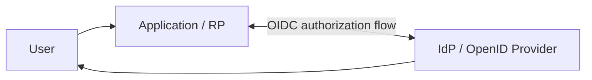
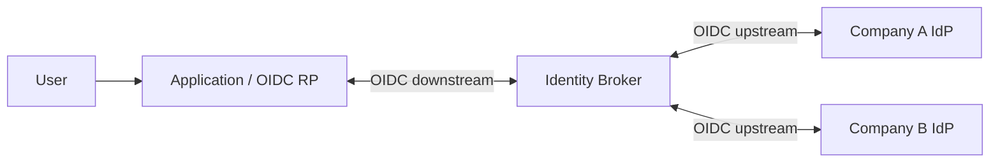
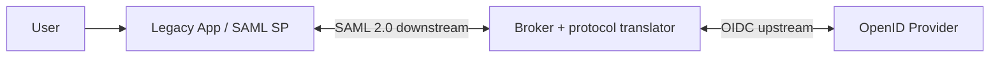
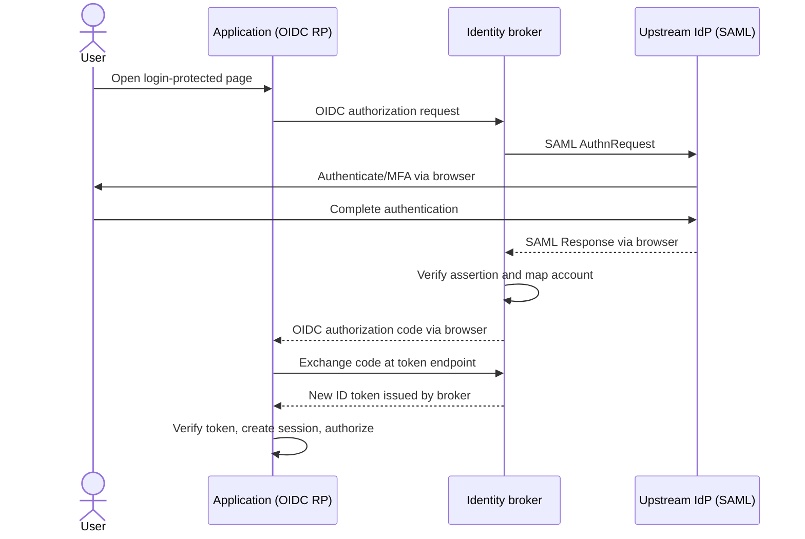

# Distinguishing Identity Federation, Identity Brokering, and Protocol Translation

## Learning Objectives

After this lesson, you will be able to:

1. Accurately explain **identity federation**, **identity brokering**, and **protocol translation** in the context of Single Sign-On (SSO).
2. Identify direct login models between applications and identity providers (IdPs), brokered models, and models using different protocols on each side.
3. Identify the roles of IdP, Relying Party (RP), Service Provider (SP), broker, and the boundaries of authentication, sessions, trust, and tokens/claims.
4. Explain why a broker must **verify inbound evidence and then issue new outbound evidence**, why you cannot merely convert JWT/XML formats, and how to protect account mapping.
5. Choose the right architecture when integrating Spring Security applications with multiple IdPs or heterogeneous SAML/OIDC systems.

## 1. Context: What Problem Does SSO Solve?

**Single Sign-On (SSO)** allows users to leverage a single authentication or existing authenticated session at a login system to access multiple trusted applications according to each application's policy. For example, an employee logs into the corporate portal and then opens the reporting system without re-entering a password.

SSO is the **desired experience/outcome**; federation, brokering, and protocol translation are **distinct architectural concepts** that can work together to produce that experience.

A login flow may involve:

- **End-User:** the subject requesting login.
- **Identity Provider (IdP):** system authenticating the user and issuing authentication/identity evidence.
- **Relying Party (RP):** application trusting an OpenID Provider via **OpenID Connect (OIDC)**.
- **Service Provider (SP):** application receiving and verifying assertions from a **SAML 2.0 IdP**.
- **Browser:** handles redirects and relays certain login responses; not the party verifying identity.
- **Broker (if present):** intermediary system sitting between multiple upstream IdPs and downstream applications.

Distinguish **authentication** (who this person is, how they were authenticated) from **authorization** (what this person is allowed to do in the application/API). Successful SSO login does not automatically grant admin privileges or access to all data.

## 2. Three Concepts: Nature, Roles, and Differences

| Concept | Question it answers | Nature | Is an intermediary required? | Is protocol switching required? |
| --- | --- | --- | --- | --- |
| **Identity federation** | "How can application A trust an identity authenticated by domain/system B?" | Trust relationship and process for sharing authentication evidence across identity-management domains | **No.** RP/SP can work directly with the IdP | **No.** Both sides can use OIDC or both use SAML |
| **Identity brokering** | "How does an intermediary layer connect multiple IdPs to one or more applications?" | **Architecture/component** acting as intermediary to authenticate upstream and provide identity downstream | **Yes, by definition of a broker** | **No.** A broker can use OIDC on both sides |
| **Protocol translation** | "How do two systems with incompatible protocols/evidence types connect?" | **Semantic bridging function across protocols**, with verification and re-issuance | Usually performed at a broker/gateway/adapter | **Yes**, since the goal is connecting two different protocols |

**Relationship between them:** a single solution can simultaneously be *federation + broker + translation*. However, not every federation needs a broker; not every broker translates protocols; and protocol translation is safe only when backed by proper authentication, trust, mapping, and issuance mechanisms.

### 2.1. Identity Federation: Two Domains Trusting Each Other

For example, company X's HR portal trusts partner Y's IdP. Users authenticate at Y; portal X trusts the result only after verifying the OIDC/SAML response for exact issuer, intended recipient, signature, and protocol conditions.

- **Upstream IdP:** party issuing the authentication result.
- **Downstream RP/SP:** party receiving and validating the result.
- **Trust:** client registration or exchanging metadata/certificates/keys, endpoints, audience, redirect URI/ACS, and authentication policy.
- **Outcome:** the application recognizes an identity from an external domain and decides to create a local session.

Federation **does not mean** all systems share a user database, passwords, or session cookies. The RP may create a local account corresponding to the federated account, or perform just-in-time provisioning per its own policy.

### 2.2. Identity Brokering: A System Sitting in the Middle

An **identity broker** plays two roles across two separate relationships:

- **Toward the upstream IdP:** the broker behaves as an **RP** (if upstream is OIDC) or **SP** (if upstream is SAML).
- **Toward the downstream application:** the broker behaves as an **OIDC Provider/IdP** or **SAML IdP**, depending on the protocol used by the application.

The broker often provides a unified login address, selects the IdP by organization/tenant/domain or user choice, maps accounts, enforces login policies, and supplies a stable set of identifiers/claims to applications.

**The broker itself must also be trusted**: an application receiving an ID token **issued by the broker** checks the broker's issuer. That application does not automatically trust tokens issued directly by every upstream IdP.

Example: 12 internal applications only configure trust with one broker, while the broker connects to three member-company IdPs. When replacing one member's IdP, many changes can be isolated at the broker. In return, the broker becomes critical login infrastructure that must be secured, monitored, and designed for high availability.

### 2.3. Protocol Translation: Two Sides Using Different Standards

For example, a legacy system only supports **SAML 2.0**, while a new IdP only supports **OIDC**. The translator receives the OIDC login result in the upstream relationship, validates it, maps identity/semantics, and **issues a new SAML assertion** to the legacy SP in the downstream relationship.

Translation is work at the **security and semantic layer**, not a mechanical "convert JWT to XML" step:

- Input and output evidence have different issuers, audiences/recipients, signatures, lifetimes, and usage conditions.
- Attributes such as `sub`, `NameID`, email, groups, or MFA context may have different semantic models.
- The translator must establish two independent trust relationships, manage transaction state, and prevent replay/session confusion.
- Standards lack a 1:1 equivalent mapping for every feature; translate only what can be verified and attested.

## 3. Comparing Three SSO Diagrams

### Model A – Direct Federation, No Broker



1. The user opens the application.
2. The application sends a login request to the registered IdP.
3. The IdP authenticates the user; the application receives and verifies the result.
4. The application creates its own session and checks permissions when accessing resources.

Trust relationship: **application ↔ IdP**. Both sides directly speak the same protocol. There is no intermediary component minting new identities.

### Model B – Federation via Broker, No Protocol Switching



1. The application initiates OIDC login with the broker.
2. The broker selects IdP A or B and initiates **another upstream OIDC login**.
3. The broker verifies the upstream ID token/response and links the identity per policy.
4. The broker acts as an OpenID Provider downstream and issues a **new ID token** to the application.
5. The application validates the token signed by the **broker**, creates a session, and enforces permissions.

**OIDC → OIDC is still brokering.** There are two authentication sessions/relationships in distinct scopes, rather than simply relaying the raw upstream ID token to the application.

### Model C – Broker Also Performing Protocol Translation



1. The legacy app emits a SAML `AuthnRequest` to the broker (broker acting as **SAML IdP**).
2. The broker creates an OIDC authorization request to the upstream OP (broker acting as **OIDC RP**).
3. The user authenticates upstream; the broker receives an authorization code, exchanges it, and **verifies the ID token**.
4. The broker links the OIDC identity to an internal identifier and applies necessary policies/conditions.
5. The broker constructs a **new SAML assertion** with the broker as `Issuer` and exact `AudienceRestriction` and `Recipient` for the legacy SP, signed with the appropriate key.
6. The SP validates the SAML Response/assertion and creates a local login session.

The reverse direction **SAML upstream → OIDC downstream** is equally feasible: the broker acts as **SAML SP** toward the legacy IdP and **OIDC Provider** toward new applications. There is no mandatory requirement for all systems to migrate to one protocol simultaneously.

**Terminology note:** "OIDC federation" sometimes just refers to configuring RPs to trust an OP; "identity broker" refers to the intermediary role; "protocol bridge/adapter" usually emphasizes the standard-bridging function. Commercial product names vary, so examine **each connection's role and protocol** rather than relying solely on product naming.

## 4. Deep Dive Into a Brokered Flow: Each Side Is a Separate Transaction

Take the model **OIDC RP → OIDC Broker → SAML IdP**. The sequence can be represented as follows:



In practice, messages pass through the browser during the SAML/redirect steps; the diagram simplifies the path to highlight **which party issues/verifies**.

Three identities or identifiers must be distinguished:

1. **Upstream subject:** account confirmed by the SAML IdP, such as a persistent NameID or agreed immutable attribute.
2. **Broker subject:** local broker profile linked to one or more upstream identities via secure account-linking rules.
3. **Downstream subject:** `sub` issued by the broker to the OIDC application, which may be public or pairwise per RP.

These three identifiers **do not have to be identical**. What is mandatory is that the broker performs reliable, stable mapping without colliding identities when two IdPs issue matching names or emails.

### 4.1. Identity Mapping Example

| Side | Field | Illustrative value | Meaning |
| --- | --- | --- | --- |
| IdP A (OIDC) | `iss` | `https://idp-a.example.org` | Upstream issuing domain |
| IdP A (OIDC) | `sub` | `u-2048` | User identifier **within issuer A's domain** |
| Broker | Internal user ID | `account-761` | Linked profile at the broker |
| Broker (OIDC) | `iss` | `https://login.example.org` | Issuer trusted by the downstream RP |
| Broker (OIDC) | `sub` | `person-761` | Downstream identifier issued by the broker |
| Broker (OIDC) | `aud` | `portal-web` | Client/RP allowed to receive this ID token |

The downstream RP checks that the token has `iss=https://login.example.org` and `aud` contains `portal-web`; it does not accept an upstream token issued for the broker merely because that token has a valid signature.

**The upstream linking key** must normally include issuer + subject (OIDC: `(iss, sub)`). In SAML, explicitly specify issuer + durable NameID/identifier attribute and qualifier/format per the IdP's configuration. Email is not guaranteed unique or immutable across domains; it may be reused or unverified. **Never automatically merge two sensitive accounts solely because of a matching email.**

### 4.2. What Does the Broker Verify Before Issuing New Evidence?

**Upstream OIDC:** validate authorization response per protocol, `state`, PKCE when applicable, client authentication/code exchange, signature and allowed algorithms, `iss`, `aud`, validity timestamps, and `nonce` when used; apply additional flow-specific checks. Use only issuers, endpoints, and keys provided by trusted configuration.

**Upstream SAML:** validate the appropriate signature on response/assertion, issuer, destination, audience, ACS/recipient, validity timestamps, `InResponseTo` when SP-initiated, freshness and replay protection, SubjectConfirmation conditions, and trusted metadata/certificates. Never accept XML merely because it contains a username or valid namespace.

**Downstream issuance:** the broker mints **new, audience-restricted evidence**, sets expiration, issuer, subject, audience/recipient, signs with the proper key, and handles transaction state correlation. The downstream RP/SP must verify this evidence independently.

Do not copy the upstream `aud` to downstream; the upstream ID token was issued **for the broker**. Likewise, do not elevate role/MFA attributes into higher-privilege claims without basis.

## 5. Semantic Translation: What Can and Cannot Be Translated?

A protocol translator needs a mapping table and trustworthy rules because SAML and OIDC differ structurally.

| Content | OIDC | SAML 2.0 | Requirements during translation |
| --- | --- | --- | --- |
| IdP identifier | `iss` | `Issuer` | Verify upstream source; issue **new** issuer (the broker) for downstream |
| User identifier | `sub` | `NameID` or stable attribute | Map via stable namespaced key; do not assume the two strings are equivalent |
| Receiving application | `aud` containing client ID | `AudienceRestriction`/`Recipient` for SP | Set fresh per **downstream** registration, never copy upstream audience |
| Attestation/integrity | ID token/JWS signature or flow-specific authentication | XML Signature on response/assertion per profile | Verify with upstream key; re-issue and sign with broker key |
| Validity window | `iat`, `exp`, other conditions | `Conditions`, `NotBefore`, `NotOnOrAfter` | Do not extend assurance level/past expiry; allow bounded clock skew |
| Time and auth method | `auth_time`, `acr`, `amr` (if present) | `AuthnInstant`, `AuthnContextClassRef` | Map only values with agreed semantics; never fabricate MFA |
| Attributes | OIDC claims like `email`, `name`, `groups` (if provided) | SAML Attributes | Map per trusted schema/source; minimize data and control permissions |
| Transaction state | `state`, `nonce`, authorization code, PKCE | `RelayState`, `AuthnRequest`/`InResponseTo` | Maintain correlation **independently per hop**, prevent CSRF, replay, mix-up |
| Logout | OIDC logout mechanisms depending on config/support | SAML Single Logout depending on implementation | Must actively design interoperability; no automatic 1:1 guarantee |

Some properties cannot be faithfully carried across: for example, if an upstream only confirms the user authenticated without strong proof of MFA, the broker **must not assert downstream that high-assurance MFA was achieved**. Policy may require re-authentication, step-up, or access denial if downstream conditions are unmet.

**Token exchange vs. protocol translation:** OAuth 2.0 Token Exchange (RFC 8693) defines how to swap one security token for another at an authorization server under supported conditions. That does not by itself provide an OIDC ↔ SAML bridge, create browser SSO sessions, or solve identity mapping. Dedicated design per use case is required.

## 6. Real-World Architectural Examples

### Case 1 – Two Applications and One IdP, Both Using OIDC

`https://portal.example.org` and `https://reports.example.org` both configure OIDC directly with `https://login.example.org`. No separate broker is needed. SSO comes from the session at the shared IdP; each application creates its own session and checks its own permissions.

**Classification:** direct federation + SSO; **no broker; no protocol translation.**

### Case 2 – One Application Serving Multiple Enterprise Customers

A SaaS application needs to log in customer A via OIDC, customer B via SAML, and customer C via another OIDC system. Instead of the application configuring and maintaining every IdP itself, the application trusts only the OIDC broker.

The broker selects the upstream IdP per tenant, verifies the result, links the account, and issues an OIDC token with the broker's issuer. Registered IdP/tenant choices must be restricted; never allow user-supplied arbitrary issuers to trick the system into trusting unfamiliar endpoints.

**Classification:** federation + identity brokering; includes protocol translation **for the SAML → OIDC connection**; the OIDC → OIDC connections are brokering only.

### Case 3 – Keeping a Legacy SAML SP While Modernizing the IdP to OIDC

A legacy ERP requires a SAML 2.0 SP. The company migrates to a new IdP supporting OIDC. The broker becomes the SAML IdP for the ERP and the OIDC RP for the new IdP; the legacy application needs no understanding of OIDC.

**Classification:** federation + brokering + OIDC → SAML translation. Clear certificates, entity IDs, ACS, NameID, AuthnContext, and SLO policies must be established.

### Case 4 – One Application with Two Social Login Buttons

A Spring Security RP directly configures two `ClientRegistration` entries for two OIDC providers and lets the user pick a login option. The application handles both login flows and maps users itself. **Simply offering multiple IdP choices does not turn an application into a downstream broker**, because it does not provide OIDC/SAML login services for other applications.

**Classification:** multiple direct federation relationships; not yet a dedicated broker or protocol translation.

## 7. Security Boundaries: Two Connections, Two Trust Anchors

With a broker, separate the two halves:

| Boundary | Who verifies? | Who issues evidence? | What must be configured |
| --- | --- | --- | --- |
| **Upstream: IdP → Broker** | Broker, acting as RP/SP | Upstream IdP | Issuer/Entity ID, client registration or metadata/certificates, callback/ACS, algorithms/keys, claims/identifiers, MFA policy |
| **Downstream: Broker → Application** | Application, acting as RP/SP | Broker, acting as IdP/OP | Broker Issuer/Entity ID, client/ACS, audience, token/assertion signature, endpoints, sessions, and permissions |
| **Application → API** (if any) | Resource Server/API | Authorization Server trusted per API model | Access token with right audience/scope, issuer, signature or introspection, resource-level authorization |

Three relationships may use three distinct tokens. **ID tokens** authenticate the End-User to an OIDC RP; **access tokens** target a Resource Server/API; **SAML assertions** are issued to an SP per SAML profile. Do not take an upstream ID token and stick it directly into the `Authorization: Bearer` header of a downstream API unless the API is explicitly designed and configured to accept that token type; normally the API must receive an access token with the right audience and permissions.

**Authorization does not automatically propagate across layers:** the broker may map `groups` into downstream claims, yet the application must validate their meaning and scope permissions at its own resources. An upstream source does not unilaterally decide who is admin across all RPs.

### 7.1. Session Types to Account For Separately

- **Upstream IdP session:** may allow SSO when the user returns to the IdP without re-entering a password.
- **Broker session:** allows the broker to remember transactions and linked identities, with its own lifetime/policy.
- **Downstream application session:** managed by each RP/SP; has its own cookies, timeout, and revocation mechanism.

Application logout does not automatically guarantee the user is logged out of the broker, upstream IdP, or other applications. OIDC logout and SAML Single Logout depend on per-party configuration/support and can fail partially. If system-wide logout is required, design and test every path explicitly rather than inferring it from clearing one cookie.

### 7.2. Account Lifecycle and Personal Data

Federation does not equal **provisioning**. Creating, deactivating, and synchronizing accounts may require separate workflows (such as SCIM or policy-driven sync). When an employee is locked upstream, downstream applications with active sessions need appropriate expiration/revocation/re-evaluation strategies.

Security rules for brokers:

1. Store identity links based on stable issuer-scoped upstream keys; allow multiple upstream identities to link to one user only through controlled workflows.
2. Isolate tenants; prevent tenant A's claims from mapping to tenant B's permissions.
3. Forward only necessary claims, complying with data and retention policies.
4. Audit login events, link changes, selected upstream source, auth failures, key changes, and critical permissions; never log raw tokens/secrets.
5. Manage secret/certificate/signing-key lifecycles, JWKS rollover, and secure metadata caching.
6. Test resilience: broker unavailability affects multiple apps; ensure HA, monitoring, and incident plans.

## 8. Where Does Spring Security Fit?

**Spring Security** provides features for Java applications to act as an **OIDC/OAuth Client**, **SAML 2.0 SP/RP**, or **OAuth 2.0 Resource Server**. They do not by default turn every application with a login page into an identity broker serving protocols to other applications.

| Need | Spring application role | Common components |
| --- | --- | --- |
| Web app logging in with an **OIDC broker** | Downstream OIDC RP | `oauth2Login()`, `ClientRegistration`/`OidcUser` |
| Web app logging in with a **SAML broker** | Downstream SAML SP/RP | `saml2Login()`, `RelyingPartyRegistration` |
| REST API accepting audience-matched access tokens | Resource Server | `oauth2ResourceServer(...)`, JWT decoder or appropriate introspection |
| Building a system acting as OP/authorization server | Party **issuing** tokens to other clients | Properly configured OIDC-capable Authorization Server |
| Building an **OIDC ↔ SAML translating broker** | Both upstream RP/SP and downstream IdP/OP | Requires a **broker/gateway platform** or full custom implementation of roles, state, issuance, metadata, and policies; `oauth2Login()`/`saml2Login()` alone are insufficient |

### 8.1. Example: Spring Boot Application Logging In via an OIDC Broker

Suppose the broker is already configured as an OpenID Provider, and the application simply acts as an RP. This example is **part of a Spring Boot servlet project**, using Java 17+ and dependencies `spring-boot-starter-security` and `spring-boot-starter-oauth2-client`; the snippet itself is not a standalone program run with `javac`.

**File `WebSecurityConfig.java`:**

```java
import org.springframework.context.annotation.Bean;
import org.springframework.context.annotation.Configuration;
import org.springframework.security.config.Customizer;
import org.springframework.security.config.annotation.web.builders.HttpSecurity;
import org.springframework.security.web.SecurityFilterChain;

@Configuration
public class WebSecurityConfig {
    @Bean
    SecurityFilterChain securityFilterChain(HttpSecurity http) throws Exception {
        return http
            .authorizeHttpRequests(auth -> auth
                .requestMatchers("/").permitAll()
                .anyRequest().authenticated()
            )
            .oauth2Login(Customizer.withDefaults())
            .build();
    }
}
```

**File `application.yml` (illustrative addresses and client ID; replace with real registration):**

```yaml
spring:
  security:
    oauth2:
      client:
        registration:
          company-broker:
            provider: company-broker
            client-id: portal-web
            client-secret: ${OIDC_CLIENT_SECRET}
            scope: [openid, profile, email]
        provider:
          company-broker:
            issuer-uri: https://login.example.org/realms/workforce
```

How to read the example:

- `registrationId` is `company-broker`; the application trusts the **broker's issuer** at `issuer-uri`, rather than configuring trust directly with every upstream IdP.
- The IdP/broker must actually serve OIDC discovery for that issuer; client `portal-web` and its redirect URI must be properly registered at the broker.
- Spring Security defaults to callbacks like `{baseUrl}/login/oauth2/code/{registrationId}`; in real deployments, register the exact callback, use HTTPS, and configure proxy/base URL properly.
- The client secret comes from an environment variable/secret manager; never place real values in the repository.
- The library runs the OIDC flow, verifies tokens per configuration, and creates `Authentication`. The application still needs business authorization and account/session management.
- This is a **downstream application** configuration; the broker runs in another system. This configuration does not allow the application to issue SAML assertions or new ID tokens to a second RP.

If downstream only supports SAML, the Spring application uses `saml2Login()` and configures `RelyingPartyRegistration` along with the broker's metadata/certificate in its SAML IdP role. You cannot just rename the method and reuse the OIDC `issuer-uri`.

### 8.2. Team Design Review Example

Suppose a team proposes: "Use `oauth2Login()` to receive OIDC from the IdP, then pass that raw ID token to the legacy SAML app; treat that as protocol translation."

This proposal is **invalid** because:

- The SAML application expects a **SAML Response/assertion**, and will not accept an OIDC ID token.
- The upstream ID token has `aud` set to the token-receiving client (the broker), not the SAML SP.
- Successful upstream login does not automatically produce a durable subject, claim mapping, SAML conditions, signature, session/correlation, and policy trusted by the SP.
- A component acting as a real SAML IdP downstream is required, issuing a fresh response/assertion after verifying and mapping the upstream result.

The proper solution is using a broker supporting both protocols with both trust relationships fully configured, or designing an equivalent component with proper security verification.

## 9. Architecture Selection Checklist

| Requirement indicator | Suitable approach | What to verify |
| --- | --- | --- |
| One or a few apps sharing OIDC with one IdP | **Direct federation** | Client registration, issuer, redirects, keys, account mapping |
| Multiple tenants/IdPs; apps want a single identity hub | **Broker** | Home realm discovery/routing, tenant isolation, linked identities, HA, audit |
| Legacy SAML app must use an OIDC-only IdP | **Broker + OIDC → SAML translation** | Downstream SAML IdP, claim/NameID mapping, metadata, signatures, ACS |
| New OIDC app must use a SAML-only IdP | **Broker + SAML → OIDC translation** | Upstream SAML SP, downstream OIDC issuer/client, subject mapping |
| Only need REST APIs validating permissions with JWT access tokens | **Resource Server** | Issuer, audience, scope/authority; do not infer SSO login from access tokens |
| Need to sync account creation/deletion, groups, and user lifecycle | **Additional provisioning/identity lifecycle** | SCIM/sync, deprovisioning workflow, still-active sessions |

### Pre-Production Broker Checklist

- **Trust:** every upstream/downstream has its own issuer, client ID/entity ID, audience, endpoints, and verification keys/certificates.
- **Routing:** every request binds to the right tenant and trusted upstream; prevent mix-up, open redirects, and rogue IdPs.
- **Binding:** responses correlate to the initial request via `state`/`nonce`/PKCE or `InResponseTo`/`RelayState` per protocol.
- **Identity:** stable linked-account rules, never blindly merge by email, policies for renamed/locked accounts.
- **Claims:** groups, roles, `acr`/`amr`/AuthnContext mapped only when semantics are guaranteed, without privilege escalation.
- **Session/logout:** explicitly define sessions at upstream, broker, and RP, plus behavior on timeout, logout, and token revocation.
- **Operations:** high availability, monitoring, limiting sensitive info in logs, key rotation, and per-hop failure testing.

## 10. Common Misconceptions

| Statement | Verdict | Reason |
| --- | --- | --- |
| "To use federation, you must have a broker." | **False** | An RP/SP can federate directly with an IdP. |
| "A broker always translates from SAML to OIDC." | **False** | An OIDC → OIDC broker is completely valid; translation is an optional function as needed. |
| "With a broker, downstream apps may trust every upstream token." | **False** | Downstream normally trusts only evidence issued by the broker for that exact RP/SP. |
| "Converting a JWT token to XML is enough for protocol translation." | **False** | Requires verification, transaction state, subject/claim mapping, issuance, and signing a new assertion. |
| "If the broker logged the user in, the app needs no permission checks." | **False** | Authentication and authorization are two separate decisions. |
| "If two IdPs return the same email, it's definitely the same user." | **False** | Must use issuer-scoped stable identifiers and safe account-linking mechanisms. |
| "Logging out at an RP definitely logs out the upstream IdP and all RPs." | **False** | Sessions and logout are managed per party and per protocol. |
| "`oauth2Login()` automatically creates an OIDC Provider for other apps." | **False** | That is the RP/OAuth client side, not downstream identity-issuing infrastructure. |
| "SSO, federation, and brokering are three names for one thing." | **False** | SSO is the experience; federation is the trust relationship; broker is the intermediary component/architecture. |

## 11. Knowledge Self-Check

**Question 1.** App A is an OIDC RP, and IdP X issues ID tokens directly to A. Is there a broker or translation?

**Answer:** There is **direct federation**; there is no broker and no translation since both sides use OIDC.

**Question 2.** A trusts only issuer B. B in turn authenticates users via OIDC at IdP X or IdP Y, then issues a new token to A. What model is this?

**Answer:** **Identity brokering**, along with federation relationships on each side. Since both sides use OIDC, **no protocol translation is needed**.

**Question 3.** A legacy SAML SP sends an AuthnRequest to a broker; the broker authenticates against an OIDC OP. Who signs the SAML assertion that the SP will verify?

**Answer:** The broker in its **downstream SAML IdP** role, using the signing key the SP has established trust in. It must verify the upstream OIDC result before issuing its own assertion.

**Question 4.** Why shouldn't an upstream ID token be sent directly to a downstream RP, even when both use OIDC?

**Answer:** The upstream token normally has issuer and audience meant for the **broker**, differing from the trust relationship with the downstream RP; it may also carry unsuitable subject, claims, and conditions. The broker must validate the upstream token and issue a fresh token with appropriate downstream issuer/audience/sub and policy.

**Question 5.** If the IdP provides no MFA proof, may the broker emit an "MFA verified" claim to the RP?

**Answer:** **No**, unless the broker has sufficiently strong independent authentication proof or a genuine step-up mechanism meeting the requirement. Never transform claims to inflate assurance levels merely by renaming fields.

**Question 6.** A Spring Security app uses `oauth2Login()` and configures two ClientRegistrations for two IdPs. Does it automatically become a broker?

**Answer:** **Not yet.** That is still an RP application with two direct login relationships. Only when it exposes downstream identity services to other applications with full issuance and trust relationships does it act as a broker.

## Summary

Three concepts to remember via **one architecture check question**:

- **Federation:** who **trusts identities** authenticated by whom?
- **Brokering:** who **sits in the middle connecting** identity systems and applications?
- **Protocol translation:** who **verifies and re-issues evidence** so two sides speaking different protocols can communicate?

They can appear together in one SSO flow, yet do not replace each other's meaning. In Spring Security, identify whether an application acts as an **RP/SP**, **Resource Server**, or is building **OP/IdP/broker** infrastructure before choosing mechanisms and configuration.

### References

- [Spring Security – OAuth 2.0 Login](https://docs.spring.io/spring-security/reference/servlet/oauth2/login/index.html)
- [Spring Security – SAML 2.0 Login](https://docs.spring.io/spring-security/reference/servlet/saml2/login/)
- [OpenID Connect Core 1.0](https://openid.net/specs/openid-connect-core-1_0.html)
- [OAuth 2.0 Token Exchange – RFC 8693](https://www.rfc-editor.org/rfc/rfc8693)
