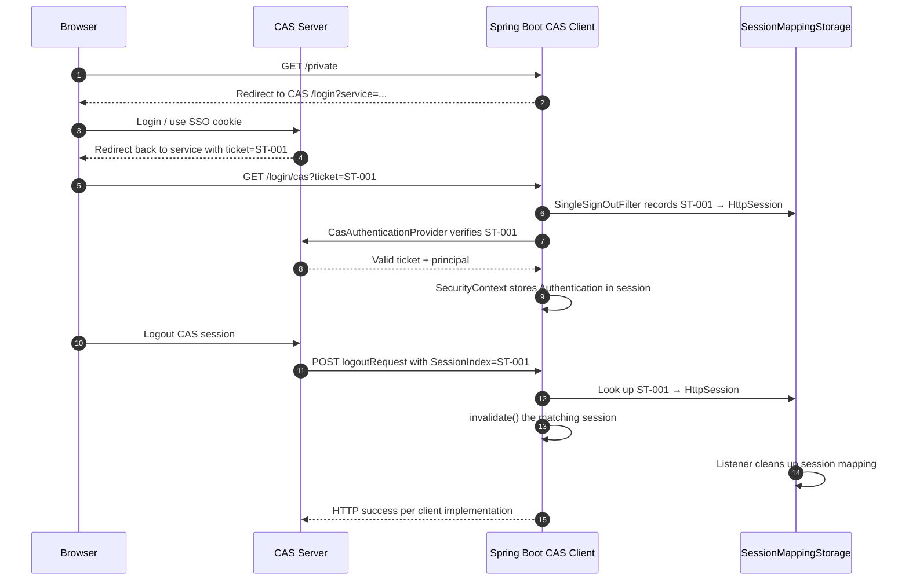
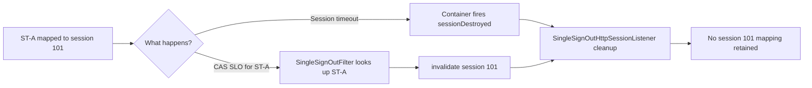

# SingleSignOutFilter, Listener, and Client Library Support Components

## 1. Problem: CAS SSO can leave multiple application sessions alive

A user logs in via **Central Authentication Service (CAS)** and accesses three Spring Boot applications: Portal, Reports, and Admin. The CAS server maintains the user's **SSO session**; each application maintains its own **`HttpSession`** and `SecurityContext`. When the user logs out of CAS, if the applications do not handle **Single Logout (SLO)**, sessions in Portal or Reports can remain valid even though the central SSO session has ended.

**CAS Single Logout does not mean the CAS server directly deletes every application's cookies or sessions.** CAS dispatches **logout notifications** to CAS clients, while each application must locate the right local session and **invalidate that session**. With Apereo Java CAS Client, the primary components are:

- **`org.apereo.cas.client.session.SingleSignOutFilter`:** detects the CAS Service Ticket in login requests, records the ticket → HTTP session mapping, then receives logout notifications and requests invalidation of the recorded session.
- **`org.apereo.cas.client.session.SingleSignOutHttpSessionListener`:** cleans up mappings when a servlet session naturally expires or is invalidated via another path.
- **`SingleSignOutHandler`** and **`SessionMappingStorage`:** internal/infrastructure components responsible for correlating tickets with sessions and handling logout.
- **Spring Security CAS filters/handlers:** validate the Service Ticket at login, clear `SecurityContext` on local logout, or initiate redirecting the browser to CAS `/logout` when policy requires.

This lesson explains in detail the **roles, filter ordering, Servlet/Boot configuration, mapping lifecycle, callback security, testing, and multi-replica operation** in a Spring Security CAS context. Domain names `example.test` and Service Tickets `ST-...` in examples are not real accounts or infrastructure.

### Learning outcomes

1. Distinguish **application logout**, **CAS SSO logout**, **CAS Single Logout**, and **Spring Security SAML2 Logout**.
2. Explain accurately why both `SingleSignOutFilter` **and** `SingleSignOutHttpSessionListener` are required.
3. Understand that `SessionIndex` in CAS SLO is normally the **CAS Service Ticket ID**, **not the Servlet session ID**.
4. Configure Apereo Java CAS Client in the proper order before authentication filters and avoid duplicate registration in Spring Boot.
5. Know the `artifactParameterName`, `logoutParameterName`, `logoutCallbackPath` parameters and compatible library versions.
6. Verify back-channel POST, front-channel, CSRF, cookies, reverse proxies, session fixation, and multi-replica behavior.
7. Write a standalone Java 17 example simulating mapping + cleanup + duplicate notifications and understand its limitations.
8. Build a test matrix proving sessions are invalidated without accidentally destroying another user's or tenant's session.

## 2. Four different logout actions

| Action | Initiated by | Which session is definitely affected? | Condition to affect other sessions |
| --- | --- | --- | --- |
| **Local logout** | Browser → `POST /logout` at app A | A's Spring/Servlet session per logout handlers | None; CAS TGT and app B may remain |
| **CAS logout** | Browser → `https://cas.example.test/cas/logout` | SSO session/Ticket Granting Ticket at CAS | CAS must send SLO notifications and clients must process them |
| **CAS Single Logout** | CAS → services A/B via callback | App session matching the CAS Service Ticket in the mapping | Service registered, message received, mapping intact, and invalidation succeeds |
| **Spring Security SAML2 SLO** | SAML SP/IdP using `saml2Logout`/`LogoutResponse` | Depends on SAML2 profile | Do not use CAS's `SingleSignOutFilter` as a substitute |

The same CAS server can support the CAS protocol, SAML2, and OIDC. However, **CAS-protocol SLO** is its own flow: even though the message is represented as **XML `<samlp:LogoutRequest>`**, the application must not install Spring Security `.saml2Logout()` to receive it.

**UX nuance:** after local logout, the browser can revisit Portal and be automatically logged back in by CAS via a non-expired SSO cookie. That is the expected consequence of local logout. To end the SSO session, initiate CAS logout per policy and handle notifications across participating applications.

## 3. Two independent session stores: CAS TGT and application HttpSession

```text
Browser
  |-- Cookie of cas.example.test (TGC) --> CAS server
  |                                         -> TGT/SSO session
  |
  |-- Cookie of portal.example.test ------> Portal HttpSession A
  |
  |-- Cookie of reports.example.test -----> Reports HttpSession B
```

- **Ticket Granting Cookie (TGC):** cookie allowing CAS to associate the browser with a TGT, typically sent only to the **CAS domain**.
- **Ticket Granting Ticket (TGT):** SSO state managed by CAS; never handed to Portal/Reports as an app session credential.
- **Service Ticket (ST):** issued by CAS for a specific `service` during app login; the client validates it with CAS and it is normally **single-use**.
- **Application session:** `HttpSession` managed by each servlet application, residing in local JVM memory or Spring Session/Redis.

When the TGT expires or is destroyed, CAS cannot directly invoke `session.invalidate()` inside Portal's JVM. CAS must **send an SLO message** so Portal can look up the session previously bound to that ST and invalidate it locally.

Conversely, if Portal calls `session.invalidate()` on its own, the CAS TGT is not automatically destroyed. This asymmetry explains why both **CAS-initiated** and **application-initiated logout** must be handled.

## 4. CAS login flow and recording the Service Ticket → session mapping

Common back-channel SLO scenario:



The diagram shows **logical responsibilities**. Exact ordering of mapping, session fixation strategy, success/failure handlers, and request dispatch may vary by Spring Security/CAS Client release. Therefore test SLO end-to-end after upgrading the CAS client or changing session storage.

### Why does the mapping use the ST rather than the username?

A user can hold **multiple applications and multiple sessions**. If a logout callback only carried `user-123` and the app picked sessions by username, it could invalidate the wrong session or every session of another tenant.

CAS-protocol SLO uses the **Service Ticket ID** as the correlation key to the HTTP session created when that ticket passed through. That is why `SingleSignOutFilter` must run early enough to observe requests with `ticket=ST-...`, **before** the filter completing CAS authentication.

## 5. SingleSignOutFilter actually handles two request types

Per Apereo Java CAS Client, `SingleSignOutFilter` receives requests and delegates to `SingleSignOutHandler`:

**A. Request carrying a CAS ticket artifact:**

```http
GET /login/cas?ticket=ST-ONE-TIME-EXAMPLE HTTP/1.1
Host: portal.example.test
```

The handler obtains the request's `HttpSession` (respecting `eagerlyCreateSessions` configuration) and records the mapping:

```text
"ST-ONE-TIME-EXAMPLE" -> Browser's HttpSession at Portal
```

This is an **internal application mapping**, not ticket validation. An invalid ST still needs verification by the CAS provider; `SingleSignOutFilter` seeing the token **is insufficient to authenticate the user**. When validation fails, the app must avoid retaining unnecessary state for too long; listeners/cleanup and security handlers help manage the lifecycle.

**B. Request carrying a Single Logout notification:**

```http
POST /login/cas HTTP/1.1
Host: portal.example.test
Content-Type: application/x-www-form-urlencoded

logoutRequest=URL_ENCODED_CAS_LOGOUT_XML
```

The handler reads `logoutRequest` and parses `SessionIndex` to retrieve the **Service Ticket ID**:

```text
SessionIndex=ST-ONE-TIME-EXAMPLE
  -> SessionMappingStorage remove(ST-ONE-TIME-EXAMPLE)
  -> HttpSession.invalidate()
  -> SecurityContext/session state is no longer usable
```

Per the Java CAS Client source, after handling the logout callback the handler **does not forward the request down normal business filters**. The key deployment detail is registering the servlet filter **before the Spring Security filter chain** so back-channel POSTs are not accidentally blocked by CSRF or a login redirect before the CAS client handles them.

**Do not write a custom `@PostMapping("/login/cas")` endpoint to parse XML and delete sessions** when already using the CAS library. It can conflict on the same route with `CasAuthenticationFilter` and bypass the mapping and supporting components.

## 6. logoutRequest payload and the meaning of SessionIndex

The CAS server can send **SAML-shaped LogoutRequest** XML over the **CAS protocol back-channel**:

```xml
<samlp:LogoutRequest
    xmlns:samlp="urn:oasis:names:tc:SAML:2.0:protocol"
    xmlns:saml="urn:oasis:names:tc:SAML:2.0:assertion"
    ID="_logout-example-01"
    Version="2.0"
    IssueInstant="2026-11-07T04:00:00Z">
    <saml:NameID>user-123</saml:NameID>
    <samlp:SessionIndex>ST-ONE-TIME-EXAMPLE</samlp:SessionIndex>
</samlp:LogoutRequest>
```

This is an **illustrative structure**, not a message to send to a live system. The CAS server wraps it in the `logoutRequest` request parameter, typically form-encoded XML on a back-channel POST.

| Field | Role | Do not confuse with |
| --- | --- | --- |
| `ID` | Logout message ID | Service Ticket / JSESSIONID |
| `IssueInstant` | Timestamp when the message was issued | Web session expiration time |
| `NameID` | User identity per CAS SLO payload | Unique session lookup key |
| **`SessionIndex`** | **ST ID used at login** per CAS SLO | `HttpSession#getId()` or a SAML2 SessionIndex from a separate SAML login |
| `logoutRequest` | HTTP parameter name carrying the message | `ticket` in CAS login |

**Key point to remember:** in CAS SLO, `SessionIndex` is used to correlate **CAS Service Ticket → HttpSession**. It is not the servlet session ID and not the `JSESSIONID` cookie value.

Never take `NameID` and delete all sessions sharing that username. Never stuff an app-invented session ID into `SessionIndex`, because the CAS client follows its own contract.

## 7. What does SingleSignOutHttpSessionListener do?

`org.apereo.cas.client.session.SingleSignOutHttpSessionListener` is a **Servlet `HttpSessionListener`** responsible for **cleaning up mappings when a session is destroyed or expires**.

Example lifecycle:

1. User enters Portal with `ST-A`; the SLO filter records `ST-A → session-101`.
2. Session-101 expires due to `server.servlet.session.timeout`.
3. The Servlet container fires `sessionDestroyed`.
4. `SingleSignOutHttpSessionListener` triggers cleanup of mappings associated with session-101.
5. If CAS later sends SLO for ST-A, the mapping is already gone; the handler **cannot mistakenly destroy a new session**.

The listener is equally important when a session is invalidated by **local logout**, session fixation policy, or business logic.

**The listener does not replace the filter:** the listener only receives lifecycle events emitted by the servlet container; it does not read `logoutRequest` and has no knowledge of CAS logout while **the session is still active**. If you register only the listener and forget the filter, back-channel CAS SLO will neither find nor invalidate the app session.

**The filter does not replace the listener:** if you register only the filter without the listener, the mapping can hold stale references/session IDs longer than needed, causing memory leaks or delayed/incorrect cleanup. Spring Security CAS docs require pairing both components together.

## 8. Supporting components and responsibility boundaries

| Component | Package / module | Responsibility |
| --- | --- | --- |
| `SingleSignOutFilter` | `org.apereo.cas.client.session` / Apereo cas-client-core | Intercepts requests with `ticket` and logout notifications |
| `SingleSignOutHandler` | `org.apereo.cas.client.session` | Detects requests, records mappings, looks up `SessionIndex`, and destroys sessions |
| `SessionMappingStorage` | CAS client session package | Mapping contract between CAS ticket ↔ Servlet session |
| `HashMapBackedSessionMappingStorage` | CAS client session package | Default/common in-memory mapping implementation |
| **`SingleSignOutHttpSessionListener`** | CAS client session package | Cleans up mappings when `HttpSession` ends |
| `CasAuthenticationFilter` | `org.springframework.security.cas.web` | Receives/authenticates with CAS ST |
| `CasAuthenticationProvider` | `org.springframework.security.cas.authentication` | Verifies ST against CAS and creates Spring Authentication |
| `CasAuthenticationEntryPoint` | `org.springframework.security.cas.web` | Redirects unauthenticated browsers to CAS login |
| `SecurityContextLogoutHandler` | Spring Security | Clears authentication, `SecurityContext`, invalidates session per config |
| `LogoutFilter` | Spring Security | Coordinates local logout or custom CAS logout initiation |
| `FilterRegistrationBean` | Spring Boot Servlet | Registers Servlet Filter and execution order |
| `ServletListenerRegistrationBean` | Spring Boot Servlet | Registers HttpSessionListener |
| `Spring Session` | Separate extension | Replaces session storage; **does not automatically make default CAS mappings distributed** |

Two integration styles exist for CAS Client: **pure Apereo Servlet filters** or **Spring Security CAS** combined with select Apereo filters. Do not "throw in all filters from both styles" if they process login/tickets redundantly, unless ordering and responsibilities are explicitly designed.

## 9. Why is filter ordering essential?

Per Spring Security CAS docs, `SingleSignOutFilter` must be placed **before `CasAuthenticationFilter`**. When using Apereo CAS Client as Servlet filters, the Java CAS Client documentation requires `SingleSignOutFilter` **before the authentication/validation filters**.

Example desired order:

```text
HTTP request
  → CharacterEncodingFilter (UTF-8)
  → SingleSignOutFilter (ticket mapping + logoutRequest)
  → Spring Security FilterChainProxy
      → CasAuthenticationFilter / other security filters
      → AuthorizationFilter
  → Spring MVC / controller
```

Meaning:

- On a login callback with `ticket=ST-...`, the mapping must be recorded **before the request is consumed/redirected by the CAS auth filter**.
- On a CAS back-channel POST, the filter should process `logoutRequest` before the web chain's `CsrfFilter` or `ExceptionTranslationFilter` returns 403/302.
- If the logout request reaches a controller and returns 404, CAS may treat the notification as unhandled.
- `CharacterEncodingFilter` UTF-8 running early prevents reading/parsing form bodies with the wrong encoding.

**Do not rely solely on `@Order` placed on a `@Component`** when multiple `FilterRegistrationBean`/`SecurityFilterChain` beans exist. Container-level servlet filter ordering and security filter ordering **inside `FilterChainProxy` are two separate levels**; inspect the effective chain.

### Avoid registering the filter twice

If you declare a `@Bean SingleSignOutFilter`, also create a `FilterRegistrationBean` for that same filter, and simultaneously call `http.addFilterBefore(...)`, the filter risks executing twice. Use **one consistent registration strategy**: either a Servlet `FilterRegistrationBean` **or** a filter inside the security chain at a verified position; the configuration below chooses a **single Servlet `FilterRegistrationBean`**.

## 10. Traditional web.xml: configuring both filter and listener

If the Servlet application is deployed using `web.xml`, configure per Apereo Java CAS Client:

```xml
<!-- CharacterEncodingFilter should run before the CAS SLO filter. -->
<filter>
  <filter-name>encoding</filter-name>
  <filter-class>
    org.springframework.web.filter.CharacterEncodingFilter
  </filter-class>
  <init-param>
    <param-name>encoding</param-name>
    <param-value>UTF-8</param-value>
  </init-param>
  <init-param>
    <param-name>forceEncoding</param-name>
    <param-value>true</param-value>
  </init-param>
</filter>
<filter-mapping>
  <filter-name>encoding</filter-name>
  <url-pattern>/*</url-pattern>
</filter-mapping>

<filter>
  <filter-name>casSingleSignOut</filter-name>
  <filter-class>
    org.apereo.cas.client.session.SingleSignOutFilter
  </filter-class>
  <init-param>
    <param-name>artifactParameterName</param-name>
    <param-value>ticket</param-value>
  </init-param>
  <init-param>
    <param-name>logoutParameterName</param-name>
    <param-value>logoutRequest</param-value>
  </init-param>
  <init-param>
    <param-name>logoutCallbackPath</param-name>
    <param-value>/login/cas</param-value>
  </init-param>
</filter>
<filter-mapping>
  <filter-name>casSingleSignOut</filter-name>
  <url-pattern>/*</url-pattern>
</filter-mapping>

<listener>
  <listener-class>
    org.apereo.cas.client.session.SingleSignOutHttpSessionListener
  </listener-class>
</listener>
```

**This is a `web.xml` fragment**, not a complete XML descriptor. Add CAS authentication filters/Spring Security container setup appropriate for your application. `SingleSignOutFilter` must be mapped to `/*` so it sees **both logins carrying `ticket`** and **logout POSTs**.

If you map the filter only to `/cas/logout/callback`, it **may miss login requests and fail to record mappings**. Keep the global mapping and narrow the notification endpoint via `logoutCallbackPath` when supported by your version. Keep this URL path aligned with the CAS service registry.

### CAS service used to receive SLO

By default, CAS can send the logout POST to the service URL seen at login. With the `/login/cas` example, setting `logoutCallbackPath=/login/cas` makes sense if CAS actually posts there. If CAS is configured with a dedicated `logoutUrl` like `/internal/cas/slo`, declare the matching callback path **while keeping the filter mapped to `/*` to capture STs**.

## 11. Key configuration parameters of SingleSignOutFilter

Per Apereo Java CAS Client documentation, typical init params:

| Init param | Default documented in README | Effect |
| --- | --- | --- |
| `artifactParameterName` | `ticket` | Parameter name carrying the CAS Service Ticket |
| `logoutParameterName` | `logoutRequest` | Parameter name containing the SLO message |
| `relayStateParameterName` | `RelayState` | Supports certain SAML-related flows |
| `eagerlyCreateSessions` | `true` | Upon seeing a ticket, may eagerly create an `HttpSession` to record the mapping |
| `artifactParameterOverPost` | `false` | Rules for accepting ticket artifacts over POST per library |
| `logoutCallbackPath` | Unset | Restricts the path accepting logout **POSTs** per implementation, instead of scanning all form POSTs |

### Risks of eager session creation

`eagerlyCreateSessions=true` is convenient: when a request carries a CAS ticket without an existing session, the filter can create a new session to record the mapping. However, creating sessions before authentication:

- Can spawn many unauthenticated sessions if a public endpoint receives bogus tickets.
- Requires request/session rate limits and safe logout handling.
- Must be tested against Spring Security's **session fixation strategy**, because authentication success can change the session ID or swap sessions.
- If set to `false` and no session exists when the ticket arrives, **there will be no mapping for SLO to find later**.

**Do not set `eagerlyCreateSessions=false` purely to save memory while assuming SLO still holds.** Sessions must be created at the right time and E2E-tested before/after CAS login.

### Consistency with CAS Server

If CAS sends the `logoutRequest` field while the client changes it to `casLogoutPayload`, the filter may miss the message. If the CAS ticket parameter is not `ticket` (e.g., `SAMLart` in SAML 1.1 CAS Client mode), configure it consistently across authentication/validation and the SLO filter. **Do not change parameters arbitrarily** without distinguishing CAS protocol, CAS SAML 1.1, and SAML2 Web Browser SSO.

## 12. Spring Boot 3.x/Java 17: registering Servlet Filter + Listener

The example below can **compile/start inside a Spring Boot Servlet project configured with Gradle and compatible dependencies**, illustrating CAS SLO wiring. It **does not perform full CAS login on its own**: a real SSO app requires `CasAuthenticationFilter`, `CasAuthenticationProvider`, `ServiceProperties`, `CasAuthenticationEntryPoint`, or another CAS client mechanism, plus a live CAS server/registered service.

### 12.1. Dependencies

In `build.gradle` of a Spring Boot 3.x project with Java 17+, repositories, and Boot dependency management, add:

```groovy
dependencies {
    implementation "org.springframework.boot:spring-boot-starter-web"
    implementation "org.springframework.boot:spring-boot-starter-security"
    implementation "org.springframework.security:spring-security-cas"

    // Choose a CAS Java Client with jakarta.servlet for Spring Boot 3.
    // Version 4.1.0 is a 4.x CAS client release; check your actual
    // deployment's BOM, advisories, and compatible version.
    implementation "org.apereo.cas.client:cas-client-core:4.1.0"
}
```

**Important version note:** Spring Boot 3.x uses **`jakarta.servlet.*`**, whereas older CAS client code may use `javax.servlet.*`. Those two namespaces are not interchangeable. Use only a CAS client version with a compatible Servlet/Jakarta API and resolve transitive dependencies via your project BOM. `4.1.0` is an **example release** in the 4.x family, not a claim that it is the latest at all times.

### 12.2. Wiring class

Save at `src/main/java/demo/cas/SloWiringApplication.java`:

```java
package demo.cas;

import java.util.Map;

import org.apereo.cas.client.session.SingleSignOutFilter;
import org.apereo.cas.client.session.SingleSignOutHttpSessionListener;

import org.springframework.boot.SpringApplication;
import org.springframework.boot.autoconfigure.SpringBootApplication;
import org.springframework.boot.web.servlet.FilterRegistrationBean;
import org.springframework.boot.web.servlet.ServletListenerRegistrationBean;
import org.springframework.context.annotation.Bean;
import org.springframework.core.Ordered;
import org.springframework.web.bind.annotation.GetMapping;
import org.springframework.web.bind.annotation.RestController;

@SpringBootApplication
@RestController
public class SloWiringApplication {

    public static void main(String[] args) {
        SpringApplication.run(SloWiringApplication.class, args);
    }

    @Bean
    FilterRegistrationBean<SingleSignOutFilter> casSloFilter() {
        FilterRegistrationBean<SingleSignOutFilter> registration =
                new FilterRegistrationBean<>();
        registration.setFilter(new SingleSignOutFilter());
        registration.setName("casSingleSignOutFilter");

        // Needs to observe both login tickets and logoutRequest.
        registration.addUrlPatterns("/*");

        // Servlet filter order, runs before Spring Security.
        registration.setOrder(Ordered.HIGHEST_PRECEDENCE + 10);

        registration.setInitParameters(Map.of(
                "artifactParameterName", "ticket",
                "logoutParameterName", "logoutRequest",
                "logoutCallbackPath", "/login/cas",
                "eagerlyCreateSessions", "true"));

        return registration;
    }

    @Bean
    ServletListenerRegistrationBean<SingleSignOutHttpSessionListener>
    casSessionListener() {
        return new ServletListenerRegistrationBean<>(
                new SingleSignOutHttpSessionListener());
    }

    @GetMapping("/")
    public String home() {
        return "CAS SLO filter/listener wiring sample";
    }
}
```

Explanation:

- Uses `FilterRegistrationBean` rather than `http.addFilterBefore` to ensure the CAS SLO filter is a **Servlet filter outside the security chain** in this sample. Do not register the same filter again.
- `Ordered.HIGHEST_PRECEDENCE + 10` places it very early; verify `CharacterEncodingFilter` runs **earlier** and the Spring Security filter chain runs **after** CAS SLO.
- `addUrlPatterns("/*")` is necessary to record the mapping when the CAS Service Ticket arrives on `/login/cas`, even if the CAS logout callback is configured on a separate path.
- `logoutCallbackPath` restricts which POST path is treated as SLO. In the example, CAS must send `POST /login/cas`. If a context path is configured, the value is normally the **path within the context**; test against your actual implementation/version.
- `ServletListenerRegistrationBean` registers the listener to clean up mappings on `sessionDestroyed`. It does not require a `@Controller` to handle SLO.
- `GET /` only confirms the app started; **it does not prove SLO works** without CAS auth and a CAS server.

**Deployment compatibility:** if the application already uses `cas-client-support-springboot` with `@EnableCasClient` or auto-config that registers SingleSignOutFilter/listener, **do not add the two beans above a second time**. Inspect which filters/listeners are actually created by your starter/version before manual wiring.

### 12.3. Running the wiring demo

In a Gradle Boot project with a wrapper and proper dependency resolution:

```bash
./gradlew bootRun
```

Visit the home page:

```text
GET /  ->  CAS SLO filter/listener wiring sample
```

This is the HTTP body output of `GET /` once the app starts, **not a CAS login/SLO result**. Real CAS SSO requires configuring CAS client authentication, a trusted `https://cas.example.test/cas`, `ServiceProperties.service`, ticket validation, public login URL, and a registered service on the CAS Server.

## 13. Integrating Spring Security CAS without duplicating responsibilities

In an application with CAS login already configured via Spring Security, the components typically include:

```text
CasAuthenticationEntryPoint
  -> redirects browser to CAS /login

CasAuthenticationFilter
  -> receives ticket at /login/cas

CasAuthenticationProvider
  -> verifies Service Ticket with /serviceValidate or /proxyValidate
  -> creates CasAuthenticationToken and SecurityContext

SingleSignOutFilter (Apereo)
  -> records ST → HttpSession and handles logoutRequest

SingleSignOutHttpSessionListener (Apereo)
  -> cleans up mapping across session lifecycle
```

**Do not replace `CasAuthenticationFilter` with `SingleSignOutFilter`.** The CAS SLO filter does not check passwords or validate ST values; it only manages mappings/notifications. `CasAuthenticationProvider` validates the ticket with CAS.

Spring Security CAS docs show an XML configuration using:

```xml
<security:http entry-point-ref="casEntryPoint">
    <security:logout logout-success-url="/signed-out"/>
    <security:custom-filter
        ref="singleLogoutFilter" before="CAS_FILTER"/>
</security:http>

<bean id="singleLogoutFilter"
      class="org.apereo.cas.client.session.SingleSignOutFilter"/>
```

This is a **Spring Security XML configuration snippet** (a historical option)—do not use it concurrently with `FilterRegistrationBean` in section 12. Even when a filter is placed before `CAS_FILTER` **inside** the security chain, ensure CAS back-channel POSTs are not blocked by preceding security filters. Placing the servlet filter outside the chain is often easier to observe in Spring Boot.

If using Spring Security 6.x with Java DSL, keep working ST authentication intact and **add exactly one pair of SLO filter/listener**. Never invent new auth paths or alter logout policy just to fix a mapping issue.

## 14. Local logout and CAS logout initiation are two separate paths

A "Log out" button in an application can serve two purposes:

**A. Application-only logout:** calls `POST /logout` via Spring Security `LogoutFilter`, `SecurityContextLogoutHandler` clears SecurityContext and invalidates `HttpSession`. `SingleSignOutHttpSessionListener` cleans up the ST→session mapping. The CAS TGT remains; subsequent login may proceed without a password.

**B. Full CAS SSO logout:** after clearing the local session, redirects the browser to **CAS Server `/cas/logout`** so CAS destroys the TGT and broadcasts notifications to other services. The app needs a fixed/allowlisted redirect URL policy and must never accept an arbitrary `next=https://evil.test`.

Spring Security CAS docs show a dedicated `requestSingleLogoutFilter`, which is an **`org.springframework.security.web.authentication.logout.LogoutFilter`** configured to redirect the browser to CAS logout:

```xml
<bean id="requestSingleLogoutFilter"
      class="org.springframework.security.web.authentication.logout.LogoutFilter">
  <constructor-arg value="https://cas.example.test/cas/logout"/>
  <constructor-arg>
    <bean class=
      "org.springframework.security.web.authentication.logout.SecurityContextLogoutHandler"/>
  </constructor-arg>
  <property name="filterProcessesUrl" value="/logout/cas"/>
</bean>
```

This is a **historical Spring XML fragment showing how to send the user to CAS logout**, not code to add simultaneously if the app already has a logout initiation flow. That historical snippet does not automatically guarantee CSRF protection on custom URLs in every config; in modern Spring Boot, **make the user logout trigger a CSRF-protected POST** and define a success handler redirecting to a fixed CAS URL after local cleanup.

**Do not confuse browser-initiated `POST /logout/cas` with `POST /login/cas` carrying `logoutRequest` from the CAS server.** Both may be POSTs, yet their origin, target, and protection mechanisms differ.

## 15. SingleSignOutHttpSessionListener and sessionDestroyed

A Servlet `sessionDestroyed` event can originate from:

- Session timeout/idle expiry.
- `HttpSession.invalidate()` on local logout.
- The CAS SLO filter calling invalidate upon receiving a matching SessionIndex.
- Session fixation protection invalidating an old session and creating a new one, depending on strategy.
- Servlet container shutdown/redeployment with implementation-specific lifecycle semantics.

The listener's goal is mapping cleanup; it **does not automatically log out the CAS session**.



**Idempotency:** once a session is invalidated, a repeated CAS SLO callback must not accidentally destroy another session; the mapping is already removed or the session is invalid. Handle `IllegalStateException`/session-not-found as normal during concurrent windows without creating a new authenticated session.

**Memory hygiene:** mappings retain `HttpSession` references if the listener is not registered properly or the app fails to release state. A large number of timed-out sessions can grow memory usage without cleanup.

## 16. Session fixation and Session ID changes after CAS login

Spring Security provides **session fixation protection** mechanisms:

- `changeSessionId()`: rotates the ID in modern servlet containers.
- `migrateSession()` or `newSession()`: may create a new session/invalidate the old one per policy/version.
- `none()`: no session fixation protection (not the recommended default).

The CAS SLO mapping may be recorded **when the request carrying the ST hits the filter**, before Spring Security finishes authentication. If the app subsequently swaps sessions, verify that CAS client storage still points to **the active HttpSession**.

Risk example:

```text
1. Filter maps ST-1 → oldSession
2. Spring Security invalidates oldSession and creates newSession
3. Listener removes mapping ST-1
4. CAS posts LogoutRequest SessionIndex=ST-1
5. Client cannot find newSession; user may remain authenticated
```

Do not "solve" this by unconditionally disabling session fixation protection; that weakens login security. Choose a compatible strategy, verify the CAS client version and session mapping lifecycle, and run an integration test:

1. CAS login to a protected route.
2. Record **only hashed/truncated diagnostics** of the session ID before and after authentication.
3. Trigger logout from the CAS Server.
4. Access the protected route using the old browser cookie.
5. Confirm no authenticated SecurityContext remains.

Many setups work with `changeSessionId()`, yet never assume every session store/library handles the lifecycle identically. Answer these questions by testing on your pinned container, Spring Security, and CAS client versions.

## 17. CAS back-channel vs. front-channel

CAS can emit SLO notifications using two mechanisms, configured on the CAS registered service:

| Mechanism | Who actually sends the HTTP request to the app? | Common HTTP method | Requirements |
| --- | --- | --- | --- |
| **Back-channel** | CAS server | Form **POST** with `logoutRequest` | CAS has network reachability to app, filter parses body; no browser cookie needed |
| **Front-channel** | Browser orchestrated by CAS | May be **GET/JSONP** or iframe depending on release | Browser policies, third-party cookie/cross-site restrictions, matching client support |
| **Local logout** | Browser at application | POST to app logout | CSRF token and session cookie per policy |

CAS 7.x/8.x docs describe `logoutType=BACK_CHANNEL` as the common/default type for registered services, alongside `FRONT_CHANNEL` or `NONE`. **Do not assume every CAS Java Client version supports front-channel identically**: the Java CAS Client README explicitly notes checking client support when choosing propagation type.

Back-channel is usually easier to reason about since the CAS server sends the request directly, though it requires ingress/firewall/reverse proxies to allow CAS callbacks. Front-channel is affected by browser privacy, CORS/iframe/JSONP policies, and can fail even when CAS SSO has ended.

**Never use `SameSite=None` to fix a server-to-server back-channel missing a session cookie.** Back-channel needs no browser cookie; it relies on the stored ST→HttpSession mapping. If the callback arrives yet cannot find the session, check storage/lifecycle/replicas first.

## 18. CAS registered service: logoutType and logoutUrl

CAS normally sends callbacks to the service URL recorded when issuing the ticket. A **dedicated logout path** can be configured per registered service, for example:

```json
{
  "@class": "org.apereo.cas.services.CasRegisteredService",
  "serviceId": "^https://portal\\.example\\.test/.*",
  "name": "portal",
  "id": 123,
  "logoutType": "BACK_CHANNEL",
  "logoutUrl": "https://portal.example.test/internal/cas/slo"
}
```

This is a **CAS service registry JSON example**—do not assume the class name and regex above are valid for every storage backend/JSON serializer/release. Cross-check your running CAS server version and registered-service schema.

If CAS calls `https://portal.example.test/internal/cas/slo`:

- Apereo `SingleSignOutFilter` should **still be mapped to `/*`** to observe `?ticket=...` at login.
- `logoutCallbackPath` in the filter must reflect `/internal/cas/slo` if that feature is used.
- Ingress/WAF must forward CAS's **POST body**.
- The callback must not return a login redirect or get blocked earlier by Spring Security.
- Protect callback invocation rights and caller validation per architecture.

If CAS registers `logoutType=NONE` for the service, a client with an SLO filter/listener **will not automatically receive notifications from CAS**. If CAS sends only front-channel while the client handles only back-channel, fix protocol compatibility rather than increasing session timeout.

## 19. CSRF with logoutRequest: do not disable it app-wide

A CAS back-channel POST typically carries no browser session cookie and does not know the application's CSRF token. If the request traverses Spring Security's `CsrfFilter` like a normal form POST, it may get **403** before the SLO handler processes it.

Preferred approach in Spring Boot examples:

1. Register `SingleSignOutFilter` at the **Servlet filter layer before Spring Security** so it receives/consumes CAS `logoutRequest` on the right route.
2. Ensure callbacks are not mangled by WAF/ingress/body parsers.
3. Retain CSRF protection for **forms/APIs using browser sessions**.
4. If it cannot be handled at an earlier filter layer, configure a **CSRF exception solely for the exact callback path** per the security threat model; never ignore `/api/**` broadly or disable CSRF app-wide.
5. Do not let the callback path also handle side-effecting business POSTs; separate endpoints whenever possible.

**Never turn the CAS callback into a "permitAll and invalidate every session by username" route.** Allowing the back-channel route does not mean every body is trustworthy; enforce origin controls and exact mappings.

### Authenticity of the CAS logout request

Do not **assume by default** that a classic CAS client verifies a **mandatory XML signature** on every `logoutRequest`: CAS-protocol SLO transmits SAML2-shaped XML, yet trust/signature mechanics can differ from SAML2 Single Logout. Many client implementations simply extract `SessionIndex` and look up the mapping without verifying an XML signature in every deployment. Make sure to:

- Accept callbacks only over HTTPS from the CAS server/trusted network policy, preferring mTLS or gateway authentication when supported by deployment.
- Restrict the callback URL, HTTP method/body/size, rate limits, and redacted logging.
- Check what your CAS release and client source/API actually validate rather than assuming signatures exist.
- Never destroy sessions based on a self-declared username in the request; use only the ticket mapping recorded by the client.
- If stronger defense against forged logout requests is required, add gateway/caller authentication or a protocol with properly validated signed logout assertions.

A forged notification can cause **forced logout/denial-of-service**, though it usually does not directly grant login access.

## 20. Parsing, body streams, and character encoding issues

`logoutRequest` usually arrives in a form POST request, e.g., `application/x-www-form-urlencoded`. Some middleware **reads the raw request body before the filter**, or vice versa, preventing the body/input stream from being read again. The CAS Java Client README documents `logoutCallbackPath` to restrict where logout params are read and avoid interfering with other form posts.

Checklist of things to verify:

- `CharacterEncodingFilter` UTF-8 runs first.
- Request `Content-Type` and payload match the client library/version.
- If a JSON body parser/request-wrapper exists, does it interfere with `getParameter("logoutRequest")`?
- Does the WAF strip XML namespaces/parameters or reject form POSTs?
- Does `logoutCallbackPath` match the effective servlet path after context path/rewrites?
- Does the client check GET vs. POST on different paths? Do not assume identical behavior if source/version does not support it.
- Are XML parser safety/size limits enabled to prevent entity expansion/DoS on untrusted data?

**Never "debug" by logging the full `logoutRequest`.** The XML contains the principal and `SessionIndex`; raw logs risk leaking identities/correlation tickets.

## 21. SessionMappingStorage and multi-replica deployments

Spring Security CAS docs describe how `SingleSignOutFilter` uses an application mapping (in historical examples, a **static Map**) and calls `HttpSession.invalidate()` upon receiving a logout message. This causes issues across multiple replicas:

```text
                   Public HTTPS Host
                          |
                     Load Balancer
                  +-------+-------+
                  |               |
               Pod A            Pod B
                  |               |
   Login ST-7 -> map ST-7       SLO POST arrives
                 to session A    (map ST-7 absent)
                  |               |
                  +-------+-------+
                          |
                    Redis Sessions?
```

**Spring Session Redis only shares HTTP session state; it does not automatically prove the CAS client's in-memory ST→HttpSession mapping is shared.** If a CAS SLO POST lands on pod B while the ST→session mapping lives on pod A, the callback may return 200 while the session remains active in Redis or on pod A.

Options to evaluate:

- Move mappings into **cluster-suitable storage** with atomic lookup, TTL, session-ID mapping, and session revocation semantics. Check which extensions your CAS client API/version supports; do not assume a static HashMap attaches to Redis via a property alone.
- Use **sticky routing** if topology permits, though CAS server-to-server callbacks may **carry no browser sticky cookie**, so delivery to the right pod is not guaranteed.
- Use a **central SLO gateway** that receives callbacks and marks sessions revoked in shared state enforced by each pod; this is a custom design requiring security review.
- If sessions reside only in-pod and ingress routes accurately, account for session loss on restarts, duplicate callbacks, and registered CAS URLs.
- Emit telemetry for mapping misses, session invalidation successes/failures, CAS callback failures, and TTL cleanup.

**Never store pod A's Java `HttpSession` object directly in Redis**: servlet container session objects are not a safe cross-pod serialization contract. Distributed mappings generally store session IDs/revocation state and coordinate with Spring Session APIs per version rather than serializing session objects.

## 22. One callback does not necessarily "log out everything"

CAS SLO is best-effort depending on service health, network, and client libraries. A successful callback at Portal does not prove:

- Other apps (Reports/Admin) received or succeeded on their callbacks.
- The browser deleted all application cookies.
- Long-lived API tokens/OAuth access tokens issued by other systems were revoked.
- Active WebSocket connections or running server-side jobs stopped.
- An upstream IdP in a CAS-as-broker setup logged out.
- Documents open in the browser were closed or safely saved.

**CAS is not a central session manager for every application.** CAS manages SSO/TGT and attempts to send notifications; each application must manage its own sessions, and destroying a session does not automatically close every open connection.

Distinguish **"CAS SSO session ended"**, **"notification delivered"**, **"mapping found"**, and **"local session invalidated"** on operational dashboards. Avoid UI messages confidently stating "logged out of all applications" when only CAS logout was invoked.

## 23. Standalone Java 17: simulating ST → session mapping and listener cleanup

The program below **runs on Java 17+ with no Spring/CAS dependencies**, verifying session mapping rules and duplicate notifications. It does not verify STs, parse CAS XML, run a servlet filter, or call a CAS server; it uses **test values** and models the logic after the protocol layer receives a ticket/notification.

Save `SingleLogoutMapDemo.java`:

```java
import java.util.Map;
import java.util.concurrent.ConcurrentHashMap;
import java.util.concurrent.atomic.AtomicBoolean;

public final class SingleLogoutMapDemo {

    record Session(String id, AtomicBoolean active) {
        Session(String id) {
            this(id, new AtomicBoolean(true));
        }

        void invalidate() {
            active.set(false);
        }
    }

    private final Map<String, Session> byServiceTicket =
            new ConcurrentHashMap<>();

    // Illustrates the filter observing the ticket at the CAS login callback.
    void onValidatedLogin(String serviceTicket, Session session) {
        if (serviceTicket == null || serviceTicket.isBlank()
                || session == null) {
            throw new IllegalArgumentException("Missing mapping");
        }
        byServiceTicket.put(serviceTicket, session);
    }

    // Illustrates a callback carrying SessionIndex equal to the Service Ticket.
    boolean onCasLogout(String serviceTicket) {
        Session matched = byServiceTicket.remove(serviceTicket);
        if (matched == null) {
            return false;
        }
        matched.invalidate();
        return true;
    }

    // Illustrates Servlet HttpSessionListener.sessionDestroyed.
    void onSessionDestroyed(Session ended) {
        byServiceTicket.entrySet().removeIf(
                entry -> entry.getValue() == ended);
    }

    public static void main(String[] args) {
        SingleLogoutMapDemo store = new SingleLogoutMapDemo();
        Session alice = new Session("session-a");
        Session bob = new Session("session-b");

        store.onValidatedLogin("ST-A", alice);
        store.onValidatedLogin("ST-B", bob);

        System.out.println("initial=" + store.byServiceTicket.size());
        System.out.println("logoutA=" + store.onCasLogout("ST-A"));
        System.out.println("aliceActive=" + alice.active().get());
        System.out.println("bobActive=" + bob.active().get());
        System.out.println("duplicateA=" + store.onCasLogout("ST-A"));

        store.onSessionDestroyed(bob);
        System.out.println("remaining=" + store.byServiceTicket.size());
    }
}
```

Compile and run:

```bash
javac SingleLogoutMapDemo.java
java SingleLogoutMapDemo
```

**Exact stdout:**

```text
initial=2
logoutA=true
aliceActive=false
bobActive=true
duplicateA=false
remaining=0
```

Meaning:

- `initial=2`: two Service Tickets were bound to two sessions.
- `logoutA=true`: CAS SLO for ST-A located session A.
- `aliceActive=false` while `bobActive=true`: session B was not mistakenly logged out.
- `duplicateA=false`: repeated callback does not find the already-removed mapping.
- `remaining=0`: the listener cleans up session B's entry when that session ends.

**Do not use this demo as a production implementation.** It lacks real filters/listeners, security binding between the CAS server and request, TTL, multi-ticket-per-session handling, shared cluster state, input bounds, and forged-request protection. `onValidatedLogin` is named for clarity; **a real `SingleSignOutFilter` may record the mapping before the CAS provider validates the ticket**, as discussed in section 5.

## 24. Required end-to-end tests

### A. Happy path

1. User opens Portal, gets redirected to CAS, and logs in.
2. Browser returns to Portal with `ticket=ST-...`.
3. CAS Client verifies the ticket; Spring Security creates an authenticated session.
4. `SingleSignOutFilter` recorded the ST mapping (per implementation).
5. User successfully accesses protected `/profile`.
6. Browser logs out at CAS `/cas/logout`.
7. CAS back-channel POST `logoutRequest` carrying `SessionIndex=ST-...` hits the right service/callback.
8. `SingleSignOutFilter` looks up the mapping and invalidates the matching session.
9. Browser sends the old Portal cookie back to `/profile`; no authenticated session remains.
10. `SingleSignOutHttpSessionListener` cleaned up the mapping; replaying the callback neither exposes nor affects other sessions.

### B. Negative tests and special environments

| Test | Expected result |
| --- | --- |
| POST `logoutRequest` before login ticket is recorded | No session found; no arbitrary session destroyed |
| Unknown ST in SessionIndex | Does not destroy anyone else's session |
| Same user holds two sessions with two different STs | Destroys only the mapped session, not by username |
| Repeated callback with the same SessionIndex | Idempotent; creates no authenticated session |
| CAS callback POST blocked by CSRF filter | Detects ordering/matcher bug without disabling CSRF site-wide |
| Filter registered after CAS auth filter | Test exposes mapping miss |
| Listener only, no filter | CAS SLO is never processed; setup test fails |
| Filter only, no listener | Session cleanup/memory test fails |
| Wrong `artifactParameterName` | Fails to record mapping for login ST |
| Wrong `logoutParameterName` | Fails to receive notifications |
| `logoutCallbackPath` mismatches CAS service registry | Notification goes unhandled |
| Callback lands on pod B while mapping is on pod A | Failover test exposes missing shared state |
| Spring Session Redis enabled with in-memory mapping | Never assume cluster SLO works automatically |
| Session fixation protection swaps session after CAS login | Mapping must still point to the active session |
| Session times out before SLO | Listener removed mapping; does not destroy another session |
| CAS server unreachable/disconnects | No notification received; retries/monitoring/policy handle it |
| CAS `logoutType=NONE` | No SLO callback sent; local sessions remain |
| CAS front-channel when client only supports back-channel | Tests protocol incompatibility |
| SLO request contains malformed/oversized XML | Does not crash app; bounded and logs redacted |
| Forged SLO request from the Internet | Origin restricted; cannot arbitrarily kill sessions |
| Local logout while CAS TGT remains | Re-login may happen automatically, documented accurately |
| WebSocket/background job continues after invalidation | Dedicated close/revocation mechanism if required by policy |
| OAuth access token remains valid despite CAS SLO | Confirm separate revocation policy; do not assume |
| Ingress returns 302/login page instead of 200 callback | Exposes callback intercepted by security chain |
| `SameSite=Lax` cookie in CAS back-channel | Not treated as the primary cause of server-to-server callback failure |
| User logs in successfully yet no mapping exists | Check `eagerlyCreateSessions`/filter ordering |
| CAS Service Ticket already validated once | Never re-run validation just to add a mapping |
| `javax.servlet` CAS client running on Spring Boot 3 | Dependency compatibility fails; choose Jakarta-compatible release |

### C. Testing with Spring Security

- **MockMvc** can verify local CSRF/logout and protected resources, yet does not prove the Servlet container registered the listener or that a CAS server delivered a callback.
- **Servlet integration tests** with `FilterRegistrationBean`, the listener, a CAS sandbox, and a real session store verify callback ordering and session invalidation.
- **Multi-replica E2E** must run through a real LB/proxy: login on pod A, callback on pod B, protected resource on pod C.
- Testing server authentication solely with `@WithMockUser` creates no CAS ST mapping and **does not prove `SingleSignOutFilter` works**.

## 25. Common errors and diagnostics

| Symptom | Possible cause | Where to inspect |
| --- | --- | --- |
| CAS logged out yet Portal stays authenticated | Missing filter/listener or missing mapping | Filter registrations and ST→session mapping |
| POST callback returns 403 | CSRF/web chain runs before SLO filter | Servlet filter order, callback matcher |
| POST callback returns 302 to CAS login | CAS auth entry point intercepted callback | Ensure SLO runs before auth |
| POST callback returns 404/405 | Wrong CAS `logoutUrl` or ingress | Public host/path, CAS registry, HTTP method |
| Session login works yet CAS logout misses mapping | Filter mapped only to callback path, missing ticket | Change filter mapping to `/*` and test ticket capture |
| Listener does not clean up | Unregistered or wrong servlet namespace | Servlet context events, listener registration |
| SLO mapping lost after login | Session fixation session replacement | Test mapping across login/`changeSessionId` |
| CAS server sends no callback | `logoutType=NONE`/wrong service registration | CAS registered-service config and logs |
| CAS front-channel fails on some browsers | Unsupported client, browser privacy policies | Use back-channel if appropriate |
| Callback reaches wrong pod | Per-JVM in-memory mapping | Cluster storage/revocation architecture |
| `logoutRequest` not received | Wrong param name/path/content-type/body wrapper | Compare CAS wire request and client init params |
| Wrong session destroyed | Custom mapping by user or missing namespace | Use proper ST mapping and tenant/session isolation |
| User logs out then auto-logs back in | Local logout only; CAS SSO cookie remains | Is the user flow calling CAS logout properly? |
| ST appears in logs | Full query param `ticket` logged | Redact access logs/APM, reduce raw query capture |
| App memory grows with logins | Mappings not cleaned up, listener missing | Memory profile, `sessionDestroyed`/TTL |
| Received 200 callback yet session remains | Session not found, filter still returned success | Trace invalidation, test protected route after SLO |
| Using `saml2Logout` instead of CAS filter | Confusing CAS-protocol SLO with SAML2 profile | Use the proper CAS client component |
| GET callback treated as business request | Front-channel client path differs from expected | CAS front-channel support and URL design |
| Internal port/hostname appears in logout URL | Wrong reverse proxy headers/base URLs | Public HTTPS service URL and proxy trust |

### Recommended logging level

Safe to log: CAS service name/registration, notification type, mapping hit/miss, session invalidation result, cluster node/internal correlation ID, HTTP status, source IP behind a trusted proxy. If tracing tickets, use a **salted/secret hash or system-generated short token**, never raw STs or SessionIndexes in logs.

Never log: raw `logoutRequest`, `ticket=ST-...`, `JSESSIONID` cookies, CAS TGT/TGC, credentials, user PII, or `SAMLResponse`. Configure access logs to strip/mask query strings carrying tickets.

## 26. Security: callback trust and preventing logout CSRF/DoS

An attacker may try sending forged POST `logoutRequest` payloads or guessing/harvesting a Service Ticket ID that previously appeared in a URL. Depending on CAS client/protocol version, callbacks may not always carry an XML signature verified by the library.

**Recommended controls:**

1. **Ingress allowlist** for CAS server source IP/network or mTLS, depending on infrastructure; never trust client-supplied `X-Forwarded-For`.
2. **HTTPS** end-to-end on public routes; verify certificate hostnames/trust and avoid downgrading to HTTP.
3. **Keep Service Ticket IDs out of logs/public output**; protect access/query logs, tracing, and error reports.
4. **Map sessions by ticket**, never by username or client-supplied sessionId.
5. **Fixed callback path**, form size limits, rate limiting, safe XML parser, reject malformed requests.
6. **Never disable CSRF app-wide**; process CAS protocol callbacks earlier or with narrow exceptions.
7. **Local logout still requires a CSRF token** with cookie-based authentication.
8. **Session keepalive/expiry** and mapping TTLs; monitor cluster-related mapping misses.
9. **Idempotent invalidation**, never creating a session while handling a notification.
10. **Threat model** for internal/broker setups: CAS logout does not automatically revoke JWTs/Refresh tokens or API sessions elsewhere.

**CAS SLO focuses on session invalidation, not authorization.** A bogus callback usually causes forced logout or DoS rather than unauthorized login; nevertheless it remains a significant availability and UX risk, particularly for financial or operational apps.

## 27. Practical configuration checklist

- [ ] CAS server protocol/release confirmed; SLO enabled globally and per-service `logoutType` set appropriately.
- [ ] CAS registered service `serviceId`, `logoutUrl`/service URL, and public HTTPS host/path are accurate.
- [ ] `SingleSignOutFilter` registered **once**, before CAS login/authentication filters.
- [ ] Filter mapped to `/*` so it sees requests carrying Service Tickets, not only logout callbacks.
- [ ] `SingleSignOutHttpSessionListener` registered **once** and cleans up on `sessionDestroyed`.
- [ ] `artifactParameterName=ticket` matches CAS login; if customized, configured consistently.
- [ ] `logoutParameterName=logoutRequest` matches the CAS server notification.
- [ ] `logoutCallbackPath` matches the path CAS server POSTs to when configured.
- [ ] `CharacterEncodingFilter` UTF-8 runs early; form body is not prematurely consumed by middleware.
- [ ] CAS back-channel POST passes through ingress/WAF and reaches the filter before CSRF/entry point.
- [ ] `HttpSession` remains the session mapped upon receiving the ST and after authentication.
- [ ] Session fixation protection stays active and post-login mappings stay accurate.
- [ ] Both session timeout and local logout trigger listener cleanup.
- [ ] Multi-replica setups do not rely blindly on static Maps or sticky browser cookies.
- [ ] Back-channel/front-channel chosen based on verified CAS client/version support.
- [ ] Forged XML logouts from untrusted networks are blocked; IP allowlist/mTLS/gateway applied where appropriate.
- [ ] No STs, raw logoutRequests, SessionIndexes, cookies, or PII in logs.
- [ ] Local logout and CAS logout initiation are clearly distinguished in UX.
- [ ] Protected resources require re-authentication after SLO, not merely an HTTP 200 callback response.
- [ ] CAS SLO is not confused with Spring Security SAML2 `saml2Logout`.
- [ ] Tests exist for duplicate notifications, missing mappings, wrong pods, session timeouts, and other users' sessions.
- [ ] API tokens/WebSockets/background jobs have separate revocation when required by policy.

## 28. Self-assessment questions

**1. Why are both SingleSignOutFilter and SingleSignOutHttpSessionListener needed?**  
The filter records/looks up ticket mappings and handles CAS notifications; the listener cleans up mappings when `HttpSession` ends, even outside CAS logout.

**2. What is SessionIndex in CAS SLO?**  
In the CAS protocol, it is usually the **Service Ticket ID** used to map to the application session, not `JSESSIONID`.

**3. Why must SingleSignOutFilter run before CasAuthenticationFilter?**  
To observe `ticket=ST-...` requests and record the mapping before downstream authentication/redirect steps consume the ticket.

**4. When CAS back-channel sends a POST without a browser cookie, is that normal?**  
Yes. The CAS server calls the app backend directly; the client looks up the session via the ST mapping without using a browser cookie on that callback.

**5. Does the listener call the CAS logout URL itself?**  
No. The listener handles `sessionDestroyed` and cleans up state; it does not initiate CAS logout.

**6. If only Spring Security `POST /logout` is called, does the CAS TGT expire?**  
Not by default. That is local logout; CAS SSO may remain active.

**7. If SingleSignOutFilter maps only `/internal/cas/slo`, does it still see login STs?**  
No, if the Servlet Filter mapping itself is narrowed. Keep the filter mapped broadly enough to see tickets, and use `logoutCallbackPath` to restrict the notification path.

**8. Why not use username to destroy sessions?**  
A user may have multiple sessions; the callback carries the Service Ticket ID to pinpoint the relevant session. Using username risks destroying the wrong session.

**9. Does Spring Session Redis automatically make SessionMappingStorage distributed?**  
Never assume so. The CAS client's in-memory map may remain per-JVM; a dedicated distributed design and tests are required.

**10. Why might POST logoutRequest get a 403?**  
If the CSRF filter runs before the CAS SLO filter or the callback path is not narrowly excluded. Never disable CSRF for the web app.

**11. If the callback returns HTTP 200 yet the session stays authenticated, what could be wrong?**  
Mapping not found, callback routed to another replica, listener/session fixation lost the mapping, or the filter handled the wrong route. Re-test a protected resource.

**12. Can Spring Security `.saml2Logout()` replace CAS SingleSignOutFilter?**  
No. Even though CAS-protocol SLO uses SAML LogoutRequest-shaped XML, it relies on the CAS client's own ticket mapping.

## 29. References

- [Spring Security — CAS Authentication, Single Logout](https://docs.spring.io/spring-security/reference/servlet/authentication/cas.html): `SingleSignOutFilter` before `CAS_FILTER`, `LogoutFilter`, `SingleSignOutHttpSessionListener`, local vs. CAS logout.
- [Spring Security 6.5 — CAS Authentication](https://docs.spring.io/spring-security/reference/6.5/servlet/authentication/cas.html): cross-check DSL and integration for Spring Security 6.x projects.
- [Apereo Java CAS Client — README, Configuring Single Sign Out](https://github.com/apereo/java-cas-client/blob/master/README.md): filter/listener, `artifactParameterName`, `logoutParameterName`, `eagerlyCreateSessions`, `logoutCallbackPath`, and ordering.
- [Apereo Java CAS Client — SingleSignOutHandler source](https://github.com/apereo/java-cas-client/blob/master/cas-client-core/src/main/java/org/apereo/cas/client/session/SingleSignOutHandler.java): `recordSession`, `SessionMappingStorage`, `destroySession` logic, and reading `SessionIndex`.
- [Apereo Java CAS Client — Releases](https://github.com/apereo/java-cas-client/releases): client releases and compatibility.
- [Apereo CAS 8.x — Logout and Single Logout](https://apereo.github.io/cas/8.0.x/installation/Logout-Single-Signout.html): back-channel/front-channel, `logoutType`, `logoutUrl`, SSO session vs. app session.
- [Apereo CAS — CAS Protocol Specification, Single Logout](https://apereo.github.io/cas/development/protocol/CAS-Protocol-Specification.html): CAS `/logout` and `LogoutRequest` XML examples.
- [Spring Boot — Servlet Filters and Listeners](https://docs.spring.io/spring-boot/reference/web/servlet.html): `FilterRegistrationBean`, `ServletListenerRegistrationBean`, and ordering.
- [Spring Security — Servlet Session Management](https://docs.spring.io/spring-security/reference/servlet/authentication/session-management.html): session fixation strategies and `SecurityContext`.
- [OWASP — Session Management Cheat Sheet](https://cheatsheetseries.owasp.org/cheatsheets/Session_Management_Cheat_Sheet.html): session invalidation, expiry, cookie handling.
- [OWASP — Cross-Site Request Forgery Prevention](https://cheatsheetseries.owasp.org/cheatsheets/Cross-Site-Request-Forgery_Prevention_Cheat_Sheet.html): local logout CSRF protection and narrowing callback exceptions.
