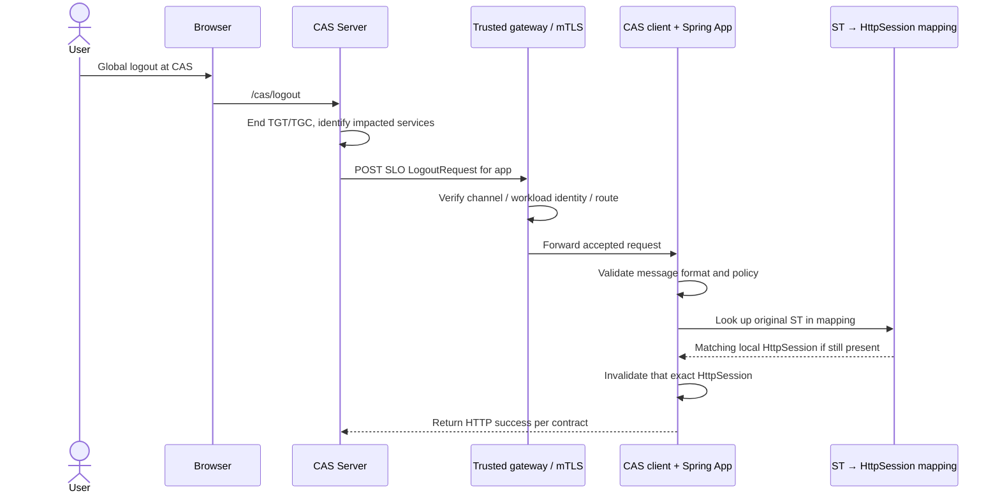
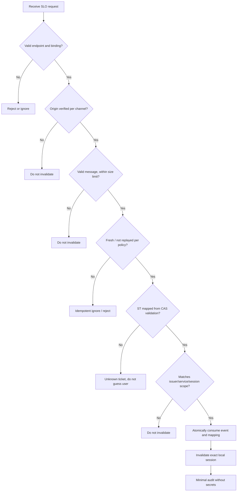

# Verifying Trust Conditions When Receiving Logout Notifications from CAS

**Topic:** Spring Security – federation → CAS Logout.  
**Scope:** **CAS native Single Logout (SLO)** when the CAS Server sends a session termination notification to a Java/Spring Security application; not to be confused with SAML2 Single Logout from a SAML Identity Provider or OIDC Back-Channel Logout.  
**Audience:** Java 17+, Spring Security Servlet/Jakarta, Apereo CAS Client, and multi-instance applications.

## Learning objectives

After this lesson, you will be able to:

1. Distinguish **application logout**, **CAS session logout**, **CAS SLO back-channel/front-channel**, and logout in other federation protocols.
2. Identify **trust conditions** before an application lets a CAS SLO notification invalidate a session: caller origin and transport channel, endpoint/binding, message structure, freshness/replay per policy, the **verified Service Ticket ↔ HttpSession** link, blast radius, and concurrency handling.
3. Recognize security limits: **XML named `samlp:LogoutRequest` is not inherently signed or origin-authenticated**, and `SessionIndex` in native CAS SLO usually represents the **Service Ticket ID**, not `JSESSIONID` or a SAML2 SessionIndex from another SP/IdP flow.
4. Place Apereo Java CAS Client's `SingleSignOutFilter` and `SingleSignOutHttpSessionListener` accurately, build trust boundaries ahead of the filter, and test forged requests as well.
5. Test safely for dropped logout notifications, duplicate deliveries, wrong-node routing, nonexistent tickets, or deliberate attempts to log out someone else.

**Core rule:** A CAS SLO notification is a **request that mutates login state**. Never trust it merely because it carries a `logoutRequest` parameter or SAML-like XML. The application must verify **who is authorized to request logout**, **exactly which session is affected**, **whether the message is valid**, and **whether handling is bounded and idempotent**.

## 1. Why do trust conditions matter?

When a user logs in via SSO:
- The CAS Server manages the **TGT/TGC**—the centralized SSO login session.
- Portal A validates **Service Ticket ST_A**, then creates and maintains Portal A's **own HttpSession**.
- Reports B may also hold its **own HttpSession**, under ticket ST_B.
- The CAS Server **does not directly own** A's or B's HttpSessions once authentication finishes.

If the user logs out at CAS, CAS can send SLO notifications to A/B asking them to invalidate their sessions. However, A's notification receiver URL is often an HTTP endpoint reachable by outsiders if ingress is misconfigured. An attacker could try sending:

```text
POST /login/cas
logoutRequest=<XML document crafted by the attacker>
```

If the app treats any body containing `LogoutRequest` as a trusted command, it risks:
- Causing **forced logouts** (logout denial of service) for other users if a ticket/session correlation key is known.
- Leaking session existence through differential responses.
- Consuming CPU/memory via huge XML payloads, entity expansion, or floods of forged notices.
- Mistakenly deleting all sessions sharing a username/tenant instead of only the ticket-bound session.
- Introducing CSRF, request routing, or trust-boundary confusion when mixing front-channel and back-channel.

**A forged logout usually does not directly give the attacker account access**, yet it remains an availability attack and can carry business impact; hence verifying the sender is a security requirement, not merely a safeguard against accidental logouts.

## 2. Four different "logout" operations

| Operation | Initiator | What ends | What is not automatically guaranteed |
| --- | --- | --- | --- |
| **Local application logout** | Browser/user or app | `SecurityContext`/`HttpSession` of **one application** | CAS Server TGT/TGC and other app sessions also ending |
| **CAS logout** | User at CAS `/logout` | CAS SSO session (TGT/TGC) per CAS policy | All local app sessions having been destroyed |
| **CAS Single Logout (SLO)** | CAS Server sends notifications to services | CAS asks apps to invalidate ST-bound sessions | 100% receipt/consumption of notifications by all apps |
| **SAML2/OIDC logout** | IdP/OP or RP per respective protocol | Per SAML2 SLO or OIDC logout token/session | Sharing the CAS native SLO parser/filter |

Per Apereo documentation, **CAS SLO is best-effort**: notifications may be dispatched asynchronously and fail at some apps while CAS logout still completes. Thus if security requires "locking a user out immediately across all apps", add compensating controls such as short session lifetimes, forced authentication, authorization lookup/revocation, and telemetry.

### 2.1. CAS native SLO is not SAML2 SLO

CAS native back-channel sends XML shaped like `samlp:LogoutRequest` with a `samlp:SessionIndex`. However, this is a **CAS SLO mechanism** documented separately by Apereo. Never infer that:
- The message has an XML Digital Signature just because its namespace is `urn:oasis:names:tc:SAML:2.0:protocol`.
- A `SAML2 LogoutRequest` signature policy can be applied verbatim to Java CAS Client `SingleSignOutFilter` without appropriate configuration/custom integration.
- `SessionIndex` here is a SAML AuthnStatement SessionIndex, `TGT`, or browser `JSESSIONID`.

**If integrating a SAML2 IdP** using Spring `saml2Login`, use the SAML2 SLO endpoint, metadata, issuer, signature, and logout-request validation of the SAML2 protocol. If using OIDC, validate `logout_token` per OIDC Back-Channel Logout; never apply those algorithms to a CAS native notification.

## 3. Back-channel vs. front-channel shapes how origin is verified

### 3.1. Back-channel: CAS Server → application via HTTP POST

Apereo CAS describes the traditional mechanism: the CAS Server directly sends an **HTTP POST** to the service URL collected during login, or to a registered service's dedicated `logoutUrl` if configured.



**Primary trust point:** a genuine request must originate from an **approved CAS Server** over a protected channel and route. Because CAS native SLO is not inherently signed, merely parsing XML and checking `IssueInstant` proves nothing; you need **transport/infrastructure-level origin authentication**, such as mTLS from the CAS workload with a gateway verifying client identity, or a tightly restricted private ingress paired with system controls.

**IP address alone is weak** if the app merely reads client-supplied `X-Forwarded-For`. If using an IP allowlist, control proxy hops and read peer addresses at a trusted termination point. For high sensitivity, mTLS/workload identity gives stronger origin proof than an unsigned custom `X-CAS-Logout: true` header.

### 3.2. Front-channel: browser sends GET/JSONP/iframe

CAS also offers front-channel per `logoutType` configuration: the browser sends requests to applications, for instance:

```text
GET https://portal.example.com/cas/slo
    ?logoutRequest=[Base64-encoded SLO XML]
    &callback=[JSONP-callback]
```

In this model, the request **comes from the browser**, not a direct TCP connection from the CAS Server. Therefore:
- You cannot require the browser's source IP to be the CAS Server IP.
- `Referer`, `Origin`, or a JSONP callback name are insufficient cryptographic proof that CAS initiated the event; they can be missing or manipulated.
- Modern browsers restrict third-party cookies and cross-site framing, so the callback may miss the right session and front-channel cannot reliably cover every browser.
- A JSONP callback is merely a transport/rendering interface, not a signature.
- Use front-channel only if the CAS client and security model truly support it and it has been tested. If authenticated server-to-server logout is required, **prefer back-channel** or adopt a protocol with proper message authentication.

**Never assume front-channel and back-channel share the same trust checks.** An edge mTLS policy enforced on back-channel **cannot** simply be imposed on browser GETs while expecting normal users to keep working.

### 3.3. Per-registered-service configuration

A registered service in CAS can declare `logoutType` as `BACK_CHANNEL`, `FRONT_CHANNEL`, or disabled, plus an optional `logoutUrl`. Illustrative **example fragment** (verify exact schema against your CAS release/registry backend):

```json
{
  "@class": "org.apereo.cas.services.CasRegisteredService",
  "serviceId": "^https://portal\\.example\\.com/login/cas$",
  "name": "portal",
  "id": 301,
  "logoutType": "BACK_CHANNEL",
  "logoutUrl": "https://portal.example.com/cas/slo"
}
```

If a separate `logoutUrl=/cas/slo` is set, the app must configure the filter to receive that request; **the filter must also observe successful ST login events** to build the ST → session mapping. Mapping the filter solely to the logout URL without tracking the login callback can lead to **finding no session to destroy**. At ingress, you can protect the `/cas/slo` route separately while still letting login requests pass through the internal filter.

## 4. Structure of a CAS native SLO message

Back-channel example per Apereo documentation:

```xml
<samlp:LogoutRequest
    xmlns:samlp="urn:oasis:names:tc:SAML:2.0:protocol"
    xmlns:saml="urn:oasis:names:tc:SAML:2.0:assertion"
    ID="_logout-3821"
    Version="2.0"
    IssueInstant="2026-11-07T03:10:00Z">
  <saml:NameID>alice</saml:NameID>
  <samlp:SessionIndex>ST-example-for-portal</samlp:SessionIndex>
</samlp:LogoutRequest>
```

**This is an unsigned sample, not a real signature-verified SAML2 request.** Values `ST-example-for-portal`/`alice` are educational data. Never send real requests to someone else's endpoint to "test".

| Field | Condition to check | Never assume |
| --- | --- | --- |
| `LogoutRequest` root | Matches the namespace/element supported by the CAS client | Merely containing the text "LogoutRequest" makes it valid |
| `ID` | Unique/non-empty; usable in a replay cache per contract | It proves by itself that CAS sent it |
| `Version` | Matches the supported CAS native SLO format | Every version or namespace should be parsed |
| `IssueInstant` | Parse UTC timestamp; bound skew and age if policy permits | A recent timestamp = a trusted sender |
| `NameID` | May appear; reference only per contract | It authorizes logging out **all** sessions of that username |
| **`samlp:SessionIndex`** | **Original CAS Service Ticket ID** to look up `ST → HttpSession` | It is `JSESSIONID`, TGT, a SAML2 IdP SessionIndex, or a global user logout key |
| XML signature | Verify only if the deployment/profile actually includes a signature and trust anchor | Native CAS SLO is signed by default |

**Never use `NameID` as the session-deletion key.** A user may have two browsers, two devices, or two CAS sessions open. A notice carrying a verified ST must affect **only its exact mapping**, not "log out all sessions of alice" via an unconditional SQL delete.

### 4.1. CAS SessionIndex is normally the Service Ticket ID

In CAS native SLO, the server can send `SessionIndex` as the **ST issued to the service at login**. For example:
- CAS issues `ST-portal-X` and A validates it successfully.
- Java CAS Client binds `ST-portal-X` → Portal A's HttpSession.
- CAS logout sends `SessionIndex=ST-portal-X`.
- A locates the session bound to that ticket and invalidates it.

The server does not need to know A's `HttpSession.getId()`, because the CAS Server does not own local sessions. **Never pass `SessionIndex` directly to `session.invalidate()`** as if it were a session ID. In the Servlet API, `invalidate()` is called on the exact `HttpSession` object retrieved from the mapping, or on the designated session store.

### 4.2. Scope: right app, right user, right login

A valid mapping must ensure:
- The ST passed **successful CAS validation** with the exact `service` at login.
- The mapping belongs solely to the **trusted CAS issuer/realm/service context**, never mixing multiple CAS servers.
- The session was created/registered after validation and was not switched to another user/account outside policy.
- On session expiration, local logout, session rotation, or app restart, the mapping is updated/removed appropriately.
- If the ST is absent from the mapping, **never search by username/email or substring** to pick a "close enough" session.

In a cluster, the HTTP node receiving SLO may differ from the node that created the ST mapping; use a shared session mapping/store or deliberate routing rather than guessing by a session ID CAS does not know.

## 5. Trust conditions before accepting SLO

Controls can be organized into **seven layers**. High-risk systems must enforce adequate controls for the chosen CAS mechanism; without origin proof on back-channel, a notification should not be treated as authenticated.

### Layer 1 – Exact endpoint and binding

- Receive on the path advertised by the CAS client/gateway; if a dedicated `logoutUrl` is set, CAS must use that exact URL.
- Back-channel is typically **POST** per CAS native spec; never accept GET as equivalent merely because it carries `logoutRequest` if config expects POST.
- Front-channel may use GET and Base64/JSONP per CAS client; enable explicitly and manage separately.
- Enforce bounded request body size and timeouts; check `Content-Type`/encoding matching the sender.
- Never conflate the SLO endpoint with user-facing `/logout` for local logout; the two actions have different threat models.

### Layer 2 – Caller origin is genuinely authenticated

**This is the primary boundary between "received XML" and "trusted CAS notification".**

For back-channel:
- Use HTTPS from CAS to ingress/application.
- Prefer **mTLS** or workload identity when infrastructure supports it: the edge verifies a client certificate belonging to an approved CAS workload/CA.
- Accept SLO only on a controlled ingress/private route from CAS/proxy; configure appropriate firewalls/network policies/service mesh rules.
- If relying on an IP allowlist, read peer IP at the trusted edge; **never** trust client-supplied `X-Forwarded-For` or `X-Real-IP` from the Internet.
- The edge strips/overwrites any source-identity headers before forwarding to the app; the app trusts only internal headers created by an **authenticated** edge.
- If using a custom signed-message mechanism, verify keys and bindings strictly per contract; **never assume** CAS native SLO carries a signature.

For front-channel, the browser is the transport, so CAS client mTLS or CAS source IP assumptions do not apply; consider disabling front-channel if strong origin assurance is needed and use a properly protected back-channel instead.

**Never use a shared secret in a query string or a homegrown `?trusted=true`** as the sole protection; URLs leak into logs. If implementing custom HMAC signatures, you need protected keys, timestamps, nonce/replay checks, and a reviewed spec—far better to avoid custom crypto when mTLS is available.

### Layer 3 – Valid XML/message, hardened parser

- Bound payload size (e.g., a few KiB policy matching real payloads), blocking oversized payloads.
- Parse XML with a trusted, **namespace-aware** library; never extract `SessionIndex` from raw bodies with regex.
- Disable external entities, DTDs, XInclude, and remote schema resolution; limit entity expansion and nesting depth.
- Validate root/namespace, proper `LogoutRequest` structure, and **a single** `SessionIndex` per implementation contract; reject ambiguous/multi-valued/empty values.
- Parse `IssueInstant` in UTC and check freshness when a skew/TTL policy aligned with the CAS Server is configured.
- Never fetch URLs/DTDs from the body or access the local filesystem.
- Never treat an arbitrary XML body as a logout request merely because an endpoint returned HTTP 200.

**Note:** Apereo Java CAS Client's parser/validator has version-specific behavior. Audit your running version; if stricter validation is required, enforce it in a reviewed prefilter/adapter rather than writing a regex parser and bypassing default client validation.

### Layer 4 – Freshness and replay, after origin verification

- `ID` and `IssueInstant` can detect replayed or stale notices **when your deployment guarantees those fields are present and stable**.
- Configure bounded clock skew with NTP, event TTL, and a consumed-ID cache scoped per trusted CAS issuer/service.
- Be idempotent: the same logout message arriving twice must neither destroy a new session nor crash the system.
- If a ticket was already processed and its mapping deleted, return a safe response without leaking account info; never resurrect the mapping.
- Never let the replay cache grow unbounded into a memory DoS; apply TTL/bounds and namespaced keys.
- **Without a signature or trusted origin, an attacker can still forge timestamps and IDs.** This is a defense-in-depth check, never a replacement for Layer 2.

### Layer 5 – Exact session correlation

- Use `SessionIndex=original ST` to find the session **recorded when that ST passed CAS validation**.
- Scope mappings to the exact CAS authority and service/tenant; never look up by email or `NameID`.
- If no mapping exists, **never delete another session**. Handle unknown tickets idempotently per policy.
- In multi-node setups, the mapping/session store must live on the right node or be shared; never assume an in-memory map works across pods.
- When Spring Security rotates the session ID for session fixation protection, correlation must still reach the live session object/store rather than a stale invalidated ID.
- If an app switches the user inside a session, update mapping/authority; never let a prior user's logout ticket kill a new user's session if a session is reused improperly.

### Layer 6 – Affect only authorized state

Once conditions are met, invalidate **only the exact local HttpSession** and its security context. Clear/close related state:
- Authenticated session and locally scoped saved credentials/tokens per app workflow.
- ST → HttpSession mapping and related session caches.
- WebSockets or authenticated server-side state if the app integrates session revocation.
- Any privileged proofs or cached authorizations tightly bound to the session.

**Never**:
- Delete database accounts or roles simply because of a logout notification.
- Log out all users sharing the same `NameID`/email.
- Wipe an entire tenant's sessions from a single ST.
- Treat logout as revoking all stateless JWTs/tokens unless a dedicated revocation contract exists.

### Layer 7 – Monitoring and outcome classification

Emit telemetry after processing:
- `CAS_SLO_ACCEPTED` / `CAS_SLO_IGNORED_UNKNOWN_TICKET` / `CAS_SLO_REPLAY` / `CAS_SLO_REJECTED_UNTRUSTED_SOURCE` / `CAS_SLO_INVALID_XML` / `CAS_SLO_SESSION_INVALIDATED`.
- Service ID/route and timestamp, trusted CAS source identity from gateway, latency, and pseudonymized invalidated app session.
- Never log raw `LogoutRequest`, Service Ticket, `TGC`, `JSESSIONID`, or PII; if correlation is needed, use a TTL-bound keyed digest/HMAC with proper key management.

Distinguish technical HTTP responses from business outcomes: CAS may receive HTTP success per protocol even when the app idempotently reports "unknown ticket"; never claim all sessions died based on status code alone.

## 6. Decision flow from request to invalidation



This sequence can be realized via **trusted gateway → Servlet filter → Apereo CAS session mapping → application session store**, without needing one monolithic controller containing all logic. The goal is **zero paths for unauthenticated requests** to reach `HttpSession.invalidate()`.

## 7. Integrating Apereo Java CAS Client in Spring Security

Apereo Java CAS Client supports native SLO via:
- `org.apereo.cas.client.session.SingleSignOutFilter`.
- `org.apereo.cas.client.session.SingleSignOutHttpSessionListener`.
- Client-managed session mapping between CAS tickets and `HttpSession`.

Apereo Java CAS Client docs require placing `SingleSignOutFilter` **before CAS authentication/validation filters** when using Servlet filters, so it observes both initial ST receipt and SLO notifications. The listener cleans up mappings when `HttpSession` expires.

### 7.1. `web.xml` example (configuration fragment)

```xml
<!-- Place early before CAS authentication/validation filters. -->
<filter>
  <filter-name>CAS Single Logout</filter-name>
  <filter-class>
    org.apereo.cas.client.session.SingleSignOutFilter
  </filter-class>
</filter>

<filter-mapping>
  <filter-name>CAS Single Logout</filter-name>
  <url-pattern>/*</url-pattern>
</filter-mapping>

<listener>
  <listener-class>
    org.apereo.cas.client.session.SingleSignOutHttpSessionListener
  </listener-class>
</listener>
```

**This is not a complete `web.xml`**; you still need the major-version-aligned Jakarta Servlet/container `web-app` descriptor, remaining CAS and Spring Security filters, URL matchers, and session store. Because the `/*` filter sees every request, **not every POST should be permitted to trigger logout**: trust conditions must be enforced on **the CAS-facing SLO route** before requests reach invalidation logic (via gateway/mTLS or a reviewed prefilter).

Do not position Spring's `CsrfFilter` or custom security chains so they block valid CAS back-channel POSTs before `SingleSignOutFilter` sees them, and then "fix" it with app-wide `csrf.disable()`. If using a dedicated `/cas/slo` logout endpoint, apply a **narrow CSRF exemption solely on that endpoint** only after establishing **separate origin authentication**. Browser cross-site CSRF and server-to-server CAS SLO are two distinct threat models. Test actual filter ordering in your deployed Boot/Security release.

### 7.2. Spring Security CAS filter chain

A system using `spring-security-cas` typically includes:
- `CasAuthenticationEntryPoint` redirecting users to CAS login.
- `CasAuthenticationFilter` receiving the ST at the callback.
- `CasAuthenticationProvider` with an Apereo `TicketValidator` verifying the ST.
- `SingleSignOutFilter` + `SingleSignOutHttpSessionListener` managing SLO mapping/invalidation.
- `SecurityContextRepository`/`HttpSession` and Spring session management for authenticated state.

**Never wire both Apereo client filters and Spring CAS filters to consume the same ST** unless the integration is explicitly tested, because STs are normally single-use. The SLO filter only tracks tickets/sessions and must not replace ST validation.

Spring Security CAS reference shows legacy XML examples for SLO. On Spring Security 6/7, verify exact Servlet/Jakarta APIs and filter order instead of copying Security 3.x XML namespaces verbatim. For Spring Boot 4/Security 7, Java CAS Client 4.x is the Jakarta line to evaluate, yet every patch must be compiled and tested against your actual BOM and client release.

### 7.3. Auth gateway placement

A trustworthy back-channel design:

```text
External CAS Server
  → private / mTLS listener at ingress
  → verify CAS client certificate or workload identity
  → (if needed) edge sets trusted internal identity
  → app /cas/slo (Servlet)
  → Apereo SingleSignOutFilter
  → ST-to-session mapping
  → invalidate local HttpSession
```

**Never require user browsers to hold the CAS Server's mTLS certificate** to use the normal portal. The protected channel applies solely to back-channel SLO; login callbacks and app UI continue using the browser security model.

Alternatively, expose the SLO endpoint on a private ingress with a different hostname/port mapped to the same app/filter chain, and configure CAS Server's registered service `logoutUrl` to target it. Even with split ingresses, ensure `SingleSignOutFilter` still observes STs on the login callback to create mappings.

### 7.4. Why checking `request.getRemoteAddr()` alone is insufficient

Behind a reverse proxy, `getRemoteAddr()` in the app is usually **the proxy's address**, not CAS's. If the app trusts every request from ingress just because ingress shares that IP, an external attacker going through public ingress arrives with the same `remoteAddr`. Block/separate traffic at **the edge where client peer identity is established**, forwarding only verified traffic over an internal route. Normalize all `X-Forwarded-*` headers at the gateway; the app must never trust values sent by Internet clients.

## 8. Runnable Java 17: checking trust conditions and eligible sessions

The program below **runs on JDK 17+**, modeling the SLO decision on a **parsed CAS notice and an authenticated connection**. It:
- Rejects unauthenticated sources.
- Rejects XML/event timestamps outside policy.
- Binds the original CAS Service Ticket to a registered local session.
- Restricts scope to the exact service.
- Handles replayed messages idempotently.
- Prevents unknown tickets from destroying any session.

**This is a model, not a production Servlet filter.** The `authenticatedTransport` flag comes from a trusted gateway in tests; never read it from client-supplied queries or headers. ST strings and session IDs in the demo are dummy data.

File `CasSloTrustDemo.java`:

```java
import java.time.Duration;
import java.time.Instant;
import java.util.HashMap;
import java.util.HashSet;
import java.util.Map;
import java.util.Set;

public class CasSloTrustDemo {
    record Link(String service, String localSession) {}
    record Notice(String id, String serviceTicket, Instant issuedAt) {}

    static final class Gate {
        private static final String SERVICE =
                "https://portal.example.com/login/cas";
        private final Map<String, Link> byTicket = new HashMap<>();
        private final Set<String> handledIds = new HashSet<>();
        private final Duration maxAge = Duration.ofMinutes(2);
        private final Duration skew = Duration.ofSeconds(30);

        void recordValidatedTicket(String st, String service, String session) {
            byTicket.put(st, new Link(service, session));
        }

        String apply(Notice notice, boolean authenticatedTransport,
                     Instant now) {
            if (!authenticatedTransport) {
                return "REJECT:untrusted-source";
            }
            if (notice == null || notice.id() == null
                    || notice.serviceTicket() == null
                    || notice.issuedAt() == null) {
                return "REJECT:malformed";
            }
            Instant time = notice.issuedAt();
            if (time.isBefore(now.minus(maxAge))
                    || time.isAfter(now.plus(skew))) {
                return "REJECT:stale";
            }
            if (handledIds.contains(notice.id())) {
                return "IGNORE:replay";
            }
            Link link = byTicket.get(notice.serviceTicket());
            if (link == null) {
                return "IGNORE:unknown-ticket";
            }
            if (!SERVICE.equals(link.service())) {
                return "REJECT:wrong-service";
            }
            handledIds.add(notice.id());
            byTicket.remove(notice.serviceTicket());
            return "INVALIDATED:" + link.localSession();
        }

        boolean stillMapped(String st) {
            return byTicket.containsKey(st);
        }
    }

    public static void main(String[] args) {
        Gate gate = new Gate();
        Instant now = Instant.parse("2026-11-07T03:12:00Z");
        gate.recordValidatedTicket(
                "ST-DEMO-A", "https://portal.example.com/login/cas",
                "SESSION-A");
        gate.recordValidatedTicket(
                "ST-DEMO-B", "https://portal.example.com/login/cas",
                "SESSION-B");
        gate.recordValidatedTicket(
                "ST-DEMO-C", "https://other.example.com/login/cas",
                "SESSION-C");

        Notice first = new Notice(
                "_evt-1", "ST-DEMO-A",
                Instant.parse("2026-11-07T03:11:30Z"));

        System.out.println("Trusted logout: "
                + gate.apply(first, true, now));
        System.out.println("Replay: "
                + gate.apply(first, true, now));
        System.out.println("Untrusted source: "
                + gate.apply(new Notice("_evt-2", "ST-DEMO-B", now),
                        false, now));
        System.out.println("Unknown ticket: "
                + gate.apply(new Notice("_evt-3", "ST-UNKNOWN", now),
                        true, now));
        System.out.println("Wrong service: "
                + gate.apply(new Notice("_evt-4", "ST-DEMO-C", now),
                        true, now));
        System.out.println("Stale event: "
                + gate.apply(new Notice("_evt-5", "ST-DEMO-B",
                        now.minus(Duration.ofMinutes(10))),
                        true, now));
        System.out.println("Other session preserved: "
                + gate.stillMapped("ST-DEMO-B"));
    }
}
```

Commands:

```bash
javac CasSloTrustDemo.java
java CasSloTrustDemo
```

**Exact stdout:**

```text
Trusted logout: INVALIDATED:SESSION-A
Replay: IGNORE:replay
Untrusted source: REJECT:untrusted-source
Unknown ticket: IGNORE:unknown-ticket
Wrong service: REJECT:wrong-service
Stale event: REJECT:stale
Other session preserved: true
```

**Critical limitations:** this program only removes a **Map entry**, performing no `HttpSession.invalidate()`, CAS SSO, XML parser, HTTPS, mTLS, Redis, concurrency, session rotation, or security filters. Production must use the session store/client library to invalidate the exact local session and make consuming the event and mapping **atomic** in distributed systems. Unauthenticated ID + timestamp cannot stop spoofing; the trusted flag must be determined by trusted infrastructure.

### 8.1. Verifying code and output

- `ST-DEMO-A` was previously recorded, connection is trusted, and timestamp is within window → only mapping A is removed.
- Reusing `_evt-1` → `IGNORE:replay`.
- Notice targeting B from an untrusted source → mapping B unchanged.
- Nonexistent ST → does not guess a user.
- ST belonging to another service → does not delete another app's session.
- Stale event → does not delete mapping B.
- B remains mapped → prints `true`.

In real tests, when handling **unknown-ticket** idempotently, never reveal user/ticket details to public callers; internal audits can record pseudonymized result codes.

## 9. Replay, idempotency, and session changes

### 9.1. The same notification can arrive multiple times

CAS may retry in certain integrations/gateways, or callbacks may be duplicated by intermediaries. Once a session is invalidated:
- There is no old session left to destroy, yet do not throw a system-wide error.
- Never destroy the **new session** if the user already logged back in.
- Never treat an old ticket as a wildcard to query all sessions.
- Never resurrect an ST-to-session mapping from an expired cache.
- Emit separate telemetry for duplicate/unknown notices if needed.

Replay is not always an attack; it can be normal network behavior. **Idempotency** is an engineering requirement. In multi-instance deployments, `handledIds` should be a TTL-bound cache with atomic insert-if-absent; a `HashSet` in a Java demo is insufficient.

### 9.2. Race: logout arrives during login

Scenario:
1. User logs in; the app has validated the ST.
2. CAS logout happens right before the app finishes recording the ST → HttpSession mapping.
3. CAS notification reaches the app.
4. App finds no mapping and ignores it.
5. App persists the authenticated session **after** the notification → risking a session staying active even though CAS SSO ended.

This is a race between login, session persistence, and SLO. Test actual filter/commit ordering:
- Record the mapping right at the proper lifecycle point after ST validation, making it **atomic** with session registration or a state machine.
- Do not accept a ticket from a revoked CAS session if validation has not finished.
- For event-before-mapping races, consider a short-lived tombstone/pending logout ticket checked before activating the session; this design requires trusted events and safe TTLs.
- Never assume every library already solves cluster races; inspect source/versions and run E2E concurrency tests.
- Consider forced reauthentication or short timeouts for highly sensitive actions.

### 9.3. Session fixation protection after CAS login

Spring Security can rotate the session ID upon successful authentication. The SLO mapping must point to the **live session object/record**, never hardcoding a replaced pre-auth ID to kill post-login sessions. With Spring Session Redis, session IDs can be updated via the framework; test ST → actual live session across rotation.

### 9.4. One user with multiple sessions

Example:
- Laptop: ST_A → session L.
- Phone: ST_B → session M.
- Third browser: ST_C → session N.

If a CAS SLO event carries `SessionIndex=ST_A`, invalidate only **session L** per mapping. If CAS terminates the entire TGT and dispatches separate notifications per service/session, the client handles **each ticket individually**. Never use `NameID=alice` to run a blanket DELETE across all sessions unless backed by a verified global revocation policy.

## 10. Clusters and `SessionMappingStorage`

A Java web app running three pods:

```text
ST validation + session registration → Pod A
CAS SLO back-channel              → Pod B
HttpSession backing store          → Redis / cluster
```

If `SingleSignOutFilter` keeps an **in-memory** mapping local to Pod A, Pod B cannot find the session even when the CAS notification is valid. This is not a CAS Server "failing to send logout" bug; it is **unshared correlation state**.

Suitable architectures include:
- Sticky routing with failover design + co-located mapping (still has gaps if a node dies).
- A custom/shared `SessionMappingStorage` or supported adapter mapping ticket→session record in Redis/database with TTL and isolation.
- A centralized session store like Spring Session (properly integrated) paired with cross-node session invalidation by ID.
- Queuing edge-authenticated SLO events into an idempotent processor with retry/backoff and dead-letter monitoring if higher delivery reliability is required.
- Partitioning by CAS issuer/tenant/service; never use un-namespaced ST keys across multiple CAS servers.

**Spring Session Redis alone does not solve all SLO mapping**: verify `SingleSignOutFilter`/`SessionMappingStorage` and how session lookup/deletion works when backing sessions move to Spring Session. Shared HttpSession storage and shared ticket-to-session mapping are two related yet distinct needs.

### 10.1. TTL and cleanup

ST→session mappings must not live forever:
- Remove on session logout/expiry and when SLO consumes the event.
- Keep TTL no longer than the reasonable lifespan of the local authenticated session, with controlled eviction.
- Protect mappings from modification by regular users or unauthorized services.
- Avoid exposing raw STs in broadly readable Redis keys/logs; namespace keys, protect access, and consider HMAC/digests in logs.
- Watch `HttpSessionListener.sessionDestroyed` and Apereo's listener to clean up mappings.
- After restarts/Redis failovers, test lost-mapping scenarios and secure fallback rules (timeouts/revalidation) rather than guessing.

## 11. Spring Security logout and CAS SLO are not the same filter

An app can use Spring Security's `LogoutFilter` for `POST /logout` (user-initiated logout) and Apereo CAS's `SingleSignOutFilter` for **CAS server-initiated notifications**. Distinguish:

| Flow | Effect | Execution |
| --- | --- | --- |
| App `POST /logout` | Clears current app session and `SecurityContext` | `LogoutFilter`/`SecurityContextLogoutHandler` or app policy |
| Redirect to CAS `/logout` | Ends TGT/TGC per CAS policy | Browser goes to CAS; app is not guaranteed a notification |
| CAS back-channel SLO `POST /cas/slo` | Tells app to kill the session tied to original ST | Trusted ingress + `SingleSignOutFilter` + session mapping |
| CAS front-channel `GET` | Browser-delivered request per CAS config | Only when client supports it and security trade-offs are accepted |
| OIDC `logout_token` | Signed logout token per OIDC Back-Channel Logout | Separate OIDC JWT verifier |
| SAML2 `LogoutRequest` | SAML2 SLO binding/signature metadata | Separate SAML2 SLO filter/validator |

**Do not add `permitAll("/cas/slo")` and treat the request as trusted.** `permitAll` only waives user login in Spring Security; it does not verify the request came from the CAS Server. Likewise, `csrf.ignoringRequestMatchers("/cas/slo")` alone creates no origin trust. To let server-to-server callbacks through, enforce ingress mTLS/trusted proxies and the proper handler, dropping an inappropriate CSRF check only on **that exact endpoint** after securing the channel.

### 11.1. Does local logout call the CAS Server?

If you want users to log out of full SSO, redirect the browser to CAS `https://sso.example.com/cas/logout` per policy. **Never** accept a post-logout `service` redirect from an arbitrary user URL creating an open redirect; the CAS service registry must permit the target. In multi-app environments, global logout is best-effort; verify local app sessions actually terminate rather than merely watching the CAS logout page.

### 11.2. Does SLO automatically revoke JWT access tokens?

Not automatically. `SingleSignOutFilter` normally affects session maps/HttpSession. If the app also issues independent OAuth2 access tokens or mobile refresh tokens, those tokens have separate lifecycles. For reliable global revocation:
- Use token revocation/back-channel events supported by the authorization server.
- Enforce short token TTLs and audience/resource-server checks.
- Where permission changes/revocation are sensitive, add session/token versions or introspection.
- Never claim "complete global logout" solely because a CAS SLO callback returned 200.

## 12. Security risks of accepting SLO from untrusted sources

### 12.1. Logout DoS via known/leaked SessionIndex

CAS STs can briefly appear in callback URLs `?ticket=ST-...`. If an app accidentally logs full URLs, sends analytics, or leaks referrers to third parties, attackers may learn the ST used to build the mapping. If the SLO endpoint lacks origin authentication, an attacker can craft a fake `LogoutRequest` carrying that ST and force-kill the victim's session.

**Mitigations:** never log tickets, disable query logging on callbacks, set referrer policies to suppress sensitive paths, authenticate SLO origin, destroy only the exact mapping, and rate-limit. "Long random STs" do not replace origin authentication when STs can leak via logs.

### 12.2. XML parser / XXE / Billion Laughs

An XML-accepting endpoint can be attacked even before touching any session. Enforce body size limits at ingress; harden the parser; disable DTDs/external entities/XInclude and outbound metadata fetches. If an older client library bundles a vulnerable parser, patch and regression-test. **Never parse XML via string split/regex**, because namespace prefixes, encodings, and entity semantics will break.

### 12.3. Spoofed proxy headers

Danger:

```text
Internet client -> public ingress -> app
Self-crafted header: X-Forwarded-For: 10.0.0.5  # CAS IP
```

If the app checks only that header against the CAS IP, any client can spoof it. Right approach: the gateway authenticates the **actual connection**, strips inbound forwarding headers, injects trusted internal identity, and restricts access to the private SLO route.

### 12.4. Seeing signed XML yet skipping verification

Some apps spot `<ds:Signature>` and trust it without verifying canonicalization, keys, trust anchors, issuers, replay, and XML Signature Wrapping. **Presence of a Signature element does not mean the signature is valid.** CAS native SLO is not signed by default; if an organization layers on a signed-message protocol, follow that protocol's validation spec strictly rather than trusting tag presence.

### 12.5. Deleting by NameID

Suppose logout XML carries `NameID` `alice`. If a controller runs `DELETE FROM sessions WHERE username='alice'`, it can wipe every session across devices/tenants—wrong scope and easy to abuse. CAS native SLO correlates by **ST**, so never substitute `NameID`.

### 12.6. Replay after re-login

User logs in with ST_A → session A. Logout event ST_A is processed. User logs back in with ST_B → session B. If old SLO ST_A arrives again, the app must not kill session B; mapping ST_A was already deleted. Never keep a username-keyed mapping overwritten by ST_B and then look up ST_A by `NameID`.

## 13. Trust-condition test matrix

| Case | Input/scenario | Expected result |
| --- | --- | --- |
| Trusted CAS back-channel SLO | mTLS/ingress verified; ST_A mapped | Invalidates **only** HttpSession A |
| One user with two sessions | ST_A, ST_B share NameID | ST_A event does not kill B |
| POST from Internet bypassing trusted ingress | XML carries valid ST_A | **Deny**, do not kill A |
| Spoofed `X-Forwarded-For` claiming CAS IP | Sent by Internet client | **Deny** at edge |
| Trusted origin yet invalid XML schema | Wrong root/namespace | **Deny**, do not invalidate |
| XML with DTD/external entity | Payload tries file/network read | **Deny**, block XXE |
| Oversized body | Multi-MB XML | Blocked at ingress/parser |
| Empty `SessionIndex` | Missing key | **Deny** |
| Multiple ambiguous `SessionIndex` values | Unclear ST | Reject per strict policy |
| `SessionIndex` = forged `JSESSIONID` | Not a validated ST | Unknown ticket, do not invalidate |
| Matching `NameID`, wrong ST | Crafted XML | Never delete by `NameID` |
| ST from another CAS issuer | Multi-CAS app | Namespace mismatch, do not invalidate |
| ST belonging to another service | Wrong service mapping | Never kill another service's session |
| Stale event outside freshness window | `IssueInstant` too old | Reject/ignore per policy |
| Event timestamp far in future | Excessive clock skew | Reject/alert |
| Same event ID resent | Replay | Idempotent, leaves new sessions untouched |
| CAS logout before mapping saved | Race | Test tombstone/atomic registration strategy |
| App session already expired | Old ST mapped or mapping cleaned | Idempotent cleanup, no error |
| Session fixation rotates `JSESSIONID` | ST still points to live session | Logout destroys post-rotation session |
| SLO hits pod B, login was on pod A | Distributed store | Shared mapping hits and invalidates properly |
| Local app logout while CAS SSO remains | Browser returns to app | May re-SSO per CAS policy; do not call it global logout |
| CAS logout with dropped callback | Network timeout | CAS best-effort; app timeout/revalidation mitigates risk |
| Front-channel blocked by cookie policy | Third-party cookie/browser restriction | Surface limitation; do not promise global logout |
| Forged front-channel GET | Browser directly calls `logoutRequest` | Never treated as authenticated back-channel |
| SAML2 `LogoutRequest` on CAS native endpoint | Different protocol | Never mix protocols/validators |
| OIDC `logout_token` sent to CAS filter | Different protocol | Reject |
| HTTP 200 yet session stays alive | Filter missed mapping, SLO no-op | **QA fail**; must check live session |
| Valid SLO yet JWT remains valid | Stateless token outside HttpSession | Separate revocation/TTL policy |
| Wrong CAS service `logoutUrl` | Callback routed to wrong path | Test registration/edge/filter matching |
| Listener not registered | Mapping leaks on session expiry | Test `SingleSignOutHttpSessionListener` |
| Concurrent requests | Session invalidated while in use | Never restore authenticated state after logout |
| DEBUG log level | Raw XML contains ST/PII | Redact; log codes/timings instead |

**Test layers:** unit tests for trust policy/session matching; integration tests with Apereo Java CAS Client and a CAS sandbox; browser E2E for login/local logout/global SLO; network security tests for mTLS/ingress; multi-node Redis/cluster tests; negative tests for malformed XML/replay/timeouts. `@WithMockUser` does not prove CAS ticket/session mapping or SLO works.

## 14. Runbook when CAS logged out yet the app stays logged in

1. **Did the CAS Server actually emit an SLO event?** Check `TGT` expiry/logout, service registration, `logoutType`, and `logoutUrl`.
2. **Did CAS send the callback to the right app?** Check network/ingress logs with masked event correlation; never log raw `LogoutRequest`/ST.
3. **Did the request pass the trusted gate?** Valid mTLS cert/workload identity, not wrongly blocked by firewall/authorization.
4. **Right binding/path/method?** Back-channel POST differs from front-channel GET/JSONP. Filter mapping must cover both the callback and login ST.
5. **Did XML parse cleanly?** Check namespace/format, body size, charset, parser errors without disabling security restrictions.
6. **Does `SessionIndex` map to a CAS-validated ST?** Inspect mapping storage; never compare against `JSESSIONID`.
7. **Is the listener/cleanup registered?** Are session mappings stale or dropped? Check TTL and Spring Session rotation.
8. **Clustered deployment?** Callback hitting a different pod than session creation; is shared mapping/session invalidation active?
9. **Did CAS get HTTP 200 while HttpSession survived?** Test with an actual request carrying the old cookie to a protected page. Status code alone is insufficient.
10. **Did the user immediately auto-relogin?** CAS SSO may still be active after local-only logout; the browser may have received a new ST.
11. **Stateless tokens in play?** CAS SLO does not automatically revoke JWTs/access tokens.
12. **Safe rollback:** never temporarily accept XML from arbitrary origins, disable TLS, or wipe all sessions for a username to "guarantee logout".

### 14.1. Recommended telemetry

```text
cas_slo_received_total{channel="back",trusted="true|false"}
cas_slo_rejected_total{reason="source|method|xml|replay|stale"}
cas_slo_mapping_lookup_total{result="hit|miss"}
cas_slo_session_invalidated_total{service="portal"}
cas_slo_duration_ms
cas_slo_callback_delivery_failure_total
```

These are **illustrative application-defined metric names**, not default Apereo CAS metrics. Never put raw STs, session IDs, or `NameID` into metric labels due to cardinality and data leakage.

## 15. Pre-production operations and testing checklist

**CAS contract**
- [ ] Distinguished CAS native SLO from SAML2/OIDC logout.
- [ ] Selected `BACK_CHANNEL` or `FRONT_CHANNEL` per registered service and verified CAS client support.
- [ ] Verified exact `logoutUrl`/service URL, HTTP method, path, and encoding.
- [ ] Understood CAS SLO is best-effort; compensating controls exist for sensitive apps.

**Origin and format**
- [ ] Back-channel origin authenticated at ingress via mTLS/workload identity or equivalent private trusted route.
- [ ] Never trust client-supplied `X-Forwarded-For`/headers from the Internet.
- [ ] HTTPS/TLS trust enabled; no trust-all configuration.
- [ ] XML parser is namespace-aware, XXE-safe, with size/time limits.
- [ ] Never treat element names, `IssueInstant`, or `SessionIndex` as a signature.
- [ ] Replay/freshness checks have TTL, bounded clock skew, and idempotency.

**Session correlation**
- [ ] `SingleSignOutFilter` observes both login STs and SLO callbacks across the lifecycle.
- [ ] `SingleSignOutHttpSessionListener` cleans up mappings when `HttpSession` expires.
- [ ] SLO uses only a **validated CAS Service Ticket ID** to find the exact local `HttpSession`.
- [ ] Never logs out by `NameID`/email or `JSESSIONID` from XML.
- [ ] Mapping/session store works across multiple nodes and session ID rotation.
- [ ] Unknown STs, stale events, duplicate messages, and wrong-service events do not affect other sessions.

**Application security**
- [ ] Spring Security local logout, CAS logout, and SLO are tested separately.
- [ ] No `permitAll`/CSRF exemption is mistaken for origin authentication.
- [ ] Non-HttpSession JWTs/access tokens have separate revocation/TTL controls.
- [ ] No logs of ST/TGT/TGC/JSESSIONID/LogoutRequest/PII.
- [ ] Alerts exist for denied callbacks, invalidation lag, and CAS outages.
- [ ] Negative tests exist for forged origin, XXE, replay, cluster splits, and races.

## 16. Common misconceptions

1. **"The XML is `samlp:LogoutRequest`, so CAS definitely sent it."** False. XML tags do not authenticate the sender.
2. **"`SessionIndex` is the application's `JSESSIONID`."** False in CAS native SLO; it is normally the original CAS ST for mapping.
3. **"Seeing `NameID=alice` means destroy all of alice's sessions."** Wrong scope; risks logout DoS.
4. **"Checking a fresh `IssueInstant` is enough."** No. An attacker can write a current timestamp too.
5. **"Checking `X-Forwarded-For` matches the CAS IP is safe."** No, if headers are client-supplied or ingress is shared.
6. **"`permitAll` on the callback means CAS is trusted."** No; `permitAll` only waives login requirements.
7. **"Exempting the endpoint from CSRF authenticates the CAS Server."** No; a separate authenticated back-channel is needed.
8. **"Back-channel SLO and browser front-channel are identical."** No; request origin, cookies, and security models differ.
9. **"CAS native SLO signs XML per SAML2 by default."** Never assume; protect the channel and actual contract.
10. **"One app returning 200 means every app logged out."** No. CAS SLO is best-effort and each app owns its sessions.
11. **"Shared Redis HttpSession solves ST mapping automatically."** Not necessarily; test the `ST → HttpSession` mapping too.
12. **"CAS logout revokes all OAuth2/JWTs."** No; separate revocation/token TTLs are required.
13. **"If SLO misses the ST, delete a closely matching session."** No; fail closed and idempotently.
14. **"Log the entire `LogoutRequest` for debugging."** No; raw tickets/NameIDs leak credentials and PII.
15. **"If front-channel fails, expose back-channel publicly to everyone."** No; isolate protected ingress and test.

## 17. Self-check questions

**Q1. What is the single most important check before destroying a session on CAS back-channel SLO?**  
Verify **the CAS Server origin and transport channel** via trusted infrastructure (e.g., mTLS/workload identity), then validate the message and look up the session via the original **CAS-verified ST**. Parsing XML alone is insufficient.

**Q2. Why shouldn't you read `SessionIndex` and use it directly as `JSESSIONID`?**  
Because in CAS native SLO, `SessionIndex` represents the CAS **Service Ticket** issued to the service, not the app-managed HttpSession ID. You must look up the ST → local session mapping.

**Q3. Why shouldn't `NameID` be trusted to delete sessions?**  
`NameID` does not uniquely identify a single browser/session; one user can hold multiple local sessions. Events must act on ST/session correlation within the right service.

**Q4. How do back-channel and front-channel differ regarding origin?**  
Back-channel is a direct connection from CAS Server to the app, protectable with mTLS/private routes. Front-channel relays the notice via the **browser**, so neither CAS IP nor mTLS applies on the request; it requires a separate threat model and client support.

**Q5. What if a CAS SLO callback returns HTTP 200 yet `/private` still opens with the old cookie?**  
SLO has not met business criteria: check filter ordering, ST mapping, cluster/session store, protocol, and authorization/session persistence. Never rely on 200 alone as proof.

**Q6. Can CAS SLO guarantee instant termination of every session everywhere?**  
Not by default. Apereo describes it as **best-effort**; session expiration, revalidation/revocation, and risk-based auditing are needed for stronger guarantees.

## 18. Official references

1. [Apereo CAS 8 – Logout & Single Logout](https://apereo.github.io/cas/8.0.x/installation/Logout-Single-Signout.html): back-channel POST/front-channel GET, `logoutType`/`logoutUrl`, SLO callbacks, ST SessionIndex, and best-effort limits.
2. [Apereo CAS – CAS Protocol Specification, `/logout` and Single Logout](https://apereo.github.io/cas/8.0.x/protocol/CAS-Protocol-Specification.html): SLO POST XML, local client responsibilities, error handling not blocking CAS logout.
3. [Apereo Java CAS Client – Configuring Single Sign Out](https://github.com/apereo/java-cas-client): `SingleSignOutFilter`, `SingleSignOutHttpSessionListener`, filter placement, and lifecycle.
4. [Spring Security – CAS Authentication and Single Logout](https://docs.spring.io/spring-security/reference/servlet/authentication/cas.html): Apereo `SingleSignOutFilter` in Spring Security, CAS logout filters, and sessions.
5. [Apereo CAS – Security Guide](https://apereo.github.io/cas/8.0.x/planning/Security-Guide.html): best-effort SLO, session lifetimes, forced authentication, and failure handling.
6. [OWASP – Session Management Cheat Sheet](https://cheatsheetseries.owasp.org/cheatsheets/Session_Management_Cheat_Sheet/): session invalidation, cookies, timeouts, and defense-in-depth.
7. [OWASP – XML External Entity Prevention Cheat Sheet](https://cheatsheetseries.owasp.org/cheatsheets/XML_External_Entity_Prevention_Cheat_Sheet/): configuring secure XML parsers.
8. [OWASP – Transport Layer Security Cheat Sheet](https://cheatsheetseries.owasp.org/cheatsheets/Transport_Layer_Security_Cheat_Sheet/): TLS verification and trust.
9. [OIDC Back-Channel Logout 1.0](https://openid.net/specs/openid-connect-backchannel-1_0.html): reference **for contrast**; never use OIDC `logout_token` for CAS native SLO.
10. [Apereo CAS – SAML2 Logout & SLO](https://apereo.github.io/cas/8.0.x/installation/Configuring-SAML2-Logout.html): trust/signature semantics of a **SAML2 IdP**, distinct from CAS native SLO.

**Conclusion:** Receiving a CAS SLO notification is safe only when the application verifies a **trusted back-channel origin**, exact binding/endpoint, valid message and freshness/replay per policy, and then uses a **validated Service Ticket** to locate **the exact local session** to invalidate. Never trust XML/`NameID`/`SessionIndex` by themselves, never confuse CAS SLO with SAML2/OIDC, and never treat HTTP 200 or the CAS logout page as proof that all sessions have ended.