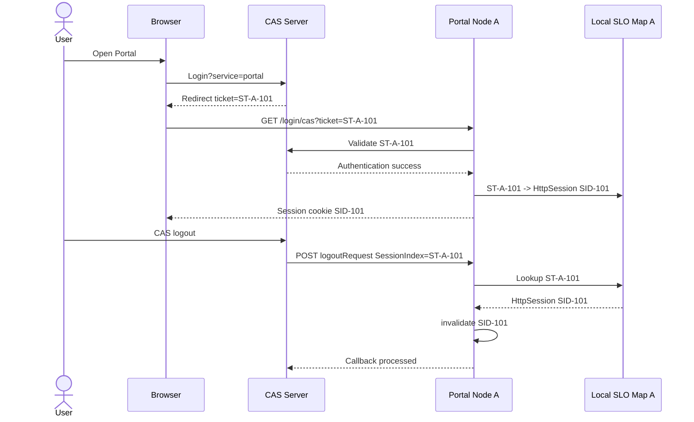
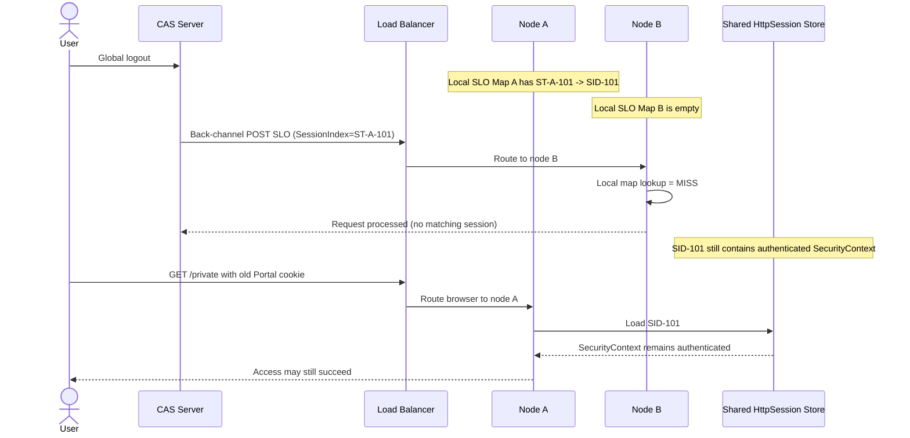
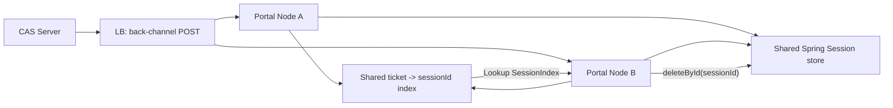

# Limitations of In-Memory Session Mapping Stores in Multi-Node Applications

## Learning objectives

After this lesson, you will be able to:

1. Distinguish **CAS Single Logout (SLO)**, the SSO session on the CAS Server, each application's `HttpSession`, and the **ticket → session mapping store** used by the CAS Client to locate sessions to destroy.
2. Describe why `SingleSignOutFilter` / `SingleSignOutHandler` with the default in-memory mapping store **sees only sessions recorded inside the current JVM**, not across the cluster.
3. Explain the scenario where login happened on node A yet the CAS Server sends **back-channel logout** to node B: the logout callback can succeed at the HTTP level while failing to locate the session, leaving the app authenticated.
4. Distinguish **sticky sessions**, **Spring Session backed by Redis/JDBC**, and **distributed CAS session-ticket mapping**, and explain why implementing only one of the three can be insufficient.
5. Evaluate remediation approaches: integrating SLO through a distributed layer with `ticketIndex → sessionId`, controlled routing, callback fan-out, short session TTLs, centralized deny/epoch checks, or officially supported cluster-aware CAS clients.
6. Design a mapping lifecycle covering **session creation, session ID rotation, logout, expiry, re-login, node restarts, session deletion, concurrent callbacks, and replay**.
7. Run **standalone Java 17+** code simulating an in-memory index across two nodes, a shared session store, and session ID rotation; observe exact stdout.
8. Apply Spring Session examples using `SessionRepository.deleteById(...)` and Redis mapping **only after the SLO callback is authenticated**, alongside end-to-end tests and a safe operations checklist.

## 1. Context: CAS can log out centrally yet does not hold application sessions

**CAS – Central Authentication Service** authenticates users and maintains the SSO session via a **Ticket-Granting Ticket (TGT)** and a CAS Server-side cookie. When a user logs in to a Service Provider (SP)/CAS Client, CAS issues a **Service Ticket (ST)** bound to a specific `service` URL. The Spring Security app validates the ST with the CAS Server and creates its own **SecurityContext** and **HttpSession**.

Later, the user requests a full CAS session logout. The CAS Server can send a **Single Logout notification** to applications that participated in SSO. However, CAS **has no direct authority to invoke `HttpSession.invalidate()` inside every application**. Each CAS Client must receive the callback, locate the right application session, and invalidate it itself.

Example system:

- CAS Server `https://sso.example.org/cas`.
- Portal application `https://portal.example.org`.
- Two Portal instances **node A** and **node B** behind a load balancer.
- The browser logs in through A using ST `ST-A-101` and receives application session `SID-101`.
- The CAS Client records the pair **`ST-A-101 → session SID-101`** to locate the session later on SLO.
- The user logs out at CAS; the SLO callback lands on **node B**.
- B knows the CAS Server configuration yet **lacks the mapping entry recorded by A in RAM**.

**Dangerous outcome:** CAS terminated the TGT and dispatched the CAS SLO request, yet `SID-101` on the application can continue accessing protected resources. This is a **session revocation coverage** failure, not a CAS Server user authentication bug.

### 1.1. Four completely different "stores"

| Store/state | Owner | Primary contents | Scope |
| --- | --- | --- | --- |
| **CAS Ticket Registry/TGT** | CAS Server | SSO sessions and CAS tickets | Depends on CAS Server architecture; not the app session store |
| **App HttpSession store** | Portal/Spring Session/container | `SecurityContext`, app state, session ID | Single-node in-memory or shared Redis/JDBC |
| **CAS Client SLO mapping storage** | Apereo CAS Java Client inside Portal | Mapping **CAS ticket/SessionIndex → HttpSession** | Default can be a JVM-local in-memory map |
| **Browser cookie** | Browser | App session identifier and CAS TGC on their respective domains | Browser is absent from CAS → app back-channel requests |

**Key point:** when an app uses **Spring Session Redis**, the CAS Client's internal map **does not automatically become a distributed map**. It can still reside only on node A while Redis stores session `SID-101` readable by both A and B.

### 1.2. CAS logout differs from application self-logout

- **Local logout at Portal:** the app typically clears Spring Security Authentication, invalidates `HttpSession`, and clears the app cookie; the CAS TGT/TGC may remain valid, so the next login attempt can auto-SSO again.
- **CAS logout:** the CAS Server terminates the SSO session/TGT. Without a working SLO mechanism at Portal, existing application sessions can remain valid.
- **CAS Single Logout:** CAS sends messages (back-channel or front-channel per config) asking clients to invalidate their sessions. This is a **best-effort coordination mechanism**, not an atomic guarantee that every app logged out.
- **Admin/emergency revocation:** deleting sessions by user/tenant or adding a deny flag may still be needed even if an SLO notification is lost.

## 2. SLO mapping mechanism inside the CAS Client

Apereo CAS Java Client includes common components:

| Component | Role |
| --- | --- |
| `org.apereo.cas.client.session.SingleSignOutFilter` | Observes requests carrying tickets at login and CAS logout messages; coordinates recording mappings or invalidating sessions |
| `SingleSignOutHandler` | Logic for storing mappings, receiving, and processing logout messages |
| `SessionMappingStorage` | Abstraction for mapping ID ↔ servlet session associations |
| `HashMapBackedSessionMappingStorage` | Implementation backed by an in-memory map inside a single JVM |
| `SingleSignOutHttpSessionListener` | Cleans up mappings when servlet sessions are destroyed per events observed by the listener |

**Package/version note:** Modern Apereo Java CAS Client uses `org.apereo.cas.client.*`; older guides use `org.jasig.cas.client.*` or `javax.servlet.*`. For Spring Boot 3, choose a **Jakarta Servlet**–compatible release rather than copying an old `web.xml` assuming APIs match automatically.

### 2.1. What does the map hold?

In a native CAS protocol deployment, when CAS issues Service Ticket `ST-A-101`, it remembers which service received the ticket. The CAS Client can record:

```text
CAS Client node A / local JVM
  mapping ID: ST-A-101
      |
      v
  HttpSession SID-101

CAS Client node B / local JVM
  (empty)
```

When the user logs out of CAS globally, the back-channel logout message sent to Portal can contain `<samlp:SessionIndex>ST-A-101</samlp:SessionIndex>`. The CAS Client uses this value to find the `HttpSession` previously linked to that ST and invalidate it.

**Technical note:** `SessionIndex` in traditional CAS SLO is commonly used to reference the ST issued to the service; it is **not by default a TGT**, email, or `JSESSIONID`. Exact profile, CAS Server version, and SLO type must be verified. Never replace everything with `username` when looking up a specific ticket-bound session.

### 2.2. Flow with a single node



In a single-node environment, or by coincidence when the callback hits the exact node holding the mapping while the session object is still valid, this can work properly. **Passing a single-node localhost test does not prove SLO works when scaled.**

### 2.3. Never store username instead of an ST-keyed mapping

A single user can hold multiple concurrent sessions and devices; two distinct CAS service tickets can bind to different sessions. Mapping `username → single session` risks scope errors and cross-tenant mistakes. With native CAS SLO, correlation data must rely on **protocol-accurate ticket/session identifiers**, and the application must know which session that ticket created.

An application-managed record may store extra audit metadata:

```text
service_namespace : portal-prod
cas_ticket_digest : HMAC-SHA256(ST-A-101, secret-app)
app_session_id    : SID-101
created_at        : ...
expires_at        : ...
status            : active
```

This is a **recommended data model**, not something provided automatically by the CAS Server or built into Spring Security. To avoid exposing raw STs, systems can use an HMAC digest as the lookup key, managing the HMAC secret via KMS/secret manager.

## 3. Why does the in-memory mapping store fail in multi-node setups?

### 3.1. Back-channel logout does not follow browser cookies

A load balancer configured for sticky sessions usually relies on the browser's `JSESSIONID` cookie. However, **back-channel SLO** is an HTTP request from **CAS Server → Portal**, not browser → Portal. It carries no user application cookie and cannot leverage sticky browser affinity to reach node A.



Even when Redis serves as the **shared app session store**, if the CAS client `SingleSignOutHandler` checks **JVM B's map**, it will not see the mapping on A. Having shared sessions **does not tell B which session ID to delete**.

### 3.2. Comparing three configurations

| Architecture | App HttpSession | CAS ticket→session index | Back-channel SLO hitting another node |
| --- | --- | --- | --- |
| Single node | RAM A | RAM A | No other node; still risks restarts/TTL |
| Multi-node, sticky browser | Separate RAM A/B | Separate RAM A/B | **Unreliable**: CAS callback lacks browser affinity |
| Multi-node, Spring Session Redis | Shared Redis | Separate RAM A/B | **Can still MISS** on node B |
| Multi-node, shared session + shared ticket index | Shared Redis/JDBC | Distributed index with TTL | Can locate the right session ID and revoke if implemented completely |
| Multi-node, shared index yet RAM-only sessions | Separate RAM A/B | Distributed index | Knows ID yet B **cannot reliably** invalidate a session owned by A |
| Central session deny flag/epoch | Any, with request-time check | Can be added | Blocks access if SLO events are mapped and denies synchronize properly |

**Conclusion:** you must solve both **locating the session** (ticket → session) and **destroying/denying the session** (cluster-wide deletion by ID). Solving only half is not enough.

### 3.3. A "random 50% failure rate" is no coincidence

If two nodes have equal odds of receiving callbacks and only one holds the mapping, under simple conditions you may see logout succeed on some attempts and fail on others. **Never treat 50% as an SLA or real-world forecast**: outcomes also depend on ingress, CAS callback URLs, session routing, node restarts, load-balancing weights, retries, and other settings.

Common symptoms:

- Single-node logout works; two or more nodes fail intermittently.
- A user with an open tab can still open `/reports` after CAS logout.
- When node A goes down, sessions logged in through A cannot be looked up from B even though Redis retains the sessions.
- The SLO callback returns HTTP 200 or 204 with zero `session invalidated` logs.
- One node holds a large mapping count in heap while another holds near zero.
- Only browser local logout works; CAS global logout leaves app sessions alive.

Never assume **HTTP 200** means the session was destroyed. It may only indicate the web server received the callback and the handler ran.

## 4. The problem goes beyond load balancing

### 4.1. Node restarts or rolling deploys

`HashMapBackedSessionMappingStorage` lives in RAM. After pod A restarts:

- The CAS Server may still hold the TGT or dispatch SLO later.
- Spring Session Redis still holds the authenticated `HttpSession SID-101`.
- The ticket→session map on A **is gone**.
- Callbacks arriving after the restart find no mapping and fail to destroy `SID-101`.

If users have long app session TTLs, exposure can persist for hours after CAS logout even though the CAS Server ended the TGT.

### 4.2. Memory growth and cleanup

A map holding `key → HttpSession` references or similar structures can pin heavy objects if cleanup is missing:

- `SessionMappingStorage` must remove mappings when sessions are destroyed.
- `SingleSignOutHttpSessionListener` helps clean up along the servlet session lifecycle; however, in distributed Spring Session setups, not every Redis/JDBC expiration automatically translates into **the right servlet listener callback** on the JVM holding the mapping object.
- If a session is deleted outside the JVM (Redis key expiry/admin revocation), local mappings may not be cleaned up as expected.
- An uncleaned ST/session can retain `HttpSession`/principal/attributes longer than needed, inflating heap and creating retention risks.
- Restarting the JVM frees the RAM map yet **does not revoke app sessions** persisted in an external store.

Therefore test **cleanup in a real runtime**, not just `HttpSession.invalidate()` in an in-memory servlet container. Monitor mapping counts, mapping age, session destruction events, heap usage, and cache evictions.

### 4.3. Session ID rotation and fixation protection

Spring Security typically rotates/changes the session ID after authentication to prevent session fixation. If the SLO mapping is recorded **before** the session ID rotates and the app stores only an **old ID string**, a later callback may look up the retired ID and miss the new session ID.

```text
Before CAS login:   SID-OLD
Record mapping:     ST-A-101 -> SID-OLD
After CAS success:  SID-NEW (rotated)
Back-channel SLO:   ST-A-101 -> SID-OLD
Session store:      SID-NEW still authenticated
```

**Do not conclude every CAS client fails this way by default.** An implementation storing an **`HttpSession` object reference** may continue seeing the object after ID rotation depending on container/strategy. The critical check is: if your system moves mappings to a **distributed index storing string session IDs**, ensure the mapping reflects **the final ID after session fixation protection**, along with listeners/transactions handling ID changes.

**Never disable session fixation protection** as a shortcut to avoid updating mappings. Update the index and test race conditions.

### 4.4. SLO callback arrives before the mapping finishes saving

Another race:

1. CAS validation/redirect succeeds.
2. CAS Server emits SLO because the user logs out almost immediately.
3. The SLO callback hits node B **before** node A writes the `ST → final session ID` mapping.
4. Node B lookup misses and treats it as done.
5. Node A then writes the mapping and saves the authenticated session.
6. The session survives even though logout just happened.

The fix must address **event ordering**: a "revoked ticket" marker, atomic link-if-not-revoked, transactions/locks, or a durable event stream with TTL and replay handling. Simply adding a Redis map without handling this race leaves a gap.

### 4.5. One session, multiple tickets, or re-login

A browser/app session may accumulate multiple CAS service tickets across reauth/login flows. If building a custom index:

- One session may require multiple `ST → session ID` mappings in some flows.
- When the session is destroyed, clean up **all** associated mappings, not just the latest ticket.
- Never allow an old SLO to accidentally wipe a newly issued session under policy; tie together the original CAS session, service ticket, and app session.
- If an ST key is ever reused due to a bug or simulation, fail closed and audit. Real CAS STs must be unpredictable, unique, and single-use.
- A session ID may rotate multiple times: the index must reflect the current session or invalidate via a stable app session identity.

### 4.6. Callback received yet server has not actually revoked

A handler may read `SessionIndex` and call `session.invalidate()`, yet fail because:

- The session already expired (valid no-op) or never existed on the current node.
- The session repository/network is temporarily unavailable.
- Serialization/namespaces are incompatible across nodes.
- The callback updated only the in-memory map without calling distributed session deletion.
- The handler swallowed an error and returned 2xx without retry/dead-letter handling.
- Another app request already loaded the context and is executing concurrently before session deletion.

Design idempotency, observability, and retries/acks around actual revocation outcomes; never claim deleting a session instantaneously halts in-flight requests or WebSocket connections.

## 5. CAS Single Logout back-channel and front-channel

Apereo CAS supports logout modes depending on version, registration, and protocol:

| Type | Path | Pros | Limitations |
| --- | --- | --- | --- |
| **Back-channel SLO** | CAS Server sends HTTP POST to service callback | Browser does not need to send app cookies; server-to-server | Must locate session via correlation ID; callback may hit another node |
| **Front-channel SLO** | Browser/iframe/AJAX redirects or calls service per CAS setting | Some apps can leverage browser context | Constrained by SameSite/privacy/CSP/iframe/JS rules; not always supported |
| **Local logout** | User posts to app `/logout` | App proactively invalidates current session | CAS TGT/other apps do not automatically log out |
| **CAS global logout** | User visits CAS `/logout` | Terminates CAS SSO session | Does not automatically delete app sessions if clients do not handle SLO |

Back-channel SLO is typically configured via service `logoutType=BACK_CHANNEL` or a specific callback URL on the CAS Server. Exact default behavior and endpoints **depend on the CAS release**—do not infer from a guide for another version. Verify whether the CAS Server actually dispatches notifications to Portal, where messages are routed, and that the client supports that profile.

**Back-channel requests from the CAS Server carry no browser `JSESSIONID`**, so ordinary sticky routing cannot solve it.

### 5.1. Logout message format

An SLO notification typically contains XML similar to:

```xml
<samlp:LogoutRequest
  xmlns:samlp="urn:oasis:names:tc:SAML:2.0:protocol"
  xmlns:saml="urn:oasis:names:tc:SAML:2.0:assertion"
  ID="_logout-123"
  Version="2.0"
  IssueInstant="2026-11-07T04:00:00Z">
  <saml:NameID>user-id</saml:NameID>
  <samlp:SessionIndex>ST-A-101</samlp:SessionIndex>
</samlp:LogoutRequest>
```

This is **illustrative XML** for the `SessionIndex` field. In practice, a CAS client receives the content in the POST `logoutRequest` parameter and uses the library's XML parser/handler. Do not try to arbitrarily decode every profile yourself; verify CAS and client versions.

**Never use `NameID`/email to silently delete "all of this user's sessions"** when the protocol only requested terminating a specific session/ticket. Broader revocation scopes can be decided separately per security policy, yet must be explicit.

### 5.2. Authenticating the logout sender

Any outsider could attempt to POST `logoutRequest` to a public endpoint. A custom system **must never extract an unverified `SessionIndex` and immediately delete a session**.

Before processing, design controls suited to the CAS deployment:

- TLS, endpoint/ingress configuration, authentication, or network ACLs for the trusted CAS Server where applicable.
- Verify XML signatures if the profile requires/supports them; never assume every native CAS SLO notification carries an XML Signature.
- Validate `Issuer`/service bindings/format/validation rules per protocol, bounding message size and blocking XML entity expansion.
- Check timestamps/replay IDs/correlation when provided and integrated by the profile; never rely solely on IP behind proxies with spoofable headers.
- Never trust client-supplied `X-Forwarded-For` headers; trust only what the edge sets.
- Log rejection reasons without leaking raw STs, `SessionIndex`, usernames, or XML containing PII.

**With built-in `SingleSignOutFilter`, inspect actual callback authentication provided by your CAS client and infrastructure.** The filter parsing XML and destroying sessions is protocol behavior—**it does not mean every callback is cryptographically authenticated**. Never expose an unprotected public REST controller `POST /revoke?ticket=...`.

## 6. Architectural options for multi-node deployments

### 6.1. Option A – Single node, default SLO config

Suitable for labs/small apps that **do not scale horizontally** once limits are understood:

- One JVM holds the `ST → HttpSession` mapping.
- `SingleSignOutFilter` receives callbacks, finds the session, and invalidates it.
- `SingleSignOutHttpSessionListener` cleans up the map on `sessionDestroyed`.
- Session timeouts bound session age if a logout is missed.

**Limitations:** JVM restarts wipe mappings, local or distributed session lifecycles may drift out of sync, and there is no true HA. Never call this safe for two nodes simply because sticky sessions are enabled.

### 6.2. Option B – Sticky sessions

Sticky routing for **browser requests** can route post-login user traffic back to the app node holding the `HttpSession`. However, the **CAS Server → LB → Portal** callback has no browser cookie and usually no way to share that affinity.

You could design callback routing by ticket hash or a dedicated ownership layer, yet that is **not standard browser sticky sessions**; it requires consistent mapping/routing, HA/restart handling, and security controls. It is typically more complex than a distributed index plus session store.

**Do not treat sticky sessions as the default solution for multi-node SLO.**

### 6.3. Option C – Spring Session Redis/JDBC while keeping the default CAS map

Spring Session shares `HttpSession` across nodes:

```text
Node A -> Redis: SID-101 SecurityContext
Node B -> Redis: SID-101 SecurityContext

CAS SLO map A: ST-A-101 -> HttpSession SID-101
CAS SLO map B: empty
```

This **fixes reading the session from any node when the cookie is present**, yet **does not automatically share the CAS Client's `ST → session` mapping**. When an SLO POST lands on B, it still misses. You must replace the mapping/invalidation approach or verify your library provides an officially supported distributed adapter for your version.

### 6.4. Option D – Shared session store + distributed SLO index

This is the clearest general approach when reliable SLO at scale is needed:

1. The application stores `HttpSession` in a shared store (Spring Session Redis/JDBC with appropriate TTL).
2. After the ST is validated, ensure the session is established and capture the **final session ID** after fixation protection.
3. Write a **distributed mapping** keyed by ticket identifier (keyed digest/HMAC recommended) → **app session ID**, with TTL and service/environment namespacing.
4. CAS SLO callbacks land on any node; an **authenticated/validated** handler extracts `SessionIndex` and looks up the shared index.
5. Using the session ID, the handler calls `SessionRepository.deleteById(sessionId)` or a central revoke/deny mechanism.
6. Clean up the auxiliary mapping/index, record secret-free audits/metrics, and handle retries/partial failures.
7. Account for logout-before-link races, concurrent callbacks, session ID rotation, session expiration, node restarts, and cache connectivity.
8. If the callback cannot be processed, **never report successful revocation**; retry/quarantine/alert per policy.



**Legacy interface note:** `SessionMappingStorage` in some Java CAS Client releases has APIs holding **`HttpSession` objects**, not plain session IDs. **Never serialize `HttpSession` directly into Redis** expecting to reconstruct a Servlet session in another JVM. To integrate with Spring Session, you usually build a custom integration/adapter at the **`ST → sessionId` and `SessionRepository`** level, or choose an implementation/library officially verified for distributed mapping. Never advertise an imaginary `RedisSessionMappingStorage` as built into every version.

### 6.5. Option E – Centralized access-deny/incident epoch

When near-instant revocation is required or callback delivery cannot be guaranteed, you can add:

- User/session/tenant revocation markers in a shared store.
- Session epochs rechecked at request authorization boundaries rather than waiting solely for `HttpSession` expiry.
- Shorter session TTLs and forced reauth for sensitive areas.
- Force-logout by user/tenant via an application-managed session index.
- Monitoring missed SLOs and reconciling with user permissions/business state.

This is **compensating defense**, not proof CAS SLO succeeded. For admin users, requests started before revocation or WebSockets/background tasks may still need dedicated interruption mechanisms.

### 6.6. Comparing options

| Solution | Fixes finding session on another node? | Fixes destroying session on another node? | Main limitation |
| --- | --- | --- | --- |
| Sticky browser session only | Unreliable | Unreliable | CAS callback carries no browser cookie |
| Spring Session Redis/JDBC only | No | Yes if session ID is known | CAS client ticket map remains in RAM |
| Distributed ticket index only | Yes | Unreliable | Local `HttpSession` may be inaccessible from another node |
| Shared index + shared session store | Yes | Yes by design | Requires code/tests/auth/TTL/race/retry handling |
| CAS client/library with official cluster SLO support | Depends on implementation | Depends on implementation | Must verify exact version and topology |
| Session deny flag/epoch | Adds blocking capability | Can block new access | Must check on every sensitive request; does not replace SLO callbacks |

## 7. Java 17+ demo: two nodes, one shared session store

A **pure Java** example simulating the failure mode—using no Spring, real CAS tickets, networking, or Redis. It simply separates two structures: a local SLO map and a shared session store.

File `CasMultiNodeLogoutDemo.java`:

```java
import java.util.HashMap;
import java.util.Map;

public final class CasMultiNodeLogoutDemo {

    static final class Node {
        private final Map<String, String> localTicketIndex =
                new HashMap<>();

        void recordLogin(String ticket, String sessionId) {
            localTicketIndex.put(ticket, sessionId);
        }

        boolean onLogout(
                String ticket, Map<String, Boolean> sharedSessions) {
            String sessionId = localTicketIndex.remove(ticket);
            if (sessionId == null) {
                return false;
            }
            sharedSessions.remove(sessionId);
            return true;
        }
    }

    public static void main(String[] args) {
        Map<String, Boolean> sharedSessions = new HashMap<>();
        Node nodeA = new Node();
        Node nodeB = new Node();

        sharedSessions.put("SID-101", true);
        nodeA.recordLogin("ST-101", "SID-101");

        System.out.println("Session exists: "
                + sharedSessions.containsKey("SID-101"));

        // CAS back-channel logout is routed by LB to node B.
        boolean foundOnB =
                nodeB.onLogout("ST-101", sharedSessions);
        System.out.println("Node B found local mapping: " + foundOnB);
        System.out.println("Session after node B SLO: "
                + sharedSessions.containsKey("SID-101"));

        // Only when the callback lands on node A can the local map be looked up.
        boolean foundOnA =
                nodeA.onLogout("ST-101", sharedSessions);
        System.out.println("Node A found local mapping: " + foundOnA);
        System.out.println("Session after node A SLO: "
                + sharedSessions.containsKey("SID-101"));

        // Shared ticket index + shared session store.
        Map<String, String> distributedIndex = new HashMap<>();
        sharedSessions.put("SID-202", true);
        distributedIndex.put("ST-202", "SID-202");

        String sid = distributedIndex.remove("ST-202"); // Read by node B.
        boolean centralFound = sid != null;
        if (centralFound) {
            sharedSessions.remove(sid);
        }
        System.out.println("Distributed index found: " + centralFound);
        System.out.println("Session after central SLO: "
                + sharedSessions.containsKey("SID-202"));

        // Session rotated yet the mapping ID was not updated.
        sharedSessions.put("SID-NEW", true);
        distributedIndex.put("ST-303", "SID-OLD");
        String stale = distributedIndex.remove("ST-303");
        sharedSessions.remove(stale);
        System.out.println("Rotated session still active: "
                + sharedSessions.containsKey("SID-NEW"));

        // If the mapping knows the final ID, the right session can be deleted.
        distributedIndex.put("ST-304", "SID-NEW");
        String finalId = distributedIndex.remove("ST-304");
        sharedSessions.remove(finalId);
        System.out.println("After final-ID mapping: "
                + sharedSessions.containsKey("SID-NEW"));
    }
}
```

Compile and run:

```bash
javac CasMultiNodeLogoutDemo.java
java CasMultiNodeLogoutDemo
```

**Exact stdout:**

```text
Session exists: true
Node B found local mapping: false
Session after node B SLO: true
Node A found local mapping: true
Session after node A SLO: false
Distributed index found: true
Session after central SLO: false
Rotated session still active: true
After final-ID mapping: false
```

Interpretation:

- Node B has no mapping in RAM and **cannot find `SID-101`**, even though the shared session store holds the entry.
- Node A sees its own mapping and deletes the exact session.
- A distributed index lets node B receive SLO and look up the session ID to delete from the shared store.
- An index holding **`SID-OLD`** after fixation protection rotated the ID to **`SID-NEW`** still fails to destroy the new session.
- This snippet proves the concept only. `HashMap` is not thread-safe and has no networking/TTL/security; Redis/JDBC requires real transactions, HMAC, retries, and audits.
- In production CAS apps, **associate the ST only after the CAS ticket is validated**, never from an unverified user-submitted `ticket`.
- Never treat raw `ST-101`/`SID-101` as audit data; they are fixed educational fixtures.

## 8. Spring Session: distributed session deletion layer

In a Spring Boot 3 app with Spring Session, you can use `SessionRepository` to locate/delete a session by ID in a shared store. This is **the second half** of the problem; it **does not automatically know which Service Ticket belongs to which session**.

### 8.1. Dependencies and configuration

In `build.gradle` of a Spring Boot 3 project with plugin/BOM already configured:

```groovy
dependencies {
    implementation 'org.springframework.boot:spring-boot-starter-web'
    implementation 'org.springframework.boot:spring-boot-starter-security'
    implementation 'org.springframework.security:spring-security-cas'
    implementation 'org.apereo.cas.client:cas-client-core'

    implementation 'org.springframework.session:spring-session-data-redis'
    implementation 'org.springframework.boot:spring-boot-starter-data-redis'
}
```

**Prerequisites:** the CAS Java Client dependency must be Jakarta Servlet–compatible for Spring Boot 3. Redis must use ACLs/TLS/credentials from a secret manager—never leave `localhost`/default ports in production just because tutorials do.

Minimal `application.yml` (illustrative only, insufficient for production):

```yaml
server:
  servlet:
    session:
      timeout: 20m
      cookie:
        secure: true
        http-only: true
spring:
  data:
    redis:
      host: redis.internal.example
      port: 6379
  session:
    timeout: 20m
```

Production also requires `spring.data.redis.ssl`/TLS, auth, namespacing, network ACLs, availability/replication, serializers, and sensitive-data policies. Different Spring Session Redis repositories support different **principal indexes**; pick the exact implementation matching your Boot/Spring Session release.

### 8.2. Minimal service to delete a session by ID

This is a **Spring-managed service snippet**, not standalone code runnable via `javac`:

```java
package com.example.cas.slo;

import org.springframework.session.Session;
import org.springframework.session.SessionRepository;
import org.springframework.stereotype.Service;

@Service
public class SessionDeletionService {

    private final SessionRepository<? extends Session> sessions;

    public SessionDeletionService(
            SessionRepository<? extends Session> sessions) {
        this.sessions = sessions;
    }

    // Call only from an authenticated SLO handler or authorized admin workflow.
    public void revokeSessionById(String sessionId) {
        if (sessionId == null || sessionId.isBlank()) {
            throw new IllegalArgumentException("sessionId required");
        }
        sessions.deleteById(sessionId);
    }
}
```

- `SessionRepository.deleteById` deletes the session by ID. With a shared Spring Session store, subsequent requests hitting any node will no longer load the old security context.
- This method **must never accept arbitrary user REST queries** to delete sessions; the caller must prove authority to revoke that session.
- An in-flight request may have loaded `Authentication` before deletion; check a revocation marker on ultra-sensitive actions if immediate enforcement is required.
- Session IDs must belong to the **exact application/session namespace**. Never cross-delete session IDs across tenants.
- Never expose a public `/deleteSession?id=...`—that is an unguarded DoS API.

### 8.3. Why doesn't `FindByIndexNameSessionRepository` replace an SLO ticket index?

`FindByIndexNameSessionRepository.findByPrincipalName(user)` looks up sessions for a **principal name** if indexed. However, a CAS SLO callback may supply only a **`SessionIndex`/ST identifier**, not a stable subject or a request to "log out all devices of this user".

Consequently:

- Never infer `principalName` from `SessionIndex` unless guaranteed by the protocol.
- Never pick an arbitrary session for a colliding username across tenants.
- For business-driven full user/tenant revocation, principal indexes are helpful **when populated and namespaced properly**—which is a **separate** operation from ST-based CAS SLO.
- To map `ST → session`, you need an **index keyed by the CAS ticket/`SessionIndex`**, not default principal lookup alone.

## 9. Distributed ticket index: a safe model bridging both layers

A production design can use Redis as the index:

```text
Key:
  portal-prod:cas:slo:map:v1:<HMAC-SHA256(ST or SessionIndex)>

Value:
  finalAppSessionId (protected, bounded TTL)

Lookup:
  Trusted SLO callback -> HMAC(SessionIndex) -> lookup sessionId
  -> SessionRepository.deleteById(sessionId)
  -> remove mapping after success
```

**Why use HMAC?** Tickets/`SessionIndex` are sensitive identifiers. Raw keys in Redis/logs allow cross-system correlation. HMAC with a dedicated secret and namespace avoids exposing ticket IDs directly and resists dictionary lookups compared to unkeyed digests. However, **HMAC does not replace authenticating the CAS SLO callback origin**, nor does it make the session IDs stored in values non-sensitive.

### 9.1. Rules for writing the index

1. **Only after successful CAS validation:** never record a browser-supplied ST before the validator verifies it, preventing index poisoning.
2. **Capture the final session ID:** after the session-fixation strategy rotates the ID; if an ID-change listener fires, update atomically or use a designed stable reference.
3. **Attach service/tenant/realm namespaces:** `portal-prod` must not share a Redis keyspace with other apps without clear isolation.
4. **Appropriate TTL:** never exceed session lifetime policy plus a brief buffer for late SLO events; never retain tickets indefinitely.
5. **Single-use / idempotency:** duplicate callbacks must never create a new login or resurrect mappings.
6. **Clean up on local logout/session expiry:** use a reverse index or session lifecycle events to prevent stale mappings; test with real listeners.
7. **Race-safe when logout arrives before link:** write a revoked-ticket marker in shared state, reject linking/session creation after the marker, or coordinate with transactions; test this scenario.
8. **Authenticated SLO handler:** never expose `ST → ID` lookups to arbitrary HTTP clients.

### 9.2. Pseudocode more reliable than a public controller

```text
onCasTicketValidated(ticket, finalHttpSessionId, serviceNamespace):
    assert authentication is successful and ticket belongs to trusted CAS
    key = HMAC(serviceNamespace, ticket)
    atomically:
        if revokedMarker(key): reject/purge login session
        else store key -> finalHttpSessionId with bounded TTL

onTrustedCasLogout(message):
    verify trusted delivery, protocol format and replay policy
    sessionIndex = parseApprovedSessionIndex(message)
    key = HMAC(serviceNamespace, sessionIndex)
    atomically mark revokedMarker(key)
    sessionId = lookup(key)
    if sessionId exists:
        delete sessionId from shared SessionRepository
        remove mapping only after deletion completed
    record result (success / already gone / retry / unknown)
```

**This is design pseudocode, not a built-in CAS Client/Spring API.** You must design atomicity between the Redis index and session store, retries/deduplication, secret rotation, and handling when lookup misses. If a network partition prevents determining the outcome, never report "all sessions revoked".

### 9.3. Spring Boot sample: a Redis → Spring Session bridge

This is an **integratable snippet** for Spring Boot 3/Spring Data Redis/Spring Session, **not automatic end-to-end SLO**. Callers must be internal workflows after **CAS ticket validation + finalized session ID** and an authenticated SLO callback handler. Never expose a public endpoint taking `SessionIndex` and invoking the method below directly.

File `src/main/java/com/example/cas/slo/CasSloIndexBridge.java`:

```java
package com.example.cas.slo;

import java.nio.charset.StandardCharsets;
import java.time.Duration;
import java.util.Base64;
import java.util.HexFormat;
import javax.crypto.Mac;
import javax.crypto.spec.SecretKeySpec;

import org.springframework.beans.factory.annotation.Value;
import org.springframework.data.redis.core.StringRedisTemplate;
import org.springframework.session.Session;
import org.springframework.session.SessionRepository;
import org.springframework.stereotype.Service;

@Service
public final class CasSloIndexBridge {
    private static final Duration INDEX_TTL = Duration.ofHours(8);
    private static final String NAMESPACE = "portal-prod:cas:slo:v1:";

    private final StringRedisTemplate redis;
    private final SessionRepository<? extends Session> sessions;
    private final SecretKeySpec hmacSecret;

    public CasSloIndexBridge(
            StringRedisTemplate redis,
            SessionRepository<? extends Session> sessions,
            @Value("${app.cas.slo.hmac-key-base64}") String keyBase64) {
        byte[] secret = Base64.getDecoder().decode(keyBase64);
        if (secret.length < 32) {
            throw new IllegalArgumentException(
                    "SLO HMAC secret must be at least 256 bits");
        }
        this.redis = redis;
        this.sessions = sessions;
        this.hmacSecret = new SecretKeySpec(secret, "HmacSHA256");
    }

    // Only call after CAS validates ST AND session fixation rotation is done.
    public void linkValidatedTicket(String ticket, String finalSessionId) {
        if (ticket == null || ticket.isBlank()
                || finalSessionId == null || finalSessionId.isBlank()) {
            throw new IllegalArgumentException("Missing ticket/session");
        }
        String key = keyFor(ticket);
        redis.opsForValue().set(key, finalSessionId, INDEX_TTL);
    }

    // Only call after the SLO callback was authenticated and validated.
    public boolean revokeTrustedSessionIndex(String sessionIndex) {
        if (sessionIndex == null || sessionIndex.isBlank()) {
            throw new IllegalArgumentException("Missing SessionIndex");
        }
        String key = keyFor(sessionIndex);
        String sessionId = redis.opsForValue().get(key);
        if (sessionId == null) {
            return false;
        }
        // Delete first: if storage fails, retain mapping for retry.
        sessions.deleteById(sessionId);
        redis.delete(key);
        return true;
    }

    private String keyFor(String identifier) {
        try {
            Mac mac = Mac.getInstance("HmacSHA256");
            mac.init(hmacSecret);
            byte[] digest = mac.doFinal(
                    identifier.getBytes(StandardCharsets.UTF_8));
            return NAMESPACE + HexFormat.of().formatHex(digest);
        } catch (java.security.GeneralSecurityException ex) {
            throw new IllegalStateException(
                    "Cannot compute SLO index key", ex);
        }
    }
}
```

**Notes before deployment:**

- `app.cas.slo.hmac-key-base64` must come from a **secret manager or protected environment**, never hardcoded in Git. Every node in the same namespace must share **the same HMAC key version**; key rotation requires reading previous key versions during a controlled window.
- `linkValidatedTicket` must be called **only after successful CAS authentication and session ID rotation**. Hooking into the wrong filter lifecycle point saves the pre-rotation ID or an unvalidated raw ST.
- `revokeTrustedSessionIndex` must be called **only from a trusted handler** after verifying SLO origin, format, and correlation. **There is no REST controller in this example.**
- `redis.opsForValue().get(key)` and `redis.delete(key)` are two separate, non-atomic operations. For non-reused ticket keys, idempotent revocation is often acceptable, **yet concurrency/races with `linkValidatedTicket`, reauthentication, and logout-before-link remain unsolved here**.
- Deleting the session before deleting the mapping allows retries if session deletion fails; if deletion succeeds yet Redis deletion fails, a duplicate callback simply deletes again (typically idempotent). Monitor partial outcomes.
- The 8-hour TTL is a **fixture**; derive it from real CAS/app session policies considering max session lifetime, logout delays, and storage retention.
- This snippet **does not yet clean up indexes on session expiry**, lacks a reverse index, logout-before-link markers, transactions/locks, callback authentication, metrics, reconciliation, or full `SingleSignOutHandler` integration. It is **one piece of a solution**, not a claim of complete cluster SLO.
- With the library's `HashMapBackedSessionMappingStorage`, merely placing a bridge beside it does not switch `SingleSignOutFilter` to use the bridge. You must integrate at the proper **lifecycle/extension points or build a verified SLO adapter** while avoiding two handlers processing the same callback against two different stores.
- In multi-tenant setups, namespace keys by service/realm; never let one app's raw ticket ID revoke another app's session.
- Supply `app.cas.slo.hmac-key-base64` via Boot's external secret config; never put literals in public deployment docs.

### 9.4. When strong atomicity is required

To handle **logout-before-link**, a safer flow can:

1. When a logout callback arrives, write an HMAC-keyed **revoked marker** before/alongside looking up the session.
2. When the login callback prepares to link, use **Redis Lua/transactions or a transactional backend** to check the marker and write the mapping atomically.
3. If already revoked, **never let the new authenticated session survive**—invalidate immediately or fail login.
4. If the link already existed, SLO retrieves and deletes the session ID, publishing the revocation outcome.
5. Enforce TTL/replay IDs and deduplication, since callbacks may be resent.
6. If Redis/network fails and the system cannot verify revocation status, enforce fail-closed policy on sensitive areas or guaranteed deferred processing.

**Do not assume the simple bridge in section 9.3 solves this race.** Use it solely to illustrate connecting a shared index with `SessionRepository`.

## 10. Filter order, listeners, and CAS Client integration

Apereo Java CAS Client SLO documentation typically configures:

- `SingleSignOutFilter` before authentication filters when using CAS Client Servlet filters.
- `SingleSignOutHttpSessionListener` to delete mappings on `sessionDestroyed`.
- Spring Security's `CasAuthenticationFilter` to validate the CAS ST.
- Each `FilterRegistrationBean` and `SecurityFilterChain` registered **once** in the proper order, avoiding Spring Boot double auto-registration.

**Illustrative Servlet SLO config with class names:**

```xml
<filter>
  <filter-name>CAS Single Logout</filter-name>
  <filter-class>
    org.apereo.cas.client.session.SingleSignOutFilter
  </filter-class>
</filter>
<filter-mapping>
  <filter-name>CAS Single Logout</filter-name>
  <url-pattern>/*</url-pattern>
</filter-mapping>
<listener>
  <listener-class>
    org.apereo.cas.client.session.SingleSignOutHttpSessionListener
  </listener-class>
</listener>
```

This is **illustrative `web.xml` syntax for Servlet environments**. In Spring Boot's embedded container, use `FilterRegistrationBean`/`ServletListenerRegistrationBean` or library-supported configuration. More important than XML syntax are placing the filter in the right order, intercepting callbacks before other consumers read the body, delivering events to the session listener, and securing the endpoint.

**Do not conclude registering those two classes alone solves multi-node deployments.** If storage remains a local `HashMap`, the A/B node failure mode persists. With Spring Session, verify listener/cleanup events when sessions are deleted from **another node or via Redis TTL**, not merely `session.invalidate()` inside the same JVM.

### 10.1. CAS SLO in Spring Security documentation

Spring Security CAS documentation describes how `SingleSignOutFilter` can store `HttpSession` in a static `Map` and invalidate the session when CAS logout arrives. That explains why a single-node model works, yet **never assume a Java static map is a distributed store**.

With Spring Security 6's `SecurityContextHolderFilter`, apps still need proper session persistence in the login flow; **the SLO handler and `SecurityContextRepository` are separate layers**. To end an app session, SLO must locate the right `HttpSession`/`SessionRepository` entry; merely calling `SecurityContextHolder.clearContext()` on the callback thread will not delete another user's browser session.

### 10.2. How to verify the filter ran properly

Check in a test environment:

1. When a CAS ticket callback hits `/login/cas`, is the SLO mapping created after successful validation?
2. After session ID rotation, does the mapping point to the active session?
3. When the CAS Server POSTs `logoutRequest`, does the filter actually intercept it, or does it hit Spring Security CSRF/filters and get 403?
4. Is the CAS Server sending callbacks via `logoutUrl`/`logoutType` to the right public path and LB listener?
5. Does the session lookup hit, and does session deletion/invalidation succeed in the shared store?
6. If Redis or session deletion fails, does the callback record failure/retry state instead of returning 200 blindly?
7. After the callback, does a browser sending `GET /reports` with the old cookie get prompted to re-login or denied?
8. When an app session expires on its own, are the index and heap cleaned up?

## 11. Designing event ordering and consistency

### 11.1. Target event timeline

```text
T0  Browser receives CAS ST (one-time)
T1  CAS Client validates ST successfully
T2  Spring Security creates Authentication/HttpSession
T3  Session fixation strategy rotates session ID if needed
T4  Context is persisted to the shared session repository
T5  Distributed SLO index links ST -> final session ID
T6  CAS Server logs out and sends back-channel SLO
T7  Trusted handler looks up ST, deletes session and index
T8  Browser GET /reports -> unauthorized or login redirect
```

This is the **target sequence**, not always guaranteed atomically by frameworks. Races across T3–T5 can open a login/logout window. Define behavior when T6 occurs between T1 and T5 and test under concurrency controls—never just add `sleep` in a unit test and call it safe.

### 11.2. Design invariants

Properties to preserve:

- **I1:** A valid SLO event for ticket X must render the app session linked to X unusable once processing finishes, regardless of which node received the callback.
- **I2:** Index X must reference the active session ID or a stable revocable identity, even after session rotation.
- **I3:** If SLO(X) runs before X's mapping is written, the subsequent mapping/login must not resurrect the session.
- **I4:** Delivering SLO(X) multiple times must be idempotent and never delete unrelated sessions.
- **I5:** Session expiration/deletion must clean up index entries without unbounded heap/Redis growth.
- **I6:** Redis/network failures must never be reported as "session revoked" without proof.
- **I7:** A CAS Server event ending a TGT does not mean the app can trust stale role/tenant entitlements forever; enforce local policies and TTLs.

### 11.3. Consistency choices

| Issue | Design consideration |
| --- | --- |
| SLO arrives before mapping | Revoked tombstone + atomic insert-if-not-revoked |
| Session deleted yet mapping cleanup fails | Retry/idempotent cleanup; never create a new session |
| Mapping removed first yet session deletion fails | **Dangerous:** loses retry evidence; use durable jobs/outbox |
| Session ID rotates | Update shared index and reverse index with the same revision, or use a stable session key |
| Node crashes mid-operation | Durable work queue, replay/correlation audits, scheduled reconciliation |
| One ST maps to multiple sessions | Ensure data model supports real scope without arbitrary overwrites |
| Untrusted IdP/CAS SLO | Reject callback, restrict XML/SSRF, verify ingress/signatures per profile |
| Index TTL expires before app session | Valid late callbacks miss the session; align TTL policies |
| Shared Redis outage | Consider failing closed on sensitive actions and support retries; never return fake 2xx |

**Not every hazard above can be solved by a single `redis.opsForValue().getAndDelete(...)` call.** When high reliability is required, treat events as business transactions with observability and retries.

## 12. Monitoring, alerts, and verifying multi-node SLO

### 12.1. Metrics

| Suggested metric | Meaning | Alert |
| --- | --- | --- |
| `cas_slo_received_total{node}` | Total valid callbacks received | Zero received even though CAS logouts occur |
| `cas_slo_mapping_hit_total{node}` | Ticket→session lookup hits | Unexpected drop after scaling |
| `cas_slo_mapping_miss_total{node}` | Mapping lookup misses | Spike after rollout or LB changes |
| `cas_slo_session_delete_success_total` | Repository session deletions | Mismatch with expected callbacks |
| `cas_slo_session_delete_failure_total` | Store/session deletion errors | Retries/backlog/alert |
| `cas_slo_replayed_total` | Duplicate callbacks | Must be idempotent; investigate anomalies |
| `cas_slo_pending_events` | Events awaiting retry | Exceeds SLO objective |
| `cas_slo_index_entries` | Index entries in Redis | Monotonic growth indicating missing cleanup |
| `cas_app_sessions_active` | Active app sessions within allowed scope | Fails to drop as expected after global logout |
| `cas_session_revocation_latency` | Valid SLO receipt to session unusable | Exceeds policy threshold |

**Never put raw tickets, `SessionIndex`, `JSESSIONID`, emails, `NameID`, HMAC secrets, or CAS Assertions into labels/logs.** Use random internal correlation IDs, node IDs, and filtered reason categories; even HMAC digests are sensitive identifiers if they allow correlating sessions across logs.

### 12.2. What to inspect in logs

On **CAS Server**: TGT logout events, notified services, `logoutType`, `logoutUrl`, HTTP callback statuses/retry policies.

On **Portal nodes**: which node received the callback, parsed/validated event status, mapping hit/miss, whether the session ID was valid in the shared store, session delete outcome, subsequent app requests rejected, and session lifecycle/cleanup events.

In **Redis/JDBC**: session key existence, namespace, TTL, deletion failures, index TTL, and consistency across node revisions. Never dump full session contents, which may contain `SecurityContext` and sensitive attributes.

**Correlate both sides using an incident correlation ID** without putting raw STs into support tickets.

## 13. Mandatory test matrix when deploying CAS SLO to a cluster

| Scenario | Expected outcome |
| --- | --- |
| Login on node A, logout callback on A | App session is destroyed |
| Login on A, callback on B | App session is destroyed **if distributed SLO architecture is complete** |
| Browser sticky to A, back-channel hits B | Does not depend on browser affinity |
| Spring Session Redis with local CAS map on A/B | Test reproduces **mapping MISS** and exposes the bug |
| Shared index only while app sessions are RAM-local | Test exposes B failing to delete A's session |
| Node A restarts after login, before SLO | Callback can still revoke via shared index/session store |
| Session ID rotates after login | SLO deletes final session, not merely the old ID |
| SLO callback arrives before link | Session is not resurrected after marker |
| Two concurrent SLOs for the same ticket | Idempotent; never deletes another session |
| Callback carries nonexistent `SessionIndex` | Records miss/reason; never deletes arbitrary sessions |
| Browser cookie exists yet session was deleted | Subsequent GET is unauthenticated |
| Session expires naturally | Index cleaned up or TTL expires; no memory leak |
| CAS client filter and Spring SLO filter registered twice | Detects config bug; no double processing |
| SLO callback from wrong/untrusted origin | Rejected; no session deleted |
| Redis disconnects during delete | Never reports fake success; retries/alerts per policy |
| Node B uses a different app namespace | Never deletes another tenant/app's session |
| App local logout while CAS TGT remains | Can re-login via SSO; behavior documented clearly |
| CAS logout while app SLO disabled | App session may survive; test demonstrates failure |
| User lacks authorization role | 403 even if CAS login succeeded |
| Long-running request/WebSocket | Evaluates post-revocation access per policy |
| Scaling 2 → 5 nodes | Callbacks hitting random nodes still revoke properly |
| Rolling deploy changing session structure | Serialization/version compatibility preserves invalidation |

### 13.1. Real end-to-end tests must include post-logout requests

1. Use browser B0 to log in to Portal via CAS Server in a test environment.
2. Intentionally route the login/ST validation callback to node A.
3. Confirm Portal session `S` exists in the shared store and `GET /me` is authenticated.
4. Log out at the CAS Server, recording the SLO callback request (without logging raw tickets).
5. Intentionally route the SLO callback to **node B**.
6. Assert the distributed lookup hits and deletes `S` in the shared store, or that a deny marker takes effect.
7. Send **a new HTTP request** with the old Portal cookie to both node A and node B.
8. Assert authenticated access is gone. If the browser auto-SSOs via CAS again, distinguish **the first request being rejected** from the new-ST flow.
9. Repeat with node A restarting before SLO, session fixation rotation, duplicate SLO, and Redis outages.
10. Verify index cleanup after `HttpSession` expiry/local logout.

**Checking HTTP 200 from the SLO callback alone is insufficient.** The verified outcome must be that **the app session actually denies further access**.

### 13.2. Unit tests for HMAC index and bridge

- `linkValidatedTicket` rejects null/blank tickets or session IDs.
- The same ticket and namespace produce the identical lookup key on every node.
- Different app/tenant namespaces never collide on mappings.
- Linking runs **only after** CAS validation and finalized session ID.
- Unauthenticated fake SLO handlers **cannot invoke** revocation in integration.
- When session deletion fails, the mapping is retained for retry.
- When session deletion succeeds, the mapping is cleaned up; duplicate callbacks are idempotent.
- When the session ID rotates, reverse/primary indexes update properly or callbacks use a stable identity.
- When a revoked marker exists, a subsequent link never resurrects the session.
- During HMAC secret rotation, a plan exists to read old key versions within TTL or migrate.
- When mapping TTL expires before the session, tests document the chosen handling for late callbacks.

### 13.3. Testing the Java demo

Create `CasMultiNodeLogoutDemo.java` from section 7 and run:

```bash
javac CasMultiNodeLogoutDemo.java
java CasMultiNodeLogoutDemo
```

The program demonstrates the topology bug standalone without needing CAS Server or Redis. **It is not an integration test**; continue testing with a Jakarta-compatible CAS Client, Spring Session store, and a real load balancer.

## 14. Operations and recovery when misses are discovered

If users are found still accessing Portal after CAS global logout:

1. **Triage severity:** which apps/tenants, who is affected, privilege level, and data sensitivity.
2. **Contain:** if unauthorized access risks exist, enable a revoke/deny flag or temporarily restrict sensitive endpoints; never restart nodes and assume the issue is solved.
3. **Inspect signals:** is the CAS Server sending SLO to the right URL, which node receives it, mapping hit/miss rates, and does the shared session store still hold the session post-callback?
4. **Stop recurrence:** fix ingress routing/callback handlers, shared session store, and distributed ticket index; verify versions and filter order.
5. **Revoke lingering sessions:** via a trusted session index or broader revocation per risk assessment; never expose a public controller taking arbitrary IDs.
6. **Verify post-revocation requests:** confirm old cookies are rejected and check whether WebSockets/background jobs persist.
7. **Notify stakeholders/security:** document the incident, timeline, blast radius, session coverage, and unknowns.
8. **Run postmortem:** root cause, scale/restart tests, mapping `MISS` monitoring, data retention, and security hardening.

**Never expose raw tickets** in incident tickets, support chats, or screenshots. CAS SLO `SessionIndex`/ST are sensitive correlation identifiers; screenshotting full SAML XML can leak PII.

### 14.1. If a distributed index cannot be deployed immediately

Conditional interim measures:

- Tighten app session lifetimes per policy.
- Trigger admin force-logout/revocation by user/tenant/incident window.
- Recheck entitlements and disabled user/tenant flags on every sensitive request.
- Temporarily run a single node **if availability trade-offs are acceptable** and restarts/mapping loss are accounted for; single-node still risks missed SLO across restarts.
- Monitor CAS callbacks, session counts, and mapping misses; explicitly document **SLO is not yet cluster-safe**.
- Never claim "Single Logout works" merely because a single staging node passed.

## 15. Common mistakes

| Mistake | Why it is wrong | Remediation |
| --- | --- | --- |
| "The CAS client's static HashMap is shared across pods." | Static lives inside **one JVM/classloader** | Distributed index or official adapter |
| "Having Spring Session Redis makes SLO cluster-safe." | Redis shares `HttpSession`, not the CAS ticket mapping | Add shared `ST → sessionId` lookup |
| "Sticky browser sessions route back-channel to the right node." | Callbacks from CAS Server carry no browser cookie | Implement distributed SLO |
| "SLO callback returning 200 means the session is dead." | Handler may have hit a mapping `MISS` | Verify session deletion and post-logout requests |
| "Storing the `HttpSession` object in Redis is enough." | Servlet session objects are not JVM-portable | Store session IDs and use `SessionRepository` |
| "Just clear `SecurityContextHolder` on SLO callback." | Holder belongs to the callback request, not the user's browser requests | Delete/deny the real user app session |
| "Use `NameID`/email as the mapping key." | Inaccurate for CAS ST semantics; breaks across devices/tenants | Map exact ticket/`SessionIndex` to session |
| "Disable session fixation to avoid updating the map." | Weakens session security | Index the final session ID post-rotation |
| "Map needs no TTL; listener always cleans up." | Expirations on remote nodes/stores may skip local listeners | Enforce TTL, lifecycle events, cleanup/reconciliation |
| "Accept unverified SLO callbacks for convenience." | Attackers can trigger logout DoS | Trusted callback validation/ingress |
| "Delete mapping first, delete session second." | If session deletion fails, retry state is lost | Durable revocation/transactions or delete-first |
| "Deleting the session stops all requests immediately." | In-flight requests/WebSockets may still hold context | Authorization rechecks, active connection handling |
| "Hardcode the index HMAC key in source code." | Key exposure/hard to rotate | KMS/secret manager, versioned keys |
| "CAS Server has logout, so app tests aren't needed." | CAS does not manage app sessions itself | Test Portal post-logout across all nodes |
| "CAS SLO is synchronous; all apps log out at once." | Notifications can be async/best-effort | Tracking, retries, explicit revocation SLAs |

## 16. Multi-node deployment checklist

### Architecture

- [ ] Clear visibility into which session CAS Client maps each ST/`SessionIndex` to and where.
- [ ] No reliance on JVM-local maps where cluster-safe SLO is required.
- [ ] Shared app session store plus distributed `ST → sessionId` index/approved adapter.
- [ ] Never serialize raw `HttpSession` across JVMs; mapping holds minimal data only.
- [ ] Handles session ID rotation, logout-before-link, duplicate callbacks, cleanup, and TTL.
- [ ] CAS Server configured with accurate service `logoutUrl`/`logoutType` and callbacks.
- [ ] Trusted ingress/callback validation, safe XML parser, anti-replay per profile.

### Spring Security / Spring Session

- [ ] Browser CAS login validates ST for exact `service`; Spring Security persists `SecurityContext`.
- [ ] Session repository supports `deleteById` from any node; proper namespace isolation.
- [ ] `SingleSignOutFilter` and listener registered using Jakarta-compatible release, no double registration.
- [ ] Any custom distributed SLO bridge is genuinely wired into login and callback lifecycles.
- [ ] Do not set `SessionCreationPolicy.STATELESS` if the app relies on session-based CAS login.
- [ ] Never clear only cookies/`ThreadLocal` while leaving Redis app sessions active.
- [ ] Policies exist for session expiry, local logout, CAS global logout, and emergency revocation.

### Testing and operations

- [ ] Login on A → SLO on B → old session rejected on **both A and B**.
- [ ] Node restarts/rolling deployments do not break revocation of surviving sessions.
- [ ] Old IDs after fixation rotation do not miss revoking the new session.
- [ ] Callbacks arriving before index linking never resurrect authentication.
- [ ] Redis failures/partial deletes retry/alert rather than reporting fake success.
- [ ] Monitoring tracks mapping hits/misses, delete outcomes, revocation latency, and session counts.
- [ ] No logging of tickets, `SessionIndex`, `JSESSIONID`, PII, or HMAC secrets.
- [ ] Practiced emergency mass revocation when full mappings are unavailable.

## 17. Self-check questions

**1. Why doesn't CAS Server logout automatically delete Portal's `HttpSession`?**

CAS Server manages TGT/SSO, while Portal manages its own `HttpSession`. CAS only sends SLO notifications; Portal must find and invalidate the right session.

**2. What does `HashMapBackedSessionMappingStorage` store and where?**

It stores mappings from ticket/`SessionIndex` to servlet `HttpSession` in the CAS Client's memory inside a single JVM—not a distributed store.

**3. Why are sticky browser sessions insufficient for back-channel CAS SLO?**

The callback is a request from CAS Server to Portal and typically carries no browser `JSESSIONID`, so the LB cannot route it back to the login node by cookie.

**4. If Spring Session Redis is already enabled, do we still need to handle SLO mapping?**

Yes. Redis session storage maps `session ID → state`, whereas CAS SLO messages carry a ticket/`SessionIndex`; you must map `ticket → session ID`.

**5. Can we use only a distributed ticket index while keeping sessions in per-node RAM?**

Not reliably. The node receiving the callback may know the ID yet cannot invalidate a session living inside another JVM. A shared deletion path or reliable coordination is needed.

**6. What does `SessionIndex` in CAS SLO usually mean?**

In traditional native CAS SLO, it normally correlates to the service ticket issued to the application—not by default a username, TGT, or `JSESSIONID`.

**7. Why not store `HttpSession` objects directly in Redis?**

Servlet `HttpSession` objects are container/runtime-bound, not portable data safe to deserialize across JVMs. Store the session ID and use a shared `SessionRepository`.

**8. Does session fixation rotation affect a distributed index?**

It can. If the index holds the pre-rotation ID, the callback deletes the old ID while the new session stays active. Record/update the final ID and test event ordering.

**9. What goes wrong if the logout callback arrives before the login flow writes the mapping?**

Lookup misses, and login writes the mapping/session afterwards, letting the session survive despite CAS logout. A revoked marker with atomic link-if-not-revoked (or equivalent) is required.

**10. Why not delete the mapping before deleting the session?**

If session deletion fails, you lose the mapping needed to retry; use durable processing or delete-first/transactions with partial-failure handling.

**11. Why must SLO callback origins be verified?**

An outsider could POST a forged XML/`logoutRequest` trying to force session termination. Enforce controls per CAS profile, trusted ingress, validation, and anti-replay where supported.

**12. Does an SLO callback returning 200 prove the user is logged out of Portal?**

No. Verify the session was deleted/denied and subsequent requests with the old cookie lose authenticated access.

**13. Does CAS Client's `SingleSignOutHttpSessionListener` guarantee mapping cleanup when Redis sessions expire on another node?**

Do not assume so. Inspect event bridging and your actual CAS client implementation; add TTL/cleanup/reconciliation.

**14. A user has two distinct app sessions. Should we delete "all sessions with the same email" upon receiving a single ST logout?**

Not automatically. CAS SLO correlates to one specific ticket/session; revoking all user sessions is a separate policy requiring trusted identity/tenant mapping.

**15. When deploying 5 nodes instead of 2, what minimum tests verify cluster-safe SLO?**

Log in on node A, force SLO callbacks to other nodes, verify the session is destroyed in the shared store and old cookies fail; repeat across restarts, rotations, races, duplicates, and outages.

## Key takeaways

**The core problem of CAS Single Logout in multi-node systems is the gap between "where sessions are stored" and "how to locate the exact session when CAS sends a logout notification".**

**CAS ST/`SessionIndex` → map ticket to app session → destroy app session → subsequent requests are no longer authenticated.**

When using **`HashMapBackedSessionMappingStorage`**, mappings exist only in one JVM's memory. If a CAS Server callback lands on another node, local lookup misses. **Sticky browser sessions do not solve back-channel SLO. Spring Session Redis/JDBC shares only `HttpSession`, not CAS mappings.**

A cluster-safe solution requires all of: **distributed `ticket → session ID` index, shared session deletion/revocation, callback authentication, session ID rotation handling, TTL/cleanup, race handling, and post-logout negative tests across multiple nodes**. Never claim full logout completed based solely on HTTP 200 from a callback.

### References

- [Apereo CAS 7.3 – Logout & Single Logout: back-channel, front-channel, SessionIndex](https://apereo.github.io/cas/7.3.x/installation/Logout-Single-Signout.html)
- [Apereo Java CAS Client – Configuring Single Sign Out](https://github.com/apereo/java-cas-client#configuring-single-sign-out)
- [Spring Security – CAS Authentication and Single Logout](https://docs.spring.io/spring-security/reference/servlet/authentication/cas.html)
- [Spring Session – Reference](https://docs.spring.io/spring-session/reference/)
- [Spring Session – FindByIndexNameSessionRepository](https://docs.spring.io/spring-session/reference/api/java/org/springframework/session/FindByIndexNameSessionRepository.html)
- [Spring Session – RedisIndexedSessionRepository](https://docs.spring.io/spring-session/reference/api/java/org/springframework/session/data/redis/RedisIndexedSessionRepository.html)
- [OWASP – Session Management Cheat Sheet](https://cheatsheetseries.owasp.org/cheatsheets/Session_Management_Cheat_Sheet.html)
