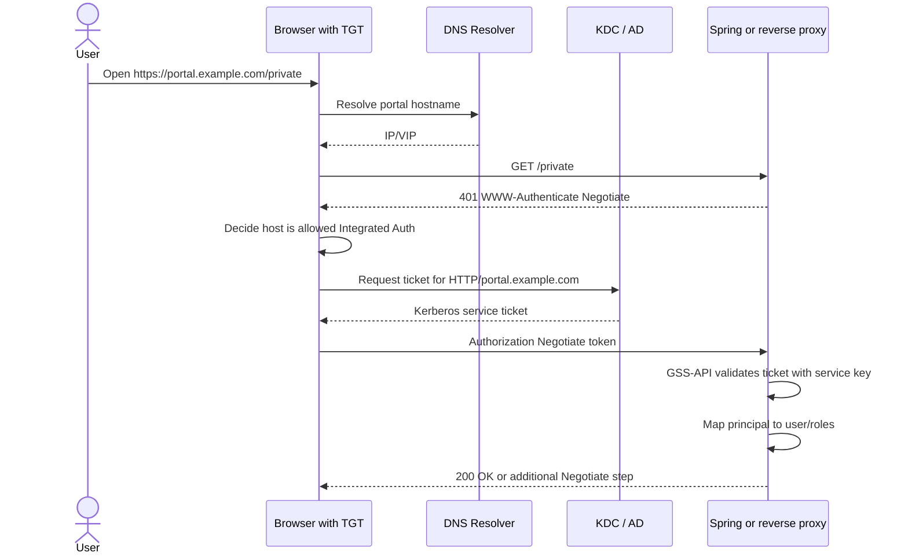

# DNS, Hostnames, Time Synchronization, and Operating Conditions for Kerberos/SPNEGO

**Module:** Spring Security – federation → Kerberos and SPNEGO.

**Objective:** understand why a Java/Spring Security application can return HTTP 200 over HTTPS while Kerberos/SPNEGO login still fails; identify and verify the practical prerequisites for DNS, public hostnames, SPNs of the form `HTTP/hostname`, Kerberos realms, KDCs, service accounts, keytab/KVNO, time synchronization, browser policies, firewalls, and reverse proxies. The lesson includes sequence diagrams, Windows/Linux inspection commands, a standalone Java 17 example, a troubleshooting matrix, and a deployment checklist.

**The single most important rule:** the browser must request a service ticket for the **exact Service Principal Name (SPN)**; the KDC must know which service account owns that SPN; the server or reverse proxy accepting Negotiate must hold the **matching service key**; clocks across client/KDC/acceptor must satisfy the clock skew policy; and the browser must actually allow Integrated Authentication for the visited hostname. Missing any one condition breaks SSO, even when the DNS A record and HTTPS both work.

End-to-end example:

| Component | Assumed Value |
| --- | --- |
| Kerberos realm | `EXAMPLE.COM` |
| Active Directory DNS domain | `example.com` |
| Public URL | `https://portal.example.com/private` |
| Kerberos HTTP SPN | `HTTP/portal.example.com@EXAMPLE.COM` |
| KDC / Domain Controllers | `dc01.example.com`, `dc02.example.com` |
| AD service account | `EXAMPLE\\svc-portal` |
| Acceptor keytab | `/run/secrets/kerberos/portal.keytab` |
| Backend | Spring Security Servlet on app01/app02 |
| Reverse proxy | `portal.example.com` points to VIP/ingress |

The domain, account, IPs, and keytab in this lesson are samples, not valid credentials. Commands that modify SPNs, passwords, DNS, or time services must be executed by administrators under change control; learners primarily use **read/observe** commands in authorized environments.

## 1. Overview of Kerberos Over HTTP via SPNEGO

**SPNEGO** (Simple and Protected GSS-API Negotiation Mechanism) is a GSS-API negotiation mechanism. Over HTTP, the server challenges with the `WWW-Authenticate: Negotiate` header and the browser replies with `Authorization: Negotiate`. On an intranet, the GSS mechanism is typically Kerberos; some platforms may use NTLM if permitted.



An initial `401` response is usually a **normal challenge**, not a security failure. Additional Negotiate rounds may occur before the context completes. If the browser sends no Authorization header after the challenge, investigate browser policy, credentials, and the KDC before blaming Spring.

HTTP example (token is a placeholder, not for real use):

```http
HTTP/1.1 401 Unauthorized
WWW-Authenticate: Negotiate
```

```http
GET /private HTTP/1.1
Host: portal.example.com
Authorization: Negotiate <base64-gssapi-token>
```

**Never copy real tokens into logs, tickets, or chat.** SPNEGO is not an OIDC ID Token or SAML Assertion. Even after GSS authentication succeeds, the application must still enforce data access and tenant permissions.

## 2. The Hostname Itself Is Part of the Service Identity

Per RFC 4559, a host-based service principal for HTTP Kerberos is typically:

```text
HTTP/hostname
```

With a realm:

```text
HTTP/portal.example.com@EXAMPLE.COM
```

**`HTTP` is the Kerberos service class**, not the URL scheme. For `https://portal.example.com`, the service class is still `HTTP`, **not `HTTPS`.**

Three hostnames are very easy to confuse:

```text
Browser URL host:      portal.example.com
Backend machine name:  app01.example.com
Pod/container name:    portal-web-65c7c8c7fc-vj8ps
SPN user needs:        HTTP/portal.example.com@EXAMPLE.COM
```

If the browser requests a ticket for `HTTP/portal.example.com`, a server holding a keytab for `HTTP/app01.example.com` will generally fail to decrypt it. Behind a load balancer, design the SPN around the **public FQDN the browser uses** (accounting for actual canonicalization rules) rather than giving each node its own separate SPN by default.

### 2.1. A Realm Is Not a DNS Hostname

The Kerberos realm `EXAMPLE.COM` and DNS domain `example.com` are commonly related, yet not automatically identical across every organization. An AD forest may have child domains, trusted realms, UPN suffixes, VPN split-DNS, or cross-realm trusts. You must align:
- The realm to which the principal/service ticket belongs.
- The DNS domain of the public hostname.
- The authoritative KDC issuing tickets for the SPN.
- `[domain_realm]` mappings or AD realm discovery.

In AD, `setspn` typically operates on `HTTP/portal.example.com` without the `@EXAMPLE.COM` suffix; the account/domain supplies the namespace. In MIT Kerberos tools, the full principal usually includes the realm. Do not treat formatting differences between the two tools as an error.

### 2.2. Does the Port Participate in the SPN?

Not always. Chrome/Chromium normally uses `HTTP/<canonical-host>` without appending a port. The enterprise policy `EnableAuthNegotiatePort` can cause the SPN to include non-standard ports, such as `HTTP/portal.example.com:8443`.

| URL | Typical SPN | Notes |
| --- | --- | --- |
| `https://portal.example.com` | `HTTP/portal.example.com` | HTTPS still uses service class HTTP |
| `https://portal.example.com:443` | `HTTP/portal.example.com` | Standard port is usually omitted |
| `https://portal.example.com:8443` | `HTTP/portal.example.com` | May append `:8443` depending on browser policy |
| `http://portal` | Depends on DNS suffix/canonicalization | Avoid short hostnames in production |

Base your conclusion on the **actual service ticket requested by the client** and the keytab/registered SPN, rather than guessing from the URL.

## 3. DNS A/AAAA Is Necessary, Not Sufficient

The application's public FQDN must resolve to the proper address within the browser's network context:

```dns
portal.example.com.   IN A    10.20.30.40
dc01.example.com.     IN A    10.20.1.10
dc02.example.com.     IN A    10.20.1.11
```

`10.20.30.40` may be a VIP, ingress, or reverse proxy rather than the Java backend itself. Internal desktops, off-VPN laptops, cluster pods, and domain controllers may receive different DNS views. Test from **the exact machine/cluster experiencing the failure**.

Linux:

```bash
getent ahosts portal.example.com
dig portal.example.com A +short
dig portal.example.com AAAA +short
```

Windows PowerShell:

```powershell
Resolve-DnsName portal.example.com -Type A
Resolve-DnsName portal.example.com -Type AAAA
Resolve-DnsName dc01.example.com -Type A
```

These commands only verify resolution. Absence of `AAAA` **is not necessarily an error** in IPv4-only environments; when IPv6 is enabled and clients prefer IPv6 addresses, verify IPv6 routing to ingress and the KDC.

### 3.1. A CNAME Alias Can Change the Requested SPN

Example:

```dns
portal.example.com.      IN CNAME ingress01.example.com.
ingress01.example.com.   IN A     10.20.30.40
```

The browser opens `https://portal.example.com`, yet some Kerberos libraries/Chromium configurations canonicalize to `ingress01.example.com` and request a ticket for `HTTP/ingress01.example.com`. When the server holds only the key for `HTTP/portal.example.com`, Negotiate can fail even though IP and HTTPS work.

| SPN Requested by Browser | SPN/Key Held by Server | Result |
| --- | --- | --- |
| `HTTP/portal.example.com` | `HTTP/portal.example.com` | Can succeed |
| `HTTP/ingress01.example.com` | Only `HTTP/portal.example.com` | Likely key/SPN error |
| `HTTP/portal.example.com` | AD SPN registered on account A, keytab from B | Failure |
| `HTTP/portal.example.com` | Same SPN registered on duplicate accounts | KDC may reject or issue ticket with wrong key |

Chromium provides the `DisableAuthNegotiateCnameLookup` policy affecting whether the original hostname is used instead of the canonical name. This is **client-specific behavior**, not a global KDC flag. Do not alter CNAMEs or create domain-wide wildcard SPNs before verifying which service name the browser actually requests.

### 3.2. Is Reverse DNS (PTR) Always Mandatory?

No. MIT Kerberos has `dns_canonicalize_hostname` and `rdns` options; some configurations forward-resolve and then reverse-lookup the IP to find the canonical hostname. When PTR points to `app01` instead of `portal`, the client may request an unintended SPN. However, not every browser/OS uses reverse lookup during HTTP Negotiate.

Check on Linux:

```bash
dig -x 10.20.30.40 +short
```

Windows:

```powershell
Resolve-DnsName 10.20.30.40 -Type PTR
```

**Do not treat a missing PTR as the universal root cause of all Kerberos errors.** If the actual client does not perform reverse canonicalization, a missing PTR can be harmless; inspect which SPN is requested. For MIT clients, `rdns=false` sometimes resolves bad PTR names; this does not automatically alter Chrome, Windows SSPI, or JDK behavior across all platforms.

### 3.3. Short Hostnames and DNS Search Suffixes

`http://portal` may be expanded by the OS to `portal.example.com` on an internal machine, while another VPN client appends a different DNS suffix. Browsers may also classify a short host as Intranet Zone and allow Negotiate automatically, whereas a dotted public FQDN is classified differently.

Recommendation: use **a single canonical public FQDN** for the application URL, SPN, TLS certificate, and proxy config. Never rely on short hostnames, localhost, Kubernetes node names, or manual hosts files to make production run.

## 4. DNS SRV and KDC Discovery

A Kerberos client needs to locate the realm's KDC. In Active Directory, DNS SRV records help locate domain controllers; MIT Kerberos can use DNS or a KDC list in `krb5.conf`.

Example:

```dns
_kerberos._tcp.example.com. IN SRV 0 100 88 dc01.example.com.
_kerberos._tcp.example.com. IN SRV 0 100 88 dc02.example.com.
_kerberos._udp.example.com. IN SRV 0 100 88 dc01.example.com.
```

SRV records contain priority, weight, port, and target. **Port 88 is Kerberos/KDC, not HTTPS**. AD sites may also have site-specific SRV records and site-aware DC selection logic.

Linux:

```bash
dig SRV _kerberos._tcp.example.com +short
dig SRV _kerberos._udp.example.com +short
```

Windows:

```powershell
Resolve-DnsName _kerberos._tcp.example.com -Type SRV
nltest /dsgetdc:example.com
```

DNS SRV returning a KDC **does not guarantee** firewall UDP/TCP 88 is open or that the KDC holds the right SPN. Verify network connectivity and service ticket acquisition separately.

### 4.1. Example `krb5.conf`

```ini
[libdefaults]
    default_realm = EXAMPLE.COM
    dns_lookup_kdc = true
    dns_lookup_realm = false
    rdns = false
    clockskew = 300

[realms]
    EXAMPLE.COM = {
        kdc = dc01.example.com
        kdc = dc02.example.com
    }

[domain_realm]
    .example.com = EXAMPLE.COM
    example.com  = EXAMPLE.COM
```

- `default_realm` is the client's default realm.
- `[realms]` specifies explicit KDCs; when both an explicit list and DNS lookup are configured, verify which source your implementation prioritizes.
- `[domain_realm]` maps domain hostnames to realms.
- `rdns=false` helps some MIT clients with unstable reverse DNS; **it is not a fix for all browsers**.
- `clockskew=300` is 300 seconds, matching the common 5-minute threshold; **do not raise it recklessly** to ignore clock errors.

Sample files must be tailored to real realms/KDCs and security policies; do not disable DNS discovery in HA KDC setups if hardcoding KDCs breaks failover.

### 4.2. How Does Java 17 Select the Realm/KDC?

The JDK includes Kerberos via `java.security.jgss`, `org.ietf.jgss`, `javax.security.auth.kerberos`, and JAAS. You can set:

```bash
java -Djava.security.krb5.conf=/etc/krb5.conf -jar app.jar
```

Or two system properties that **must be set together** when configured directly:

```bash
java \
  -Djava.security.krb5.realm=EXAMPLE.COM \
  -Djava.security.krb5.kdc=dc01.example.com \
  -jar app.jar
```

When unspecified, the JDK searches default config locations per Java home/OS. The `KRB5_CONFIG` environment variable used by MIT libraries **does not automatically guarantee** the JDK/JAAS uses the same file or DNS canonicalization; inspect the process's actual config. Java Kerberos uses the `javax.security.auth.kerberos` package **even when Spring Boot 3/4 Servlet uses `jakarta.servlet`**; the two API groups are independent.

## 5. Time Synchronization and Clock Skew Thresholds

Kerberos uses authenticator timestamps and ticket lifetimes to prevent replay and control sessions. Microsoft Windows/AD has a **Maximum tolerance for computer clock synchronization** policy with a common default of **5 minutes**; MIT Kerberos typically defaults to `clockskew=300` seconds. This is a **configurable policy**, not a fixed constant for every domain.

Clocks to verify:
- Client browser/desktop requesting the TGT and service ticket.
- KDC/Domain Controller issuing tickets.
- Spring server or proxy processing GSS tickets.
- DCs in the time hierarchy; VM hosts/Kubernetes nodes.
- Depending on the flow, cross-realm KDCs or other backend acceptors.

**Different timezones are not an error** if machines represent the same absolute instant. A machine in Vietnam showing 17:00 +07 and a KDC showing 10:00 UTC are still synchronized. Conversely, two machines in the same timezone drifting by 8 minutes will fail.

### 5.1. Example

```text
KDC clock        10:00:00 UTC
Client clock     10:02:00 UTC   (+120 seconds)
Server clock     10:00:30 UTC   (+30 seconds)
Default skew     300 seconds

Drift within simulated threshold: may PASS if other conditions hold.

KDC clock        10:00:00 UTC
Client clock     10:07:00 UTC   (+420 seconds)
Default skew     300 seconds

Client may be rejected due to time skew.
```

This is an **explanatory model**, not a substitute for actual RFC/KDC/acceptor logic. Thresholds vary by policy and ticket/message type; use system logs to pinpoint **which hop** reports clock skew.

**Five minutes is a tolerance ceiling, not an operational target.** Production systems should maintain much smaller offsets, alert early on sync failures, and never raise tolerance to an hour.

### 5.2. Linux Time Diagnostics

```bash
date -u
timedatectl status
timedatectl timesync-status
chronyc tracking
chronyc sources -v
```

Not every Linux distro has `chrony` or `systemd-timesyncd`; use only tools installed on the host. Inspect time source, offset, stratum, last synchronization, VM/hypervisor host, and node sync health. Containers normally share the **host's kernel clock**; setting `TZ=UTC` changes display only and **does not fix NTP drift**.

### 5.3. Windows Time Diagnostics

```powershell
w32tm /query /status
w32tm /query /source
w32tm /query /peers
w32tm /stripchart /computer:dc01.example.com /dataonly /samples:5
```

With appropriate privileges and change approval, you can resync:

```powershell
w32tm /resync
```

Time service operations can affect scheduled tasks and logs. Never manually adjust a domain controller's clock or disable clock checks; fix the proper NTP source / domain time hierarchy.

### 5.4. Clock Skew Differs from Ticket Expiry

| Error / Field | Meaning |
| --- | --- |
| `KRB_AP_ERR_SKEW` or `KRB5KRB_AP_ERR_SKEW` | Authenticator/request timestamp outside tolerance |
| `KRB_AP_ERR_TKT_EXPIRED` | Ticket has expired, even if clocks are accurate |
| `starttime/endtime/renew-till` | Ticket/TGT lifecycle bounds |
| Expired TGT in `klist` | Requires valid renewal or re-login mechanism |
| Expired HTTPS certificate | Browser/proxy TLS issue, **not directly Kerberos ticket clock skew** |

Never increase ticket lifetimes or clockskew just because of an unclassified `401` error.

## 6. Registering the SPN on the Right Service Account

In Active Directory, the `servicePrincipalName` attribute maps an SPN to the account holding the service key. If a user requests a ticket for a nonexistent SPN, the KDC returns principal unknown; if the SPN exists while the server's keytab belongs to a different account, the server cannot decrypt the ticket.

### 6.1. AD SPN Inspection Commands

```powershell
setspn -Q HTTP/portal.example.com
setspn -X
setspn -L EXAMPLE\svc-portal
```

`-Q` queries a principal; `-X` detects duplicates; `-L` lists SPNs on a service account. Appropriate privileges and AD scope are required; `-X` can take time in a large forest.

Modifying command **for approved admins only**:

```powershell
setspn -S HTTP/portal.example.com EXAMPLE\svc-portal
```

`-S` checks for duplicates before adding. Never register an SPN on multiple accounts; never create wildcard SPNs or assign unnecessarily privileged service accounts. If URL aliases/CNAMEs create new hostnames for which browsers actually request tickets, admins must design corresponding SPNs consistently.

### 6.2. Keytab, KVNO, and Encryption Types

A **keytab** holds sensitive key material so the server GSS acceptor can decrypt/accept Kerberos tickets. It requires the right principal, right account key, matching enctype, and a **Key Version Number (KVNO)** compatible with the KDC. After a service account password rotation, old keytabs can become unusable.

On Linux, inspect keytab metadata in an authorized environment:

```bash
klist -k -t -e /run/secrets/kerberos/portal.keytab
```

Usually this prints principal, version, and enctype without printing key bytes; however, **the keytab itself is a secret**—never copy/commit it into Git or CI logs. Admins can test the credential if policy allows:

```bash
kinit -k -t /run/secrets/kerberos/portal.keytab \
  HTTP/portal.example.com@EXAMPLE.COM
```

Do not use this service principal as an ordinary user to call arbitrary APIs. Test in a controlled environment and never expose keytabs through public tools.

### 6.3. Verifying That the Client Can Obtain a Service Ticket

On Linux with Kerberos utilities:

```bash
kinit user@EXAMPLE.COM
kvno HTTP/portal.example.com@EXAMPLE.COM
klist
```

On Windows:

```powershell
klist
klist get HTTP/portal.example.com
```

`kinit`/`klist` verify TGT/cached tickets; `kvno`/`klist get` test ticket acquisition for a specific SPN. **Successfully obtaining a ticket does not prove the Java acceptor has the key or that the browser allows Negotiate**. A real test still requires the HTTP 401 challenge, Authorization header, and acceptor verification.

If you encounter `KRB_AP_ERR_MODIFIED` or equivalent, check:
- The SPN belongs to **the exact service account** and is not duplicated.
- The process keytab was generated from that same account's key.
- KVNO, encryption types (AES per policy), and key version after rotation.
- Across a cluster, all pods use compatible keytab sets.
- Whether CNAME/port settings cause the browser to request a different SPN than the keytab.

Never enable weak DES/RC4 or disable integrity checks to "fix an error". Use algorithms and key lengths supported by domain/KDC and Java per security policy.

## 7. Network: HTTPS Is Not the Only Dependency

| Path | Typical Port | Role |
| --- | --- | --- |
| Browser → web app/proxy | TCP 443 | HTTPS and Negotiate |
| Client → KDC | TCP/UDP 88 | AS/TGS, obtaining TGT and service tickets |
| Involved hosts → DNS | TCP/UDP 53 | A/AAAA/CNAME/PTR/SRV lookups |
| Time sources | UDP 123 or AD time hierarchy | NTP/time synchronization |
| Password change service | TCP/UDP 464 | kpasswd if workflows require it |
| AD LDAP/DC discovery | TCP/UDP 389, LDAPS TCP 636 if used | User/group lookups, AD discovery |
| Cross-realm path | TCP/UDP 88 to partner realm | Kerberos referrals/trusts |

This table lists **common ports**, not a checklist to open everywhere. Domain-join/GPO/AD management may need additional ports, yet not every browser SPNEGO request uses them. Verify the actual topology: does the browser reach the KDC directly or via VPN/domain environment? Which KDC serves the site?

Linux:

```bash
getent hosts dc01.example.com
nc -vz dc01.example.com 88
curl -I --max-time 5 https://portal.example.com/private
```

Windows:

```powershell
Test-NetConnection dc01.example.com -Port 88
Test-NetConnection portal.example.com -Port 443
Resolve-DnsName _kerberos._tcp.example.com -Type SRV
```

`nc` and `Test-NetConnection` mainly test TCP and do not prove UDP works. `curl -I` may simply show the 401 challenge. **Never expose KDC port 88 publicly to the Internet** or drop firewalls just to give off-VPN machines SSO; use approved VPN/Zero Trust/Identity federation instead.

## 8. The Browser Must Permit Integrated Authentication

A client with a valid TGT still will not send `Authorization: Negotiate` automatically if the browser does not trust the host, runs in a restricted profile, or lacks an OS/GSS provider.

### 8.1. Chrome / Edge

Items typically checked under enterprise/browser policy:
- `AuthServerAllowlist` (older Chromium docs call it `AuthServerWhitelist`): list of hosts allowed to receive Integrated Authentication.
- `AuthSchemes` includes `negotiate`.
- `DisableAuthNegotiateCnameLookup` affects whether the SPN uses the CNAME or the original URL host.
- `EnableAuthNegotiatePort` affects appending non-standard ports.
- `AuthNegotiateDelegateAllowlist` governs credential delegation; **not needed for normal login**.
- Intranet Zone classification/enterprise policy; Chrome/Edge on Windows can use OS SSPI. Incognito/Guest profiles may be restricted.

Inspect `chrome://policy` or `edge://policy` directly on the user's machine. Never allow a wildcard matching all Internet hosts to receive domain credentials. A dotted FQDN sometimes falls outside Windows' default Local Intranet Zone, requiring an explicit enterprise allowlist.

### 8.2. Firefox / Linux / macOS and CLI

Firefox has the `network.negotiate-auth.trusted-uris` setting/policy and corresponding delegation options; verify against your managed version. Linux/macOS require an appropriate GSSAPI provider/credential cache; one browser does not necessarily share a TGT with another.

When a curl build supports Negotiate and the host has Kerberos credentials:

```bash
curl --negotiate -u : \
  --silent --show-error \
  --output /dev/null \
  --write-out 'HTTP %{http_code}\n' \
  https://portal.example.com/private
```

`200` proves only that the URL responded successfully, not that Kerberos succeeded if the app allows anonymous/fallback paths. Verify the GSS mechanism and server audit logs. **Never use curl `-k/--insecure` to bypass TLS validation**, and never enable verbose traces containing SPNEGO tokens in production.

### 8.3. SPNEGO Does Not Mean Kerberos-Only

Some Negotiate stacks can fall back to NTLM. If compliance requires **Kerberos-only**, measure the actual negotiated mechanism rather than marking tests passed solely because HTTP login succeeded. Never accept unintended fallback without proving KDC/SPN behavior.

## 9. Spring Security Kerberos and Java JAAS / JGSS

**Spring Security Kerberos** is a separate extension, not activated automatically by `saml2Login()` or `oauth2Login()`. Spring documentation describes these components:
- `SpnegoEntryPoint` generates the challenge.
- `SpnegoAuthenticationProcessingFilter` processes the Negotiate header.
- `KerberosServiceAuthenticationProvider` uses a ticket validator to authenticate.
- `SunJaasKerberosTicketValidator` uses JAAS/JGSS, service principal, and keytab.
- `UserDetailsService`/LDAP maps the Kerberos principal to user/authorities.
- `SecurityFilterChain` routes URLs and enforces session/authorization.

**Version compatibility must be checked explicitly:** a Spring Security Kerberos extension release may target older Spring/Servlet APIs. Java 17 JAAS uses `javax.security.auth.kerberos`, whereas Spring Boot 3/4 web uses `jakarta.servlet`. Do not drop an old `javax.servlet` JAR into Boot 4 expecting it to work; check dependency trees, Javadocs, release support, and end-to-end tests with a KDC.

### 9.1. Spring Bean Snippet Illustrating SPN / Keytab

```java
import org.springframework.context.annotation.Bean;
import org.springframework.context.annotation.Configuration;
import org.springframework.core.io.FileSystemResource;
import org.springframework.security.kerberos.authentication.sun
        .SunJaasKerberosTicketValidator;

@Configuration
public class KerberosValidatorConfig {

    @Bean
    SunJaasKerberosTicketValidator kerberosTicketValidator() {
        SunJaasKerberosTicketValidator validator =
                new SunJaasKerberosTicketValidator();
        validator.setServicePrincipal(
                "HTTP/portal.example.com@EXAMPLE.COM");
        validator.setKeyTabLocation(new FileSystemResource(
                "/run/secrets/kerberos/portal.keytab"));
        validator.setDebug(false);
        return validator;
    }
}
```

This is a **configuration fragment**, not a standalone runnable app: it still needs compatible extension dependencies, a Spring Boot main class, authentication provider, filter, entry point, user mapping, authorization, and a real KDC. Note `servicePrincipal` must match the SPN of tickets requested by clients; the keytab file must be mounted read-only and readable only by the service UID.

Sample `application.yml` separating custom app config:

```yaml
app:
  kerberos:
    service-principal: HTTP/portal.example.com@EXAMPLE.COM
    keytab-location: /run/secrets/kerberos/portal.keytab
    public-url: https://portal.example.com

server:
  forward-headers-strategy: framework
  servlet:
    session:
      cookie:
        secure: true
        http-only: true
```

`app.kerberos` **is not built-in Spring Boot SPNEGO auto-configuration**. Without code binding/reading these properties, they do not activate Kerberos. `forward-headers-strategy` should only be enabled when ingress strips spoofed client headers and Spring trusts only authorized proxies.

### 9.2. The Reverse Proxy Determines Where the Service Key Lives

**Case A – Proxy terminates Negotiate:** nginx/Apache/IIS/auth gateway acts as the Kerberos acceptor and owns the keytab/service identity for `HTTP/portal.example.com`. Spring receives a **trusted identity assertion/header** from the internal proxy. You must strip client-supplied identity headers, enforce mTLS/network isolation, and never expose the backend directly; otherwise an attacker can send `X-User` and bypass authentication.

**Case B – Proxy passes Negotiate through to Spring:** the Java/JGSS backend holds the keytab/SPN; the proxy must forward `WWW-Authenticate: Negotiate` and `Authorization: Negotiate` faithfully without rewriting/blocking headers or authenticating once itself and expecting the backend to authenticate again. If HTTPS terminates at the proxy, protect the proxy→backend link properly.

**Case C – Multiple pods behind the same public host:** every acceptor must hold a key matching the single public SPN and a valid key version. When rotating the service account password/kvno, roll out keytabs systematically so half the pods do not hold only the old key while the KDC stops honoring it.

### 9.3. Sessions and Authorization Remain the Application's Responsibility

After GSS succeeds, the application must:
- Map the Kerberos principal to the proper internal user, tenant, and roles.
- Never grant `ROLE_ADMIN` to every domain user by default.
- Protect `SecurityContext`/`HttpSession`, session fixation protection, and CSRF for state-changing POSTs.
- Account for logout: clearing the app's local session **does not erase the Windows TGT/SSO credential cache**. The browser can immediately auto-log in again on the next request.
- Test filter ordering, endpoint challenge/response, failure paths, multi-instance behavior, auditing, and error messages.
- Keep Kerberos principals cleanly separated from OAuth2/SAML identities if the app supports multiple login methods.

## 10. Standalone Java 17: Checking SPN Logic and Clock Drift

The Java exercise below uses **JDK 17** only and runs with `javac/java`; it does not contact KDC/DNS, read tickets/keytabs, or authenticate users. It illustrates the requirements that **the SPN name must match** and **time drift must stay within policy**.

File `KerberosPrerequisiteDemo.java`:

```java
import java.net.URI;
import java.time.Duration;
import java.time.Instant;
import java.util.Locale;

public class KerberosPrerequisiteDemo {

    static String normalizeHost(String raw) {
        if (raw == null || raw.isBlank()) {
            throw new IllegalArgumentException("Host required");
        }
        String host = raw.toLowerCase(Locale.ROOT);
        return host.endsWith(".")
                ? host.substring(0, host.length() - 1)
                : host;
    }

    static String httpSpn(String host, String realm) {
        return "HTTP/" + normalizeHost(host) + "@" + realm;
    }

    static boolean allowedDrift(
            Instant first, Instant second, Duration maxSkew) {
        return Duration.between(first, second).abs()
                .compareTo(maxSkew) <= 0;
    }

    public static void main(String[] args) {
        URI uri = URI.create("https://PORTAL.example.com/private");
        String host = normalizeHost(uri.getHost());
        String service = httpSpn(host, "EXAMPLE.COM");
        String alias = httpSpn("ingress01.example.com", "EXAMPLE.COM");

        Instant kdc = Instant.parse("2026-11-07T03:00:00Z");
        Duration tolerance = Duration.ofMinutes(5);

        System.out.println("URL host: " + host);
        System.out.println("Service SPN: " + service);
        System.out.println("Alias matches: " + service.equals(alias));
        System.out.println("Drift 120s allowed: " +
                allowedDrift(kdc, kdc.plusSeconds(120), tolerance));
        System.out.println("Drift 420s allowed: " +
                allowedDrift(kdc, kdc.plusSeconds(420), tolerance));
    }
}
```

Run:

```bash
javac KerberosPrerequisiteDemo.java
java KerberosPrerequisiteDemo
```

**Exact stdout on JDK 17+:**

```text
URL host: portal.example.com
Service SPN: HTTP/portal.example.com@EXAMPLE.COM
Alias matches: false
Drift 120s allowed: true
Drift 420s allowed: false
```

**Limitations:** `normalizeHost` performs simple string normalization for the exercise only and **does not perform DNS CNAME/PTR canonicalization**, IDN mapping, or production host verification. `allowedDrift` models a time-difference check and does not implement RFC 4120 replay defense or ticket lifetimes. SPN/realm strings are hardcoded solely for deterministic stdout. In real systems, inspect KDC tickets, browser behavior, and keytabs in your actual environment.

## 11. Classifying Errors by Layer Instead of Guessing

| Symptom | Possible Cause | Right Action |
| --- | --- | --- |
| Browser receives 401, sends **no** Authorization Negotiate | Untrusted host, no TGT, browser policy | Check `chrome://policy`/Intranet Zone, TGT, response headers |
| Browser sends NTLM, not Kerberos | SPN/KDC error or fallback policy | Check mechanism, requested SPN, KDC |
| `KDC_ERR_S_PRINCIPAL_UNKNOWN` | Missing SPN or wrong realm lookup | `setspn -Q`, alias/CNAME, realm |
| `KRB_AP_ERR_MODIFIED` | Service key mismatches SPN/account/KVNO/enctype | SPN ownership, `setspn -X`, keytab |
| `KRB_AP_ERR_SKEW` | Client/KDC/acceptor out of sync | `chronyc`/`w32tm`, time source |
| `KRB_AP_ERR_TKT_EXPIRED` | Ticket/TGT expired | `klist`, renewal, KDC policy |
| FQDN succeeds, alias fails | Different SPN canonicalization | DNS CNAME/PTR and browser policy |
| TCP 443 succeeds, SSO fails | KDC TCP/UDP 88 or keytab error | SRV, network, service ticket, acceptor |
| Only node B fails | Stale keytab, differing KVNO/enctype/permissions | Compare secret rollout per node |
| Only off-VPN machines fail | No TGT/KDC route, split DNS | Clear remote-access/fallback architecture |
| Same timezone, yet clock skew | Real clock drift between machines | Compare UTC and NTP offset |
| Has TGT, cannot get service ticket | Wrong SPN/realm/KDC | `kvno`, `klist get`, SPN ownership |
| Has service ticket, yet perpetual HTTP 401 | Keytab/GSS/browser/proxy header | Inspect acceptor and 401 handshake |
| Kerberos auth succeeds, yet HTTP 403 | Insufficient role/tenant mapping | Authorization policy; do not change SPN |
| Auto-logs back in after app logout | OS still holds TGT | Distinguish local logout from domain SSO |
| Java CLI works, Spring container fails | Differing krb5.conf, UID/keytab, DNS, JAAS/filter | Check runtime pod config/JVM properties |
| Reverse proxy returns 401 loop | Strips/blocks Authorization or WWW-Authenticate | Fix HTTP Negotiate forwarding |
| Browser authenticates, yet fails Kerberos-only | NTLM fallback | Verify mechanism; fail closed per policy |

**Never use dangerous workarounds:** never disable TLS hostname verification, never open wildcard SPNs/trusted hosts, never disable GSS integrity, never enable NTLM outside policy, and never raise clock skew infinitely.

### 11.1. Each Diagnostic Tool Verifies Only One Condition

- `dig`/`Resolve-DnsName` verifies DNS, not the SPN.
- `Test-NetConnection` TCP 88 does not fully test UDP or KDC authentication.
- `kinit` acquiring a TGT does not prove a service ticket works.
- `kvno`/`klist get` obtains a service ticket, yet does not prove the acceptor keytab matches.
- `setspn -Q` shows an SPN, yet does not prove the keytab/KVNO is right.
- `curl -I` showing 401 may simply be the normal challenge.
- `w32tm`/`chronyc` reports the time source, yet **all** involved machines must be checked.

Check in order: **browser URL → DNS → KDC discovery → SPN → keytab/KVNO → time sync → HTTP Negotiate → Spring Authentication → business authorization**.

### 11.2. Enable Java Debugging Only Under Strict Control

```bash
java \
  -Djava.security.krb5.conf=/etc/krb5.conf \
  -Dsun.security.krb5.debug=true \
  -Dsun.security.jgss.debug=true \
  -Dsun.security.spnego.debug=true \
  -jar app.jar
```

Debug flags depend on the JDK implementation; Oracle Java documents Kerberos/JGSS/SPNEGO debugging flags. Logs can contain principals, hosts, credential metadata, or sensitive details. Enable temporarily in a sandbox/incident window, redact before sharing, and disable immediately afterward.

With JAAS `Krb5LoginModule`, `useKeyTab`, `keyTab`, `principal`, `storeKey`, `doNotPrompt`, and `isInitiator` must match either the **acceptor** or **initiator** role. Never copy an outbound client JAAS config onto an SPNEGO server without reviewing it.

## 12. Pre-Production Test Matrix

| Test Case | Method | Expectation |
| --- | --- | --- |
| Public hostname | DNS A/AAAA + HTTPS | Points to right ingress/VIP, valid cert |
| CNAME alias | Check actual client SPN | SPN matches account/keytab |
| Missing reverse DNS | Test clients with/without rdns | Do not assume PTR is mandatory |
| Short hostname | VPN/off-VPN DNS suffixes | Use canonical FQDN |
| KDC SRV records | Query _kerberos._tcp | KDC discovered for right realm |
| KDC connectivity | Actual TCP/UDP 88 | Not blocked by firewall |
| Cross realm | Realm trust/referral | User from allowed realm obtains ticket |
| SPN uniqueness | setspn -Q/-X | No duplicate service accounts |
| Wrong account SPN | Broken AD mapping | Ticket safely rejected |
| Keytab principal | klist -k | Exact HTTP/FQDN@REALM |
| Keytab KVNO/enctype | Rotate service account key | Pods hold matching keys |
| User TGT | klist | Valid ticket |
| Service ticket | kvno/klist get | Exact SPN |
| Initial 401 challenge | Browser network | Negotiate header sent |
| Trusted browser host | Enterprise allowlist | Authorization Negotiate sent |
| Unknown browser host | Not allowlisted | Does not auto-send domain credentials |
| NTLM fallback | Check mechanism | Denied if policy is Kerberos-only |
| 120s simulated skew | Lab with 300s policy | Can pass |
| 420s simulated skew | Lab with 300s policy | Fails per time policy |
| Time sync failure on node | Chrony/Windows Time monitoring | Alert triggered and fault isolated |
| Different TZ, same instant | UTC verification | No false errors |
| Reverse proxy passthrough | HTTP header tests | No loss of Authorization/Negotiate |
| Proxy terminates SPNEGO | Identity header security | No spoofed user |
| Cluster rolling upgrade | Multiple pods/keytabs | SSO stable across all nodes |
| Local logout | Browser keeps TGT | UX matches SSO design |
| Privilege mapping | Kerberos user lacks role | 403, no implicit roles granted |
| Off-domain browser | No TGT | Proper policy fallback, no bypass |
| Debug logs | Security audit | No leaked tickets/keytabs/secrets |

**Real testing** requires a domain-credentialed browser/OS, a KDC/AD test environment, SPN/keytab, proper networking, and multiple nodes. Spring `@WithMockUser` only places an Authentication in the test SecurityContext and **does not prove Kerberos/SPNEGO works**.

## 13. Conditions for Kubernetes and Load Balancers

A single public hostname `portal.example.com` can route to multiple pods:

```text
Browser ---> https://portal.example.com (HTTP/portal.example.com)
                |
             VIP / Ingress
                |
           +----+----+
           |         |
          Pod A     Pod B
           |         |
       Keytab N   Keytab N
```

If **Spring on each pod accepts Negotiate**, all pods must hold credentials matching the same SPN and KDC-issued tickets. Pods having random hostnames is not an error as long as `servicePrincipal` is configured accurately. When rotating the service account password/KVNO, roll out keytabs in sync and account for in-flight tickets per security policy; never bake keytabs into container images.

Kubernetes containers usually share the **node's system clock**; if only pods on worker node B report `KRB_AP_ERR_SKEW`, check NTP on that node/hypervisor. Changing `TZ` inside the pod changes display only.

If the proxy/ingress **terminates SPNEGO itself**, only the proxy needs the Kerberos acceptor key. Downstream apps may trust identity only after the proxy authenticates and strips client-provided identity headers. Keep the two models clearly separated; never have both the proxy and Spring consume tokens without a verified protocol flow.

**Remote users and split DNS:** off-VPN machines may reach the HTTPS page yet fail to reach the KDC or lack a TGT. Never expose domain controllers/KDCs publicly just to "fix errors"; choose an explicit VPN/Zero Trust or OIDC/SAML fallback design.

## 14. Ordered Quick-Check Runbook

**DNS and hostname**
- [ ] Consistent public FQDN for browser and TLS.
- [ ] A/AAAA points to the right VIP; CNAME/PTR behavior understood for real clients.
- [ ] DNS SRV or realm/KDC config returns the proper KDC.
- [ ] No redirects to a host lacking an SPN.

**KDC and service identity**
- [ ] Browser/OS holds a TGT or a valid path to acquire one.
- [ ] KDC is reachable with the right realm and trust path.
- [ ] SPN `HTTP/portal.example.com` exists **uniquely** on the proper account.
- [ ] Keytab contains valid key/KVNO/enctype; process has restricted read permission.
- [ ] Service key rotation does not leave pods with incompatible secrets.

**Clock and browser**
- [ ] Client, KDC/DC, and acceptor/VM nodes have reliable time sources and small offsets.
- [ ] Display timezones are not confused with actual clock drift.
- [ ] Browser policy allowlists exact hosts; broad delegation is not enabled.
- [ ] Negotiate is sent and accepted properly; Kerberos vs. NTLM verified if required.

**Spring and operations**
- [ ] SPNEGO extension matches the Spring Security/Jakarta runtime and filter chain.
- [ ] Reverse proxy neither drops headers nor trusts spoofed user headers.
- [ ] SecurityContext, CSRF, authorization/tenant, and session/logout are tested.
- [ ] Monitoring covers SPN/KDC/keytab/time skew, with credentials masked in logs.
- [ ] Tested VPN/off-VPN, cluster failover, key rotation, and negative cases.

## 15. Self-Check Questions

**Q1. Why can HTTPS access succeed while Kerberos login still fails?**  
Because HTTPS only authenticates/connects the web server via TLS. Kerberos additionally requires browser trusted-host policy, a TGT, a KDC service ticket for the right SPN, an acceptor keytab, and synchronized clocks.

**Q2. When the URL is `https://portal.example.com`, must the SPN be `HTTPS/portal.example.com`?**  
No. The HTTP service class in Kerberos is normally `HTTP/portal.example.com`, even over HTTPS.

**Q3. Can a CNAME change the requested SPN?**  
Yes. Some clients canonicalize from the URL alias to the DNS target; browser policy and libraries decide. Check the actual service ticket before registering extra SPNs.

**Q4. Does a missing PTR record always break SPNEGO?**  
No. It matters when the client performs reverse canonicalization; it is not mandatory in every implementation.

**Q5. Does a 5-minute clock skew tolerance mean keeping clocks 4 minutes apart is recommended?**  
No. That is a common default tolerance ceiling. Production requires small offsets and early alerts rather than consuming that margin.

**Q6. If `setspn -Q` finds the SPN, is the server guaranteed to decrypt the ticket?**  
No. The keytab might belong to the wrong account, have the wrong KVNO/enctype or file permissions, or the browser might request an alias SPN.

**Q7. Spring Boot 4 uses `jakarta.servlet`, so why does the JDK still have `javax.security.auth.kerberos`?**  
Because that is a Java SE JAAS package, unrelated to the Servlet/Jakarta EE namespace transition.

**Q8. Is a browser receiving 401 always a failure?**  
Not necessarily. An initial 401 with `WWW-Authenticate: Negotiate` is the normal challenge step; check whether the browser replies with a valid ticket.

## 16. Official Documentation

1. [RFC 4559 – SPNEGO-based Kerberos and NTLM HTTP Authentication](https://www.rfc-editor.org/rfc/rfc4559): HTTP 401/Negotiate and SPN `HTTP/hostname`.
2. [RFC 4120 – Kerberos V5](https://www.rfc-editor.org/rfc/rfc4120): KDC, tickets, realms, lifetimes, and replay.
3. [RFC 4178 – SPNEGO GSS-API Mechanism](https://www.rfc-editor.org/rfc/rfc4178): negotiation mechanism.
4. [MIT Kerberos – Principal Names and DNS](https://www.mit.edu/~kerberos/krb5-1.21/doc/admin/princ_dns.html): CNAME, PTR, canonicalization, and SPNs.
5. [MIT Kerberos – krb5.conf](https://web.mit.edu/kerberos/krb5-latest/doc/admin/conf_files/krb5_conf.html): realms, DNS, and clockskew.
6. [Microsoft – Kerberos troubleshooting](https://learn.microsoft.com/en-us/troubleshoot/windows-server/windows-security/kerberos-authentication-troubleshooting-guidance): SPN, keytab/mismatch, and time.
7. [Microsoft – Maximum tolerance for computer clock synchronization](https://learn.microsoft.com/en-us/previous-versions/windows/it-pro/windows-server-2012-r2-and-2012/jj852172(v=ws.11)): default policy around 5 minutes.
8. [Chromium – HTTP Authentication](https://www.chromium.org/developers/design-documents/http-authentication/): browser trusted-host allowlist, CNAME, and port policies.
9. [Oracle Java 17 – Kerberos package](https://docs.oracle.com/en/java/javase/17/docs/api/java.security.jgss/javax/security/auth/kerberos/package-summary.html): JDK/JAAS Kerberos and `java.security.krb5.conf`.
10. [Oracle Java – Security Troubleshooting](https://docs.oracle.com/en/java/javase/24/security/troubleshooting-security.html): JGSS/Kerberos/SPNEGO debug flags.
11. [Spring Security – Spring and Spring Security Kerberos](https://docs.spring.io/spring-security/reference/servlet/authentication/kerberos/ssk.html): `SpnegoEntryPoint`, `KerberosServiceAuthenticationProvider`, `SunJaasKerberosTicketValidator`.
12. [Spring Security Kerberos Project](https://spring.io/projects/spring-security-kerberos/): separate extension and version support.

**Conclusion:** SPNEGO/Kerberos works reliably when the **public FQDN, browser-requested SPN, AD/KDC service account, acceptor keytab, realm/DNS discovery, and system clocks** all align; the browser must also permit Negotiate for that host. Troubleshoot in order: **DNS → SPN → KDC → ticket → keytab/KVNO → NTP → HTTP headers → Spring Authentication → authorization**. Never bypass verification, widen clock tolerance, or open wildcards just to make 401 errors disappear.