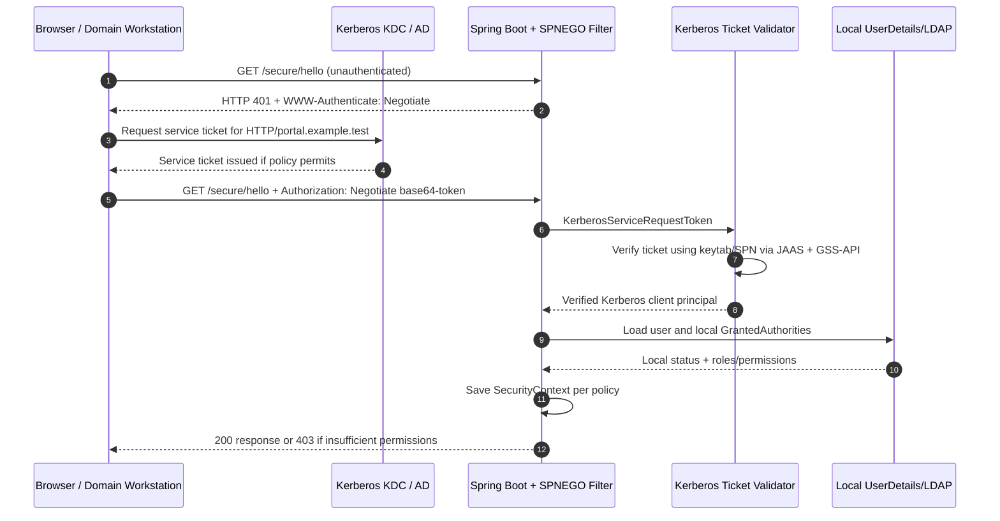

# Configuring the Spring Security Kerberos Extension Compatible with the Application

## 1. Problem Statement and Scope

An enterprise web application can allow employees who have logged into a domain-joined workstation to access internal pages without re-entering their password. The browser and server exchange **SPNEGO/HTTP Negotiate**, which typically carries a **Kerberos service ticket**; Java verifies the ticket using the service's key, while Spring Security creates an `Authentication` and enforces application authorization.

The difficulty is not merely adding a dependency. Spring Boot, Spring Security, the **Spring Security Kerberos** extension, the Java version, the servlet API, the web browser, the Domain Controller/Kerberos KDC, the service principal name (SPN), the keytab, and the authorization policy must be **compatible across multiple layers**. Choosing an older Kerberos library on Boot 3 can fail with `javax.servlet`/`jakarta.servlet` errors; if the SPN is wrong, the browser can loop on 401 even though the Java configuration compiles.

This lesson guides how to configure the **Spring Security Kerberos extension** for **Spring Boot Servlet**. The implementation focus is **Spring Boot 3.x + Spring Security 6.5.x + Java 17+ + Spring Security Kerberos 2.2.0**, using `SpnegoAuthenticationProcessingFilter`, `SpnegoEntryPoint`, `KerberosServiceAuthenticationProvider`, and `SunJaasKerberosTicketValidator`.

The `example.test` URLs, principals, service accounts, and keytab files are **illustrative data only**, not working credentials. Running real SPNEGO requires a realm/KDC, SPN, keytab, and browser configured by an IT/domain administrator.

### After This Lesson, Learners Should Be Able To

1. Choose the right **dependency branch** based on Spring Boot/Spring Security.
2. Explain the `WWW-Authenticate: Negotiate` → `Authorization: Negotiate` flow and the responsibility of each Spring Security component.
3. Prepare the `HTTP/fqdn@REALM` SPN, keytab, `krb5.conf`, DNS, and time synchronization.
4. Configure a valid `SecurityFilterChain` with the SPNEGO filter, provider, ticket validator, and `UserDetailsService`.
5. Distinguish an authenticated Kerberos username from **local roles/tenant/ACL**, without granting admin permissions merely because domain login succeeded.
6. Design persistence/CSRF/session/HTTPS and avoid duplicate filter registration.
7. Integrate into an application that already has OIDC/SAML/Bearer using separated filter chains.
8. Diagnose 401, `KRB_AP_ERR_MODIFIED`, clock skew, keytab mismatch, duplicate SPN, KDC/network failures, and browsers not attaching a Negotiate token.
9. Run real integration tests without exposing Kerberos tokens or keytab contents.

## 2. How Do Kerberos, SPNEGO, JAAS, and Spring Security Differ?

| Component | Primary Role | Verified By What? |
| --- | --- | --- |
| **Kerberos KDC** | Authentication Service/Ticket Granting Service, issues TGTs and service tickets | Realm principals, shared keys, time, and KDC policy |
| **Kerberos Ticket Granting Ticket (TGT)** | Held by user/client after domain login, used to request service tickets | Ticket cache, KDC; the raw TGT is not sent to the web application |
| **Service ticket** | Proves the user holds a ticket for the `HTTP/host@REALM` service | Service decrypts/verifies using the corresponding key, replay/time checks |
| **SPNEGO / HTTP Negotiate** | HTTP authentication handshake, mechanism negotiation | `WWW-Authenticate`/`Authorization` headers and GSS-API |
| **JDK JAAS / JGSS** | Logs in the acceptor/service principal, processes GSS/Kerberos | `krb5.conf`, keytab, `javax.security.auth.*`, `org.ietf.jgss.*` |
| **Spring Security Kerberos extension** | Reads the Negotiate header, runs the Kerberos validator, and binds the principal into Spring Security | `SpnegoAuthenticationProcessingFilter`, provider, validator |
| **Spring Security Authorization** | Decides which resources the principal may view or modify | `GrantedAuthority`, `authorizeHttpRequests`, `@PreAuthorize`, ACL/tenant |

**Kerberos authenticates identity; it does not automatically grant application permissions.** A keytab allows the web server to accept service tickets bearing the matching SPN; it does **not** contain a list of business roles, and knowing the user `alice@EXAMPLE.TEST` does not by itself prove that Alice belongs to the finance department.

Spring Security Kerberos is an **extension**, not the entire core `spring-security-config`. It integrates Kerberos into the existing `AuthenticationManager`/`AuthenticationProvider`/`SecurityFilterChain` architecture.

### How It Differs from SAML and OIDC

A SAML SP receives a `SAMLResponse` at the ACS and verifies the XML Signature/trust metadata. An OIDC RP receives an authorization code and ID Token and verifies the issuer/audience/nonce. SPNEGO relies on a **domain ticket** and **HTTP Negotiate**. A Windows account logged into a domain does not automatically issue an OIDC ID Token, SAML Assertion, or OAuth Bearer access token.

## 3. HTTP Negotiate Flow and Authentication in the Application



Two typical HTTP messages:

```http
HTTP/1.1 401 Unauthorized
WWW-Authenticate: Negotiate
```

```http
GET /secure/hello HTTP/1.1
Host: portal.example.test
Authorization: Negotiate <BASE64_SPNEGO_TOKEN_REDACTED>
```

`Authorization: Negotiate` **is neither Basic Auth nor OAuth Bearer**. The base64 payload is a SPNEGO/GSS token, which inside may contain a Kerberos AP-REQ. **Base64 does not encrypt the message**; do not put this token into logs, public HAR files, proxy analytics, or exception responses.

If the browser does not have a domain ticket or does not trust the host as intranet, it may not send a Negotiate token even when the server returns the correct challenge. Therefore, you must check browser/OS/KDC/SPN as well, not just the Java configuration.

## 4. Version Compatibility Is the First Step, Not the Last

| Application Branch | Java / Servlet | Spring Security | Spring Security Kerberos Extension | Things to Note |
| --- | --- | --- | --- | --- |
| **Spring Boot 3.x aligned with Security 6.5.x** | Java 17+, **`jakarta.servlet`** | **6.5.x** | **2.2.0**, group `org.springframework.security.kerberos` | The 2.2.0 documentation tests against JDK 17, Security 6.5.1, and Framework 6.2.8 |
| Spring Boot 3.x on Security 6.0–6.3 | Java 17+, `jakarta.servlet` | Older 6.x | Choose an extension release **tested with the corresponding minor**, e.g. 2.0.x/2.1.x | Do not claim 2.2.0 fits every Boot 3.x |
| Legacy Spring Boot 2.x | Usually Java 8/11/17, **`javax.servlet`** | 5.x | Matching 1.x extension branch, with an upgrade plan | Do not mix 1.x jars with a Jakarta application |
| Spring Security **7.x** / Spring Framework 7 | Java 17+ per extension docs, Jakarta | 7.x | Kerberos **7.x** branch, group `org.springframework.security` | **Maven/Gradle coordinates changed**, do not copy the 2.2.0 group |

**Verified reference point:** official Spring Security Kerberos **2.2.0** documentation states it is tested with **JDK 17, Spring Security 6.5.1, Spring Framework 6.2.8**. Spring Security Kerberos **7.x** documentation specifies groupId **`org.springframework.security`** instead of **`org.springframework.security.kerberos`**.

Do not blindly pick the highest version number. Identify the **Boot BOM**, `spring-security-web`, `spring-security-config`, `spring-security-kerberos-core`, `spring-security-kerberos-web`, Servlet API, and Java first. The extension may have a different support baseline than the Spring Boot BOM, so you must inspect the dependency tree and run integration tests.

### Signs of Choosing the Wrong Branch

- `ClassNotFoundException: javax.servlet.Filter` or `NoClassDefFoundError: javax/servlet/...` in Boot 3: a jar using the old Servlet API is present.
- `NoSuchMethodError` between `spring-security-web` and the extension: Spring Security API mismatch.
- The `SpnegoAuthenticationProcessingFilter` bean does not implement `jakarta.servlet.Filter`: a legacy jar was pulled in by mistake.
- A plugin/BOM automatically pulls Security 7 while the extension is 2.x: do not apply without checking compatibility.
- Maven resolves two versions of `spring-security-kerberos-core`/`web` simultaneously: versions must be aligned.

## 5. Choosing Dependencies for Java 17 + Boot 3/Security 6.5

In a Gradle project **already configured with Spring Boot 3.x plugins, dependency management, and Maven Central**, add the following dependencies (for example, pinning extension version 2.2.0):

```groovy
dependencies {
    implementation "org.springframework.boot:spring-boot-starter-web"
    implementation "org.springframework.boot:spring-boot-starter-security"

    implementation "org.springframework.security.kerberos:spring-security-kerberos-core:2.2.0"
    implementation "org.springframework.security.kerberos:spring-security-kerberos-web:2.2.0"

    testImplementation "org.springframework.boot:spring-boot-starter-test"
    testImplementation "org.springframework.security:spring-security-test"
}
```

This is a **`build.gradle` snippet**, not a standalone project. If using Maven, the equivalent coordinates are:

```xml
<dependency>
    <groupId>org.springframework.security.kerberos</groupId>
    <artifactId>spring-security-kerberos-core</artifactId>
    <version>2.2.0</version>
</dependency>
<dependency>
    <groupId>org.springframework.security.kerberos</groupId>
    <artifactId>spring-security-kerberos-web</artifactId>
    <version>2.2.0</version>
</dependency>
```

The Maven example is also a **`pom.xml` snippet**.

The two jars have distinct responsibilities:

- **Core:** Kerberos service authentication, JAAS ticket validator, client/JGSS integration.
- **Web:** SPNEGO HTTP filter and entry point.
- **Spring Security core/config/web:** authorization, filter chain, security context, user details.

Do not copy the Spring Security 7 dependency `org.springframework.security:spring-security-kerberos-web` into a project running Spring Security 6.5. Conversely, when upgrading to Security 7, read **the documentation for version 7** and switch to the appropriate coordinates rather than trying to keep the 2.x artifacts.

### Inspecting the Dependency Tree

```bash
./gradlew dependencyInsight \
  --dependency spring-security-web \
  --configuration runtimeClasspath

./gradlew dependencyInsight \
  --dependency spring-security-kerberos \
  --configuration runtimeClasspath
```

Goal: know the resolved versions and avoid having one Security 6.5 jar and one 6.1 jar due to transitive dependencies. You can use `./gradlew dependencies --configuration runtimeClasspath` to view the entire graph. For Maven, use `mvn dependency:tree` according to your build configuration.

**Do not disable CVE checks or force dependency downgrades** just to get an extension version to compile; choose a version set with an appropriate support/patching policy, then run real integration tests.

## 6. Kerberos Realm, DNS, SPN, Keytab, and Browser Must Agree on One Name

Assume:

```text
Kerberos realm:     EXAMPLE.TEST
KDC/AD domain:      ad.example.test
Public application: https://portal.example.test
HTTP service SPN:   HTTP/portal.example.test@EXAMPLE.TEST
Service keytab:     /run/secrets/kerberos/portal-http.keytab
```

Practical rules:

1. The browser must access an **FQDN matching the SPN**, not a pod IP, an arbitrary short hostname, or an unregistered alias.
2. The KDC must have a principal/service account owning the exact SPN, **not duplicated** across multiple service accounts.
3. The application's keytab contains the key with the exact **principal, key version number (KVNO), and encryption type (enctype)** that the KDC uses for service tickets.
4. The JVM needs realm/KDC/DNS/trust configuration via `krb5.conf` or a compatible Java Kerberos mechanism.
5. User, KDC, and server clocks must be sufficiently synchronized (NTP); Kerberos enforces a clock skew limit.
6. Public DNS FQDN, reverse proxy, and keytab SPN must be consistent, even when TLS terminates at ingress.
7. Never ask users to provide their domain password to "generate SPNEGO"; the browser/OS Kerberos client handles tickets.

### Why URL, Host, and SPN Are Not the Same Thing

- URL the user calls: `https://portal.example.test/secure/hello`.
- Kerberos service principal: `HTTP/portal.example.test@EXAMPLE.TEST`.
- Keytab: secret file containing the key for that SPN.
- TLS certificate: authenticates the **HTTPS hostname**, does not replace the keytab or Kerberos service key.
- KDC ticket: encrypted for the **service key**, not with the TLS private key.

If the browser calls `https://proxy-alias.example.test` while the KDC only has SPN `HTTP/portal.example.test`, it may request a ticket for a nonexistent host alias or the server may fail to decrypt it. Register the SPN for the approved alias, or use a fixed canonical public URL.

## 7. Preparing the Service Principal and Keytab Safely

In Microsoft Active Directory, an AD administrator typically registers the SPN on a privileged **service account**, for example following this pattern:

```powershell
# Active Directory admin example only; replace CORP and the real service account name.
setspn -S HTTP/portal.example.test CORP\svc-portal
setspn -Q HTTP/portal.example.test
```

`-S` helps detect duplicate SPNs before adding via the appropriate Windows/AD tooling; `-Q` queries existing SPNs. Commands must be run by an authorized administrator under change control. **Never self-register SPNs on a production domain from an application pod.**

The keytab must be generated with tools and procedures supported by the active Kerberos/AD system (e.g. `ktpass` under AD administration, or `kadmin/ktadd` with MIT Kerberos), with the exact principal, KVNO/enctype, and account. **Do not put commands containing plaintext passwords in articles, repositories, or CI logs.** In practice there are many AD AES256/AES128 and principal-mapping variants; follow an approved internal runbook.

Inspect the keytab **on an authorized host/volume**:

```bash
# Lists principal/KVNO/enctype metadata only; does not print key material.
klist -kte /run/secrets/kerberos/portal-http.keytab
```

`klist -kte` on MIT Kerberos typically lists principal, key version, and encryption type; the output can still be sensitive configuration metadata, so do not paste it into public issues. Some OSes/JDKs provide different tools; check `klist --help` in the actual environment.

**A keytab file with the wrong SPN/KVNO/enctype cannot be "fixed" merely by renaming the file.** You must reissue the keytab and coordinate with KDC/service account rotation.

## 8. Configuring krb5.conf, DNS, and the JVM

Example `/etc/krb5.conf` in a Linux environment using MIT Kerberos/Active Directory:

```ini
[libdefaults]
  default_realm = EXAMPLE.TEST
  dns_lookup_kdc = true
  rdns = false

[realms]
  EXAMPLE.TEST = {
    kdc = dc1.example.test
    kdc = dc2.example.test
  }

[domain_realm]
  .example.test = EXAMPLE.TEST
  example.test = EXAMPLE.TEST
```

This is an **illustrative configuration**, and should not replace a production configuration already managed by operations without review. Some environments rely on DNS SRV records instead of a fixed KDC list; others use cross-realm trusts, DNS aliases, or different policies.

For the JVM, you can specify a particular `krb5.conf` file:

```bash
JAVA_TOOL_OPTIONS="-Djava.security.krb5.conf=/etc/krb5.conf" \
  ./gradlew bootRun
```

In a container, pass the option via command/`JAVA_TOOL_OPTIONS` depending on deployment. Process-level Java configuration affects all JAAS/GSS calls using that JVM. **Do not** leave `sun.security.krb5.debug=true` enabled long-term in production because debug output can expose metadata/authentication details.

KDC connectivity: verify DNS resolution and network rules for Kerberos (typically TCP/UDP port 88; AD additionally uses LDAP 389/636 and DNS 53 depending on the flow). Do not open wide ports or disable the host firewall because of a single failed test. LDAP is only needed if the application actually queries AD to retrieve roles/user attributes.

## 9. Configuring Spring Boot application.yml for Kerberos

Spring Boot does not have a built-in core property like `spring.security.kerberos.enabled=true` analogous to `oauth2Login`. With this extension, the application **declares beans explicitly** and reads the SPN/keytab from properties.

```yaml
app:
  kerberos:
    service-principal: "HTTP/portal.example.test@EXAMPLE.TEST"
    keytab-location: "file:/run/secrets/kerberos/portal-http.keytab"

server:
  servlet:
    session:
      cookie:
        secure: true
        http-only: true
        same-site: "lax"
```

The two `app.kerberos.*` properties here are **example-defined configuration keys**, not Spring Boot auto-configuration. `keytab-location` uses the Spring Resource `file:` prefix, allowing Java to bind it into a `FileSystemResource` or appropriate `Resource`.

The `SameSite=Lax` cookie setting is merely an option for an **internal web session using browser navigation**; depending on SAML/OIDC callbacks or embedded apps, it may need adjustment. SPNEGO does not automatically enforce `Secure`/`HttpOnly` cookies and does not replace CSRF protection.

Do not use `classpath:portal-http.keytab` in production if doing so bundles a private key into the JAR. Mount the keytab from a secret manager or read-only volume, restrict access to the app's OS account, and maintain a rotation process.

## 10. Spring Security Beans to Wire Together

A typical SPNEGO configuration has five parts:

1. **`SunJaasKerberosTicketValidator`**: uses the keytab and HTTP service principal to validate Kerberos/AP-REQ via JAAS/JGSS.
2. **`KerberosServiceAuthenticationProvider`**: uses the validator and then calls `UserDetailsService` to retrieve authorities for the Kerberos-authenticated user.
3. **`AuthenticationManager`**: typically a `ProviderManager` holding the Kerberos provider and any other providers the app needs.
4. **`SpnegoAuthenticationProcessingFilter`**: reads `Authorization: Negotiate` and submits a `KerberosServiceRequestToken` to the manager.
5. **`SpnegoEntryPoint`**: issues HTTP `401` + `WWW-Authenticate: Negotiate` when a protected request is unauthenticated; a fallback can be configured if an explicit setup exists.

Spring Security flow:

```text
HTTP Negotiate header
     |
SpnegoAuthenticationProcessingFilter
     |
KerberosServiceRequestToken
     |
AuthenticationManager / KerberosServiceAuthenticationProvider
     |
SunJaasKerberosTicketValidator + SPN + keytab
     |
Verified Kerberos identity
     |
UserDetailsService -> local GrantedAuthorities
     |
SecurityContext -> authorizeHttpRequests -> Controller
```

**`KerberosAuthenticationProvider` is not required** if the server only accepts service tickets via SPNEGO. `KerberosAuthenticationProvider` uses `SunJaasKerberosClient` for username/password authentication against Kerberos or client-specific flows; avoid inadvertently enabling a username/password fallback if the app does not need it.

## 11. Java 17/Spring Boot 3 Example: SPNEGO SecurityFilterChain

The example below contains a complete Java class demonstrating **wiring** for Security 6.5/Kerberos 2.2.0. It uses a simple `Map` as a **demo local user directory**: users not in the list are rejected; production must replace this with a managed database/LDAP/policy service.

Save at `src/main/java/demo/kerberos/KerberosWebApplication.java`:

```java
package demo.kerberos;

import java.util.Map;

import org.springframework.beans.factory.annotation.Value;
import org.springframework.boot.SpringApplication;
import org.springframework.boot.autoconfigure.SpringBootApplication;
import org.springframework.context.annotation.Bean;
import org.springframework.core.io.Resource;
import org.springframework.http.HttpStatus;
import org.springframework.security.authentication.ProviderManager;
import org.springframework.security.config.annotation.web.builders.HttpSecurity;
import org.springframework.security.core.Authentication;
import org.springframework.security.core.userdetails.User;
import org.springframework.security.core.userdetails.UserDetailsService;
import org.springframework.security.core.userdetails.UsernameNotFoundException;
import org.springframework.security.kerberos.authentication.KerberosServiceAuthenticationProvider;
import org.springframework.security.kerberos.authentication.sun.SunJaasKerberosTicketValidator;
import org.springframework.security.kerberos.web.authentication.SpnegoAuthenticationProcessingFilter;
import org.springframework.security.kerberos.web.authentication.SpnegoEntryPoint;
import org.springframework.security.web.SecurityFilterChain;
import org.springframework.security.web.authentication.session.ChangeSessionIdAuthenticationStrategy;
import org.springframework.security.web.authentication.www.BasicAuthenticationFilter;
import org.springframework.security.web.context.HttpSessionSecurityContextRepository;
import org.springframework.web.bind.annotation.GetMapping;
import org.springframework.web.bind.annotation.RestController;

@SpringBootApplication
@RestController
public class KerberosWebApplication {

    public static void main(String[] args) {
        SpringApplication.run(KerberosWebApplication.class, args);
    }

    @Bean
    UserDetailsService localUsers() {
        // Demo ONLY: application account mapping, does not contain domain passwords.
        Map<String, String[]> authorities = Map.of(
                "alice@EXAMPLE.TEST", new String[] { "ROLE_EMPLOYEE" },
                "ops@EXAMPLE.TEST", new String[] {
                        "ROLE_EMPLOYEE", "ROLE_ADMIN"
                }
        );

        return username -> {
            String[] granted = authorities.get(username);
            if (granted == null) {
                throw new UsernameNotFoundException(
                        "No approved local account for Kerberos identity");
            }

            // The password in this UserDetails is NOT used on the SPNEGO path.
            return User.withUsername(username)
                    .password("{noop}not-used-for-kerberos")
                    .authorities(granted)
                    .build();
        };
    }

    @Bean
    SunJaasKerberosTicketValidator ticketValidator(
            @Value("${app.kerberos.service-principal}") String spn,
            @Value("${app.kerberos.keytab-location}") Resource keytab) {
        SunJaasKerberosTicketValidator validator =
                new SunJaasKerberosTicketValidator();
        validator.setServicePrincipal(spn);
        validator.setKeyTabLocation(keytab);
        validator.setDebug(false);
        return validator;
    }

    @Bean
    KerberosServiceAuthenticationProvider kerberosProvider(
            SunJaasKerberosTicketValidator validator,
            UserDetailsService localUsers) {
        KerberosServiceAuthenticationProvider provider =
                new KerberosServiceAuthenticationProvider();
        provider.setTicketValidator(validator);
        provider.setUserDetailsService(localUsers);
        return provider;
    }

    @Bean
    SecurityFilterChain webSecurity(
            HttpSecurity http,
            KerberosServiceAuthenticationProvider kerberosProvider)
            throws Exception {

        ProviderManager authenticationManager =
                new ProviderManager(kerberosProvider);

        SpnegoAuthenticationProcessingFilter spnego =
                new SpnegoAuthenticationProcessingFilter();
        spnego.setAuthenticationManager(authenticationManager);

        // IMPORTANT: by default, the extension filter does NOT persist
        // SecurityContext across requests.
        spnego.setSecurityContextRepository(
                new HttpSessionSecurityContextRepository());

        // Apply session fixation protection on successful authentication.
        spnego.setSessionAuthenticationStrategy(
                new ChangeSessionIdAuthenticationStrategy());

        return http
                .authorizeHttpRequests(auth -> auth
                        .requestMatchers("/", "/health").permitAll()
                        .requestMatchers("/secure/admin/**")
                            .hasRole("ADMIN")
                        .requestMatchers("/secure/**").authenticated()
                        .anyRequest().denyAll())
                .exceptionHandling(errors -> errors
                        .authenticationEntryPoint(new SpnegoEntryPoint()))
                .authenticationProvider(kerberosProvider)
                .addFilterBefore(spnego, BasicAuthenticationFilter.class)
                .build();
    }

    @GetMapping("/")
    public String index() {
        return "Kerberos SPNEGO demonstration";
    }

    @GetMapping("/health")
    public String health() {
        return "up";
    }

    @GetMapping("/secure/hello")
    public String hello(Authentication authentication) {
        return "Hello " + authentication.getName();
    }

    @GetMapping("/secure/admin/status")
    public String admin(Authentication authentication) {
        return "Admin " + authentication.getName();
    }
}
```

### Key Points to Understand

- `SpnegoAuthenticationProcessingFilter` **is instantiated with `new` inside the filter chain**, not declared as a separate `@Bean`, to prevent Spring Boot from automatically registering it as a **servlet container filter** outside the Spring Security chain.
- `ProviderManager` uses `KerberosServiceAuthenticationProvider` exclusively. If the application has OIDC/SAML or other providers, the manager and filter chains must be designed carefully.
- `SunJaasKerberosTicketValidator` verifies the ticket using the SPN/keytab. It does **not** load admin roles itself.
- `UserDetailsService` retrieves authorities from an **application-managed directory**. Unprovisioned user ⇒ fail-closed.
- `.hasRole("ADMIN")` defaults to requiring the `ROLE_ADMIN` authority; Alice cannot access `/secure/admin/status`, while ops can only if both Kerberos authentication and local lookup succeed.
- `SpnegoEntryPoint()` produces the Negotiate challenge. If a browser does not support SPNEGO, it may continue receiving 401; a fallback login form must be explicitly configured, not assumed by default.
- CSRF remains enabled per Spring Security defaults. Do not call `csrf.disable()` across the whole application just because of SPNEGO.
- `HttpSessionSecurityContextRepository` keeps the SecurityContext in the session for web browsers. For stateless APIs, a different repository mechanism can be chosen and a ticket/Negotiate token required per request per policy.

**Environment limitation:** the class compiles when using the dependency/version in section 5, a valid Spring Boot configuration, and Java 17+. However, **Kerberos authentication cannot complete without an appropriate KDC, service principal, and keytab**. There is no fixed Kerberos stdout.

### Considerations for SecurityContext Repository

Per the `SpnegoAuthenticationProcessingFilter` 2.2.0 JavaDoc, **by default the filter does not save the `SecurityContext`** after authentication. For a browser-session application, the example calls:

```java
spnego.setSecurityContextRepository(
        new HttpSessionSecurityContextRepository());
```

This is an **explicit** configuration, not something Spring Security guarantees automatically for custom filters. Without saving the context, subsequent requests may be challenged again or forced to renegotiate even though the user just logged in. On the other hand, if the API application is intentionally stateless, **do not add session persistence** just to mask a client failing to send tokens.

### Session Fixation Protection

The filter JavaDoc also notes that `SessionAuthenticationStrategy` may default to **no-op** if left unset. In the web session demo, `ChangeSessionIdAuthenticationStrategy` rotates the session ID upon successful authentication on supported Servlet containers, helping mitigate session fixation. You must verify interactions with the session repository, Spring Session, concurrent-session controls, and filter order in a real application. `setSkipIfAlreadyAuthenticated` defaults to true per the API, helping avoid renegotiating when a valid security context already exists.

## 12. Web Request Path and Expected Responses

When the app starts with the right keytab/realm and the domain client already holds Kerberos credentials:

1. `GET /` returns the public string.
2. `GET /health` returns `up`.
3. Unauthenticated `GET /secure/hello` triggers `401` with `WWW-Authenticate: Negotiate`.
4. The browser/OS requests a service ticket from the KDC for `HTTP/portal.example.test@EXAMPLE.TEST`.
5. The browser sends the Negotiate token; the filter/provider/JAAS verifies it and loads the local user.
6. If the user is `alice@EXAMPLE.TEST`, `/secure/hello` can return `Hello alice@EXAMPLE.TEST`.
7. Alice accessing `/secure/admin/status` receives **403 Forbidden** due to lacking `ROLE_ADMIN`.
8. `ops@EXAMPLE.TEST` having `ROLE_ADMIN` granted by the app directory is allowed to access the admin endpoint.

Do not describe steps 4–8 as results reproducible on any arbitrary laptop: the machine must join the Kerberos realm or hold a valid ticket cache, the browser must be configured for Negotiate, and the KDC and keytab must be in sync.

If using `curl` to test, you need a curl build with GSSAPI/SPNEGO support and a user ticket cache:

```bash
# On a machine configured for the realm with a valid user credential:
klist

# Instruct curl to use Negotiate (':' is a curl parameter)
curl --negotiate -u : \
  https://portal.example.test/secure/hello
```

If no user TGT exists yet, a managed environment may require running `kinit alice@EXAMPLE.TEST` first, per IT policy. Never put passwords into shell commands, and never expose `KRB5CCNAME`/ticket caches publicly.

## 13. Comparing KerberosServiceAuthenticationProvider and KerberosAuthenticationProvider

These two names look similar but serve different scenarios:

| Provider | Input | Core Component | Best Fit |
| --- | --- | --- | --- |
| **KerberosServiceAuthenticationProvider** | `KerberosServiceRequestToken` carrying a service ticket/SPNEGO token | `KerberosTicketValidator`, such as `SunJaasKerberosTicketValidator` | Web SPNEGO, server **accepting tickets** from clients |
| **KerberosAuthenticationProvider** | Username/password token along the Kerberos client path | `KerberosClient`, such as `SunJaasKerberosClient` | Applications needing to validate credentials against Kerberos |

An application that only accepts browser Negotiate tokens **does not need users to enter their domain password**, so `KerberosServiceAuthenticationProvider` is usually sufficient. Enabling a form fallback using AD/LDAP or a Kerberos password client requires product justification, security review, TLS, CSRF, credential-handling policy, and a properly configured authentication manager.

**Do not replace `SunJaasKerberosTicketValidator` with `SunJaasKerberosClient`** when the server needs to accept SPNEGO tokens. One is a service-side ticket validator, while the other is a Kerberos client for initiating authentication with different credentials.

## 14. UserDetailsService: Safely Mapping Identity to Roles

The Kerberos service ticket tells the application which **client principal** was authenticated by the KDC. Yet `KerberosServiceAuthenticationProvider` still needs a `UserDetailsService` to obtain `UserDetails` and `GrantedAuthority`.

While the demo uses a `Map`, production typically uses:

- Application database: an `external_identity_link` table or account directory mapping `kerberosPrincipal -> localUserId`.
- LDAP/Active Directory: reading user status, groups, or organizationally authorized attributes.
- Policy service: managing role/tenant permissions by local user ID, action, and resource.
- HR provisioning system: managing active/disabled account status and entitlement lifecycle.

Do not automatically grant `ROLE_ADMIN` based on:

- `username.endsWith("@EXAMPLE.TEST")`.
- A well-formed SPNEGO token that has not been validated.
- A group named `Admins` from a realm/forest trust not approved by policy.
- The request's hostname/subdomain.
- An `X-Remote-User` header value sent by an Internet client.

**The source of identity must be the Kerberos principal confirmed by the validator**, not an HTTP header self-asserted by the browser. One user might share the same `sAMAccountName` across two realms/trusts; the **full principal and realm** namespace must be preserved when mapping to local accounts.

### Username Canonicalization

In AD environments, a principal may have an uppercase realm, an alias, or a UPN different from the local username. Design canonicalization **according to rules approved by the IT/identity team**. Do not strip `@REALM` and map every `alice` from trusted forests into the same local user without verifying tenant/issuer.

### Per-Resource Authorization

`hasRole("EMPLOYEE")` is only a coarse HTTP guard. For document/record APIs, method-level or repository-level ACLs must check **local user + tenant + documentId + action**. Successful Kerberos authentication does not replace authorization.

## 15. Integrating LDAP/Active Directory for Permissions

The Spring Security Kerberos extension supports LDAP/AD integration through several components:

- `KerberosLdapContextSource`: an LDAP context capable of using JAAS Kerberos login.
- `SunJaasKrb5LoginConfig`: configures principal/keytab/initiator for JAAS when a client component needs to log in.
- `FilterBasedLdapUserSearch` and `LdapUserDetailsService` in Spring Security LDAP: searches for users and maps attributes/authorities.
- `ActiveDirectoryLdapAuthenticationProvider`: an option for **credential-based authentication** against AD, distinct from service-ticket validation.

An example **configuration snippet** for a Kerberos LDAP context:

```java
KerberosLdapContextSource source =
        new KerberosLdapContextSource("ldap://dc1.example.test:389");

SunJaasKrb5LoginConfig jaas = new SunJaasKrb5LoginConfig();
jaas.setServicePrincipal("HTTP/portal.example.test@EXAMPLE.TEST");
jaas.setKeyTabLocation(
        new FileSystemResource("/run/secrets/kerberos/portal-http.keytab"));
jaas.setIsInitiator(true);
jaas.afterPropertiesSet();

source.setLoginConfig(jaas);
```

This is an **illustrative API snippet**, not a standalone runnable class. For outbound Kerberos LDAP, organizations typically provision **a dedicated initiator principal** with LDAP read permissions rather than reusing the acceptor SPN; it needs appropriate tickets for `ldap/dc1.example.test` and cross-realm policies. Do not assume an HTTP service principal keytab has any LDAP permissions.

**LDAP identity lookup differs from user password authentication.** Once SPNEGO has verified the user, you can use a read-only LDAP service account to look up groups; there is no need to make the user re-enter a password. When connecting to LDAP in production, consider policy-mandated LDAPS/StartTLS, certificate trust, LDAP filter escaping against injection, and allowlisted group mappings.

Do not copy a demo `DummyUserDetailsService` that hands `ROLE_USER` to all domain users into a system holding sensitive data.

## 16. SecurityFilterChain in an Application That Already Has SAML/OIDC or Bearer APIs

A federation application may simultaneously serve:

- `/intranet/**`: intranet browsers using Kerberos SPNEGO.
- `/web/**`: Internet browsers using OIDC/SAML SSO.
- `/api/**`: machines/applications sending OAuth Bearer access tokens.

**Do not cram every authentication mechanism into one filter chain and hope Spring Security picks the right one.** The clear approach is to separate `SecurityFilterChain` beans using `@Order` and `securityMatcher` by path/host/semantics.

Diagram:

```text
/api/**       -> JWT Resource Server (Bearer), stateless
/intranet/**  -> SPNEGO Negotiate (Kerberos), session or explicit policy
/web/**       -> OIDC/SAML Login (browser), session + CSRF
everything else -> deny by default
```

Separate API configuration snippet:

```java
@Bean
@Order(1)
SecurityFilterChain api(HttpSecurity http) throws Exception {
    return http
            .securityMatcher("/api/**")
            .sessionManagement(session -> session
                    .sessionCreationPolicy(SessionCreationPolicy.STATELESS))
            .csrf(AbstractHttpConfigurer::disable)
            .authorizeHttpRequests(auth -> auth
                    .anyRequest().authenticated())
            .oauth2ResourceServer(oauth ->
                    oauth.jwt(Customizer.withDefaults()))
            .build();
}
```

This is a **configuration class snippet** intended for a system that actually has the JWT Resource Server dependency and a `JwtDecoder` with trusted issuer/audience; `.authenticated()` alone does not replace object authorization. **Disable CSRF only on Bearer-only APIs**, never on web routes that use cookies.

Kerberos chain snippet:

```java
@Bean
@Order(2)
SecurityFilterChain intranet(
        HttpSecurity http,
        KerberosServiceAuthenticationProvider provider) throws Exception {

    SpnegoAuthenticationProcessingFilter filter =
            new SpnegoAuthenticationProcessingFilter();
    filter.setAuthenticationManager(new ProviderManager(provider));
    filter.setSecurityContextRepository(
            new HttpSessionSecurityContextRepository());

    return http
            .securityMatcher("/intranet/**")
            .authorizeHttpRequests(auth -> auth
                    .anyRequest().authenticated())
            .exceptionHandling(ex -> ex
                    .authenticationEntryPoint(new SpnegoEntryPoint()))
            .authenticationProvider(provider)
            .addFilterBefore(filter, BasicAuthenticationFilter.class)
            .build();
}
```

This is a **variant snippet** and should not be placed alongside the section 11 class unless intentionally splitting chains; it exists only to clarify separation. Web OIDC/SAML can use `@Order(3)` with `oauth2Login`/`saml2Login` and the corresponding protocol endpoints.

### Be Careful with Callback URLs

SPNEGO relies on `Authorization: Negotiate` challenge/response on the same host. OIDC and SAML have callback paths such as `/login/oauth2/code/{registrationId}` and `/login/saml2/sso/{registrationId}`. If using `securityMatcher("/web/**")` for the web chain, **callbacks outside /web** might miss the intended filter chain. You must configure `loginProcessingUrl`/callback processing paths or matchers wide enough to cover them, with proper CSRF/redirect rules. This is why path-by-path integration tests are needed when combining multiple federation protocols.

**Do not force a Bearer API missing a token to negotiate Kerberos** or route an OIDC callback through a SPNEGO entry point; each client type has its own authentication protocol.

## 17. SPNEGO and Reverse Proxies

Typical infrastructure:

```text
Browser --HTTPS--> public portal.example.test
                        |
                   Reverse Proxy
                        |
                 Spring Boot :8080
                        |
              Kerberos ticket validator
```

Conditions:

1. The browser uses the **public FQDN** URL that has the `HTTP/portal.example.test` SPN registered.
2. The proxy **does not strip or alter** `Authorization: Negotiate` when Spring Boot is responsible for verifying the ticket.
3. The proxy forwards the `WWW-Authenticate: Negotiate` challenge from the backend back to the browser.
4. Ensure TLS, forwarded hosts, and routing are correct; do not expose the backend to the Internet where it could receive forged headers.
5. If the proxy **terminates Kerberos authentication itself** instead of forwarding the Negotiate header, Spring Boot cannot simply trust `X-Remote-User`. A trusted gateway must be designed with network isolation, header stripping, mTLS, or signed identity assertions, rather than blindly removing authentication filters.
6. Do not expect the Java keytab to match an **internal pod hostname** if the browser obtains a ticket for the **public FQDN**.
7. Across multiple replicas, every acceptor node must be able to use the exact same service principal/keytab, key version, and storage/session policy.

### Extended Protection / Channel Binding

Windows AD, IIS, or Java GSS may require **channel binding / Extended Protection for Authentication (EPA)**. If a proxy TLS termination setup drops channel binding context, `GSSException: Channel binding mismatch` can occur. **Do not resolve this by disabling EPA/LM compatibility or weakening workstation policies.** Evaluate the JDK version, TLS termination architecture, reverse proxy, GSS channel binding support, and enterprise policy; design the solution with the identity/security team.

Some older articles suggest registry workarounds to disable Extended Protection — **do not apply this security-weakening workaround in production** without formal security analysis and approval.

## 18. Session Management, Logout, and CSRF

### SecurityContext After SPNEGO

Spring Security 6 uses `SecurityContextRepository` to load/save context depending on the filter and mechanism. The `SpnegoAuthenticationProcessingFilter` 2.2.0 JavaDoc notes that **by default it does not save the context**. In session-based intranet apps, you must explicitly configure `setSecurityContextRepository(...)` to avoid users renegotiating on every request or losing auth state.

If the application is stateless, do not enable session persistence; instead, the client must supply a token/Negotiate header per request or use a vetted strategy. Do not turn on session state just to make tests pass.

### Session Fixation

The extension filter supports `setSessionAuthenticationStrategy(...)`. Leaving it as a no-op can omit session ID rotation right after SPNEGO success. In a session-oriented app, section 11 uses `ChangeSessionIdAuthenticationStrategy`. When adding Spring Session, concurrent session limits, or OIDC/SAML, test to ensure strategies do not override each other.

### CSRF

SPNEGO does not eliminate CSRF: browsers holding a session cookie send cookies automatically. For state-changing POST/PUT/DELETE requests, **keep CSRF tokens** or an equivalent protective policy. Only on a pure Bearer API where browsers never use cookie auth can disabling CSRF on that **separate chain** be considered.

### Logout

`POST /logout` in Spring Security can invalidate the session and clear the context as configured; it **does not automatically clear the Kerberos TGT in the OS/browser or the Windows domain session**. A user can reopen the URL and be automatically authenticated by SPNEGO again. Communicate this behavior clearly in UI/specs: "logging out of the application" does not mean "logging out of the machine/domain/KDC".

A feature requiring **strong user switching/logout** may need a different web/session/IdP policy or reauthentication workflow; do not promise Spring SPNEGO provides global logout equivalent to SAML SLO.

## 19. Kerberos RestTemplate and Outbound Authentication

When Spring Boot **calls another HTTP service** protected by Kerberos, the application switches roles to a **Kerberos client/initiator**. Spring Security Kerberos provides `KerberosRestTemplate`:

```java
// Java snippet requiring imports and Kerberos environment:
KerberosRestTemplate client = new KerberosRestTemplate();

String result = client.getForObject(
        "https://backend.example.test/health",
        String.class);
```

The documentation also describes a constructor using a keytab/principal when the client must log in itself as a service account:

```java
// Demonstration only, do not use real user keytabs in source:
KerberosRestTemplate client = new KerberosRestTemplate(
        "/run/secrets/kerberos/outbound-client.keytab",
        "svc-portal@EXAMPLE.TEST");
```

**The two directions use different keytabs:**

- **Acceptor/inbound web:** `SunJaasKerberosTicketValidator` uses a keytab containing `HTTP/portal...` to **receive/verify** service tickets.
- **Initiator/outbound HTTP:** `KerberosRestTemplate` can use a ticket cache or an initiator principal/keytab to **request/send** service tickets to the backend.

Do not assume service A can automatically forward a user's Kerberos ticket to B or use the inbound HTTP service keytab as a delegated user credential. **Delegation (Kerberos constrained delegation/S4U2Proxy)** has distinct AD/KDC, JAAS/GSS, service account privilege, and risk model requirements; `KerberosRestTemplate` does not automatically enable end-to-end user impersonation. That is a separate design requiring identity team approval.

## 20. Diagnostic Checklist: When 401 Negotiate Loops

| Symptom | Possible Cause | Where to Check |
| --- | --- | --- |
| Server does not return `WWW-Authenticate: Negotiate` | Wrong chain, unconfigured entry point, unprotected request | `SecurityFilterChain` ordering, matcher, 401 response |
| Server returns 401 but browser does not send `Authorization: Negotiate` | Browser policy, URL not in intranet zone, client lacks TGT | Browser integrated auth allowlist, OS `klist`, host FQDN |
| Browser sends NTLM instead of Kerberos | SPN lookup failed, Windows auth fallback, unsupported mechanism | SPN/KDC/client settings; do not assume NTLM is accepted |
| `KRB_AP_ERR_MODIFIED` | Keytab has wrong key/KVNO/enctype, SPN mapped wrongly or duplicated | SPN owner, `klist -kte`, account rotation, keytab generation |
| `KRB_AP_ERR_SKEW` | Large clock skew between client/KDC/server | NTP/time sync, clock skew policy |
| `Server not found in Kerberos database` | KDC lacks `HTTP/FQDN` SPN | DNS/FQDN/SPN registration |
| `Cannot find key of appropriate type to decrypt AP-REQ` | Enctype mismatch/JDK crypto policy/keytab | AES settings, keytab enctypes, KDC ticket enctype |
| `LoginException: Unable to obtain password from user` | JAAS acceptor config cannot locate keytab/principal | Resource path, file permissions, JAAS options |
| `Keytab file not found` | Wrong mount/volume path, keytab missing in container | Check `file:` Resource, volume, OS read permissions |
| User Kerberos-authenticated but gets 403 | Local user lacks role/ACL | `UserDetailsService`, account status, tenant permissions |
| Auth lasts for only one request | SPNEGO filter does not save SecurityContext | `setSecurityContextRepository`, session cookie, repository |
| Repeated auth requests after login | Session cookie not sent/expired or filter skip policy | DevTools cookies, SameSite/Path/Domain, session store |
| `javax.servlet` error on Boot 3 | Legacy extension on Jakarta stack | Upgrade Kerberos extension to the matching branch |
| `NoSuchMethodError` after upgrade | Mismatched Security jar versions | Dependency insight/tree, BOM, plugin versions |
| Token stripped by proxy | Proxy not forwarding Authorization/WWW-Authenticate | Ingress/Apache/Nginx filter rules |
| SPNEGO requires TLS channel binding | Reverse proxy/EPA mismatch | Security/AD team checks channel binding configuration |
| Service works on pod A, fails on B | Different keytabs/mounts/versions | Synchronize secrets, principal, KVNO, session store |
| Logs out then immediately logs back in | OS still holds TGT/domain session | Explain local logout vs global OS logout |

**Do not work around a broken Kerberos handshake by enabling anonymous access on `/secure/**` or switching to `anyRequest().permitAll()`.** That removes protection instead of fixing authentication.

## 21. Safe Observation via Browser and Logs

### Browser DevTools

On a protected request, check:

1. Does the first response return `401` and `WWW-Authenticate: Negotiate`?
2. Does the follow-up request include `Authorization: Negotiate`?
3. Does the public URL the browser calls match the FQDN/SPN?
4. Is there a redirect between hostname alias/shortname/FQDN causing the browser to fetch a ticket for another host?
5. After authentication, is there a session cookie and do protected GETs succeed?
6. Does a 403 come from an authenticated Kerberos principal lacking an authority or from CSRF?
7. If an HTTP proxy is used, does it forward both challenge and token?

**Do not export HAR files containing Negotiate tokens, cookies, Authorization headers, or PII into public chats/tickets.** Redact before sharing. SPNEGO tokens can contain data useful to an attacker even though Kerberos includes replay protection.

### Temporary JVM Diagnostics

In a secure lab, you occasionally need:

```bash
java \
  -Djava.security.krb5.conf=/etc/krb5.conf \
  -Dsun.security.krb5.debug=true \
  -jar app.jar
```

Enable debug only for an approved window in a test/restricted-access environment, then turn it off. Java Kerberos debug output can log principals, KDCs, enctypes, ticket metadata, and network info. Never ship raw debug logs to public services. Use redacted correlation IDs when analyzing failures.

### Never Print Keytabs or Tickets

Do not run `cat /run/secrets/...keytab`, do not run `klist -K` (which can print keys), and do not place service passwords in shell history/CI logs. `klist -kte` is strictly for authorized administrators inspecting key metadata.

## 22. Testing Java/Spring Security Without a Real KDC

Testing can be split into three layers:

**Layer A — unit tests for authorization mapping:** use an `Authentication` fixture simulating a verified Kerberos user to test role/tenant/ACL logic. This unit test **does not prove a real Kerberos ticket is verified**.

**Layer B — Spring MockMvc filter chain:** use `spring-security-test` to verify `/secure/**` is protected, the entry point returns `401 Negotiate`, anonymous requests are blocked, CSRF works, and missing roles yield 403. Using `@WithMockUser` simulates an authenticated principal; also verify that requests without a Negotiate token remain unauthenticated when no session exists.

**Layer C — E2E integration with a sandbox KDC/test AD:** create a test service principal/keytab, client TGT, and browser/curl GSSAPI to perform a real handshake, verifying that a valid ticket authenticates and an invalid ticket is rejected. This is the only layer that confirms SPNEGO, JAAS, and keytab compatibility.

### A MockMvc URL Policy Test Snippet

In a test class configured with `@SpringBootTest` and `@AutoConfigureMockMvc` with appropriate static imports:

```java
mvc.perform(get("/secure/hello"))
        .andExpect(status().isUnauthorized())
        .andExpect(header().string(
                "WWW-Authenticate", "Negotiate"));

mvc.perform(get("/secure/admin/status")
        .with(user("alice@EXAMPLE.TEST").roles("EMPLOYEE")))
        .andExpect(status().isForbidden());

mvc.perform(get("/secure/admin/status")
        .with(user("ops@EXAMPLE.TEST").roles("ADMIN")))
        .andExpect(status().isOk());
```

This is an **excerpt** inside a test holding `MockMvc mvc` and `spring-security-test`, not a standalone Java file; depending on the `AuthenticationEntryPoint`/handler, response headers may carry additional values, so check release behavior. `with(user(...))` only tests authorization **after simulating authentication**; it **does not send a Negotiate token** and does not invoke JAAS/KDC. Do not claim this test guarantees SPN/keytab correctness.

If using an embedded or containerized test KDC, isolate the realm/test accounts, configure clock sync, and never copy production keytabs into CI.

## 23. Pre-Release Test Matrix

| Scenario | Expectation |
| --- | --- |
| Java 17 + Boot 3 / Security 6.5 + Kerberos extension 2.2.0 | Startup and SPNEGO filter/provider wiring work cleanly |
| Using Kerberos extension 1.x on Boot 3 | `javax.servlet` incompatibility detected; build fails cleanly |
| Unknown HTTP service SPN | Browser fails to obtain proper ticket or validator rejects |
| Stale keytab KVNO/enctype | Authentication fails, no roles granted |
| Valid Kerberos client ticket + active local account | Authenticated according to local policy |
| Valid ticket but unprovisioned local account | Authentication/authorization denied |
| Valid principal with EMPLOYEE role accessing admin | 403 |
| Anonymous GET `/secure/hello` | 401 + Negotiate challenge |
| Browser does not support integrated auth | 401 or configured fallback |
| Browser sends NTLM token unsupported by server | Denied/diagnosed, never silently treated as Kerberos |
| Token stripped by proxy | Authentication is not bypassed |
| Replayed Kerberos ticket | Rejected per GSS/KDC replay policy |
| Unreadable keytab | Startup/validation fails, never creates an anonymous admin |
| Clock skew beyond limit | Ticket rejected |
| LDAP group lookup unreachable | Fail-closed per local authorization policy |
| Java debug enabled in production | Caught in configuration review and disabled |
| Browser logs out of web app then reopens | May auto-SSO via OS TGT; documented accurately |
| SPNEGO filter does not save context | Test catches repeated negotiate prompts or lost context |
| Kerberos app and Bearer API share a service | Filter chains do not force the API to negotiate |
| HTTPS reverse proxy host differs from SPN | Mismatch caught, public URL/SPN aligned |
| Session cookies blocked | Credential validation is not bypassed |
| Secret rotation from KVNO N to N+1 | Keytab deployed consistently across nodes, overlap tested |
| Multi-pod with only one node holding keytab | Never silently route users to a privileged node |
| Kerberos principal from another realm sharing short username | Not auto-linked to the same local account |
| Business HTTP POST missing CSRF | CSRF policy still blocks when using session cookies |

When all positive tests pass but negative tests have not run, it is **not sufficient** to declare the integration production-ready. With Kerberos, many incidents surface only upon credential expiration, DC failover, key rotation, browser policy changes, or pod restarts.

## 24. Standalone Java 17 Code: Illustrating Principal-to-Permission Mapping

The Java snippet below **runs standalone without Spring or a KDC**. It illustrates how to **reject principals outside the application's directory** and separate verified identity from administrative permissions. The method merely takes `verifiedKerberosPrincipal` as a **post-authentication simulation**; production must never read that principal directly from a user-supplied HTTP header.

Save `KerberosRoleMappingDemo.java`:

```java
import java.util.Map;
import java.util.Set;

public final class KerberosRoleMappingDemo {

    static final Map<String, Set<String>> DIRECTORY = Map.of(
            "alice@EXAMPLE.TEST", Set.of("ROLE_EMPLOYEE"),
            "ops@EXAMPLE.TEST", Set.of("ROLE_EMPLOYEE", "ROLE_ADMIN")
    );

    static boolean allowed(
            String verifiedKerberosPrincipal, String requiredRole) {
        return DIRECTORY.getOrDefault(
                verifiedKerberosPrincipal, Set.of()).contains(requiredRole);
    }

    public static void main(String[] args) {
        System.out.println("aliceEmployee="
                + allowed("alice@EXAMPLE.TEST", "ROLE_EMPLOYEE"));
        System.out.println("aliceAdmin="
                + allowed("alice@EXAMPLE.TEST", "ROLE_ADMIN"));
        System.out.println("opsAdmin="
                + allowed("ops@EXAMPLE.TEST", "ROLE_ADMIN"));
        System.out.println("unknownUser="
                + allowed("attacker@OTHER.TEST", "ROLE_EMPLOYEE"));
        System.out.println("shortNameOnly="
                + allowed("alice", "ROLE_EMPLOYEE"));
    }
}
```

Compile/run on Java 17+:

```bash
javac KerberosRoleMappingDemo.java
java KerberosRoleMappingDemo
```

Exact stdout:

```text
aliceEmployee=true
aliceAdmin=false
opsAdmin=true
unknownUser=false
shortNameOnly=false
```

Takeaway: a Kerberos-authenticated user only receives permissions belonging to the **local directory/policy**; a principal from another realm or a bare short username is not automatically mapped to an internal account. This demo **does not verify a Kerberos ticket**; it only illustrates policy after a real validator has succeeded.

## 25. Checking Compatibility Breaking Points During Library Upgrades

Perform upgrades in order:

1. **Record the current dependency tree**: Java, Boot, Security, Framework, Kerberos core/web, and Servlet API.
2. **Identify the supported branch**: Security 6.5 aligns with tested extension 2.2.0; Security 7 uses group `org.springframework.security` and matching-family releases.
3. **Do not mix `javax.servlet` and `jakarta.servlet`**. Extension servlet filters must implement `jakarta.servlet.Filter` on Boot 3+.
4. **Review the Spring Security DSL**: legacy `WebSecurityConfigurerAdapter`/`antMatchers` patterns are obsolete; use `SecurityFilterChain`/`requestMatchers`.
5. **Check filter registration**: do not expose the SPNEGO filter as a `@Bean` if Boot will auto-register it outside the Spring Security chain.
6. **Check session persistence**: the extension filter JavaDoc states it does not save `SecurityContext` by default; configure a repository per policy.
7. **Check the session fixation strategy** when a custom filter handles authentication itself.
8. **Check the keytab Resource**: `file:` path, secret mount, file permissions, SPN, KVNO, enctype.
9. **Check JVM krb5.conf and KDC**: realm/DNS/NTP, cross-realm policy, AD/EPA.
10. **Check browser and ingress**: challenge, Authorization header forwarding, public host.
11. **Check principal/role mapping**: LDAP/directory contract, disabled accounts, tenant isolation.
12. **Check tests**: MockMvc HTTP policy and E2E GSS ticket validation against a test KDC realm.
13. **Check logging**: disable Kerberos debug, redact tokens/keytabs.
14. **Run a canary deployment** and monitor 401/403 rates, principal lookup failures, and SPN/KVNO rotation metrics.

Do not declare success based solely on application startup: several GSS failures only trigger when a browser sends the first ticket. Do not declare success based solely on HTTP 200 from a public `/health` endpoint.

## 26. Anti-Patterns to Avoid

| Anti-Pattern | Risk | Right Approach |
| --- | --- | --- |
| Using Kerberos extension 1.x with Boot 3 | `javax`/`jakarta` incompatibility | Choose extension 2.x tested against Security 6.x |
| Using 2.2.0 coordinates in Security 7 unchecked | Coordinate/API mismatch and dependency conflicts | Use the corresponding 7.x coordinates/release |
| Setting only `SpnegoEntryPoint` without provider/validator | Browser stuck in endless challenge loop | Complete wiring: filter–manager–provider–keytab |
| Declaring SPNEGO filter as `@Bean` and adding to HttpSecurity | Double registration, wrong execution order | Instantiate filter inside the chain or suppress container registration |
| Assuming Spring automatically saves custom SPNEGO filter SecurityContext | Session login does not persist | Configure `setSecurityContextRepository` when session-oriented |
| Placing keytab in public classpath/JAR | Exposes long-lived service secret | Secret mount with minimal read permissions |
| Duplicate SPN across multiple AD accounts | Service ticket decryption fails or routes to wrong account | `setspn -S/-Q` and disciplined SPN governance |
| Accessing app via IP or unregistered alias | Browser requests ticket for a different host | Consistent public FQDN and accurate SPN |
| Hardcoding KDC/domain passwords in Java | Credential leakage | Browser SSO + service keytab/secret manager |
| Disabling EPA/hostname verification to fix channel binding | Weakens channel authentication and raises relay risk | Review proxy/JDK/AD settings while keeping security controls |
| Treating `KerberosServiceAuthenticationProvider` as granting admin roles | Privilege escalation | Explicit UserDetailsService/local policy |
| Using short username without realm | Cross-realm user collision | Full namespace identity linking |
| Logging Negotiate tokens | Exposes authentication material | Redact headers/traces |
| Allowing Bearer APIs to silently fall back to SPNEGO sessions | Blurs trust boundaries | Separate filter chains and explicit auth semantics |
| Disabling CSRF app-wide because of SPNEGO | Cookie-based web forms vulnerable to CSRF | Keep CSRF enabled for session-authenticated routes |
| Trusting `X-Remote-User` sent from the Internet | Header spoofing | Strict gateway trust contract or direct ticket validation |
| Treating local logout as domain logout | Broken UX/security expectations | Document that the OS TGT remains active |
| Replaying a client's Kerberos ticket to debug | Token/cookie leakage | Use a test realm and redacted logs |

## 27. Pre-Release Checklist

- [ ] JDK version, Spring Boot, Spring Security, Kerberos core/web, and servlet API compatibility verified.
- [ ] Boot 3/Security 6.5 project uses compatible extension 2.2.0; no javax servlet jars present.
- [ ] `HTTP/FQDN@REALM` SPN properly registered, non-duplicate, and service account protected.
- [ ] Keytab matches principal/KVNO/enctype, mounted read-only, and excluded from JAR/Git.
- [ ] Realm/KDC/DNS/network/NTP configured and tested via a domain-joined client machine.
- [ ] Browsers support Integrated Authentication for the permitted FQDN.
- [ ] `SpnegoEntryPoint` sends `WWW-Authenticate: Negotiate` accurately.
- [ ] `SpnegoAuthenticationProcessingFilter` appears **once** in the SecurityFilterChain.
- [ ] `KerberosServiceAuthenticationProvider` uses `SunJaasKerberosTicketValidator` with the proper SPN/keytab.
- [ ] Local `UserDetailsService` resolves permissions from a managed directory; unknown/disabled users fail-closed.
- [ ] `SecurityContextRepository` and session fixation strategy configured if the app maintains sessions.
- [ ] `ROLE_ADMIN` not granted to all Kerberos principals; tenant/ACL checks enforced on business APIs.
- [ ] Web session cookies set Secure/HttpOnly and appropriate CSRF protection applied.
- [ ] Reverse proxy forwards Negotiate challenges/tokens, TLS, and Host cleanly without blindly trusting forwarded headers.
- [ ] If the app also uses OIDC/SAML/Bearer, filter chains and callback URLs tested separately.
- [ ] LDAP/AD group lookups operate under least privilege with fail-closed error handling.
- [ ] Key rotation and pod rollout planned, with consistent credentials across replicas.
- [ ] Negative tests cover SPN mismatch, unknown user, invalid ticket, clock skew, enctype, admin 403, CSRF, and proxy-stripped tokens.
- [ ] JVM Kerberos debug and raw Authorization/Negotiate header logging disabled in production.
- [ ] UI/operations docs state that local logout does not clear the OS Kerberos TGT.

## 28. Self-Assessment Questions

**1. Is the Kerberos extension bundled automatically in every Spring Boot starter security?**  
No. You need the appropriate `spring-security-kerberos-core`/`web` dependencies and explicit bean configuration.

**2. For Boot 3/Security 6.5, which branch should you start with?**  
Spring Security Kerberos **2.2.0** documentation tests against JDK 17/Security 6.5.1/Framework 6.2.8; align the BOM and run integration tests.

**3. Does Spring Security 7 use the same groupId as extension 2.2.0?**  
No. The 7.x branch moves to `org.springframework.security`; consult the corresponding release docs.

**4. Which headers does SPNEGO use?**  
The server challenges with `WWW-Authenticate: Negotiate`; the client responds with `Authorization: Negotiate ...`.

**5. What does SPN `HTTP/portal.example.test@EXAMPLE.TEST` relate to?**  
It is the Kerberos identity of the HTTP service; the KDC issues service tickets for this SPN and the server uses the matching keytab to accept/verify them.

**6. Does `SunJaasKerberosTicketValidator` grant ROLE_ADMIN?**  
No. It verifies the service ticket; `UserDetailsService`/local authorization assigns authorities.

**7. Why might the Spring SPNEGO filter not keep a user logged in across requests?**  
The extension JavaDoc states it does not save `SecurityContext` by default; session-oriented apps must configure an appropriate `SecurityContextRepository`.

**8. What should you do upon seeing `KRB_AP_ERR_MODIFIED`?**  
Check SPN owner/duplication, keytab KVNO/enctype, service-account rotation, and hostname; never disable ticket validation.

**9. What if a domain-logged-in browser does not send a Negotiate token?**  
Check KDC/TGT, browser intranet allowlist, public FQDN, SPN, proxy, and the 401 challenge.

**10. Should CSRF be disabled when using Kerberos SSO?**  
Not by default. Cookie-based web sessions still carry CSRF risk; keep CSRF protection on state-changing actions.

**11. Does `POST /logout` delete the Windows domain TGT?**  
No. It primarily logs out the app session; the browser can immediately renegotiate.

**12. Why is `@WithMockUser` testing insufficient to verify Kerberos integration?**  
It mocks authentication without running JAAS/keytab/KDC/Negotiate; E2E testing against a test realm is required.

## 29. Reference Documentation

- [Spring Security Kerberos 2.2.0 — Introduction](https://docs.spring.io/spring-security-kerberos/reference/introduction.html): tested with **JDK 17**, Spring Security **6.5.1**, Spring Framework **6.2.8**.
- [Spring Security Kerberos 2.2.0 — Java Configuration](https://docs.spring.io/spring-security-kerberos/reference/ssk.html): `SpnegoAuthenticationProcessingFilter`, `SpnegoEntryPoint`, `KerberosServiceAuthenticationProvider`, `SunJaasKerberosTicketValidator`, LDAP, and `KerberosRestTemplate`.
- [Spring Security Kerberos 2.2.0 — SpnegoAuthenticationProcessingFilter API](https://docs.spring.io/spring-security-kerberos/docs/current/api/org/springframework/security/kerberos/web/authentication/SpnegoAuthenticationProcessingFilter.html): authentication manager, repository, session strategy, filter behavior.
- [Maven Central — spring-security-kerberos-web 2.2.0](https://central.sonatype.com/artifact/org.springframework.security.kerberos/spring-security-kerberos-web/2.2.0): artifact coordinates, dependency on Jakarta Servlet and Spring Security 6.5.1.
- [Spring Security 7.x — Kerberos Introduction](https://docs.spring.io/spring-security/reference/servlet/authentication/kerberos/introduction.html): **dependency groupId changed to `org.springframework.security`** on the 7.x branch.
- [Spring Security — Session Management](https://docs.spring.io/spring-security/reference/servlet/authentication/session-management.html): explicit SecurityContext persistence, session fixation, filter interactions.
- [Spring Security — HTTP Authorization](https://docs.spring.io/spring-security/reference/servlet/authorization/authorize-http-requests.html): SecurityFilterChain and URL rules.
- [Spring Security — CSRF Protection](https://docs.spring.io/spring-security/reference/servlet/exploits/csrf.html): cookie-based web actions and CSRF.
- [Spring Security Kerberos — GitHub Project](https://github.com/spring-projects/spring-security-kerberos): source, sample configurations, issue/release notes.
- [MIT Kerberos Documentation](https://web.mit.edu/kerberos/krb5-latest/doc/): realms, krb5.conf, klist/kinit, keytab, and key rotation.
- [Microsoft — setspn Command Reference](https://learn.microsoft.com/en-us/windows-server/administration/windows-commands/setspn): SPN registration, duplicate detection, and service accounts.
- [Microsoft — Kerberos Authentication Overview](https://learn.microsoft.com/en-us/windows-server/security/kerberos/kerberos-authentication-overview): TGT/service ticket, AD Kerberos infrastructure.
- [OWASP — Authentication Cheat Sheet](https://cheatsheetseries.owasp.org/cheatsheets/Authentication_Cheat_Sheet.html): authentication assurance, fallback, and defense in depth.
- [OWASP — Session Management Cheat Sheet](https://cheatsheetseries.owasp.org/cheatsheets/Session_Management_Cheat_Sheet.html): session fixation, cookies, logout, and lifecycle.
