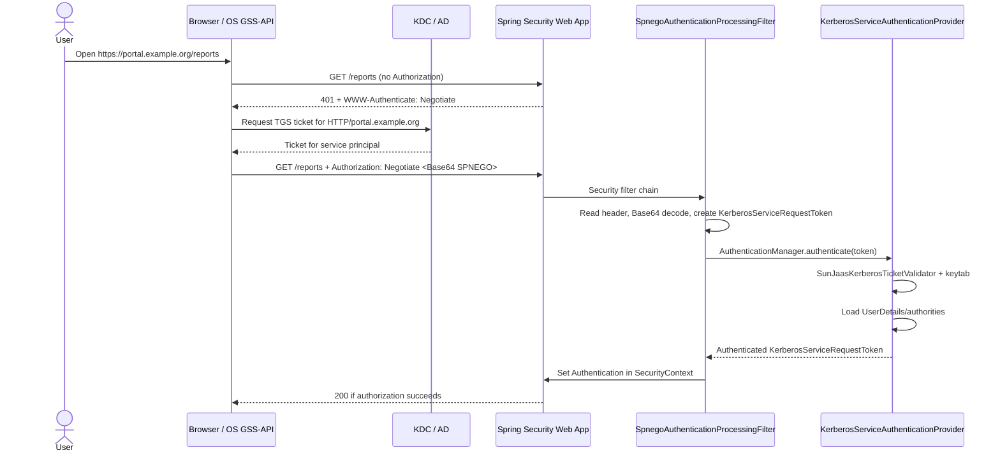

# SpnegoAuthenticationProcessingFilter and Accepting SPNEGO Tokens

## Learning Objectives

After this lesson, you can:

1. Describe HTTP **Negotiate/SPNEGO** and the coordination between the browser, **Kerberos KDC**, Service Principal Name (SPN), keytab, and the Spring Security application.
2. Explain `401 Unauthorized + WWW-Authenticate: Negotiate` and `Authorization: Negotiate <Base64-token>`, distinguishing SPNEGO tokens from username/password, JWT, CAS Service Ticket, and SAMLResponse.
3. Analyze the exact role of `SpnegoAuthenticationProcessingFilter` in **Spring Security Kerberos 2.2.x**: reading the header, Base64-decoding, creating `KerberosServiceRequestToken`, invoking `AuthenticationManager`, handling success/failure, and continuing the filter chain.
4. Configure `SpnegoEntryPoint`, `KerberosServiceAuthenticationProvider`, `SunJaasKerberosTicketValidator`, `UserDetailsService`, and keytabs with Java 17+/Spring Boot 3/Spring Security 6 within proper responsibility boundaries.
5. Understand security-relevant defaults: `skipIfAlreadyAuthenticated=true`, `RequestAttributeSecurityContextRepository`, `NullAuthenticatedSessionStrategy`, optional handlers, and `stopFilterChainOnSuccessfulAuthentication=false`.
6. Diagnose common failures: browser not sending token, KDC/DNS/SPN/keytab errors, clock skew, crypto/key version, reverse proxy stripping headers, channel binding mismatch, multi-node failover, 401 loops, and users lacking local permissions.
7. Separate Kerberos authentication from **application authorization**, watch out for NTLM fallback, token replay/relay, logging raw Authorization headers, and TLS/Extended Protection requirements where applicable.
8. Run a **standalone Java 17+ program** to classify `Negotiate` header syntax (without simulating Kerberos verification), and build a test matrix for the Spring filter, GSS-API, and HTTP end-to-end flows.

## 1. What Is Kerberos Integration?

In an enterprise network, Kerberos lets a user authenticated with a **Key Distribution Center (KDC)** obtain a ticket proving their identity to a specific service. Web applications often leverage this to support **Integrated Windows Authentication** or internal SSO without asking users to re-enter their password in a web form.

Roles:

| Component | Example | Responsibility |
| --- | --- | --- |
| **Client/browser** | Organization-configured Edge/Chrome/Firefox | Receives HTTP Negotiate challenge, obtains/produces security token via OS GSS/SSPI |
| **KDC** | Active Directory Domain Controller or MIT Kerberos | Issues TGT/TGS tickets after checking policies and principals |
| **User principal** | `alice@EXAMPLE.ORG` | Identifies the user within a realm; does not imply app roles |
| **Service principal (SPN)** | `HTTP/portal.example.org@EXAMPLE.ORG` | Identifies the web service for which the client requests a ticket |
| **Service keytab** | `/run/secrets/portal-http.keytab` | Holds secret keys for the service principal to accept Kerberos tickets |
| **HTTP Negotiate** | `WWW-Authenticate` / `Authorization` | Transports GSS-API/SPNEGO tokens over HTTP |
| **SpnegoAuthenticationProcessingFilter** | Spring Kerberos extension | Extracts token from HTTP request and passes it to authentication provider |
| **KerberosServiceAuthenticationProvider** | Spring Kerberos extension | Invokes ticket validator and loads user details/authorities |
| **SecurityContextRepository** | Spring Security | Stores/loads authentication context after successful verification, if stateful |

**SPNEGO** is a security mechanism negotiation protocol, commonly carrying a Kerberos AP-REQ inside HTTP Negotiate. **SPNEGO is not a type of JWT**: Base64 in `Authorization` is merely binary transport encoding over HTTP; the token is trustworthy only after GSS-API/Kerberos verifies it with the proper keytab/credentials.

### 1.1. Do Not Confuse Ticket/Token Types

| Concept | Issued By | Verified By |
| --- | --- | --- |
| Kerberos **TGT** | KDC after AS exchange | KDC/TGS; never sent directly as an HTTP header to the app |
| Kerberos **service ticket** | KDC/TGS for SPN `HTTP/...` | Service using its key/keytab and GSS-API |
| **SPNEGO token** | Created by GSS-API/SSPI client, may wrap a Kerberos message | Service acceptor via GSS-API and the negotiated mechanism |
| CAS **Service Ticket** | CAS Server via browser redirect | CAS Server `/serviceValidate`, not the SPNEGO validator |
| SAML **SAMLResponse** | IdP returned to ACS | SAML SP via signature/trust/conditions |
| OIDC **ID token** | OIDC Provider | OIDC client via JWKS/issuer/audience/nonce |
| App **HttpSession cookie** | Web app/container | Server session lookup; not a Kerberos service ticket |

A user may use Kerberos to log into the app and then receive an `HttpSession`. From that point, application session lifetime and logout **differ** from the TGT/TGS cache lifecycle on the user's machine.

## 2. HTTP Negotiate Handshake per RFC 4559

RFC 4559 defines the **Negotiate** HTTP authentication scheme, typically using SPNEGO GSS-API. The flow may involve one or more round trips; never assume every request has strictly one 401 and one 200.

### 2.1. Basic Flow



**Walkthrough:**

1. When the browser is not yet authenticated with the app, accessing a protected resource triggers `401 Unauthorized` with a `WWW-Authenticate: Negotiate` challenge. Spring's `SpnegoEntryPoint` typically emits this challenge.
2. Depending on intranet/trust settings, the browser asks OS GSS-API or Windows SSPI for a service ticket targeting the **SPN matching the public URL**, usually `HTTP/portal.example.org`.
3. The browser sends `Authorization: Negotiate <token>` in the follow-up request. The token is not the user's password and application JavaScript does not extract it.
4. `SpnegoAuthenticationProcessingFilter` extracts token bytes from the header and passes them to Spring's `AuthenticationManager`.
5. The provider uses `KerberosTicketValidator` (e.g., `SunJaasKerberosTicketValidator`) to accept the token with service credentials, then looks up user/roles.
6. On success, Spring Security places the `Authentication` into the context; controllers/services execute only if authorization permits.
7. The GSS exchange may require extra steps/challenges or a final response token (mutual authentication), depending on the negotiated mechanism and client. Verify real behavior with target browsers/KDC/libraries.

### 2.2. Sample HTTP Messages

Initial request:

```http
GET /reports HTTP/1.1
Host: portal.example.org
Accept: text/html
```

Challenge response:

```http
HTTP/1.1 401 Unauthorized
WWW-Authenticate: Negotiate
Cache-Control: no-store
```

Browser sends token once Kerberos credentials are ready:

```http
GET /reports HTTP/1.1
Host: portal.example.org
Authorization: Negotiate BASE64_SPNEGO_APREQ
```

Response when GSS/Kerberos authentication **and application permissions** succeed:

```http
HTTP/1.1 200 OK
Content-Type: text/plain;charset=UTF-8

Report for alice
```

`BASE64_SPNEGO_APREQ` is an illustrative placeholder, **not a real Base64 token**. In the real protocol, the browser sends Base64-encoded binary GSS/SPNEGO data. When mutual authentication is used, a successful HTTP response may also carry `WWW-Authenticate: Negotiate <final-token>`; do not strip the final leg when the implementation requires it.

### 2.3. Why HTTPS Is Needed Despite Kerberos Encryption/Authentication

RFC 4559 provides only an HTTP **authentication** mechanism; it **does not protect all HTTP headers and bodies**. TLS is required to shield URLs, cookies, application payloads, and auth headers from network observation or tampering.

You must also consider **Extended Protection/channel binding** in environments with AD, reverse proxies, or TLS termination. Never resolve channel binding errors by arbitrarily disabling security policies on domain controllers or in the Windows registry; understand the TLS path and binding according to deployment design.

## 3. SpnegoAuthenticationProcessingFilter in Spring Security

`SpnegoAuthenticationProcessingFilter` belongs to **Spring Security Kerberos Web**, package:

```java
org.springframework.security.kerberos.web.authentication.SpnegoAuthenticationProcessingFilter
```

In Spring Security Kerberos **2.2.0**, this class extends `OncePerRequestFilter` and operates in the **Servlet security filter chain**. It is not a login controller, not a SAML filter, and does not issue TGTs.

### 3.1. What the Filter Actually Does

Typical processing steps:

1. Reads `SecurityContextHolder`. If already authenticated and `skipIfAlreadyAuthenticated=true`, lets the request proceed without re-authenticating SPNEGO.
2. Reads the `Authorization` header.
3. For a matching `Negotiate <Base64>` header, the filter Base64-decodes it to bytes (2.2.x also recognizes a legacy `Kerberos` header prefix). Certain characteristic NTLMSSP tokens are skipped by prefix logic; **this does not mean it offers a full NTLM decoder or guarantees blocking all NTLM downgrades**.
4. Creates an **unauthenticated** `KerberosServiceRequestToken(byte[])`.
5. Calls `authenticationManager.authenticate(authenticationRequest)`. The provider determines whether the ticket is valid.
6. If authentication succeeds, executes `SessionAuthenticationStrategy`, creates a `SecurityContext` holding the returned `Authentication`, updates the holder, and invokes `SecurityContextRepository.saveContext(...)`.
7. Invokes `successHandler` if configured; by default continues `chain.doFilter(...)` upon success.
8. On `AuthenticationException`, clears the context and invokes `failureHandler` if configured; otherwise, 2.2.x source code may return **HTTP 500**. When no matching token is present, the filter normally lets the chain proceed; `ExceptionTranslationFilter`/`SpnegoEntryPoint` challenges the user if the resource requires authentication.

**Absence of the header does not mean the filter "reports invalid login".** It simply passes through and lets authorization decide whether to emit a 401.

### 3.2. Default Configuration Table You Need to Know

| Property | Default in Module 2.2.0 | Impact |
| --- | --- | --- |
| `authenticationManager` | **Must be set** | Filter cannot invoke the provider if missing |
| `skipIfAlreadyAuthenticated` | `true` | Ignores new header when current request is already authenticated; mind freshness/reauth policy |
| `sessionStrategy` | `NullAuthenticatedSessionStrategy` | Does not automatically rotate session ID on auth success unless configured |
| `securityContextRepository` | `RequestAttributeSecurityContextRepository` | Saves context only for the current request, does not persist browser login across requests by default |
| `successHandler` | `null` | No special redirect handling; continues chain per flag |
| `failureHandler` | `null` | On `AuthenticationException`, may return HTTP 500 instead of a friendly challenge |
| `stopFilterChainOnSuccessfulAuthentication` | `false` | Request normally continues down the filter chain after authentication |
| `securityContextHolderStrategy` | Strategy from `SecurityContextHolder` | Typically ThreadLocal in Servlet flows |
| `authenticationDetailsSource` | `WebAuthenticationDetailsSource` | Attaches request details; not Kerberos trust proof |

**Critical point for Spring Security 6:** setting only `SecurityContextHolder` within the request or using a request-attribute-only repository leaves the next request **anonymous**. For browser sessions, configure the **same `SecurityContextRepository`** on both the filter and the HTTP security chain, include a session fixation strategy, and test end-to-end.

### 3.3. The Filter Does Not Verify the Cryptographic Token Itself

`SpnegoAuthenticationProcessingFilter` only extracts token bytes from HTTP. Authentication decisions belong to `AuthenticationManager` and `KerberosServiceAuthenticationProvider`, via `KerberosTicketValidator`/GSS-API.

**Warning:** `Authorization: Negotiate AAAA` may be valid Base64 while being meaningless to Kerberos. Successful parsing **is not** successful login. Never inspect "what string the token starts with" and manually construct an authenticated `UsernamePasswordAuthenticationToken`.

### 3.4. Placement in the Filter Chain

A common setup:

```java
http.addFilterBefore(spnegoFilter, BasicAuthenticationFilter.class);
```

Placing it before `BasicAuthenticationFilter` lets SPNEGO inspect the header ahead of other schemes, while still accounting for `SecurityContextHolderFilter` (loading existing context), `ExceptionTranslationFilter`, `AuthorizationFilter`, any fallback form login, and exception handling.

If you have multiple `SecurityFilterChain` beans or separated `/api/**` routes, the filter must reside in **the exact chain** protecting Kerberos-enabled resources. Never register the filter once as a global Servlet Filter and again inside the Spring Security chain — that causes double processing, wrong ordering, or bypassed security contexts.

## 4. KerberosServiceAuthenticationProvider, Validator, and UserDetails

`KerberosServiceAuthenticationProvider` is the `AuthenticationProvider` dedicated to `KerberosServiceRequestToken`. This layer requires two distinct components:

- **`KerberosTicketValidator`**: uses the **service principal's** credentials to accept/verify a Kerberos or SPNEGO message, returning the principal and validation details.
- **`UserDetailsService`**: loads local user status and `GrantedAuthority` after Kerberos verifies identity. The app does not grant admin rights just because a user belongs to the AD domain.

### 4.1. Why Are SPN and Keytab Required?

When the browser visits `https://portal.example.org`, it may request a ticket for the service principal:

```text
HTTP/portal.example.org@EXAMPLE.ORG
```

Realm `EXAMPLE.ORG` and the hostname are **examples**, not real SPNs. The KDC issues tickets encrypted with the service account's key. The application needs a keytab holding the key matching the SPN and the key version/algorithm used by the KDC to decrypt/accept tickets.

If the app configures `HTTP/app.internal@EXAMPLE.ORG` while the browser requests `HTTP/portal.example.org@EXAMPLE.ORG`, an SPN/keytab mismatch can raise `GSSException`. Other causes include AD duplicate SPNs, wrong service account, realm mismatch, DNS canonicalization, and stale keytabs after password rotation.

### 4.2. KDC, App, and OS Have Distinct Responsibilities

| Step | Primarily Happens At | Must Call KDC on Every HTTP Request? |
| --- | --- | --- |
| Obtain/renew TGT | Client and KDC | Not on every request |
| Obtain service ticket for HTTP SPN | Browser/OS and KDC/TGS | Tickets can be cached, not needed every request |
| Browser creates GSS/SPNEGO token | Client OS/browser | Uses cached credentials |
| Service accepts Kerberos AP-REQ | App/GSS JAAS with service keytab | Usually verifiable with local keytab; do not assume the app calls the KDC per request |
| Look up user details/roles | App/AD/LDAP/DB | Depends on implementation/caching |
| Persist app session | Spring Security/Session | Not directly tied to ticket issuance |

### 4.3. KerberosServiceRequestToken Before and After Authentication

`new KerberosServiceRequestToken(byte[])` constructs an **unauthenticated** token for the provider. After validation, the provider returns an authenticated `KerberosServiceRequestToken` containing the principal, `GrantedAuthority` set, and `KerberosTicketValidation` data.

**Do not confuse with `CasAuthenticationToken`:** even though both CAS and Kerberos involve "tickets", one uses CAS Server `/serviceValidate` while the other uses Kerberos/GSS/SPN/keytabs. Packages and trust models are different.

### 4.4. UserDetailsService Is Not a Kerberos Validator

For instance, if Kerberos proves identity `alice@EXAMPLE.ORG` but the application has no matching user:

- The ticket itself may be cryptographically valid.
- The local `UserDetailsService` may reject unprovisioned, disabled, locked, or out-of-tenant users.
- That is a **post-GSS authentication/authorization policy failure**, not a bad keytab.

**Never fall back to a default user with `ROLE_ADMIN` when lookup fails.** If mapping `alice@EXAMPLE.ORG` to internal username `alice`, define a stable, collision-safe, tenant-isolated realm/identity mapping.

## 5. Preparing Kerberos Infrastructure Before Writing Spring Code

An application cannot "run Kerberos SSO" merely by adding a Spring dependency. First you need a KDC/AD environment with working DNS, time, and service accounts.

### 5.1. SPN and DNS Checklist

1. Identify the **public FQDN** users visit, e.g., `portal.example.org`.
2. Ensure DNS resolves cleanly to the app or reverse proxy; avoid aliases/canonicalization making browsers pick a different SPN.
3. In AD/MIT KDC, create or assign **SPN `HTTP/portal.example.org`** to a managed service account.
4. Confirm there are no duplicate SPNs or SPNs bound to the wrong principal. Requires AD/KDC admin privileges per policy.
5. Generate the keytab from service credentials matching realm, SPN, kvno, and approved enctypes; deliver to runtime via secret manager/dedicated mount.
6. Verify DNS lookup, KDC connectivity, and time sync (NTP/chrony/Windows Time Service).
7. With multiple app nodes, all nodes must accept the same public service principal or an approved per-host SPN/keytab architecture; never leave one node on an old keytab and another on a new one.
8. Test with a domain-joined/trusted-zone browser and valid user account; never test with a fake `Authorization` string to claim Kerberos works.

### 5.2. Controlled Diagnostic Commands

On Linux with Kerberos tools (and appropriate privileges):

```bash
# Inspect principals/kvno/enctypes in the provisioned keytab without printing keys.
klist -k -e /run/secrets/portal-http.keytab

# Inspect a test user's ticket cache, if permitted in that environment.
klist

# Request a service ticket in a test realm if TGT credentials already exist.
kvno HTTP/portal.example.org@EXAMPLE.ORG
```

These commands **have no fixed stdout**: output depends on the KDC, keytab read permissions, principal, realm, ticket expiration, and OS. Never paste full keytabs or binary tokens into support tickets.

On a Windows domain admin workstation you can query SPNs with tools like `setspn -Q HTTP/portal.example.org` per AD procedures; a test user can inspect their cache with `klist`. Commands require specific privileges, environments, and policies; do not probe production domains without authorization.

### 5.3. Protecting the Keytab

**A keytab is a secret, not a public certificate.** Anyone possessing the keytab under suitable conditions can impersonate the service or decrypt tickets issued to it. Therefore:

- Never commit keytabs to Git, container images, or the app's `src/main/resources`.
- Mount at a path readable only by the service process; enforce minimal file permissions, storage encryption, and backup ACLs.
- Never log binary keytabs or post them to issue trackers or chat.
- Document key rotation/compromise response procedures, verify new kvno/enctype, roll out across nodes consistently, and confirm new tickets pass while old keys fail per policy.
- Never disable channel binding/Extended Protection, hostname verification, or allow NTLM fallback just because a keytab was generated incorrectly.

## 6. Spring Boot 3 + Spring Security 6: Integrating SPNEGO

**Scope:** Java 17+ Servlet web app example with **Spring Security Kerberos 2.2.0**, documented by the project as built/tested against JDK 17, Spring Security 6.5.1, and Spring Framework 6.2.8. Do not apply Spring Security 7.x Maven coordinates to Boot 3: the 7.x branch changed the groupId and baseline dependencies.

All hostnames, realms, usernames, and paths below are fixtures; a real KDC/keytab must be provisioned before end-to-end login. The Spring code depends on a Gradle project and cannot be run directly with `javac SecurityConfig.java`.

### 6.1. Gradle Dependencies

`build.gradle` file, with compatible Spring Boot 3 plugins and dependency management/BOM:

```groovy
dependencies {
    implementation 'org.springframework.boot:spring-boot-starter-web'
    implementation 'org.springframework.boot:spring-boot-starter-security'

    implementation 'org.springframework.security.kerberos:spring-security-kerberos-core:2.2.0'
    implementation 'org.springframework.security.kerberos:spring-security-kerberos-web:2.2.0'

    testImplementation 'org.springframework.boot:spring-boot-starter-test'
    testImplementation 'org.springframework.security:spring-security-test'
}
```

**Version notes:**

- The Kerberos module is an extension project, **not** bundled by default in `spring-boot-starter-security`.
- The `org.springframework.security.kerberos` artifacts at **2.2.0** differ from the `org.springframework.security:spring-security-kerberos-*` coordinates introduced in Spring Security 7.x.
- The Boot/Spring Security BOM manages Spring Security versions, not necessarily every extension version; inspect the dependency graph to avoid mismatched Spring Security core/web jars.
- If a project uses Spring Security 7, apply 7's own API/coordinates; this example deliberately targets Spring Security 6.x.

### 6.2. Configuration Without Embedding the Keytab

`src/main/resources/application.yml`:

```yaml
server:
  servlet:
    session:
      timeout: 20m
      cookie:
        secure: true
        http-only: true
        same-site: lax

app:
  kerberos:
    service-principal: "HTTP/portal.example.org@EXAMPLE.ORG"
    keytab-path: "/run/secrets/portal-http.keytab"
```

`same-site: lax` is an illustrative setting for stateful browser requests; with Negotiate auth, the browser can still send a ticket on separate requests even without a session cookie. Cookie policy must fit the app, CSRF model, and browser deployment. Never treat `SameSite=Lax` as a substitute for SPN/keytab/Negotiate.

Use **external configuration/secret managers** for the principal and keytab path per environment. Keytab contents **never** belong in YAML.

### 6.3. Main Application

`src/main/java/com/example/kerberos/PortalApplication.java`:

```java
package com.example.kerberos;

import org.springframework.boot.SpringApplication;
import org.springframework.boot.autoconfigure.SpringBootApplication;

@SpringBootApplication
public class PortalApplication {
    public static void main(String[] args) {
        SpringApplication.run(PortalApplication.class, args);
    }
}
```

### 6.4. UserDetailsService: Mapping a Kerberos-Verified User

`src/main/java/com/example/kerberos/PortalUsers.java`:

```java
package com.example.kerberos;

import org.springframework.context.annotation.Bean;
import org.springframework.context.annotation.Configuration;
import org.springframework.security.core.userdetails.User;
import org.springframework.security.core.userdetails.UserDetailsService;
import org.springframework.security.core.userdetails.UsernameNotFoundException;

@Configuration
public class PortalUsers {

    @Bean
    UserDetailsService userDetailsService() {
        // DEMO ONLY: production uses local IAM/DB/LDAP mapping with tenant policy.
        return principalName -> {
            if (!"alice@EXAMPLE.ORG".equalsIgnoreCase(principalName)) {
                throw new UsernameNotFoundException(
                        "Unknown or unapproved Kerberos principal");
            }
            return User.withUsername(principalName)
                    .password("{noop}unused-for-spnego-demo")
                    .authorities("REPORT_READ")
                    .build();
        };
    }
}
```

**Limitations:** this example accepts only the test principal `alice@EXAMPLE.ORG`. Never use `{noop}` for real password logins; the password placeholder here **is not used by the SPNEGO filter for authentication**. When integrating AD/LDAP or multiple realms, design verifiable principal/realm → account mappings and allowlisted roles. Never automatically assign admin to every `*@EXAMPLE.ORG`.

### 6.5. SecurityConfig with Filter, Provider, Repository, and Entry Point

`src/main/java/com/example/kerberos/SecurityConfig.java`:

```java
package com.example.kerberos;

import org.springframework.beans.factory.annotation.Value;
import org.springframework.context.annotation.Bean;
import org.springframework.context.annotation.Configuration;
import org.springframework.core.io.FileSystemResource;
import org.springframework.security.authentication.AuthenticationManager;
import org.springframework.security.authentication.ProviderManager;
import org.springframework.security.config.annotation.method.configuration.EnableMethodSecurity;
import org.springframework.security.config.annotation.web.builders.HttpSecurity;
import org.springframework.security.config.http.SessionCreationPolicy;
import org.springframework.security.core.userdetails.UserDetailsService;
import org.springframework.security.kerberos.authentication.KerberosServiceAuthenticationProvider;
import org.springframework.security.kerberos.authentication.sun.SunJaasKerberosTicketValidator;
import org.springframework.security.kerberos.web.authentication.SpnegoAuthenticationProcessingFilter;
import org.springframework.security.kerberos.web.authentication.SpnegoEntryPoint;
import org.springframework.security.web.SecurityFilterChain;
import org.springframework.security.web.authentication.www.BasicAuthenticationFilter;
import org.springframework.security.web.authentication.session.ChangeSessionIdAuthenticationStrategy;
import org.springframework.security.web.context.DelegatingSecurityContextRepository;
import org.springframework.security.web.context.HttpSessionSecurityContextRepository;
import org.springframework.security.web.context.RequestAttributeSecurityContextRepository;
import org.springframework.security.web.context.SecurityContextRepository;

@Configuration
@EnableMethodSecurity
public class SecurityConfig {

    @Bean
    SecurityContextRepository securityContextRepository() {
        return new DelegatingSecurityContextRepository(
                new RequestAttributeSecurityContextRepository(),
                new HttpSessionSecurityContextRepository());
    }

    @Bean
    KerberosServiceAuthenticationProvider kerberosServiceProvider(
            UserDetailsService users,
            @Value("${app.kerberos.service-principal}") String principal,
            @Value("${app.kerberos.keytab-path}") String keytabPath) {

        SunJaasKerberosTicketValidator validator =
                new SunJaasKerberosTicketValidator();
        validator.setServicePrincipal(principal);
        validator.setKeyTabLocation(new FileSystemResource(keytabPath));
        validator.setDebug(false); // avoid exposing sensitive GSS/Kerberos diagnostics

        KerberosServiceAuthenticationProvider provider =
                new KerberosServiceAuthenticationProvider();
        provider.setTicketValidator(validator);
        provider.setUserDetailsService(users);
        return provider;
    }

    @Bean
    SecurityFilterChain kerberosChain(
            HttpSecurity http,
            KerberosServiceAuthenticationProvider provider,
            SecurityContextRepository contextRepository) throws Exception {

        AuthenticationManager manager = new ProviderManager(provider);
        SpnegoAuthenticationProcessingFilter spnegoFilter =
                new SpnegoAuthenticationProcessingFilter();
        spnegoFilter.setAuthenticationManager(manager);

        // 2.2.x default uses RequestAttribute repository only:
        // configure explicitly if login should persist in HttpSession.
        spnegoFilter.setSecurityContextRepository(contextRepository);

        // For a custom authentication filter, configure fixation protection explicitly.
        spnegoFilter.setSessionAuthenticationStrategy(
                new ChangeSessionIdAuthenticationStrategy());

        // Prevent default failure handling from turning AuthenticationException into 500.
        spnegoFilter.setFailureHandler((request, response, exception) -> {
            response.setHeader("WWW-Authenticate", "Negotiate");
            response.sendError(401);
        });

        http.authorizeHttpRequests(auth -> auth
                    .requestMatchers("/").permitAll()
                    .requestMatchers("/admin/**").hasAuthority("PORTAL_ADMIN")
                    .anyRequest().authenticated())
                .exceptionHandling(ex -> ex
                    .authenticationEntryPoint(new SpnegoEntryPoint()))
                .sessionManagement(session -> session
                    .sessionCreationPolicy(SessionCreationPolicy.IF_REQUIRED))
                .securityContext(sc -> sc
                    .securityContextRepository(contextRepository))
                .addFilterBefore(spnegoFilter, BasicAuthenticationFilter.class);

        return http.build();
    }
}
```

**Detailed explanation:**

1. `SunJaasKerberosTicketValidator` uses `servicePrincipal` and the keytab file to accept tickets via GSS/JAAS. It does not merely "compare SPN strings"; cryptographic validation happens through JGSS/JDK.
2. `KerberosServiceAuthenticationProvider` is wired with the validator and `UserDetailsService`. A valid ticket for an unprovisioned user can still be rejected by local policy.
3. `ProviderManager` receives `KerberosServiceRequestToken` and invokes the provider. Do not configure `UsernamePasswordAuthenticationProvider` expecting it to validate SPNEGO tokens.
4. `SpnegoAuthenticationProcessingFilter` is an instance **added only to the Spring Security chain**, not declared as a `@Bean Filter` that Boot would register globally a second time.
5. Both the filter's `setSecurityContextRepository` and `http.securityContext(...)` use the **same repository**. This lets subsequent requests load context from `HttpSession` when stateful login is chosen.
6. `ChangeSessionIdAuthenticationStrategy` provides session fixation protection. The 2.2.0 filter defaults to `NullAuthenticatedSessionStrategy`; never assume custom filters automatically inherit the form-login DSL's session strategy.
7. `SpnegoEntryPoint()` emits the 401 Negotiate challenge for unauthenticated protected requests. Non-SPNEGO browsers require a separate approved UX/fallback.
8. The example failure handler returns 401/challenge to avoid the default HTTP 500. **This does not by itself resolve multi-leg GSS negotiation, keytab issues, or NTLM.** Never catch-all into a fake authenticated user; log redacted reason categories.
9. App authorization still guards `/admin/**` with `PORTAL_ADMIN`; the demo user has only `REPORT_READ` and cannot access admin routes.
10. Using `HttpSession` in `SecurityContextRepository` creates a local app session; Windows/Kerberos logout or TGT expiration **does not automatically revoke** the existing app session.
11. For **stateless per-request Negotiate** products, you can avoid persisting app sessions, provided you test GSS continuity, browser/connection/challenge behavior, and load balancing. Do not take a stateful example and blindly set `SessionCreationPolicy.STATELESS`.

**Missing pieces required for deployment:** KDC/realm setup, SPN registration, keytab mount and access policy, reverse proxy, TLS, domain-joined browser, protected endpoints, log redaction, production authorization source, and testing with a real KDC. You cannot verify it by crafting arbitrary Base64 tokens.

### 6.6. Test Endpoints

`src/main/java/com/example/kerberos/PortalController.java`:

```java
package com.example.kerberos;

import java.util.Map;
import org.springframework.security.core.Authentication;
import org.springframework.web.bind.annotation.GetMapping;
import org.springframework.web.bind.annotation.RestController;

@RestController
public class PortalController {

    @GetMapping("/")
    public String home() {
        return "Public";
    }

    @GetMapping("/me")
    public Map<String, Object> me(Authentication auth) {
        return Map.of(
                "principalName", auth.getName(),
                "authenticated", auth.isAuthenticated());
    }

    @GetMapping("/reports")
    public String reports(Authentication auth) {
        return "Report for " + auth.getName();
    }
}
```

If `alice@EXAMPLE.ORG` holds valid Kerberos credentials, the service keytab is valid, the local user is approved, and the browser negotiated successfully, `GET /reports` **can** return:

```text
Report for alice@EXAMPLE.ORG
```

This is a **conditional illustrative output**, not a fixed result without a real KDC/keytab. The `/me` API returns only name/authenticated, avoiding echoing `Authorization`, raw ticket bytes, or `Authentication.toString()` which could contain sensitive details.

## 7. Step-by-Step Control from HTTP Header to Authentication

### 7.1. Diagnostic Milestones

| Stage | Input | Success | Typical Failure |
| --- | --- | --- | --- |
| Browser receives challenge | 401 + `WWW-Authenticate: Negotiate` | Browser attempts GSS/SSPI | Header stripped by proxy, browser untrusted |
| Browser fetches TGS ticket | Public SPN `HTTP/portal.example.org` | Valid service ticket obtained | SPN missing, DNS/realm/KDC error |
| Browser sends header | `Authorization: Negotiate Base64` | HTTP request carries token | NTLM fallback, empty/oversized header |
| Filter parses | Header/token bytes | Builds `KerberosServiceRequestToken` | Wrong scheme, malformed Base64, unsupported form |
| Provider validates | GSS token + keytab | Verifies AP-REQ/identity | Keytab/SPN/kvno/enctype/clock skew |
| User details | Verified principal | Valid local user/authorities | Unknown user/disabled/missing tenant mapping |
| Context persistence | Authenticated token | Saved or kept per policy | RequestAttribute only, missing cookie/store |
| Authorization | Local identity/permissions | Controller/service allowed | 403 if missing role/tenant action |

### 7.2. When Already Authenticated, Does the Filter Always Process a New Negotiate Header?

By default `setSkipIfAlreadyAuthenticated(true)`. If `SecurityContextHolder` already holds an authenticated token that is not `AnonymousAuthenticationToken`, the filter lets the request continue without **revalidating the header**.

This matters when:

- The user already has an app session: the browser might send a fresh Negotiate header, yet the filter may skip it.
- Sensitivity policies demand forced reauthentication: design logout/re-auth/`skipIfAlreadyAuthenticated` and session strategy explicitly; **do not blindly flip it to false** thinking it is "safer".
- Multiple authentication mechanisms coexist (SAML/CAS/form/API): the filter may skip because the user authenticated via another mechanism. Separate chains and explicitly verify authentication type/freshness if a route requires Kerberos.

Do not disable skipping on every HTTP request across a cluster without assessing performance, replay policies, browser handshakes, and load balancers.

### 7.3. Empty Headers, Basic, and NTLM

- No `Authorization` → filter passes through; the entry point can emit Negotiate if authorization detects an anonymous user.
- `Authorization: Basic ...` or `Bearer ...` → this filter does not authenticate those schemes. Separate API paths cleanly if the app has other chains.
- `Authorization: Negotiate ...` with invalid Base64 → parsing/decoding can fail; yields 400/401/500 depending on exception and filter behavior. Test rather than assuming every error hits the same `AuthenticationException` handler.
- Some browser/Windows stacks **pick NTLM inside Negotiate** when Kerberos is unavailable. The Spring 2.2.x filter includes logic skipping characteristic NTLMSSP prefixes. **That does not guarantee all NTLM payloads are rejected**; enforce policy/KDC/mechanism controls when Kerberos-only is required.
- `Authorization: Kerberos ...` is a prefix 2.2.x filter source accepts for compatibility; the RFC 4559 HTTP Negotiate standard remains `Negotiate`, so do not design new integrations around other prefixes without reason.

### 7.4. Do Not Confuse Base64 Parsing with Authentication

Base64 is an encoding, not encryption, MAC, or signature. For example:

```text
Authorization: Negotiate AQID
```

`AQID` decodes to bytes `01 02 03`, which **is not** a valid Kerberos AP-REQ. Only `KerberosTicketValidator`/GSS-API with the right service keytab can conclude authentication succeeded.

## 8. Standalone Java 17+: Classifying Header Syntax Without Simulating Kerberos

To understand filter token intake at the HTTP layer, let's write a program that performs **syntactic inspection only**. It knows nothing of KDC, SPN, keytabs, GSS-API, or ticket integrity. Every syntactically plausible token is labeled **CANDIDATE_NOT_AUTHENTICATED** and must never be used to log a user in.

File `NegotiateHeaderDemo.java`:

```java
import java.nio.charset.StandardCharsets;
import java.util.Base64;

public final class NegotiateHeaderDemo {

    private static final byte[] NTLM_MAGIC =
            "NTLMSSP\0".getBytes(StandardCharsets.US_ASCII);

    public static String classify(String header) {
        if (header == null || header.isBlank()) {
            return "NO_CREDENTIALS";
        }
        if (!header.startsWith("Negotiate ")) {
            return "OTHER_SCHEME";
        }

        String encoded = header.substring("Negotiate ".length()).trim();
        if (encoded.isEmpty()) {
            return "EMPTY_TOKEN";
        }

        byte[] token;
        try {
            token = Base64.getDecoder().decode(encoded);
        } catch (IllegalArgumentException exception) {
            return "BAD_BASE64";
        }
        if (token.length == 0) {
            return "EMPTY_TOKEN";
        }
        if (startsWith(token, NTLM_MAGIC)) {
            return "NTLM_NOT_KERBEROS";
        }
        return "CANDIDATE_NOT_AUTHENTICATED";
    }

    private static boolean startsWith(byte[] bytes, byte[] prefix) {
        if (bytes.length < prefix.length) {
            return false;
        }
        for (int i = 0; i < prefix.length; i++) {
            if (bytes[i] != prefix[i]) {
                return false;
            }
        }
        return true;
    }

    public static void main(String[] args) {
        String fakeNtlm = "Negotiate " + Base64.getEncoder()
                .encodeToString(NTLM_MAGIC);
        String arbitraryBytes = "Negotiate " + Base64.getEncoder()
                .encodeToString(new byte[] {1, 2, 3});

        System.out.println("Missing: " + classify(null));
        System.out.println("Bearer: " + classify("Bearer abc"));
        System.out.println("Empty: " + classify("Negotiate "));
        System.out.println("Malformed: " + classify("Negotiate %%%"));
        System.out.println("NTLM magic: " + classify(fakeNtlm));
        System.out.println("Other Base64: " + classify(arbitraryBytes));
    }
}
```

Compile and run with JDK 17+:

```bash
javac NegotiateHeaderDemo.java
java NegotiateHeaderDemo
```

**Exact stdout:**

```text
Missing: NO_CREDENTIALS
Bearer: OTHER_SCHEME
Empty: EMPTY_TOKEN
Malformed: BAD_BASE64
NTLM magic: NTLM_NOT_KERBEROS
Other Base64: CANDIDATE_NOT_AUTHENTICATED
```

**What to understand:**

- The program only distinguishes `Authorization` header schemes and Base64 syntactic validity.
- Bytes `01 02 03` decoded cleanly yet carry **zero cryptographic Kerberos proof**; never mark authenticated.
- Detecting `NTLMSSP\0` at the start of the byte stream is merely a **demo heuristic**. A real SPNEGO token can wrap inner messages without magic bytes at offset 0. Blocking NTLM downgrade requires negotiated mechanism validation and enterprise policy, not just substring/magic matching.
- A production parser also needs request/header size limits, structured error handling, rate limiting, and zero raw token logging. Never copy this demo in place of Spring's `SpnegoAuthenticationProcessingFilter`.
- If HTTP headers traverse a reverse proxy, they can be stripped or modified. Never let clients supply trusted headers like `X-Remote-User` to bypass Kerberos; identity must come from the validator or a protected trusted authenticated proxy contract.
- Never use `NegotiateHeaderDemo` as a "SPNEGO validator" inside a controller.

## 9. Browser, DNS, and Proxy Issues

### 9.1. Browser Fails to Send Authorization Despite Server 401

Usually the browser does not trust the URL enough for **Integrated Authentication** or the user has no Kerberos credentials:

- Host is not in the intranet/integrated authentication allowlist per browser/device policy.
- Browser is running off-domain or lacks a TGT.
- DNS/realm mismatch; KDC cannot locate the SPN.
- SPN is registered for a different alias than the hostname the user visited.
- Browser/proxy resolves hostname to an IP address, CNAME, or internal endpoint, picking the wrong SPN.
- Corporate proxy blocks `WWW-Authenticate` or `Authorization`; ingress emits an improper 401 itself.
- Client falls back to NTLM instead of Kerberos, while the server accepts only Kerberos.

**Do not fix by enabling NTLM, removing hostname checks, or adding every URL to the intranet allowlist.** Scope permitted hostnames and devices strictly, verify policy, and check KDC/SPN/DNS.

### 9.2. Reverse Proxy and TLS Termination

Deployment flow:

```text
Browser  -- HTTPS public URL -->  Ingress/LB
Ingress  -- protected hop -->     Spring Boot instance
Public SPN: HTTP/portal.example.org@EXAMPLE.ORG
Validator keytab: service account credential for public SPN
```

Requirements to ensure:

1. The browser requests a ticket for the **public hostname**, not pod hostname `portal-app-1.internal`.
2. The Spring Boot Kerberos acceptor holds the keytab for the public SPN.
3. Ingress forwards `Authorization: Negotiate ...` intact without rewriting it to `Bearer`/Basic or stripping it.
4. Both the public TLS leg and internal hop have proper security policies; if TLS termination affects channel binding, evaluate Extended Protection architecture.
5. If ingress **terminates Kerberos authentication itself**, the architecture becomes **trusted proxy authentication**. Do not run a second SPNEGO filter on an already-consumed header. Proxy identity headers are trustworthy only if direct app access is blocked, mTLS/network ACLs protect the hop, and the proxy overwrites headers rather than accepting them from the Internet.
6. Load balancers, keep-alive, and HTTP/2 can affect some multi-leg/connection-bound GSS implementations. Test with real browsers and proxy settings, not just curl.
7. Set reasonable header size limits accounting for Kerberos tokens with large PAC/group memberships; oversized headers can trigger **400/431** before the Spring filter ever runs.

### 9.3. Multi-Node and Keytabs

If nodes A and B both serve `https://portal.example.org`, both must **accept tickets for the same public SPN** with matching key versions/algorithms. Options:

- Mount the same service keytab/secret to every node via a secret manager with strict file ACLs.
- Or deploy an IAM/KDC-approved service credential/acceptor design with synchronized key rotation.
- Ensure identical user realm mapping, session persistence (if stateful), roles, and proxy configuration across A and B.
- Plan rolling deployments: new nodes on a newer keytab version while old nodes lag behind cause intermittent 401s. Use staged rollovers and testing.
- Never copy raw keytabs manually over chat/issues; distribute through standard secret delivery channels.

### 9.4. Clock Skew and DNS Canonicalization

Kerberos is time-sensitive: clock drift across client/KDC/service causes tickets to be rejected. Synchronize clocks via NTP/Windows Time Service, verify timezone vs. UTC in logs, and **never widen clock skew tolerances indefinitely** to mask errors.

DNS aliases/CNAMEs, SPN duplication, and default realm mappings influence which principal name browsers request. Cross-check the actual requested SPN from redacted Kerberos logs/KDC events, the public URL, and entries in the keytab. Never automatically try arbitrary SPNs if users arrive via untrusted hosts.

## 10. Specific Security Concerns of HTTP Negotiate

### 10.1. SPNEGO Can Negotiate an Unwanted Mechanism

SPNEGO is an authentication protocol selector. On Windows, some Negotiate deployments can **fall back to NTLM** when Kerberos is unavailable.

- Spring filter 2.2.x includes logic skipping a known `NTLMSSP` prefix, yet **never cite that logic as proof the whole system resists NTLM**.
- Enforce client/server policies requiring Kerberos when the application is designed as Kerberos-only; inspect the actual negotiated mechanism.
- NTLM relay/downgrade and keytab failures must be threat-modeled; never deliberately lower authentication strength just to "stop seeing 401s".
- Never treat raw `Authorization` prefixes or Base64 decoding as proof of principal; trust only the GSS acceptor/provider.

### 10.2. Mutual Authentication and Channel Binding

RFC 4559 allows a final-leg token in `WWW-Authenticate` even on a successful HTTP response; browsers may need to process it to complete mutual authentication. Channel binding details depend on Windows/AD, TLS termination, GSS mechanisms, and libraries.

**Do not resolve "Channel binding mismatch" errors by disabling Extended Protection in the registry or weakening org-wide policies based on an old blog post.** Identify the termination point, TLS certificates, SPN/CBT, Java runtime, and compatibility policy; work with IAM/security to choose a verified architecture.

### 10.3. Tokens and Logs Are Sensitive Data

Some versions of Spring Security Kerberos 2.2.x `SpnegoAuthenticationProcessingFilter` source have debug/warn paths logging the **entire `Authorization` header** (including on authentication failure). Keep this in mind during security hardening:

- **Do not leave Kerberos/GSS/Spring filter debug enabled long-term in production**; audit warning log paths of your exact dependency version.
- Log only reason codes, node IDs, server-generated request correlation IDs, authenticated booleans, and principal/realm within allowed limits.
- Never log Base64 SPNEGO bytes, service tickets, keytabs, TGT caches, `JSESSIONID`, full PACs, or user attributes into issues/traces.
- Before enabling diagnostic mode in test environments, use test identities and ACL/retention-protected log storage; purge artifacts containing tokens afterward.
- If a module emits raw tokens at WARN level in code, disabling DEBUG alone is **insufficient**. Apply log redaction filters, logger configs/safe patches/version updates, or verify custom deployments keep logs safe without sacrificing observability.

### 10.4. Never Blindly Trust Client-Provided Identity Headers

Some reverse proxies/SSO gateways pass the user via headers such as `X-Authenticated-User`. That is **a different authentication architecture** requiring a strict trust boundary. If the app accepts headers sent directly by browsers:

```http
GET /admin HTTP/1.1
X-Authenticated-User: administrator
```

an attacker can set any username. Never construct an `Authentication` solely from such a header without proxy mTLS/allowlists, header stripping, signed assertions, or an equivalent trusted mechanism.

## 11. Session Context, Logout, and Application Authorization

### 11.1. Filter May "Skip" Because the User Is Already Logged In

`SpnegoAuthenticationProcessingFilter` defaults to `skipIfAlreadyAuthenticated=true`. If the browser sends a new SPNEGO ticket while the app session is already authenticated via another mechanism, the filter may ignore the ticket.

When designing multiple login methods (SPNEGO + form/LDAP, SPNEGO + SAML2, or OAuth APIs):

- Split security filter chains by path and entry point.
- Define **which paths strictly require Kerberos** rather than merely "any authenticated".
- Check authentication type, issuer/realm, and login freshness, not just the authenticated boolean.
- Decide re-authentication/`skipIfAlreadyAuthenticated(false)` based on policy, performance, and GSS negotiation.
- Test session fixation, CSRF, local logout, and switching principals across browser tabs.

### 11.2. Persisting SecurityContext Across HTTP Requests

With the filter's default `RequestAttributeSecurityContextRepository`, auth lives only for the current request/dispatch. For a persistent browser SSO session:

- Use `HttpSessionSecurityContextRepository` or a `DelegatingSecurityContextRepository` combining request attributes + HttpSession.
- Set the repository **both on the filter** and in `HttpSecurity.securityContext(...)`.
- Configure a session fixation strategy; maintain `Secure`, `HttpOnly`, `SameSite` per browser/infra needs.
- Across multiple pods, use a shared session store (Spring Session Redis/JDBC) or consistent routing; **a shared session store does not replace having valid keytab/SPN on every node**.
- Test session expiry, logout, and permissions revoked after login.

If the app is intentionally **stateless per-request** (e.g., an intranet API negotiating every request), test GSS handshakes/client behavior and session overhead; never take a stateful sample and disable sessions without redesigning the mechanism.

### 11.3. Logout and AD Disable Do Not Immediately Clear App Sessions

A user already authenticated in the app can keep using `HttpSession` even after their machine TGT expires or their AD account is disabled, unless the app revalidates state. Do not assume Kerberos automatically pushes logout.

You may need:

- Local logout invalidating the session.
- Admin session revocation by principal/tenant/device.
- Session inactivity/maximum lifetime limits.
- Re-checking local entitlements and account disabled status before sensitive actions.
- Policy-driven step-up/reauth; never accept a raw Negotiate token from an arbitrary request to elevate to admin.
- Revocation of WebSocket sessions/API tokens if the app exposes channels beyond the browser.

### 11.4. Authorization After Receiving the Principal

Kerberos principal `alice@EXAMPLE.ORG` is a **verified identity**, carrying no automatic tenant data rights. `UserDetailsService` or the authorization service must map:

```text
Verified Kerberos principal: alice@EXAMPLE.ORG
        |
        v
Internal account: account-42
        |
        +-- Tenant: finance-vn
        +-- Permissions: REPORT_READ, REPORT_EXPORT
        +-- Status: ACTIVE
        |
        v
GET /tenants/finance-vn/reports -> 200
GET /tenants/another-team/reports -> 403
GET /admin                    -> 403
```

This is **illustrative**; not every realm uses the same username format. Never merge users by the substring before `@` when two realms share usernames. Never check only `hasAuthority('REPORT_READ')` on an API taking a browser-chosen `tenantId`; enforce object-level permissions.

## 12. Diagnosing Failures by Symptom

| Symptom | Likely Cause | Check / Remediation |
| --- | --- | --- |
| Always 401, browser never sends Authorization | Browser integrated auth policy, missing TGT, untrusted hostname | Check browser allowlist/OS ticket cache, test canonical public FQDN |
| Browser sends `Negotiate TlRMTVNTUA...` | Attempting NTLM fallback | Check SPN/KDC/AD domain policies, block unintended NTLM |
| `GSSException: Defective token` | Header is not a valid AP-REQ, truncated/altered, GSS mechanism mismatch | Check proxy/header limits/encoding, never log raw tokens |
| `GSSException: Clock skew too great` | Clock drift | Synchronize client/KDC/server clocks |
| `KRB_AP_ERR_MODIFIED` or checksum failure | Wrong keytab, duplicate/wrong-account SPN, stale kvno/enctype | Compare keytab SPN/kvno, KDC service account, key rotation |
| `Server not found in Kerberos database` | Browser requested an unregistered SPN | Register/deduplicate SPN for exact hostname/realm |
| `Cannot locate default realm` | Broken `krb5.conf`/realm mapping | Check KDC DNS/SRV/krb5.conf/realm |
| `Pre-authentication failed` when fetching TGT | User credentials/AD account/cipher policy | Diagnose client/KDC, not just Spring filter |
| Header has token but filter never runs | Wrong filter chain/path/order; duplicate global registration | Inspect `SecurityFilterChain` matchers and `addFilterBefore` |
| Filter calls provider but returns 500 | `AuthenticationException` with missing failure handler or runtime error | Configure safe handler, classify root cause |
| Kerberos login succeeds, next request is anonymous | RequestAttribute-only repository, cookie dropped, session store miss | Same `SecurityContextRepository` on filter+chain, cookie/session checks |
| Authenticated yet 403 | Missing local role/tenant permission | Check `UserDetailsService`/authorities; keep authorization enabled |
| 401 only after deploying a new node | Keytab/realm version out of sync | Audit keytab mounts/kvno/crypto across all nodes |
| 401 via proxy, direct-to-app works | Ingress strips `Authorization` or CBT/TLS mismatch | Inspect proxy forwarding, TLS/channel binding |
| Oversized header returns 431/400 | Large PAC/groups exceeding header size limit | Tune size policy carefully, reduce group bloat; avoid unlimited caps |
| User A recognized as User B | Bad global context config, header spoofing, session mix-up | Keep context per request, never trust self-asserted `X-User` |
| Base64 tickets appear in logs | Filter or proxy debug/warn logging | Redact/disable sensitive log paths, treat artifacts as secrets |
| Windows logout completes yet web app stays logged in | App `HttpSession` remains authenticated | Independent revocation/expiry/reauth policy |
| Browser pops up password prompt | Missing Kerberos SPN or Negotiate fallback | Check device/domain/browser policies, provide approved fallback |

### 12.1. Ordered Debugging Workflow

1. **Do not start by changing code.** Verify public URL, KDC/realm, SPN, keytab location, and keytab read permissions.
2. Use browser DevTools/Network in a test environment to confirm `401 + WWW-Authenticate: Negotiate` is returned.
3. Check whether the browser sends `Authorization: Negotiate`. **Never copy the token** into tickets/chat; record only present/absent and byte size if policy permits.
4. Verify ingress/LB passes headers intact without rewriting to `Bearer`/Basic or stripping tokens.
5. Verify the Spring filter executes in the right `SecurityFilterChain` and `AuthenticationManager` holds a provider supporting `KerberosServiceRequestToken`.
6. Check keytab SPN/kvno/enctypes, clocks, and redacted Kerberos GSS error reasons; distinguish missing tickets from invalid tickets.
7. After GSS succeeds, check local `UserDetailsService` lookup and authorities.
8. After callback/request, verify `SecurityContextRepository` and session cookies on subsequent requests.
9. If authentication passes yet 403 returns, inspect authorization/tenant logic — **do not** weaken Kerberos trust.
10. Verify multi-node behavior, keytab distribution, and log redaction before closing.

### 12.2. Do Not "Fix" with Anti-Patterns

- Never hardcode keytabs in classpath/Git.
- Never lower HTTPS/TLS/Extended Protection requirements to dodge channel binding errors.
- Never arbitrarily enable NTLM fallback when security policy mandates Kerberos.
- Never read `Authorization`, Base64-decode it, and manually build an authenticated user.
- Never trust client-sent `X-Remote-User` without a trusted proxy contract.
- Never assign admin permissions based on `user@REALM` naming or unapproved AD groups.
- Never set `SessionCreationPolicy.STATELESS` on a flow needing stateful context without redesigning the architecture.
- Never log full GSS tokens, tickets, keytabs, credentials, or sensitive principal attributes.
- Never set `skipIfAlreadyAuthenticated=false` globally to force re-checks without understanding GSS/session behavior.
- Never accept any arbitrary realm/SPN just because a keytab holds multiple principals; define explicit allowlists and realm mappings.

## 13. Test Matrix for SpnegoAuthenticationProcessingFilter

### 13.1. Unit/Filter Behavior

| Test | Input | Expected Result |
| --- | --- | --- |
| Anonymous and missing header | No `Authorization` | Filter passes chain along; entry point challenges if protected |
| Basic/Bearer header | Non-Negotiate `Authorization` | Filter does not mistake it for Kerberos |
| Valid Base64 but random bytes | `Negotiate AQID` | Does not create authenticated user; provider/GSS FAILS |
| Malformed Negotiate header | Invalid Base64 | Handled safely, no user granted; test actual exception path |
| Valid Kerberos token | GSS token from real KDC | Provider validates, user details looked up, context authenticated |
| Wrong service principal token | AP-REQ for a different SPN | GSS rejects, no session issued |
| Valid ticket, disabled user | Local UserDetails denies | No permissions granted despite cryptographically valid token |
| NTLMSSP header | Client NTLM fallback | Rejected under Kerberos-only policy |
| Already authenticated, default skip | Existing app session | Filter normally skips header revalidation |
| Filter placed in wrong chain | URL misses matcher | Caught that filter didn't run; fix chain |
| Success with `stopFilterChain=false` | Valid token | Request continues to authorization |
| Safe failure handler | Invalid token | 401 challenge/failure UX, not 500/stack trace leak |
| Request-only repository | Success on request A | Request B may be anonymous |
| HttpSession repository | Success, browser keeps cookie | Request B loads the right authenticated principal |
| Session fixation rotation | Pre-login session exists | Session ID changes after authentication per strategy |
| Async/background | Different request thread | No `SecurityContext` bleed across users |

### 13.2. Integration Tests with a Real KDC/AD or Trusted Test KDC

1. Log in as user `alice@EXAMPLE.ORG` with valid TGT/realm.
2. Access `https://portal.example.org/reports`, receive 401 challenge, then browser/OS sends a valid `Negotiate` ticket.
3. Spring filter decodes, provider verifies GSS ticket with the right keytab; local lookup confirms active user and `REPORT_READ`.
4. `/reports` returns 200; `/admin` returns 403 without `PORTAL_ADMIN`.
5. Switch public hostname to an unregistered SPN → authentication FAILS, no session granted.
6. Switch keytab to wrong account/kvno → GSS FAILS.
7. Test non-domain-joined browser / integrated auth disabled → no token sent; fallback UX per policy, no silent privileges.
8. Test behind ingress: `Authorization` preserved, TLS/channel binding aligned, and keytabs synchronized across nodes A/B.
9. After an authenticated request, send a new request with the app cookie (if stateful) → context loaded; request without cookie → does not inherit another user.
10. Perform local logout and confirm old session cannot access protected routes; if browser retains Kerberos TGT, immediate re-login can occur — document clearly.
11. Test duplicate SPN, stale keytab, and clock skew in a controlled test environment; **never mutate production KDC/domain without authorization**.
12. Negative-test `NTLMSSP`/malformed headers; never accept merely because decoding yields bytes.

### 13.3. Mock Testing Does Not Replace KDC Integration

A mock `AuthenticationManager` can verify how the filter behaves on `Authentication` success/failure, yet **it does not prove cryptographic Kerberos validation**. Likewise, `SecurityMockMvcRequestPostProcessors.user(...)` only tests authorization branches with a mocked user, generating no GSS tokens or keytabs.

Mark end-to-end SPNEGO as passing only with evidence that:

- The browser received the challenge and sent a token for the exact public SPN.
- Ticket validation succeeded through the keytab/KDC setup.
- The principal mapped to the right local account/roles.
- App session/authorization works on follow-up requests and after logout.
- Negative tests for wrong SPN, malformed tokens, and NTLM fallback are all rejected.

## 14. Operations, Monitoring, and Keytab Rotation

### 14.1. Useful Metrics

| Metric / Log Category | Meaning | Must Exclude |
| --- | --- | --- |
| `spnego_challenge_total` | Count of Negotiate challenge responses | Raw tickets |
| `spnego_header_present_total` | Rate of browsers sending the header | Full Authorization header |
| `kerberos_validation_success_total` | Successful GSS accepts | Tokens/keytabs |
| `kerberos_validation_failure_total{reason}` | Coarse error classification | Stack traces containing credentials |
| `kerberos_user_lookup_failure_total` | Verified principal rejected by app | PII/username in metric labels |
| `kerberos_session_load_miss_total` | Context not restored on follow-up request | Raw JSESSIONID |
| `kerberos_bad_spn_total` | SPN/keytab mismatches | Keytab or TGS contents |
| `kerberos_unauthorized_total{routeGroup}` | Authenticated but lacking app permission | Sensitive principal/tenant IDs |
| `kerberos_keytab_rotation_revision{node}` | Verify keytab version sync | Keytab secrets |

Never attach user principals, SPNEGO Base64, secret-bearing keytab paths, session IDs, or full PACs to metric labels. Recording random server-generated request correlation IDs and node IDs in protected scopes is fine.

### 14.2. Keytab Rotation Procedure

1. Service owner/IAM confirms the SPN, KDC account, and active ticket enctypes.
2. Generate the new keytab/key version through controlled channels, secure permissions, and verify fingerprint/metadata (never publish the keytab).
3. Per KDC schedule, ensure clients holding older tickets can complete handshakes during the permitted overlap window or expect reauth; **never promise all KDCs support automatic overlap**.
4. Deploy the keytab to nodes A/B and matching app versions; verify revision/ready state on each node.
5. Run positive tests with new tickets/keys and negative tests with wrong SPNs/credentials.
6. Once complete, retire old keys/versions per policy while monitoring `GSSException`, app session/challenge rates, and rollback conditions.
7. If a private service key is compromised, follow **emergency credential compromise** procedures: revoke/rotate keys, revoke app sessions based on risk, and never retain a compromised key just to avoid 401s.
8. Keep audit records: who issued, timestamp, nodes updated, test results, and old keytab deletion deadline.

### 14.3. Fix Failures at the Layer Where They Occur

- Browser does not send token: check endpoint challenge, browser policy, TGT/SPN/DNS.
- Browser sends token but validator rejects: check KDC/keytab/crypto/time/CBT, never remove authentication.
- Validator passes but local user lacks access: check IAM/authorization, do not alter Kerberos.
- Authentication passes but next request loses login: check `SecurityContextRepository`/cookie/session store.
- Random 401s on specific nodes: check keytabs, server versions, SPNs, and ingress routing cluster-wide.
- Tokens appear in logs: handle as a redaction/secrets incident, not just by tweaking log levels.

## 15. Self-Check Questions

**1. Which header does `SpnegoAuthenticationProcessingFilter` process?**

It reads `Authorization`, primarily `Negotiate <Base64 token>`, decodes bytes into `KerberosServiceRequestToken`, and invokes `AuthenticationManager`. It does not treat Base64 itself as user proof.

**2. Who emits `WWW-Authenticate: Negotiate` when a user is unauthenticated?**

Usually `SpnegoEntryPoint` via Spring Security's exception handling when a protected resource requires authentication.

**3. Is the token created by the filter already authenticated?**

No. `KerberosServiceRequestToken(byte[])` is passed to the provider. Only after GSS/Kerberos ticket validation and local user checks does a valid `Authentication` exist.

**4. Why is the service SPN usually `HTTP/portal.example.org@REALM`?**

The browser accesses the HTTP service at its public hostname, and the KDC issues tickets for the service principal bound to that hostname; the app needs a keytab for that exact principal.

**5. Can `Authorization: Negotiate AQID` log a user in?**

No. `AQID` Base64-decodes cleanly, yet bytes `01 02 03` are not a Kerberos AP-REQ verifiable by keytab/GSS.

**6. Why does `KerberosServiceAuthenticationProvider` still need `UserDetailsService`?**

Kerberos verifies identity; the app needs to load account status and application authorities/roles. Never grant admin automatically just because a user belongs to the realm.

**7. Does the filter store `SecurityContext` in `HttpSession` by default?**

Not necessarily. In Spring Kerberos 2.2.0, the filter defaults to `RequestAttributeSecurityContextRepository`; for browser sessions you must configure the repository on both the filter and chain.

**8. Why is `skipIfAlreadyAuthenticated=true` important?**

The filter can skip revalidating a Negotiate header when the context already holds an authenticated user. This affects reauth/freshness and mixed authentication mechanisms.

**9. Browser receives `WWW-Authenticate` yet sends no `Authorization`. What to check first?**

Browser policy/intranet allowlist, user TGT, DNS/SPN/KDC, proxy, and public FQDN — do not start by disabling Kerberos validation.

**10. Can sticky load balancing or Redis fix a wrong keytab?**

No. Shared app sessions only handle persistence; every GSS acceptor node still needs valid credentials/SPN/key versions.

**11. Why not allow NTLM fallback automatically when Kerberos fails?**

NTLM has a different threat model, introduces downgrade/relay risks, and violates Kerberos-only policies. Fix SPN/KDC/browser and verify the negotiated mechanism.

**12. Should `Authorization: Negotiate ...` be logged to ease debugging?**

Not in production. It carries sensitive security material; some filter versions may log raw headers at DEBUG/WARN. Redact and audit logging paths.

**13. Why does an already-authenticated user still get 403?**

Application authorization denies the role, tenant, or resource action. This is not necessarily a GSS/Keytab failure.

**14. Why doesn't logging out of Windows or TGT expiration immediately log out of the Portal?**

If the Portal created an `HttpSession`, it can continue using the local `SecurityContext` until expiry/revocation. Kerberos ticket caches and app sessions have separate lifecycles.

**15. When is `NegotiateHeaderDemo` considered a Kerberos validator?**

Never. It only inspects header syntax/Base64/heuristics; it performs no GSS accept and proves no identity.

## Key Takeaways

**HTTP Negotiate is a token exchange mechanism; the Spring Security filter is merely an intake point, not a cryptographic source of truth.** Remember the chain:

**Browser receives `401 + WWW-Authenticate: Negotiate` → client/KDC gets ticket for `HTTP/public-host@REALM` → browser sends `Authorization: Negotiate <SPNEGO>` → `SpnegoAuthenticationProcessingFilter` builds `KerberosServiceRequestToken` → `KerberosServiceAuthenticationProvider` invokes GSS/JAAS validator with keytab → app loads UserDetails/authorities → SecurityContext → authorization.**

Four principles:

1. **Parsing is not authenticating:** Base64 and HTTP headers do not prove a user.
2. **Kerberos identity is not a role:** the app still checks local accounts, tenants, and permissions.
3. **Authentication does not persist by itself:** choose an appropriate `SecurityContextRepository`/session strategy and test follow-up requests.
4. **Get SPN/keytab/TLS/browser policies right:** never fix 401 errors by weakening security controls or accepting unverified NTLM/headers.

### References

- [Spring Security Kerberos 2.2.0 – Introduction and compatibility baseline](https://docs.spring.io/spring-security-kerberos/reference/introduction.html)
- [Spring Security Kerberos – Spring and Spring Security Kerberos](https://docs.spring.io/spring-security-kerberos/reference/ssk.html)
- [Spring Security Kerberos 2.2.0 – SpnegoAuthenticationProcessingFilter API](https://docs.spring.io/spring-security-kerberos/docs/2.2.0/api/org/springframework/security/kerberos/web/authentication/SpnegoAuthenticationProcessingFilter.html)
- [Spring Security Kerberos 2.2.0 – SpnegoEntryPoint API](https://docs.spring.io/spring-security-kerberos/docs/2.2.0/api/org/springframework/security/kerberos/web/authentication/SpnegoEntryPoint.html)
- [Spring Security Kerberos 2.2.0 – KerberosServiceAuthenticationProvider API](https://docs.spring.io/spring-security-kerberos/docs/2.2.0/api/org/springframework/security/kerberos/authentication/KerberosServiceAuthenticationProvider.html)
- [Spring Security Kerberos – SunJaasKerberosTicketValidator](https://docs.spring.io/spring-security-kerberos/docs/2.2.0/api/org/springframework/security/kerberos/authentication/sun/SunJaasKerberosTicketValidator.html)
- [RFC 4559 – SPNEGO-based Kerberos and NTLM HTTP Authentication](https://www.rfc-editor.org/rfc/rfc4559)
- [RFC 4178 – The Simple and Protected GSS-API Negotiation Mechanism](https://www.rfc-editor.org/rfc/rfc4178)
- [Spring Security – Authentication Persistence and Session Management](https://docs.spring.io/spring-security/reference/6.5/servlet/authentication/session-management.html)
- [OWASP – Session Management Cheat Sheet](https://cheatsheetseries.owasp.org/cheatsheets/Session_Management_Cheat_Sheet.html)
