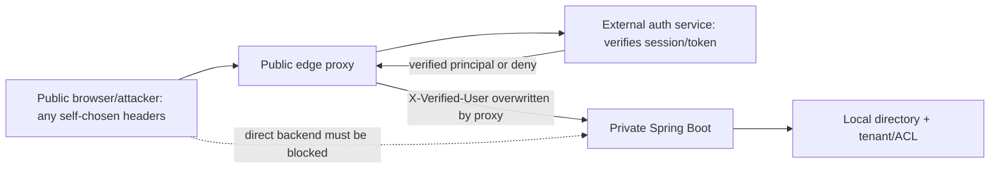

# Stripping client-supplied identity headers before the proxy sets trusted values

## 1. The problem and core principle

In a **reverse-proxy authentication** architecture, a web application may receive login results from a gateway instead of handling SAML/OIDC/Kerberos itself. The gateway verifies the login session and forwards the identity via an HTTP request header such as `X-Verified-User`.

Example:

```http
GET /internal/me HTTP/1.1
Host: app.example.test
X-Verified-User: alice@example.test
```

This header **carries no built-in proof of authentication**. Any browser, `curl`, or HTTP client can send `X-Verified-User: admin@example.test`. If the proxy simply forwards raw input, or uses `setifempty`/`append` instead of overwriting, Spring Security pre-authentication can accept an attacker-chosen username.

**Mandatory rule: before the proxy establishes a trusted identity, all client-supplied identity headers must be stripped; only after external authentication succeeds should a single canonical header be set from the proxy's verified result.** The backend may trust that header only when **every direct access path** is blocked and the proxy → backend connection is controlled.

This lesson belongs to the **Proxy Authentication** group of Spring Security federation. Configurations illustrate NGINX, Apache, and Java 17/Spring Boot 3/Spring Security 6.x. Hostnames like `example.test`, users, and IPs are hypothetical only.

### Objectives

1. Explain the trust boundary between browser, proxy, authentication service, and backend.
2. Distinguish `unset`, `set`, `append`, and `setifempty`.
3. Build NGINX `auth_request` / `auth_request_set` and overwrite the header with the verified principal.
4. Block direct access paths into the backend.
5. Prevent identity header spoofing via mixed case, underscores, aliases, and duplicates.
6. Understand that `RequestHeaderAuthenticationFilter` only reads the header and does not verify the user.
7. Configure Spring Security pre-auth and local user/tenant/role authorization.
8. Test end-to-end scenarios including fail-open, identity switching, and auth-service outages.
9. Distinguish identity headers from `Forwarded`/`X-Forwarded-*` and OAuth Bearer tokens.
10. Protect sessions, CSRF, login callbacks, and logs/traces.

## 2. Threat model and the question "who issued the user?"



Consider two nearly identical requests:

```http
# UNTRUSTED: sent directly by caller
X-Verified-User: admin@example.test

# TRUSTED ONLY WHEN: proxy verified Alice and created anew
X-Verified-User: alice@example.test
```

Two strings can share the exact same syntax yet have **completely different provenance**. The backend cannot verify a "trusted header name" if direct connections remain open or the proxy fails to overwrite.

| Condition | If missing |
| --- | --- |
| Edge strips identity headers from inbound clients | Attacker self-asserts identity |
| Proxy genuinely authenticates before setting | Anyone becomes authenticated |
| Proxy sets from **auth response**, not from request | Spoofed header reflected |
| Backend is reachable only from trusted proxy | Direct requests bypass auth |
| Backend trusts a single canonical header | Legacy aliases allow bypass |
| Spring local directory/policy check | Any claimed username/role gets granted access |
| Auth outage fails closed | Availability failure becomes privilege escalation |

**Never treat HTTPS as proof that a header came from the proxy.** An HTTPS client → proxy connection still lets the client pick arbitrary headers. TLS protects transport only; it does not prove the truthfulness of client-sent strings.

## 3. Inventory of headers commonly mistaken for identity

| Header | Possible sources | Trust level |
| --- | --- | --- |
| `X-Verified-User` | Proxy-authenticated principal or forged client input | Trust only with strip/rewrite + trusted channel |
| `X-Authenticated-User` | Gateway, SSO plugin, client-supplied | Not inherently trusted |
| `X-Auth-Request-User` | Auth service response or client request | Must distinguish request vs. response direction |
| `X-Forwarded-User` | Legacy SSO or client-supplied | Not inherently trusted |
| `X-Remote-User` / `Remote-User` | Legacy CGI/Apache or client | Not inherently trusted |
| `SM_USER` | SiteMinder/legacy reverse proxy | Untrusted unless origin is verified |
| `X-User-Roles` / `X-Groups` | Attributes or client | Never auto-grant authorities |
| `X-Verified-Email` | IdP/proxy user attributes | Requires email-verification contract |
| `X-Tenant` | Router/IdP/proxy/client | Does not replace tenant membership/ACL |
| `Authorization: Bearer` | OAuth client | API must verify token, not convert into plain user header |
| `Forwarded`/`X-Forwarded-For`/`X-Forwarded-Proto` | Routing/network metadata | Not user identity |

**Your inventory must not stop at this document.** Inspect what the backend actually reads: Spring Security pre-auth filters, `HttpServletRequest.getHeader` in controllers, legacy SSO adapters, API gateway plugins, and middleware. If Spring reads `SM_USER` while NGINX strips only `X-Verified-User`, attackers still have a path via `SM_USER`.

## 4. The strip → authenticate → overwrite sequence

Standard flow:

```text
Public HTTP request
  |
  v
[1] Strip/deny client-controlled identity headers
  |
  v
[2] External authentication: cookie, OIDC, SAML, mTLS, Kerberos...
  |-- failure/timeout --> deny (do not forward to backend)
  |
  v
[3] Normalize user ID from verified authentication result
  |
  v
[4] Set/overwrite single X-Verified-User
  |
  v
[5] Forward over protected proxy -> backend channel
  |
  v
[6] Spring pre-auth extracts username, local IAM grants permissions
```

Some proxies support rewriting the same header with "set" semantics that internally replace the prior value; other proxies/adapters preserve duplicates or aliases. **Inspect the generated configuration and the actual request arriving at the backend**. Saying "there is a set-header line" does not prove stripping worked.

### Comparing methods

| Action | Interpretation | Suitable for identity? |
| --- | --- | --- |
| `unset` / remove | Removes existing header | Yes, for the stripping phase |
| `set` / replace | Replaces with verified value | Yes, if it genuinely overwrites |
| `append` / `add` | Keeps old + adds new value | **No**, risks duplicates |
| `setifempty` | Keeps client value if already present | **No** |
| `pass-through` | Forwards client header | **No** |
| `rename` | Renames client header | **No**, adds zero trust |

Anti-pattern:

```text
Client: X-Verified-User=admin
Proxy: append X-Verified-User=alice
Backend: getHeader("X-Verified-User") may be admin
```

Neither picking the "first value" nor the "last value" at the backend is reliable across multiple parsers and hops.

## 5. NGINX proxy_set_header: exact semantics you need to know

NGINX documentation states: `proxy_set_header` sets headers sent to the upstream server; **an empty value prevents the header from being sent**:

```nginx
proxy_set_header X-Verified-User "";
proxy_set_header X-Forwarded-User "";
```

After authentication succeeds, set the new value:

```nginx
proxy_set_header X-Verified-User $trusted_user;
```

These are **two conceptual phases**, not advice to place two directives with the same name in the same block. In deployment configs, you only need the final directive **setting the canonical header from a verified variable** plus explicit stripping of aliases.

Conversely, the following is **unsafe**:

```nginx
# $http_x_verified_user is client input!
proxy_set_header X-Verified-User $http_x_verified_user;
```

Subtlety: `proxy_pass_request_headers` is normally enabled, so NGINX forwards headers not mentioned in `proxy_set_header`. Overwriting `X-Verified-User` **does not remove** `X-User-Roles` or `SM_USER`. You must inventory and deny/strip all reserved names read by the backend or auxiliary systems.

`proxy_set_header` directives are inherited from an outer level **only if** there are no `proxy_set_header` directives at the current level. Inspect `nginx -T` output to catch routes missing `Host`, wrong forwarded-proto, or overrides from another `location` block.

## 6. NGINX auth_request and auth_request_set: end-to-end

Example where NGINX shares a network namespace with an external auth service at `http://127.0.0.1:4180/auth` and a Spring Boot backend at `http://127.0.0.1:8080`. The auth service is configured to perform real SSO authentication without reflecting browser headers.

When Alice is authenticated, the auth service returns:

```http
HTTP/1.1 200 OK
X-Auth-Request-User: alice@example.test
```

When anonymous, denied, or failing, it **never returns 2xx with a fake user**.

NGINX template:

```nginx
# Server configuration excerpt. Add TLS, logs, and upstreams
# for your real environment before production use.
server {
    listen 443 ssl;
    server_name app.example.test;
    ssl_certificate     /etc/nginx/tls/fullchain.pem;
    ssl_certificate_key /etc/nginx/tls/private.key;

    location = /_edge_auth {
        internal;
        proxy_pass http://127.0.0.1:4180/auth;
        proxy_pass_request_body off;
        proxy_set_header Content-Length "";
        proxy_set_header X-Original-URI $request_uri;

        # Strip identity aliases before auth service.
        proxy_set_header X-Verified-User "";
        proxy_set_header X-Authenticated-User "";
        proxy_set_header X-Forwarded-User "";
        proxy_set_header X-Remote-User "";
        proxy_set_header X-Auth-Request-User "";
        proxy_set_header X-User-Roles "";
    }

    location /internal/ {
        # NGINX auth_request: 2xx allows, 401/403 blocks;
        # other errors must not bypass authorization.
        auth_request /_edge_auth;

        # Read auth service RESPONSE, DO NOT read
        # client's $http_x_auth_request_user.
        auth_request_set $trusted_user $upstream_http_x_auth_request_user;

        proxy_set_header X-Verified-User $trusted_user;

        # Client must not send these aliases to app.
        proxy_set_header X-Authenticated-User "";
        proxy_set_header X-Forwarded-User "";
        proxy_set_header X-Remote-User "";
        proxy_set_header X-Auth-Request-User "";
        proxy_set_header X-User-Roles "";

        # Only when this backend does NOT perform Bearer token auth:
        proxy_set_header Authorization "";

        proxy_set_header Host $host;
        proxy_set_header X-Forwarded-Proto https;
        proxy_pass http://127.0.0.1:8080;
    }
}
```

This is an **illustrative configuration per contract**. It cannot run verbatim with the example hostnames and certs; operating it requires NGINX with `ngx_http_auth_request_module`, an auth service that genuinely authenticates users, TCP/upstream/mTLS policies, log redaction, and a fail-closed backend.

### Step-by-step execution

1. Browser sends `GET /internal/me`, possibly carrying `X-Verified-User: admin`.
2. NGINX invokes `/_edge_auth` internally. The listed identity headers are stripped from the subrequest.
3. The auth service validates the cookie or credentials **designed for it**, returning `2xx + X-Auth-Request-User` for a valid user.
4. `auth_request_set` reads the value **from the auth subrequest's HTTP response** into `$trusted_user`.
5. NGINX sets `X-Verified-User` sent to the backend to `$trusted_user`.
6. NGINX strips identity aliases and client credentials that must not be forwarded.
7. Backend pre-auth reads only the proxy-set `X-Verified-User`.
8. Backend looks up local user and permissions to allow or deny.

If the auth service returns `401`, the request is denied/challenged; `403` denies; other error responses never become access. If the auth service accidentally returns 200 without a user, `$trusted_user` is empty and NGINX may omit the header — the backend must **deny**. A better contract has the auth service return 401/403 whenever a principal cannot be determined.

### Never confuse the two NGINX variable types

```nginx
# UNTRUSTED: request header from browser.
$http_x_auth_request_user

# CONDITIONALLY TRUSTED: header from auth subrequest RESPONSE.
$upstream_http_x_auth_request_user
```

Even the second variable is trustworthy only when the auth service genuinely verifies the request and is called by the proxy over an approved channel/endpoint. An auth service that echoes the browser's `X-Auth-Request-User` back into its response defeats the entire mechanism.

## 7. NGINX: fail-closed behavior and phase-ordering traps

Per documentation, NGINX `auth_request` has clear semantics: **2xx allows**, **401 or 403 denies**, and other responses are treated as errors. **Never** configure `error_page 500 =200` or fall back to `auth_request off` when the external auth service is unavailable.

Common cases:

| Auth result | What should the gateway do? | Backend |
| --- | --- | --- |
| 200 + Alice verified | Set Alice and forward | Authentication + ACL |
| 200 yet missing identity | Treat as contract violation | Never turn anonymous into a user |
| 401 | Challenge/login | Never forward into protected app |
| 403 | Deny | Never forward |
| 500/timeout | Fail closed, alert | Never grant access |
| Duplicate/malformed header | Deny/normalize per policy | Never pick a user arbitrarily |
| Logged in as Alice yet browser sends `admin` | Forward **Alice**, not admin | Alice's permissions |

**Warning:** do not write an `if ($trusted_user = "") { return 403; }` check in NGINX's rewrite phase assuming the variable is already populated after `auth_request`. NGINX phases can execute in unexpected order. In a proper design, the auth service **must never return 2xx without an identity**, the backend rejects empty headers, and integration tests verify behavior.

`proxy_set_header Authorization ""` is appropriate only if this backend route **does not verify OAuth Bearer tokens itself**. If an API uses `oauth2ResourceServer`, give it a separate route/filter chain and do not blindly strip its Bearer header.

## 8. Apache httpd 2.4: unset, set, and phase conditions

Apache `mod_headers` provides two distinct directives:

- `Header` operates on **HTTP responses**.
- `RequestHeader` operates on **HTTP requests** before `mod_proxy` forwards upstream.

Stripping client-supplied identity headers:

```apache
RequestHeader unset X-Verified-User
RequestHeader unset X-Authenticated-User
RequestHeader unset X-Forwarded-User
RequestHeader unset X-Remote-User
RequestHeader unset X-User-Roles
```

After authenticating via a module such as `mod_auth_openidc`, Apache can expose server-side `REMOTE_USER`. Illustrative snippet:

```apache
<Location "/internal/">
    AuthType openid-connect
    Require valid-user

    RequestHeader unset X-Verified-User
    RequestHeader unset X-Authenticated-User
    RequestHeader unset X-Forwarded-User

    # Set only from REMOTE_USER populated by Apache auth module.
    # Test module phase ordering in your deployment.
    RequestHeader set X-Verified-User "expr=%{REMOTE_USER}"
</Location>
```

This snippet is **incomplete**: it requires `mod_auth_openidc`, provider/client registration, TLS/proxy routes, log redaction, backend isolation, and testing `REMOTE_USER` phase timing. If `REMOTE_USER` is not yet populated when the expression evaluates, the header will be empty or wrong; fix this via verified module configuration/workflows, **never by falling back to a client header**.

Per Apache documentation:

- `RequestHeader unset` removes all header values of that name.
- `RequestHeader set` replaces existing values.
- `RequestHeader append` / `add` can create multiple values.
- `RequestHeader setifempty` preserves the client value if the header already exists.

**Never use `append` or `setifempty` for identity.** Also avoid stripping `X-Verified-User` in one `Location` while overlooking another `ProxyPass` or virtual host reaching the same backend.

## 9. Ingress-nginx, Gateway API, and route bypasses

An ingress-nginx deployment may use external auth annotations:

```yaml
apiVersion: networking.k8s.io/v1
kind: Ingress
metadata:
  name: portal-edge
  annotations:
    nginx.ingress.kubernetes.io/auth-url: "https://auth.example.test/auth"
    nginx.ingress.kubernetes.io/auth-signin: "https://auth.example.test/start"
    nginx.ingress.kubernetes.io/auth-response-headers: "X-Auth-Request-User"
spec:
  ingressClassName: nginx
  rules:
    - host: app.example.test
      http:
        paths:
          - path: /internal/
            pathType: Prefix
            backend:
              service:
                name: backend-app
                port:
                  number: 8080
```

**This is an incomplete illustrative manifest**, missing TLS, secrets, network policies, controller-specific header strip/overwrite, and a real auth service. The `auth-response-headers` annotation specifies headers copied from the **authentication service's response** upstream; **do not automatically assume all client-controlled identity aliases were stripped**.

Ingress checklist:

1. Inspect the generated NGINX configuration (how the controller renders annotations) for your exact version.
2. Designate one canonical header that the backend reads; ensure no other controller acts as a fallback.
3. Verify the client's `X-Auth-Request-User` header is never retained as trusted input.
4. Audit default ingresses, canaries, regex paths, path rewrites, wildcard hosts, internal ingresses, mesh ingresses, and Gateway API HTTPRoutes.
5. Ensure requests **do not** forward if external auth fails.
6. Verify auth cache keys bind user/session/credential and tenant.
7. Do not enable unrestricted `configuration-snippet` or `auth-snippet` across namespaces: snippets can alter NGINX outside a tenant's boundary.
8. Distinguish **community ingress-nginx** from **NGINX Inc. Ingress Controller**; their annotations are not always identical.

`NetworkPolicy` is a mandatory additional defense, not a substitute for strip/overwrite.

## 10. Envoy/ext_authz and header overwriting

With Envoy external authorization, the auth service can return an `OkHttpResponse` with headers to add/overwrite before forwarding upstream. The API also supports `headers_to_remove`.

Model:

```text
CLIENT:
    X-Verified-User: admin
    X-Forwarded-User: root

ENVOY ext_authz:
    external auth verifies Alice
    removes client identity headers
    sets X-Verified-User: alice
    append=false / overwrite semantics

BACKEND:
    sees only X-Verified-User: alice
```

This is **pseudocode**, not runnable Envoy YAML. For identity headers, **never append** to client values; check the allowlist of headers the auth service may inject, `ext_authz` matchers/ordering, and your Envoy version.

In a service mesh, mTLS workload identity proves **which proxy/service connected**, whereas HTTP user identity comes from verified JWTs, external auth, or sessions — **not the same concept**. The backend needs policies keeping them distinct.

## 11. Multi-tier proxies must preserve the invariant

Production systems rarely have just one proxy:

```text
Browser → CDN/LB → WAF → identity gateway → mesh proxy → backend
```

One hop might strip a header while a downstream hop accidentally restores the raw value from `X-Original-User` or `X-Forwarded-User`. Do not inspect requests only at the **first edge**. Verify the **actual request reaching the servlet container** after the entire proxy chain.

| Hop | Identity-related authority |
| --- | --- |
| Public CDN/LB | Routing/TLS; does not authenticate users by default |
| Identity gateway | Authenticates, strips client identity, sets canonical principal |
| Internal mesh | Verifies workload identity; protects/preserves canonical principal |
| Spring Boot | Trusts one header over trusted transport; looks up local user/ACL |
| Downstream service | Never trusts prior-hop headers implicitly without a contract |

When users log out or switch accounts, identity must reflect the **current request**. Never let a mesh cache/session retain user A when a new request from user B or an anonymous user arrives.

## 12. Header normalization: case and underscores

HTTP header names are case-insensitive. Some proxies/frameworks convert underscores to dashes, or use CGI/WSGI environment variables that cause name collisions.

Variants that must be tested:

```http
X-Verified-User: admin
x-verified-user: admin
X_VERIFIED_USER: admin
X-Verified_User: admin
X-VERIFIED_USER: admin
```

Under HTTP grammar, underscores and dashes are distinct characters; yet **multi-layer stacks** can interpret them differently through normalization. An oauth2-proxy security advisory documented header smuggling where attackers exploited underscore-versus-dash mismatches between proxy and backend.

Countermeasures:

1. At the edge, normalize/compare reserved header names under a policy covering the entire infrastructure chain.
2. Block unauthorized variants before they traverse multiple parsers.
3. Enforce a single canonical header and a single verified identity value.
4. Test case-insensitivity, underscores, mixed separators, and HTTP/2 → HTTP/1.1.
5. Do not rely solely on NGINX's default `underscores_in_headers off` when Apache, ingress-nginx, app servers, or CGI bridges also sit in the path.
6. Track and apply security patches for gateways and controllers.

Comparing names with `String.equalsIgnoreCase` in a Java controller alone **is insufficient**, because the Servlet container may receive data after proxy normalization/merging.

## 13. Duplicate headers and comma-joined values

A request may contain:

```http
X-Verified-User: admin
x-verified-user: alice
```

Or:

```http
X-Verified-User: admin,alice
```

Different layers may return the first value, the last value, or a concatenated string. For identity, that is an **ambiguous request** and must never be handled by "picking the first part".

- The edge should strip/reject duplicates of reserved identity names.
- The gateway sets one header with one canonical verified value.
- The auth service must not return multiple principals or comma-separated identities when the contract expects one user.
- The backend can validate header count/format as defense in depth, though it cannot recover variants already collapsed by upstream parsers.
- Never use Apache `RequestHeader append` or Envoy append for identity.
- Log the anomaly category and correlation ID without printing full PII-bearing values.

**A leftover `X-User-Roles` header remains dangerous even when `X-Verified-User` was properly overwritten**, if business code mistakenly consumes that role header.

## 14. HTTP request smuggling and parser mismatches

Request smuggling occurs when frontend and backend disagree on **HTTP request boundaries**, such as discrepancies in `Content-Length`, `Transfer-Encoding`, or HTTP/2 → HTTP/1.1 downgrades. This can make the backend process a request **different from the one the edge inspected**.

While distinct from ordinary header spoofing, both expose the same danger: **a proxy trust decision is no longer bound to the exact request/headers the backend receives**.

Required defenses:

- Keep proxies, web servers, and gateways patched; enable strict parsing.
- Reject malformed headers, conflicting framing, CRLF injection, and ambiguous header names.
- Test the actual protocols in use: HTTP/1.1, HTTP/2, HTTP/2→1.1, and service mesh hops.
- Never forward requests interpreted differently across hops.
- Protect internal backend paths even if an edge parser is bypassed.

The OWASP Web Security Testing Guide documents how to assess request smuggling in authorized environments; never test payloads against out-of-scope systems.

## 15. Spring Security pre-authentication: getting responsibilities right

Spring Security provides:

- `RequestHeaderAuthenticationFilter`: reads `SM_USER` by default, configurable via `setPrincipalRequestHeader("X-Verified-User")`.
- `AbstractPreAuthenticatedProcessingFilter`: extracts the principal and passes a `PreAuthenticatedAuthenticationToken` to the authentication manager.
- `PreAuthenticatedAuthenticationProvider`: processes a **principal assumed to be externally authenticated**, looking up local user details.
- `UserDetailsByNameServiceWrapper`: connects the provider to `UserDetailsService`.
- `SecurityContextRepository`: determines whether Authentication persists to subsequent requests.
- `SecurityFilterChain`: specifies which endpoints use pre-auth, plus session/CSRF/fallback policies.

Per Spring Security's own Javadoc, `RequestHeaderAuthenticationFilter` **does not authenticate the header**, and if attackers can forge headers they can pick any username. It is appropriate **only on a trusted network with protected external authentication**, not on a public Internet API.

Broken pattern:

```java
String user = request.getHeader("X-Verified-User");
return "Hello " + user; // no validation/trust boundary
```

Even if the controller is guarded by `hasRole("USER")`, if roles also come from a client-sent header, the problem remains unsolved.

## 16. Spring Boot 3 / Java 17: self-contained pre-auth wiring class

Demo of a Spring Boot Servlet app with **a filter chain for `/internal/**` and a deny-all fallback**. Deploy only behind a proxy with verified strip/overwrite, network ACLs, and workload protection.

Dependencies for a project already using Spring Boot plugins/BOM/Java 17+:

```groovy
dependencies {
    implementation "org.springframework.boot:spring-boot-starter-web"
    implementation "org.springframework.boot:spring-boot-starter-security"
    testImplementation "org.springframework.boot:spring-boot-starter-test"
    testImplementation "org.springframework.security:spring-security-test"
}
```

This is a **`build.gradle` snippet**, not a complete build file.

Save `src/main/java/demo/preauth/ProxyPreauthApplication.java`:

```java
package demo.preauth;

import java.util.Map;
import java.util.Set;
import java.util.UUID;

import org.springframework.boot.SpringApplication;
import org.springframework.boot.autoconfigure.SpringBootApplication;
import org.springframework.context.annotation.Bean;
import org.springframework.core.annotation.Order;
import org.springframework.http.HttpMethod;
import org.springframework.http.HttpStatus;
import org.springframework.security.authentication.ProviderManager;
import org.springframework.security.config.annotation.web.builders.HttpSecurity;
import org.springframework.security.config.annotation.web.configurers.AbstractHttpConfigurer;
import org.springframework.security.config.http.SessionCreationPolicy;
import org.springframework.security.core.Authentication;
import org.springframework.security.core.userdetails.User;
import org.springframework.security.core.userdetails.UserDetailsByNameServiceWrapper;
import org.springframework.security.core.userdetails.UserDetailsService;
import org.springframework.security.core.userdetails.UsernameNotFoundException;
import org.springframework.security.web.SecurityFilterChain;
import org.springframework.security.web.authentication.HttpStatusEntryPoint;
import org.springframework.security.web.authentication.UsernamePasswordAuthenticationFilter;
import org.springframework.security.web.authentication.preauth.PreAuthenticatedAuthenticationProvider;
import org.springframework.security.web.authentication.preauth.PreAuthenticatedAuthenticationToken;
import org.springframework.security.web.authentication.preauth.RequestHeaderAuthenticationFilter;
import org.springframework.security.web.context.NullSecurityContextRepository;
import org.springframework.web.bind.annotation.GetMapping;
import org.springframework.web.bind.annotation.PathVariable;
import org.springframework.web.bind.annotation.RestController;
import org.springframework.web.server.ResponseStatusException;

@SpringBootApplication
@RestController
public class ProxyPreauthApplication {

    private static final Map<String, String> TENANT = Map.of(
            "alice@example.test", "north",
            "ops@example.test", "north",
            "bob@example.test", "south");

    private static final Map<String, Set<String>> ROLES = Map.of(
            "alice@example.test", Set.of("ROLE_EMPLOYEE"),
            "ops@example.test", Set.of("ROLE_EMPLOYEE", "ROLE_ADMIN"),
            "bob@example.test", Set.of("ROLE_EMPLOYEE"));

    public static void main(String[] args) {
        SpringApplication.run(ProxyPreauthApplication.class, args);
    }

    @Bean
    UserDetailsService localDirectory() {
        return name -> {
            Set<String> roles = ROLES.get(name);
            if (roles == null) {
                throw new UsernameNotFoundException(
                        "Local identity not provisioned");
            }
            // Password is NOT used in pre-auth; chain has no form login.
            return User.withUsername(name)
                    .password("{noop}" + UUID.randomUUID())
                    .authorities(roles.toArray(String[]::new))
                    .build();
        };
    }

    @Bean
    @Order(1)
    SecurityFilterChain trustedGateway(
            HttpSecurity http, UserDetailsService localDirectory)
            throws Exception {

        PreAuthenticatedAuthenticationProvider provider =
                new PreAuthenticatedAuthenticationProvider();
        provider.setPreAuthenticatedUserDetailsService(
                new UserDetailsByNameServiceWrapper
                        <PreAuthenticatedAuthenticationToken>(
                                localDirectory));

        RequestHeaderAuthenticationFilter filter =
                new RequestHeaderAuthenticationFilter();
        filter.setPrincipalRequestHeader("X-Verified-User");
        filter.setAuthenticationManager(new ProviderManager(provider));

        // Missing header -> no principal; authenticated() denies.
        filter.setExceptionIfHeaderMissing(false);

        // Stateless per-request preauth: do not retain prior request's user.
        filter.setSecurityContextRepository(
                new NullSecurityContextRepository());

        return http
                .securityMatcher("/internal/**")
                .securityContext(sc -> sc.securityContextRepository(
                        new NullSecurityContextRepository()))
                .sessionManagement(sm -> sm.sessionCreationPolicy(
                        SessionCreationPolicy.STATELESS))
                // ONLY if this is a gateway-only API not using cookie auth.
                .csrf(AbstractHttpConfigurer::disable)
                .exceptionHandling(ex -> ex.authenticationEntryPoint(
                        new HttpStatusEntryPoint(HttpStatus.UNAUTHORIZED)))
                .authorizeHttpRequests(auth -> auth
                        .requestMatchers(HttpMethod.GET, "/internal/admin")
                            .hasRole("ADMIN")
                        .requestMatchers(HttpMethod.GET, "/internal/**")
                            .authenticated()
                        .anyRequest().denyAll())
                .authenticationProvider(provider)
                .addFilterBefore(
                        filter, UsernamePasswordAuthenticationFilter.class)
                .build();
    }

    @Bean
    @Order(2)
    SecurityFilterChain denyEverythingElse(HttpSecurity http)
            throws Exception {
        return http
                .authorizeHttpRequests(auth -> auth
                        .requestMatchers("/health").permitAll()
                        .anyRequest().denyAll())
                .build();
    }

    @GetMapping("/health")
    public String health() {
        return "up";
    }

    @GetMapping("/internal/me")
    public Map<String, String> me(Authentication principal) {
        return Map.of("user", principal.getName(),
                      "status", "authenticated-by-proxy");
    }

    @GetMapping("/internal/admin")
    public String admin(Authentication principal) {
        return "admin " + principal.getName();
    }

    @GetMapping("/internal/tenant/{tenant}")
    public Map<String, String> byTenant(
            @PathVariable String tenant, Authentication principal) {
        if (!tenant.equals(TENANT.get(principal.getName()))) {
            throw new ResponseStatusException(HttpStatus.FORBIDDEN);
        }
        return Map.of("tenant", tenant, "status", "authorized");
    }
}
```

### Security explanation

- Reads only `X-Verified-User`. Does not read `X-Forwarded-User`, `SM_USER`, or `X-User-Roles`.
- `PreAuthenticatedAuthenticationProvider`/`UserDetailsService` looks up the local account/authorities; **does not verify OIDC/SAML tokens itself**.
- Unknown users are rejected; `hasRole("ADMIN")` requires local `ROLE_ADMIN`.
- `NullSecurityContextRepository` prevents reusing an old session when a new request lacks a verified header.
- `setExceptionIfHeaderMissing(false)` **does not open anonymous access**: `authenticated()` still protects all of `/internal/**`.
- The filter is not declared as a separate `@Bean` that Boot would auto-register as a servlet filter outside the Spring Security chain; it is instantiated inline inside the chain.
- The fallback chain exposes no other public routes besides `/health`.
- Disable CSRF only on **gateway-only stateless routes** that do not use cookies/sessions as credentials. For web sessions/SAML/OIDC, keep CSRF protection enabled.
- `/internal/tenant/{tenant}` checks the local tenant after authentication; a client changing the path cannot gain another tenant's access.

**Crucial warning:** if an attacker **can send a request directly to the backend port** with `X-Verified-User: ops@example.test`, the demo will treat them as Ops. This is an inherent limit of pre-auth headers, not a Java bug. Network/gateway protection is a **mandatory prerequisite**, not an optional optimization.

### Example output behind a proper gateway

The auth service verifies Alice; the backend receives:

```http
GET /internal/me HTTP/1.1
X-Verified-User: alice@example.test
```

Response body:

```json
{"user":"alice@example.test","status":"authenticated-by-proxy"}
```

If Alice accesses `/internal/admin`, she receives 403. An unknown principal receives no authentication. There is no fixed login stdout because the gateway, SSO infrastructure, and local directory must run together.

## 17. Local roles, tenants, and identity links must not come from input

In a real `UserDetailsService`, the user identifier from the gateway should map to an **immutable local user ID** via a governed identity link table:

```text
verified proxy subject
    -> identity issuer/tenant namespace
    -> local account link
    -> active/disabled status
    -> local roles/tenant memberships
    -> resource ACL/ownership
    -> allow/deny
```

Never use email as the sole link key across multiple OIDC/SAML issuers: emails can change or be reassigned. Never grant admin from `X-Groups: admins` unless the proxy/IdP is authorized to govern that group and the backend maintains a formal mapping.

A user authenticated at the proxy has access **only per local policy**. Sensitive APIs also need object-level authorization: tenant, account status, document owner, action, and MFA/freshness if required.

## 18. Sessions and identity switching: avoiding stale SecurityContext

`AbstractPreAuthenticatedProcessingFilter` may skip re-reading the header if `SecurityContext` already contains an Authentication. In stateful web apps, this can cause:

- Gateway logged out Alice while the backend session still holds Alice.
- Gateway switched to Bob while the backend keeps using Alice's SecurityContext.
- A new request lacks the header while the backend session cookie persists.
- Roles/tenants were revoked while cached sessions remain unrefreshed.

Choose clearly:

1. **Stateless pre-auth:** verified header required on every request, using `NullSecurityContextRepository` and denying missing identities (section 16).
2. **Stateful:** synchronize session lifecycle with the gateway; use `setCheckForPrincipalChanges(true)` and `setInvalidateSessionOnPrincipalChange(true)` where appropriate, and test logout/revocation.
3. **End-to-end signed access tokens:** API verifies JWT audience/issuer/time/scope or AS introspection rather than accepting plain username headers.

Do not mix `oauth2Login`, `saml2Login`, form login, Bearer, and header pre-auth across the entire app without clearly demarcated routes/chains. In particular, SAML ACS or OIDC callbacks **do not automatically carry a trusted proxy username**; they have their own protocol validators and correlation state.

## 19. Restricting direct access into the backend

An Internet request bypassing the proxy bypasses strip/overwrite:

```text
Internet -> Trusted edge -> Backend :8080   (valid path)
Internet ----------------> Backend :8080   (must be blocked)
```

Layers that must work together:

- Never expose the backend via public LoadBalancers/NodePorts/hostPorts/debug endpoints.
- Firewalls/NSGs/security groups permit only trusted proxy identity/IP/workloads to reach the backend.
- Kubernetes NetworkPolicy denies untrusted pods/namespaces to backend ports when the CNI enforces policies.
- Use TLS/mTLS between proxy and backend when the risk model requires it; verify the proxy's client certificate/workload identity.
- In a mesh, beyond `PeerAuthentication STRICT`, add an `AuthorizationPolicy` allowing only authorized proxy sources.
- In cloud environments, use private subnets and never expose the private backend via tunnels or secondary ingresses.
- Never rely on a static `X-Proxy-Secret` as the sole defense: secrets can leak or be replayed and do not protect request semantics.

Example NetworkPolicy restricting the backend:

```yaml
apiVersion: networking.k8s.io/v1
kind: NetworkPolicy
metadata:
  name: backend-from-edge-only
  namespace: app-space
spec:
  podSelector:
    matchLabels:
      app: backend
  policyTypes:
    - Ingress
  ingress:
    - from:
        - namespaceSelector:
            matchLabels:
              kubernetes.io/metadata.name: ingress-space
          podSelector:
            matchLabels:
              app: edge-proxy
      ports:
        - protocol: TCP
          port: 8080
```

This is a **conceptual template**: labels/controllers/CNI/mesh must match your real cluster. It does not replace proxy header sanitization or OIDC/SAML auth checks.

## 20. Forwarded headers are not identity

`Forwarded`, `X-Forwarded-For`, `X-Forwarded-Host`, and `X-Forwarded-Proto` describe routing, IPs, and public URLs; they **do not prove the user**.

```http
Forwarded: for=203.0.113.7;proto=https;host=app.example.test
X-Forwarded-For: 203.0.113.7
X-Forwarded-Proto: https
```

Spring Boot provides `server.forward-headers-strategy=framework` for deployments behind a proxy. Enable it only when the **proxy strips/overwrites client `Forwarded` and `X-Forwarded-*` headers**, otherwise attackers can poison host/scheme/redirects/ACS. Never infer user Alice from an IP in `X-Forwarded-For`.

When using Spring SAML/OIDC, public base URL/ACS/redirect URIs must come from **trusted proxy headers** or pinned configuration; never disable `Destination`, `Recipient`, OAuth `state`/`nonce`, or issuer validation to mask host mismatches.

## 21. CSRF, cookies, and OAuth Bearer: pick the right filter chain

Header pre-auth fits when the gateway authenticates the user on every request. Yet if the browser relies on a session cookie, CSRF must still be addressed:

- With session cookie auth, browsers **automatically send cookies**, so POST/PUT/DELETE require a CSRF policy.
- For a stateless `/internal/**` API receiving only gateway-verified identity without relying on browser cookies, a different policy like the demo may apply.
- If an API accepts Bearer tokens from clients, use `oauth2ResourceServer().jwt()`/`opaqueToken()` to validate AS issuer/audience/scopes; never trust `X-Verified-User` on public API paths.
- OIDC `/login/oauth2/code/{registrationId}` and SAML `/login/saml2/sso/{registrationId}` must enter the **web login chain** with dedicated protocol validation.
- Never strip `Authorization: Bearer` on API paths that need to verify tokens; strip only on routes where the gateway already handled credentials and the backend uses pre-auth.
- `SameSite` on session cookies does not replace identity header stripping. Cross-site SAML HTTP-POST may require tuned session cookie settings, yet still requires full SAML validation.

**Do not disable CSRF application-wide because of header pre-auth**. If a user's browser can invoke state-changing endpoints and the proxy authenticates via an SSO cookie, endpoints remain vulnerable to CSRF even if the backend calls itself "stateless".

## 22. Standalone Java 17 demo: simulating strip then overwrite

The following program illustrates only the **data invariant**, not a real HTTP parser or proxy. It does not handle duplicate headers, HTTP/2, TLS, or external authentication. `Optional<String> verifiedUser` is assumed to come from an independent auth service, **never from request headers**.

Save `HeaderSanitizationDemo.java`:

```java
import java.util.LinkedHashMap;
import java.util.Locale;
import java.util.Map;
import java.util.Optional;
import java.util.Set;

public final class HeaderSanitizationDemo {

    private static final Set<String> RESERVED = Set.of(
            "x-verified-user",
            "x-authenticated-user",
            "x-auth-request-user",
            "x-forwarded-user",
            "x-remote-user",
            "x-user-roles"
    );

    private static String canonical(String name) {
        return name.toLowerCase(Locale.ROOT).replace('_', '-');
    }

    static Map<String, String> forward(
            Map<String, String> clientHeaders,
            Optional<String> verifiedUser) {

        Map<String, String> result = new LinkedHashMap<>();
        clientHeaders.forEach((name, value) -> {
            if (!RESERVED.contains(canonical(name))) {
                result.put(name, value);
            }
        });

        // Use only the principal from a trusted authentication result.
        verifiedUser
                .filter(user -> user.matches("[A-Za-z0-9._@-]{1,128}"))
                .ifPresent(user -> result.put("X-Verified-User", user));

        return Map.copyOf(result);
    }

    public static void main(String[] args) {
        Map<String, String> forged = Map.of(
                "X-Verified-User", "admin@example.test",
                "X_Verified_User", "root@example.test",
                "X-User-Roles", "ROLE_ADMIN",
                "Accept", "application/json");

        Map<String, String> alice = forward(
                forged, Optional.of("alice@example.test"));
        Map<String, String> noLogin = forward(
                forged, Optional.empty());

        System.out.println("forwardedUser="
                + alice.get("X-Verified-User"));
        System.out.println("spoofedAdminAccepted="
                + "admin@example.test".equals(
                        alice.get("X-Verified-User")));
        System.out.println("underscoreAliasRemoved="
                + !alice.containsKey("X_Verified_User"));
        System.out.println("forgedRolesRemoved="
                + !alice.containsKey("X-User-Roles"));
        System.out.println("anonymousGetsIdentity="
                + noLogin.containsKey("X-Verified-User"));
        System.out.println("acceptHeaderPreserved="
                + "application/json".equals(alice.get("Accept")));
    }
}
```

Run on Java 17+:

```bash
javac HeaderSanitizationDemo.java
java HeaderSanitizationDemo
```

**Exact** stdout:

```text
forwardedUser=alice@example.test
spoofedAdminAccepted=false
underscoreAliasRemoved=true
forgedRolesRemoved=true
anonymousGetsIdentity=false
acceptHeaderPreserved=true
```

In production, never build your own proxy out of a `Map`: a Java `Map` cannot represent duplicate headers, and HTTP stacks have their own canonicalization. Most importantly, **trusted identities must come from external auth results**, never from the client.

## 23. End-to-end testing from the public entry point

MockMvc directly injecting a header:

```java
mvc.perform(get("/internal/me")
        .header("X-Verified-User", "alice@example.test"))
        .andExpect(status().isOk());
```

Proves only that the backend accepts the pre-auth header **once the header reaches the backend**. It **does not** prove the gateway strips/overwrites safely. You must run tests through the **public gateway** and inspect the request received at the backend.

### Anonymous spoofing test

```bash
curl -i \
  -H "X-Verified-User: admin@example.test" \
  -H "X-User-Roles: ROLE_ADMIN" \
  https://app.example.test/internal/me
```

Expected: gateway rejects/challenges (401/403/redirect per policy) without forwarding the request into the protected backend.

### Authenticated user Alice spoofing admin

With an authenticated Alice browser/test session in staging, inject extra forged headers:

```bash
# Use only authorized fixtures/test harnesses; do not expose real cookies.
curl -i \
  -H "X-Verified-User: admin@example.test" \
  -H "X-Forwarded-User: root" \
  -H "X-User-Roles: ROLE_ADMIN" \
  -H "Cookie: REDACTED_TEST_SESSION" \
  https://app.example.test/internal/me
```

Expected: backend sees **Alice** (when the test cookie is valid), not admin/root; never grants ROLE_ADMIN from client headers.

### Direct backend test

```bash
# Only from an authorized test pod/network segment:
curl -i \
  -H "X-Verified-User: admin@example.test" \
  http://backend.app-space.svc.cluster.local:8080/internal/me
```

Expected: **network connection is blocked** for any non-proxy source. If the direct path succeeds, Java pre-auth headers **can be bypassed** regardless of how cleanly public NGINX is configured.

### Auth service outage test

Temporarily simulate `401`, `403`, `503`, or timeouts from external auth in staging. Expected: zero unauthorized requests are forwarded; the system fails closed and fires proper alerts rather than turning timeouts into 2xx.

## 24. Security test matrix

| Case | Expected outcome |
| --- | --- |
| Anonymous sets `X-Verified-User=admin` | Gateway denies |
| Logged-in Alice sets `X-Verified-User=admin` | Backend still sees Alice |
| Alice sets `X-User-Roles=ADMIN` | Does not grant local ROLE_ADMIN |
| Client sets `X-Authenticated-User` / `SM_USER` | Aliases stripped, never read by app |
| Client uses lowercase `x-verified-user` | No bypass |
| Client uses underscore `X_Verified_User` | Rejected/stripped before normalization |
| Client sends duplicate identity headers | Rejected/overwritten to one canonical value |
| Client sends `X-Verified-User: admin,alice` | Cannot pick arbitrary user |
| Auth service returns 200 without principal | Backend denies, contract error |
| Auth service returns 401 or 403 | Protected request not forwarded |
| Auth service returns 500/timeout | Fails closed |
| Auth cache keyed solely by URL | Caught/rejected in cross-user test |
| Direct backend NodePort/port | Network deny |
| Canary/default ingress route lacks auth | Blocked/never exposed |
| Proxy A strips, proxy B restores raw header | Caught in backend capture |
| HTTP/2 → HTTP/1.1 normalization | Identity provenance unchanged |
| OAuth Bearer API on separate route | Verifies token separately, ignores username header |
| OIDC/SAML callback | Traverses dedicated protocol chain |
| Disabled local account | No Authentication granted |
| Cross-tenant URL/path | Local ACL denies |
| Backend context retains old user after logout | Handled by stateless/revalidation/session policy |
| Forged `X-Forwarded-Host` | Does not alter identity/redirect policy |
| Invalid control chars/CRLF | Rejected by parser/gateway |
| Key/policy/proxy upgrade | Regression tests still pass |

Testing only "Alice logs in successfully" is insufficient. The primary risks lie in **negative tests**: unauthenticated users, identity switches, a misconfigured hop, or direct backend access.

## 25. Troubleshooting deployment failures

| Symptom | Cause | What to check |
| --- | --- | --- |
| User header never reaches backend | Auth response lacks user, wrong `auth_request_set` variable | Distinguish `$upstream_http_*` from `$http_*` |
| Anonymous can still view profile | Protected route lacks auth or has `permitAll` fallback | NGINX location, Spring filter chain |
| Client chooses admin | Pass-through/append/setifempty/direct backend | Strip/overwrite and network boundary |
| Alice has two username values | Duplicate/alias normalization | Headers at each hop, parser behavior |
| Auth service returns 200 unauthenticated | Auth gateway contract bug | Deny when principal is missing |
| Auth outage still lets requests through | Fail-open config | Auth request status mapping |
| Backend returns all 401s | Missing header or unknown Spring UserDetails | Generated proxy headers, local directory |
| Backend returns 403 for valid user | Missing local role/tenant/ACL | Authorization policy |
| Proxy works yet prior request's user persists | Stateful SecurityContext/cache | `NullSecurityContextRepository` / session invalidation |
| `X-Forwarded-Host` causes wrong redirects | Client forwarded headers not stripped | Trusted ingress and Boot forwarding |
| NGINX adds headers causing wrong Host | `proxy_set_header` inheritance changed | `nginx -T` / generated config |
| Ingress annotation does nothing | Wrong controller or version | Check community ingress-nginx vs. NGINX Inc |
| API Bearer token disappears | `Authorization` stripped on wrong route | Separate gateway-only vs. Bearer API |
| Request smuggling detected | HTTP parser mismatch | Patch proxy, reject ambiguous requests |
| JWT/SAMLResponse/cookies logged | Unredacted header dumps | Logging configuration and observability |

Never fix issues by setting `anyRequest().permitAll()`, disabling Spring Security, or trusting `X-User-Roles` as a "quick workaround". Those turn a configuration bug into an authentication vulnerability.

## 26. Observability and auditing

Useful metrics:

- `edge_auth_allow` / `edge_auth_deny` / `edge_auth_error`.
- `edge_identity_header_stripped` by header name group, without storing raw user values.
- `edge_auth_missing_subject` when external auth returns 2xx without an identity.
- `backend_preauth_unknown_user`.
- `backend_tenant_access_denied`.
- `direct_backend_denied` from firewall/service-mesh policies.
- `identity_header_duplicate_rejected` and `header_normalization_anomaly`.

Things to **redact** from logs: session cookies, Authorization Bearer tokens, OIDC ID Tokens, SAMLResponse, Kerberos Negotiate tokens, raw identity headers unless strictly required, client secrets, and other credentials.

If an incident occurs:

1. Identify which proxy the request traversed and whether a bypass path exists.
2. Reconcile the verified user at the auth service with the identity received by the backend.
3. Inspect the generated gateway config active at incident time, not just Git templates.
4. Close any direct backend access immediately.
5. Revoke affected sessions/tokens per policy.
6. Audit actions and tenant resources accessed improperly.
7. Add negative tests to prevent recurrence.

## 27. Anti-patterns to eliminate

| Wrong | Why dangerous | Replace with |
| --- | --- | --- |
| `proxy_set_header X-Verified-User $http_x_verified_user` | Client-supplied user | Verified auth service result |
| `RequestHeader setifempty` | Attacker sets it first | Unset/overwrite |
| `RequestHeader append` | Duplicate identity | Single canonical value |
| Stripping one header, ignoring aliases | Legacy adapter bypass | Inventory all identity headers |
| Trusting username header over direct Internet | Admin impersonation | Backend isolation + workload auth |
| Seeing `X-User-Roles=ADMIN` and granting admin | Role escalation | Local IAM roles |
| Letting requests through on external auth 503 | Fail open | Deny + alert |
| Auto-creating local users for all OIDC/SAML users | Cross-tenant mapping risk | Provisioning/account linking |
| App retains old SecurityContext on gateway logout | Stale principal | Stateless/revalidation policy |
| Disabling CSRF for web cookie sessions | CSRF | Proper CSRF protection |
| Using mTLS between proxies while taking headers from client | Workload auth differs from user auth | Signed/verified identity contract |
| Trusting `X-Forwarded-For` as identity | Spoofable routing metadata | IAM/auth service |
| MockMvc test sending X-Verified-User to prove gateway safety | Does not test the proxy | E2E via edge and direct-path deny |
| Treating `auth-response-headers` annotation as proof all spoofs are stripped | Ingress behavior varies by controller | Inspect generated config/test |
| Skipping OAuth audience/issuer checks because proxy sends header | Token audience confusion | Resource Server validators |
| Relying on a static "secret header" as sole trust | Header can leak/replay | Network/mTLS + auth protocol |

## 28. Pre-production checklist

- [ ] Inventoried all public ingresses, internal ingresses, LoadBalancers, NodePorts, and admin/debug routes.
- [ ] Backend trusts and reads only a single **canonical identity header**.
- [ ] All client-controlled identity headers/aliases are stripped/overwritten.
- [ ] No `setifempty`/`append` is used for username/role/tenant.
- [ ] NGINX `auth_request_set` reads from the verified auth **response**, not `$http_x_*`.
- [ ] Auth service never returns 2xx without a verified user; outages fail closed.
- [ ] Generated proxy config (NGINX/Ingress/Apache/Envoy) has been inspected.
- [ ] Case, underscore/dash aliases, duplicates, malformed values, and HTTP protocol downgrades are tested.
- [ ] Backend is unreachable from the Internet/unknown pods; NetworkPolicy/firewall/mesh is genuinely enforced.
- [ ] Proxy-to-backend TLS/mTLS/workload identity fits the trust model.
- [ ] Spring `RequestHeaderAuthenticationFilter` is never treated as an ID Token/JWT/SAML verifier.
- [ ] Spring pre-auth provider looks up active users/roles from the local directory.
- [ ] `SecurityFilterChain` applies only to intended routes, with a deny-by-default fallback.
- [ ] Session persistence, identity switching, and logout policies are explicit.
- [ ] CSRF remains protected on session-based browser endpoints.
- [ ] OIDC/SAML callbacks and OAuth Bearer APIs have separate chains/protocol validation.
- [ ] Role/tenant/resource ACLs are enforced after authentication.
- [ ] Auth cache keys/TTLs/revocation handle user/session/tenant properly.
- [ ] Negative tests cover anonymous spoof, Alice spoofing admin, empty user response, outage, direct backend, aliases, stale session, and cross-tenant.
- [ ] Observability/auditing do not log raw identities/tokens/cookies or secrets.
- [ ] A regression testing process exists after gateway/controller/JVM/Spring Security upgrades.

## 29. Self-assessment questions

**1. Is `X-Verified-User` trustworthy merely because its name contains Verified?**  
No. Clients can craft that header themselves; gateway authentication/overwriting and backend isolation are required.

**2. Why is `setifempty` unsuitable for identity?**  
It can preserve a header pre-set by the client, enabling username spoofing.

**3. How does `$http_x_auth_request_user` differ from `$upstream_http_x_auth_request_user`?**  
The first comes from the client request; the second comes from the **auth subrequest's response** (trustworthy only when the auth service is properly configured).

**4. Is proper stripping at the proxy enough if the backend's direct port is public?**  
No. Attackers can bypass the proxy and send headers directly.

**5. Does Spring `RequestHeaderAuthenticationFilter` verify SAML Assertions or JWT signatures?**  
No. It only extracts the username; the external auth system is responsible for verification.

**6. What should the gateway do if the auth service returns 503?**  
Fail closed; never forward the request as an authenticated user.

**7. What must an anonymous client sending `X-Verified-User: admin` receive?**  
A denial/login challenge at the public edge; never admin data.

**8. If Alice is logged in yet sends `X-Verified-User: admin`, do her privileges change?**  
No. The backend must receive Alice from the auth result and Alice's local roles.

**9. Why must `X_Verified_User` be tested?**  
Some proxies/backends normalize underscores and dashes differently, enabling header smuggling.

**10. Should `X-User-Roles: ADMIN` from a browser be trusted?**  
No. Roles must come from local IAM or a verified, authorized claims source.

**11. Why does the stateless model need `NullSecurityContextRepository`?**  
So a new request missing a verified header never reuses an `Authentication` stored in a prior session.

**12. When should an API use Bearer tokens instead of username headers?**  
When the API is called end-to-end by clients holding access tokens; the Resource Server must verify issuer/audience/signature/scope per trust contract.

**13. Is the `X-Forwarded-For` header proof of user identity?**  
No. It is routing/client IP metadata, not a substitute for authentication.

**14. Which combination of tests best proves safety?**  
Combining denied anonymous spoofs, Alice spoofing admin still resolving to Alice, network-denied direct backend calls, fail-closed auth service errors, and cross-tenant/role tests.

## 30. Official documentation and security research

- [Spring Security 6.5 — Pre-Authentication Scenarios](https://docs.spring.io/spring-security/reference/6.5/servlet/authentication/preauth.html): warnings on request-header authentication and external system responsibilities.
- [Spring Security 6.5 — RequestHeaderAuthenticationFilter API](https://docs.spring.io/spring-security/reference/6.5/api/java/org/springframework/security/web/authentication/preauth/RequestHeaderAuthenticationFilter.html): `principalRequestHeader`, `exceptionIfHeaderMissing`, default `SM_USER`.
- [Spring Security 6.5 — AbstractPreAuthenticatedProcessingFilter API](https://docs.spring.io/spring-security/reference/6.5/api/java/org/springframework/security/web/authentication/preauth/AbstractPreAuthenticatedProcessingFilter.html): pre-auth context persistence and principal changes.
- [Spring Security — Authentication Persistence](https://docs.spring.io/spring-security/reference/6.5/servlet/authentication/persistence.html): `SecurityContextRepository` and stateless contexts.
- [NGINX — ngx_http_proxy_module](https://nginx.org/en/docs/http/ngx_http_proxy_module.html#proxy_set_header): empty values, request header overwriting, and inheritance.
- [NGINX — ngx_http_auth_request_module](https://nginx.org/en/docs/http/ngx_http_auth_request_module.html): `auth_request` statuses and `auth_request_set`.
- [Apache HTTP Server 2.4 — mod_headers](https://httpd.apache.org/docs/2.4/mod/mod_headers.html): RequestHeader unset/set/append/setifempty.
- [Kubernetes ingress-nginx — Authentication Annotations](https://kubernetes.github.io/ingress-nginx/user-guide/nginx-configuration/annotations/): auth-url, auth-response-headers, and controller limitations.
- [Kubernetes — NetworkPolicy](https://kubernetes.io/docs/concepts/services-networking/network-policies/): blocking untrusted network ingress paths.
- [Envoy — External Authorization API](https://www.envoyproxy.io/docs/envoy/latest/api-v3/service/auth/v3/external_auth.proto): response header overwriting and `headers_to_remove`.
- [OWASP — HTTP Request Smuggling Testing](https://owasp.org/www-project-web-security-testing-guide/latest/4-Web_Application_Security_Testing/07_Input_Validation_Testing/16-Testing_for_HTTP_Request_Smuggling): parser differentials.
- [oauth2-proxy — Header Smuggling Advisory GHSA-vjrc-mh2v-45x6](https://github.com/oauth2-proxy/oauth2-proxy/security/advisories/GHSA-vjrc-mh2v-45x6): underscore-dash alias bypass and patch.
- [OWASP — Authentication Cheat Sheet](https://cheatsheetseries.owasp.org/cheatsheets/Authentication_Cheat_Sheet.html): authentication boundaries.
- [OWASP — Authorization Cheat Sheet](https://cheatsheetseries.owasp.org/cheatsheets/Authorization_Cheat_Sheet.html): deny by default, least privilege, and resource ACLs.
