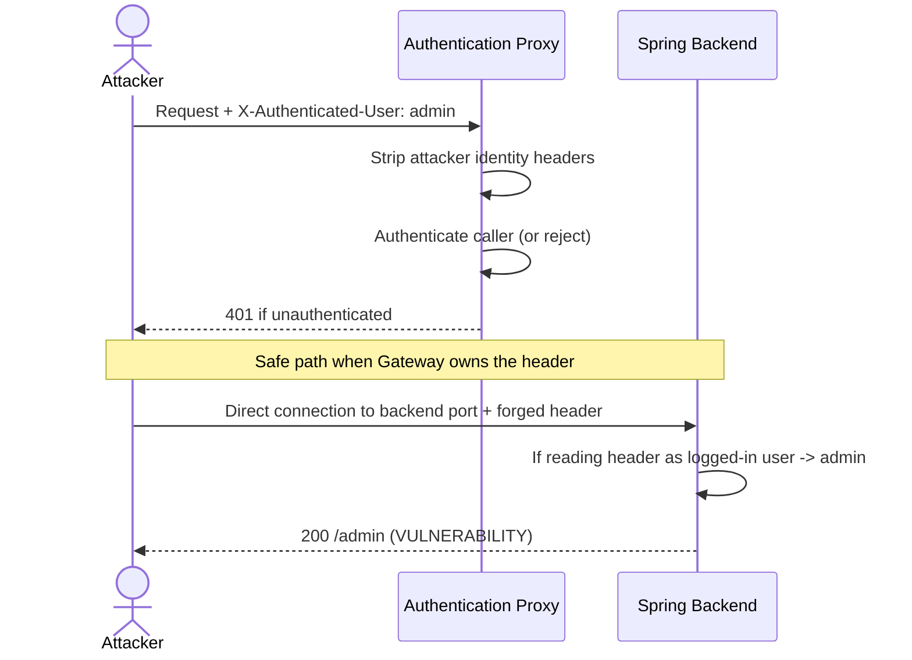
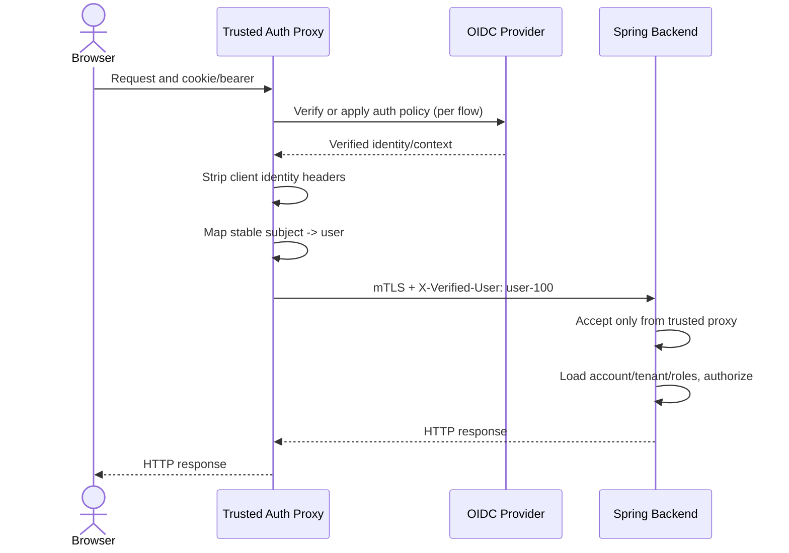
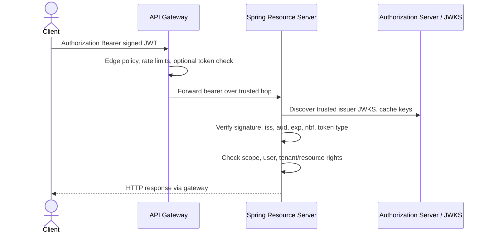

# Distinguishing identity headers from signed assertions or tokens

**Module:** Spring Security – federation → Proxy Authentication.

**Objective:** distinguish an **HTTP identity header** injected into a request by a reverse proxy/API gateway from a **cryptographically signed assertion or token** (SAML Assertion, JWT/JWS, OIDC ID Token, OAuth2 JWT Access Token); understand trust boundaries, anti-spoofing, replay, token substitution, identity mapping, and fail-closed Spring Security integration.

**Core idea:** a header like `X-Authenticated-User: alice` is just an **HTTP string**. The header itself **carries no signature and does not prove Alice just logged in**. It is trustworthy only when the application accepts requests **exclusively from a proxy that authenticated the user with trustworthy transport/network controls**, where the proxy stripped client-sent values and **overwrote** them with the real authentication result. By contrast, a **signed assertion/token** carries integrity proof from an issuer signed with a trusted key; the recipient must still **verify the signature and relevant claims/conditions**. A valid signature **does not grant permissions on its own** and does not prove the token was issued for the receiving application or API.

**Terminology distinction:** "carried in an HTTP header" does not mean "bare header". For example, `Authorization: Bearer <signed-JWT>` is **a header used to transport a signed token**. What gets verified is the **token inside**, not inherent trust in HTTP headers. Conversely, `X-Authenticated-User: alice` may be emitted by a proxy after a valid OIDC flow, yet the string `alice` itself still lacks an end-to-end signature unless another verification mechanism protects it.

This material uses Java 17+, Spring Security Servlet, reverse proxies, and fictitious issuer/URL examples. The signing code in the Java section is an **educational simulation**, not a production JWT, SAML, or HTTP Message Signatures library.

## 1. Context: the proxy authenticates on the application's behalf

A legacy application or microservices system may place an **Identity-Aware Proxy (IAP)**, gateway, SSO middleware, or reverse proxy in front:

```text
+------------------+
| Browser / Client |
+---------+--------+
          | HTTPS, session cookie / OAuth2 / OIDC
          v
+--------------------------+
| Authentication Proxy     |
| - login OIDC/SAML/SPNEGO |
| - validate session/token |
| - derive trusted user    |
| - enforce edge policies  |
+------------+-------------+
             | internal hop: user header or signed token
             v
+--------------------------+
| Spring Security app/API  |
| - trust boundary checks  |
| - Authentication object  |
| - authorization          |
| - business resource      |
+--------------------------+
```

**There are two key identity handoff models:**

1. **Header-based pre-authentication:** the proxy authenticates the user and passes an identity string to the backend, such as `X-Authenticated-User: alice`. The backend **verifies no signature on this header**; it trusts an *operational relationship*: only the trusted proxy can reach the backend and clients cannot forge the header.
2. **Signed-token/assertion verification:** the backend receives a SAML Assertion/JWT/JWS issued by a trusted issuer and verifies signature, issuer, audience, expiration, subject, and protocol itself. Proof is cryptographically bound; bearer protection and authorization are still needed.

The two models **can coexist**: the proxy validates an OIDC ID Token and sets a raw header for the backend; or the proxy issues a **separate signed JWT with backend-specific audience**; or the proxy authenticates while the backend also receives tokens. Yet you must specify clearly **who authenticates on each hop** and **who is permitted to assert user identity**.

## 2. Comparison table: nature and strength of proof

| Criterion | Bare identity header | Signed JWT/JWS | Signed SAML Assertion |
| --- | --- | --- | --- |
| Example | `X-Authenticated-User: alice` | JWT with `sub/iss/aud/exp` and signature | XML `Assertion` and `ds:Signature` |
| Transport location | HTTP request header | Typically `Authorization: Bearer`, cookie, or body per protocol | Typically `SAMLResponse` via browser POST/Redirect binding |
| Integrity protection on the data itself | **None built in** | Yes, **once** JWS signature is verified | Yes, over signed XML elements when XMLDSig verifies cleanly |
| Identifying the issuer | Only via **proxy/hop trust** | `iss` must be checked and key must belong to trusted issuer | SAML `Issuer` and signing certificate/trust |
| Identifying the intended recipient | Defined via proxy routing/policy | `aud` must contain app/resource server | `AudienceRestriction`, Recipient, Destination/ACS |
| Lifetime | None for bare username; depends on proxy session | `exp`, `nbf`, `iat` per profile | `Conditions NotBefore/NotOnOrAfter`, SubjectConfirmationData |
| Replay resistance | Depends on proxy session/transport | Bearer tokens **can still be replayed** if stolen; requires TTL/PoP/revocation per threat model | `InResponseTo`, one-time-use/replay store, conditions |
| Privilege scoping | Role headers can be spoofed if boundaries are weak | Scope/role claims valid only per issuer/policy | AttributeStatement/assurance checked, never auto-grants roles |
| Implementation | Simple, yet demands absolute network trust | Operational overhead for keys/JWKS/validation; independently verifiable across services | Overhead for metadata/certs/XMLSig/protocol validation |
| Primary risks | Header spoofing, proxy bypass, multi-hop confusion | Token substitution, alg/key confusion, stolen bearer | XML signature wrapping, replay, wrong audience/recipient |
| Decisive question | **Who can send headers to the backend?** | **For whom, when, and what token type did the issuer sign?** | **Did a trusted issuer sign the exact assertion/recipient/request?** |

**Signatures protect integrity/authenticity of signed fields without encrypting contents.** Signed JWTs/JWS and SAML Assertions can be read by recipients or hops without confidentiality protection; TLS is required, plus JWE or SAML encryption when data confidentiality is mandated by profile. Conversely, TLS between proxy and backend protects **one hop**; it does not turn a header string into a signed assertion that the backend can verify independently of the proxy.

## 3. What is and isn't an identity header?

Common header names (no single mandatory standard exists):

```http
X-Authenticated-User: alice
X-Auth-Request-User: alice
X-Forwarded-User: alice
Remote-User: alice
SM_USER: alice
X-Authenticated-Email: alice@example.com
X-Authenticated-Groups: report-viewer
```

**Warning:** a header named after a well-known SSO product **creates no trust**. Any HTTP client can normally set headers unless infrastructure blocks/overwrites them. Example:

```bash
curl https://portal.example.com/private \
  -H 'X-Authenticated-User: admin'
```

The command above is a **spoofing test** to run only in authorized environments. If the app accepts it and creates an admin session merely because the header is present, the system has an **authentication bypass**. Putting a corporate email, the word "verified", or a valid username inside the header adds zero trustworthiness.

### 3.1. How can an unsigned header be trustworthy?

A valid header pre-auth architecture requires **all at once**:

1. **The proxy genuinely authenticates the user** (OIDC/SAML/SPNEGO/session validation or approved system) **before** creating the header.
2. **Only the proxy can connect to the backend**: the backend has no public/exposed NodePort/LoadBalancer, alternate ingress, secondary service-mesh route, or bypass debug port.
3. **Authenticate the proxy's identity** on the backend hop where possible: mTLS with dedicated service identity, network policies + firewalls, and routing ownership.
4. **Strip/reject all client-supplied identity headers** at the edge, including aliases, duplicate headers, uppercase variants, hyphen/underscore variants normalized by proxies/frameworks, and role/tenant headers.
5. **Only the proxy creates the new header** from the verified authentication result; the value must be a namespaced **stable subject/internal ID**, never taken from query/body.
6. **The backend reads the value only inside the trust boundary**, failing closed if missing or invalid; no alternate route lets clients supply the header themselves.
7. **Backend authorization** comes from trusted sources (database/policy-governed group mappings), never trusting arbitrary role/tenant strings passed from upstream.

When all of these conditions hold, the header serves as an **operational assertion** of the gateway: trusting the proxy as the authoritative authentication component. This is a practical model, yet **not equivalent** to an end-to-end signature-verifiable token; topology shifts or misconfigurations can break safety without breaking cryptography.

### 3.2. `X-Forwarded-*` differs from identity headers

Headers like `Forwarded`, `X-Forwarded-For`, `X-Forwarded-Proto`, and `X-Forwarded-Host` normally describe the client IP/scheme/host prior to the proxy. **They are not proof of verified identity**. Clients can craft `X-Forwarded-For: 127.0.0.1` if the edge fails to strip/reset; never use them as security credentials.

**Distinct purposes:**
- `X-Forwarded-For` captures proxy-chain/network attribution under trusted-proxy logic.
- `X-Authenticated-User` conveys pre-auth identity when the intake path is strictly controlled.
- `Authorization: Bearer ...` carries a credential the backend can validate.
- `X-Verified-JWT` may carry a JWS/JWT; trustworthy only if a verifier validates the token and authority per contract.

## 4. Attack model: bypassing the proxy with a forged header



The bug here is not "headers got altered in transit", but that the **client bypassed the authentication boundary**. Spring's `RequestHeaderAuthenticationFilter` only extracts the username from a request header. Official Spring Security docs stress this filter **does not verify the user itself**: if clients can forge the header, they can choose any username.

### 4.1. Commonly overlooked bypass paths

- A Kubernetes `NodePort` Service or pod IP reachable over an uncontrolled network.
- A secondary ingress pointing straight to the backend without auth middleware enabled.
- An internal API gateway route skipping `auth_request` on certain paths.
- Health/debug/admin endpoints reading the same auth header without verifying the source.
- Service mesh policies applied to only one namespace, leaving jobs/sidecars able to send direct HTTP.
- Proxy A authenticates the request while Proxy B appends/merges headers, letting attacker input survive.
- Spring app enabling both header pre-auth and a form-login fallback without route/flow separation.
- Public test environments using production-like header auth config without the proxy.

**Defense in depth:** network policies/mTLS identifying the gateway, path-level authentication coverage, header sanitization, and integration tests must cover **every entry point**, not just the login URL.

## 5. Header injection, duplicate headers, and normalization

HTTP field names are **case-insensitive**: `X-Authenticated-User` and `x-authenticated-user` refer to the same header name. Some proxies and frameworks also normalize underscores, merge duplicate values, or pick first vs. last occurrences differently. Thus you can get:

```http
X-Authenticated-User: attacker
x-authenticated-user: alice
X_Authenticated_User: admin
```

**Do not try to "sanitize" with a single regex on incoming header strings and then append another header.** Instead:
- The edge must **remove/overwrite**, never **append**, protected identity fields and aliases.
- Every downstream hop must handle duplicates/case/underscores consistently.
- Never use multiple equivalent headers arbitrarily (email, username, groups, tenant, role) without a canonicalization contract.
- Never multi-decode or parse comma-separated usernames as a valid user list.
- If a framework receives multiple values for a protected header, normally **reject** rather than picking one user arbitrarily.
- Reject carriage returns/line feeds or invalid principal values; apps/proxies must rely on strict standard-compliant HTTP parsers.

**Identity confusion** also occurs when users are renamed or emails are reassigned. Prefer a **stable immutable subject ID** from a verified authority mapped to an internal user ID; never use user-editable emails or display-name headers as the sole identity key.

## 6. Signed JWT/JWS: what proof does a signature provide?

**JWT (JSON Web Token)** is a claims format. A JWT may be a **signed JWS**, or an encrypted JWE; having three base64url segments does not guarantee a signature. Standard compact JWS:

```text
BASE64URL(protected-header).BASE64URL(payload).BASE64URL(signature)
```

Example JWS header:

```json
{
  "alg": "RS256",
  "typ": "at+jwt",
  "kid": "key-2026-11"
}
```

**Illustrative** OAuth2 JWT access token payload:

```json
{
  "iss": "https://login.example.com/realms/partners",
  "sub": "user-100",
  "aud": "api://reports",
  "exp": 2000000000,
  "iat": 1999999700,
  "jti": "opaque-token-id",
  "scope": "reports:read",
  "tenant_id": "partner-a"
}
```

- `alg` identifies the algorithm used; validators must enforce an **algorithm allowlist** and matching key type. **Never trust** attacker-supplied headers to choose verification behavior or accept `alg=none` outside policy.
- `kid` is a hint to **select a key within a trusted key set**, not an attacker-chosen URL/path to fetch keys; never trust `jku`/`x5u` arbitrarily.
- `iss` is the issuer; recipients must enforce a pinned expected issuer and resolve keys from matching trust config/JWKS.
- `sub` is the subject within the issuer's namespace; map it to an approved internal user ID.
- `aud` must contain the target resource/API or client. A token issued for **API A** is not automatically valid at **API B**.
- `exp`/`nbf`, bounded clock skew, and `iat`/max age if required by profile; never trust expired tokens.
- `scope`/`roles`/`tenant_id` carry **authorization** data, trustworthy only when the issuer is authoritative and mapped through policy.
- `typ=at+jwt` helps distinguish token types per RFC 9068, yet the validator must enforce the type; **a `typ` field inside payload/header does not prove token type without signature/type validation**.

**This example is not a usable JWT**: the JSON payload illustrates claims only, with no signature or public key. Never copy it into production as a bearer token.

### 6.1. What must be verified before treating the user as authenticated?

Validation steps for a signed JWT used on an API:

1. Parse the token with a maintained JOSE/JWT library; enforce input size and format limits.
2. Verify the **signature** with a key belonging to the trusted issuer and an allowed algorithm; never let unverified headers trigger SSRF or load keys from arbitrary Internet URLs.
3. Verify **issuer `iss`** matches the trust contract, even when keys come from a cached JWKS.
4. Verify **audience `aud`** matches the API. Never accept an ID Token with `aud=web-client` on backend API calls.
5. Verify **time claims** `exp`, `nbf`, and optional max-age/`iat` per contract.
6. Verify **token type/purpose**: OAuth2 access tokens for resource servers, OIDC ID Tokens for relying parties, logout tokens, and refresh tokens are not interchangeable.
7. Verify **subject/tenant/scopes/roles** against resource ownership, app policy, account status, and provenance.
8. Address replay/PoP/revocation where needed: a stolen signed bearer token **can still be replayed** until expiration unless additional controls constrain it.

**A valid signature does not mean the token is unexpired or meant for this audience.** If a service only checks `Signature.valid == true`, a JWT legitimately signed by the issuer for another app can be abused for **token substitution**.

### 6.2. Signed JWT vs. opaque token

An OAuth2 access token **does not have to be a JWT**. An opaque/reference string access token can be verified by the backend via an **introspection endpoint** or a trusted server-side mechanism. Do not assume every bearer token without three dot-separated parts is invalid; token format depends on the authorization server contract.

Similarly, a gateway **session cookie** may be an opaque session ID; the backend sees only a user header after proxy authentication. A string like `session=abc` proves nothing on its own without session-store verification.

### 6.3. Private/public-key signing differs from HMAC signing

- **RS256/PS256/ES256** are asymmetric signatures: the issuer signs with a **private key**, and resource servers verify with a **public key**. Avoid distributing signing secrets across many services.
- **HS256** is a MAC using a shared secret: every verifier holding that secret can technically **mint** tokens, altering the issuer/verifier boundary. Never use short or hardcoded secrets.
- **TLS/mTLS** authenticates and protects a **connection hop**, not the end-to-end signature of a JWT/HTTP message.
- Signatures do not provide confidentiality; JWT payloads are typically readable by anyone holding the token. Use TLS and minimize PII in claims.

## 7. Signed SAML Assertions: same concept, different protocol

A SAML 2.0 Assertion is XML generated by an Identity Provider to authenticate a subject for a Service Provider (SP). **Abbreviated** XML example (**not a valid SAMLResponse**):

```xml
<saml:Assertion
    xmlns:saml="urn:oasis:names:tc:SAML:2.0:assertion"
    ID="_assertion123"
    Version="2.0"
    IssueInstant="2026-11-07T03:00:00Z">
  <saml:Issuer>https://idp.partner.example/saml</saml:Issuer>
  <saml:Subject>
    <saml:NameID>opaque-user-100</saml:NameID>
  </saml:Subject>
  <saml:Conditions NotBefore="2026-11-07T02:59:00Z"
                   NotOnOrAfter="2026-11-07T03:04:00Z">
    <saml:AudienceRestriction>
      <saml:Audience>https://portal.example.com/saml2/sp</saml:Audience>
    </saml:AudienceRestriction>
  </saml:Conditions>
  <!-- Signature/SubjectConfirmation/AuthnStatement not shown -->
</saml:Assertion>
```

The `<!-- ... -->` comment marks sections **omitted for brevity**; **this XML must not be used to authenticate**.

An SP must:
- Verify the XML signature of the **exact signed Response or Assertion** per profile; trust certificates from metadata/trust configuration, never accepting arbitrary in-message certificates as trust anchors.
- Defend against XML Signature Wrapping: never grab a convenient `NameID` element while the signature covers a different element.
- Verify `Issuer`, audience, Recipient/ACS, Destination, `InResponseTo` against pending AuthnRequests, and response correlation.
- Check `Conditions`, `SubjectConfirmationData`, and NotBefore/NotOnOrAfter with bounded clock skew.
- Prevent replay via Assertion ID/Response ID and one-time request correlation per protocol.
- Map verified NameID/issuer to the **same internal identity**; `email` or attributes never grant roles automatically.
- Check `AuthnStatement`/`AuthnContext` when actions require MFA/assurance/freshness.

**Never forward an Assertion signed for SP A to API B and treat B as a valid audience.** If API B needs its own token, use token exchange or a broker-issued token with the right audience and trust; never edit XML while keeping the old signature.

**SAML encryption and SAML signatures are distinct functions:** a signed yet unencrypted Assertion exposes its contents to any hop inspecting the XML, while an encrypted Assertion must be decrypted with the right key and still pass authentication/validation. Never disable signature validation during metadata/certificate rotation.

## 8. Transport placement is not trust level

Consider two independent axes:

| Container/transport | Data | Actual trust level |
| --- | --- | --- |
| `X-User: alice` | Raw string | Trusted only when the proxy→backend boundary is protected |
| `Authorization: Bearer <JWT>` | Signed JWT bearer | Backend verifies signature + claims + type; bearer still replayable |
| `X-Verified-Identity: <JWS>` | JWS inside custom header | Backend **must verify the JWS**, never auto-trust because the header says verified |
| Cookie `gateway_session=...` | Opaque session ID | Gateway/session store must validate |
| `SAMLResponse` in POST body | XML response/Assertion | SP verifies SAML signature and conditions/protocol |
| `X-Client-Cert: ...` | Cert string, if set by proxy | Not mTLS itself; trusted only if proxy verified TLS client cert and stripped spoofs |
| mTLS peer cert in backend TLS handshake | Certificate + proof of key | Backend verifies cert chain, SAN/URI identity, and authorization |
| `Signature-Input`/`Signature` of RFC 9421 | HTTP Message Signature | Verify key, covered components, freshness/nonce per policy |
| `X-Forwarded-For: 1.2.3.4` | IP across proxy hops | Not a user credential |

**There is no rule that "headers are untrusted while bodies are trusted".** Headers and bodies are merely carriers. **Authentication proof** lies in a verified signature/MAC or a controlled trust boundary, not JSON/XML/header placement.

## 9. Case 1: proxy sends a raw user header

### 9.1. Safe flow when the proxy is the authentication authority



**The proxy's header contains no proof** that the backend can verify using an issuer key. The backend **delegates authentication** to the proxy based on authenticating the proxy's connection source and eliminating alternate paths.

### 9.2. Illustrative NGINX `auth_request`

A design using `ngx_http_auth_request_module` might look like this (abbreviated for a **test environment**, not production-ready; upstream names are illustrative):

```nginx
server {
    listen 443 ssl;
    server_name portal.example.com;

    # TLS certificates, access controls and hardening omitted.

    location = /_auth {
        internal;
        proxy_pass http://auth-service:4180/verify;
        proxy_pass_request_body off;
        proxy_set_header Content-Length "";
        proxy_set_header X-Original-URI $request_uri;
    }

    location /private/ {
        auth_request /_auth;

        # Value taken from auth subrequest response of trusted service.
        auth_request_set $verified_user
            $upstream_http_x_auth_request_user;

        # OVERWRITE incoming header; do not forward client value.
        proxy_set_header X-Verified-User $verified_user;
        proxy_set_header X-Authenticated-Role "";
        proxy_set_header X-Forwarded-Proto https;

        proxy_pass http://backend-service:8080;
    }
}
```

**Prerequisites before production**:
- `auth-service` must genuinely validate sessions/tokens/signatures, return `2xx` only when authenticated with a **canonical user ID**, and keep `/_auth` internal, never public.
- If `auth-service` returns `2xx` **without a user ID** or with an invalid value, the backend/gateway must **deny**, never treating an empty string as authenticated.
- NGINX `auth_request` must cover **all protected locations**, with no higher-priority `location` bypassing auth.
- `proxy_set_header X-Verified-User` overwrites one field; design sanitization for **all identity header aliases/duplicates** across every proxy hop and test parser differences.
- The backend must have **no** access path bypassing the proxy; add service-to-service mTLS where the trust model requires it.
- Showing `proxy_pass http://backend...` illustrates routing only. Production requires a protected proxy→backend channel (mTLS/TLS or strict network enforcement per threat model); never copy `http` into untrusted networks.
- Do not forward raw OIDC ID Tokens or SAML Assertions unnecessarily, and never write session/identity secrets into access logs.

**If the gateway sends `X-Verified-User` while the backend stays public, that remains a vulnerability.** Reading a header does not mean the backend verified who emitted it.

### 9.3. Trust boundaries with ingress/service mesh

An mTLS sidecar only proves the peer service holds a certificate/identity from the mesh PKI. The backend must ensure:
- Policy permits only the auth gateway's exact identity to send protected identity headers.
- Other services in the cluster **cannot** call the backend on the same port and attach headers themselves.
- mTLS is mandatory, with permissive mode disabled so no plaintext path remains.
- Ingress strips client-supplied identity headers even when clients use HTTP/2 or HTTP/3 at the edge.
- Gateway certs/keys are revoked/rotated on schedule.
- Auditing distinguishes the authenticated end user from the calling service identity; they are two separate identities.

**mTLS does not sign the value `alice` individually.** It authenticates the transport channel; only when the caller identity is **authorized to emit identity headers** by policy can the backend trust the value. Hence even with mTLS, restrict which service principals may assert user identities.

## 10. Case 2: backend verifies a signed access token itself

Where the backend can act as an **OAuth2 Resource Server**, use tokens issued specifically for that backend instead of relying on raw headers.



This provides **defense in depth**: the gateway may perform edge checks, yet the API independently proves the token is valid **for itself**. The API need not trust a raw `X-User` from ingress when protecting resources with proper signature validation.

**Limitation:** a signed bearer JWT can still be stolen and replayed if intercepted. For higher risk, add short TTLs, revocation/introspection, mTLS certificate-bound tokens (RFC 8705), DPoP (RFC 9449) where supported, or appropriate proof-of-possession/transaction binding. Never assume those protections are active merely because a JWT is signed.

### 10.1. Spring Security Servlet Resource Server

Excerpt of `application.yml` for an API app (issuer and audience are illustrative):

```yaml
spring:
  security:
    oauth2:
      resourceserver:
        jwt:
          issuer-uri: https://login.example.com/realms/partners
          audiences:
            - api://reports
```

Spring Security/Boot uses the configured issuer metadata/JWKS to verify signatures. `issuer-uri` checks `iss`, `audiences` checks `aud`, and standard timestamps are validated per profile. Ensure the authorization server **actually** issues **JWT access tokens for `api://reports`**, not OIDC ID Tokens with `aud=portal-web`.

`SecurityConfig.java` (class fragment in Spring Boot Servlet with resource-server/JOSE dependencies):

```java
package com.example.reports;

import org.springframework.context.annotation.Bean;
import org.springframework.context.annotation.Configuration;
import org.springframework.security.config.Customizer;
import org.springframework.security.config.annotation.web.builders.HttpSecurity;
import org.springframework.security.web.SecurityFilterChain;

@Configuration
public class SecurityConfig {
    @Bean
    SecurityFilterChain apiSecurity(HttpSecurity http) throws Exception {
        http.authorizeHttpRequests(auth -> auth
                    .requestMatchers("/public/**").permitAll()
                    .anyRequest().authenticated())
            .oauth2ResourceServer(oauth2 ->
                    oauth2.jwt(Customizer.withDefaults()));
        return http.build();
    }
}
```

**Spring code is a configuration fragment**, requiring Spring Boot/Web/Security/OAuth2 Resource Server/JOSE dependencies, a main class, real issuer/JWKS, matching tokens, and resource authorization. This sample implements no endpoints or business logic, so it cannot run standalone with `javac`. When APIs involve session cookies and browser actions, evaluate CSRF/session policies; never disable CSRF system-wide merely because one route uses JWTs.

### 10.2. Token validation does not replace business authorization

A signed token with `scope=reports:read` only means the issuer granted that scope **under the trust contract**. Before returning `GET /reports/42`, the API must still verify:
- The user has an active local account.
- Token issuer/subject maps to the right tenant.
- `report 42` belongs to that tenant and the user is permitted to view it.
- Roles are accepted only from approved issuers; never map arbitrary `admin=true` claims to `ROLE_ADMIN`.
- When permissions change rapidly, enforce short TTLs/revocation/permission queries.
- Audit user subject, client ID, scope, resource, and decision with PII redacted.

**A validly signed JWT for a valid user can still lack permission**. Authentication and authorization are two distinct steps.

## 11. Spring Security Pre-Authentication: reading headers and warnings

Spring Security provides `RequestHeaderAuthenticationFilter` for cases where an **external party already authenticated the user**, such as CA SiteMinder or an authenticating proxy. It is **not a cryptographic verifier**.

Java fragment illustrating the filter bean (place only behind a proven-safe gateway; not a full runnable app):

```java
import org.springframework.context.annotation.Bean;
import org.springframework.context.annotation.Configuration;
import org.springframework.security.authentication.AuthenticationManager;
import org.springframework.security.web.authentication.preauth
        .RequestHeaderAuthenticationFilter;

@Configuration
class PreAuthHeaderComponents {
    @Bean
    RequestHeaderAuthenticationFilter requestHeaderAuthenticationFilter(
            AuthenticationManager manager) {
        RequestHeaderAuthenticationFilter filter =
                new RequestHeaderAuthenticationFilter();
        filter.setPrincipalRequestHeader("X-Verified-User");
        filter.setExceptionIfHeaderMissing(true);
        filter.setAuthenticationManager(manager);
        return filter;
    }
}
```

**This fragment omits `AuthenticationManager`/`PreAuthenticatedAuthenticationProvider`, user details/authorization mapping, `SecurityFilterChain`, and gateway enforcement.** Never drop it into a public app with `.authenticated()`: attackers can send `X-Verified-User` themselves and impersonate users.

Proper design:
- Filter runs **only** on proxy-controlled paths/ports/networks.
- `AuthenticationManager` uses a pre-auth provider to load users by stable ID and authorities from trusted sources.
- When the header is missing/invalid, **reject**; never fall back to `anonymous` and expose protected resources.
- Never mix pre-auth with other login mechanisms on the same path in ways that create bypasses.
- When supporting multiple proxies/tenants, verify the proxy's service identity and per-proxy mapping policy.
- Never accept arbitrary `X-Verified-Roles` inputs to grant admin; roles are governed by app/security authorities.

Spring Security's documentation on `RequestHeaderAuthenticationFilter` states explicitly: this class **only extracts the username from a header and performs no authentication verification**. Protecting headers and preventing bypasses is the external system's responsibility.

### 11.1. How should a request carrying both a JWT and an identity header be handled?

Example:

```http
GET /reports/42 HTTP/1.1
Authorization: Bearer eyJ...signed...
X-Verified-User: admin
```

If an API is designed to authenticate bearer JWTs, the **verified JWT** is the source of truth; raw user headers **must never override** `JwtAuthenticationToken.getName()`. A user could attach an admin header to corrupt mapping. The API should reject or ignore protected raw headers per routing policy. Conversely, for proxy pre-auth, reject direct bearer/header sources uncontrolled by the gateway.

**Never merge two principals with "pick whichever has higher privileges" logic.** When using multiple mechanisms, each route/security filter chain needs an independent policy, clear conflict handling (typically fail closed), and thorough auditing.

## 12. Why must you still trust the issuer when a header contains a JWT/JWS?

An attacker can **mint** a JWT with their own private key, setting:
- `iss=https://evil.example`;
- `sub=admin`;
- `aud=api://reports`;
- `role=admin`;
- a valid RS256 signature **under the attacker's public key**.

If the API merely checks "signature valid under the key embedded in the token or JWKS URL named by the token", an attacker gets accepted. You need a **binding between trusted issuer and trusted key**, not merely valid cryptographic math.

### 12.1. Algorithm/key confusion

Pitfalls:
- Trusting `alg` from the token to run HS256 using an RSA public key as the HMAC secret (classic algorithm confusion).
- Accepting `alg=none` outside policy.
- Fetching `jku` or `x5u` from an attacker-chosen URL (SSRF/key injection).
- Selecting keys by `kid` alone without constraining to the configured issuer's JWKS.
- Sharing the same key/trust for ID Tokens and API access tokens without checking audience/type.
- Trusting an unverified `iss` claim to dynamically switch tenant/config sources.

**Countermeasures:** algorithm allowlists, pinned issuer → keyset mappings, proper JWK rotation, JWT BCP RFC 8725, and separate validation rules per token type and audience.

### 12.2. Cross-token substitution

| Valid token | Issued for | Valid use |
| --- | --- | --- |
| OIDC ID Token | `portal-web` | OIDC RP login authentication |
| OAuth2 access token | `api://reports` | Reports API after verifying issuer/audience/scopes |
| OAuth2 access token | `api://payroll` | Payroll API; not valid for reports |
| SAML Assertion | `https://portal.example.com/saml2/sp` | Portal SAML SP per profile |
| Gateway-signed identity assertion | `backend-service-id` | Backend named in audience/contract |
| Raw `X-Verified-User` | No signed audience | Relies solely on proxy trust/routing |

**A valid signature does not turn a token meant for app A into a ticket for app B.** If the proxy needs to mint a new token for B, it must be **authorized as an issuer** or use an authorization server/token exchange per contract, signed with a registered key and carrying B's audience. The backend must trust that specific issuer. Never take an upstream token with `aud=proxy-client` and forward it verbatim to every API.

## 13. Proxy trust path: what does signing a dedicated identity statement accomplish?

A gateway can authenticate an OIDC/SAML user and then issue a **backend-specific signed identity statement** (JWS/JWT). Compared to raw headers:

```text
Model 1 – raw preauth:
  Gateway --mTLS--> Backend
           X-Verified-User: user-100
  Backend trusts Gateway hop + header sanitization.

Model 2 – gateway-signed token:
  Gateway --TLS--> Backend
           Authorization: Bearer <gateway-issued-JWS>
  Backend verifies Gateway issuer signature, audience, expiry, subject.

Model 3 – upstream JWT pass-through:
  Client --> Gateway --> Backend
           Authorization: Bearer <AS-issued-access-token>
  Backend verifies AS signature, issuer, audience, expiry.
```

**Model 2** lets the backend verify identity proof independently of the hop, even across intermediate proxies. Yet you must manage signing keys, JWKS, audience, TTL, issuer, token type, and formal trust. **Having the gateway sign a claim does not make the claim truthful**: if the gateway takes a raw `X-User` sent by an attacker and signs it, the backend receives a signed assertion **whose underlying claim is still forged**. Correct upstream authentication remains a prerequisite.

### 13.1. What belongs in an identity statement?

Depending on profile, it may contain:

```json
{
  "iss": "https://gateway.example.com",
  "sub": "user-100",
  "aud": "api://reports",
  "iat": 1999999700,
  "exp": 2000000000,
  "jti": "event-or-token-id",
  "auth_source": "oidc-partner-a",
  "tenant_id": "partner-a"
}
```

This is a **claim example**, not a complete JWT. `auth_source` and `tenant_id` are custom claims; explicit issuer/tenant/subject policies are needed. If request integrity at the **HTTP method/path/body** level is required, an identity JWT alone does not sign those request bytes. Look into **RFC 9421 HTTP Message Signatures** or appropriate PoP/transaction signing, defining covered components and replay/freshness.

### 13.2. Signing a payload does not mean signing the whole HTTP request

A JWS in `Authorization` protects token claims. An attacker holding a valid token can send it with **a different HTTP request** unless the token is bound to method/path/client or resource authorization blocks it. For sensitive requests:
- CSRF protection when browsers carry ambient cookie credentials.
- Scope/resource/ownership checks and idempotency.
- Nonces/challenges/one-time proofs when confirming transactions.
- DPoP/mTLS-bound access tokens when APIs must prevent replay/credential theft.
- HTTP Message Signatures only when both sides agree on canonicalization, keys, and covered components.
- Never claim a token signature proves the user confirmed an exact payment amount or wallet address.

## 14. Standalone Java 17 demo: forged header vs. MAC-protected statement

The following exercise uses **JDK 17** to show that:
1. A raw `X-User` header has no proof: clients can supply `admin`.
2. A statement protected by an HMAC over `issuer/subject/audience/expiry` cannot have its subject or audience altered while keeping a valid MAC.
3. Expired statements are rejected even with a valid MAC.

**WARNING:** this is an **HMAC demo** with a hardcoded key solely for deterministic stdout; it is **not a JWT/JWS validator**, does not protect HTTP requests, and has no key rotation, nonce/replay store, algorithm negotiation, TLS, or user authorization. Production must use Spring Security/Nimbus/JOSE, proper trust configs, and real key management; never carry this key or code into real services.

File `SignedIdentityDemo.java`:

```java
import java.nio.charset.StandardCharsets;
import java.security.MessageDigest;
import java.time.Instant;
import java.util.Base64;
import javax.crypto.Mac;
import javax.crypto.spec.SecretKeySpec;

public class SignedIdentityDemo {

    private static final byte[] DEMO_KEY =
            "not-for-production-shared-key-only-for-learning"
                    .getBytes(StandardCharsets.UTF_8);

    record Claims(String issuer, String subject,
                  String audience, long expiresEpochSeconds) {}

    record SignedStatement(Claims claims, String mac) {}

    static String canonical(Claims c) {
        return c.issuer() + "\n" + c.subject() + "\n"
                + c.audience() + "\n" + c.expiresEpochSeconds();
    }

    static byte[] signature(Claims c) throws Exception {
        Mac mac = Mac.getInstance("HmacSHA256");
        mac.init(new SecretKeySpec(DEMO_KEY, "HmacSHA256"));
        return mac.doFinal(
                canonical(c).getBytes(StandardCharsets.UTF_8));
    }

    static SignedStatement issue(Claims c) throws Exception {
        String encoded = Base64.getUrlEncoder()
                .withoutPadding().encodeToString(signature(c));
        return new SignedStatement(c, encoded);
    }

    static boolean verify(SignedStatement statement, Instant now)
            throws Exception {
        if (statement == null || statement.claims() == null
                || statement.mac() == null) {
            return false;
        }

        Claims c = statement.claims();
        if (!"https://gateway.example.com".equals(c.issuer())
                || !"api://reports".equals(c.audience())
                || c.subject() == null || c.subject().isBlank()
                || c.expiresEpochSeconds() <= now.getEpochSecond()) {
            return false;
        }

        byte[] received;
        try {
            received = Base64.getUrlDecoder().decode(statement.mac());
        } catch (IllegalArgumentException ex) {
            return false;
        }

        return MessageDigest.isEqual(received, signature(c));
    }

    public static void main(String[] args) throws Exception {
        String untrustedHeader = "admin";
        System.out.println("Raw header can claim admin: "
                + "admin".equals(untrustedHeader));

        Claims good = new Claims(
                "https://gateway.example.com",
                "user-100", "api://reports", 2_000_000_000L);
        SignedStatement valid = issue(good);
        Instant now = Instant.ofEpochSecond(1_900_000_000L);

        System.out.println("Signed statement valid: "
                + verify(valid, now));

        Claims changedUser = new Claims(
                good.issuer(), "admin",
                good.audience(), good.expiresEpochSeconds());
        SignedStatement tampered =
                new SignedStatement(changedUser, valid.mac());
        System.out.println("Tampered subject rejected: "
                + !verify(tampered, now));

        Claims changedAudience = new Claims(
                good.issuer(), good.subject(),
                "api://payroll", good.expiresEpochSeconds());
        SignedStatement wrongTarget =
                new SignedStatement(changedAudience, valid.mac());
        System.out.println("Wrong audience rejected: "
                + !verify(wrongTarget, now));

        Instant afterExpiration =
                Instant.ofEpochSecond(2_000_000_000L);
        System.out.println("Expired statement rejected: "
                + !verify(valid, afterExpiration));
    }
}
```

Run in the directory containing the file:

```bash
javac SignedIdentityDemo.java
java SignedIdentityDemo
```

**Exact stdout:**

```text
Raw header can claim admin: true
Signed statement valid: true
Tampered subject rejected: true
Wrong audience rejected: true
Expired statement rejected: true
```

**How the mechanism works:**
- Raw headers can be filled in by the caller. In the demo, the first expression merely shows **the ability to assert a string**; a safe backend must **never treat it as authentication** unless arriving via a trusted proxy.
- `canonical` binds `iss/sub/aud/exp` into the HMAC; changing `sub` or `aud` while keeping the old MAC is rejected by `MessageDigest.isEqual`.
- `verify` also checks expected issuer/audience and current time. Validly signed yet expired statements still fail.
- Using an HMAC shared secret differs from asymmetric signatures typically used for JWT/OIDC (RS/ES/PS). Any verifier holding the shared key can also mint MACs; hence the demo **does not model public-key verification boundaries across organizations**.
- Never invent a custom newline-canonicalized format for production: the demo omits escaping/newline injection, replay, token types, security headers, mTLS, request signatures, and key rotation. Use standard libraries to issue and verify JWT/JWS.
- Never turn `verify=true` into proof the user is authorized for the resource; business authorization belongs to another layer.

## 15. Boundaries of signed assertions and replay risks

**Signatures verify integrity; they do not prevent replay on their own.**

An attacker holding a genuine signed bearer token (obtained from logs, URLs, browser storage, or compromised TLS termination) can replay it until `exp` passes. A signed SAML Assertion can still be replayed if the SP fails to store used assertion IDs or ignores `InResponseTo`. A pre-auth header can be replayed or spoofed if attackers call the backend directly.

| Context | Additional control needed beyond authentication |
| --- | --- |
| Raw proxy header | Trusted source, strip/overwrite, mTLS/network isolation, session policy |
| OAuth2 signed bearer access token | Short TTL, revocation, audience/scope, TLS, PoP if needed |
| SAML browser SSO | InResponseTo, Recipient, Assertion ID replay cache, time constraints |
| HTTP message signature | Verify covered method/path/content digest, created/expires, nonce/replay policy |
| Account linking | Explicit confirmation and subject continuity, not email alone |
| Banking/approval action | Fresh reauth/step-up, transaction binding, one-time proof, idempotency |
| Service-to-service mTLS | Peer identity/SAN authorization, credential rotation, routing boundaries |

If a user authenticates at the proxy and the backend receives only headers, revocation depends on the proxy session and backend session. If the backend verifies JWTs itself, signatures remain valid after user disablement until token expiration or an extra status check runs. Never promise "having JWTs gives instant revocation".

## 16. Identity mapping: headers, `sub`, NameID, email

In federated logins, multiple identity sources may emit overlapping usernames/emails. Keep these distinct:

1. **External identity:** trusted issuer + subject (`iss,sub` in OIDC/JWT; `SAML Issuer + NameID` per SAML contract).
2. **Proxy/gateway principal:** verified identity mapped to a stable ID; never use raw email as a unique user ID when it can be recycled.
3. **Internal user ID:** the application's primary key, linked to external identities through an approved workflow.
4. **Tenant membership/roles:** permissions managed by an authoritative system, never inferred from profile attributes.
5. **Authentication assurance:** MFA/freshness metadata only when backed by trusted evidence from the issuer/proxy, never self-assigned.

Broken example:

```java
String user = request.getHeader("X-Authenticated-Email");
if (user.endsWith("@company.example")) {
    grantAdmin();
}
```

This is an **anti-pattern**, not real code. It is bypassed if requests skip the proxy or emails are self-asserted; even a verified email **never grants admin**. Replace with:
- Stable internal user ID behind a verified trust boundary.
- `ACTIVE` account lookup and tenant membership checks.
- Resource ownership/roles managed in application IAM.
- Dedicated step-up/MFA policies for sensitive actions.
- Auditing of permission decisions and authentication sources.

## 17. When to use headers vs. when to use signed tokens?

| Scenario | Approach worth considering | Why |
| --- | --- | --- |
| Legacy app cannot handle OIDC/SAML/JWT | Trusted proxy + pre-auth header | Minimal code changes; requires ultra-strict network/proxy ownership |
| Modern API/resource server can verify JWTs | Signed OAuth2 access token with right issuer/audience | Backend verifies trust itself, reducing reliance on raw headers |
| Web browser uses OIDC login + local session | `oauth2Login` at app/BFF or proxy SSO with clear trust boundary | ID Token is for RP login; never use as API access token |
| API sits behind multiple intermediaries outside one trust domain | Backend-issued/gateway-issued signed statement with right audience | Integrity independent of intermediate hops when issuer is trusted |
| B2B SAML Federation | Signed SAML Response/Assertion for exact SP | Needs strict XMLDSig, audience, recipient/correlation |
| Opaque OAuth token | Resource server introspection | Avoids JWT signature requirements while retaining authoritative validation |
| Service-to-service workload identity | mTLS workload identity + authorization | Authenticates peer service, not user delegation |
| Transaction needing request-specific proof | PoP/message signature/transaction proof per profile | Generic identity JWTs do not bind HTTP method/body |
| System cannot yet block direct backend access | **Do not use raw headers as authentication** | Direct bypass is an immediate vulnerability |

**There is no blanket rule that "tokens are always safer than headers" in every design.** A JWT verified without proper issuer/aud/alg checks remains dangerous; a pre-auth header stripped/overwritten by the proxy and locked down by mTLS can be valid for legacy apps. What matters is **the ability to prove and enforce the trust boundary**.

## 18. Testing header spoofing, token forgery, and proxy bypasses

| Case | Request/condition | Expected |
| --- | --- | --- |
| Client sends `X-Verified-User: admin` to public proxy | Not logged in | Proxy returns 401, never forwards admin |
| Client sends admin header while logged in as normal user | Gateway auth succeeds as normal user | Backend sees only the real user's stable ID |
| Mixed-case HTTP header name | `x-verified-user` | Stripped/overwritten under same policy |
| Duplicate identity headers | Repeated header with differing values | Never picks attacker principal; cleanly rejects/overwrites |
| Header with underscore alias | `X_Verified_User` | Cannot bypass parser normalization |
| Client sets `X-Verified-Roles` itself | `admin` | Backend never grants admin from untrusted field |
| Client bypasses proxy calling pod IP | Direct internal service | Connection blocked/mTLS denied |
| Service mesh peer other than gateway | Injects identity header itself | Denied by service identity ACL |
| Gateway auth returns `2xx` without user ID | Missing identity | Fails closed |
| Gateway auth returns `401/403` | Auth failure | No access to protected backend |
| Gateway auth times out | 502/504 | Fails closed, never forwards to backend |
| Alternate route lacks `auth_request` | Secondary public ingress | Access denied; audit config coverage |
| Invalid JWT signature | Tampered JWT payload | Resource server returns 401 |
| JWT signed by attacker key | Untrusted `iss`/JWKS | Denied; no dynamic key injection |
| JWT `alg=none` | Self-issued token | Denied |
| JWT from wrong issuer | IdP B token sent to service trusting IdP A | Denied |
| Valid-issuer JWT with wrong audience | Token for `api://payroll` calling reports | Denied |
| OIDC ID Token used as API bearer | `aud=portal-web` | Denied by token type/audience checks |
| Expired JWT | `exp` in the past | Denied even with valid signature |
| Not-yet-valid JWT | Future `nbf` beyond skew | Denied |
| Signed JWT replayed before expiry | Stolen issued bearer | Mitigated via TTL/PoP/revocation per threat model |
| User disabled at broker | JWT still within lifetime | Revocation/updated authorization policy blocks access |
| Badly signed SAML Response | Signed by unknown cert | SP rejects |
| SAML Assertion for SP A sent to B | Wrong audience/recipient | SP B rejects |
| SAML XML wrapping | Signed element differs from element read for user | Rejected by hardened SAML library |
| Unsolicited SAML reply on correlated flow | Missing `InResponseTo` | Rejected per policy |
| Proxy signs token using raw user header as subject | Upstream spoofed | Security test catches issuer claim contamination |
| Token in custom header named "signed" | No verifier | Never auto-authenticates |
| Valid mTLS peer cert for unauthorized service | Wrong workload identity | Denied |
| Reports token has `reports:read` for wrong tenant | Wrong resource ownership | 403 |
| Browser cookie session CSRF | POST business action | CSRF defense/idempotency holds |
| Multi-hop reverse proxy | Identity headers across two proxies | Never preserves client headers or mixes claims |
| Tokens/headers entering access logs | Inspect sanitized logs | Zero credentials/PII leaked |

**Multi-layer testing:**
- Unit: stable subject mapping, denying missing headers, token claim validators, role policies.
- Integration: NGINX/ingress `auth_request`, header stripping, backend network policy/mTLS, Spring pre-auth provider, and JWT decoder.
- End-to-end: browser/curl login, alternate ingress routes, expired/replayed tokens, cluster failover, and key rotation.
- Security negative: direct port access, crafted headers, duplicate/case variants, alg/key confusion, wrong `iss/aud`, SAML wrapping/replay, header-to-token signing contamination.

**Never test solely with `@WithMockUser`**: mocked security contexts let all API tests pass without traversing the proxy or token validator. You need external tests with valid gateway/issuer fixtures and controlled attack samples.

## 19. Operations and layered defense

### 19.1. Key management for signed tokens

- Keep signing private keys in a vault/HSM/secure KMS; never hardcode or log them.
- Publish public JWKS on trusted issuer endpoints; handle key rotation with overlap/caching.
- On signing key compromise: run incident response, revoke/rotate, update trust anchors, and review issued tokens.
- Never trust `kid`/`jku` from tokens as arbitrary key-fetch URLs.
- Segregate keys/issuers/token types by security domain as appropriate.
- Enforce approved signature algorithms, eliminating weak ones/`none` outside profile.
- When using HMAC across services, remember any verifier holding the shared secret can mint MACs; consider asymmetric signing where trust boundaries demand it.

### 19.2. Proxy boundary management

- Inventory every ingress, load balancer, sidecar, and reverse proxy capable of reaching the backend.
- Audit trusted header names/aliases, strip/overwrite logic, and path coverage.
- Pair firewalls/Kubernetes NetworkPolicy with mTLS; allow only approved service identities to call protected paths.
- Keep proxy configs reviewed and tested-as-code; block direct backend ports/debug endpoints.
- Monitor auth failures, wrong upstream service identities, and spoofed-header test regressions.
- Watch version/plugin behavior during ingress/NGINX upgrades and HTTP/2/3 normalization.
- Never allow a proxy to keep forwarding user headers after session expiration/revocation.
- Backend must fail closed whenever authenticated identity or valid issuer evidence is absent.

### 19.3. Logging and data protection

Logs should capture:
- Non-credential correlation/request IDs.
- Issuer trust profile/registration ID and hashed/opaque internal subject.
- Auth mechanism (proxy-preauth/JWT/SAML/mTLS), decision, HTTP status, and TTL bucket (if needed).
- Expected audience and token validation failure codes without printing raw JWTs.
- mTLS peer workload identity where gateway auditing requires it.

**Never log** `Authorization`, bearer JWTs, `SAMLResponse`, session cookies, raw identity assertions, private keys, or sensitive PII. Even unsigned pre-auth headers carry personal data and can cause credential confusion in logs/screenshots.

## 20. Runbook for architectural decisions

**If choosing pre-auth headers:**

1. Explicitly name which gateway **actually authenticates** users and its IdP/session source.
2. Specify protected header names; gateway strips all client values and emits **one** canonical identity.
3. Ensure backend has zero direct/public paths; enforce mTLS or verifiable network trust boundaries.
4. Run Spring `RequestHeaderAuthenticationFilter` only on a bypass-proof security filter chain.
5. Manage stable identity mapping, tenant/authorization rules, and logout/session policies separately.
6. Test direct spoofing, duplicate/underscore headers, alternate ingresses, and cluster routes.
7. Whenever headers are missing, peer identity is wrong, or gateway auth fails, **deny**.

**If choosing the signed-token approach:**

1. Lock down issuer, token type, resource audience, signing algorithms/JWKS, and key rotation.
2. Client/gateway passes tokens strictly per designed OAuth2/OIDC/SAML profiles.
3. Spring Resource Server/SAML SP verifies signature/trust, issuer, audience/recipient, lifetimes, and request correlation/replay itself.
4. Never use ID Tokens for APIs or SAML Assertions across different SPs.
5. Map verified claims → internal subject/tenant and enforce business authorization.
6. Use short TTLs/revocation/PoP as needed; evaluate stolen-token risks.
7. Test invalid signatures, wrong issuer/audience/type, expired tokens, key rotation, and missing-key failures.

**If combining both:** document for each hop what was verified, who emitted and trusts it, and its scope/audience; never let raw headers override principals from signed tokens.

## 21. Self-check questions

**Q1. Does a request with `X-Authenticated-User: alice` prove Alice authenticated?**  
Not yet. The header is an input string. It may be used only when a trusted proxy authenticated Alice, stripped/overwrote the header, and clients cannot reach the backend bypassing the proxy.

**Q2. `Authorization: Bearer <JWT>` is also a header; how does it differ from an identity header?**  
Yes, both use headers as transport, yet a JWT/JWS carries a signature/claims that **the backend verifies itself**. Reading Bearer headers without verifying the JWT is just as dangerous as trusting raw identity strings.

**Q3. Is a validly signed JWT sufficient to access every API?**  
No. Issuer, audience, token type, lifetime, subject, and scopes/permissions are all required. A token for API A is not valid at API B by default.

**Q4. Does mTLS between proxy and backend give the `X-User` header a signature?**  
No. mTLS authenticates the peer and secures the connection; raw headers are trusted because only an authorized peer can send them, not because of an individual signature on the value.

**Q5. Can the proxy sign a JWT to turn a user email from the request into a trusted identity?**  
No. If the proxy has not authenticated the email source, signing it merely turns a false claim into a signed statement. Issuer security **depends on authenticating before issuing tokens**.

**Q6. Should a validly signed SAML Assertion with a different audience be accepted?**  
No. The SP must verify audience/recipient/`InResponseTo` and all conditions; a valid signature alone is insufficient.

**Q7. Do signed JWTs completely prevent replay?**  
No. A stolen bearer JWT can be replayed until expiration; use TTL, revocation, and PoP/nonce/transaction binding per threat model.

**Q8. Why not map `X-Verified-Groups: admin` to ROLE_ADMIN?**  
Because if the header is spoofed or the gateway lacks authority for that app, attackers escalate privileges. The app must enforce trusted role mapping and business authorization.

## 22. Standards, implementations, and security references

1. [Spring Security – Pre-Authentication Scenarios](https://docs.spring.io/spring-security/reference/servlet/authentication/preauth.html): `RequestHeaderAuthenticationFilter` only extracts usernames from headers without authenticating; trust comes from the external system.
2. [Spring Security – RequestHeaderAuthenticationFilter JavaDoc](https://www.springframework.org/spring-security/reference/7.0/api/java/org/springframework/security/web/authentication/preauth/RequestHeaderAuthenticationFilter.html): reading principal headers and warnings on header forgery risks.
3. [Spring Security – OAuth2 Resource Server JWT](https://docs.spring.io/spring-security/reference/servlet/oauth2/resource-server/jwt.html): `iss`, `aud`, JWKS, expiry, signatures, and JWT validators.
4. [Spring Boot – OAuth2 Resource Server Configuration](https://docs.spring.io/spring-boot/reference/security/oauth2.html): `issuer-uri`/`audiences` and opaque token introspection.
5. [RFC 7519 – JSON Web Token (JWT)](https://www.rfc-editor.org/rfc/rfc7519): claims such as `iss/sub/aud/exp/nbf`.
6. [RFC 7515 – JSON Web Signature (JWS)](https://www.rfc-editor.org/rfc/rfc7515): JWS protected headers, signatures, and signing inputs.
7. [RFC 8725 – JWT Best Current Practices](https://www.rfc-editor.org/rfc/rfc8725): preventing alg/key confusion, issuer/audience binding, and cross-token substitution.
8. [RFC 9068 – JWT Profile for OAuth2 Access Tokens](https://www.rfc-editor.org/rfc/rfc9068): `typ=at+jwt` and validation for JWT access tokens.
9. [RFC 9421 – HTTP Message Signatures](https://www.rfc-editor.org/rfc/rfc9421): signing HTTP request components, distinct from JWT claims and TLS hops.
10. [RFC 8705 – OAuth2 Mutual-TLS](https://www.rfc-editor.org/rfc/rfc8705) and [RFC 9449 – DPoP](https://www.rfc-editor.org/rfc/rfc9449): sender-constrained/PoP access tokens.
11. [OASIS – SAML 2.0 Core](https://docs.oasis-open.org/security/saml/v2.0/saml-core-2.0-os.pdf) and [SAML 2.0 Profiles](https://docs.oasis-open.org/security/saml/v2.0/saml-profiles-2.0-os.pdf): XML signatures, issuer, audience, recipient, and correlation.
12. [OWASP – SAML Security Cheat Sheet](https://cheatsheetseries.owasp.org/cheatsheets/SAML_Security_Cheat_Sheet.html): signature wrapping, replay, and strict validation.
13. [OWASP – JSON Web Token Cheat Sheet](https://cheatsheetseries.owasp.org/cheatsheets/JSON_Web_Token_for_Java_Cheat_Sheet.html): JWT signing, token theft, validation, and revocation.
14. [NGINX – auth_request module](https://nginx.org/en/docs/http/ngx_http_auth_request_module.html): gateway pre-auth subrequests and `auth_request_set`.
15. [NGINX – proxy_set_header](https://nginx.org/en/docs/http/ngx_http_proxy_module.html#proxy_set_header): controlling headers sent to upstream servers.

**Conclusion:** the key difference **does not lie in header vs. body placement**, but in **proof and trust boundaries**. Raw identity headers are trustworthy only when the proxy is a tightly protected authentication authority and the backend has no bypass paths. Signed assertions/tokens let the backend verify integrity and issuer independently, yet must still validate **audience, lifetimes, token types, subjects, and replay/authorization**; signatures neither encrypt data nor turn false claims into truth. In Spring Security, use `RequestHeaderAuthenticationFilter` only behind a trusted proxy boundary; when an API receives properly contracted signed access tokens, prefer `oauth2ResourceServer().jwt()` so the backend verifies tokens itself while still enforcing business authorization.