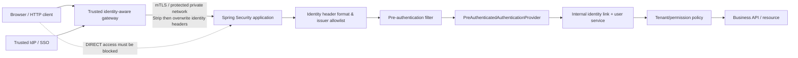

# Normalizing principals and loading local authorities via user services

## Learning objectives

After this lesson, you will be able to:

1. Distinguish **authentication at a reverse proxy/identity-aware gateway** from **identity normalization and authorization in Spring Security**; know why a username header never becomes safe proof by itself.
2. Understand Spring Security 6 APIs: `RequestHeaderAuthenticationFilter`, `RequestAttributeAuthenticationFilter`, `AbstractPreAuthenticatedProcessingFilter`, `PreAuthenticatedAuthenticationToken`, `PreAuthenticatedAuthenticationProvider`, `AuthenticationUserDetailsService`, `UserDetailsByNameServiceWrapper`, `UserDetailsService`, and `GrantedAuthority`.
3. Design the mapping **(trusted issuer, stable external subject) → internal account ID → tenant membership → approved permissions**; never merge accounts by email, display name, or un-namespaced username.
4. Define a controlled normalization policy: verify source/format, Unicode/case/realm/aliases, prevent collisions and ambiguities, and never blindly `trim()`/`toLowerCase()`/strip domains on opaque subjects.
5. Build a Spring Boot 3 / Spring Security 6 / Java 17+ example using a **trusted proxy**, filtering invalid headers, building a consistent principal key, and loading authorities from an **internal user service** without trusting browser-controlled role headers.
6. Understand both models—**per-request pre-auth** and **storing SecurityContext in HttpSession**—along with stale privileges, session fixation, logout, identity switching, proxy SSO expiry, and immediately revoked permissions.
7. Run security tests: proxy bypass, duplicate/comma-injected headers, wrong issuer, matching subjects across two IdPs, disabled accounts, role escalation, tenant mix-up, stale role caches, and multi-node requests.
8. Run a **standalone Java 17+** program simulating canonical external identities, explicit mapping to local accounts, and authorization checks with deterministic stdout; never use that program to replace real authentication.

## 1. Context: the proxy knows the user, yet the application must still decide permissions

Suppose an organization runs a portal `https://portal.example.org` behind an **Identity-Aware Reverse Proxy**. The proxy performs OIDC/SAML/Kerberos/mTLS authentication and forwards requests to Spring Boot only after verifying the user. The proxy may send internal headers:

```http
GET /app/reports HTTP/1.1
Host: portal.example.org
X-Verified-Issuer: https://idp.alpha.example
X-Verified-Subject: sub-001
```

**These headers form an internal CONTRACT, not an HTTP authentication standard to trust by default.** If an Internet client reaches Spring Boot directly and sends `X-Verified-Subject: administrator`, the application will be spoofed if it merely reads the header and grants access.

The problem has two distinct layers:

- **Layer 1 – External authentication:** the proxy verifies identity from an IdP/KDC/certificate, checks tokens/signatures/issuer/audience/expiry/nonce or equivalent mechanisms, maintains the proxy session, and blocks clients from overwriting internal headers.
- **Layer 2 – Internal account/authorization:** Spring Security determines the **exact trusted external identity**, maps it to a local account/tenant, checks account active state, loads roles/permissions from an internal source, and protects each action.

The auth proxy may know for certain the user is `sub-001` at issuer Alpha, yet **does not** know whether that user holds `REPORT_READ` in tenant `tenant-alpha`. Those permissions belong to the **internal user/entitlement service**.

### 1.1. Identifiers that must be distinguished

| Field | Example | Should it be an account key? |
| --- | --- | --- |
| Proxy `X-Verified-Issuer` | `https://idp.alpha.example` | Used as **namespace** after verifying trusted origin |
| Proxy `X-Verified-Subject` | `sub-001` | Used together with issuer; understand IdP stability guarantees |
| Email | `alex@example.org` | Not automatically: can change, collide, or be unverified |
| `preferred_username` | `alex` | Usually for display or search only |
| Display name | `Alex Nguyen` | No: non-unique, mutable, prone to Unicode confusables |
| Proxy group | `Administrators` | Never auto-grants app admin without a trust contract and approved mapping |
| Canonical external key | Unambiguous encoding of `(issuer, subject)` | Used as the **federation link key** in the DB |
| Internal account ID | `acct-1007` | Immutable/opaque internal key; should be the primary business key |
| Tenant ID | `tenant-alpha` | Data ownership and authorization scope |
| Local authority | `REPORT_READ` | Privilege granted by internal source; check resource/tenant |

**Three separate questions:**
1. *Who is this person in the IdP?* → issuer + subject from a trusted proxy.
2. *Which internal account links to that identity?* → external identity link table, with linking/migration policies.
3. *What may this account do with which resources?* → permissions/roles, tenant membership, object ownership, and runtime conditions.

## 2. Trust boundary: headers are safe only when the proxy guarantees them

Spring Security documentation explicitly states `RequestHeaderAuthenticationFilter` **does not authenticate** users itself; it only reads the username from a header. Thus the architecture must verify the **origin of the header** before Spring Security trusts it.

### 2.1. Recommended deployment structure



**Mandatory infrastructure conditions** that cannot be replaced by Java regexes:

1. **The origin app is unreachable directly** from the Internet or untrusted networks. Use private ingresses, security groups/firewalls, and network policies.
2. The proxy → app connection uses **mTLS/service identity**, ACLs, or an appropriate strong authentication channel; never treat client-supplied IP headers as proof.
3. The proxy **strips all** client-sent identity headers (`X-Verified-Issuer`, `X-Verified-Subject`, `X-User`, `Remote-User`, `X-Forwarded-User`...) before **setting** values after authentication.
4. The proxy never forwards **unauthenticated** requests to the protected backend over the same route carrying trusted headers; isolate health/readiness paths.
5. No URL, pod, admin port, or fallback route bypasses the proxy to hit an app configured for header pre-auth.
6. Proxy and app agree on **header names, cardinality, encoding, issuer aliases, maximum length, and logout/freshness policies**.
7. `Forwarded`/`X-Forwarded-For`/`X-Forwarded-Host` must also be handled at trusted ingress; never use them to decide user identity.
8. If these conditions cannot be guaranteed, **do not use `RequestHeaderAuthenticationFilter` as a login mechanism**. Instead verify tokens/mTLS at the application or use a signed gateway assertion checking audience and expiry.

### 2.2. Header spoofing vulnerability

**Dangerous scenario** if the app exposes an internal port on an untrusted network:

```http
GET /app/admin HTTP/1.1
Host: origin-app.example.net
X-Verified-Issuer: https://idp.alpha.example
X-Verified-Subject: admin-subject
```

If the app simply calls `request.getHeader(...)` assuming the proxy authenticated, an attacker can pick any account the lookup finds. **Spring Security calling the class "pre-authentication" does not verify the header actually came from the proxy.**

Even behind a gateway, test:
- Client pre-sends the same header names; gateway must strip and overwrite.
- Gateway receives two same-named headers, mixed-case headers, or comma-joined values; backend must not pick an unvetted value arbitrarily.
- Direct traffic from another internal VLAN/pod to the app; network policies must deny non-proxy identities.
- Request missing headers on a fallback route; app must fail closed, never falling into a default account.
- Proxy sends only `X-Verified-Subject` without an issuer; cross-IdP account collisions must be prevented.

**Never use `X-Forwarded-For` as proof the proxy sent the request**: it can be spoofed unless ingress strips/normalizes and authenticates intermediate hops.

## 3. Principal normalization: define "exactly one person" before converting data types

### 3.1. Even authenticated inputs can still be ambiguous

Suppose two IdPs emit:

```text
Issuer Alpha: https://idp.alpha.example  subject: sub-001
Issuer Beta:  https://idp.beta.example   subject: sub-001
```

If the app simply runs `loadUserByUsername("sub-001")`, two independent identities can resolve to the **same internal account**. If a Beta user gets confused with an administrative Alpha account, that is an **account takeover / tenant mix-up**.

A link key needs at least two parts:

```text
External identity = (verified issuer, stable external subject)

lookup (issuer, subject)
  -> identity_link row
  -> immutable internal_account_id
  -> tenant memberships + user status + permissions
```

In OIDC, `(iss, sub)` is the proper foundation for identity mapping. If the proxy authenticates Kerberos/SAML instead of OIDC, define the **matching approved namespace**: e.g., `(Kerberos realm, full principal)` or `(SAML IdP entityID, persistent NameID + NameID format/profile)`. Never assume different subject types are equivalent.

### 3.2. Distinguish canonicalization from arbitrary identity mutation

**Proper canonicalization** establishes a stable representation under an **identity contract** agreed by both parties without collapsing two distinct subjects into one.

**Common dangerous mutations**:

```java
// DO NOT use as default canonical identity.
String key = externalSubject.trim().toLowerCase();
String username = externalSubject.split("@")[0];
String guessedAccount = email.toLowerCase();
```

Why:
- Some IdPs treat `SUB-1` and `sub-1` as **two distinct subjects**.
- `alice@REALM-A` and `alice@REALM-B` can be two different people.
- `alice+sales@example.org` and `alice@example.org` are not guaranteed to be the same account.
- Emails change on name changes, domain moves, and mailbox recycling; a verified email is not automatically a stable subject.
- Unicode has multiple ways to represent visually similar characters, yet **NFC/NFKC or case-folding does not preserve identity** unless the IdP defines it that way.
- Trimming whitespace or truncating length can cause two distinct IDs to merge.

**Rule:** for opaque IdP `sub` values, **preserve the verified subject verbatim** and enforce format/length bounds per contract; never lower-case, transliterate, trim, or normalize Unicode for comparison unless upstream guarantees those semantics. If UPNs/emails truly require case-insensitive handling, enforce dedicated migration, collision detection, and formal approval.

### 3.3. Levels of normalization

| Level | What to do | What to avoid |
| --- | --- | --- |
| Transport | Accept headers only from trusted proxy; bound size, cardinality, encoding, CRLF | Trusting headers from public clients |
| Source namespace | Check issuer/realm against an exact approved allowlist | Blindly trusting any domain or unknown issuer |
| Subject | Check non-null/non-blank, format/length per contract | Arbitrarily lower-casing/stripping realms on opaque IDs |
| Canonical key | Encode `issuer` and `subject` unambiguously | Joining with a delimiter either field could contain |
| Identity linking | Query table with a unique constraint on the source tuple | Auto-linking by email/display name |
| Internal identity | Use an immutable account ID, not login aliases as PK | Using email as primary key |
| Authorization | Load roles/tenant entitlements from internal store | Copying unvetted role headers |
| Session | Define freshness/revocation/identity switching | Keeping stale privileges indefinitely |

### 3.4. Encoding a composite key without delimiter collisions

Naive concatenation:

```text
issuer + "|" + subject
```

can collide if either field is allowed to contain `|`. Instead:

- Store **two separate columns** `(issuer, subject)` with a DB unique constraint (preferred).
- Or use explicit length-prefixing.
- Or encode each component with **unpadded UTF-8 Base64URL**, joined by `.` (outside the Base64URL alphabet) with a version prefix.

Example key format:

```text
v1.<base64url(issuer UTF-8)>.<base64url(subject UTF-8)>
```

Base64URL here is **merely a representation**, not secrecy encryption and **not authentication proof**. It keeps the string unambiguous across `UserDetailsService.loadUserByUsername(String)`; actual authentication trust still rests on the trusted proxy.

### 3.5. Case/Unicode/IDN: the contract governs

- Issuer URLs/OIDC `iss` should compare against **configured/verified issuer values**; never rewrite URLs by lower-casing the entire string, stripping slashes, altering ports/paths, or converting IDN hosts without a contract.
- SAML IdP `entityID` is likewise a string identifier, not an arbitrary hostname to normalize.
- Kerberos principals/UPNs may have environment-defined case/realm rules; verify actual KDC/AD policies.
- Subjects with Unicode: use UTF-8 and preserve raw bytes/string semantics from the source, avoiding implicit NFKC, splitting surrogate pairs, or "ASCII letters only" regexes unless the source guarantees it.
- Display names/emails for UI: may need Unicode NFC/sanitization for display; **never use that same function for identity matching**.
- IDNA domain names and case-insensitive hosts should normalize **only in a policy-governed issuer verification layer**, never arbitrarily mutating issuer strings and silently rebinding identities.
- When changing canonicalization versions, run a migration on `identity_link` with collision reports and rollback, never a blind bulk `UPDATE ... LOWER(subject)`.

## 4. Data model linking external identities to internal accounts

A straightforward design:

```text
external_identity_link
  link_id                   UUID / bigint internal
  source_type               OIDC / SAML2 / KERBEROS / GATEWAY
  trusted_issuer            exact verified namespace
  external_subject          stable opaque subject
  internal_account_id       immutable local FK
  linked_by                 actor/workflow
  linked_at, unlinked_at
  status                    ACTIVE / SUSPENDED / REVOKED
  UNIQUE(source_type, trusted_issuer, external_subject)
       |
       v
account
  id                        internal opaque ID
  lifecycle_status          ACTIVE / DISABLED / DELETED
  owner_tenant_id
  authz_revision
       |
       v
tenant_membership
  account_id, tenant_id, status
       |
       v
permission_grant
  account_id, tenant_id, permission, resource_scope, expiry, source
```

**Additional invariants required:**

1. One `ACTIVE` external identity maps to **one internal account** at login time unless a specialized business model explicitly specifies otherwise.
2. Do not auto-create users when no mapping exists ("JIT provisioning") without an approved workflow, tenant assignment, and anti-takeover controls.
3. One account may link **multiple external identities** via a dedicated linking flow; unlinking an old identity must revoke its login capability.
4. An identity must never "switch" to an admin account solely due to matching emails; linking/migration requires user proof/owner approval.
5. The identity link key and `internalAccountId` remain stable even when display name/email/UPN changes.
6. When an account/tenant membership is disabled, the user **must not retain** access merely because the proxy header still says authenticated.
7. Never adopt `roles` from the proxy as local authorities without a source contract/allowlist. When importing IdP groups, verify issuer, stable group IDs, and explicit role mappings.
8. Never let an account linked from realm A inherit tenant B privileges due to a `Map<String,User>` keyed by short username.

### 4.1. Example: two identical subjects, two distinct accounts

| Issuer | Subject | Internal account | Tenant | Permission |
| --- | --- | --- | --- | --- |
| Alpha | `sub-001` | `acct-1007` | `tenant-alpha` | `REPORT_READ` |
| Beta | `sub-001` | `acct-2088` | `tenant-beta` | `REPORT_READ` |
| Alpha | `sub-admin` | `acct-1001` | `tenant-alpha` | `TENANT_ADMIN` |

When Beta sends `sub-001`, the application **must never** resolve Alpha's `acct-1007`. Even if Beta sends an email matching an Alpha account, that rule does not change. Disabled accounts must be denied regardless of an active upstream SSO session.

## 5. How does Spring Security handle pre-authentication?

Spring Security Servlet provides classes under `org.springframework.security.web.authentication.preauth`.

### 5.1. Flow from proxy to authorities

```mermaid
sequenceDiagram
    actor B as Browser
    participant G as Trusted Gateway
    participant Gate as Header Gate
    participant F as PreAuth Filter
    participant AM as AuthenticationManager
    participant P as PreAuthenticatedAuthenticationProvider
    participant U as Internal UserDetailsService
    participant Z as Authorization Policy
    B->>G: GET /app/tenants/tenant-alpha/reports
    G->>G: Verify external login / token
    G->>G: Strip client identity headers and inject verified fields
    G->>Gate: Trusted request with issuer, subject
    Gate->>Gate: Validate cardinality/issuer/format, canonical key
    Gate->>F: Request attribute: canonical external key
    F->>AM: PreAuthenticatedAuthenticationToken(request)
    AM->>P: authenticate
    P->>U: loadUserByUsername(canonicalKey)
    U->>U: Lookup identity link -> account -> tenant grants
    U-->>P: UserDetails with app-only authorities
    P-->>F: authenticated PreAuthenticatedAuthenticationToken
    F->>Z: SecurityContext carries local account identity
    Z->>Z: Check tenant, action, account enabled
    Z-->>B: 200 or 403; no automatic ROLE_ADMIN
```

Framework classes:

- **`AbstractPreAuthenticatedProcessingFilter`**: extracts principal/credentials from the request, creates `PreAuthenticatedAuthenticationToken`, and calls `AuthenticationManager`. It **assumes** external authentication is already secure.
- **`RequestHeaderAuthenticationFilter`**: implementation reading a header, defaulting to `SM_USER` for SiteMinder compatibility. It does **not** verify TLS, proxy origin, issuer signatures, or tokens itself.
- **`RequestAttributeAuthenticationFilter`**: reads the principal from a **servlet request attribute** set by a trusted filter/gateway adapter; ideal when validating two fields and combining them into a canonical key before pre-auth.
- **`PreAuthenticatedAuthenticationProvider`**: upon receiving a pre-auth token, primarily delegates to `AuthenticationUserDetailsService` to load user details and local authorities; does not verify IdP/proxy itself.
- **`UserDetailsByNameServiceWrapper`**: bridges `AuthenticationUserDetailsService<PreAuthenticatedAuthenticationToken>` to `UserDetailsService.loadUserByUsername(String)`.
- **`PreAuthenticatedGrantedAuthoritiesUserDetailsService`**: builds `UserDetails` from authorities already inside token/details; **not preferred** when local entitlements are required and proxy groups are unvetted.
- **`Http403ForbiddenEntryPoint`**: commonly used in apps accepting external pre-auth only, avoiding redirecting browsers to a local form login.
- **`SecurityContextRepository`**: persists authentication for the current request or across requests via HttpSession, independent of the authority source.

### 5.2. Two kinds of UserDetailsService

**`UserDetailsService`** accepts a `String username` and returns `UserDetails` or throws `UsernameNotFoundException`. With pre-auth, `username` can be the **canonical external identity key**.

**`AuthenticationUserDetailsService<PreAuthenticatedAuthenticationToken>`** receives the full token, useful when accompanying verified metadata is needed. `UserDetailsByNameServiceWrapper` is a simple adapter: it passes `authentication.getName()` to `UserDetailsService`.

If external identity sources involve complex issuer/tenant rules, write a custom **`AuthenticationUserDetailsService`** reading an immutable identity object verified by the adapter. Never treat unverified browser-influenced `authentication.getDetails()` as proof of roles/tenants.

### 5.3. Do not confuse the pre-auth provider with DaoAuthenticationProvider

- `DaoAuthenticationProvider` is built for username/password in Spring Security, calling `UserDetailsService` and checking credentials via `PasswordEncoder`.
- `PreAuthenticatedAuthenticationProvider` trusts that external auth occurred and merely loads `UserDetails`/account state. It **does not check passwords**.
- Putting a dummy `"N/A"` in the pre-auth token's credential slot **does not** turn headers into valid passwords.
- A public `/login?username=admin` endpoint must never feed usernames into the pre-auth provider and treat them as authenticated.

### 5.4. Defaults you must understand

In Spring Security 6.5:

| Feature | Behavior to note | Consequence |
| --- | --- | --- |
| Missing header with `RequestHeaderAuthenticationFilter` | Defaults to `exceptionIfHeaderMissing=true` | May throw when gateway omits the header |
| Missing request attribute with `RequestAttributeAuthenticationFilter` | Configurable via `setExceptionIfVariableMissing` | Health routes require explicit design |
| Pre-auth filter when context already authenticated | By default **does not re-authenticate** | Permissions in `HttpSession` can go stale |
| `setCheckForPrincipalChanges(true)` | Compares current principal with new request identity | Requires stable principal mapping and session identity-switch handling |
| `setInvalidateSessionOnPrincipalChange(true)` | Invalidates session when change detected | Not every app should toggle blindly without checking SSO semantics |
| `setContinueFilterChainOnUnsuccessfulAuthentication(true)` | By default lets other mechanisms try | For proxy-only, avoid fallback bypasses; routes must fail closed |
| `PreAuthenticatedAuthenticationProvider` | Does not verify external credentials | Trusted proxy infrastructure is a prerequisite |
| `SecurityContextRepository` | May persist context across requests/sessions | Stateful vs. stateless affects freshness and revocation |

**Especially important:** if the current `Authentication.getName()` is `acct-1007` while the header principal is an external string, the framework can treat the principal as changed **on every request** when `checkForPrincipalChanges` is enabled. Keep the canonical name for `UserDetails.getUsername()` or write a tested comparator; store the internal account ID as a dedicated field on the principal.

## 6. Two authority-loading architectures: per-request vs. session-based

### 6.1. Re-authenticating pre-auth and loading authorities per request

**Suited when the gateway verifies the request/SSO every time** and the app needs no separate login session:

- The gateway validates its cookie/token and injects trusted headers **on every protected request**.
- The app derives the canonical principal and calls the internal `UserDetailsService` on every request.
- `SecurityContext` lives for one request only, storing no browser-auth session in `HttpSession`.
- Updated permissions/disabled status take effect on the very next request once the backend authorization store updates (subject to caching/consistency).
- Use `SessionCreationPolicy.STATELESS` with an appropriate request-scoped repository.

Pros: simplifies app logout/identity switching, avoids long-lived stale roles, easy to test. Cons: per-request DB/IAM lookups can add load; requires bounded caching, latency limits, and fail-closed behavior if permissions cannot be resolved. **CSRF must still be threat-modeled** whenever browsers auto-send gateway SSO cookies, even if the app creates no session itself.

### 6.2. Stateful app session after initial pre-auth

If the app keeps an `HttpSession`:

- After pre-auth succeeds, `SecurityContext` is saved via `HttpSessionSecurityContextRepository` or `DelegatingSecurityContextRepository`.
- Subsequent requests may reuse old roles/authorities from the session **without calling `UserDetailsService` again**.
- If the proxy session expires while the app session remains, users could still access via a direct route or if the backend stops checking headers; **the proxy must gate every request**.
- When the user switches identity at the proxy while retaining the browser session, `checkForPrincipalChanges` and invalidation/reauth policies must be designed.
- When permissions are revoked, you may need to purge app sessions by account, bump an authz revision, query fresh permissions on high-risk actions, or shorten TTLs.
- Session fixation protection must be wired appropriately on the pre-auth flow; never assume a custom pre-auth filter invokes all of form login's `SessionAuthenticationStrategy` hooks automatically.
- Across multiple nodes, test shared session stores and serialization/rolling upgrades.

**The code sample below chooses stateless request-scoped pre-auth** to guarantee local permissions are loaded on every request and avoid session-freshness ambiguity. Never switch it to stateful merely by changing `STATELESS` to `IF_REQUIRED` without revisiting the full session lifecycle.

## 7. Spring Boot 3 / Spring Security 6 example: gateway authenticates, app loads authorities

**Scope:** Java 17+, Spring Boot 3.x compatible with Spring Security 6.x, Servlet stack. The example uses **two verified headers** as the gateway–app contract:

```text
X-Verified-Issuer:  https://idp.alpha.example
X-Verified-Subject: sub-001
```

**Assumptions outside Java code:** the gateway already completed strong authentication and **stripped/overwrote** these headers; the app origin is reachable exclusively from the authenticated gateway (mTLS/private network); every protected request traverses the gateway. If these assumptions fail, **the code below is NOT safe to deploy**. The Java gate validates syntax/allowlists, yet **cannot authenticate the gateway by magic**.

### 7.1. Dependencies

In a project with a matching Spring Boot plugin/BOM, `build.gradle` can include:

```groovy
dependencies {
    implementation 'org.springframework.boot:spring-boot-starter-web'
    implementation 'org.springframework.boot:spring-boot-starter-security'

    testImplementation 'org.springframework.boot:spring-boot-starter-test'
    testImplementation 'org.springframework.security:spring-security-test'
}
```

Pre-auth classes already live in `spring-security-web`/`spring-security-core`; no CAS/SAML dependencies are required just to read gateway headers. Versions are managed by Spring Boot dependency management; do not pull Spring Security 7 APIs into a 6.x project before migrating.

### 7.2. File `ExternalPrincipalKey.java`: an explicit canonicalization rule

```java
package com.example.proxy;

import java.nio.charset.StandardCharsets;
import java.util.Base64;
import java.util.Set;

public final class ExternalPrincipalKey {
    private static final Set<String> ALLOWED_ISSUERS = Set.of(
            "https://idp.alpha.example",
            "https://idp.beta.example"
    );

    private ExternalPrincipalKey() {}

    public static String of(String issuer, String subject) {
        // IdP address is a namespace from an approved contract.
        if (issuer == null || !ALLOWED_ISSUERS.contains(issuer)) {
            throw new IllegalArgumentException("Unknown issuer");
        }
        // DEMO: both IdPs agree subjects are opaque ASCII.
        // Do not apply this regex to all IdPs/Unicode identities.
        if (subject == null || !subject.matches("[A-Za-z0-9_-]{1,128}")) {
            throw new IllegalArgumentException("Invalid subject");
        }

        return "v1." + enc(issuer) + "." + enc(subject);
    }

    private static String enc(String value) {
        return Base64.getUrlEncoder().withoutPadding().encodeToString(
                value.getBytes(StandardCharsets.UTF_8));
    }
}
```

**Explanation:**

- `issuer` must match an **exact** approved configuration. Production uses a registry/versioned metadata rather than hardcoding two URLs across many services.
- The subject regex here is a **sample data model**: the IdPs committed to ASCII opaque IDs (alphanumerics/underscore/hyphen, max 128). For IdPs using Unicode or different formats, update validation per contract; **never truncate/lowercase arbitrarily**.
- Key `v1.base64url(issuer).base64url(subject)` is unambiguous and stable enough for `UserDetailsService` lookups, yet does not encrypt secrets or prove identity.
- The `(issuer, subject)` pair preserves exact casing. To change normalization rules, version and migrate identity links rather than altering them silently.
- This Java helper **cannot** know on its own whether headers came from a trusted proxy. The trust boundary lives at ingress.

### 7.3. File `VerifiedProxyHeaderGate.java`: validating headers before pre-auth

```java
package com.example.proxy;

import java.io.IOException;
import java.util.Enumeration;

import jakarta.servlet.FilterChain;
import jakarta.servlet.ServletException;
import jakarta.servlet.http.HttpServletRequest;
import jakarta.servlet.http.HttpServletResponse;

import org.springframework.web.filter.OncePerRequestFilter;

public final class VerifiedProxyHeaderGate extends OncePerRequestFilter {
    public static final String PRINCIPAL_ATTRIBUTE =
            "verified.proxy.principal";

    @Override
    protected boolean shouldNotFilter(HttpServletRequest request) {
        // Health endpoint must be network-gated separately at ingress.
        return "/healthz".equals(request.getServletPath());
    }

    @Override
    protected void doFilterInternal(
            HttpServletRequest request,
            HttpServletResponse response,
            FilterChain chain) throws ServletException, IOException {

        try {
            String issuer = singleHeader(request, "X-Verified-Issuer");
            String subject = singleHeader(request, "X-Verified-Subject");

            // Request attribute written only by this server code, never from body.
            request.setAttribute(PRINCIPAL_ATTRIBUTE,
                    ExternalPrincipalKey.of(issuer, subject));
        } catch (IllegalArgumentException invalid) {
            // Never leak unknown issuer or account lookup result to browser.
            response.sendError(HttpServletResponse.SC_UNAUTHORIZED);
            return;
        }

        chain.doFilter(request, response);
    }

    private static String singleHeader(
            HttpServletRequest request, String name) {
        Enumeration<String> values = request.getHeaders(name);
        if (values == null || !values.hasMoreElements()) {
            throw new IllegalArgumentException("Header missing");
        }
        String first = values.nextElement();
        if (values.hasMoreElements() || first == null || first.isBlank()) {
            throw new IllegalArgumentException("Duplicate or blank header");
        }
        return first;
    }
}
```

**Security notes:**

- Missing header / duplicate header / unknown issuer / malformed subject → immediate **401**, never guessing a user.
- Checking duplicates here **does not replace** gateway canonicalization: a proxy might fold two headers into `a,b`; in this example, the exact issuer allowlist and subject regex reject commas.
- Never call `getHeader("X-Verified-Role")` to grant roles; privileges come from the account service in the next step.
- Skipping `/healthz` allows identity-less health probes, yet infrastructure must **prevent public health routes from accessing app/private data**. All non-health routes require headers.
- **This Java code does not verify peer mTLS certificates.** Enforce mTLS/network restrictions at sidecar/ingress/server; if requests can reach the app directly and supply both headers, attackers can still spoof identities. That is a mandatory deployment prerequisite.
- Never register `VerifiedProxyHeaderGate` both as a global Servlet Filter bean and inside the Spring Security chain; the example instantiates it inline inside `SecurityFilterChain`.
- In apps with multiple filter chains/route matchers, the gate must cover **every protected path**. Never let another chain bypass it.

### 7.4. File `AccountUserDetails.java`: keeping internal account ID separate

```java
package com.example.proxy;

import java.util.Collection;
import java.util.Set;

import org.springframework.security.core.GrantedAuthority;
import org.springframework.security.core.authority.SimpleGrantedAuthority;
import org.springframework.security.core.userdetails.UserDetails;

public record AccountUserDetails(
        String username,
        String internalAccountId,
        String tenantId,
        boolean enabled,
        Set<String> permissionNames) implements UserDetails {

    @Override
    public Collection<? extends GrantedAuthority> getAuthorities() {
        return permissionNames.stream()
                .map(SimpleGrantedAuthority::new)
                .toList();
    }

    @Override
    public String getPassword() {
        // Pre-auth does NOT authenticate via a local password.
        return "N/A";
    }

    @Override
    public boolean isAccountNonExpired() {
        return enabled;
    }

    @Override
    public boolean isAccountNonLocked() {
        return enabled;
    }

    @Override
    public boolean isCredentialsNonExpired() {
        return true;
    }

    @Override
    public boolean isEnabled() {
        return enabled;
    }
}
```

Here `username` holds the **canonical external key** so `Authentication.getName()` stays consistent with the principal read by the pre-auth filter. `internalAccountId` is the application's business key; `tenantId` is the mapped tenant, **never** taken from browser-supplied URLs/queries.

Using a Java `record` requires Java 17+; Spring Security `UserDetails` supports these methods cleanly. If session serialization is ever needed, all nested values must be serializable; `Set<String>` illustrates simply, yet context persistence and class versioning need separate review.

### 7.5. File `LocalAccountDirectory.java`: UserDetailsService loading local authorities

```java
package com.example.proxy;

import java.util.Map;
import java.util.Set;

import org.springframework.security.core.userdetails.UserDetails;
import org.springframework.security.core.userdetails.UserDetailsService;
import org.springframework.security.core.userdetails.UsernameNotFoundException;
import org.springframework.stereotype.Service;

@Service
public final class LocalAccountDirectory implements UserDetailsService {

    record LocalAccount(
            String id,
            String tenantId,
            boolean active,
            Set<String> permissions) {}

    // DEMO ONLY. Production: database/IAM API + unique identity link.
    private final Map<String, LocalAccount> links = Map.of(
            ExternalPrincipalKey.of("https://idp.alpha.example", "sub-001"),
            new LocalAccount("acct-1007", "tenant-alpha", true,
                    Set.of("REPORT_READ")),
            ExternalPrincipalKey.of("https://idp.beta.example", "sub-001"),
            new LocalAccount("acct-2088", "tenant-beta", true,
                    Set.of("REPORT_READ")),
            ExternalPrincipalKey.of("https://idp.alpha.example", "sub-admin"),
            new LocalAccount("acct-1001", "tenant-alpha", true,
                    Set.of("TENANT_ADMIN"))
    );

    @Override
    public UserDetails loadUserByUsername(String canonicalExternalKey)
            throws UsernameNotFoundException {

        LocalAccount row = links.get(canonicalExternalKey);
        if (row == null) {
            throw new UsernameNotFoundException(
                    "No approved internal account link");
        }
        return new AccountUserDetails(
                canonicalExternalKey,
                row.id(),
                row.tenantId(),
                row.active(),
                row.permissions());
    }

    // Example directory recheck; production must read current effective state
    // and update cache/invalidation when account/permissions change.
    public boolean canRead(String internalAccountId, String tenantId) {
        return links.values().stream()
                .anyMatch(row -> row.id().equals(internalAccountId)
                        && row.tenantId().equals(tenantId)
                        && row.active()
                        && row.permissions().contains("REPORT_READ"));
    }
}
```

**Boundaries and limitations:**

- The rows here are **classroom fixtures**, not real corporate data.
- Alpha/Beta pairs sharing `sub-001` map to **two distinct account IDs**.
- `UserDetailsService` **does not re-verify OIDC/SAML signatures**: that is the gateway's responsibility. It receives the canonical key and returns the approved local account/permissions.
- Unknown link → `UsernameNotFoundException`, disabled user → `UserDetails.isEnabled=false` (checked by the provider's checker to deny authentication).
- **Never auto-provision** accounts with default roles merely because the proxy authenticated an unknown subject; if a product needs JIT provisioning, enforce a vetted policy/owner/tenant mapping.
- `links.values().stream()` is an in-memory simulation; production requires primary/unique indexes, tenant scoping, transactions, cache invalidation, auditing, and performance planning.
- In multi-tenant apps one account may belong to multiple tenants; a single `tenantId` in the demo is illustrative only. Real designs use membership/grant tables per resource.
- Never allow callers to supply internal IDs directly and bypass external identity links.

### 7.6. File `ProxySecurityConfig.java`: wiring pre-auth filter with UserDetailsService

```java
package com.example.proxy;

import org.springframework.context.annotation.Bean;
import org.springframework.context.annotation.Configuration;
import org.springframework.security.authentication.AuthenticationManager;
import org.springframework.security.authentication.ProviderManager;
import org.springframework.security.config.annotation.method.configuration.EnableMethodSecurity;
import org.springframework.security.config.annotation.web.builders.HttpSecurity;
import org.springframework.security.config.http.SessionCreationPolicy;
import org.springframework.security.core.userdetails.UserDetailsByNameServiceWrapper;
import org.springframework.security.web.SecurityFilterChain;
import org.springframework.security.web.authentication.Http403ForbiddenEntryPoint;
import org.springframework.security.web.authentication.preauth.AbstractPreAuthenticatedProcessingFilter;
import org.springframework.security.web.authentication.preauth.PreAuthenticatedAuthenticationProvider;
import org.springframework.security.web.authentication.preauth.PreAuthenticatedAuthenticationToken;
import org.springframework.security.web.authentication.preauth.RequestAttributeAuthenticationFilter;
import org.springframework.security.web.context.RequestAttributeSecurityContextRepository;
import org.springframework.security.web.context.SecurityContextRepository;

@Configuration
@EnableMethodSecurity
public class ProxySecurityConfig {

    @Bean
    SecurityFilterChain proxyAuthenticatedChain(
            HttpSecurity http,
            LocalAccountDirectory accountDirectory) throws Exception {

        PreAuthenticatedAuthenticationProvider provider =
                new PreAuthenticatedAuthenticationProvider();
        provider.setPreAuthenticatedUserDetailsService(
                new UserDetailsByNameServiceWrapper<
                        PreAuthenticatedAuthenticationToken>(
                        accountDirectory));

        AuthenticationManager manager = new ProviderManager(provider);
        SecurityContextRepository repository =
                new RequestAttributeSecurityContextRepository();

        RequestAttributeAuthenticationFilter preauth =
                new RequestAttributeAuthenticationFilter();
        preauth.setPrincipalEnvironmentVariable(
                VerifiedProxyHeaderGate.PRINCIPAL_ATTRIBUTE);
        // Missing attribute only allowed on /healthz after gate skip;
        // all protected paths are gated first.
        preauth.setExceptionIfVariableMissing(false);
        preauth.setAuthenticationManager(manager);
        preauth.setSecurityContextRepository(repository);

        http.securityContext(sc ->
                    sc.securityContextRepository(repository))
                .sessionManagement(session ->
                    session.sessionCreationPolicy(
                            SessionCreationPolicy.STATELESS))
                .exceptionHandling(ex ->
                    ex.authenticationEntryPoint(
                            new Http403ForbiddenEntryPoint()))
                .authorizeHttpRequests(auth -> auth
                    .requestMatchers("/healthz").permitAll()
                    .requestMatchers("/app/admin/**")
                        .hasAuthority("TENANT_ADMIN")
                    .requestMatchers("/app/**").authenticated()
                    .anyRequest().denyAll());

        // Gate runs BEFORE pre-auth; both stay inside the Spring chain.
        http.addFilterBefore(
                new VerifiedProxyHeaderGate(),
                AbstractPreAuthenticatedProcessingFilter.class);
        http.addFilterAt(
                preauth, AbstractPreAuthenticatedProcessingFilter.class);

        return http.build();
    }
}
```

**How the filter chain works:**

1. `VerifiedProxyHeaderGate` checks both verified headers and stores the **canonical key** in a servlet attribute controlled exclusively by server code. Missing/forged headers → 401 with no principal created.
2. `RequestAttributeAuthenticationFilter` reads the attribute, creates `PreAuthenticatedAuthenticationToken`, and passes it to `ProviderManager`.
3. `PreAuthenticatedAuthenticationProvider` invokes `UserDetailsByNameServiceWrapper` to delegate to `LocalAccountDirectory.loadUserByUsername`.
4. `AccountUserDetails.getAuthorities()` supplies `REPORT_READ`/`TENANT_ADMIN` **from the internal map**, never copying proxy/client groups or roles.
5. `SecurityContextRepository` is **RequestAttribute**; `SessionCreationPolicy.STATELESS` matches per-request gateway authentication. Never use an app cookie to keep pre-auth alive longer than the gateway.
6. `Http403ForbiddenEntryPoint` returns 403 when an authenticated user is missing on a protected resource; the gate itself can return 401 on missing headers. **A 403 does not mean the app performed strong authentication**; that still depends on the proxy.
7. Only one `SecurityFilterChain` applies, and paths outside the allowlist are denied. Never enable `formLogin`/`httpBasic`/untrusted login fallbacks that bypass the proxy.
8. `setExceptionIfVariableMissing(false)` is for the health route; the gate blocks missing headers on **all non-health routes**. If you change route matchers/health, re-verify the invariant. If there is no health bypass, you can set `true` and handle missing headers securely.
9. Never create the filters as separate Spring `@Bean`s that Boot would auto-register a second time as global Servlet Filters.
10. `PreAuthenticatedAuthenticationProvider` trusts that the input is already externally authenticated; **it does not verify mTLS** and cannot compensate for a public origin.

**Note on pre-auth errors:** `AbstractPreAuthenticatedProcessingFilter` may by default let the filter chain continue when the provider throws `AuthenticationException` so another authentication mechanism can try. This example configures **no** other mechanisms and requires `authenticated`/`denyAll` on protected routes, so an invalid local account gets no access. In environments with other OAuth/form/API flows, split chains or define explicit failure policies; never let pre-auth fail and fall into a weaker mechanism.

### 7.7. File `PortalApplication.java`

```java
package com.example.proxy;

import org.springframework.boot.SpringApplication;
import org.springframework.boot.autoconfigure.SpringBootApplication;

@SpringBootApplication
public class PortalApplication {
    public static void main(String[] args) {
        SpringApplication.run(PortalApplication.class, args);
    }
}
```

Main class in the same `com.example.proxy` package so Spring Boot component-scans services and configuration.

### 7.8. Controller and tenant-scoped authorization policy

`LocalAccountDirectory` holds general roles, yet endpoints taking `tenantId` need **object/tenant authorization**. Example:

File `TenantAccessPolicy.java`:

```java
package com.example.proxy;

import org.springframework.security.core.Authentication;
import org.springframework.stereotype.Component;

@Component("tenantAccess")
public final class TenantAccessPolicy {
    private final LocalAccountDirectory directory;

    public TenantAccessPolicy(LocalAccountDirectory directory) {
        this.directory = directory;
    }

    public boolean canRead(Authentication authentication, String tenantId) {
        if (authentication == null
                || !(authentication.getPrincipal()
                        instanceof AccountUserDetails user)) {
            return false;
        }
        return user.isEnabled()
                && user.tenantId().equals(tenantId)
                && user.permissionNames().contains("REPORT_READ")
                && directory.canRead(
                        user.internalAccountId(), tenantId);
    }
}
```

File `ReportService.java`:

```java
package com.example.proxy;

import org.springframework.security.access.prepost.PreAuthorize;
import org.springframework.stereotype.Service;

@Service
public class ReportService {

    @PreAuthorize("@tenantAccess.canRead(authentication, #p0)")
    public String readTenantReport(String tenantId) {
        return "Report for " + tenantId;
    }
}
```

File `AppController.java`:

```java
package com.example.proxy;

import org.springframework.security.core.Authentication;
import org.springframework.web.bind.annotation.GetMapping;
import org.springframework.web.bind.annotation.PathVariable;
import org.springframework.web.bind.annotation.RestController;

@RestController
public class AppController {
    private final ReportService reports;

    public AppController(ReportService reports) {
        this.reports = reports;
    }

    @GetMapping("/healthz")
    public String health() {
        return "ok";
    }

    @GetMapping("/app/me")
    public String me(Authentication authentication) {
        return authentication.getName();
    }

    @GetMapping("/app/tenants/{tenantId}/reports")
    public String report(@PathVariable String tenantId) {
        return reports.readTenantReport(tenantId);
    }
}
```

**Scope:** returning `Report for tenant-alpha` is illustrative only after authentication, local mapping, `REPORT_READ`, and tenant policy all pass. A Beta user requesting tenant Alpha causes `canRead` to return false → 403. An Alpha user holding only `REPORT_READ` likewise cannot access `/app/admin/**`.

In production, **never return the raw canonical key** from `/app/me` if doing so unnecessarily exposes or correlates identifiers; APIs should return permitted internal account IDs/fields with privacy controls. `healthz` is a liveness example only; never expose diagnostics or database contents.

### 7.9. When should you NOT use this example?

- If requests can reach Spring Boot **without passing through the authenticated proxy**.
- If the proxy fails to strip/overwrite all identity headers completely.
- If the application itself must verify raw JWT/OIDC/SAML tokens; use the corresponding providers/filters instead of pre-auth headers.
- If external subject sources do not match the ASCII opaque ID fixture; design parsers to match the contract instead of copying a regex that drops valid users.
- If the app has complex multi-tenant/permission models that an in-memory `Map` cannot represent; use a DB/IAM/permission service with row-level policies.
- If a browser app requires its own `HttpSession`; replace the `STATELESS` sample with a tested session/revocation design.
- If the gateway assigns roles/admin in headers and the app trusts them blindly; this lesson's requirement is **loading internal authorities**.

## 8. Standalone Java 17+: canonical identity and internal authority lookup

The following program is **plain Java**, needing no Spring, proxy, IdP, or network connection. It illustrates a vital property: **matching subjects from different issuers never merge accounts**, case-sensitive opaque subjects are preserved verbatim, and permissions come from an **internal table**. Never treat inputs in this program as authenticated production identities.

File `ExternalPrincipalDemo.java`:

```java
import java.nio.charset.StandardCharsets;
import java.util.Base64;
import java.util.Map;
import java.util.Set;

public final class ExternalPrincipalDemo {
    private static final Set<String> TRUSTED_ISSUERS = Set.of(
            "https://idp.alpha.example",
            "https://idp.beta.example");

    record Account(
            String internalId,
            String tenantId,
            boolean active,
            Set<String> permissions) {}

    static String key(String issuer, String subject) {
        if (issuer == null || !TRUSTED_ISSUERS.contains(issuer)) {
            throw new IllegalArgumentException("issuer");
        }
        if (subject == null || !subject.matches("[A-Za-z0-9_-]{1,128}")) {
            throw new IllegalArgumentException("subject");
        }
        return "v1." + enc(issuer) + "." + enc(subject);
    }

    static String enc(String part) {
        return Base64.getUrlEncoder().withoutPadding()
                .encodeToString(part.getBytes(StandardCharsets.UTF_8));
    }

    static final Map<String, Account> LINKS = Map.of(
            key("https://idp.alpha.example", "sub-001"),
            new Account("acct-1007", "tenant-alpha", true,
                    Set.of("REPORT_READ")),
            key("https://idp.beta.example", "sub-001"),
            new Account("acct-2088", "tenant-beta", true,
                    Set.of("REPORT_READ")),
            key("https://idp.alpha.example", "sub-002"),
            new Account("acct-1010", "tenant-alpha", false,
                    Set.of("REPORT_READ"))
    );

    static String account(String issuer, String subject) {
        try {
            Account account = LINKS.get(key(issuer, subject));
            return account == null || !account.active()
                    ? "DENY" : account.internalId();
        } catch (IllegalArgumentException ignored) {
            return "DENY";
        }
    }

    static boolean allowed(
            String issuer, String subject,
            String tenant, String permission) {
        try {
            Account account = LINKS.get(key(issuer, subject));
            return account != null
                    && account.active()
                    && account.tenantId().equals(tenant)
                    && account.permissions().contains(permission);
        } catch (IllegalArgumentException ignored) {
            return false;
        }
    }

    public static void main(String[] args) {
        String alpha = "https://idp.alpha.example";
        String beta = "https://idp.beta.example";

        System.out.println("Alpha: " + account(alpha, "sub-001"));
        System.out.println("Beta: " + account(beta, "sub-001"));
        System.out.println("Different issuers: "
                + !key(alpha, "sub-001").equals(key(beta, "sub-001")));
        System.out.println("Case changed: " + account(alpha, "SUB-001"));
        System.out.println("Unknown issuer: "
                + account("https://evil.example", "sub-001"));
        System.out.println("Disabled: " + account(alpha, "sub-002"));
        System.out.println("Alpha read own tenant: "
                + allowed(alpha, "sub-001",
                        "tenant-alpha", "REPORT_READ"));
        System.out.println("Beta read Alpha tenant: "
                + allowed(beta, "sub-001",
                        "tenant-alpha", "REPORT_READ"));
        System.out.println("Alpha admin: "
                + allowed(alpha, "sub-001",
                        "tenant-alpha", "TENANT_ADMIN"));
    }
}
```

Compile and run with JDK 17+:

```bash
javac ExternalPrincipalDemo.java
java ExternalPrincipalDemo
```

**Exact stdout:**

```text
Alpha: acct-1007
Beta: acct-2088
Different issuers: true
Case changed: DENY
Unknown issuer: DENY
Disabled: DENY
Alpha read own tenant: true
Beta read Alpha tenant: false
Alpha admin: false
```

**Explanation:**

- `sub-001` at Alpha and Beta can be two different people; the two issuers yield **two canonical keys** resolving to distinct accounts.
- `SUB-001` is not automatically lower-cased to `sub-001` because the example contract defines opaque subjects as case-sensitive.
- Unknown issuers and disabled accounts are rejected; no new account is created on a "best guess".
- `REPORT_READ` comes from local `LINKS`, with no role field from the proxy.
- Beta user cannot gain read access to Alpha's tenant by changing the URL path; Alpha user likewise does not automatically hold `TENANT_ADMIN`.
- `Base64URL` only builds an unambiguous key. It **does not verify identity, encrypt secrets, or sign assertions**.
- The in-memory `Map` demo has no DB transactions, concurrency/revocation, sessions, proxy mTLS, or IdP token validation. **Never turn `key(...)` into a login bypass from a public form.**

## 9. When permissions change: role freshness, caching, and revocation

A user authenticated by the proxy can have permissions altered inside the app:

- Local account gets locked.
- Leaves tenant Alpha while still holding an IdP SSO session.
- `REPORT_READ` is revoked; `TENANT_ADMIN` is removed.
- Moves to a new department or old group membership is removed.
- External identity is unlinked from the internal account.

**If `UserDetailsService` is called only once when the app creates `HttpSession`**, `Authentication.getAuthorities()` inside the session can go **stale**. Even as the proxy keeps sending a valid subject, the Spring filter may skip re-authentication because an authentication already sits in context.

### 9.1. Options for refreshing authorities

| Option | Benefit | Limitation |
| --- | --- | --- |
| Pre-auth **every request**, query directory each time | New privileges apply on the next request after data source updates | Extra DB/IAM calls; needs rate limits/caching |
| Permission cache with short TTL + event invalidation | Reduces load with targeted freshness | TTL alone is insufficient for emergency revocation |
| Authz revision/epoch in account/session | Detects whether permissions changed since login | Requires consistent versions/events |
| Session index by account/tenant, revoked on change | Terminates issued browser sessions | Requires shared store across all nodes/devices |
| Policy service checks permissions on sensitive actions | Does not rely blindly on old authority snapshots | Depends on policy service HA/latency |
| Require reauth/step-up for admin operations | Raises assurance for sensitive operations | Must define freshness and UX |

**Fail-closed policy:** if the backend user/entitlement service fails to return status **for a sensitive action**, never fall back to cached old admin roles. Public reads may vary by system, yet **never allow writes or privilege escalation when permissions cannot be verified**.

### 9.2. Using the internal account ID for action-time authorization

A pre-authenticated `Authentication` can hold `AccountUserDetails` with:

- `username` as the canonical key for federation mapping.
- `internalAccountId` as the immutable business key.
- `tenantId` and approved authorities.
- `enabled` reflecting active status at lookup time.

On high-risk actions, services take `internalAccountId` from the **Spring Security-authenticated** principal and recheck entitlements against the authoritative store. **Never take `accountId` from a query string** as the acting subject.

### 9.3. When the user service connection fails

Do not do this:

```java
// WRONG: directory error -> grant full permissions by default to avoid downtime.
catch (RuntimeException ex) {
    return User.withUsername(principal)
            .password("N/A")
            .authorities("ROLE_ADMIN")
            .build();
}
```

Instead, classify directory errors and enforce a fail-closed policy. `UsernameNotFoundException` or disabled accounts must deny; network timeouts may use bounded retries/circuit breakers, yet **never** auto-grant privileges. Emit metrics/outage alerts and avoid browser errors that leak account existence or internal IAM details.

## 10. Identity switching, logout, and session lifecycle

### 10.1. Browser switches users at the proxy while the app keeps an old session

A browser may log out of IdP A and log into IdP B in the same tab while the app's `HttpSession` still holds A's authentication. If a stateful app neither compares incoming identity headers nor invalidates the session, the user can **continue under the old user's privileges**.

Options:

1. Re-run pre-auth on every request under a stateless architecture (as in the demo), with the gateway supplying fresh trusted headers.
2. When stateful, enable `checkForPrincipalChanges=true` and session invalidation on principal change, **only when internal `Authentication.getName()` and incoming canonical keys share the same semantics**.
3. Wire IdP/gateway logout events to app session revocation; never treat gateway logout as automatic app logout.
4. Never compare short usernames for principal changes across issuer/tenant switches, as identity switches can go undetected.
5. For concurrent tabs and session fixation, test behavior and account linking case by case.

### 10.2. When the proxy logs out

Proxy logout may delete the gateway cookie/session. Yet if the app keeps its own session and a route bypasses the proxy, it could still admit the old user. Therefore:

- Every protected request must traverse the gateway or pass an independent token-validation guard.
- When stateful, coordinate logout/session revocation and check account active/revocation state.
- Prohibit direct origin URLs and internal debug/actuator routes bypassing identity policy.
- If the IdP requires "logout everywhere", revoke app sessions/tokens across all nodes; proxy logout alone does not clear every session.
- Do not clear only the callback's `SecurityContextHolder` assuming every session vanished from Redis.
- When forcing re-auth on sensitive actions, use a flow with explicit authenticator assurance/freshness rather than merely re-reading a username header.

### 10.3. MFA and authentication assurance

The gateway may send `X-Verified-Amr`, `X-Verified-Acr`, or session auth time. **Trust them only** when the gateway genuinely verified those assertion claims and the contract protects those headers. The application must never turn a browser-supplied `mfa` string into step-up proof.

A single trusted identity can carry varying authentication assurance levels; sensitive privileges need policies checking **freshness/strength** alongside local entitlements. Even when local `TENANT_ADMIN` exists, fresh MFA within N minutes may still be required.

## 11. Confusion over external authorities and groups

### 11.1. Should groups be taken from the proxy?

Some gateways forward `X-Verified-Groups`, sometimes very long lists. When the system requires **loading internal authorities**, do not assign those groups straight into `GrantedAuthority` by default.

If business requirements allow mapping groups:
- Trust the gateway and each group's authoritative source.
- Use stable **group object IDs**, not display names.
- Explicit allowlist mapping `(issuer, groupId, tenant) → local permission`.
- Handle group overage/truncation/partial lists and duplicate/encoding ambiguities.
- Manage role lifecycles, revoking privileges when group memberships change.
- Never let an `Administrators` group in tenant B become `ROLE_ADMIN` in tenant A.

`PreAuthenticatedGrantedAuthoritiesUserDetailsService` is convenient when external authorities are already trusted, yet **unsuitable as the default when an internal user service must decide permissions**. This lesson uses `UserDetailsByNameServiceWrapper` to load roles internally.

### 11.2. Roles, authorities, permissions, and tenants are not the same

| Concept | Example | Scope |
| --- | --- | --- |
| Spring `GrantedAuthority` | `REPORT_READ` | General check or input to an authorization policy |
| Internal role | `TENANT_ANALYST` | Tenant-scoped role bundle; may expand to permissions |
| Permission | `REPORT_EXPORT` | Specific action |
| Tenant membership | `tenant-alpha` active | Organization boundary of the account |
| Resource scope | `report:quarterly:*` | Object-level/attribute-based access constraint |
| Gateway identity | `(iss, sub)` | Identity evidence, not a grant on its own |

`hasAuthority("REPORT_READ")` may suffice for endpoints tied to a single pre-checked default tenant/resource. For `/app/tenants/{tenantId}/reports`, verify **tenant too**. Use `@PreAuthorize("@tenantAccess.canRead(authentication, #p0)")` as shown, with the policy service reading the account from the trusted principal.

### 11.3. Roles in session can go stale

If `UserDetailsService` returns `REPORT_READ` at 09:00 and the user is revoked at 09:05, a `SecurityContext` inside `HttpSession` can still hold the old permission. With per-request pre-auth, the user service can return updated grants at 09:05; with caching, enforce invalidation/TTL and emergency deny.

**Never promise "DB role changes take effect immediately" if deployment uses TTLs/caches or stateful sessions.** Measure and define revocation SLAs matched to risk.

## 12. Testing: from header transport to authorization

### 12.1. Required test matrix

| Scenario | Expected outcome |
| --- | --- |
| Request via gateway, valid issuer+subject | Canonical key uniquely resolved; approved account loaded |
| App origin called directly | **Network/TLS policy denies**, never reaches Java pre-auth |
| Client spoofs `X-Verified-Subject: admin` to gateway | Proxy strips/overwrites after auth; app never sees forged value |
| Missing issuer | 401/403; never falls back to a default issuer |
| Missing subject | 401/403 |
| Duplicate issuer/subject headers | Denied; never picks first/last arbitrarily |
| Comma-injected/folded identity header | Denied per transport contract |
| Unknown issuer | Denied; never auto-registers |
| Well-formed subject with unknown link | `UsernameNotFoundException`/denied |
| Disabled local account | Denied even when proxy authenticates cleanly |
| Alpha/Beta sharing `sub-001` | Two separate account links, never merged |
| `SUB-001` instead of `sub-001` | Not auto-case-folded in opaque ID fixture |
| Matching email across IdPs | Never auto-linked |
| Alpha user accessing tenant Beta | 403 per local tenant policy |
| Beta sends `TENANT_ADMIN` role header | Does not elevate local authorities |
| Alpha `REPORT_READ` accessing `/app/admin` | 403 |
| Permission updated in local directory | Next request sees update per cache/revocation policy |
| User service times out | Never grants default permissions |
| Gateway logs out while stateful app session persists | Protected access gated/revoked, no bypass |
| Gateway switches user between two requests | Never reuses prior user's Authentication |
| Stale session cache after account disable | High-risk actions denied/explicitly revoked |
| Multiple security filter chains | No route bypasses the identity gate |
| Untrusted `X-Forwarded-For` | Never used as identity proof |
| Health endpoint without headers | Returns minimal health only, leaks no app data |
| Multi-node | Identical identity links/permissions/deny policies across all nodes |

### 12.2. Distinguishing unit tests from integration tests

**Unit tests** for `ExternalPrincipalKey`, `LocalAccountDirectory`, and `TenantAccessPolicy` verify application code only; they do not prove the gateway strips headers or that the origin is blocked.

**Spring filter integration tests** using `MockMvc` verify header/attribute paths, provider rejections, authorities, and route access. Yet if MockMvc injects fake headers directly, it **bypasses the proxy**; never use those results as proof of infrastructure security.

**Infrastructure end-to-end tests** are what verify:
- Browser requests cannot reach the app origin directly.
- The proxy validates IdP tokens/SSO and strips/overwrites identity headers.
- Duplicates/case-sensitivity/header smuggling are handled consistently across CDN, ingress, sidecar, and servlet container.
- Only approved issuer/subjects reach the app.
- Disabled/unlinked users lose authorization within SLA.
- Session logout/identity switching and all nodes block unauthorized access.

### 12.3. Sample test cases for key scenarios

**A. Header spoofing:**

```text
Client:
  X-Verified-Issuer: https://idp.alpha.example
  X-Verified-Subject: sub-admin

Proxy:
  - strip/overwrite all client X-Verified-* headers
  - verify client's real session is Beta/sub-001
  - send Beta/sub-001 headers to app

App:
  - external key Beta/sub-001
  - local account acct-2088, not Alpha admin
```

**B. Unauthorized tenant:**

```text
Verified:
  issuer  = https://idp.beta.example
  subject = sub-001

GET /app/tenants/tenant-alpha/reports
  -> Spring pre-auth succeeds: acct-2088 (tenant-beta)
  -> TenantAccessPolicy.canRead = false
  -> HTTP 403
```

**C. Disabled account:**

```text
Gateway:
  external login still valid (IdP session active)

Directory:
  identity link exists
  internal account disabled

Provider/UserDetails checker:
  reject or authorization denies
  -> no app access
```

**D. External identity switch:**

```text
Request 1: Alpha/sub-001 -> acct-1007
Request 2: Beta/sub-001  -> acct-2088

Stateless request-scoped preauth:
  Request 2 obtains Beta account independently
  NEVER carries Alpha SecurityContext across request boundary
```

### 12.4. Testing code and builds

In a Spring Boot/Gradle project with a wrapper:

```bash
./gradlew dependencyInsight --configuration runtimeClasspath --dependency spring-security-web
./gradlew compileJava
./gradlew test
```

On Windows use `.\gradlew.bat`. Building/testing here requires a real dependency environment; this article does not claim to connect to a live gateway or production DB. `ExternalPrincipalDemo` in section 8 can run standalone on JDK 17 to verify mapping logic.

## 13. Troubleshooting common issues

| Symptom | Likely cause | Remediation steps |
| --- | --- | --- |
| App returns 401 despite SSO login | Gateway omits identity header, route bypasses, or header stripped | Check gateway policies/proxy-to-app headers; do not open public bypasses |
| App returns 403 despite successful proxy auth | Local account unknown/disabled or missing permission | Check identity link + tenant grants; never auto-grant roles |
| Two users land in the same account | Lookup uses only subject/email/short name | Use `(issuer, stable subject)` + unique constraint |
| User not found due to casing | App lower-cases/strips while upstream subject is case-sensitive | Define canonical contract; run audited migration |
| Accounts merged after Unicode normalization | NFKC/case-fold violates issuer contract | Preserve opaque IDs; run collision audit |
| Account exists yet roles are empty | `UserDetailsService` fails to load local grants | Check DB queries, mappings, and `GrantedAuthority` |
| User has role in DB yet gets 403 | Tenant/resource scope mismatch or stale cache | Check tenant policy, authz revision, grant expiry |
| Role revoked yet session keeps it | Stateful SecurityContext retains old authorities | Revoke session/refresh authorities/check current entitlements |
| Proxy returns 401 yet app admits request | Direct origin path or alternate auth mechanism bypass | Network segmentation, remove fallbacks, run negative tests |
| Forged admin header from browser accepted | Proxy fails to strip/overwrite | Fix ingress; never relax Java checks to "let login work" |
| Two identity headers present and app picks one | Duplicate/header canonicalization differs across hops | Reject duplicates; define header contract |
| `getUserPrincipal` keeps old user after switch | Stateful context un-revalidated / mismatched name semantics | Re-auth/invalidate; canonical key comparison |
| User service outage causes 500 | Backend unavailable with no error mapping | Fail closed, generic client message, alert/bounded retry |
| Roles disappear after deploying new node | Drifting config/DB cache/issuer allowlist | Version/digest checks, shared source, parity tests |
| Session cookie expires | Mismatched app session vs. gateway cookie TTL | Align both layers and logout/revocation handling |
| `@PreAuthorize` does not execute | Method security disabled or self-invocation | Add `@EnableMethodSecurity`; invoke via Spring proxy |
| `X-Forwarded-Host` alters tenant | Trusting unnormalized forwarded host | Trusted ingress, host allowlists, and tenant resolver |
| Identities leaked in logs | Printing raw headers/`Authentication.toString` | Redact, use server correlation IDs and retention policies |

### 13.1. Low-leakage debugging procedure

1. Confirm the **network path** traversed the trusted gateway and direct origin access is blocked.
2. Confirm gateway authentication succeeded and issuer/subject came **from a verified token**, not a browser header.
3. Verify the gateway strips/overwrites identity headers and handles duplicates/comma-joined values; log only present/valid flags, never raw identifiers.
4. On the app, verify the identity gate sets the canonical key request attribute cleanly inside the right filter chain.
5. Verify `PreAuthenticatedAuthenticationProvider` calls `UserDetailsService` without a bad Dao/password fallback.
6. Inspect the unique identity link in the DB: source type, exact issuer, subject casing/encoding, and active/unlinked state.
7. Check local account enabled status, tenant membership, and role/permission grant expiry/revision.
8. When authenticated yet returning 403, audit **business authorization**: tenant, resource, action.
9. If roles fail to update, inspect cache/session/policy freshness rather than merely restarting the app.
10. Verify across multiple nodes/restarts, ensuring metrics and audits leak no PII.

## 14. Onboarding, migration, and unlinking identities

### 14.1. Onboarding an external identity

Workflow:

1. IAM/Security verifies the issuer/realm and trusts the gateway; documents `subject` stability/format contract.
2. Owners approve the tenant and internal account permitted to link.
3. Save the identity link with a unique constraint and audit actor, timestamp, and auth source.
4. Assign/map local roles under least privilege; never take admin claims from browsers or automatically from the gateway.
5. Test login, wrong issuer, unknown link, disabled account, cross-tenant access, and display/email changes.
6. Mark `ACTIVE` only after all critical negative tests pass and direct origin routes are locked down.

### 14.2. When an IdP changes subject or issuer

An external subject may change after directory migration, pairwise subject policy changes, or moving an issuer from an old environment to a new one. This is an **identity migration**, which cannot be solved with `toLowerCase`/realm stripping:

- Reconcile old and new identifiers using trusted sources and user/owner proof.
- Maintain time-bounded, audited transitional mappings; never auto-link by email.
- On collisions, halt migration for those records for review.
- Address existing sessions and tokens created under the old identity; revoke/migrate per policy.
- Remove old links only after testing and agreeing on retention/rollback.
- When an issuer loses trust or a partner retires, never reuse old links to re-grant access.

### 14.3. Unlinking/disabling/retiring

When a user leaves the company or a partner is offboarded:

1. Disable the identity link and scoped account/membership/grants.
2. Enforce app-level denial even if the gateway still holds an SSO cookie.
3. Revoke active sessions/API credentials if present, across all pods.
4. Confirm new and in-flight sensitive requests lose access.
5. Record an audit entry (without exposing raw subjects/tokens outside protected stores).
6. Re-onboarding requires formal review; never restore prior `TENANT_ADMIN` rights merely by matching emails.

## 15. Security and deployment checklist

### Trusted proxy boundary

- [ ] App origin is directly unreachable; gateway → app enforces mTLS/network ACLs and an identity contract.
- [ ] Gateway validates real tokens/sessions, issuer/audience/expiry/nonce per protocol.
- [ ] Gateway strips all client identity headers and sets exactly one value per field.
- [ ] Duplicate/folded/comma-injected identity headers are blocked; never pick first/last arbitrarily.
- [ ] Missing/unknown issuer or invalid subject → fail closed.
- [ ] `Forwarded`/`X-Forwarded-For` or self-asserted headers are never used as user proof.
- [ ] All protected routes/filter chains pass through the gate; health routes are separately constrained.

### Principal canonicalization

- [ ] External key comprises trusted issuer + stable subject, not merely username/email.
- [ ] Opaque subjects are preserved per contract; never blindly `trim`/`lowercase`/NFKC/strip realms.
- [ ] DB enforces a unique constraint on the external identity tuple.
- [ ] External identity linking has approval, auditing, and anti-takeover checks.
- [ ] Unknown/unlinked/disabled identities are rejected; never auto-provision admin.
- [ ] `internalAccountId`/tenant come from the DB, never from client query parameters.
- [ ] Migrations detect collisions and never resurrect old accounts/grants.

### Loading internal authorities

- [ ] Pre-auth provider uses `UserDetailsService` or an internal policy service.
- [ ] Authorities come from local entitlements/approved mappings, never unverified proxy role headers.
- [ ] Disabled/locked accounts and inactive memberships are denied.
- [ ] Object/tenant authorization is enforced at business boundaries, not merely via hidden URLs.
- [ ] Role cache TTL/invalidation and emergency revocation policies are explicit.
- [ ] Stale admin permissions are never used during user service outages.
- [ ] Login/authorization audits leak no raw tokens/headers/PII.

### Sessions and operations

- [ ] Per-request pre-auth vs. `HttpSession` is chosen intentionally.
- [ ] If stateful, principal changes, session fixation, logout, TTLs, and permission freshness are handled.
- [ ] If stateless, the gateway validates requests/SSO on **every** protected request.
- [ ] Session/authorization checks behave uniformly across all nodes.
- [ ] Tests cover proxy bypasses, duplicate headers, cross-issuer, role revocation, and cross-tenant access.
- [ ] Integration tests traverse IdP→gateway→app rather than merely injecting fake headers in MockMvc.
- [ ] Canary/rolling deploys keep consistent issuer registry, mapping, and permission policy versions.

## 16. Common mistakes

| Mistake | Why wrong? | Right approach |
| --- | --- | --- |
| "Seeing `X-Verified-User` means the user is authenticated." | Clients can forge it via bypasses or unstripped proxies | Trusted proxy origin + overwrite |
| "`RequestHeaderAuthenticationFilter` verifies JWT/mTLS itself." | It only reads a string header | Gateway verifies; app checks trust boundary |
| "`sub` alone is unique across all IdPs." | Subject uniqueness is scoped to the issuer namespace | `(issuer, subject)` |
| "A verified email is safe to auto-link." | Emails can change, collide, or be recycled | Explicit account-linking proof |
| "Lower-casing all external IDs is simpler." | Case-sensitive subject collisions | Preserve opaque subjects |
| "Stripping `@REALM` from Kerberos names has no impact." | Collisions across realms | Keep source realm and explicit links |
| "Unicode NFKC is always safe for identities." | Can merge distinct IDs | Follow source contract + collision checks |
| "Proxy group Administrators = `ROLE_ADMIN`." | Groups differ by issuer/tenant/namespace | Local permission allowlist |
| "Valid SSO login grants access to all tenants." | Authentication is not authorization | Check tenant/resource/action |
| "Pre-auth provider checks passwords." | Provider merely trusts external auth and loads user details | Never bypass trust boundaries |
| "Using `UserDetailsService` means no role cache updates are needed." | `UserDetails` can sit in sessions/caches | Revocation/TTL/refresh policies |
| "When an account is disabled, proxy logout is enough." | App sessions or tokens may survive | Deny locally + revoke sessions |
| "On user service failure, grant a default role to avoid downtime." | Fail-open / privilege escalation | Fail closed, alert |
| "Protecting one security filter chain is enough." | Other routes may bypass | Audit all routes and ports |
| "The servlet picks the right duplicate header automatically." | Different proxies merge headers differently | Cardinality validation + strict contract |
| "MockMvc with fake headers proves the proxy is safe." | Does not test ingress/mTLS/network paths | End-to-end infrastructure tests |

## 17. Self-check questions

**1. In proxy authentication, who performs real authentication?**

The trusted gateway/identity-aware proxy verifies credentials, tokens, or SSO sessions. Spring Security's pre-auth filter reads only the **trusted result** and turns it into a local `Authentication` after valid user/account mapping.

**2. Why is `RequestHeaderAuthenticationFilter` unsafe when the app origin is public?**

Because it reads the username from an HTTP header that clients can send themselves. Without source checks or header stripping, attackers can impersonate any user.

**3. Why must `sub-001` from Alpha and Beta never map to the same account?**

`sub` is unique only within an issuer/source namespace. Canonical identity must include `(verified issuer, stable subject)` linked to an internal account in the DB.

**4. Should email or display name be used to find existing accounts and auto-link?**

No. They can change, collide, or lack sufficient guarantees; linking requires separate proof and approval.

**5. What is `UserDetailsByNameServiceWrapper`'s role?**

It bridges a pre-auth `Authentication` to `UserDetailsService.loadUserByUsername(authentication.getName())` to load account state/authorities from an internal source.

**6. Is `PreAuthenticatedGrantedAuthoritiesUserDetailsService` always appropriate?**

No. It fits when external authorities are already trusted. When the requirement is **loading internal authorities**, use `UserDetailsService`/approved policy mappings to avoid trusting unvetted group/role headers.

**7. Why not lower-case opaque subjects automatically?**

An IdP may treat `ABC` and `abc` as two distinct subjects; lower-casing causes collisions and account takeovers.

**8. How does the internal account ID differ from the canonical external key?**

The external key identifies the federation link by issuer+subject; the internal ID is the immutable business key for the account, permissions, and tenants inside the application.

**9. Why is `hasAuthority("REPORT_READ")` insufficient for a URL containing `tenantId`?**

It does not prove the user has rights to the specific tenant/resource named in the URL. Server-side object/tenant authorization is needed.

**10. Why does the example choose `SessionCreationPolicy.STATELESS`?**

To authenticate through the proxy and load local `UserDetails` on every protected request, avoiding stale `SecurityContext`/role snapshots inside app `HttpSession`. The gateway must authenticate every request.

**11. If `HttpSession` is used, why might a newly revoked permission still work?**

The `Authentication` stored in session can carry old authorities. Refresh entitlements, revoke sessions, or check authz versions on sensitive actions.

**12. When a user switches from IdP Alpha to Beta in the same browser, what must be watched?**

Principal-change detection/session invalidation, unique issuer+subject keys, and never reusing Alpha's old authentication for Beta's request.

**13. Why should a proxy-passed role header never automatically become `ROLE_ADMIN`?**

Because proxy/IdP roles do not necessarily equate to application privileges, risking group-name collisions and cross-tenant escalation. Approved mappings and local entitlements are required.

**14. If `UserDetailsService` cannot reach the DB, should temporary privileges be granted to avoid disruption?**

Never for sensitive actions. Fail closed, use bounded retries/alerts, and allow only explicitly reviewed business fallbacks for non-sensitive resources.

**15. Which tests verify a protected origin is immune to header spoofing?**

Integration/network tests sending forged headers from browsers/direct origins, checking gateway strip/overwrite, mTLS/ACLs, and testing all ingresses/ports/alternate routes. Unit tests alone check only app code.

**16. Why is Base64URL in the canonical key not authentication?**

It merely encodes a representation of issuer+subject; anyone knowing the pair can compute the exact same key. Trust comes from the proxy and account linking/authorization.

## Key takeaways

**Proxy authentication is a split-responsibility model, not an authentication shortcut.** The proxy verifies users and protects header provenance; Spring Security normalizes identities and loads local authorities; business services enforce tenant/resource authorization.

Chain to remember:

**IdP/SSO → trusted gateway verify → strip + overwrite verified identity headers → canonical `(issuer,subject)` → `PreAuthenticatedAuthenticationToken` → `PreAuthenticatedAuthenticationProvider` → `UserDetailsService` → internal account ID + active status + local permissions → `SecurityContext` → object/tenant authorization.**

Four foundational rules:

1. **Trust boundaries before normalization:** Java cannot trust headers if the app origin or proxy can be bypassed.
2. **Canonical identity is not email:** use issuer/realm namespaces and stable subjects; never merge via lowercase/aliases.
3. **External authentication does not grant local admin:** load permissions from an internal directory/approved mapping and check tenant/action/resource.
4. **Authentication and permissions have lifecycles:** choose session vs. per-request deliberately with clear role-freshness and revocation mechanisms.

### References

- [Spring Security 6.5 – Pre-Authentication Scenarios](https://docs.spring.io/spring-security/reference/6.5/servlet/authentication/preauth.html)
- [Spring Security 6.5 – AbstractPreAuthenticatedProcessingFilter API](https://docs.spring.io/spring-security/reference/6.5/api/java/org/springframework/security/web/authentication/preauth/AbstractPreAuthenticatedProcessingFilter.html)
- [Spring Security 6.5 – RequestHeaderAuthenticationFilter API](https://docs.spring.io/spring-security/site/docs/6.5.x/api/org/springframework/security/web/authentication/preauth/RequestHeaderAuthenticationFilter.html)
- [Spring Security 6.5 – RequestAttributeAuthenticationFilter API](https://docs.spring.io/spring-security/site/docs/6.5.x/api/org/springframework/security/web/authentication/preauth/RequestAttributeAuthenticationFilter.html)
- [Spring Security 6.5 – PreAuthenticatedAuthenticationProvider API](https://docs.spring.io/spring-security/reference/6.5/api/java/org/springframework/security/web/authentication/preauth/PreAuthenticatedAuthenticationProvider.html)
- [Spring Security 6.5 – UserDetailsByNameServiceWrapper API](https://docs.spring.io/spring-security/site/docs/6.5.x/api/org/springframework/security/core/userdetails/UserDetailsByNameServiceWrapper.html)
- [Spring Security 6.5 – Authentication Persistence and Sessions](https://docs.spring.io/spring-security/reference/6.5/servlet/authentication/session-management.html)
- [OWASP – Authentication Cheat Sheet, Secure Federated Account Linking](https://cheatsheetseries.owasp.org/cheatsheets/Authentication_Cheat_Sheet.html)
- [OWASP – Authorization Cheat Sheet](https://cheatsheetseries.owasp.org/cheatsheets/Authorization_Cheat_Sheet.html)
- [OWASP – HTTP Headers / Reverse Proxy Security Guidance](https://cheatsheetseries.owasp.org/cheatsheets/HTTP_Headers_Cheat_Sheet.html)
