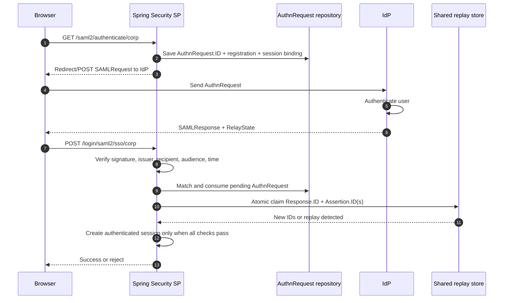
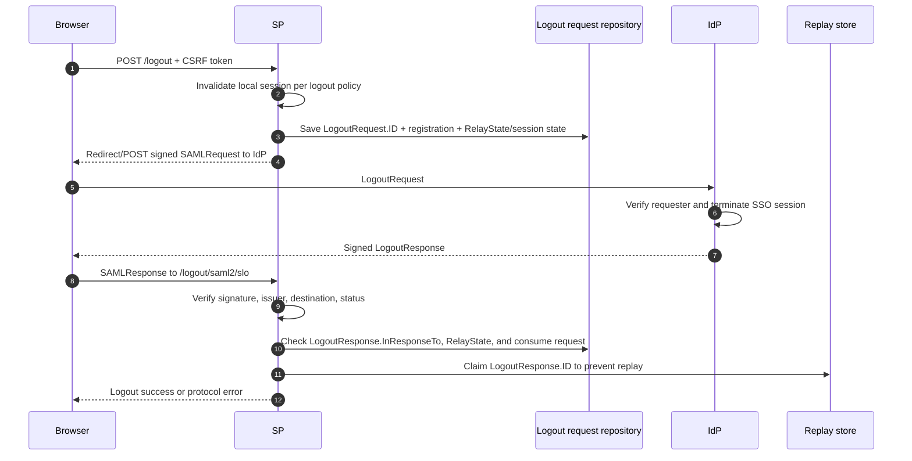

# Preventing Replay of Assertions, Responses, and Logout Messages in SAML 2.0

## 1. The Problem: A Valid Signature Does Not Mean a Message Is Fresh

A Service Provider (SP) using Spring Security SAML 2.0 may correctly verify the Identity Provider's (IdP) signature, identify the right user, and create a login session. However, **if the same valid SAML message is captured and re-submitted**, it can cause unintended consequences: creating an unwanted login session, abusing an assertion's validity window, repeating a logout operation, or corrupting session state in a multi-replica system.

This is a **replay attack**. The replayed object can be:

- A `<saml:Assertion>`: an assertion signed by the IdP with its own `ID`.
- A `<samlp:Response>` at the Assertion Consumer Service (ACS): a message containing one or more assertions.
- A `<samlp:LogoutRequest>`: a Single Logout (SLO) request, with an `ID` and possibly a `SessionIndex`.
- A `<samlp:LogoutResponse>`: a response to a logout request, with an `ID` and `InResponseTo`.
- In multi-SP/IdP architectures, an assertion from one tenant/issuer might be attempted against a different registration, even when sharing the same IdP.

**Security principle:** only accept a *verified* message when it matches the right issuer, service, and transaction/session, is still within its validity period, and **has not been processed previously within the protected replay window**. Signature verification, timestamp checks, request correlation, and replay caching **complement one another**; none of them replaces all the others.

This lesson belongs to the **Security Hardening** group of the **Spring Security – federation** module, focusing on SAML 2.0 Web Browser SSO and Single Logout in Spring Boot 3.x/Spring Security 6.x, while pointing out differences to watch when upgrading versions. Examples use Java 17+. Domains like `example.test`, IDs, and timestamps are illustrative only and are **not validly signed SAML messages**.

### Learning outcomes

1. Distinguish replay of **Assertion**, **Response**, **LogoutRequest**, and **LogoutResponse**.
2. Understand `ID`, `InResponseTo`, `IssueInstant`, `NotBefore`, `NotOnOrAfter`, `OneTimeUse`, `Recipient`, `Destination`, `AudienceRestriction`, and `SessionIndex`.
3. Design **request correlation + replay detection** in SP-initiated SSO.
4. Articulate the risks of IdP-initiated/unsolicited SSO when no AuthnRequest exists.
5. Prevent SLO replay while still handling duplicate messages **idempotently** per contract.
6. Store shared multi-replica replay state, TTL, and **atomic** check-and-insert operations.
7. Place the replay guard after cryptographic/protocol validation and before side effects.
8. Configure Spring Security `saml2Login`, `saml2Logout`, and request repositories in their proper roles.
9. Know the boundary between Spring Security/OpenSAML validators and **custom replay policy** verified by the deployment.
10. Write unit/integration/negative tests and operate without leaking SAML data.

## 2. Why HTTPS, XML Signatures, or Encryption Do Not Automatically Stop Replay

An attacker does not necessarily modify assertion content. If they possess a copy of a SAMLResponse from a browser, log, reverse proxy, or compromised component, they can try to re-POST **the exact signed bytes**. The signature can still verify as valid because the content **has not changed**.

| Mechanism | Question answered | Left unresolved |
| --- | --- | --- |
| HTTPS/TLS | Is data on the wire confidential and intact? | A party that already received/captured the message can resend it |
| XML Signature/binding equivalent | Did the message/assertion come from a trusted IdP key? | Has it already been processed before? |
| XML Encryption | Can outsiders read assertion content? | Ciphertext can be resent verbatim |
| `IssueInstant`/`NotOnOrAfter` | Is the message still within the allowed time window? | Multiple submissions **within the same time window** |
| `InResponseTo` | Does it match an SP-issued request? | Has that request already been consumed, or is the response/assertion duplicated? |
| `OneTimeUse` | IdP requests immediate one-time use, not retention for reuse | Must be **enforced** via replay tracking at the SP |
| Atomic replay cache | Has the ID already been processed in this scope/TTL? | Does not replace signature, issuer, audience, subject confirmation, or request state |

The **OASIS SAML 2.0 Security Considerations** specification emphasizes that message encryption **does not inherently prevent replay**; message identifiers/IssueInstant may be used together with a validation policy. Therefore, never fix replay by “making the IdP sign more strongly” or “adding XML Encryption” while omitting one-time checks.

## 3. IDs That Must Be Checked Independently

SAML has **multiple ID layers**. Confusing the layers easily lets a form of replay slip through:

| Object | Identifier | Role |
| --- | --- | --- |
| SP-issued `AuthnRequest` | `AuthnRequest.ID` | Outbound request, used for `InResponseTo` |
| IdP-returned `Response` | `Response.ID` | Identifies a protocol response |
| IdP-issued `Assertion` | `Assertion.ID` | Identifies the assertion used to build the principal |
| IdP/AP-sent `LogoutRequest` | `LogoutRequest.ID` | Identifies an inbound SLO operation |
| SP/AP-sent `LogoutResponse` | `LogoutResponse.ID` | Identifies an SLO protocol response |
| SP-issued SLO request | `LogoutRequest.ID` of outbound request | Used to correlate `LogoutResponse.InResponseTo` |
| `AuthnStatement.SessionIndex` | `SessionIndex` | References the **SAML session** for Single Logout, **not a message ID** |
| `RelayState` | Opaque binding state | Helps correlate transaction/return URL; itself neither a signature nor a replay ledger |

You must track **both Response.ID and Assertion.ID**, not just one of them. For instance, an old assertion can be placed inside a new Response: `Response.ID` differs, while `Assertion.ID` repeats. Conversely, replaying the entire response preserves both IDs; the Response guard rejects it.

**Never use NameID, email, SessionIndex, or timestamp as a replay key instead of the message ID.** A user can legitimately log in multiple times. A replay key is not a user's unique key.

### Partitioning keys by trust source

A key may consist of:

```text
saml-replay:
  environment:
  relyingPartyRegistrationId:
  verifiedIssuerEntityId:
  messageType:
  verifiedMessageOrAssertionId:
```

Here `messageType` can be `RESPONSE`, `ASSERTION`, `LOGOUT_REQUEST`, or `LOGOUT_RESPONSE`. Take `verifiedIssuerEntityId` only from trusted validation output; **unverified Issuer text establishes no trust**.

If two SP registrations share the same IdP but have different audiences/ACSs, partitioning by registration prevents collisions across trust domains, while **audience validation** remains mandatory. If the same assertion could potentially be reused across registrations against policy, the key/ledger design must reflect a broader anti-replay scope rather than accidentally allowing reuse per registration.

## 4. SAML Login Path: AuthnRequest → Response → Assertion



The diagram shows an **architectural sequence of responsibilities**, without promising the exact internal callback/hook order of every Spring Security release. What must hold true: **never create an authenticated session before completing all required checks**, including atomically marking the IDs per anti-replay policy. Keep the lifecycle of `AuthnRequest` and the replay ledger consistent, avoiding consuming the request while an ID guard error goes unhandled.

The SP-initiated flow has an advantage: **the SP issued a specific request** and can match `InResponseTo` against the pending ID bound to the exact browser session.

## 5. Key XML Fields in a Response

An **abbreviated, unsigned structural example that cannot log in**:

```xml
<samlp:Response
    xmlns:samlp="urn:oasis:names:tc:SAML:2.0:protocol"
    xmlns:saml="urn:oasis:names:tc:SAML:2.0:assertion"
    ID="_response-101"
    Version="2.0"
    IssueInstant="2026-11-07T09:00:00Z"
    InResponseTo="_authnrequest-55"
    Destination="https://sp.example.test/login/saml2/sso/corp">
  <saml:Issuer>https://idp.example.test/entity</saml:Issuer>
  <samlp:Status>
    <samlp:StatusCode
      Value="urn:oasis:names:tc:SAML:2.0:status:Success"/>
  </samlp:Status>
  <saml:Assertion
      ID="_assertion-900" Version="2.0"
      IssueInstant="2026-11-07T09:00:00Z">
    <saml:Issuer>https://idp.example.test/entity</saml:Issuer>
    <saml:Subject>
      <saml:NameID>opaque-user-123</saml:NameID>
      <saml:SubjectConfirmation
        Method="urn:oasis:names:tc:SAML:2.0:cm:bearer">
        <saml:SubjectConfirmationData
          InResponseTo="_authnrequest-55"
          Recipient="https://sp.example.test/login/saml2/sso/corp"
          NotOnOrAfter="2026-11-07T09:05:00Z"/>
      </saml:SubjectConfirmation>
    </saml:Subject>
    <saml:Conditions
        NotBefore="2026-11-07T08:59:00Z"
        NotOnOrAfter="2026-11-07T09:05:00Z">
      <saml:AudienceRestriction>
        <saml:Audience>https://sp.example.test/saml2/metadata/corp</saml:Audience>
      </saml:AudienceRestriction>
      <saml:OneTimeUse/>
    </saml:Conditions>
  </saml:Assertion>
</samlp:Response>
```

Notes:

- `Response.ID` is `_response-101`.
- `Assertion.ID` is `_assertion-900` — **must not duplicate Response.ID**.
- `InResponseTo` must match an SP-generated request that is still pending.
- `Recipient` is the ACS URL; `Audience` is the SP Entity ID per registration.
- `SubjectConfirmationData.NotOnOrAfter` bounds when the bearer assertion may be presented to the SP.
- `Conditions.NotOnOrAfter` bounds the overall validity of the assertion.
- `<OneTimeUse/>` requires the assertion not to be retained for later use, and the deployment must have a tracking policy.
- The signature may be on the Response or Assertion depending on profile and trust requirements; the sample XML omits the signature and is therefore **insufficient to authenticate**.

Do not use this XML itself as a “signature valid” test fixture. Integration tests require an IdP sandbox or properly signed OpenSAML test keys/fixtures verified by a real validator.

## 6. Blocking Replay of Response.ID

**Full-response replay** typically preserves the same `Response.ID`, signature, and assertion. Once the first response has been processed successfully, subsequent submissions must be rejected, even while signatures and timestamps are still valid.

Pseudo-policy:

```text
afterTrustedSamlValidation(response):
    key = namespace(registration, verifiedIssuer, "RESPONSE", response.ID)
    if not replayStore.claimAtomically(key, expiry):
        reject("RESPONSE_REPLAY")
    continueOnlyIfOtherReplayChecksAndCorrelationPass()
```

**Do not build the replay key from the entire Base64-encoded SAMLResponse** as the primary control: HTTP wrappers/encoding/whitespace or wrapping can change while the protocol message ID stays the same. Use the **ID of the node whose signature/structure has been verified**.

Reject or specially handle cases where `Response.ID` is empty, malformed, duplicates node IDs within the same XML, or violates schema/protocol. **Do not trust an ID value inside an attacker-injected XML node** that differs from the node actually used by the OpenSAML validator.

## 7. Blocking Replay of Assertion.ID

A new Response can carry an old assertion, for example:

```text
SAMLResponse A: Response.ID=_r1
                Assertion.ID=_a1

SAMLResponse B: Response.ID=_r2
                Assertion.ID=_a1    <- assertion was already processed
```

If the application only stores `Response.ID`, then `_r2` looks new. Therefore, **Assertion.ID must be tracked independently** for every assertion that could be used for authentication or authorization.

With multiple assertions in a single Response:

- Verify **all assertions the application intends to trust/consume**.
- Check ID uniqueness in XML and signed-node binding.
- Check issuer, subject confirmation, audience, time, and conditions on the **actually consumed assertion**.
- Apply the replay guard to the **entire set of involved IDs** before creating a principal or side effects.
- If an assertion was already processed previously, **fail closed** rather than skipping the duplicate assertion and continuing to take roles from another assertion.
- When encrypted assertions are present, extract IDs only after decryption/verification through the trusted OpenSAML pipeline; never manually parse/trust a ciphertext wrapper ID.

**Do not use a valid Response signature to skip the Assertion replay check.** The two controls defend against different exploit techniques.

## 8. InResponseTo and Transaction Binding: The Primary Defense for SP-Initiated SSO

In SP-initiated Web SSO, the SP saves `AuthnRequest.ID` when redirecting the browser to the IdP. The Response and the assertion's bearer `SubjectConfirmationData.InResponseTo` must match that request.

A secure mapping to maintain:

```text
pending request:
  requestId = _authnrequest-55
  registrationId = corp
  browserSessionBinding = opaque session state
  issuedAt = 2026-11-07T09:00:00Z
  expiresAt = short bounded time
  relayState = unpredictable correlation value if used
  consumed = false
```

**Do not merely compare the `InResponseTo` string against a global requestId in a cache.** An attacker can send session A's Response to browser session B if the cache is keyed only by ID and does not know which browser/transaction owns the request. A session-bound request repository helps mitigate login-CSRF/login fixation.

When a response arrives:

1. Locate the right pending AuthnRequest for the browser/transaction.
2. Check registration/IdP/ACS/Request ID/RelayState per policy.
3. Accept only a matching `InResponseTo`.
4. Consume/mark the request as **not usable a second time**, handling concurrency.
5. Simultaneously check replay IDs for both Response and Assertion.
6. Never recreate an already-consumed pending request just because the browser refreshed.

Spring Security Servlet provides `Saml2AuthenticationRequestRepository` and `HttpSessionSaml2AuthenticationRequestRepository`; cache-based implementations also exist in certain releases. **RelayState and InResponseTo from the browser do not by themselves prove the request belongs to that browser**: if separating from session, protect the binding through another design.

## 9. RelayState Is Neither a Replay Cache Nor a Signature

`RelayState` serves to preserve state across SAML bindings (such as matching a transaction/return URL). It passes through the browser and can be tampered with depending on binding/implementation.

- The HTTP-Redirect binding has a signature mechanism over query parameters per profile when URL signatures are used, including `RelayState` if present; the binding signature must still be verified properly.
- The HTTP-POST binding does not mean every `RelayState` is covered by the XML Signature; **do not treat it as immutable** without separate protection.
- A long/random RelayState does not replace session binding on its own.
- Never use RelayState as a local user ID, role, tenant grant, arbitrary redirect URL, or proof that “this user is logged in”.
- Never trust RelayState to bypass `InResponseTo` or OneTimeUse.
- RelayState may be used as a lookup key with **one-time consume + sufficient entropy + session binding/protection** by design.

Anti-replay requires a ledger keyed by `Response.ID` and `Assertion.ID`; a fresh RelayState **does not make an old assertion fresh**.

## 10. NotBefore, NotOnOrAfter, and Clock Skew

Timestamps commonly appear across multiple layers:

| Field | Meaning | Check |
| --- | --- | --- |
| `Response.IssueInstant` | Time the Response was issued | Reject overly old/future messages per policy |
| `Assertion.IssueInstant` | Time the assertion was issued | Plausibility, max age when required by policy |
| `Conditions.NotBefore` | Assertion is not valid before this instant | Current clock + skew must reach it |
| `Conditions.NotOnOrAfter` | Assertion must not be accepted at or after this instant | Compare against now and configured skew |
| `SubjectConfirmationData.NotOnOrAfter` | Bearer assertion delivery limit | Must be checked separately for subject confirmation |
| `LogoutRequest.NotOnOrAfter` | Optional expiration time for logout request | If present, enforce and pair with max-age policy |
| `LogoutRequest/Response.IssueInstant` | Time the SLO message was issued | Enforce max age/future limit when required by policy |
| `LogoutResponse.InResponseTo` | Correlation to pending logout request | Does not replace temporal checks |

**NotOnOrAfter means “must not be used at or after that instant”** under SAML validity semantics; clock-skew tolerance must be managed consistently. Never stretch clock skew excessively to “fix” NTP drift or slow callbacks: that widens the replay window.

**Illustrative** policy example, not Spring/OASIS defaults: accept assertions up to 3 minutes, max skew ±60 seconds, retain replay cache entries for at least the entire window during which the SP can accept a message. Actual values must reflect the IdP, network latency, KDC/NTP, and risk model.

## 11. OneTimeUse Is a Usage Condition, Not Automatic Assertion Deletion

OASIS SAML Core `2.5.1.5` defines `<OneTimeUse/>` as a condition indicating the assertion should be used immediately and **must not be retained for future use**. Compliant relying parties must track processed assertions to prevent reuse.

Example:

```xml
<saml:Conditions
    xmlns:saml="urn:oasis:names:tc:SAML:2.0:assertion"
    NotBefore="2026-11-07T09:00:00Z"
    NotOnOrAfter="2026-11-07T09:04:00Z">
  <saml:AudienceRestriction>
    <saml:Audience>https://sp.example.test/saml2/metadata/corp</saml:Audience>
  </saml:AudienceRestriction>
  <saml:OneTimeUse/>
</saml:Conditions>
```

**Points to remember:**

1. `OneTimeUse` is not a type of signature.
2. It does not automatically create a replay cache on the SP; the implementation must know which assertions have been used.
3. It is **independent of `NotBefore`/`NotOnOrAfter`**: an assertion still within its validity period that has already been used must be rejected.
4. An assertion without `OneTimeUse` **can also be blocked from reuse by the SP under bearer SSO security policy**; never assume “no OneTimeUse means unlimited replay”.
5. OpenSAML has `OneTimeUseConditionValidator` and `ReplayCache`; **whether they are enabled and properly wired into the Spring Security provider must be verified on the actual release/deployment**.
6. Do not put OneTimeUse in an assertion and claim global anti-replay exists without real state storage.

Per OASIS, `OneTimeUse` does not itself make `Conditions` “invalid” in the timestamp sense; it is a **constraint on how the assertion is used**. Thus replay policy must be enforced at the point where the SP decides to accept the assertion.

## 12. IdP-Initiated/Unsolicited SSO: No AuthnRequest to Correlate

In **IdP-initiated SSO**, the IdP can send a Response to the ACS without the SP **having created a prior AuthnRequest**. Consequently, `InResponseTo` may be absent, and session-bound request correlation does not protect the flow.

Risks:

- A valid captured Response can be replayed within a short window if there is no global replay ledger.
- Login CSRF/session swapping: a browser receives an identity session that the user did not intentionally request.
- A Response intended for another SP/tenant may be attempted against this ACS.
- An attacker can use genuine messages to enter a flow in the wrong context.

The design should:

1. **Disable unsolicited SSO if the product does not need it** and test that the ACS rejects responses lacking a pending request.
2. If required, configure it **per approved IdP/registration**, never falling back to it when a session is lost.
3. Require signature, issuer, audience, destination, recipient, temporal rules, and replay caching of **Assertion/Response IDs**.
4. Have a separate defense against login CSRF/session confusion, user confirmation, or strict session handling per use case.
5. Never automatically turn an SP-initiated response that lost its cookie (due to SameSite/session timeout) into a valid unsolicited flow.
6. Check consent/local account linking/tenant authorization after authentication.

**A replay cache is necessary, but does not by itself replace login CSRF protection.** A Response that has never been processed before can still represent a login unintended by the user in that browser.

## 13. SLO: Logout Messages Can Also Be Replayed

Single Logout has two primary directions:

- **RP-initiated:** the user submits `POST /logout` to the SP; Spring Security sends a `LogoutRequest` to the IdP and later receives a `LogoutResponse`.
- **AP/IdP-initiated:** the IdP sends a `LogoutRequest` directly to the SP; the SP verifies it, logs out the matching session(s), and returns a `LogoutResponse`.

**Two distinct replay targets:**

- Replaying an old `LogoutRequest` can trigger repeated logout actions, targeting a new session if the app matches only broadly by NameID.
- Replaying an old `LogoutResponse` can mislead the application into thinking a new logout transaction succeeded, if `InResponseTo` and pending request state are not checked.

A valid logout may be handled **idempotently** — a second request does not worsen state — but **idempotency does not mean accepting a replay as a brand-new message**. You must distinguish “already-processed duplicate” from “fresh authenticated logout”.

## 14. RP-Initiated LogoutRequest and LogoutResponse Flow



Spring Security 6.5 describes **storing the outbound LogoutRequest in the session** to verify `RelayState` and `LogoutResponse.InResponseTo`. With multiple replicas or cookie/session constraints, the repository can be customized while preserving **one-time consume and session binding**.

LogoutResponse example:

```xml
<samlp:LogoutResponse
    xmlns:samlp="urn:oasis:names:tc:SAML:2.0:protocol"
    xmlns:saml="urn:oasis:names:tc:SAML:2.0:assertion"
    ID="_logout-response-77"
    Version="2.0"
    InResponseTo="_logout-request-10"
    IssueInstant="2026-11-07T09:02:00Z"
    Destination="https://sp.example.test/logout/saml2/slo">
  <saml:Issuer>https://idp.example.test/entity</saml:Issuer>
  <samlp:Status>
    <samlp:StatusCode
      Value="urn:oasis:names:tc:SAML:2.0:status:Success"/>
  </samlp:Status>
</samlp:LogoutResponse>
```

This is **abbreviated, unsigned XML and not a valid production message**. The SP must verify the Response is from the right IdP, matches a pending request, has the expected status, and has an unused ID.

### Why shouldn't you check only Status=Success?

A historical `LogoutResponse` with `Status=Success` can be re-submitted by an attacker. If the RP does not retain pending requests and only inspects Status, it might mark a new logout as complete even though the IdP never performed the corresponding action.

**Policy:** no pending matching request, or wrong `InResponseTo`, or duplicate `LogoutResponse.ID` ⇒ reject as a new SLO response. If the user is already logged out locally, never restore a session or expand privileges upon receiving an invalid message.

## 15. AP/IdP-Initiated LogoutRequest: Check Replay Before Deleting Sessions

In the IdP-initiated flow, the SP receives a `LogoutRequest` from the IdP at `/logout/saml2/slo`. Per SAML Core, a logout request contains:

- `ID` and `IssueInstant` on the protocol request base type.
- `Issuer` identifying the sender.
- `Destination` endpoint receiving the request.
- `NameID` or equivalent identifying the principal.
- `SessionIndex` **optional**, which may contain multiple values.
- `NotOnOrAfter` **optional**, bounding how long the request remains valid.
- Optional `Reason`.

Example:

```xml
<samlp:LogoutRequest
    xmlns:samlp="urn:oasis:names:tc:SAML:2.0:protocol"
    xmlns:saml="urn:oasis:names:tc:SAML:2.0:assertion"
    ID="_idp-logout-request-42"
    Version="2.0"
    IssueInstant="2026-11-07T09:03:00Z"
    NotOnOrAfter="2026-11-07T09:05:00Z"
    Destination="https://sp.example.test/logout/saml2/slo">
  <saml:Issuer>https://idp.example.test/entity</saml:Issuer>
  <saml:NameID>opaque-user-123</saml:NameID>
  <samlp:SessionIndex>_session-abc</samlp:SessionIndex>
</samlp:LogoutRequest>
```

This message is **illustrative only** and unsigned. For production deployments, IdP-initiated SLO must be authenticated/integrity-protected per profile/binding and policy, so requiring a valid signature from the provisioned IdP is the appropriate choice.

### Inbound LogoutRequest workflow

1. Resolve the right `RelyingPartyRegistration` from the approved catalog.
2. Verify binding/XML signature with the trusted IdP key; verify issuer/destination.
3. Check `IssueInstant` is not too old/future; check `NotOnOrAfter` if present; enforce a separate max-age since the field is optional.
4. Check `NameID`/qualifiers and `SessionIndex` match the **exact local session(s)** for that IdP/registration.
5. Check `LogoutRequest.ID` is not already in the replay store; **atomic claim before mutating sessions**.
6. Terminate only policy-permitted sessions; do not log out all accounts sharing an email by default.
7. Return a signed/protocol-compliant `LogoutResponse` per policy, preserving idempotency for duplicate requests without repeating side effects.

**Special risk:** an old signed LogoutRequest with a common NameID, if processed again **without checking SessionIndex**, can terminate a **new** session of the same user. Therefore both a replay guard and session scoping are required.

## 16. SessionIndex Is Not LogoutRequest.ID

The two strings serve different purposes:

| Field | Used for | Not used for |
| --- | --- | --- |
| `LogoutRequest.ID` | Identifying a specific request, detecting replay | Finding local sessions by user |
| `LogoutRequest.SessionIndex` | Identifying the SAML session the IdP wants to log out | Uniquely identifying each logout message |
| `AuthnStatement.SessionIndex` | Binding a SAML authentication to a session at the IdP | Replacing `Assertion.ID` |
| `LogoutResponse.InResponseTo` | Matching the outbound LogoutRequest | Proving the response is fresh if the repo already consumed it |
| `NameID` | Identifying the principal within a profile | Blindly deleting all sessions sharing the same email |

Per SAML Core, `SessionIndex` in LogoutRequest is **optional**. If the IdP omits the index, have an **explicit policy**: which sessions may be logged out based on NameID/issuer/tenant/registration/assurance? In multi-tenant or concurrent-session systems, apply a conservative scope instead of destroying every session matching the user's email.

**Do not assume SessionIndex is a secret.** It is a correlation identifier, not a token authorizing logout without a signed LogoutRequest.

## 17. HTTP-Redirect and HTTP-POST Bindings in SLO

SAML SLO can use HTTP-Redirect or HTTP-POST bindings. They do not represent signatures the same way:

- **HTTP-Redirect:** the signature can reside in query parameters `SigAlg`, `Signature` (and `RelayState` per binding rules), bound to deflated/encoded request parameters.
- **HTTP-POST:** typically uses an XML Signature inside the SAML payload POSTed by the browser.
- Both bindings must verify **cryptographic integrity**, destination, issuer, time, ID, and replay per the IdP/SP profile.
- **Do not use a generic HTTP request hash** for anti-replay because encoding/deflate/parameter order can vary while the protocol message ID remains unchanged.
- Do not write raw `SAMLRequest`, `SAMLResponse`, `SigAlg`, or `Signature` into URL access logs, traces, or analytics unnecessarily.
- POST SAML callbacks use specialized CSRF/protocol validation; this does not mean disabling CSRF for all web POSTs.

If a partner only sends unsigned SLO or uses weak algorithms, **evaluate and approve the trust policy**; do not enable unverified acceptance just to “make logout work”.

## 18. ReplayCache Design: Partitioning, TTL, Atomicity

A real anti-replay store needs more than `HashSet<String>`:

```text
Key:   saml:{env}:{registrationId}:{verifiedIssuer}:{type}:{verifiedID}
Value: consumed marker + timestamp/policy version (contains no assertion XML)
TTL:   at least through the window the receiver still accepts the message
Write: atomic "insert only if absent" across all replicas
Read:  shared and consistent
Fail:  deny if durable replay check is unavailable for protected action
```

### Why use a composite key?

- `_id123` can appear across unrelated issuers.
- `Response` and `Assertion` are distinct namespaces.
- IdP A and IdP B have different trust anchors.
- Tenant North and South have different resource/registration policies.
- Test and production environments must not share a replay ledger.

If policy requires **blocking the same assertion across multiple registrations** of the same IdP, the assertion replay namespace must be placed at the overarching scope (e.g., per trusted IdP + SP entity) so there is no loophole merely by switching registrations. **Do not automatically allow an old assertion because it appears under a different registration**: audience/recipient must also block it.

### Atomic check-and-insert

Wrong:

```text
if (!store.contains(key)):
    store.put(key)
    accept()
```

Two requests hitting two pods can both read “not present” and both accept. Correct is an **atomic insert-if-absent** operation; for example in Redis:

```redis
SET saml:prod:corp:issuer-hash:ASSERTION:id-hash 1 NX PX 300000
```

If Redis returns `OK`, insertion succeeded; if it returns null/nil, the key already existed and the message must be rejected. In production, a 300000ms TTL is only an **example**, not sufficient for every IdP. Real keys should use a hash/HMAC of identifiers to reduce PII exposure, prevent user-controlled key explosion, and keep formatting uniform.

**Never use separate Redis GET then SET**, never use a pod-local cache in a cluster, and never allow replay during Redis timeouts or inconsistent failover.

## 19. Multiple IDs in One Response: Group Atomicity Requirement

Suppose a Response has:

```text
Response.ID = _r21
Assertion IDs = [_a4, _a5]
```

If the SP claims `_r21` successfully but fails claiming `_a4` because it was already used, the Response must be rejected. However, partially written keys could break another valid transaction or create a DoS vector.

A good design uses **atomic claim-all**:

```text
keys = [
  REPLAY_RESPONSE(issuer, responseId),
  REPLAY_ASSERTION(issuer, assertionId1),
  REPLAY_ASSERTION(issuer, assertionId2)
]
if any key exists: reject
else write all keys with TTL atomically, then proceed
```

With Redis, a suitable Lua script/transaction can check and insert **within a single atomic operation** when keys share the same shard/slot; Redis Cluster requires hash-tag design or a backend supporting atomic multi-key operations. If unsupported, use an equivalent **storage/transaction manager** or the fail-closed rule analyzed above.

**Avoid recording markers too early:** an attacker could send XML **unsigned or with an invalid signature** self-declaring a legitimate message's `Assertion.ID`; if the replay cache writes before verification, the attacker can “poison” the cache and block the real user. Therefore, complete cryptographic/protocol verification before claiming IDs.

**Avoid recording markers too late:** if a session has already been created or logout has deleted the session before the atomic claim, two racing requests can trigger side effects twice.

## 20. Replay TTL and valid-until Must Have a Finite Policy

The replay cache needs to hold markers **as long as the receiver could still accept the message**. Do not pick an arbitrary 60-second TTL if an assertion can be accepted for 5 minutes plus skew.

A design framework:

```text
maxAcceptanceEnd =
    min(relevant SAML expiry bounds if present,
        issueInstant + configuredMaximumAge if enforced)
    + boundedClockSkew

replayMarkerTTL =
    maxAcceptanceEnd - now + smallOperationalMargin
```

This is **policy pseudocode**, not a mandatory formula for every SAML profile. For assertions, bounds in Conditions and SubjectConfirmationData often differ; you must determine the **latest limit the verifier could actually accept** (across confirmation paths) and retain the cache at least until that time. Never simply read NotOnOrAfter from one node and forget another bound.

For **LogoutRequest**, `NotOnOrAfter` is optional; if absent, the receiver must define a finite `maxAgeSinceIssueInstant` and **bound clock skew**. For **LogoutResponse**, tie it to the pending request TTL and a max message age to avoid holding markers indefinitely.

When increasing clock-skew tolerance, **increase replay retention proportionally** if the acceptance window widens. If markers are evicted earlier than the acceptance window, an old message can slip back through. During cache outage/eviction/memory pressure, never silently enable “best effort, allow login anyway”.

### Bounding cache growth

Set message/XML size limits, maximum ID length, and quotas/rate limits before writing state. Long untrusted IDs and floods of invalid requests can exhaust memory. Thus only claim IDs **after** signature and protocol validation succeed, using bounded TTLs, bounded metrics cardinality, and hashed keys where needed.

## 21. Spring Security 6.x: What the Framework Actually Supports

In Spring Security SAML2 Servlet:

- `Saml2WebSsoAuthenticationRequestFilter` generates the `AuthnRequest`.
- `Saml2AuthenticationRequestRepository` stores pending requests; `HttpSessionSaml2AuthenticationRequestRepository` is the session-based implementation.
- `Saml2WebSsoAuthenticationFilter` receives the `SAMLResponse` at the ACS.
- `Saml2AuthenticationTokenConverter` builds `Saml2AuthenticationToken` and resolves `RelyingPartyRegistration`.
- The OpenSAML-backed authentication provider verifies signature, issuer, destination, assertion conditions, and subject confirmation per configuration.
- `Saml2LogoutRequestFilter` handles AP-initiated `LogoutRequest`.
- `Saml2LogoutResponseFilter` handles `LogoutResponse`.
- `Saml2LogoutRequestValidator` and `Saml2LogoutResponseValidator` are hooks to customize SLO validation.
- `Saml2LogoutRequestRepository` (in the SLO DSL) manages outbound request state used for `InResponseTo` and RelayState.

**Do not assume without verifying:** merely enabling `.saml2Login()` or `.saml2Logout()` is not enough to assert that the deployment has a **shared atomic replay cache** for all Response.ID, Assertion.ID, LogoutRequest.ID, and LogoutResponse.ID values across multiple pods. OpenSAML/Spring replay checking, `OneTimeUseConditionValidator`, TTL, and storage must be verified against the **actual BOM/version and integration tests**.

Spring Security 6.5 and Spring Security 7.x differ in OpenSAML4/OpenSAML5 APIs and validator hooks. Never copy `OpenSaml4AuthenticationProvider` code into a project that only has `OpenSaml5AuthenticationProvider` without verifying the exact release.

## 22. Spring Boot 3.x Baseline Configuration for SAML Login and SLO

In a Boot project's `build.gradle` with the Java plugin, dependency management, and appropriate repositories:

```groovy
repositories {
    mavenCentral()
    // Some OpenSAML combinations require the Shibboleth repository.
    maven { url "https://build.shibboleth.net/maven/releases/" }
}

dependencies {
    implementation "org.springframework.boot:spring-boot-starter-web"
    implementation "org.springframework.boot:spring-boot-starter-security"
    implementation "org.springframework.security:spring-security-saml2-service-provider"
}
```

Illustrative `application.yml` snippet for an RP:

```yaml
spring:
  security:
    saml2:
      relyingparty:
        registration:
          corp:
            entity-id: "https://sp.example.test/saml2/metadata/corp"
            acs:
              location: "https://sp.example.test/login/saml2/sso/corp"
            signing:
              credentials:
                - private-key-location: "file:/run/secrets/saml/sp.key"
                  certificate-location: "file:/run/secrets/saml/sp.crt"
            singlelogout:
              url: "https://sp.example.test/logout/saml2/slo"
            assertingparty:
              metadata-uri: "https://idp.example.test/metadata"
```

These are **illustrative values**, not deployable without a real IdP, real SP signing key/cert, trusted metadata, SLO setup, and HTTPS proxy. Never commit private keys to JAR/Git; use a secret manager/read-only volume and rotation policy.

**Note:** the configuration above **does not automatically install a distributed replay ledger**; it creates a baseline for SAML login/logout. Anti-replay must be verified or integrated additionally per the threat model. If the IdP requires different Response/Assertion signatures, configure them explicitly per metadata/trust contract rather than dropping validators to “make it work”.

### Sample Spring SecurityFilterChain

Save `src/main/java/demo/samlreplay/SamlReplayApplication.java`:

```java
package demo.samlreplay;

import org.springframework.boot.SpringApplication;
import org.springframework.boot.autoconfigure.SpringBootApplication;
import org.springframework.context.annotation.Bean;
import org.springframework.security.config.Customizer;
import org.springframework.security.config.annotation.web.builders.HttpSecurity;
import org.springframework.security.core.Authentication;
import org.springframework.security.web.SecurityFilterChain;
import org.springframework.web.bind.annotation.GetMapping;
import org.springframework.web.bind.annotation.RestController;

@SpringBootApplication
@RestController
public class SamlReplayApplication {

    public static void main(String[] args) {
        SpringApplication.run(SamlReplayApplication.class, args);
    }

    @Bean
    SecurityFilterChain samlSecurity(HttpSecurity http) throws Exception {
        return http
                .authorizeHttpRequests(auth -> auth
                        .requestMatchers("/", "/error").permitAll()
                        .anyRequest().authenticated())
                .saml2Login(Customizer.withDefaults())
                .saml2Logout(Customizer.withDefaults())
                .build();
    }

    @GetMapping("/")
    public String home() {
        return "SAML2 login and SLO example";
    }

    @GetMapping("/secure/whoami")
    public String whoami(Authentication authentication) {
        return authentication.getName();
    }
}
```

This is a Java 17+ class with Spring Boot/Security dependencies; for **login and logout to succeed**, it must be connected to a real IdP with proper certificates/metadata/keys. **This class only demonstrates the framework baseline** and does not include atomic anti-replay integration on its own. Do not claim `/secure/whoami` returns HTTP 200 without configuring an IdP.

When the app uses browser sessions, keep Spring Security CSRF protections for `POST /logout`. SAML ACS/SLO protocol callbacks are handled by filters per the proper bindings; **do not disable CSRF across the entire web app** to work around callback errors without understanding the framework mechanism.

## 23. Customizing Spring Security: Where to Attach the Replay Guard

Keep the **default SAML validators** and add the guard in the right place. One way to think about it:

```text
Saml2WebSsoAuthenticationFilter
 -> trusted RelyingPartyRegistration
 -> OpenSAML: secure parse + signature verify
 -> issuer/destination/audience/recipient/time/subject checks
 -> correlate with pending AuthnRequest and session
 -> anti-replay: atomic claim Response + all consumed Assertion IDs
 -> create Authentication + session

Saml2LogoutRequestFilter
 -> verify signed LogoutRequest issuer/destination/time/session
 -> anti-replay: atomic claim LogoutRequest.ID
 -> invalidate only matching local sessions, respond

Saml2LogoutResponseFilter
 -> verify signed LogoutResponse issuer/destination/status
 -> correlate InResponseTo + pending logout request
 -> anti-replay: atomic claim LogoutResponse.ID
 -> complete logout response handling
```

This is an **architectural model**, not the exact call order of every provider. When implementing, leverage extension points provided by your Spring Security version:

- In Spring Security 6.x, `OpenSaml4AuthenticationProvider` or `OpenSaml5AuthenticationProvider` depending on release has `ResponseValidator`/`AssertionValidator` customization, where you can **delegate to default validators** and then apply additional policy.
- For SLO, there are `Saml2LogoutRequestValidator` / `Saml2LogoutResponseValidator` via the `saml2Logout` DSL; delegate to the default implementation before checking IDs.
- Use `Saml2AuthenticationRequestRepository`/`Saml2LogoutRequestRepository` for transaction state; never replace them with a global HashMap lacking browser/session binding.
- You can build an adapter around **verified OpenSAML objects** and the cache service, while ensuring the replay marker is written **before side effects** and **after signature/conditions**.
- When a custom validator returns an error, return `Saml2Error`/`Saml2ResponseValidatorResult` or `Saml2LogoutValidatorResult` matching the release contract; never swallow exceptions and continue login/logout.

**Do not write code that directly parses Base64/XML in a controller to compare IDs** unless it guarantees signed-node selection, XXE/DTD protection, XML Signature Wrapping prevention, and exact alignment with the object used by the Spring provider. An unverified ID should never become a consumed marker.

Because validator/signature extension points differ between Security 6.5/7.0/7.1, `ResponseValidator`/`AssertionValidator` snippets should only be implemented after consulting the Javadoc for the **exact BOM**. Do not invent a `spring.security.saml2.replay-cache.enabled=true`: Spring Boot has no universal property guaranteeing distributed replay checks for all four message types.

## 24. The AuthnRequest Repository Is Not a Global Replay Ledger

`HttpSessionSaml2AuthenticationRequestRepository` stores requests per browser session. In SP-initiated SSO it helps verify `InResponseTo`, but **it does not replace recording the history of every Assertion.ID across all browsers/pods**.

Distinctions:

| Store | Key/state | Purpose |
| --- | --- | --- |
| `Saml2AuthenticationRequestRepository` | Pending AuthnRequest + RelayState/session | Correlate login transaction, consume request |
| `Saml2LogoutRequestRepository` | Outbound pending LogoutRequest | Correlate `LogoutResponse.InResponseTo`/RelayState |
| **Replay store** | Used Response/Assertion/Logout Request/Response IDs | Block message reuse across requests/replicas |
| Local session repository | Browser Authentication/SecurityContext | Maintain login state |
| SLO session index mapping | Issuer/NameID/SessionIndex ↔ local sessions | Log out the **exact session** |
| Local user/tenant directory | Subject → local roles/ACL | Business authorization |

If the session store is Redis, it **does not automatically** provide anti-replay markers. Separate data, TTL, and insert-if-absent operations are required.

If an application uses `SameSite=Strict` and loses the browser session on cross-site SAML POST, **never downgrade** from SP-initiated to unsolicited SSO to bypass missing `InResponseTo`. Fix cookie/session binding or use a repository with another secure transaction-protection mechanism.

## 25. Multi-Replica, Redis, and Logout Side Effects

With multiple pods:

```text
IdP
  |
  +--> SP pod A: sees Response.ID=_r77
  |
  +--> SP pod B: also sees Response.ID=_r77

Local HashSet A: unseen -> accept
Local HashSet B: unseen -> accept

Shared atomic cache:
  pod A SET NX -> OK
  pod B SET NX -> nil
  only one request is claimed
```

Considerations:

- **Durability/consistency:** Redis failover can lose a recently written marker under async replication; choose acceptable consistency per risk model, or use a datastore with transactional guarantees.
- **Atomic multi-key:** if checking Response.ID + N Assertion.IDs, claim-all must execute in a single corresponding transaction/script.
- **Failure policy:** a cache outage must reject protected authentication/logout; never “temporarily disable replay protection”.
- **TTL:** keep markers at least until the message can no longer be accepted.
- **Namespace:** environment, IdP issuer, RP registration, message type, and ID.
- **Scale:** bound XML size, assertion count, ID lengths, log cardinality, and replay metrics.
- **Rollback:** a marker already claimed when a downstream handler fails may cause a retry to be rejected; accept **fail closed** and initiate a new transaction rather than automatically deleting the marker of an already-seen message.

A minimal Redis approach uses `SET ... NX PX` for a single ID. For multi-ID/correlated state, implement an atomic group contract via Lua script/transaction or a strong transactional DB. Never use `GET` then `SET` or pod-local caches.

### Do not cache raw SAML

The replay store typically only needs hashed IDs, timestamps, and policy context; there is no need to store raw `SAMLResponse`/XML Assertions/NameID. For forensics, use event IDs and redacted metadata; storing raw authentication material increases identity and replay exposure.

## 26. Standalone Java 17: Replay Guard for Four Message Types

The following program illustrates an **in-memory replay window** using `ConcurrentHashMap.compute` for atomic check-and-insert on a **single ID**. It keys by issuer + SP registration + message type + ID; it **does not verify signatures, XML, SessionIndex, or multi-pod safety**. In a real system, call `claim` only **after the SAML validator has verified the message** and set valid-until per policy.

Save file `SamlReplayGuardDemo.java`:

```java
import java.time.Clock;
import java.time.Instant;
import java.time.ZoneOffset;
import java.util.concurrent.ConcurrentHashMap;
import java.util.concurrent.atomic.AtomicBoolean;

public final class SamlReplayGuardDemo {

    enum Kind {
        RESPONSE, ASSERTION, LOGOUT_REQUEST, LOGOUT_RESPONSE
    }

    record Key(String issuer, String registration, Kind kind, String id) {
    }

    static final class ReplayGuard {
        private final ConcurrentHashMap<Key, Instant> seen =
                new ConcurrentHashMap<>();
        private final Clock clock;

        ReplayGuard(Clock clock) {
            this.clock = clock;
        }

        boolean claim(String issuer, String registration,
                Kind kind, String verifiedId, Instant validUntil) {

            if (issuer == null || issuer.isBlank()
                    || registration == null || registration.isBlank()
                    || kind == null
                    || verifiedId == null || verifiedId.isBlank()
                    || validUntil == null) {
                return false;
            }

            Instant now = clock.instant();
            if (!validUntil.isAfter(now)) {
                return false;
            }

            Key key = new Key(issuer, registration, kind, verifiedId);
            AtomicBoolean firstUse = new AtomicBoolean(false);

            seen.compute(key, (ignored, priorExpiry) -> {
                if (priorExpiry == null || !priorExpiry.isAfter(now)) {
                    firstUse.set(true);
                    return validUntil;
                }
                return priorExpiry;
            });
            return firstUse.get();
        }
    }

    public static void main(String[] args) {
        Instant now = Instant.parse("2026-11-07T09:00:00Z");
        ReplayGuard guard = new ReplayGuard(
                Clock.fixed(now, ZoneOffset.UTC));
        Instant end = now.plusSeconds(300);
        String issuer = "https://idp.example.test/entity";
        String rp = "corp";

        System.out.println("responseFirst="
                + guard.claim(issuer, rp, Kind.RESPONSE, "_r1", end));
        System.out.println("responseReplay="
                + guard.claim(issuer, rp, Kind.RESPONSE, "_r1", end));

        System.out.println("assertionFirst="
                + guard.claim(issuer, rp, Kind.ASSERTION, "_a1", end));
        System.out.println("assertionReused="
                + guard.claim(issuer, rp, Kind.ASSERTION, "_a1", end));

        System.out.println("logoutRequestFirst="
                + guard.claim(issuer, rp, Kind.LOGOUT_REQUEST, "_l1", end));
        System.out.println("logoutRequestReplay="
                + guard.claim(issuer, rp, Kind.LOGOUT_REQUEST, "_l1", end));

        System.out.println("logoutResponseFirst="
                + guard.claim(issuer, rp, Kind.LOGOUT_RESPONSE, "_lr1", end));
        System.out.println("logoutResponseReplay="
                + guard.claim(issuer, rp, Kind.LOGOUT_RESPONSE, "_lr1", end));

        System.out.println("otherRegistration="
                + guard.claim(issuer, "other", Kind.RESPONSE, "_r1", end));
        System.out.println("expiredRejected="
                + guard.claim(issuer, rp, Kind.ASSERTION,
                        "_expired", now.minusSeconds(1)));
    }
}
```

Run with JDK 17+:

```bash
javac SamlReplayGuardDemo.java
java SamlReplayGuardDemo
```

**Exact stdout:**

```text
responseFirst=true
responseReplay=false
assertionFirst=true
assertionReused=false
logoutRequestFirst=true
logoutRequestReplay=false
logoutResponseFirst=true
logoutResponseReplay=false
otherRegistration=true
expiredRejected=false
```

Explanation:

- `responseReplay=false`: an already-claimed Response ID cannot be accepted again in the same scope.
- `assertionReused=false`: the Assertion ID is rejected even if it could appear in a different Response ID.
- `logoutRequestReplay=false` / `logoutResponseReplay=false`: the same SLO ID cannot be reused as a new message.
- `otherRegistration=true`: the key is scoped by registration; **production must still validate audience/recipient** and may need a stricter shared assertion scope.
- `expiredRejected=false`: an expired message cannot be claimed.
- `AtomicBoolean` is only used to receive the result of single-key `compute`; it does not perform a multi-ID transaction.

**Limitations:** no TTL eviction job, no signature validation, no SP session check, no shared cache, no crash/failover protection, and no atomic claim-all. Therefore, this is a **unit demonstration**—never copy it as production replay protection.

## 27. Logging, Metrics, and Incident Response

When replay is detected, record enough data for analysis without exposing raw SAML messages:

```text
event = saml_replay_detected
messageType = ASSERTION
registrationId = corp
issuerAlias = verified_idp_1
messageIdHash = 7f8e...  (HMAC/truncated hash, not raw)
correlationId = internal_request_id
decision = DENY
```

Logs should distinguish:

- Invalid signature.
- Invalid issuer/registration.
- Audience/Recipient/Destination mismatch.
- Expired/not-yet-valid.
- Missing/mismatched `InResponseTo`.
- Already-consumed AuthnRequest or SLO request.
- Replay Response ID.
- Replay Assertion ID.
- Replay LogoutRequest ID.
- Replay LogoutResponse ID.
- Replay store unavailable/atomic claim failed.
- Logout session target not found or SessionIndex mismatch.

**Never log raw `SAMLResponse`, `SAMLRequest`, `RelayState`, assertion XML, NameID/email, cookies, signing keys, or valid signatures** to general logging systems. A copy of SAML still inside its validity window is replayable material.

### Proper metrics

Separate `saml_authentication_success` from `saml_response_replay_rejected`. Separate `saml_logout_request_received` from `saml_logout_session_invalidated` to avoid reporting “logout succeeded multiple times” due to retries/replays. Never use raw `Response.ID` or `NameID` as a metric label with unbounded cardinality.

## 28. Negative Tests for Response/Assertion

| Test | Target | Expected |
| --- | --- | --- |
| 1. Previously processed Response re-POSTed verbatim | Response replay | Reject |
| 2. Old Assertion ID inside a new Response ID | Assertion replay | Reject |
| 3. Old Response ID with new Assertion ID | Response replay | Reject |
| 4. Invalid Response signature with ID matching real message | Cache poisoning | Reject signature **without writing marker** |
| 5. `InResponseTo` matches already-consumed request | Transaction replay | Reject |
| 6. `InResponseTo` belongs to another browser session | Login CSRF/fixation | Reject |
| 7. Session cookie lost after IdP POST | Missing pending request | Do not auto-downgrade to unsolicited |
| 8. `OneTimeUse` Assertion resent while still valid | Condition enforcement | Reject |
| 9. Assertion without `OneTimeUse` when bearer already processed | SP anti-replay policy | Reject per policy |
| 10. Expired `SubjectConfirmationData.NotOnOrAfter` | Temporal invalidity | Reject |
| 11. Future `Conditions.NotBefore` | Temporal invalidity | Reject |
| 12. Issuer altered so signature fails | Trust boundary | Reject |
| 13. Audience belongs to another SP | Cross-service replay | Reject |
| 14. Recipient/Destination differs from ACS | ACS mismatch | Reject |
| 15. Response contains two assertions with same ID | XML ambiguity | Reject |
| 16. Valid signed assertion with XML Signature Wrapping node | Signed-node selection | Reject or use only exact signed node |
| 17. Two concurrent POSTs to two pods with same Response.ID | Race | Only one atomic claim succeeds |
| 18. Redis outage/failover | Cache availability | Fail-closed |
| 19. Marker TTL shorter than acceptance window | Replay window | Test catches wrong policy |
| 20. Unapproved IdP-initiated request | Unsolicited SSO | Reject |
| 21. Permitted IdP-initiated with replayed Response/Assertion | Unsolicited replay | Reject |
| 22. Token/claim extracted from unverified XML | Parser bypass | Do not create authenticated principal |
| 23. Valid signed Response containing expired assertion | Full pipeline check | Reject |
| 24. Duplicate/overlapping multi-assertion check | Atomicity | Reject entire group, no partial assertion use |

Use a test IdP and sandbox signing keys; `@WithMockUser` tests **do not run XML Signature/OpenSAML validation**. Integration tests must actually POST a signed SAMLResponse to the ACS.

## 29. Negative Tests for LogoutRequest/LogoutResponse

| Test | Check | Expected |
| --- | --- | --- |
| A. Signed IdP LogoutRequest replayed with same ID | AP-initiated SLO replay | Do not re-logout as a fresh message |
| B. Old LogoutRequest after user re-login | New session protection | Do not log out new session with wrong SessionIndex |
| C. Unsigned LogoutRequest/unknown issuer | Signature/issuer trust | Reject |
| D. Overly old LogoutRequest lacking NotOnOrAfter | Max message age | Reject per policy |
| E. LogoutRequest with expired NotOnOrAfter | Expiry | Reject |
| F. LogoutRequest with SessionIndex of another tenant | Session scope | Do not log out across tenants |
| G. LogoutRequest with only NameID, no SessionIndex | Broad logout risk | Apply explicit policy, do not delete unconditionally |
| H. LogoutResponse from already-consumed LogoutRequest | Response replay | Reject as a fresh response |
| I. Old LogoutResponse ID, new InResponseTo | Replay/transaction mismatch | Reject |
| J. Fresh LogoutResponse but wrong InResponseTo | Correlation failure | Reject |
| K. LogoutResponse signed by IdP B while RP awaits IdP A | Issuer/registration mismatch | Reject |
| L. LogoutResponse error Status | Protocol result | Do not mark as global success |
| M. LogoutResponse received with no pending SLO request | Unsolicited response | Reject |
| N. Duplicate SLO across two pods | Atomicity + idempotency | Do not broadly invalidate/repeat side effects |
| O. Replay cache offline during inbound logout | Fail closed | Do not let message trigger side effects |
| P. Valid LogoutRequest when local session is already gone | Idempotency | Return appropriate result without recreating session |
| Q. SLO message with wrong Destination | Endpoint binding | Reject |
| R. Unverified HTTP-Redirect signature | Binding signature | Reject |
| S. SLO replayed in another environment | Namespace | Must not affect sessions in this environment |
| T. Browser still has IdP session after local logout | Logout semantics | Do not assume global SLO succeeded |

Test both **RP-initiated** and **AP-initiated** flows, not just a single UI Logout button. If a partner sends unsigned SLO on a different binding, confirm security/trust policy before accepting it.

## 30. Common Implementation Mistakes and Remedies

| Anti-pattern | Why it is dangerous | Correct design |
| --- | --- | --- |
| “Response is signed so it cannot be replayed” | Signature remains valid when message is resent | Signature + IDs + expiry + correlation |
| Storing only Response.ID | Old assertion can be placed in a new Response | Store Assertion.ID as well |
| Storing only Assertion.ID | Full protocol Response can be reprocessed depending on flow | Check Response.ID too |
| Dropping `InResponseTo` when session is lost | Login CSRF/fixation and replay | Fix cookie/repository |
| Using only RelayState as session proof | Browser can bring state from another flow | Session binding + one-time consume |
| No cache because `OneTimeUse` is in XML | The condition does not enforce itself | Replay ledger |
| Redis GET then SET | Race across replicas | Atomic `SET NX`/transaction |
| HashSet inside one pod | Other pods do not see the marker | Shared store |
| 30s TTL while assertion accepted for 5 minutes | Replay after marker eviction | Align TTL with acceptance window |
| Writing ID to cache before signature validation | Cache poisoning/DoS | Verify then claim |
| Creating session before claim | Race creates multiple sessions | Gate before side effects |
| Old LogoutRequest logs out new session | Missing SessionIndex/replay check | Session-specific signed SLO |
| Checking only NameID in SLO | Logs out wrong sessions/tenants | Issuer + SessionIndex + local mapping |
| Checking only LogoutResponse Status Success | Old reply reused for new request | Pending request + InResponseTo + replay ID |
| Dropping validation after one SLO error | Trust boundary lost | Keep validator, fix IdP/metadata |
| Disabling CSRF globally for SAML POST | Browser forms/sessions lose CSRF protection | Configure callback properly |
| Logging SAML XML for debugging | Leaks bearer assertion/PII | Redaction + hashed IDs |
| Pods have clocks skewed by minutes | Unpredictable expiry | NTP, small skew, metrics |
| Blindly assuming OpenSAML auto-enforces OneTimeUse | Config/version differences | Verify with integration tests |
| Local logout while IdP session stays alive | Not global SLO | Document RP/AP SLO and verify behavior |

## 31. Diagnosing Spring Security in Practice

| Symptom | Likely Cause | Resolution |
| --- | --- | --- |
| Second SAMLResponse still creates session | Missing global replay guard | Check Response/Assertion ID tests |
| Duplicate response only rejected on one pod | Local/non-shared cache | Use atomic shared store |
| Fresh assertion flagged as replay | Wrong key scope, overly long TTL, or colliding provider IDs | Inspect issuer/registration namespace, IdP uniqueness |
| First message rejected as replay | Cache poisoned before signature validation | Fix integration order |
| Valid login loses `InResponseTo` | SameSite/cookie/session store/replicas | Check browser POST and request repository |
| User logged out by old IdP request | Missing SLO replay/session scoping | Check SessionIndex and ID ledger |
| RP-initiated SLO always “succeeds” though IdP didn't log out | Pending InResponseTo/Status validation skipped | Correlate logout request repository |
| Signature check fails after IdP key rotation | Stale verification cert metadata | Fix trusted key rotation, do not disable signatures |
| Assertion expired despite clock skew | NTP/clock skew | Sync clocks, do not widen skew unboundedly |
| Redis failover drops replay markers | Asynchronous replication/consistency | Choose proper storage guarantees, test failover |
| 400 at `/logout/saml2/slo` | Invalid signed message, issuer, destination, or state | Inspect redacted error category |
| Session created then app returns 500 | Replay guard placed after authentication side effects | Move gating before session creation |
| Replay store RAM grows continuously | Missing TTL or unbounded raw IDs | Bounds/TTL/hashed keys |
| XML parser breaks Signature | Wrong WAF/parser/rewrite | Check binding/crypto, never reparse unsafely |

**Never set `permitAll` on ACS/SLO and manually accept raw XML as an authenticated user.** The endpoint may need to accept HTTP requests without an existing session, but **SAML validation must determine the outcome**—a public controller does not imply trust.

## 32. Pre-Production Hardening Checklist

- [ ] Explicitly defined SAML RP, IdP, RelyingPartyRegistration, ACS, Entity ID, and SLO endpoints.
- [ ] All signing/verification credentials come from approved trusted configuration/metadata.
- [ ] Signatures on Response/Assertion/Logout are verified per the exact binding/profile.
- [ ] Validate Issuer, Destination, Recipient, Audience, Conditions, and SubjectConfirmation.
- [ ] SP-initiated Response must match pending `AuthnRequest.ID`/`InResponseTo` and browser binding.
- [ ] Pending AuthnRequest is consumed once, with TTL and concurrency protection.
- [ ] RelayState is never used as a permission or standalone proof of request session.
- [ ] Response.ID and every Assertion.ID are checked for replay, including OneTimeUse.
- [ ] Assertion OneTimeUse is enforced, not merely parsed and ignored.
- [ ] IdP-initiated/unsolicited SSO has an explicit policy or is disabled.
- [ ] Replay cache is shared across replicas; ID claiming is atomic.
- [ ] A Response with multiple assertions is claimed as an atomic group when required.
- [ ] Markers are claimed only **after validation** and **before side effects**.
- [ ] Cache TTL covers acceptance windows + clock skew, without premature eviction.
- [ ] Cache outage/failover follows a fail-closed policy with observability.
- [ ] SP/AP-initiated LogoutRequest is processed only when issuer/signature/time/ID are valid.
- [ ] LogoutRequest.ID has an anti-replay guard.
- [ ] NameID/SessionIndex are matched to exact local sessions per IdP and tenant.
- [ ] LogoutResponse.InResponseTo matches pending outbound LogoutRequest and consumes it from the repository.
- [ ] LogoutResponse.ID is replay-protected; Status is validated per protocol.
- [ ] Duplicate logout never recreates sessions or repeats unintended side effects.
- [ ] App uses HTTP/Redirect or POST bindings with proper signatures, without mixing them up.
- [ ] Web CSRF/session cookies/SameSite are configured for SAML compatibility without disabling global security.
- [ ] Unit tests, integration tests, multi-pod concurrency, and key rotation have been run.
- [ ] Logs/metrics contain no raw assertions, SAML messages, NameID, cookies, or secrets.
- [ ] NTP and clock-skew monitoring are active.
- [ ] Migration policy from Spring Security 6.x/OpenSAML4 to 7.x/OpenSAML5 is verified against actual release APIs.

## 33. Self-Assessment Questions

**1. Why can a signed SAMLResponse still be replayed?**  
Because an attacker can resend the exact signed bytes; the signature proves origin/integrity, not one-time freshness.

**2. Do Response.ID and Assertion.ID play the same role?**  
No. Response.ID identifies the protocol message; Assertion.ID identifies the assertion. Both must be tracked.

**3. Does `OneTimeUse` automatically enable a Redis cache in Spring Security?**  
You cannot assume that. You must verify the validator/configuration and replay storage on the actual release.

**4. What problem does `InResponseTo` solve?**  
Correlates the Response to an SP-issued AuthnRequest. It must be bound to the browser/transaction and consumed once.

**5. Can a replay cache replace `InResponseTo`?**  
No. A fresh response from an unintended flow can still cause login CSRF.

**6. Why are Redis `GET` + `SET` unsafe?**  
Two pods can concurrently read absent and both write; atomic check-and-insert is required.

**7. How long should the replay marker TTL be?**  
At least until the message can no longer be accepted by the SP, including temporal policy and clock skew, per trust/profile.

**8. Should an unverified ID be written to the replay cache?**  
No. An attacker can poison the marker and cause denial-of-service for the legitimate message.

**9. What does inbound SLO require beyond a signature?**  
Issuer/destination/time, a fresh message ID, matching NameID/SessionIndex, and local session scope.

**10. Why is LogoutResponse.Status Success not enough?**  
You must match `InResponseTo` against a pending LogoutRequest and verify LogoutResponse.ID, issuer, and signature.

**11. What if LogoutRequest has no SessionIndex?**  
The spec makes it optional; the application must have a clear logout scope policy rather than destroying every session sharing an email.

**12. Should raw SAMLResponse be cached to prevent replay?**  
Not needed; prefer hashed IDs and expiry. Raw SAML carries sensitive identity/credential material.

**13. Why is single-pod caching insufficient?**  
A replay sent to another pod will miss the marker; a shared consistent store is required.

**14. Should a second LogoutRequest log the user out again?**  
Do not treat it as a fresh message. Reject duplicates or return an idempotent response per contract without repeating side effects.

**15. Which tests are most important to prove anti-replay?**  
Resent signed response; old assertion ID inside a new response; two-pod concurrency; old logout request after re-login; logout response with wrong `InResponseTo`; replay store outage.

## 34. Official References

- [OASIS — SAML 2.0 Core](https://docs.oasis-open.org/security/saml/v2.0/saml-core-2.0-os.pdf): `Assertion.ID`, `Response.ID`, `OneTimeUse` (section 2.5.1.5), `LogoutRequest`/`LogoutResponse` (section 3.7), `SessionIndex`.
- [OASIS — SAML 2.0 Profiles](https://docs.oasis-open.org/security/saml/v2.0/saml-profiles-2.0-os.pdf): Web Browser SSO, bearer `SubjectConfirmationData`, `InResponseTo`, and Single Logout profiles.
- [OASIS — SAML 2.0 Security Considerations](https://docs.oasis-open.org/security/saml/v2.0/saml-sec-consider-2.0-os.pdf): replay, message IDs, and why encryption does not replace anti-replay.
- [OASIS — SAML 2.0 Approved Errata 05](https://docs.oasis-open.org/security/saml/v2.0/errata05/os/saml-v2.0-errata05-os.html): errata related to bearer SubjectConfirmationData and InResponseTo.
- [Spring Security 6.5 — SAML 2.0 Login Overview](https://docs.spring.io/spring-security/reference/6.5/servlet/saml2/login/overview.html): filters/provider and validation.
- [Spring Security 6.5 — SAML Authentication Requests](https://docs.spring.io/spring-security/reference/6.5/servlet/saml2/login/authentication-requests.html): request repositories, session binding, RelayState/cache caveat.
- [Spring Security 6.5 — SAML Authentication Responses](https://docs.spring.io/spring-security/reference/6.5/servlet/saml2/login/authentication.html): default validators and extension points.
- [Spring Security 6.5 — SAML Single Logout](https://docs.spring.io/spring-security/reference/6.5/servlet/saml2/logout.html): RP/AP-initiated SLO, validator hooks, logout request repository, and `InResponseTo`.
- [Spring Security 6.5 API — HttpSessionSaml2AuthenticationRequestRepository](https://docs.spring.io/spring-security/reference/6.5/api/java/org/springframework/security/saml2/provider/service/web/HttpSessionSaml2AuthenticationRequestRepository.html): save/load/remove pending AuthnRequest.
- [OpenSAML 5 — OneTimeUseConditionValidator](https://shibboleth.net/api/java-opensaml/5.2.2/org/opensaml/saml/saml2/assertion/impl/OneTimeUseConditionValidator.html): OneTimeUse validation requiring `ReplayCache`.
- [OpenSAML 4 — ReplayCache](https://shibboleth.net/api/java-opensaml/4.3.0/org/opensaml/storage/ReplayCache.html): tracking non-replayable message identifiers.
- [OWASP — SAML Security Cheat Sheet](https://cheatsheetseries.owasp.org/cheatsheets/SAML_Security_Cheat_Sheet.html): anti-replay, XML Signature Wrapping, and SAML trust boundaries.
- [OWASP — Session Management Cheat Sheet](https://cheatsheetseries.owasp.org/cheatsheets/Session_Management_Cheat_Sheet.html): session fixation, cookies, expiry, and logout lifecycle.
