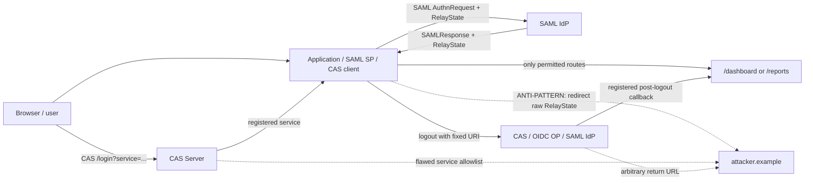
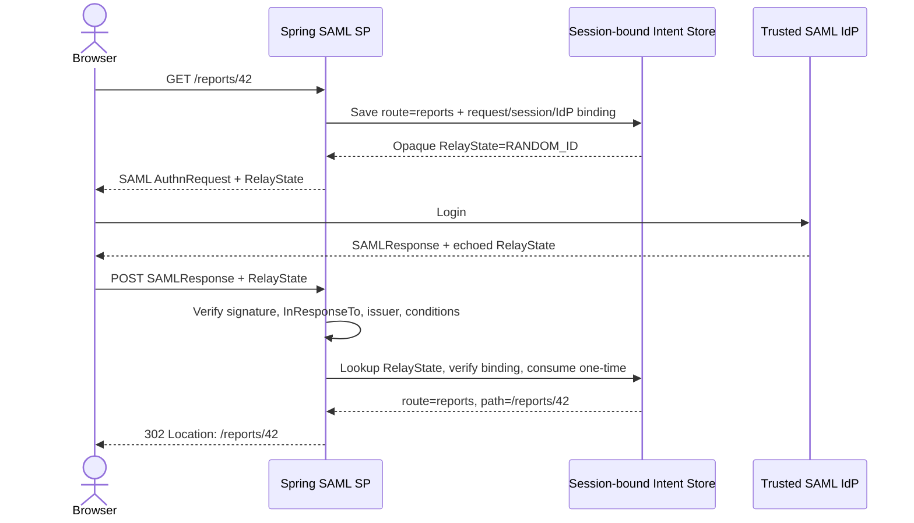

# Open Redirects via RelayState, Service URLs, and Post-Logout Destinations

**Module:** Spring Security – federation → Security Hardening.

**Objective:** identify and prevent **open redirects / unvalidated redirects (CWE-601)** at redirect points of federated login systems: SAML 2.0 `RelayState`, CAS `service` URLs, applications using `next/returnUrl` after SSO, and post-logout redirect destinations across CAS/OIDC/SAML/Spring Security. Learners should understand trust boundaries, be able to design destination allowlists, session-bound one-time state, secure SSO/logout configurations, write a Java 17 demo, and build a test suite against redirect abuse.

**Foundational rule:** never take a URL from request-supplied `RelayState`, `service`, `returnUrl`, `next`, `redirect`, `continue`, `post_logout_redirect_uri`, `Referer`, or `Host/X-Forwarded-Host` and place it directly into an HTTP `Location`. **A successful authentication transaction does not turn an unvalidated redirect URL into a trusted destination.** Prefer a **server-mapped destination ID (route ID) pointing to a fixed URL/path**, and use **one-time, short-lived, session-bound random state** to carry needed context across the IdP.

> Three boundaries to distinguish: **(1) which services the IdP/CAS is permitted to redirect the browser to; (2) which pages the SP/application is permitted to redirect the browser to after authentication; (3) where the application/IdP is permitted to send the browser after logout.** Each is an independent policy. A sound CAS service registry does not mean the application's post-login redirect code is sound; a validly signed SAML Assertion does not make `RelayState` a safe URL; a logged-out session does not automatically allow any arbitrary `returnTo`.

## 1. What Is an Open Redirect and Why Is It Especially Dangerous Around SSO?

An **open redirect** occurs when an endpoint on a trusted domain returns an HTTP 3xx whose `Location` can be controlled by a user or attacker to navigate to a domain outside the permitted list.

**Vulnerable application example:**

```http
GET /login/success?next=https%3A%2F%2Fevil.example%2Flanding HTTP/1.1
Host: portal.example.com
```

A vulnerable implementation:

```java
// ANTI-PATTERN: do not use in production.
String next = request.getParameter("next");
response.sendRedirect(next);
```

Unchecked HTTP response:

```http
HTTP/1.1 302 Found
Location: https://evil.example/landing
```

The victim sees a link starting with the legitimate domain `portal.example.com`, but after one hop the browser lands on the attacker's domain. In practice, consequences can include:
- **Phishing backed by the SSO domain's reputation:** the initial URL belongs to a trusted website.
- **Abusing callback/return endpoints:** the attacker appends `next` and uses the real domain as a stepping stone.
- **Data leakage in URLs:** if tokens, SAMLResponse, CAS ST, OAuth code, user profile, or state end up in `Location`, Referer/logs/redirects may expose sensitive data.
- **Chaining with token theft or CSRF:** an open redirect can contribute to a composite attack if another step attaches credentials to the URL.
- **Logout phishing:** right after a “You have signed out” screen, the browser redirects immediately to the attacker's fake login page.
- **Policy bypass:** a URL allowlist or “same domain” check at one layer while another layer redirects onward externally.

**Do not claim every open redirect always leaks tokens.** The impact depends on where tokens live, binding, query strings, Referer policy, browser behavior, and application flow. However, an open redirect inside an SSO system dramatically elevates risk because it happens right around steps where users trust the IdP and transition authentication state.

### 1.1. What is the data coming from the browser and IdP?

In SSO, several variables are often assigned the wrong level of trust:

| Data | Who can influence it? | Is it proof for redirecting? |
| --- | --- | --- |
| `?next=/reports` | Browser/client if accepted by the app | **No**, must be mapped/validated |
| SAML Response `RelayState` | May be preserved from request, tampered with depending on binding, or supplied by IdP-initiated flow | **No**, must correlate and validate destination |
| Validly signed `SAMLResponse` | IdP signs assertions/responses per profile | Authenticates identity after validation; **does not validate arbitrary return URLs** |
| CAS `service` | Client may specify at `/login`/`/logout` | CAS must check registered services and redirect policy |
| Portal `returnTo` | App/client may supply | **No**, insufficient on its own to redirect |
| OIDC `post_logout_redirect_uri` | RP sends to the OpenID Provider | OP **must match a registered URI exactly** |
| OIDC logout `state` | RP creates and OP echoes per protocol | Opaque correlation value, **not a URL by itself** |
| Spring SavedRequest | Framework saves the original request | Safe only when request/target is not polluted by custom code or bad upstream trust |
| `Host` / `X-Forwarded-Host` | Spoofable by client if proxy fails to strip | **Not** a trusted origin on its own |
| HTTP `Location` | Server emits to browser | **Final target must be decided after checks**, not copied from raw input |

The key point: **authentication validity, message integrity, and redirect target authorization are three separate checks**.

## 2. Map of the Three Main Redirect Gates



| Gate | Normal case | When does an open redirect occur? |
| --- | --- | --- |
| SAML login | SP saves request context, sends opaque `RelayState`, validates Response, and sends user to saved route | SP calls `sendRedirect(RelayState)` or decodes RelayState into a raw external URL |
| CAS login | Client uses canonical `service` URL, CAS checks registered services then redirects with ST | CAS opens its service registry too broadly, or app builds `service` from arbitrary client URL |
| Post-login in app | App uses saved local path/route from server-side state | Custom success handler reads raw `next`/`Referer`/saved input and redirects |
| CAS logout | CAS terminates TGT and only returns to a registered `service` if feature is enabled | CAS follows redirects to wildcard serviceIds or request-supplied redirect settings |
| OIDC logout | OP checks `post_logout_redirect_uri` **exact match** against registered URIs | OP skips check, or RP builds URI from untrusted `returnTo`/Host header |
| SAML logout | SP/IdP use proper metadata/trust SLO endpoints; fixed local success path | App redirects using unvalidated SAML logout `RelayState`/`returnUrl` |

**Risk does not end at the IdP.** Even if CAS/OP only redirects back to a valid service `https://portal.example.com/login/cas`, the portal's callback could read `next=https://evil.example` and redirect the victim away from the portal. Therefore you must test the **entire 3xx redirect chain**, not just a single response.

## 3. SAML 2.0 RelayState: Navigation Context, Not Redirect Authorization

### 3.1. What does RelayState do?

In SAML2 browser SSO, the SP may send:

```text
GET https://idp.example.com/sso?
    SAMLRequest=<encoded-authn-request>
    &RelayState=<opaque-context-id>
```

The IdP returns the SAMLResponse along with RelayState per the binding:

```http
POST /login/saml2/sso/corp HTTP/1.1
Host: portal.example.com
Content-Type: application/x-www-form-urlencoded

SAMLResponse=<encoded-saml-response>&RelayState=<opaque-context-id>
```

The fields in the example are **symbolic**, not usable tokens/messages. `RelayState` helps the SP tie the answer back to initial context like “return to reports” or a request ID. **It is not user identity, not an access permission, and should not carry a raw target URL.**

Important rules in SAML bindings:
- `RelayState` in SAML 2.0 HTTP Redirect/POST bindings has a specification limit of **at most 80 bytes**. Count **bytes**, not “80 Unicode characters”.
- The IdP normally must **echo the exact RelayState value** received per the binding, yet echoing does not assess whether a target is safe.
- Per SAML errata, in the **HTTP Redirect Binding**, RelayState can be covered by the **query string signature** when binding signatures are used; for HTTP POST Binding, integrity protection must follow the spec/independent safeguards if lacking coverage. **Do not claim RelayState is always unsigned.**
- Even an intact RelayState protected by the sender **still does not prove an embedded URL is permitted for the application**.
- You still must check SAML `InResponseTo`, issuer, audience, destination/recipient, signature, conditions/time, and replay; `RelayState` **does not replace** any of those checks.

### 3.2. Anti-pattern: letting RelayState hold an arbitrary URL

```java
// ANTI-PATTERN: a verified SAML Response is still insufficient.
String relayState = request.getParameter("RelayState");
response.sendRedirect(relayState);
```

If an attacker sends a victim through a flow with `RelayState=https://evil.example/landing`, the application can redirect externally after SSO. The flaw becomes harder to spot because SAML signature verification still PASSES.

Another anti-pattern:

```java
// ANTI-PATTERN: Base64 decoding is not integrity verification.
String target = new String(
    java.util.Base64.getUrlDecoder().decode(relayState),
    java.nio.charset.StandardCharsets.UTF_8);
response.sendRedirect(target);
```

**Base64, URL encoding, and encryption do not replace an allowlist policy.** Even a validly encrypted/decrypted string can carry an attacker's URL if the app let the attacker choose the target when minting the token.

### 3.3. Proper design: opaque random RelayState → server-side intent

When a user visits `/reports/42` before logging in:

1. The application determines an internal **route key**, e.g. `reports`, along with a validated/canonicalized resource ID.
2. The app creates a server-side `LoginIntent` bound to the **browser session initiating SAML**, `registrationId`, expected IdP, AuthnRequest ID, route key, and a short TTL.
3. The app emits an **opaque random token** as `RelayState`, e.g. 24–48 base64url characters; never put URLs, login tokens, session IDs, or PII inside RelayState.
4. Upon receiving SAMLResponse, Spring/SAML library verifies signature, issuer, audience, recipient, `InResponseTo`, time, and replay per protocol.
5. The app looks up `RelayState` in storage, verifies request/session correlation, expected IdP/registration, and TTL, and consumes it **once**.
6. The app picks the destination exclusively from a **server-side map** `reports → /reports/42` or an approved local route; on failure, return an error page/safe local target—never redirect raw input.



**Do not rely on a public Redis key `RelayState → route`** if it is not bound to the original browser session: an attacker could start their own request and try to pair the SAMLResponse/RelayState into the victim's session (login CSRF/login fixation). A signed RelayState without session binding is still insufficient in every scenario. You must guarantee that **the exact session that initiated the flow** is the one allowed to complete it.

### 3.4. Spring Security and the request repository

Spring Security SAML2 documentation describes:
- `Saml2WebSsoAuthenticationRequestFilter` creates and saves the `AuthnRequest` before sending to the IdP.
- `Saml2AuthenticationRequestRepository` stores/loads `AbstractSaml2AuthenticationRequest`.
- The default `HttpSessionSaml2AuthenticationRequestRepository` stores it in `HttpSession`, providing session binding and protection against login fixation.
- `CacheSaml2AuthenticationRequestRepository` supports distributed cache storage when needed, but **does not by itself prove the browser initiated the request** if relying solely on callback-supplied `RelayState` or `InResponseTo`.

Minimal Spring Security SAML SP illustration:

```java
import org.springframework.context.annotation.Bean;
import org.springframework.context.annotation.Configuration;
import org.springframework.security.config.Customizer;
import org.springframework.security.config.annotation.web.builders.HttpSecurity;
import org.springframework.security.web.SecurityFilterChain;

@Configuration
public class SamlSecurityConfig {
    @Bean
    SecurityFilterChain samlChain(HttpSecurity http) throws Exception {
        http
            .authorizeHttpRequests(auth -> auth
                .requestMatchers("/", "/signed-out", "/error")
                    .permitAll()
                .anyRequest().authenticated())
            .saml2Login(Customizer.withDefaults());

        return http.build();
    }
}
```

**The code above is a configuration fragment, not a standalone runnable application.** It also needs `spring-security-saml2-service-provider` and dependencies, `RelyingPartyRegistration`/metadata, a main app, user mapping, and session config. It **provides no custom redirect handler** and has no line redirecting on raw RelayState. To return to a business screen, use framework-managed saved requests or a custom success handler resolving a **server-side safe route ID** after all validations.

### 3.5. IdP-initiated SSO and RelayState without a prior request

In IdP-initiated SAML SSO, the response may lack `InResponseTo` and have no SP-created login intent. If the system permits this flow due to an IdP contract:
- Trust only registered trusted IdPs, properly validating Response/Assertion, audience/recipient/time/replay.
- **Never** use raw RelayState supplied by the IdP/browser as an external redirect.
- Without valid state, use a **fixed default route** such as `/dashboard`.
- Do not fabricate a request correlation that never existed; enabling unsolicited flows requires a dedicated security review.
- Avoid using this flow for account linking, privilege changes, or sensitive actions requiring user-initiated intent.

**RelayState and SAMLResponse belong to two separate validation zones:** verifying SAML assertions is necessary, yet does not replace checking the final redirect destination.

## 4. CAS `service`: Post-Login Target Must Be in the Service Registry

CAS is ticket-based SSO. The browser visits CAS:

```text
https://sso.example.com/cas/login
  ?service=https%3A%2F%2Fportal.example.com%2Flogin%2Fcas
```

After login, CAS issues a Service Ticket for `service` and redirects to the approved URL:

```http
HTTP/1.1 302 Found
Location: https://portal.example.com/login/cas?ticket=ST-example
```

The CAS client must validate the ticket with the **exact same canonical service URL**, via `/serviceValidate` or `/p3/serviceValidate` per protocol. An ST is issued for a specific service and is usually single-use. **`service` is not an arbitrary URL to trust by default just because the user logged into CAS.**

### 4.1. Open service registry risk

If the CAS Server accepts arbitrary service URLs (open mode or an overly broad `serviceId` regex), an attacker can abuse the trusted CAS hostname as a redirector to the attacker's site. Unsafe configurations:

```text
serviceId = ".*"
serviceId = "^https?://.*"
serviceId = "^https://.*example.com.*"
```

In particular, `.*example.com` can match unintended hosts like `notexample.com`; prefix-only expressions can also allow spoofed subdomains or URL userinfo.

Design the service registry around admin-approved **registered logical services** with concrete URL schemes/hosts/paths. Conceptual example:

```json
{
  "@class": "org.apereo.cas.services.CasRegisteredService",
  "serviceId": "^https://portal[.]example[.]com/login/cas$",
  "name": "Portal CAS callback",
  "id": 421
}
```

**This is an illustrative snippet**, not a CAS service registration JSON directly applicable to every CAS version/store. CAS service registry schemas/regex matching and context paths depend on version and application; validate via CAS service management on staging. If the real app needs multiple callback URLs, register each tightly scoped URL/pattern rather than widening to `^https://.*$` because configuration feels hard.

### 4.2. Never build CAS `service` from browser-supplied `next`

Anti-pattern in app A:

```java
// ANTI-PATTERN: turning a client-controlled URL into a CAS service.
String service = request.getParameter("next");
String login = "https://sso.example.com/cas/login?service=" +
        java.net.URLEncoder.encode(
                service, java.nio.charset.StandardCharsets.UTF_8);
response.sendRedirect(login);
```

Even when the CAS registry is tightly configured, never rely on it as the sole control. The app must use a **fixed canonical service URL**, for instance:

```text
CAS login base:
  https://sso.example.com/cas/login

Fixed CAS service:
  https://portal.example.com/login/cas

Internal business destination:
  routeKey=reports  →  /reports
```

Correct flow:
1. App stores `routeKey=reports` in session-bound server-side state/saved request.
2. Redirect to CAS `/login?service=<fixed-app-callback>`.
3. CAS login → callback to fixed service with ST.
4. App validates ST using the **exact service identifier**.
5. App routes the user to `/reports`, without reading raw URLs from query/RelayState.

### 4.3. Difference between the registered service URL and internal return route

Suppose CAS has registered:

```text
https://portal.example.com/login/cas
```

The user wants to open `https://portal.example.com/reports/42`. There is no need to change `service` to the resource path every time. The application can store the saved request/route in the app session and use a single fixed callback; this simplifies the service registry and reduces the attack surface.

If a CAS client design uses the request URL as `service`, it must still **explicitly define canonical service URLs and ensure the registered service regex** is not overly broad. Never replace `/login/cas` with raw `Referer`, `Host`, or `next` from the client.

### 4.4. Proxies/reverse proxies and Host header injection

Behind a load balancer, an app might compute `service` from:

```java
// ANTI-PATTERN when request Host/X-Forwarded-Host is untrusted.
String service = request.getScheme() + "://"
        + request.getServerName()
        + "/login/cas";
```

If ingress allows clients to control `Host`/`X-Forwarded-Host` and the app trusts them, the app can build callbacks/redirects pointing to an attacker's domain. Across CAS/OIDC/SAML, those URLs can also affect metadata, ACS, logout callbacks, cookie domains, and ticket validation.

Recommendations:
- Configure public base URL/ACS/service URL **statically from trusted server configuration**.
- Ingress must **strip/rewrite** client-sent forwarded headers; trust only registered reverse proxies.
- Restrict ingress hosts by exact FQDN and TLS certificate SAN.
- Never build logout/authorization callbacks from `request.getHeader("Host")`.
- In Spring Boot, carefully check `server.forward-headers-strategy` and proxy trust; framework support for forwarded headers does not make them valid when the edge is misconfigured.
- Test malicious Host headers in authorized environments to verify the system never emits absolute `Location` headers to attacker domains.

## 5. CAS Logout `service` and Post-Logout Redirects

**CAS SSO logout** and **app local logout** are two independent events. CAS exposes `/logout` to end the CAS SSO session. Apereo CAS can support redirecting back to a service via the `service` parameter, **but only when it satisfies the service registry and follow-redirects is enabled**.

### 5.1. Do not confuse the three types of logout

| Type | What is terminated? | Target/response |
| --- | --- | --- |
| **Local app logout** | Portal's HttpSession/SecurityContext | Fixed route such as `/signed-out` |
| **CAS logout** | SSO TGT/TGC session at CAS | CAS logout page, or redirect to a registered service if policy allows |
| **CAS Single Logout (SLO)** | CAS sends logout notifications to services based on session mapping | Usually front/back-channel; not necessarily a browser return URL |

CAS SLO **does not guarantee every app session is destroyed**, because logout messages can fail or arrive late. Do not use the browser reaching `/signed-out` as proof that all downstream sessions ended.

### 5.2. The `service` parameter on CAS logout

Example when policy permits:

```text
https://sso.example.com/cas/logout
  ?service=https%3A%2F%2Fportal.example.com%2Fsigned-out
```

Apereo CAS 8.x documentation states:
- The return `service` must be an accepted **registered service**.
- CAS must allow follow-service redirects.
- `cas.logout.follow-service-redirects` defaults to **false** in the referenced configuration docs.
- `cas.logout.redirect-parameter` configures the parameter name; the default in logic is `service`.
- `cas.logout.redirect-url` can configure a fixed post-logout redirect URL when operationally needed.

Do not enable arbitrarily:

```properties
# Enable only after verifying the registered service allowlist and threat model.
cas.logout.follow-service-redirects=true
```

One way to reduce open redirect risk is keeping follow-redirects off and using a **fixed logout page**. If business needs require returning to the app, register **exactly** `https://portal.example.com/signed-out` or an admin-approved destination, verify the actual redirect path, and never open the service registry just to accommodate return URLs.

### 5.3. CAS 2.0 `url` differs from CAS 3.0 `service`

Some older CAS guides use:

```text
/cas/logout?url=https://portal.example.com
```

Under CAS 2.0, `url` was traditionally a **link displayed after logout**, **not necessarily an automatic HTTP 302**. In the CAS 3 spec, `service` is the logout return URL parameter and must pass registered-service validation. Real Apereo CAS deployments have dedicated settings controlling redirects. **Do not troubleshoot by trial-and-erroring `url`/`service` and assuming every version auto-redirects**: check docs for the exact server/version and security policy.

### 5.4. Post-logout redirects must not have a dangerous “next hop”

Even if CAS approves `/logout?service=https://portal.example.com/signed-out`, `/signed-out` can be abused if it continues with:

```text
https://portal.example.com/signed-out
  ?next=https://evil.example/fake-login
```

CAS checking the first hop does not check subsequent redirect logic inside the application. **Verify the entire redirect chain** and forbid raw `next` on the post-logout page itself. Logout success pages should be **terminal/safe local destinations** or pick an allowlisted route ID.

## 6. OIDC `post_logout_redirect_uri`: Registration and Exact Matching

OpenID Connect RP-Initiated Logout 1.0 defines parameters:
- `id_token_hint` – previously issued ID Token, **recommended** as a hint about the client/user session.
- `post_logout_redirect_uri` – URI the RP wants the OP to send the browser to after logout.
- `state` – opaque value maintaining state/correlation between logout request and callback.
- `client_id`/`logout_hint` in cases supported by the profile/OP.

Per the OIDC spec, `post_logout_redirect_uri` **must have been registered** with the OP, and the OP **must not redirect if the supplied URI does not match a registered URI exactly**. Without `id_token_hint`, the OP must also have other means to validate the redirect target's legitimacy before redirecting. **Never turn `post_logout_redirect_uri` into a per-request wildcard.**

### 6.1. Valid contract example

```text
OIDC OP:
  https://login.example.com

RP client_id:
  portal-web

Registered post_logout_redirect_uris:
  https://portal.example.com/signed-out

RP sends:
  post_logout_redirect_uri=https://portal.example.com/signed-out
  state=<opaque-random-nonce>

Expected:
  OP checks client + exact registered URI, logs out, and redirects back to RP.
```

These values illustrate the contract. An OP may enforce HTTPS and additional logout confirmation/`id_token_hint` policies; test against your actual provider.

### 6.2. Mistake: taking `post_logout_redirect_uri` from the user

```java
// ANTI-PATTERN: do not use a browser query param as the URI sent to the OP.
String returnTo = request.getParameter("returnTo");
String postLogoutRedirectUri = returnTo;
```

If the OP checks poorly or client registration allows wildcards, the browser can be sent to a phishing domain after logout. If the OP checks properly, it rejects the URI; still, the **RP must choose a controlled destination itself**, rather than “leaving everything to the OP”.

### 6.3. OIDC `state` is not a redirect URL

An RP can send `state=<random>`, and the OP echoes `state`. The RP should look up the **server-side logout intent** with TTL, issuer/client registration, and browser correlation, then render a safe logout status. Never treat `state` as base64 of a URL or let the client swap state to `https://evil.example` and redirect.

**OIDC logout state and OAuth2 login state have different purposes**: both are correlation mechanisms, yet you must never reuse the same transaction/nonce or mix login callbacks with logout callbacks. For login, `state` defends against CSRF/mix-up in the flow; for RP-initiated logout, `state` correlates the logout response with the outbound request.

## 7. SAML SLO: Verifying LogoutRequest/LogoutResponse and Return Targets

SAML Single Logout (SLO) uses `LogoutRequest`/`LogoutResponse` between SP and IdP, typically per metadata `SingleLogoutService`. Spring Security supports:
- **RP-initiated SLO:** portal POSTs `/logout` (per configuration), destroys the local session, and sends a signed logout message to the IdP; if the IdP returns a matching `LogoutResponse`, the SP verifies it and renders the configured page/safe route.
- **IdP-initiated SLO:** IdP sends a signed `LogoutRequest`, SP verifies it, destroys the local session, and sends a signed response back to the IdP; in some flows the IdP controls the browser, so the SP has no authority to choose a browser destination.

Mandatory conditions:
1. **SLO destination** must come from trusted `RelyingPartyRegistration`/IdP metadata and signature/trust policy, never from a raw request URL.
2. Validate `Issuer`, `Destination`, signature, message ID, `InResponseTo` (for responses), recipient/binding, time/replay per profile.
3. Logout `RelayState`, if present, must correlate the flow, **never serve as an absolute Location**.
4. App local post-logout redirect should be `/signed-out` or a registered route, not raw `returnUrl`.
5. Recognize SLO is **best-effort message-dependent**, never relying solely on the browser returning to the RP page.

### 7.1. Spring Security SAML SLO configuration

```java
// CONFIGURATION FRAGMENT; requires RelyingPartyRegistration and signing credentials
http
    .saml2Login(org.springframework.security.config.Customizer.withDefaults())
    .saml2Logout(org.springframework.security.config.Customizer.withDefaults());
```

Enable only when asserting party metadata includes `SingleLogoutService` and the app has proper signing/verification credentials; never assume every SAML deployment supports SLO. In Spring, default SAML logout request/response processing uses dedicated endpoints and validators. Never manually redirect the browser using `RelayState` at the `/logout/saml2/slo` callback after the library processes the assertion/message.

**Local logout** and **federated logout** are not synonymous: if you only want to clear the app session, use a separate local route without calling the IdP. Align UX with your organization (especially when the user holds other app sessions).

## 8. Spring Security: Safe Local Redirects After Login/Logout

### 8.1. Post-login: never use a request parameter as an arbitrary target

A safe login setup can let Spring handle default saved requests or **redirect only to a fixed local route**. When customizing a success handler, never do:

```java
// ANTI-PATTERN: cookies, query params, and Referer are not a redirect allowlist.
String next = request.getParameter("next");
String referer = request.getHeader("Referer");
response.sendRedirect(next != null ? next : referer);
```

If business requirements only have return targets `dashboard`, `reports`, and `settings`, map them server-side:

```java
static final java.util.Map<String, String> ROUTES = java.util.Map.of(
    "dashboard", "/dashboard",
    "reports", "/reports",
    "settings", "/settings"
);

// Only use ROUTES.get(serverStoredRouteKey) after correlation.
// Never take a key or target from an unauthenticated callback without verification.
```

**Spring SavedRequest:** the default `SavedRequestAwareAuthenticationSuccessHandler` can return users to the protected resource they originally requested. The framework does not have an open redirect by default; risk typically arises when custom handlers enable `targetUrlParameter`, `Referer`, or when the request cache is polluted by how the app builds URLs. Defend with trusted hosts, request-cache scoping, and a server-side allowlist for customized return targets.

### 8.2. Local logout: use a fixed URI

Illustrative Spring Security Servlet `SecurityFilterChain` fragment (does not configure IdP/SAML/CAS on its own):

```java
import org.springframework.context.annotation.Bean;
import org.springframework.context.annotation.Configuration;
import org.springframework.security.config.Customizer;
import org.springframework.security.config.annotation.web.builders.HttpSecurity;
import org.springframework.security.web.SecurityFilterChain;

@Configuration
public class LocalLogoutSecurity {
    @Bean
    SecurityFilterChain webSecurity(HttpSecurity http) throws Exception {
        http
            .authorizeHttpRequests(auth -> auth
                .requestMatchers("/", "/signed-out", "/error").permitAll()
                .anyRequest().authenticated())
            .saml2Login(Customizer.withDefaults())
            .logout(logout -> logout
                .logoutUrl("/logout")
                .logoutSuccessUrl("/signed-out")
                .invalidateHttpSession(true)
                .clearAuthentication(true));

        return http.build();
    }
}
```

**This is a local logout example.** It requires real SAML registration/IdP, dependencies, main app, and proper CSRF configuration; `.logoutSuccessUrl("/signed-out")` is a fixed internal location. In Spring Security, `POST /logout` is the standard default when CSRF is enabled; avoid creating `GET /logout?returnTo=...` triggered by external links. When implementing SAML SLO, a dedicated handler manages the IdP path; do not let local logout success URLs override SLO checks.

### 8.3. OIDC RP-Initiated Logout Success Handler

Spring Security provides `OidcClientInitiatedLogoutSuccessHandler`. Configuration fragment for OIDC apps (not SAML-only):

```java
import org.springframework.security.oauth2.client.registration
        .ClientRegistrationRepository;
import org.springframework.security.oauth2.client.oidc.web.logout
        .OidcClientInitiatedLogoutSuccessHandler;
import org.springframework.security.web.authentication.logout.LogoutSuccessHandler;

public final class LogoutHandlers {
    public static LogoutSuccessHandler oidcLogout(
            ClientRegistrationRepository registrations) {
        var handler =
                new OidcClientInitiatedLogoutSuccessHandler(registrations);
        handler.setPostLogoutRedirectUri(
                "https://portal.example.com/signed-out");
        return handler;
    }
}
```

Integrating into the app:

```java
// Inside HttpSecurity of the configured OIDC client app:
http.logout(logout ->
    logout.logoutSuccessHandler(
        LogoutHandlers.oidcLogout(clientRegistrationRepository)));
```

**Condition:** `https://portal.example.com/signed-out` must be registered at the OP under `post_logout_redirect_uris` for that specific client. Do not take this URI from `?returnTo`. The handler also supports `{baseUrl}` templates, but the **base URL must come from a trusted request/proxy**; where ingress is exposed to Host header injection, an explicitly configured fixed absolute URI avoids trusting request hostnames.

This is a **configuration fragment**, not a standalone `javac` program: it requires `oauth2Login`, client registrations, the Spring Security OIDC runtime, and an OP supporting `end_session_endpoint`. Check your exact Spring Security version/Javadoc when integrating.

### 8.4. Do not rely on `Referer` for post-logout redirects

`Referer` may be absent, stripped by browser policy, or attacker-influenced in certain flows. Using it as the post-logout destination can send users to an attacker's page. **After logout, navigate to a static landing page or app-chosen route ID**, independent of `Referer`.

### 8.5. Forwarded headers and wrong public base URLs

If an app configures `{baseUrl}`, a proxy may supply `Forwarded`/`X-Forwarded-Host`/`X-Forwarded-Proto` to construct the public URL. If the edge does not filter client-supplied values, you can emit a `post_logout_redirect_uri` with the wrong host. Verify:
- Trusted reverse proxy chains.
- Exact allowed Host headers and ingress host routing.
- TLS hostname and scheme.
- Statically configured application public base URL in production.
- Never write credentials/state into absolute redirects or logs.

## 9. A Unified Safe Pattern: Route ID + Random State + Session Binding

SAML RelayState, CAS post-login saved requests, and OIDC logout state can all follow one principle:

1. **The browser selects only a finite named action** or accesses an application-routed business URL.
2. The server decides the **route key** and validated resource data, never accepting a raw external URL.
3. The server creates an **opaque random state** with strong entropy (e.g., 128+ bits) and short TTL, bound to original session, protocol, expected IdP, request ID/flow type, and route.
4. On callback, the server **verifies the protocol** (SAMLResponse/CAS ST/OIDC response), then looks up state matching the session/flow and consumes it atomically.
5. Translate the route key using a **fixed server-side map**; resource path segments may be appended after type checks, length bounds, and authorization.
6. If state is missing, already consumed, mismatched in session/issuer, or expired → reject/route to a safe local error; **never fall back to a raw URL**.
7. **Authentication/authorization** are decided independently; an allowlisted redirect route does not grant read access to the underlying resource.

| State type | What may be held on the server? | What must not appear in browser-visible state |
| --- | --- | --- |
| SAML RelayState | request ID, session binding, relying-party registration, route key | Raw full return URL, username, ticket, SAML Assertion, session ID |
| CAS app SavedRequest | app session ID mapping, local route, callback binding | CAS ST/TGC, external URL, arbitrary `next` |
| OIDC logout state | original logout transaction, client registration, safe landing route | Verbatim ID Token, raw `returnTo`, access token |
| OAuth login state | request/PKCE/nonce/issuer binding, local return route | Unvalidated URL, user PII, token |
| Generic redirect state | one-time route key and subject/session provenance | Arbitrary URI used as `Location` |

### 9.1. Do not treat a route ID as a permission

For instance, route key `admin` only maps to `/admin` if the system allows navigating to that route, yet **the protected route must still enforce RBAC/ABAC**. If an attacker guesses a route ID and gets redirected to `/admin`, the system must not serve data just because the redirect succeeded. Redirect security and resource security are two separate policies.

### 9.2. TTL, one-time use, and distributed cache

When an app runs multiple pods, pending redirect/login state may live in a shared store:
- Keys with sufficient entropy, non-enumerable.
- Short TTL, automatic cleanup.
- Correlation with original session/browser and expected provider.
- Atomic consume/`GETDEL` or transaction/CAS operation to prevent replay.
- Store returns only safe route keys, never arbitrary external URLs.
- Session cookie `Secure`/`HttpOnly`/SameSite aligned with SAML POST/redirect flows; test real cross-site callbacks.
- Do not log raw state if it is a security-relevant secret; use a correlation hash.
- When callbacks land on another pod, the store must remain readable and preserve session binding.
- Separate namespaces for login state and logout state; never share tokens across transaction types.

## 10. Standalone Java 17: Blocking Fake URLs and Replayed State

The following exercise uses **JDK 17 only**, without Maven/Spring/IdP. It simulates a **server-side route registry** and **opaque state** for callbacks:
- The user chooses a **route ID**, not a URL.
- State is generated with `SecureRandom` and base64url, containing no raw URL.
- Returns a route only when state exists and session ID matches; single-use consume.
- Already-used state or wrong session returns **`/signed-out`** (safe local fallback).
- Raw `https://evil.example` is not a route ID and is rejected right at initiation.

**Limitations:** this is an in-memory demo without TTL/DB transactions, CSRF, identity provider verification, network/HTTP, session authentication, issuer binding, logout notifications, or authorization. Session IDs in the test are dummy strings set by the program. **Never use this memory/map directly as a SAML/AuthN Request Repository in production.**

File `SafeRedirectStateDemo.java`:

```java
import java.security.SecureRandom;
import java.util.Base64;
import java.util.HashMap;
import java.util.Map;
import java.util.Objects;

public class SafeRedirectStateDemo {
    private static final Map<String, String> ROUTES = Map.of(
            "home", "/home",
            "reports", "/reports",
            "signed-out", "/signed-out");

    record Pending(String sessionId, String routeKey) {}

    static final class Store {
        private final SecureRandom random = new SecureRandom();
        private final Map<String, Pending> pending = new HashMap<>();

        String begin(String sessionId, String routeKey) {
            if (sessionId == null || sessionId.isBlank()) {
                throw new IllegalArgumentException("Session required");
            }
            if (!ROUTES.containsKey(routeKey)) {
                throw new IllegalArgumentException("Unknown route ID");
            }
            byte[] nonce = new byte[24]; // 192 bits, URL-safe token.
            String token;
            do {
                random.nextBytes(nonce);
                token = Base64.getUrlEncoder().withoutPadding()
                        .encodeToString(nonce);
            } while (pending.containsKey(token));

            pending.put(token, new Pending(sessionId, routeKey));
            return token;
        }

        String complete(String sessionId, String relayState) {
            Pending value = pending.get(relayState);
            if (value == null
                    || !Objects.equals(value.sessionId(), sessionId)) {
                return "/signed-out";
            }
            if (!pending.remove(relayState, value)) {
                return "/signed-out";
            }
            return ROUTES.get(value.routeKey());
        }
    }

    public static void main(String[] args) {
        Store store = new Store();

        String first = store.begin("session-A", "reports");
        System.out.println("Valid callback: "
                + store.complete("session-A", first));
        System.out.println("Replay falls back: "
                + store.complete("session-A", first));

        String second = store.begin("session-A", "home");
        System.out.println("Wrong session falls back: "
                + store.complete("session-B", second));
        System.out.println("Original session still valid: "
                + store.complete("session-A", second));

        boolean blocked;
        try {
            store.begin("session-A", "https://evil.example/landing");
            blocked = false;
        } catch (IllegalArgumentException ex) {
            blocked = true;
        }
        System.out.println("External URL rejected: " + blocked);
    }
}
```

Run:

```bash
javac SafeRedirectStateDemo.java
java SafeRedirectStateDemo
```

**Exact stdout:**

```text
Valid callback: /reports
Replay falls back: /signed-out
Wrong session falls back: /signed-out
Original session still valid: /home
External URL rejected: true
```

**What is proven?**
- State holds only a nonce; the server resolves the target URL from a map.
- `RelayState=https://evil.example` cannot become a redirect because a raw URL is not a route ID.
- A wrong session cannot redirect to the stored route.
- Replay cannot re-trigger a redirect to a protected context.

**What is not proven?**
- Java's Map stores no TTL and is not thread-safe/multi-node; production must use a shared store with atomic consume, expiration, and session-bound state.
- The random token only binds the **exercise**; it does not prove SAMLResponse or CAS ST validity. The authentication protocol must be verified **before** the app processes redirect state.
- Dummy session ID strings are not proof of authentication; real HTTP sessions must be framework-managed with fixation protection.
- Redirecting to `/reports` does not mean the user is authorized to read data; authorization belongs on the endpoint itself.
- A 192-bit-entropy token does not prevent replay on its own, so consumption and TTL are still mandatory.
- SAML RelayState in browser-visible URLs/forms should not hold secrets; use an opaque token as above within the 80-byte binding limit.

## 11. Why Is String Filtering with `startsWith` Unsafe?

Dangerous URLs can fool naive string checks:

| Attacker-controlled input | Why is it dangerous/unacceptable? |
| --- | --- |
| `https://evil.example/login` | Absolute external URL |
| `//evil.example/login` | Network-path reference; browser uses current scheme and attacker host |
| `https://portal.example.com.evil.example/x` | Host prefix looks like portal while actual host differs |
| `https://portal.example.com@evil.example/x` | URL `userinfo` makes the real host `evil.example` |
| `https://evil.example@portal.example.com/x` | Name in userinfo confuses source; reject userinfo even when host is valid |
| `/\\evil.example/path` | Browsers/proxies may canonicalize backslashes differently from the server |
| `%2F%2Fevil.example/x` | Encoding may be decoded before the redirect step |
| `%252F%252Fevil.example` | Double decoding across hops can produce a network-path reference |
| `javascript:alert(1)` | Scheme not meant for HTTP redirects; must deny |
| `data:text/html,...` | Non-web scheme absent from allowlist |
| `https://portal.example.com:4443/x` | Port differs from approved port |
| `https://portal.example.com/redirect?to=evil` | “Redirect chain”: first hop allowlisted yet endpoint redirects externally |
| `https://portal.example.com//evil.example` | Prone to inconsistent normalization if code mutates paths manually |
| `https://portal.example.com/%5c%5cevil` | Encoded backslashes can be transformed by proxies/frameworks |
| `https://portal.example.com/%0d%0aLocation:%20...` | Encoded control characters/response-splitting risk if injected raw into headers |

**Best solution:** do not accept URLs as targets. Select a **destination ID from a server-side allowlist**. If an application genuinely must support external URLs for a business requirement, use a standard URL parser consistent with browsers and redirect APIs, validate scheme/canonical hostname/port/path/userinfo, apply an exact allowlist, and **never mutate the string after validation**. Also verify allowlisted endpoints do not perform a second-hop external redirect.

### 11.1. Accept local paths only when strictly necessary

For “return to the last viewed page”, the safest option is a route ID like `reports`. If storing dynamic local paths is required:
- Path must begin with a **single `/`**, never `//`.
- Reject `\\`, CR/LF/control chars, and URLs with scheme/userinfo/authority.
- Restrict prefixes/paths to permitted routes and normalize via framework/URI parser; avoid double encoding.
- Never allow app callbacks or logout endpoints to use `/redirect?url=...` as a safe local path.
- Bind type-checked resource IDs and enforce post-login authorization.
- Store in server-side state; never read raw query/payload on callback.

Do not rely on regex `^/.*` alone. It also matches `//evil.example`, which browsers can interpret as an external host.

### 11.2. When external redirects are mandatory

For example, a portal needing to redirect to three contracted partners may have:

```text
destination_id = partner-a → https://login.partner-a.example/finished
destination_id = partner-b → https://account.partner-b.example/finished
destination_id = home      → /home
```

Destination IDs are **server-managed**. Changing URLs happens only via configuration/change approval, never supplied by users at runtime. If routes come from tenant configuration, the server must bind tenant, service permissions, exact host/path/scheme, redirect depth, and TTL. External redirects may display an interstitial “You are leaving this site” notice showing the verified hostname, yet a notice **does not replace an allowlist**.

## 12. Protocol-Specific Attack Chains

### 12.1. SAML RelayState injection

```text
1. Client initiates SAML login supplying RelayState as a raw URL.
2. IdP authenticates the user and returns a signed SAMLResponse.
3. SP verifies the signature yet calls sendRedirect(RelayState).
4. Browser is sent to an external site.
```

The fix is not “disabling signature verification” but **keeping SAML validation and replacing the redirect logic**: opaque state + session correlation + allowlisted route.

### 12.2. CAS service URL poisoning

```text
1. CAS allows an overly broad serviceId regex or open mode.
2. Request hits /cas/login?service=https://evil.example/...
3. After login, CAS sends the browser to the attacker-chosen service.
4. The CAS brand is abused as an open redirector.
```

The fix belongs in the **CAS service registry**, not just the login UI. Simultaneously, app A must use a fixed `service` and never forward unapproved `next` parameters.

### 12.3. CAS app second-hop redirect

```text
1. CAS checks and redirects to registered:
   https://portal.example.com/login/cas
2. Portal callback validates ST successfully.
3. Custom success handler reads:
   ?next=https://evil.example/landing
4. Portal emits external Location.
```

CAS did its job properly; the bug lies in the **portal post-login handler**. You must scan chained redirects as well.

### 12.4. Open redirect after CAS logout

```text
1. Portal logs out, sending /cas/logout?service=<configured-return>.
2. CAS checks follow-redirects + registered service.
3. Returns to portal/signed-out.
4. Portal reads ?returnTo=<attacker-url> and redirects onward.
```

Protect both CAS configuration and the portal logout landing page. Reject attacker-chosen logout destinations.

### 12.5. OIDC logout return URI poisoning

```text
1. RP receives ?logoutReturn=https://evil.example/...
2. RP forwards that URI to OP as post_logout_redirect_uri.
3. OP checks poorly/registration is too broad and accepts it.
4. Browser leaves OP for the attacker's domain.
```

Fix both sides: **OP exact registered URI match** and **RP selecting fixed/allowlisted URIs**. When the OP validates properly, the request must fail rather than silently redirecting.

### 12.6. Reverse proxy Host header poisoning

```text
1. Attacker sends Host/X-Forwarded-Host not filtered by ingress.
2. App constructs {baseUrl} or service callback from attacker host.
3. App emits redirects or metadata with the wrong absolute URL.
```

Block hosts at the edge, strip forwarded headers, configure a fixed canonical public base URL, and verify redirects in integration tests.

## 13. Logout CSRF and the Difference Between Safe Redirects and Proper Logout

An HTTP endpoint with a safe redirect target can still suffer from **logout CSRF** if an external client triggers logout against the user's will via GET. With Spring Security Servlet when CSRF is enabled, logout normally uses **POST /logout** with a CSRF token; do not casually enable GET logout just to build a “sign out” link.

Additionally:
- App local logout must clear `SecurityContext`/session/cookies per policy.
- CAS/OIDC/SAML federated logout requires dedicated protocol handling; never promise local session logout = IdP SSO logout.
- OIDC `post_logout_redirect_uri` is only post-logout **navigation**, not proof that logout completed across all services.
- SAML `LogoutResponse` requires verifying issuer/signature/request correlation; redirecting to a success page is not proof on its own if the callback was not validated.
- When logout encounters an error, choose a safe local error page rather than falling back to raw `returnUrl`.
- Never place access tokens, ID Tokens, refresh tokens, or SAMLResponse in the landing page URL.

**Avoid relying on `Referer`:** at logout, Referer may be absent, attacker-influenced, or point to an external domain. A fixed `/signed-out` route is easier to verify and lowers phishing risk.

## 14. SPA, BFF, and Mobile Deep Links

### 14.1. SPA using OIDC

An SPA may have return routes like `/app/settings`, yet it should not register arbitrary `post_logout_redirect_uri` values for every route. Typically register **one exact logout callback**, e.g. `https://portal.example.com/signed-out`, and let the SPA pick an **allowlisted local route** based on verified state. Watch browser history, fragments, and URL queries: fragments are invisible to the server on HTTP requests, and fragments containing tokens can leak if the SPA redirects unsafely.

### 14.2. BFF / reverse proxy logging in on behalf of SPA

In the Backend-for-Frontend model:
- The BFF owns the OIDC client, session cookie, and logout.
- The browser receives only a session cookie/CSRF protection and does not need to store ID Tokens or refresh tokens in localStorage.
- The BFF redirects the OP using a fixed post-logout callback.
- The BFF must validate browser-sent `returnTo` without forwarding it to the OP.
- The logout callback must clear sessions/cookies and never trust browser-sent raw auth user headers.

### 14.3. Native/mobile custom schemes

OIDC may permit certain custom URI schemes or loopback redirects per profile; these are domain-specific exceptions, **not a reason to allow `javascript:`/`data:` in web redirects**. For web RPs, prefer HTTPS registered logout URIs. For mobile apps, follow platform scheme/ownership/registration rules and never open wildcard custom schemes.

## 15. Multi-Tenant: One Redirect Allowlist per Tenant

An application serving multiple organizations may have:
- `tenant-a.portal.example.com`;
- `tenant-b.portal.example.com`;
- several distinct IdP registrations and logout endpoints.

**Never take the domain from an unchecked `tenant` query parameter.** Determine the tenant from the authenticated app context or trusted server-side host mapping, then select **tenant-specific allowed callback/return URIs**:

```text
Tenant A:
  SAML SP entity/ACS: https://tenant-a.portal.example.com/login/saml2/sso/corp
  Logout success:     https://tenant-a.portal.example.com/signed-out

Tenant B:
  SAML SP entity/ACS: https://tenant-b.portal.example.com/login/saml2/sso/partner
  Logout success:     https://tenant-b.portal.example.com/signed-out
```

- Tenant A must not be able to request redirecting to Tenant B merely because they share a parent domain.
- The app must verify SAML `Audience/Recipient/Destination` and the exact relying-party registration per tenant.
- CAS registered service regexes should not use `*.portal.example.com` wildcards if tenants hold differing privileges and can create subdomains.
- OIDC post-logout URIs must be registered exactly per client/tenant and checked against issuer/client ID.
- Even when two hosts share an eTLD+1, cookie/session scopes and tenant authorization must be checked separately.
- User input must never set `issuer-uri`, SAML metadata URLs, or CAS serviceIds.

## 16. Monitoring: Never Log Credentials and Never Mistake 3xx for Success

Each login/logout can involve multiple 302s and callbacks. Logs should suffice for investigation **without storing raw tokens/cookies**.

Log:
- Event type: `SAML_LOGIN_START`/`LOGIN_SUCCESS`/`CAS_LOGOUT`/`OIDC_LOGOUT_RETURN`.
- Server-owned route key, target allowlist rule ID, and decision `ALLOW/DENY`.
- Protocol, verified issuer/IdP registration, or CAS service registration.
- **Masked/hashed** opaque correlation ID, not verbatim RelayState/CSRF tokens.
- Expected vs actual host/scheme (sanitized), and whether sourced from trusted config or request.
- Request ID, tenant ID, timestamp, HTTP 3xx/status, and failure reason.
- Redirect chain depth/host transitions in tests/monitoring.
- Events like `UNREGISTERED_RETURN_URI`, `INVALID_RELAY_STATE`, `SERVICE_NOT_ALLOWED`.

Do not log:
- Raw `SAMLResponse`, `SAMLRequest` if containing PII/credentials.
- CAS ST/TGT/TGC/PT/PGT.
- Raw OIDC `id_token_hint`, access/refresh tokens.
- Session cookies, state/nonce/PKCE secrets.
- Full `Location` if carrying sensitive query params; log only destination category or secret-stripped origin/path.

**Alert patterns:** spikes in 302s to non-allowlisted hosts, SAML logins missing state/session binding, CAS requests for unregistered services, OP rejecting `post_logout_redirect_uri`, high volumes of encoded/obfuscated redirect values.

## 17. Incident Table and Remediation

| Symptom | Possible Cause | Remediation |
| --- | --- | --- |
| Browser lands on unknown domain after SAML login | Success handler uses raw RelayState | Opaque state + safe route mapping, keep SAML signature check |
| SAML SSO succeeds yet loses original page | Session/saved request lost, SameSite, or cache handling | Check session-bound repo, cookie SameSite, distributed store |
| Spring uses custom cache, login fixation risk | Lookup by RelayState/InResponseTo without browser binding | Bind original session/browser/issuer and one-time state |
| Long `RelayState`, rejected by IdP | Exceeds 80-byte binding limit | Use short random opaque state, keep data server-side |
| Valid SAML Response but fake `RelayState` | State not protected per flow | Reject, never trust callback destination |
| CAS `/login` returns service unauthorized | URL mismatches registry | Fix callback, narrow registry as needed |
| CAS login redirects to attacker site | Open registry/broad regex | Disable open mode, restrict serviceId, audit entries |
| CAS succeeds then portal redirects out | Unvalidated custom `next` on callback | Fix success handler, route allowlist |
| CAS ST validation `INVALID_SERVICE` | App sends service differing from ticket-issuing service | Canonical public service URL and consistent encoding |
| CAS logout does not redirect | `follow-service-redirects` is false | That may be a safe default; enable only with allowlist |
| CAS2 `url` shows a link rather than 302 | Protocol/version differs from `service` | Check CAS spec and exact server config |
| OIDC logout URI rejected by OP | `post_logout_redirect_uri` not registered exactly | Use fixed registered URI |
| OIDC logout returns OK yet redirects to wrong host | `{baseUrl}` depends on untrusted Host/X-Forwarded-* | Fixed public callback and proxy trust |
| SAML SLO finishes yet app stays logged in | LogoutRequest/Response endpoint or session mapping bug | Verify signature, protocol flow, and SLO delivery |
| `//evil.example` passes local-path regex | Regex only checks `^/` | Block network-path references, prefer route IDs |
| Prefix check allows `portal.example.com.evil.example` | String compare instead of canonical hostname | Exact parsed hostname/port/path allowlist |
| First-hop 302 valid yet next hop malicious | Allowlisted path itself redirects on `to` | Inspect full chain and remove open redirects on internal endpoints |
| Logout link logs users out unexpectedly | GET logout/CSRF disabled | POST + CSRF, appropriate confirmation |
| Occurs only behind reverse proxy | Host rewriting, forwarded headers/trailing slash | Lock down public base URL, ingress tests |
| Browser shows logout page yet other sessions remain | Local logout differs from CAS/OIDC/SAML SLO | Do not treat redirect as proof of global logout |

**Never “fix” by disabling SAML signatures, opening CAS registered-service regexes, disabling OP exact URI matching, trusting all forwarded headers, or permitting arbitrary `returnTo`.** Those changes turn configuration bugs into security vulnerabilities.

## 18. Pre-Release Security Test Suite

| Test case | Input/condition | Expected |
| --- | --- | --- |
| SAML RelayState is valid opaque token | Matches session, request, IdP, unconsumed | Verified SAML → safe local route |
| RelayState is absolute external URL | `https://evil.example` | Do not redirect externally |
| RelayState is protocol-relative URL | `//evil.example` | Reject/do not use as Location |
| RelayState modified after start | Differs from stored token | Reject; prevent login fixation |
| Session A's RelayState used in B | Same IdP/same token | Reject, do not bind SAMLResponse |
| Already-consumed RelayState | Repeated callback | Reject/safe landing; no reuse |
| Expired RelayState TTL | Delayed callback | Reject and clean up |
| RelayState exceeds 80 bytes | SAML HTTP POST/Redirect binding | Protocol-compliant handling; use short opaque key |
| SAML Response invalid signature | Valid RelayState | Do not authenticate/redirect as success |
| SAML Response wrong audience/recipient | Signed by another IdP/wrong target | Reject |
| SAML unsolicited response | No AuthnRequest | Reject if policy requires SP-init; if allowed, safe default route |
| SAML SLO forged LogoutResponse | Wrong signature/`InResponseTo` | Reject, do not redirect raw state |
| CAS exact registered `service` | Fixed portal callback | CAS redirects properly, ST validates |
| CAS service attacker domain | `https://evil.example` | CAS denies |
| CAS serviceId wildcard | Test registry regex | QA FAIL; narrow allowlist |
| CAS client external `next` | `next=https://evil.example` | Internal route policy blocks |
| CAS login second-hop redirect | Registered callback has `?to=...` | No external redirect |
| CAS logout unregistered `service` | Attacker URI | CAS denies/no redirect |
| CAS logout redirects disabled | `follow-service-redirects=false` | CAS logout page/no arbitrary 302 |
| CAS logout redirects enabled/allowed | Fixed registered `/signed-out` | Redirects to exact URI, no second hop |
| CAS2 `url` behavior | Legacy CAS protocol | Do not assume automatic redirect |
| OIDC post logout exact registered | `https://portal.example.com/signed-out` | OP accepts if other checks pass |
| OIDC post logout wrong path | `/signed-out/` | OP rejects if unregistered |
| OIDC post logout wrong port | `:4443` | OP rejects |
| OIDC post logout attacker hostname | `portal.example.com.evil.example` | OP rejects |
| OIDC logout wrong/replayed state | Mismatched opaque state | RP does not trust callback |
| OIDC logout without id_token_hint | OP identification policy | Do not redirect without sufficient proof |
| Spring local logout | POST with valid CSRF | Clears session and fixed local URL |
| Spring GET logout | CSRF enabled | Does not trigger destructive logout via external link |
| Spring logout raw Referer | External origin | Never use Referer as target |
| Spring SavedRequest | Legitimate protected local route | Returns to local URL |
| Spring custom success handler | `next=//evil.example` | Reject/route ID |
| Host header spoof | `Host: attacker.example` | App/ingress rejects; Location unchanged |
| X-Forwarded-Host spoof | `X-Forwarded-Host: attacker.example` | Proxy strips, app uses trusted public URL |
| Userinfo/prefix URL | `portal.example.com@evil.example` | Reject |
| Double-encoded slashes | `%252f%252fevil.example` | Does not produce external destination |
| Control characters | `%0d%0aLocation: ...` | Reject/malformed, no header injection |
| Redirect chain | 3xx → allowlisted → external | QA FAIL, block second hop |
| Tenant isolation | Tenant A picks Tenant B URI | Reject |
| Proxy alternate ingress | Bypass same-host policy | No open redirect path |
| Logs | Invalid state/URI | Never leak SAMLResponse, ticket, JWT, cookie |
| Authorization | Safe route to `/admin` when user lacks role | 403, never substitute redirect for authorization |

**Real testing needs all three layers:** unit tests for policy/route resolvers; integration tests with Spring Security/SAML IdP/CAS Server/OIDC OP sandboxes; browser E2E verifying the full redirect chain, cookies, SameSite/CSRF, reverse proxy Host behavior, and SLO. `@WithMockUser` or testing only `302 Location` on a controller **does not prove** the full federation response/issuer was verified.

### 18.1. Verification via short QA questions

- Is the redirect target chosen from **server-owned configuration** or session-bound state?
- Are all untrusted query/cookie/RelayState/Referer/Host inputs blocked from becoming raw `Location`?
- Does the CAS service registry match the exact service URL, and does logout redirect have its own policy?
- Do OIDC RP/OP use exact registered post-logout callbacks and logout state?
- Are SAML Response and LogoutResponse verified for signature/issuer/correlation?
- Does missing/expired state **fail closed**?
- Once authenticated, does the app still enforce role/resource checks at the final route?
- Can an allowlisted endpoint be used to redirect onward externally?
- Are multiple tenants/domains strictly isolated?
- Can proxy headers be spoofed by clients?
- Do logs/screenshots/telemetry leak tickets/tokens/SAMLResponse?

## 19. Review Procedure for Running Systems

**Step 1 – Inventory all redirect sinks.** Search code for: `sendRedirect`, `RedirectView`, `return "redirect:"`, `DefaultRedirectStrategy`, custom `SavedRequestAwareAuthenticationSuccessHandler`, `logoutSuccessUrl`, `LogoutSuccessHandler`, `RelayState`, `service`, `next`, `returnTo`, `continue`, and CAS logout/OIDC logout/SAML SLO handlers. Never conclude a bug exists just by seeing a method name; trace **tainted input → Location**.

**Step 2 – Trace URL provenance.** Does the data originate from query/body/cookie/Referer/Host/forwarded headers, or from server config/trusted metadata? If already in the session, **who can write to the session** and is it validated before storing?

**Step 3 – Separate login and logout policies.** Enumerate registered CAS services and logout return links; OIDC registered post-logout URIs; SAML SP ACS/SLO metadata; local post-login safe routes. Review configurations per tenant.

**Step 4 – Replace raw URLs with route IDs.** Use fixed mappings only; for RelayState use a random opaque session-bound reference. Any external links must be approved via an exact allowlist.

**Step 5 – Enable negative tests.** Cover scheme-relative, encoded/double-encoded, userinfo, prefix host, wrong port, Host poisoning, login/logout replay, wrong tenant, and second-hop cases.

**Step 6 – Safe rollout.** Test federation staging, canary tenant, and denied-redirect metrics; never open the registry when a client breaks. If legacy deep links exist, migrate them to governed local route mappings.

**Step 7 – Continuous monitoring.** Watch CAS service registry drift, OP registered URIs, Spring Security upgrades, ingress policies, and signed/correlated SAML requests; alert on redirects to unapproved hosts.

## 20. Self-Check Questions

**Q1. Does a SAML Assertion with a valid signature mean `RelayState` is allowed as a redirect URL?**  
No. Authentication proof and redirect authorization are separate. RelayState may be integrity-protected in some bindings yet still is not an allowlisted destination.

**Q2. Can RelayState contain a full URL?**  
Some implementations use URLs, but it is not a safe default design. SAML HTTP Redirect/POST bindings have an 80-byte limit and tampering/XSS/CSRF risks. Prefer **short opaque random state** mapped to a server-side route.

**Q3. The CAS registry blocks `https://evil.example`; does the portal still need to check `next`?**  
Yes. CAS can redirect to the registered portal callback, yet the portal may redirect onward from `next`, creating a second-hop open redirect.

**Q4. Does passing `service` to CAS logout always redirect the browser?**  
No. Apereo CAS has `cas.logout.follow-service-redirects` defaulting to false per CAS 8.x docs, and the return service must also be registered/allowed.

**Q5. Can OIDC `post_logout_redirect_uri` be any URL sent by the RP?**  
No. OIDC RP-Initiated Logout requires a **registered and exact-matching** URI; the OP must verify legitimacy, and the RP must not accept arbitrary `returnTo`.

**Q6. Is allowing redirects to hostnames ending in `example.com` safe enough?**  
No. String suffixes/prefixes are easily spoofed via subdomains, userinfo, and path/port tricks. Use exact allowed origins/paths or route IDs.

**Q7. Is `//evil.example` a local path because it starts with `/`?**  
No. That is a **network-path reference**; browsers can navigate to the attacker host under the current scheme.

**Q8. Does redirecting to `/admin` from valid state grant admin privileges?**  
No. Redirect policy and resource authorization are distinct; `/admin` must still check permissions.

**Q9. After logout, can `Referer` be used to return to the previous page?**  
It should not. Referer is not a trustworthy allowlist and can point to an external domain; use a fixed local route.

**Q10. Why test the full redirect chain?**  
Because a CAS/OP-validated first hop can lead to **an app endpoint with an open redirect** on the next hop.

## 21. Official References

1. [OWASP – Unvalidated Redirects and Forwards Cheat Sheet](https://cheatsheetseries.owasp.org/cheatsheets/Unvalidated_Redirects_and_Forwards_Cheat_Sheet.html): prefer not accepting arbitrary URLs, use short IDs and exact allowlists; avoid raw prefix/suffix matching.
2. [CWE-601 – URL Redirection to Untrusted Site](https://cwe.mitre.org/data/definitions/601.html): open redirect model and consequences.
3. [OASIS SAML 2.0 Approved Errata](https://docs.oasis-open.org/security/saml/v2.0/errata05/csprd01/saml-v2.0-errata05-csprd01.html): RelayState in HTTP Redirect binding can be covered by query signature; redirect/CSRF/XSS warnings when using RelayState.
4. [OASIS SAML 2.0 Bindings](https://docs.oasis-open.org/security/saml/v2.0/saml-bindings-2.0-os.pdf): 80-byte RelayState limit, redirect/POST bindings, and integrity protection.
5. [Spring Security – Producing SAML2 AuthnRequests](https://docs.spring.io/spring-security/reference/servlet/saml2/login/authentication-requests.html): `HttpSessionSaml2AuthenticationRequestRepository` and `CacheSaml2AuthenticationRequestRepository`, login fixation notes.
6. [Spring Security – Performing SAML2 Single Logout](https://docs.spring.io/spring-security/reference/servlet/saml2/logout.html): RP/AP-initiated SLO, `LogoutRequest/LogoutResponse`, verification, and success handling.
7. [Apereo CAS – CAS Protocol Specification](https://apereo.github.io/cas/development/protocol/CAS-Protocol-Specification.html): `service`, registered services, ticket validation, logout behavior.
8. [Apereo CAS – Service Management](https://apereo.github.io/cas/development/services/): registered services and `serviceId` regex.
9. [Apereo CAS – Logout & Single Logout](https://apereo.github.io/cas/8.0.x/installation/Logout-Single-Signout.html): CAS logout `service`, `follow-service-redirects`, and SLO.
10. [OpenID Connect RP-Initiated Logout 1.0](https://openid.net/specs/openid-connect-rpinitiated-1_0.html): `id_token_hint`, `post_logout_redirect_uri`, exact registered match, and `state`.
11. [Spring Security – OIDC Client-Initiated Logout Success Handler](https://docs.spring.io/spring-security/reference/api/java/org/springframework/security/oauth2/client/oidc/web/logout/OidcClientInitiatedLogoutSuccessHandler.html): fixed/template `post_logout_redirect_uri` support.
12. [OWASP – CSRF Prevention Cheat Sheet](https://cheatsheetseries.owasp.org/cheatsheets/Cross-Site_Request_Forgery_Prevention_Cheat_Sheet.html): protecting logout/side-effect requests and login CSRF.
13. [RFC 9700 – OAuth2 Security Best Current Practice](https://www.rfc-editor.org/rfc/rfc9700.html): redirect URI validation, PKCE, and browser OAuth security boundaries.

**Conclusion:** for **SAML RelayState**, use short opaque state stored server-side and bound to the session; for **CAS service URLs**, use a canonical callback and a CAS registered-service allowlist; for **CAS/OIDC/SAML logout**, allow redirects only to configured/registered destinations with proper protocol checks. At every step avoid client-supplied raw `Location`, verify session/request correlation, never let a second-hop redirect escape the allowlist, and never confuse “logged in/logged out” with “safe destination URL”.