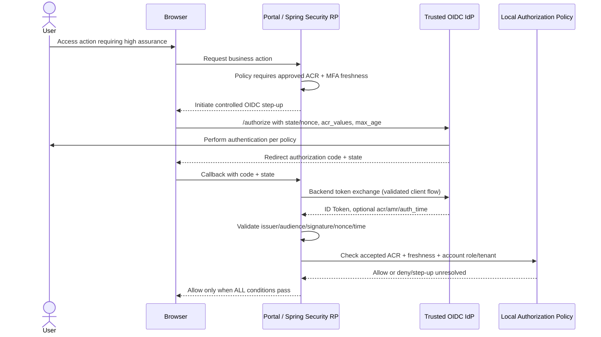

# Distinguishing IdP-Confirmed MFA Signals from Self-Declared Attribute Values

## Learning Objectives

After this lesson, you will be able to:

1. Distinguish **MFA that genuinely occurred and was confirmed by the Identity Provider (IdP)** from data such as `mfa=true`, `mfa_enabled`, `has_2fa`, or `amr` self-declared by a browser, user profile, or untrusted intermediary.
2. Understand the concepts of **authentication factor**, **authentication method**, **authentication assurance level**, **authentication freshness**, and **authorization** without conflating them.
3. Accurately interpret OIDC claims `acr`, `amr`, `auth_time`, `iss`, `sub`, `aud`, `nonce`, `exp`, and request parameters `acr_values`, `max_age`; know which fields are RP requests and which are OP results.
4. Read evidence from the **ID Token verified by the Spring Security/OIDC client** instead of raw JSON, aggregated UserInfo, query parameters, forms, cookies, localStorage, or self-declared headers.
5. Understand that SAML2 requires checking **`AuthnContextClassRef` inside `AuthnStatement` of a verified response/assertion**, rather than treating an `Attribute name="mfa"` as MFA proof.
6. Design a **per-issuer and per-application** assurance contract: exact ACR allowlists, method semantics, phishing resistance, step-up timing, IdP policy, assertion sources, and testing approach.
7. Configure Spring Boot 3/Spring Security 6/Java 17+ to enforce **OIDC assurance AND local role AND tenant** at the method boundary; when claims are missing or issuer/ACR/freshness fail, **deny** without auto-granting `ROLE_ADMIN`.
8. Understand step-up authentication for sensitive operations and distinguish OIDC browser login from OAuth2 resource servers per **RFC 9470**; never send ID tokens as Bearer access tokens.
9. Run a **standalone Java 17+ demo** checking source, issuer, ACR, timestamp, and local roles; observe self-declared `mfa=true` rejected even though it contains the string “MFA”.
10. Write a test matrix covering pre/post step-up, fake headers, signed tokens from the wrong issuer, wrong audience, replay, missing roles, stale SSO sessions, multi-tenant, and multi-node.

## 1. MFA in Federation Is a Claim Requiring a Trusted Source

**MFA – Multi-Factor Authentication** requires the user to prove control of distinct authentication factors. When an app delegates login to an IdP via OIDC, SAML2, CAS, or a proxy, the app **does not directly witness** how the user entered a password, used a device, or performed WebAuthn. It receives only **assertions/claims** from the party responsible for authentication.

A browser can send:

```http
POST /tenants/finance/approve HTTP/1.1
Host: portal.example.org
Content-Type: application/json

{"mfa":true,"mfaMethod":"fido2","role":"ADMIN"}
```

**This is not proof of MFA.** A user can edit JSON; you cannot authorize payments from it. Similarly, a profile object `{"mfa_enabled":true}` may only indicate the account **enrolled** an additional factor, not that the **current login** used it.

Conversely, when the app is an OIDC Relying Party (RP), an **ID Token verified for an approved IdP** may carry `acr`, `amr`, and `auth_time`. Those fields carry security meaning **only after** verifying source, signature/algorithm, and token constraints, **while** knowing how the IdP contract defines their values.

### 1.1. Distinguishing four layers

| Layer | Example | What can be concluded | What is NOT automatically concluded |
| --- | --- | --- | --- |
| **Enrollment** | User profile `mfaRegistered=true` | A method was registered on the account | That method was just used |
| **Self-declared signal** | Header `X-MFA: true` from browser, JSON `mfa=true` | Client wants to transmit a value | MFA succeeded |
| **IdP-asserted authentication context** | OIDC `acr`/`amr`/`auth_time` in verified ID Token or verified SAML AuthnContext | IdP asserts the outcome of an authentication event | It always meets the RP's policy regardless of IdP |
| **Local authorization** | Account has `PAYMENT_APPROVE` in tenant A | Account holds an app-permitted grant | Authentication is fresh/strong enough for a specific transaction |

The right formula for high-risk actions is typically:

**verified identity + accepted authentication assurance + freshness + active local account + required permission + resource/tenant policy = ALLOW**.

If any condition is missing, enforce deny/step-up policy—**never** fill it in with a frontend flag.

### 1.2. The same value does not carry the same trust

Consider the same string `"mfa"` appearing in three sources:

```json
{
  "requestBody": {"amr": ["mfa"]},
  "editableUserProfile": {"authLevel": "mfa"},
  "idTokenClaimsAfterVerification": {
    "iss": "https://idp.example.org/realms/corp",
    "sub": "user-001",
    "acr": "urn:example:assurance:phishing-resistant-mfa",
    "amr": ["hwk", "user"],
    "auth_time": 1794045600
  }
}
```

This is **illustrative JSON**, not a real ID Token. Specifically, `idTokenClaimsAfterVerification` is an explanatory label **assuming** a trusted OIDC client already validated the token. Hand-written JSON has no signature and no verification proof.

- `requestBody.amr`: chosen by the sender, **UNTRUSTED**.
- `editableUserProfile.authLevel`: profile attribute, mutable/not tied to an authentication event, **NOT AUTHENTICATION EVIDENCE**.
- `acr/amr/auth_time` from a **verified ID Token**: can serve as evidence from a trusted IdP, **still requiring policy and freshness checks**.

## 2. MFA Is Not a Checkbox or Just Any Two Input Steps

### 2.1. Factor categories

| Factor category | Nature | Examples | Notes |
| --- | --- | --- | --- |
| **Something you know** | Known secret | Password, PIN | Password + PIN are usually two knowledge secrets, not automatically two distinct factors |
| **Something you have** | Proof of possession of an object/key | Security key, challenge-signing device, proper OTP authenticator | SMS OTP carries SIM-swap/phishing risks; not inherently phishing-resistant |
| **Something you are** | Biometric trait | Fingerprint/face for authenticator activation | Needs device/verifier support; a photo or profile saying “has Face ID” is not proof |
| **Context/risk signals** | Supporting conditions | IP, geolocation, device posture, behavior | Not an MFA factor in the possession/knowledge/inherence sense |

**Two steps do not equal two factors.** For instance, entering a password plus a security question are both knowledge. Conversely, a multi-factor authenticator such as a cryptographic key device + local PIN/biometric activation can prove two factors in one user gesture, if the IdP and device enforce and attest to that profile.

### 2.2. Why is “MFA enabled” insufficient?

| Value | Question it answers | Does it prove MFA for this login? |
| --- | --- | --- |
| `mfa_enabled=true` | Does the account have MFA configured on? | **No** |
| `has_totp_device=true` | Is TOTP enrolled? | **No** |
| `webauthn_credentials_count=2` | How many authenticators exist? | **No** |
| `risk_score=low` | How did the risk engine score it? | **No** |
| `auth_time=...` | When did the user authenticate? | **No**, lacks method/assurance |
| `amr=["pwd"]` | IdP says password was used? | Single method only, not MFA |
| `amr=["pwd","otp"]` | IdP says password and OTP were used? | Can support MFA per exact IdP contract and event; never verified just by reading raw JSON |
| `acr="...mfa..."` | Which context class does IdP claim was met? | **Conditionally**, value must be defined/checked against issuer contract |
| `amr=["mfa"]` in signed verified ID Token | IdP asserts MFA method reference | **Conditionally**, needs semantic agreement; does not prove phishing resistance |

### 2.3. NIST AAL and phishing resistance

NIST SP 800-63B-4 (final 2025) describes AAL2 as requiring **two distinct factors** under secure authentication mechanisms, or a multi-factor authenticator. AAL3 imposes higher requirements, including phishing resistance and other technical criteria.

**Never assign AAL2/AAL3 merely from `acr="aal2"`** or `amr=["mfa"]`. To claim NIST compliance, verify the exact IdP profile, authenticator classes, protocol, replay resistance, phishing resistance, and operational controls per the applicable standard.

Notes:
- Manually entered OTP can satisfy MFA in some profiles yet is **not inherently phishing-resistant**.
- WebAuthn/FIDO2 can support phishing-resistant mechanisms; a passkey does not automatically prove **two factors** without knowing `userVerification`, authenticator type, and IdP assurance policy.
- Remembered devices, trusted networks, or VPNs do not prove MFA occurred on this login; they are risk signals or policy-governed exceptions.
- Check factor independence and same-device risks when assessing assurance, rather than just counting two different strings.

## 3. OIDC: `acr`, `amr`, `auth_time`, and ID Token Provenance

Per OpenID Connect Core 1.0, relevant claims:

| Claim | Type | Meaning per OIDC | Notes |
| --- | --- | --- | --- |
| `iss` | String | Issuer identifying the OP | Exact issuer must be in trust config; never accept client-chosen issuers |
| `sub` | String | Subject identifying the user at the issuer | Use `(iss,sub)` as the federated identity; never email |
| `aud` | String or array | Client(s) the ID Token is intended for | RP must validate client ID; wrong audience = untrusted |
| `exp` | Number | ID Token expiration | Never use expired tokens |
| `iat` | Number | Time the **ID Token was issued** | Does not mean the user just performed MFA |
| `nonce` | String if requested | Binds response to client session/request against replay | RP must verify per flow/issued nonce |
| `azp` | String when applicable | Authorized party | Validate when required; does not convert into MFA |
| **`acr`** | String, optional | **Authentication Context Class Reference** satisfied by authentication | Semantics agreed by OP/RP, case-sensitive |
| **`amr`** | Array of strings, optional | **Authentication Methods References** OP reports were used | Strings do not automatically mean the same across all IdPs |
| **`auth_time`** | Number, optional unless required by OIDC rules | Time end-user authentication occurred | Not automatically a specific MFA timestamp; needs contract if used for MFA freshness |

**Three distinct groups:**
- **Identity/token validity:** `iss`, `aud`, `sub`, `exp`, `nonce`, signature, authorized party when applicable.
- **Assurance:** `acr` (context satisfied), `amr` (method references).
- **Freshness:** `auth_time` (time of user authentication), never substituting `iat` or session start.

### 3.1. Example of an IdP-confirmed signed ID Token

Example **decoded claims for reading**, not a valid JWT token because it omits the JOSE signature:

```json
{
  "iss": "https://idp.example.org/realms/corp",
  "sub": "user-001",
  "aud": "portal-web",
  "exp": 1794049200,
  "iat": 1794045600,
  "auth_time": 1794045500,
  "acr": "urn:example:assurance:phishing-resistant-mfa",
  "amr": ["hwk", "user"]
}
```

`urn:example:assurance:phishing-resistant-mfa` is an **illustrative value in this example's IdP contract**, **not a universal URN supported by every IdP**. It suffices for policy only when IAM has verified the IdP truly issues that exact `acr` **only after an authentication event meeting that profile**, backed by logs/tests/interoperability terms.

If the IdP emits `acr="urn:example:assurance:password-only"`, the user may have logged in successfully yet is **not** eligible to approve a money transfer. An SSO session can be valid for viewing a dashboard while lacking high assurance for sensitive actions.

### 3.2. `acr` is not a magic string

OIDC defines `acr` as an **authentication context class** and leaves concrete value meanings to policy/agreements. For example:

- IdP A defines `urn:example:assurance:phishing-resistant-mfa` strictly for WebAuthn with user verification (per contract).
- IdP B has `urn:vendor:mfa`, yet its policy requires only any OTP, with no phishing-resistance guarantee.
- IdP C omits `acr` altogether, even if the user completed two steps.

**Never** write `acr.contains("mfa")`, `acr.endsWith("2")`, or `acr.compareTo("...") >= 0`. URNs/strings **have no universal strength ordering**. Use only **exact accepted values per issuer/trust policy** with governed mapping versions.

### 3.3. `amr` is methods used, not app permissions

OIDC `amr` is an array of method references. RFC 8176 defines several values such as:

| `amr` | Reference meaning | Must NOT be inferred automatically |
| --- | --- | --- |
| `pwd` | Password authentication | MFA occurred |
| `otp` | One-time password | OTP is phishing-resistant |
| `hwk` | Proof of possession of hardware-secured key | User definitely used biometrics or two factors |
| `swk` | Proof of possession of software-secured key | High AAL achieved automatically |
| `fpt`, `face` | Fingerprint/facial biometric | IdP checked the right session/account if read from user profile |
| `mfa` | Multiple-factor authentication (method reference) | All IdPs share one uniform MFA policy |
| `user` | User presence | Proof of user verification sufficient for high-MFA policy |

Values come from **RFC 8176 or a valid registry**, and IdPs may define custom values. Combining `amr` requires a **semantic contract**: `["pwd","otp"]` in a verified ID Token may satisfy a “password + approved OTP” policy, yet never upgrades itself to “phishing-resistant MFA”. Conversely, `amr=["hwk"]` does not automatically equal two factors.

**Never grant `GrantedAuthority("ROLE_ADMIN")` because `amr` contains `mfa`.** `amr` represents an authentication method, not an entitlement.

### 3.4. `auth_time` is freshness, not `iat`

- `iat`: issuance time of the **ID Token**.
- `auth_time`: time of end-user authentication per the OP.
- `now - auth_time`: can determine recent user authentication, with bounded clock skew.
- `now - iat`: **does not prove the user just logged in**. A fresh token can be minted from an existing SSO session.
- Portal's `sessionCreationTime` also **does not prove fresh MFA**.

If business rules require “MFA within 10 minutes”, you need an IdP contract guaranteeing `auth_time` and `acr` reflect **an MFA-satisfying event with that recency**, rather than the OP reusing an `acr` from an MFA hours earlier while updating `auth_time` on silent refresh. **Not every OP defines MFA freshness via `auth_time`.** Absent a compliant contract, the RP must implement verifiable step-up or an OP assurance-specific timestamp mechanism.

### 3.5. `acr_values` and `max_age` are REQUESTS, not proof

An Authorization Request may contain:

```http
GET /authorize?response_type=code&client_id=portal-web&scope=openid&redirect_uri=https%3A%2F%2Fportal.example.org%2Flogin%2Foauth2%2Fcode%2Fcorp&acr_values=urn%3Aexample%3Aassurance%3Aphishing-resistant-mfa&max_age=600&state=OPAQUE_STATE HTTP/1.1
Host: idp.example.org
```

This is an **illustration** (omitting required nonce/PKCE security parameters of a full production flow). `acr_values` asks the OP to prefer an authentication context; `max_age` requests a maximum age for end-user authentication per OIDC.

**Mistake:** “The client sent `acr_values=mfa`, so the post-redirect session has MFA.” False. **The RP must check the `acr`/`auth_time` returned by the OP in the validated ID Token against policy.**

Per OIDC Core, `acr_values` is a **voluntary** request; the OP might not honor it and is not forced to return that exact `acr`. You can request `acr` as an **Essential Claim** via the `claims` parameter when supported by the OP. Even with Essential Claims, the RP must still verify the response rather than trusting what it asked for.

### 3.6. ID Token and UserInfo do not have the same trust context

In Spring Security OIDC, `OidcUser.getClaims()` can hold claims **merged from both the ID Token and UserInfo**, whereas `OidcUser.getIdToken()` accesses the **ID Token itself**.

For policies relying on **OP-confirmed strong authentication in the ID Token**, prefer:

```java
OidcIdToken idToken = oidcUser.getIdToken();
String acr = idToken.getAuthenticationContextClass();
List<String> amr = idToken.getAuthenticationMethods();
Instant authTime = idToken.getAuthenticatedAt();
```

This is a snippet **inside an OIDC-authenticated application**, not a standalone Java file. UserInfo is a separate endpoint that may carry aggregated profile claims/attributes. An `mfa_enabled` field in UserInfo **is not equal to** an authentication event's `acr`. If the OP's trust contract uses a distributed claim or another response, define its assertion type, protection, and validation explicitly—never lump all attributes together as `mfaPassed`.

## 4. OIDC Trust Path: Who Confirms Claims, and What Is Confirmed?

### 4.1. Standard flow



**Critical security steps:**

1. RP has a preconfigured **`ClientRegistration`** pointing to the OP; never read an issuer from `?issuer=...` and auto-trust it.
2. OP performs authentication and issues an ID Token bound to the client, subject, expiry, and matching nonce/flow.
3. Spring Security OIDC client verifies token validity requirements for the supported flow (signing keys/JWKS, issuer, audience, expiry, nonce where applicable).
4. Business code reads claims **only** from the authenticated principal produced by the client after validation.
5. Code checks the **exact ACR** guaranteed by the IdP contract, `auth_time`, and local entitlements.
6. When data is missing or claims fail, **never** add `"mfa"` to the Spring Authentication; perform step-up or deny.

### 4.2. Conditions required to treat an ID Token as trusted

| Condition | Effect |
| --- | --- |
| Exact trusted issuer `iss` | Prevents trusting tokens signed by another IdP/realm |
| Exact audience `aud` / client ID | Stops tokens issued to another client from being used at Portal |
| Approved signature algorithm/key | Never just Base64-decode; never accept `alg=none` or keys from token-supplied URLs |
| `exp`/`iat` and clock skew | Rejects expired tokens/anomalous timestamps |
| OIDC flow `nonce`/`state` validation | Blocks login CSRF/replay and response mix-up |
| `azp` when required | Binds authorized party in multi-audience cases |
| PKCE and authorization code callback protection | Reduces code interception and mix-up per flow |
| Bound client registration/session | Prevents swapping OP/callbacks from user input |
| Approved assurance contract | Defines what `acr/amr` mean and when the IdP emits them |
| Local role/resource policy | Ensures MFA does not grant privileges on its own |

**A JSON Web Token validly signed by an attacker cannot be a trusted IdP assertion.** Signatures help only when the key comes from a trusted source, issuer/audience are checked, and the token type fits the purpose. Never write a custom `String.split(".")` JWT parser to make MFA decisions.

### 4.3. Self-declared claims in tokens minted by another system

If an arbitrary microservice mints its own JWT with `{"mfa":true}`, that does **not** become IdP MFA merely because the JWT is signed. You must know:

- Who issued the token? The right trusted OP or another app service?
- Which RP/resource server is the token for? Does the audience match?
- Did the issuing service witness an IdP step-up or merely copy a request header?
- Are claims bound to the **same subject/session**, or vulnerable to token substitution?
- Does the contract specify assurance timestamp/method and revocation behavior?

If **token exchange** is needed, propagate assurance per policy with explicit provenance—never let a downstream service “upgrade” its authentication level.

## 5. SAML2: AuthnContextClassRef Differs from an Attribute Named “MFA”

SAML2 can express authentication context via `AuthnStatement/AuthnContext/AuthnContextClassRef`. This is assertion content describing the **authentication event**, unlike an arbitrary SAML Attribute.

### 5.1. Structurally annotated SAML example

```xml
<saml:Assertion
    xmlns:saml="urn:oasis:names:tc:SAML:2.0:assertion"
    ID="_example-assertion"
    IssueInstant="2026-11-07T10:00:00Z"
    Version="2.0">
  <!-- Missing Signature, Subject, Conditions, AudienceRestrictions,
       Issuer, and many fields required for a valid assertion! -->
  <saml:AuthnStatement AuthnInstant="2026-11-07T09:58:00Z">
    <saml:AuthnContext>
      <saml:AuthnContextClassRef>
        urn:example:assurance:phishing-resistant-mfa
      </saml:AuthnContextClassRef>
    </saml:AuthnContext>
  </saml:AuthnStatement>
  <saml:AttributeStatement>
    <saml:Attribute Name="mfa_enabled">
      <saml:AttributeValue
        xmlns:xsi="http://www.w3.org/2001/XMLSchema-instance"
        xsi:type="xs:boolean"
        xmlns:xs="http://www.w3.org/2001/XMLSchema">true</saml:AttributeValue>
    </saml:Attribute>
  </saml:AttributeStatement>
</saml:Assertion>
```

**Illustrative XML only to distinguish field locations**, not a usable SAML Response for login; it omits critical elements and signatures. Never copy this snippet into a test and treat it as a signed assertion.

Differences:
- `AuthnContextClassRef` inside `AuthnStatement`: field referencing the authentication context per SAML.
- `AuthnInstant`: authentication timestamp per the IdP, tied to freshness policy.
- `Attribute Name="mfa_enabled"`: may merely indicate the user enrolled an authenticator, not that the login event used MFA.
- Custom IdP `Attribute Name="mfa"`: may carry custom meaning, **trustworthy only when signed/protected and explicitly defined in the contract as representing event assurance**; not equivalent to `AuthnContextClassRef` by default.
- `RequestedAuthnContext` in AuthnRequest: a **request**; the response/verified assertion must still be checked to see whether the IdP met it.

### 5.2. SAML2 verification path

Spring Security SAML2 uses `RelyingPartyRegistration` (entity IDs, ACS, IdP signing credentials, and metadata). The provider validates signature/trust and conditions, including issuer, destination, subject, audience, expiry, and flow correlation.

**Never parse raw XML from `SAMLResponse` query/form and regex-match `<AuthnContextClassRef>.*mfa.*` to grant privileges.** XML can be altered, replayed, signature-wrapped, or contain multiple assertions/statements; a text snippet does not prove it was covered by a valid signature.

When policy requires SAML authentication context:

1. Request the appropriate context from the IdP via the agreed AuthnRequest/profile.
2. **Let the SAML provider validate the response/assertion first**, including signature, conditions, audience, subject, time, and request correlation.
3. Extract the authentication context from the **exact AuthnStatement inside the provider-validated assertion**, not arbitrary XML text.
4. Bind the immutable assurance result to the authentication principal/session for the **exact subject**.
5. Check the exact `AuthnContextClassRef` allowlist per **IdP entityID**, semantic/trust contract, and freshness.
6. Check local account/role/tenant/resource; never turn `FACTOR_SAML_RESPONSE` or `ROLE_USER` into MFA proof.
7. If the library does not expose AuthnContext directly on `Saml2AuthenticatedPrincipal`, use documented provider customization or a trust-preserving adapter **post-validation**; never read raw responses before the trust boundary.

### 5.3. Examples of false conclusions

| Observed data | Wrong conclusion | Accurate understanding |
| --- | --- | --- |
| SAML attribute `mfa=true` | User just did MFA | Could be a profile flag; check contract/source |
| `AuthnContextClassRef=PasswordProtectedTransport` | MFA occurred | Typically indicates password over protected transport, not two factors |
| `AuthnContextClassRef` contains “2” | AAL2 | No universal ranking exists for class strings |
| AuthnRequest had `RequestedAuthnContext` | IdP definitely stepped up | Must verify the returned verified response context |
| Signed SAMLResponse with wrong issuer/audience | Trustworthy enough | Must validate **all** protocol bindings/conditions |
| SP stored `Saml2Authentication` | User stays MFA-verified until logout | Session/freshness lifecycles differ from IdP events |
| IdP just issued assertion | AuthnInstant is fresh | Assertion issuance and authentication time can differ |

## 6. CAS, Kerberos, Proxies, and Microservices: Distinct Assurance Sources

### 6.1. CAS

CAS Server can integrate MFA and emit authentication context per its own protocol/attributes. However, a **valid CAS Service Ticket** guarantees only that the CAS Server authenticated the user per policy—**it does not automatically guarantee MFA occurred**.

If CAS Server puts an `mfa=true` attribute in the assertion:

- Was the attribute computed by CAS Server from an MFA event, or merely pulled from a directory/user profile?
- Was it delivered over a CAS protocol response with validated service/ticket, TLS, and client trust?
- Does it prove timestamp/freshness and that this specific service required that assurance?
- If CAS SSO reused a TGT, was fresh step-up performed for high-risk actions?
- Who governs the `(CAS service, requiredAuthContext)` mapping and role/tenant policy?

**Do not treat an attribute named “mfa” as default proof.** CAS implementations/profiles differ from OIDC/SAML2 and need dedicated contracts.

### 6.2. Kerberos/SPNEGO

A Kerberos service ticket proves the client holds credentials matching the service principal via GSS. **Standard Kerberos authentication does not automatically mean MFA.** OS smart-card logins may carry separate assurance, yet Spring's SPNEGO filter sees only the ticket and verified principal, typically without a standard MFA claim like OIDC `acr`.

Never assume:
- User `alice@REALM` has a service ticket → automatically satisfied MFA.
- Request carries `Authorization: Negotiate` → biometrics/OTP were used.
- Valid keytab/SPN → the user's device performed user verification.

If high assurance is required, you need a **trusted IdP/gateway** supplying factor/freshness assertions, or a verifiable step-up mechanism.

### 6.3. Reverse proxy pre-authentication

A gateway may authenticate with the IdP and send:

```http
GET /app/transfer HTTP/1.1
Host: portal.example.org
X-Verified-Subject: user-001
X-Verified-Assurance: urn:example:assurance:phishing-resistant-mfa
X-Verified-Auth-Time: 2026-11-07T09:58:00Z
```

**Those three headers are trustworthy ONLY IF**:
- The origin app cannot receive traffic directly from browsers/untrusted networks.
- The gateway verifies real IdP assertions rather than echoing browser-sent `X-Verified-Assurance`.
- The gateway strips all client-sent identity/assurance headers before setting its own.
- Gateway → app runs over an authenticated channel (mTLS/ingress ACL/private identity), with header cardinality/case/size invariants and host routing.
- Gateway claim → assurance mapping is validated by source IdP/issuer, exact subject, auth time, and policy.
- When the gateway session changes users or lowers assurance, the app does not keep using stale context.

Without this trust boundary, `X-MFA: true` is just a string any attacker can inject into an HTTP request.

### 6.4. Systems without standard assurance claims

In some legacy setups, the IdP provides only username and groups. Safe options:

1. **Do not infer MFA from a group `MFA_USERS` by default**—that group may indicate enrollment only.
2. Use an IdP-specific SDK/protocol extension once source and semantics are verified.
3. Require the IdP to supply standard `acr/amr/auth_time` or verified AuthnContext by contract.
4. If caching assurance server-side, populate the cache strictly from **verified login events**, bound to subject/session/issuer with expiry.
5. If unprovable, **deny actions requiring MFA**, redirect to step-up, or return a clear error to the user.
6. Never ask the user to check a “I have enabled MFA” box to bypass policy.

## 7. Designing Per-Action IdP Assurance Policies

### 7.1. Authorization and assurance are two independent axes

Finance system example:

| Action | Local permission | Authentication assurance | Freshness |
| --- | --- | --- | --- |
| View profile page | Authenticated local account | Basic trusted login | Per session policy |
| View report | `REPORT_READ` in exact tenant | Trusted authentication | Per policy |
| Export sensitive report | `REPORT_EXPORT` in exact tenant | IdP-guaranteed MFA level | e.g., authenticated within 30 minutes |
| Approve money transfer | `PAYMENT_APPROVE` in exact tenant | **Phishing-resistant MFA** from approved issuer/profile | e.g., within 10 minutes |
| Change payee / grant admin | Special privilege + SoD | Strong step-up, approval, risk checks | Short freshness or reauth per action |

**The 30-minute/10-minute thresholds are illustrative, not NIST, OIDC, or Spring Security defaults.** IAM/Security and business owners define them per threat model.

### 7.2. Contract required between RP and IdP

| Item | Questions to confirm |
| --- | --- |
| Trusted issuer | Which exact issuer URL/entityID/realm is used? |
| Supported assurance classes | Which `acr`/SAML AuthnContext values are actually issued? |
| Meanings | What must the IdP require before issuing that value? Are there two independent factors? |
| Phishing resistance | Is authentication backed by WebAuthn/FIDO2/cryptographic authenticators or phishable OTP? |
| Authentication time | Which event does `auth_time`/`AuthnInstant` measure? Does MFA step-up update it? |
| Existing SSO session | How long does the OP reuse old sessions and keep strong ACR? |
| Requested vs returned | Are `acr_values`/essential claims/RequestedAuthnContext enforced? |
| Error when unmet | Does the OP return an error/lower ACR if MFA isn't completed, or silently fall back? |
| Device remembered | Can factors be skipped by policy? May strong assurance still be claimed? |
| Account recovery flow | Does password reset/recovery downgrade assurance? |
| Authenticator change | Does enrolling/deleting an MFA factor require assurance/approval? |
| User/tenant binding | Which exact subject, client, audience, and resource does the assertion bind to? |
| Auditability | Are event logs/metadata sufficient to audit policy without leaking secrets? |
| Versioning | Could policy changes alter semantics while keeping the `acr` string intact? Is there change control? |
| Revocation | How do IdP/portal handle MFA compromise/session theft/logout? |

**Never reuse an ACR string from IdP A for IdP B without an IAM- and partner-approved mapping.** Both might emit `"mfa"` while carrying different risk profiles.

### 7.3. An explicit decision policy

```text
function mayApprovePayment(authentication, tenant, payment):
    require authentication created by configured trusted mechanism
    require issuer == expected trusted issuer
    require subject stable and linked to ACTIVE local account
    require authentication proof validated for this client/session
    require returned ACR is in issuer-specific APPROVED_STRONG_ACR set
    require verified authTime exists and is within policy window
    require authTime not implausibly in the future
    require local permission PAYMENT_APPROVE for this tenant/payment
    require separation-of-duties and payment risk checks
    return ALLOW
on missing/unknown/mismatch/stale:
    return DENY or initiate controlled STEP_UP
```

This is **pseudocode**, not a built-in Spring Security API. The emphasis is on **signals and verification provenance**, not adding `ROLE_MFA` to every user whenever a header appears.

### 7.4. Evidence levels and handling

| Evidence received by app | Decision for MFA-required action |
| --- | --- |
| `mfa=true` from body/query/localStorage | Deny |
| User-editable `mfaEnabled` in profile | Deny |
| `X-MFA: true` over public origin | Deny |
| `amr` read from unvalidated decoded JSON | Deny |
| Signed OIDC ID Token with wrong issuer | Deny |
| OIDC ID Token right issuer but `aud` is another client | Deny |
| Valid OIDC token lacking required `acr`/`auth_time` | Deny/step-up |
| Valid OIDC token with password-only `acr` | Deny/step-up |
| Valid OIDC token, approved `acr`, stale `auth_time` | Deny/step-up |
| Valid OIDC token, approved/fresh `acr`, missing local role | Deny |
| Signed SAML response/verified assertion with approved context, subject, and freshness | May allow **after** local authz checks |
| Trusted proxy forwarding IdP-verified context with end-to-end binding | May allow per policy, never trust header name alone |
| User enters TOTP on frontend without backend verification | Deny |

## 8. Spring Boot 3 + Spring Security 6: Verifying MFA from OIDC ID Token

This example uses **Spring Boot 3.x, Spring Security 6.x, Java 17+**, Servlet web apps, and OAuth2/OIDC Authorization Code login. It does not implement a real IdP. Running end-to-end requires an **approved OIDC Provider**, valid client registration/secret, public HTTPS redirect, IdP emitting `acr`/`auth_time` per contract, and a business data store.

Assumptions:

- OIDC issuer: `https://idp.example.org/realms/corp`.
- Client ID: `portal-web`.
- Approved assurance class: `urn:example:assurance:phishing-resistant-mfa` (**illustrative contract**, not a universal standard string).
- Local permission: `PAYMENT_APPROVE` in `tenant-finance`.
- Freshness: **10 minutes** from `auth_time`, max future clock skew **30 seconds**.
- Spring Authentication must be `OAuth2AuthenticationToken` for client registration `corp`, with principal `OidcUser` created by the Spring Security OIDC flow.
- Demo code denies when `acr`, `auth_time`, issuer, local account, or permission are missing/invalid.

### 8.1. build.gradle

In a Spring Boot 3 project already configured with plugin and dependency management/BOM:

```groovy
dependencies {
    implementation 'org.springframework.boot:spring-boot-starter-web'
    implementation 'org.springframework.boot:spring-boot-starter-security'
    implementation 'org.springframework.boot:spring-boot-starter-oauth2-client'
    testImplementation 'org.springframework.boot:spring-boot-starter-test'
    testImplementation 'org.springframework.security:spring-security-test'
}
```

Match Spring Security 6.x with Spring Boot 3.x; **never** mix APIs from other versions without compiling and running tests. You do not need to add a separate JSON Web Token parser to validate OIDC login ID Tokens.

### 8.2. application.yml

File `src/main/resources/application.yml`:

```yaml
spring:
  security:
    oauth2:
      client:
        registration:
          corp:
            provider: corp
            client-id: "${OIDC_CLIENT_ID}"
            client-secret: "${OIDC_CLIENT_SECRET}"
            authorization-grant-type: authorization_code
            scope: openid,profile
            redirect-uri: "{baseUrl}/login/oauth2/code/{registrationId}"
        provider:
          corp:
            issuer-uri: https://idp.example.org/realms/corp
server:
  servlet:
    session:
      cookie:
        secure: true
        http-only: true
        same-site: lax
```

**Explanation:** Spring uses issuer metadata from the configured provider to discover endpoints/JWKS via the OIDC client mechanism. Client secrets must come from **environment/secret manager**, never committed to Git. Redirect URI must be registered at the IdP and protected by HTTPS. If the token issuer mismatches the provider, the OIDC flow must fail before business policy runs.

This file does not force the IdP to emit `acr`. The IdP must configure assurance mappings, step-up flows, and claim release; the app enforces them.

### 8.3. Main application

File `src/main/java/com/example/mfa/PortalApplication.java`:

```java
package com.example.mfa;

import org.springframework.boot.SpringApplication;
import org.springframework.boot.autoconfigure.SpringBootApplication;

@SpringBootApplication
public class PortalApplication {
    public static void main(String[] args) {
        SpringApplication.run(PortalApplication.class, args);
    }
}
```

### 8.4. SecurityFilterChain and method security

File `src/main/java/com/example/mfa/WebSecurityConfig.java`:

```java
package com.example.mfa;

import java.time.Clock;
import org.springframework.context.annotation.Bean;
import org.springframework.context.annotation.Configuration;
import org.springframework.security.config.Customizer;
import org.springframework.security.config.annotation.method.configuration.EnableMethodSecurity;
import org.springframework.security.config.annotation.web.builders.HttpSecurity;
import org.springframework.security.web.SecurityFilterChain;

@Configuration
@EnableMethodSecurity
public class WebSecurityConfig {

    @Bean
    Clock systemClock() {
        return Clock.systemUTC();
    }

    @Bean
    SecurityFilterChain webSecurity(HttpSecurity http) throws Exception {
        return http
                .authorizeHttpRequests(auth -> auth
                    .requestMatchers("/", "/error").permitAll()
                    .anyRequest().authenticated())
                .oauth2Login(Customizer.withDefaults())
                .build();
    }
}
```

**Do not disable CSRF on browser apps.** In this example, the approval action uses HTTP POST with default Spring Security CSRF protection. For AJAX, pass the CSRF token via the proper secure mechanism—never switch to GET just for demo convenience.

### 8.5. LocalAccountService: Separating App Permissions from MFA

File `src/main/java/com/example/mfa/LocalAccountService.java`:

```java
package com.example.mfa;

import java.util.Map;
import java.util.Set;
import org.springframework.stereotype.Service;

@Service
public final class LocalAccountService {
    private record Key(String issuer, String subject) {}

    private record Account(
            boolean active, Map<String, Set<String>> tenantPermissions) {}

    // DEMO ONLY. Production reads a governed IAM/DB/policy service;
    // never use an in-memory Map as a real authorization source.
    private final Map<Key, Account> data = Map.of(
            new Key("https://idp.example.org/realms/corp", "user-001"),
            new Account(true, Map.of(
                    "tenant-finance", Set.of("PAYMENT_APPROVE"))),
            new Key("https://idp.example.org/realms/corp", "user-002"),
            new Account(true, Map.of(
                    "tenant-finance", Set.of("REPORT_READ"))),
            new Key("https://idp.example.org/realms/corp", "user-003"),
            new Account(false, Map.of(
                    "tenant-finance", Set.of("PAYMENT_APPROVE")))
    );

    public boolean canApprove(
            String issuer, String subject, String tenantId) {
        Account account = data.get(new Key(issuer, subject));
        return account != null
                && account.active()
                && account.tenantPermissions()
                        .getOrDefault(tenantId, Set.of())
                        .contains("PAYMENT_APPROVE");
    }
}
```

**Three distinct checks:**
- `user-001` right issuer, tenant finance, holds local permission → passes the **permission** check, not yet concluding MFA.
- `user-002` holds a valid MFA ID Token yet lacks `PAYMENT_APPROVE` → still 403.
- `user-003` previously held permission yet account is DISABLED → still 403.

Accounts are **illustrative fixtures**, not real users. Production uses unique `(iss,sub) → internalAccountId` mappings, tenant memberships, object/resource authorization, SoD, expiration, account status, and role revocation.

### 8.6. MfaPolicy: Trust Only Claims Inside Verified OidcIdToken

File `src/main/java/com/example/mfa/MfaPolicy.java`:

```java
package com.example.mfa;

import java.net.URL;
import java.time.Clock;
import java.time.Duration;
import java.time.Instant;
import java.util.Set;

import org.springframework.security.core.Authentication;
import org.springframework.security.oauth2.client.authentication.OAuth2AuthenticationToken;
import org.springframework.security.oauth2.core.oidc.OidcIdToken;
import org.springframework.security.oauth2.core.oidc.user.OidcUser;
import org.springframework.stereotype.Component;

@Component("mfaPolicy")
public final class MfaPolicy {
    private static final String TRUSTED_REGISTRATION = "corp";
    private static final String TRUSTED_ISSUER =
            "https://idp.example.org/realms/corp";
    private static final Set<String> APPROVED_ACR = Set.of(
            // Use only if IdP/IAM confirmed the semantics of this class.
            "urn:example:assurance:phishing-resistant-mfa"
    );
    private static final Duration MAX_AUTH_AGE =
            Duration.ofMinutes(10);
    private static final Duration FUTURE_SKEW =
            Duration.ofSeconds(30);

    private final LocalAccountService accounts;
    private final Clock clock;

    public MfaPolicy(LocalAccountService accounts, Clock clock) {
        this.accounts = accounts;
        this.clock = clock;
    }

    public boolean canApprove(
            Authentication authentication, String tenantId) {

        if (!(authentication instanceof OAuth2AuthenticationToken oauth)
                || !authentication.isAuthenticated()
                || !TRUSTED_REGISTRATION.equals(
                        oauth.getAuthorizedClientRegistrationId())
                || !(oauth.getPrincipal() instanceof OidcUser oidc)) {
            return false;
        }

        // Read ONLY the ID Token from the principal verified by OIDC login;
        // DO NOT take request.getParameter("mfa") or a UserInfo profile flag.
        OidcIdToken token = oidc.getIdToken();
        if (token == null) {
            return false;
        }

        URL issuerUrl = token.getIssuer();
        String issuer =
                issuerUrl == null ? null : issuerUrl.toString();
        String subject = token.getSubject();
        String acr = token.getAuthenticationContextClass();
        Instant authTime = token.getAuthenticatedAt();

        if (!TRUSTED_ISSUER.equals(issuer)
                || subject == null || subject.isBlank()
                || !APPROVED_ACR.contains(acr)
                || authTime == null) {
            return false;
        }

        Instant now = clock.instant();
        if (authTime.isBefore(now.minus(MAX_AUTH_AGE))
                || authTime.isAfter(now.plus(FUTURE_SKEW))) {
            return false;
        }

        // MFA STILL does NOT authorize payment if local permission is missing.
        return accounts.canApprove(issuer, subject, tenantId);
    }
}
```

**What the code proves:**

1. It does not accept an arbitrary `Authentication` with principal string “admin”; it requires an `OAuth2AuthenticationToken`, the exact registered client `corp`, and an `OidcUser`.
2. **Spring Security OIDC** creates `OidcUser` only after the OIDC flow validates the ID Token. The policy consumes only that result and never accepts a raw JWT passed by the request; if an app adds fake logins or builds an `OidcUser` from a request body, the trust boundary breaks.
3. `TRUSTED_ISSUER` is an exact allowlist; tokens from other IdPs do not qualify.
4. `APPROVED_ACR` is an exact set confirmed by the **IdP assurance contract**. Never infer from substring `"mfa"`.
5. Missing `authTime`, older than 10 minutes, or implausibly in the future → DENY.
6. `LocalAccountService.canApprove` checks permission for the right tenant and active account; MFA never grants `PAYMENT_APPROVE`.
7. `OidcIdToken.getAuthenticationContextClass()` / `getAuthenticatedAt()` are real Spring Security 6.5 APIs. `getAuthenticationMethods()` is also available if policy must inspect `amr`; the example uses ACR as primary assurance per agreed contract and **does not** arbitrarily require string values in `amr`.
8. This is **an evaluation of the authentication timestamp reported by the OP**. If the OP performs silent reauthentication or carries over an ACR from an old session, verify the contract specifically for *when the strong factor was executed* rather than blindly trusting a time field.
9. Never log tokens, raw claims, or emails. For security decisions, log non-sensitive metadata such as approved/denied reason codes and a correlation ID.
10. An ID Token expiring after login **does not automatically invalidate the app's HttpSession**. Spring Security keeps the principal in the session until policy/session revocation. The code checks `auth_time` yet **does not re-verify signature/expiry on every request**; session lifecycle/revocation must be designed independently.

**Explicit limitation:** `issuer` in Java is a `URL` accessor in Spring Security 6.5. With multi-issuer IdPs, map `(clientRegistration, exact issuer) → allowed ACR values` and a local account store; never reuse one ACR allowlist across all tenants/IdPs.

### 8.7. ReportService using `@PreAuthorize`

File `src/main/java/com/example/mfa/PaymentApprovalService.java`:

```java
package com.example.mfa;

import org.springframework.security.access.prepost.PreAuthorize;
import org.springframework.stereotype.Service;

@Service
public class PaymentApprovalService {

    @PreAuthorize("@mfaPolicy.canApprove(authentication, #p0)")
    public String approve(String tenantId, String paymentId) {
        // DEMO: production must check paymentId belongs to tenantId,
        // payment risk, SoD, optimistic locking, and approval auditing.
        return "Approved " + paymentId;
    }
}
```

File `src/main/java/com/example/mfa/ApprovalController.java`:

```java
package com.example.mfa;

import org.springframework.web.bind.annotation.PathVariable;
import org.springframework.web.bind.annotation.PostMapping;
import org.springframework.web.bind.annotation.RestController;

@RestController
public class ApprovalController {
    private final PaymentApprovalService payments;

    public ApprovalController(PaymentApprovalService payments) {
        this.payments = payments;
    }

    @PostMapping("/tenants/{tenantId}/payments/{paymentId}/approve")
    public String approve(
            @PathVariable String tenantId,
            @PathVariable String paymentId) {
        return payments.approve(tenantId, paymentId);
    }
}
```

**Important:** `@PreAuthorize` in this example verifies user/tenant permission and MFA assurance, yet the method body is simulated and **does not check whether `paymentId` belongs to `tenantId`, amount limits, maker-checker SoD, or idempotency**. Production must add business-level object authorization and transaction checks. Never copy an endpoint returning “Approved” as a real payment system.

### 8.8. Build commands and end-to-end requirements

With the Gradle wrapper:

```bash
./gradlew dependencyInsight --configuration runtimeClasspath --dependency spring-security-oauth2-client
./gradlew compileJava
./gradlew test
```

Windows: `.\gradlew.bat`. Build commands do not prove the IdP enforces MFA policy; that belongs to integration testing against a configured OIDC test IdP.

A real running web app requires:
- An OIDC issuer with valid metadata/JWKS and registered client `portal-web`.
- An HTTPS redirect URI permitted by the IdP.
- The OP genuinely emitting `acr`/`auth_time` per contract.
- Proper session/CSRF/cookie configuration.
- IAM supplying real local accounts/permissions instead of fixtures.
- Integration tests covering low/high-assurance sessions, identity changes, role revocation, step-up, clock skew, and stale browser cookies.

## 9. Standalone Java 17+ Demo: Same String “MFA”, Different Outcomes by Source

This program simulates **decision policy only**, **does not verify JWT signatures**, and contacts no IdP. Here the `verified` boolean is an internal test datum and **must never be read from a user's body/header in production**.

File `MfaEvidenceDemo.java`:

```java
import java.time.Duration;
import java.time.Instant;
import java.util.Map;
import java.util.Set;

public final class MfaEvidenceDemo {
    enum Source {
        VERIFIED_ID_TOKEN,
        USER_PROFILE,
        REQUEST_BODY,
        REQUEST_HEADER
    }

    record Evidence(
            Source source,
            boolean verifiedByTrustedOidcClient,
            String issuer,
            String subject,
            String acr,
            Instant authTime) {}

    record Identity(String issuer, String subject) {}

    private static final String ISSUER =
            "https://idp.example.org/realms/corp";
    private static final String STRONG =
            "urn:example:assurance:phishing-resistant-mfa";
    private static final Instant NOW =
            Instant.parse("2026-11-07T10:00:00Z");

    private static final Map<Identity, Set<String>> PERMISSIONS =
            Map.of(new Identity(ISSUER, "user-001"),
                   Set.of("PAYMENT_APPROVE"));

    static String assess(Evidence e) {
        if (e.source() != Source.VERIFIED_ID_TOKEN
                || !e.verifiedByTrustedOidcClient()) {
            return "DENY_UNTRUSTED";
        }
        if (!ISSUER.equals(e.issuer())) {
            return "DENY_ISSUER";
        }
        if (!STRONG.equals(e.acr())) {
            return "DENY_ASSURANCE";
        }
        if (e.authTime() == null
                || e.authTime().isBefore(NOW.minus(Duration.ofMinutes(10)))
                || e.authTime().isAfter(NOW.plusSeconds(30))) {
            return "DENY_STALE";
        }
        if (!PERMISSIONS.getOrDefault(
                new Identity(e.issuer(), e.subject()), Set.of())
                .contains("PAYMENT_APPROVE")) {
            return "DENY_ROLE";
        }
        return "ALLOW";
    }

    public static void main(String[] args) {
        Evidence good = new Evidence(
                Source.VERIFIED_ID_TOKEN, true, ISSUER,
                "user-001", STRONG, NOW.minusSeconds(120));

        System.out.println("Verified fresh: " + assess(good));

        System.out.println("Profile says MFA: " +
                assess(new Evidence(
                        Source.USER_PROFILE, false, ISSUER,
                        "user-001", STRONG, NOW.minusSeconds(120))));

        System.out.println("Request says MFA: " +
                assess(new Evidence(
                        Source.REQUEST_BODY, false, ISSUER,
                        "user-001", STRONG, NOW.minusSeconds(120))));

        System.out.println("Unverified JWT: " +
                assess(new Evidence(
                        Source.VERIFIED_ID_TOKEN, false, ISSUER,
                        "user-001", STRONG, NOW.minusSeconds(120))));

        System.out.println("Wrong issuer: " +
                assess(new Evidence(
                        Source.VERIFIED_ID_TOKEN, true, "https://other-idp.example",
                        "user-001", STRONG, NOW.minusSeconds(120))));

        System.out.println("Weak ACR: " +
                assess(new Evidence(
                        Source.VERIFIED_ID_TOKEN, true, ISSUER,
                        "user-001", "urn:example:assurance:password-only",
                        NOW.minusSeconds(120))));

        System.out.println("Stale strong ACR: " +
                assess(new Evidence(
                        Source.VERIFIED_ID_TOKEN, true, ISSUER,
                        "user-001", STRONG, NOW.minus(Duration.ofHours(2)))));

        System.out.println("Strong MFA without role: " +
                assess(new Evidence(
                        Source.VERIFIED_ID_TOKEN, true, ISSUER,
                        "user-002", STRONG, NOW.minusSeconds(120))));
    }
}
```

Compile and run with JDK 17+:

```bash
javac MfaEvidenceDemo.java
java MfaEvidenceDemo
```

**Exact stdout:**

```text
Verified fresh: ALLOW
Profile says MFA: DENY_UNTRUSTED
Request says MFA: DENY_UNTRUSTED
Unverified JWT: DENY_UNTRUSTED
Wrong issuer: DENY_ISSUER
Weak ACR: DENY_ASSURANCE
Stale strong ACR: DENY_STALE
Strong MFA without role: DENY_ROLE
```

**Result analysis:**

1. `Verified fresh`: test fixture assumes the OIDC client validated the assertion, exact issuer and strong ACR match, timestamp is fresh, and local permission holds.
2. `Profile says MFA`: despite carrying the exact `STRONG` string, a user profile does not prove an authenticated event.
3. `Request says MFA`: the browser can claim anything; must not be used.
4. `Unverified JWT`: JSON has textually valid issuer/acr fields yet lacks signature/trust verification; must deny.
5. `Wrong issuer`: another IdP cannot self-use the trusted issuer's assurance namespace.
6. `Weak ACR`: user is authenticated yet lacks high-risk assurance.
7. `Stale strong ACR`: the strong event is past its freshness window.
8. `Strong MFA without role`: **MFA does not grant permissions** of another account.

**Demo limitations:** the `VERIFIED_ID_TOKEN` enum and `verifiedByTrustedOidcClient` boolean are code-created test data with no cryptography. Production **never** accepts a `verified:true` field from the client. To truly verify OIDC login, use Spring Security OAuth2/OIDC flows and verified principals; to verify resource-server JWTs, use JwtDecoder + separate issuer/audience validation.

## 10. Step-Up Authentication: When Current Assurance Is Insufficient

A user may be logged in via valid SSO yet lack sufficient assurance to modify admin privileges, approve money transfers, or export sensitive data. **Step-up** requires them to authenticate at a stronger or more recent level/method.

### 10.1. Distinguishing three situations

| State | What the app must do |
| --- | --- |
| User **unauthenticated** | Redirect to OIDC/SAML login per flow |
| User authenticated yet `acr` weak/missing | Initiate **controlled step-up**; do not run action immediately |
| User has approved `acr` yet `auth_time` is stale | Require freshness/reauth per IdP contract |
| User has strong/fresh auth yet lacks local permission | **403/deny**; fresh MFA does not grant roles |
| IdP does not support required assurance class | Fail closed/display support notice; no silent downgrade |
| User switches issuer/subject during step-up | Do not attach new assurance to old account; check identity continuity |
| User cancels MFA | Do not proceed with sensitive action; never keep an old success flag |

### 10.2. OIDC step-up must be a stateful flow

An RP can send `acr_values` and `max_age` or request `acr` as an Essential Claim (when supported by the OP). You must:

1. Hold the current user, intended action, tenant/resource, and nonce/`state` in a **server-trusted transaction context** with a TTL.
2. Navigate the user to the exact trusted IdP/client registration; disallow arbitrary redirect URLs.
3. Request assurance and freshness per contract; never use `?mfa=true` or `?stepup=passed`.
4. Receive the authorization code, validate callback `state`/nonce, and exchange the code server-side per standard OIDC flow.
5. Validate response `iss`, `aud`, `sub`, and returned `acr`/`auth_time`.
6. Ensure the **post-step-up subject is the same account/link** or handle identity switching per policy; never let user A step up and user B consume the result.
7. Complete the business action only after a **fresh policy evaluation**, including local permissions and object authorization.
8. If the action creates a financial transaction, enforce transaction integrity / approval records and idempotency; MFA does not replace those checks.
9. When the response falls short or the flow times out, deny without minting “assurance success” from a saved request.
10. Bound attempt loops, replay, and step-up session lifetime.

### 10.3. “Fresh” OIDC requests do not prove a strong factor

Examples:
- `prompt=login` can ask the OP to show the login UI, yet **does not mean MFA** if the OP only asks for a password.
- `max_age=0` requests fresh authentication per OIDC, yet **does not mean phishing-resistant**.
- `acr_values=mfa` is only a non-universal context request; an IdP-specific approved string is needed.
- Fresh `auth_time` with missing/weak `acr` → still insufficient for high-assurance routes.
- Strong `acr` with stale `auth_time` → requires fresh step-up per business freshness policy.
- `amr=["mfa"]` may be evidence per contract; if the IdP does not define/emit it reliably, do not treat it as a pass.

**Principle:** request parameters are merely “what I want”, **verified returned context** is “what the IdP asserts it did”, and **RP policy** decides whether it is accepted.

### 10.4. OAuth2 resource servers under RFC 9470

An API called with a **Bearer access token** differs from a browser OIDC client holding an ID Token. Under RFC 9470, when an access token holds sufficient scopes yet the user fails the authentication level, the resource server can return a challenge such as:

```http
HTTP/1.1 401 Unauthorized
WWW-Authenticate: Bearer error="insufficient_user_authentication", acr_values="urn:example:assurance:phishing-resistant-mfa", max_age="600"
Cache-Control: no-store
```

This is a **syntax example aligned with RFC 9470 concepts**; real tokens and servers/clients must support this profile. The client receives the challenge and returns to the Authorization Server to obtain a **new access token** meeting the assurance requirement. The resource server **never** accepts a JSON field “MFA=true” in an API request as proof.

Important:
- The resource server validates the **access token** for exact issuer/audience/scope/expiry/signature (if JWT) or introspection per policy.
- Assurance claims in the access token/introspection must be **confirmed by the trusted Authorization Server** per agreed mechanism.
- **Never send an ID Token as a Bearer access token** to an API. ID Tokens target OIDC clients and have different audience semantics.
- Do not assume every OAuth2 server emits `acr`/`auth_time` in access tokens; this profile must be supported and tested.
- A challenge is how you request step-up, **not the result of step-up**.
- The resource must still enforce authorization/tenant/object checks once assurance is satisfied.

## 11. Authentication Assurance Must Bind to a Session, Subject, and Scope

### 11.1. Avoiding assurance laundering

**Assurance laundering** happens when a weak system turns untrusted data into “MFA passed”. Example:

```text
Browser sends ?mfa=true
    -> Gateway maps it to X-Verified-MFA: true
    -> Portal creates ROLE_MFA
    -> Payment endpoint sees ROLE_MFA
    -> Unauthorized approval
```

The flaw occurs at the **trust boundary**: the gateway did not verify from the IdP and merely relabeled user input. The fix is not renaming the header to `X-Identity-Assurance-Signed`; you need issuer proof plus subject/time/context validation.

Another example:

```text
Authenticated OIDC user A at low assurance
    -> Local app records "MFA complete" boolean in shared session
    -> Browser switches to user B / another tenant
    -> Old MFA flag reused
    -> High-risk action incorrectly allowed
```

If an app caches assurance, the record must bind **source issuer, exact subject, client/session, authenticated-at, level, policy version, TTL, and revocation status**—never a global boolean.

### 11.2. Authentication context changes over time

- When an account changes MFA authenticators, an old one is compromised, or IdP policy is downgraded, old sessions may need revocation.
- When the IdP mints a new access/ID token from an old SSO session, never assume the user just performed a strong factor.
- When a local account is disabled, strong assurance must not resurrect privileges.
- When a role/tenant is revoked, `Authentication.getAuthorities()` in the session can be stale.
- When a browser/session ID is stolen, a historical high `acr` does not prove the current request comes from the legitimate owner; use session protection and MFA-bound step-up/re-auth for high-risk actions.
- Across multiple nodes, assurance caches/deny statuses must be cluster-consistent; never keep pod-local `mfaPassed` booleans without TTLs.

### 11.3. Freshness must be evaluated at action time

A user completes MFA at 09:50, opens the payment approval page at 09:55, and clicks Approve at 10:05. If policy allows at most 10 minutes, **at the moment Approve is clicked** it is expired even though the UI loaded at 09:55.

- Check at backend request/method authorization, **not only when rendering buttons**.
- Use server clock/`Instant` with bounded clock skew.
- Avoid checking `iat` instead of `auth_time`.
- For multi-step approval flows, enforce transaction timeouts and idempotency; never reuse confirmation from another session.
- If proving the user confirmed the **exact transaction** (amount/payee), generic MFA may not suffice; use transaction binding/dynamic linking per policy.
- Never allow re-clicking a step-up callback link to replay an already-used decision.

## 12. Risk and Anti-Pattern Table

| Anti-pattern | Why it is wrong | Proper approach |
| --- | --- | --- |
| `if (request.getParameter("mfa").equals("true")) allow` | User controls query params | Use only verified IdP assertions + policy |
| `if (userProfile.mfaEnabled) allow` | Enrollment differs from authentication event | Use returned authentication context |
| `if (email.endsWith("@company")) assumeMfa` | Email domain differs from auth method | OIDC/SAML trust + exact assurance |
| `if (session.getAttribute("MFA")==true) allow` | Boolean can be stale or mismatched in subject/issuer | Bind verified event, subject, auth time, TTL |
| `if (acr.contains("mfa")) allow` | Strings lack universal semantics | Exact allowlist per issuer contract |
| `if (amr.contains("otp")) phishingResistant=true` | OTP is not inherently phishing-resistant | Enforce verified authenticator profile |
| `if (jwtHasClaim("mfa")) allow` | Parsing JSON without verifying signature/aud/iss | Use framework token validation |
| `if (token.alg=="RS256") allow` | Algorithm string does not prove key trust | Configured issuer/JWKS/crypto checks |
| `if (auth_time != null) allow` | Freshness does not prove method | Freshness **AND** approved assurance |
| `if (iat < 10min) allow` | New token can come from old SSO login | Use `auth_time` + policy |
| `if (requestedAcrValues) allow` | Request does not equal result | Check returned verified ACR |
| `if (UserInfo.mfa=="true") allow` | UserInfo/profile claims have different provenance | Verified ID Token / explicit event assertion contract |
| `if (SAMLAttribute.mfa=="true") allow` | Attribute may be enrollment | Validated AuthnContext per IdP contract |
| `if (SAMLResponse contains "MFA") allow` | Missing XML signature/conditions checks | SAML provider verified assertion |
| `if (CAS ticket valid) assume MFA` | Ticket verifies CAS protocol only | CAS MFA assurance from trusted event policy |
| `if (SPNEGO ticket valid) assume MFA` | Kerberos principal does not prove a second factor | Trusted assurance attestation/step-up |
| `if (X-Verified-MFA) allow` over direct origin | Browser spoofs header | mTLS/ingress strip/overwrite/trusted issuer |
| `if (mfa) ROLE_ADMIN` | MFA is not authorization | Local permissions + SoD/tenant checks |
| `if (MFA once) forever` | Assurance loses freshness and can be revoked | Bounded TTL, step-up per risky action |

## 13. Testing to Distinguish Trusted Signals from Self-Declared Ones

### 13.1. Integration matrix

| Scenario | Expected for strong-MFA-required action |
| --- | --- |
| Browser sends `mfa=true` in POST | Deny/ignore |
| Browser sends header `X-MFA: true` | Deny/ignore |
| User edits profile `mfaEnabled` | Deny/ignore for action |
| User enrolled TOTP yet logged in with password-only | Deny/step-up |
| OIDC ID Token lacks `acr` | Deny/step-up |
| OIDC ID Token lacks `auth_time` when freshness is required | Deny/step-up |
| OIDC ID Token has `amr=["pwd"]` | Not sufficient for MFA |
| OIDC ID Token has `amr=["pwd","otp"]` from approved issuer | Per contract (not inherently phishing-resistant) |
| OIDC token has strong `acr` yet wrong issuer | Deny |
| Token validly signed by another IdP's key | Deny |
| Token has wrong audience/client ID | OIDC token validation fails |
| Expired token / nonce mismatch | OIDC validation fails |
| Browser sends raw decoded JSON resembling verified ID Token | Deny |
| Valid token issuer/aud + password-only ACR | Deny/step-up |
| Valid strong ACR yet auth_time 2 hours ago | Deny/step-up |
| Valid strong/fresh ACR yet missing local role | Deny |
| Valid strong/fresh ACR, disabled user | Deny |
| Valid strong/fresh ACR, wrong tenant | Deny |
| Valid strong/fresh ACR, approved role, tenant, valid subject | Allow per object policy |
| Step-up requested with `acr_values`, OP returns weak ACR | Deny |
| Step-up requested, OP omits ACR | Deny |
| Step-up callback uses a different subject | Deny/switch flow, never inherit A's privileges |
| Cancel step-up then re-call action | Deny |
| IdP changes `acr` policy semantics while keeping string | Contract review, fail closed/rotation |
| Signed SAML message has only profile `mfaEnabled` | Do not treat as verified authentication context |
| SAML verified strong AuthnContext yet stale AuthnInstant | Deny/step-up |
| Valid CAS ST yet CAS MFA unconfirmed | Deny/step-up |
| Valid Kerberos ticket lacking assurance profile | Do not infer MFA |
| Gateway bypassed via direct origin + forged header | Origin must block at network layer |
| Cached MFA role/boolean persists on user switch | Deny/session invalidation |
| Same user after app logout with old IdP SSO | Must re-verify assurance/freshness per policy |
| API receives ID Token instead of access token | Reject (audience/token type mismatch) |
| RFC9470 challenge received yet client skips step-up | Action stays denied |
| Multi-node: node A approved while node B has stale disabled account | Node B must deny via shared state |

### 13.2. Test groups to separate

**A. Unit policy tests:** invoke `MfaPolicy.canApprove(...)` with `Authentication` fixtures from Spring Security test infrastructure:
- valid/wrong issuer, ACR, null/stale/future `auth_time`;
- valid/wrong client registration;
- valid/wrong `OidcUser` type;
- missing role/tenant/disabled user;
- `amr` present/missing never grants permissions on its own.

**B. OIDC client integration tests:** use a mock/test IdP with verified signatures and JWKS:
- ID Token issuer/audience/nonce/expiry/azp validation;
- approved vs weak ACR;
- `auth_time` per login/step-up event;
- auth request `acr_values`/`max_age` and what the OP actually returns;
- browser state/CSRF, callback replay, identity switching.

**C. SAML2 integration tests:** test IdP certificates/metadata; sign response/assertion, validate trust/conditions, inspect AuthnContext of the **validated assertion**, and verify a forged `mfa=true` Attribute creates no assurance.

**D. Gateway/infra tests:** inject fake `X-Verified-Assurance` from the browser, test direct-origin bypass, duplicate headers, gateway mTLS, and stale identity switches.

**E. Business E2E tests:** user has `PAYMENT_APPROVE` yet weak auth → deny; strong/fresh step-up → allow for exact tenant/payment; user loses role mid-flow → deny; revoked token/session → deny.

### 13.3. Why mock-user tests alone are insufficient

`@WithMockUser(roles="ADMIN")` or `SecurityMockMvcRequestPostProcessors.user("alice")` is very helpful for testing **authorization branches**, yet does not prove the user actually performed MFA at the IdP. A test-constructed mock `OidcUser` is also only a fixture.

**Concluding “MFA verified” requires at least two verification layers:** IdP token/assertion validation per protocol and local policy on exact assurance+freshness+role. Never mark PASS based on JSON `mfa:true` or `@WithMockUser` alone.

## 14. Debugging and Operating When MFA Claims Behave Unexpectedly

| Symptom | Likely Cause | Check Step |
| --- | --- | --- |
| IdP logs show MFA yet ID Token lacks `acr` | OP not configured to emit claim or flow didn't request it | Check contract, OP app/client policy, ID Token claims |
| `acr` always “password-only” despite `acr_values` | Voluntary request, OP didn't enforce | Essential claim / IdP step-up policy, validate response |
| Stale `auth_time` after OP token refresh | Fresh issuance time, old auth event | Use `auth_time`, trigger step-up when needed |
| MFA passes at Portal yet API resource server rejects | API receives access token lacking assurance | RFC9470/AS access-token claim policy; never send ID Token |
| SAML Attribute `mfa_enabled=true` yet password AuthnContext | Enrollment flag differs from event assurance | Use verified AuthnContext/IdP contract |
| Gateway sends `X-MFA: true` yet app distrusts it | Missing trusted ingress contract | Check mTLS/strip/overwrite and verified source |
| Strong ACR approved yet action returns 403 | Missing local role/tenant/status/SoD | Check permission store; never alter ACR |
| Strong user yet callback has different `sub` | Session mix-up/login CSRF/identity switch | Compare state/nonce/subject/client |
| One node allows, another node denies | Stale assurance/role cache version | Shared policy/TTL/cache invalidation |
| User disabled at IdP yet app session remains active | Local session unrevoked | Session/token policy, current-state guard |
| User uses same ACR from new IdP | Missing issuer-specific mapping | Require issuer+ACR allowlist, no substring matching |
| IdP changes ACR mapping unannounced | Semantics drift | Contract versioning, canary/tests, pause high-risk actions |
| Source claims written to support logs | Privacy/security leak | Redaction, secret handling, retention policy |
| Browser stuck in step-up loop | OP cannot satisfy ACR/freshness, session/cookie issues | Inspect OP response, stop retries when unmet, show UX notice |

### 14.1. Safe observability

Metrics you can use:

- `mfa_assurance_policy_allow_total{actionClass}`.
- `mfa_assurance_policy_deny_total{reason}` with reason enum (untrusted, wrong_issuer, weak_acr, stale, no_local_role).
- `oidc_step_up_requested_total{clientRegistration}`.
- `oidc_step_up_unmet_total{clientRegistration}`.
- `saml_authncontext_unrecognized_total{trustedIdp}`.
- `mfa_auth_time_missing_total`.
- `mfa_policy_version{service}`.
- `session_authorization_revoked_total`.

Never record raw ID/access tokens, SAMLResponse, OTPs, assertion XML with PII, `JSESSIONID`, binary WebAuthn attestations, or email/name/subject as metric labels. Logs need server-generated correlation IDs and reason categories, governed by ACLs/retention policies.

### 14.2. Emergency policy when an IdP is suspected of MFA misissuance

If an IdP is discovered issuing strong ACR improperly or a token-validation endpoint was bypassed:

1. Halt high-risk actions relying on the affected ACR/profile (deny or step-up via an alternate approved IdP) per incident runbook.
2. Identify affected client registrations, tenants, accounts/sessions, and timeframe; never expose raw tokens.
3. Revoke/expire affected sessions/grants/tokens if needed; never wait for users to log out themselves.
4. Inspect changes to OP MFA policy, JWKS/trust configs, proxy header rewriting, and claims transformers.
5. Restore only once the IdP proves its issuer assurance contract is sound again and negative tests pass.
6. Audit approvals/transactions executed while evidence was uncertain per SOC/compliance procedures.

**Never “mitigate an incident” by temporarily trusting `mfa_enabled` to keep operations running** on actions handling sensitive data or privileges.

## 15. Pre-Production Control Checklist

### IdP and protocol trust

- [ ] Issuer/entityID are exact-allowlisted; discovery/JWKS/certificates are governed.
- [ ] OIDC ID Tokens have signature/algorithm, issuer, audience, time, and nonce/state verified by the library; no manual Base64 parsing.
- [ ] SAML assertions/responses have signature, recipient/destination, issuer, subject, audience, conditions, and correlation verified.
- [ ] Never confuse client-side request parameters with IdP-returned results.
- [ ] Never accept self-declared claims from browsers, editable profiles, queries, untrusted headers, or unsigned JSON as MFA.
- [ ] When using a trusted proxy, enforce mTLS/network isolation, header stripping/overwriting, source attestation, and end-to-end testing.
- [ ] Token types and audiences are separated between OIDC clients and OAuth2 API resource servers.

### Assurance policy and freshness

- [ ] IAM wrote/approved exact `(issuer, ACR)` mappings and authenticator semantics.
- [ ] Explicit semantics defined for `amr` when used, never guessing from `["mfa"]`/`["otp"]`.
- [ ] Distinguished enrolled MFA from a successful MFA event.
- [ ] Enforced `auth_time` and per-action freshness with bounded clock skew.
- [ ] Verified the IdP updates `auth_time` per proper semantics on step-up, not just `iat`.
- [ ] Controlled step-up implemented when assurance is low; no silent downgrade.
- [ ] Policy defined for IdPs/issuers omitting required claims: fail closed.
- [ ] Contract change management in place when ACR strings stay the same yet meanings shift.
- [ ] Distinguished AAL2/AAL3 and phishing resistance per standards, never assigning AAL via regex.

### Authorization and sessions

- [ ] MFA never grants `ROLE_ADMIN` or cross-tenant permissions automatically.
- [ ] Active local account, role grants, tenant/object policies, and SoD enforced at the business boundary.
- [ ] Never store a global `mfaPassed` boolean independent of subject/session/issuer.
- [ ] Session MFA freshness checked **at action time**, not only when rendering UI.
- [ ] Sessions/tokens revoked on user/account/IdP compromise or role revocation.
- [ ] Shared policies/caches stay consistent across all nodes; stale sessions/cookies tested.
- [ ] CSRF, session fixation, redirect allowlists, replay protection, and secure cookies/TLS remain active.

### QA

- [ ] Fake body/header/profile `mfa=true` cannot bypass controls.
- [ ] Wrong issuer/audience, expired/unsigned tokens, and untrusted SAML XML are rejected.
- [ ] Weak/missing ACR, stale/missing auth_time, and missing roles all deny.
- [ ] Step-up succeeds only when returned verified context meets policy for the exact subject.
- [ ] Multi-tenant, multi-IdP, user switching, logout, and multi-node all have tests.
- [ ] Never log secrets or raw authentication assertions.

## 16. Self-Check Questions

**1. Does `mfa_enabled=true` on a user profile prove the latest login used MFA?**

No. It can be an enrollment/setting status, not attestation of an authentication event.

**2. If a browser POSTs `{"mfa":true}`, should payment approval be allowed?**

No. The browser controls the JSON; you must use claims/statements confirmed by a trusted IdP plus local authorization.

**3. What does OIDC `acr` represent?**

The Authentication Context Class Reference the OP asserts the authentication satisfied. Class semantics are agreed by OP/RP; there is no universal strong/weak ordering.

**4. Is OIDC `amr` the same as `acr`?**

No. `amr` describes authentication methods, whereas `acr` is the context class/assurance. `amr` can supplement checks, yet does not become a policy permission on its own.

**5. Why is `amr=["otp"]` not necessarily phishing-resistant?**

Manually entered OTPs can be phished/relayed; phishing resistance requires authenticators/protocols meeting appropriate standards.

**6. How do `auth_time` and `iat` differ?**

`auth_time` is when end-user authentication occurred per the OP; `iat` is when the ID Token was issued. A fresh ID Token does not prove MFA was just performed.

**7. If the RP sends `acr_values` in an authorization request, is MFA guaranteed?**

No. It is a request; the OP may not satisfy it per OIDC semantics. The RP must verify the returned claims and contract.

**8. If an ID Token has a strong `acr` yet the wrong `aud`, can it be trusted?**

No. The ID Token must target the exact client; tokens issued for another RP must not be used at Portal.

**9. What if a JWT has a valid signature yet the issuer is not a trusted IdP?**

Do not trust it. A signature does not prove it came from an accepted IdP if the signer/key/issuer differs from trust configuration.

**10. Why use `oidcUser.getIdToken()` instead of request bodies/headers?**

Because the OIDC principal is produced by the Spring Security client after protocol validation; request bodies/headers can be set arbitrarily by the browser.

**11. Why does `OidcUser.getClaims()` require care when checking assurance?**

It can merge claims from both ID Token and UserInfo. For policies requiring ID Token attestation, read `getIdToken()` directly rather than promoting a profile flag into an MFA event.

**12. What does SAML2 `AuthnContextClassRef` mean?**

Located in `AuthnContext` under `AuthnStatement`, it describes the authentication context per the IdP. Trust it only inside an assertion/response verified by the SAML provider with contract-defined semantics.

**13. Why is `SAML Attribute Name="mfa_enabled"` not equivalent to AuthnContext?**

It may state only that the account enrolled a factor, not that the current authentication event exercised that factor.

**14. Can a valid Kerberos SPNEGO ticket be treated as MFA?**

Not by default. A service ticket proves Kerberos identity, without carrying a standard MFA assurance claim for Spring's SPNEGO filter.

**15. Can `X-Verified-MFA: true` from a gateway be trusted?**

Only when the gateway actually verifies upstream IdP evidence, strips/overwrites headers, the app origin cannot be bypassed, and the proxy→app channel is authenticated; the header name alone is insufficient.

**16. When `acr` is strong/fresh yet the user lacks `PAYMENT_APPROVE`, what happens?**

Deny. Authentication assurance does not grant local roles, tenant entitlements, or object-level authorization.

**17. Does `prompt=login` guarantee MFA?**

No. It requests a login UI/reauth, yet the OP may use password-only; the RP must check the verified returned assurance.

**18. Can a session that passed MFA once be used for every action forever?**

No. Freshness, subject binding, session theft, revocation, step-up, and risk policy are independent conditions.

**19. What is RFC 9470 for?**

Allows an OAuth2 resource server to require the client to perform step-up authentication when an access token lacks sufficient strength/freshness, e.g. via an `insufficient_user_authentication` challenge.

**20. Why not send an ID Token as a Bearer access token to an API?**

An ID Token is issued for an OIDC client and has different audience/semantics. APIs must validate access tokens tailored to resource servers.

**21. If an MFA claim is missing even though the IdP admin console says “MFA enabled”, what should you do?**

Inspect the IdP assurance contract, claims release policy, and actual login/step-up event; **never** grant MFA based on a console flag.

**22. What is the single most important check when validating MFA from federation?**

Do not inspect attribute names/values in isolation. Verify **who issued it, whether authentication actually occurred, which event/subject the claim binds to, what it means under policy, whether it is still fresh, and whether the user holds internal permissions**.

## Key Takeaway

**MFA is a property of a proven authentication event, not a text attribute a user can set themselves.**

Security chain:

**Trusted IdP performs authentication → OP/SP signs/issues assertion with context → Spring Security verifies issuer/key/signature/audience/time/nonce/conditions → app reads returned `acr`/`amr`/`auth_time` or verified SAML AuthnContext → checks issuer-specific assurance contract → verifies freshness → checks local account + permissions + tenant/resource → ALLOW or DENY/STEP_UP.**

Four foundational principles:

1. **Source before value:** `mfa=true` from body/profile/header never becomes proof even if the string resembles an IdP claim.
2. **Request differs from result:** `acr_values`/`RequestedAuthnContext` are requests; always validate the returned verified context.
3. **MFA differs from authorization:** IdP confirms only authentication method/level; the application decides entitlements and resource authorization.
4. **Time-bounded and scoped:** assurance binds to issuer, subject, client/session, timestamp, and policy; it is never a permanent flag.

### References

- [OpenID Connect Core 1.0 – ID Token, acr/amr/auth_time, Essential Claims and acr_values](https://openid.net/specs/openid-connect-core-1_0.html)
- [RFC 8176 – Authentication Method Reference Values (amr)](https://www.rfc-editor.org/rfc/rfc8176)
- [RFC 9470 – OAuth 2.0 Step Up Authentication Challenge Protocol](https://www.rfc-editor.org/rfc/rfc9470)
- [Spring Security 6.5 – IdTokenClaimAccessor API](https://docs.spring.io/spring-security/reference/6.5/api/java/org/springframework/security/oauth2/core/oidc/IdTokenClaimAccessor.html)
- [Spring Security – OAuth 2.0 Login](https://docs.spring.io/spring-security/reference/6.5/servlet/oauth2/login/core.html)
- [Spring Security – SAML2 Login Overview](https://docs.spring.io/spring-security/reference/6.5/servlet/saml2/login/overview.html)
- [Spring Security – Method Security](https://docs.spring.io/spring-security/reference/6.5/servlet/authorization/method-security.html)
- [NIST SP 800-63B-4 (July 2025) – Authentication and Authenticator Management](https://pages.nist.gov/800-63-4/sp800-63b.html)
- [OWASP – Authentication Cheat Sheet](https://cheatsheetseries.owasp.org/cheatsheets/Authentication_Cheat_Sheet.html)
- [OWASP – Multifactor Authentication Cheat Sheet](https://cheatsheetseries.owasp.org/cheatsheets/Multifactor_Authentication_Cheat_Sheet.html)
- [Microsoft Entra – MFA assertions from federated IdP](https://learn.microsoft.com/en-us/entra/identity/authentication/how-to-mfa-expected-inbound-assertions)
