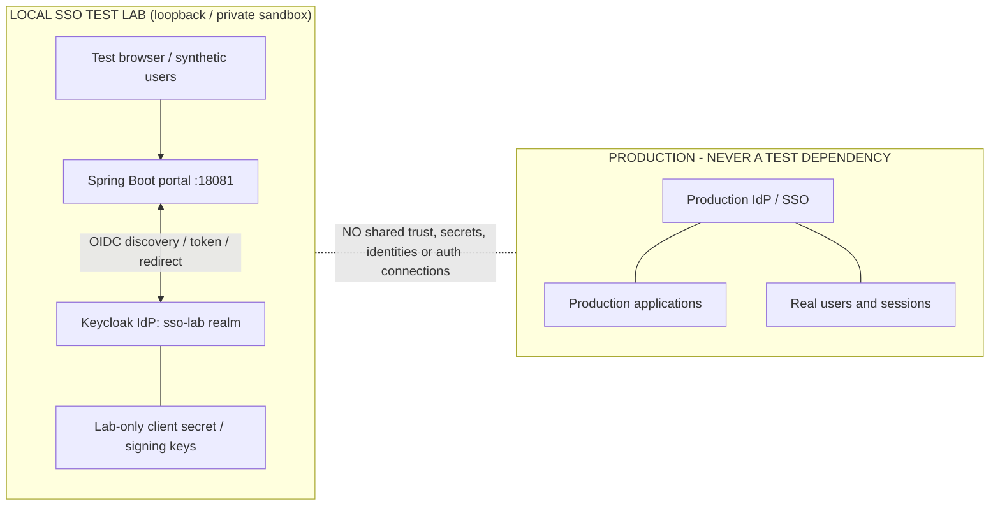
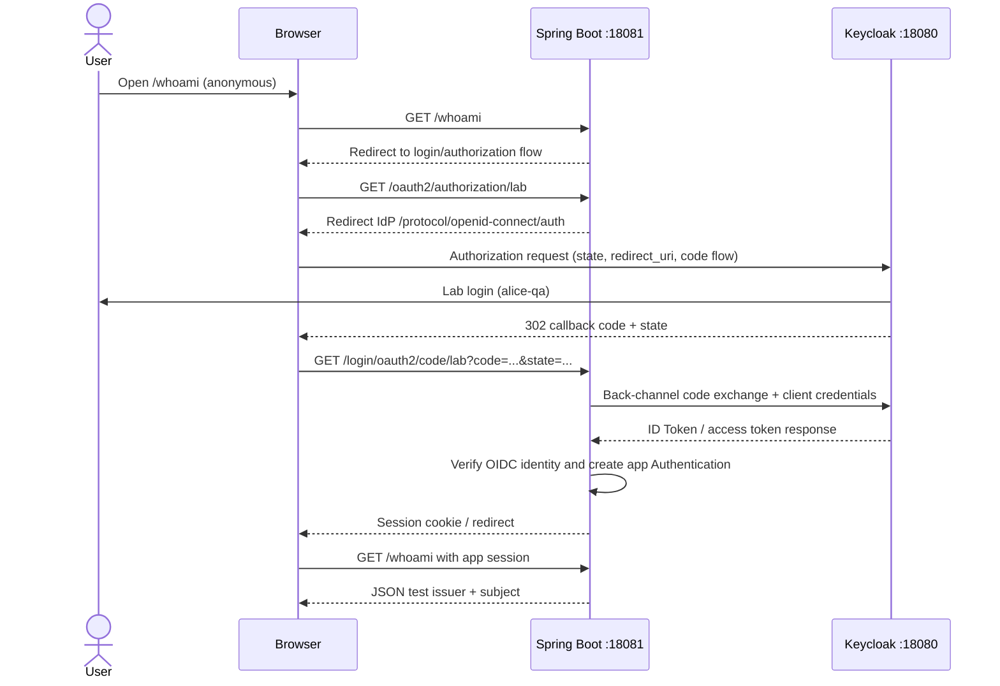
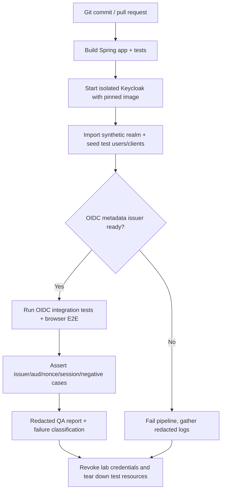

# Setting Up an Isolated Test IdP or SSO Server Separate from Production

## Learning Objectives

After this lesson, you will be able to:

1. Explain why SSO testing requires an **isolated test Identity Provider (IdP)/SSO server** instead of immediately using production accounts, client registrations, signing keys, or login sessions.
2. Design isolation boundaries across **identity, trust configuration, data, secrets, network, domain/cookie, callback URLs, logs, and environment lifecycle**; distinguish a separate realm inside the same server from a truly isolated system.
3. Set up a **local Keycloak OIDC IdP** with Docker Compose, restrict the port to `127.0.0.1`, pin the container version, use a dedicated admin password, and import a realm containing no real users.
4. Register a standard Authorization Code OIDC client, configure exact redirect URIs, create synthetic test users, and verify the issuer and metadata from `.well-known/openid-configuration`.
5. Connect **Spring Boot 3 / Spring Security 6 / Java 17+** to the test IdP using `oauth2Login`, `ClientRegistration`, `issuer-uri`, and a dedicated secret; observe successful authentication, rejection, and logout.
6. Distinguish **MockMvc `oidcLogin()` mock**, **integration test with a real IdP**, **end-to-end browser SSO**, and **security testing/failure injection**. Know which test proves signature, issuer, audience, state/nonce, and session behavior.
7. Build a matrix of SSO flows: first login, app-session reuse, IdP SSO reuse, two clients, user switching, logout, disabled user, redirect mismatch, wrong issuer, expired token, role/tenant mapping, and MFA step-up.
8. Know the limitations of using an OIDC test IdP for **SAML2, CAS, or Kerberos/SPNEGO**; choose the right server/protocol instead of mistaking Keycloak OIDC for a CAS Server or KDC.
9. Run a **standalone Java 17+** program simulating a safe lab configuration policy with deterministic stdout; understand that config checks are only one layer and do not replace real network/IAM controls.
10. Operate the lab on a personal machine, CI, or staging in a controlled manner: seed synthetic data, clean up containers, revoke secrets, redact logs containing tokens, and avoid accidentally trusting production.

## 1. The Problem: Testing Realistic SSO Without Real-World Impact

SSO (Single Sign-On) is the ability for a user already authenticated at a trusted system (such as an OIDC Provider, SAML2 Identity Provider, CAS Server, or KDC) to use multiple applications under their respective constraints without re-entering full credentials everywhere.

When building a Spring Security application, a development team typically needs to verify:

- How does an unauthenticated browser reach the IdP?
- How does the IdP return an authorization code, SAMLResponse, or CAS Service Ticket?
- How does Spring Security verify the issuer, signature, audience, state/nonce, recipient, ticket, or Kerberos service principal?
- Do two applications share an **IdP session** while still maintaining separate app sessions?
- When an account is disabled or permissions change, are old requests still allowed?
- How does local logout differ from global logout?
- If the token/signing key is wrong, does the callback fail safely?
- Do automated CI flows create or delete real users?

**You should not answer these questions by testing against a production IdP without controls.** A single buggy provisioning script line, wildcard client redirect, accidentally trusted signing certificate, or “test logout all” can break real users' access, leak tokens, or create security risks.

### 1.1. Diagram of an Isolated Lab



Example scope: Keycloak runs on the developer machine, accessible only via `http://localhost:18080`; the Spring Boot test app runs on `http://localhost:18081`. These HTTP ports are **only suitable for loopback testing**; for multi-user shared staging, use HTTPS/TLS, dedicated domain/DNS, and controlled separate infrastructure.

### 1.2. IdP, RP, SP, and CAS Server

| Protocol | Authenticating/Hosting Party | Application Consuming Identity | Key Data |
| --- | --- | --- | --- |
| **OIDC** | OpenID Provider (OP)/IdP, e.g., Keycloak | Relying Party (RP), Spring `oauth2Login` | `iss`, `sub`, `aud`, ID Token, code, nonce/state |
| **SAML2** | SAML Identity Provider | Service Provider (SP), Spring `saml2Login` | EntityID, ACS, metadata, SAMLResponse, signature |
| **CAS** | Apereo CAS Server | CAS Client/Service, Spring Security CAS integration | CAS login, `service`, ST, validation, SLO |
| **Kerberos/SPNEGO** | KDC/AD realm and Kerberos service acceptor | Browser + Spring Kerberos client/service | TGT/TGS, SPN, keytab, GSS token |

A **Keycloak OIDC realm** is a fast option for testing OIDC browser SSO; it also supports SAML2. **Keycloak is not a native CAS Server by default** and **does not replace a Kerberos KDC**. If a test requires real CAS or SPNEGO, you must stand up the proper server/protocol separately.

## 2. Isolation Boundaries: Avoiding “Lab on Paper, Production in Practice”

Systems can be split into local, CI, staging, and production. Within the same IdP server, creating a **test realm** separates users/clients by logical namespace, but **is not full isolation** if they still share high-privilege admins, network, backing DB, master realm, keys, or failure domain. For sensitive testing, deploy a **separate IdP instance/cluster** with completely separate trust and data.

### 2.1. Isolation Matrix

| Component | Allowed in Local/CI Lab | Must Not Be Used in Lab |
| --- | --- | --- |
| IdP URL | `http://localhost:18080/realms/sso-lab`, or dedicated HTTPS test hostname | `https://login.company.example/realms/prod` |
| Realm/tenant | Dedicated `sso-lab` or `qa-*` | Shared production realm |
| Users | Synthetic `alice-qa`, `bob-qa`, `disabled-qa` | Real employees, real partners, production admin accounts |
| Signing keys | Keys generated separately by test IdP and freely rotated/tested | Real private signing keys, certs/keystores/keytabs |
| OIDC clients | `spring-portal` created for lab, loopback redirect | Production client ID/secret/redirect URIs |
| SAML trust | Lab IdP signing cert and lab SP entity ID | Production federation metadata/cert/trust |
| CAS config | Separate CAS test Server/Service registry | Production CAS server, TGT registry/tickets |
| Kerberos | Test realm/KDC, `HTTP/lab-host` + test keytab | Real AD domain or production service keytab |
| Sessions/cookies | Dedicated browser profile, loopback/test domain | Production browser sessions/cookies |
| DB/directory | Test accounts and fixture data | Real customer/HR/LDAP/PII data |
| Network | Loopback, private network, ACLs, outbound restrictions | Production IdP connectors, webhooks, SMTP, LDAP, SCIM write access |
| Logs | Redacted test activity, short retention | Raw ID/access/refresh tokens, passwords |
| Notifications | Mail sink/webhook stub, fake addresses | Email/SMS/OTP to real users |
| Cleanup | Easy to delete and recreate, owner+TTL | Dependent on or impacting production |

**Simply renaming a `prod` realm to `test` does not isolate the system** if the lab still uses production client secrets or connects to real AD/LDAP. You must verify trust, write capabilities, network, and data.

### 2.2. Four Minimum Isolation Layers

**Layer 1 – Identity/data:** synthetic accounts, separate subject/issuer, never import production dumps containing tokens, emails, phone numbers, or PII. Use fake data incapable of sending notifications to real people.

**Layer 2 – Trust/credentials:** separate signing keys, OIDC client credentials, SAML certificates, CAS service configuration, token issuer, and trusted JWKS; test apps trust only the lab issuer, and production apps do not trust the lab issuer.

**Layer 3 – Network/domain:** never publish IdP development mode to the internet; enforce loopback/firewall restrictions, private DNS, egress allowlists, and do not bridge test networks to production identity backends. Domain/cookie separation prevents session collisions and accidental cross-login.

**Layer 4 – Lifecycle/operations:** dedicated CI resources with TTL, restricted admin access, no committed secrets, log redaction, teardown, and checks ensuring no forwarding/port mappings remain open to production.

### 2.3. Exception Case: “Staging Using Production IdP”

Occasionally an organization requires integration testing against a production IdP using a **test application and approved accounts**. This is **not a fully isolated lab**. If strictly required, it needs security/IAM approval, a separate client registration, callback allowlist, read-only scopes, restricted audience, and production guardrails. This lesson focuses on an **independent** solution and does not treat that exception as the default.

## 3. Lab Architecture Used Throughout This Lesson

**Fixed illustrative values**:

| Parameter | Value |
| --- | --- |
| IdP image | `quay.io/keycloak/keycloak:26.8.2` (version pinned against Keycloak docs referenced at time of writing) |
| IdP host listener | `127.0.0.1:18080`, container port `8080` |
| IdP public URL | `http://localhost:18080` |
| Test realm | `sso-lab` |
| OIDC issuer | `http://localhost:18080/realms/sso-lab` |
| OIDC discovery | `http://localhost:18080/realms/sso-lab/.well-known/openid-configuration` |
| Application port | `18081` |
| Spring registration ID | `lab` |
| OIDC client ID | `spring-portal` |
| Callback | `http://localhost:18081/login/oauth2/code/lab` |
| Authorization start | `http://localhost:18081/oauth2/authorization/lab` |
| Login test users | `alice-qa` / `bob-qa` / `disabled-qa` |
| Public root | `http://localhost:18081/` |
| Protected test page | `http://localhost:18081/whoami` |

**Do not change one URL in the table while forgetting to update related URLs**. The OIDC `issuer` in metadata and the ID Token must match the provider config exactly. The browser redirect URI must match the entry in Keycloak exactly. If using 127.0.0.1 instead of localhost, or running the app inside a container rather than on the host, synchronize the URLs/issuer/redirect and test both browser-to-IdP and app-to-token-endpoint connectivity.

### 3.1. Why Choose Keycloak?

- Capable of acting as an OpenID Provider for **Authorization Code + OIDC**.
- Provides a test realm, users, clients, signing keys, and metadata/JWKS to test real Spring `oauth2Login`.
- Includes SAML2 client support for testing another SP flow.
- Has an official Docker image and a simple `start-dev` mode for **loopback-only** setups.
- Supports testing first login, IdP SSO session reuse, multiple RP clients, wrong redirects, signing key rollover, disabled accounts, and configurable logout.

**However:** `start-dev` uses development defaults and **must not be used in production**. Do not put the `latest` image into a pipeline that needs reproducibility; pin a tested version or an approved image digest. A specific version used in this lesson may be superseded by later patches; when upgrading, review the changelog and re-run the test matrix.

## 4. Preparing Tools and Workspace

Requirements:

- Development machine with Docker Engine + Docker Compose v2 (`docker compose` command).
- JDK 17+ for the Spring Boot 3/Java demo.
- Gradle Wrapper or Maven Wrapper in the Spring Boot project.
- Terminal, a dedicated test browser profile, and an HTTP client such as `curl`.
- Do not run with production credentials or a cloud network tunnel.
- Local ports `18080` and `18081` are not in use by other services.
- Docker/network permissions granted according to machine policy.
- Sufficient machine resources for Keycloak, container images, and IDE; increase memory if the container OOMs.

Illustrative directory layout:

```text
sso-lab/
├── compose.yaml
├── realm-import/
│   └── sso-lab-realm.json
├── .gitignore
└── portal/
    ├── build.gradle
    └── src/main/
        ├── java/com/example/ssolab/
        │   ├── SsoLabApplication.java
        │   ├── LabSecurityConfig.java
        │   └── LabController.java
        └── resources/application.yml
```

Do not create configuration files outside the Google Sheet lesson area when performing this task; the structure above describes **files the learner creates themselves inside a permitted lab workspace**.

### 4.1. Keeping Passwords and Secrets Out of Git

Example `.gitignore`:

```gitignore
.env
.env.*
!.env.example
*.keytab
*.p12
*.pfx
*.jks
*.pem
*.key
secrets/
logs/
build/
.gradle/
```

**This is only a guardrail**: if a secret has already been committed, adding `.gitignore` does not remove it from Git history. You must rotate the credential and clean history per incident policy. Some public PEM certificate files need not be treated as secrets, but avoid accidentally committing private keys and test identity data.

### 4.2. Creating an Independent Test Admin Password

The Compose file below requires the environment variable `SSO_LAB_ADMIN_PASSWORD`. Generate a strong password **used only for the lab**, store it in a local secret manager or protected terminal environment, and never hardcode literals in code/repos.

On bash/zsh, you can prompt without echoing:

```bash
read -r -s -p "Lab admin password: " SSO_LAB_ADMIN_PASSWORD
printf '\n'
export SSO_LAB_ADMIN_PASSWORD
```

Depending on the shell, `read -p`/`-s` may not be portable everywhere; use an organization-approved secret management method. Environment variables are not a perfect secret vault: someone with high enough privileges on the host/engine can inspect container configuration; **never use production credentials** in this variable. On Windows PowerShell, use a secure prompt/secret manager instead of putting the password directly on the command line where it gets saved in history.

## 5. Standing Up a Local Keycloak IdP with Docker Compose

### 5.1. The compose.yaml File

```yaml
name: sso-lab

services:
  idp:
    image: quay.io/keycloak/keycloak:26.8.2
    command:
      - start-dev
      - --import-realm
      - --hostname=http://localhost:18080
    ports:
      - "127.0.0.1:18080:8080"
    environment:
      KC_BOOTSTRAP_ADMIN_USERNAME: lab-admin
      KC_BOOTSTRAP_ADMIN_PASSWORD: "${SSO_LAB_ADMIN_PASSWORD:?Set_SSO_LAB_ADMIN_PASSWORD}"
    volumes:
      - ./realm-import:/opt/keycloak/data/import:ro
```

**Explanation of each decision:**

1. `name: sso-lab` keeps the Compose namespace consistent; never use the same project name as a production stack.
2. Image version is **pinned**; do not use `latest` for reproducible tests.
3. `start-dev` is **local-only**. It enables development settings unsuitable for production; ensure it is not publicly exposed.
4. Binding `127.0.0.1:18080:8080` restricts the host listener to IPv4 loopback. **Do not replace it with `18080:8080` or `0.0.0.0:18080:8080`** without a network security review.
5. `--hostname=http://localhost:18080` makes the IdP advertise URLs/issuer matching the address the browser and Spring client actually use, instead of mixing container port 8080 with host port 18080.
6. `KC_BOOTSTRAP_ADMIN_*` creates a dedicated bootstrap admin account. The password is supplied outside the repo via an environment variable; do not use examples like `admin/admin` on shared infrastructure.
7. `./realm-import` is mounted read-only and uses `--import-realm`; never mount real data or production exports.
8. Do not add LDAP federation, production SMTP, outbound webhooks, SCIM connectors, or identity brokers to production.
9. This is **plaintext HTTP on loopback** for learning only; multi-user staging environments must use `start`/production-mode config with HTTPS, trusted certs, and proper DB and secret management.
10. If the Docker daemon or container networking on the device has special configuration, loopback binding must be **verified empirically from another machine**. Do not assume one line of YAML proves the container cannot be reached externally.

### 5.2. The realm-import/sso-lab-realm.json File

```json
{
  "realm": "sso-lab",
  "enabled": true,
  "displayName": "Isolated Local SSO Lab"
}
```

This is a **minimal realm fixture**, creating only an enabled realm. It contains no users/clients/secrets. Create clients and users via the Admin Console in the next step to avoid committing client secrets/test user passwords.

Keycloak imports realms from `/opt/keycloak/data/import` when started with `--import-realm`. The file must have the `.json` extension; **if the realm already exists**, startup import usually **skips it** and does not overwrite the existing realm. To reset the fixture, plan a dedicated stop/delete workflow for the lab environment rather than assuming import will auto-overwrite.

### 5.3. Starting and Verifying Keycloak

```bash
docker compose up -d
docker compose ps
docker compose logs --tail 120 idp
```

Run the commands above inside the directory containing `compose.yaml` after supplying `SSO_LAB_ADMIN_PASSWORD`. Without the realm import or password, Compose will lack complete configuration.

Once logs show Keycloak is ready, open:

- `http://localhost:18080/admin/` – Keycloak Admin Console.
- `http://localhost:18080/realms/sso-lab/.well-known/openid-configuration` – OIDC discovery JSON.

Verify discovery with:

```bash
curl --fail --silent --show-error \
  http://localhost:18080/realms/sso-lab/.well-known/openid-configuration
```

**There is no fixed stdout**; the server returns metadata JSON containing `issuer`, `authorization_endpoint`, `token_endpoint`, `jwks_uri`, and other properties. The key value to verify is:

```text
issuer = http://localhost:18080/realms/sso-lab
```

If `issuer` reports `http://localhost:8080/realms/sso-lab` or a different hostname, fix the hostname/port config **in the lab** before configuring Spring; do not try to patch the token issuer with custom string replacement in Java.

### 5.4. Protecting the Admin Console

- The lab admin account exists only in the lab instance with a dedicated password.
- Do not allow internet or unauthorized internal network access to `/admin`.
- Do not share an admin user/password with production.
- Do not grant test admin privileges to app users merely for SSO testing convenience.
- When multiple developers collaborate, use a staging Keycloak instance with HTTPS/ACLs/individual admin accounts and auditing, rather than sharing a local password over chat.
- Do not log admin tokens, cookies, or take screenshots containing client credentials.

## 6. Configuring the Realm, OIDC Client, and Test Accounts

In the Admin Console, select the **`sso-lab` realm**—do not confuse it with `master` or an accidentally imported production realm.

### 6.1. Creating the `spring-portal` OIDC Client

UI labels may vary by Keycloak version; the configuration semantics must be accurate:

| Field | Test Value | Meaning |
| --- | --- | --- |
| Client type/protocol | `OpenID Connect` | Spring `oauth2Login` uses OIDC |
| Client ID | `spring-portal` | Matches `client-id` in Spring |
| Client authentication | **ON** | Confidential server-side client with a client secret |
| Standard flow | **ON** | OIDC Authorization Code |
| Direct access grants/password grant | **OFF** | Do not test password grant in place of browser code flow |
| Service accounts | OFF unless needed | Avoid granting unnecessary M2M grants |
| Valid redirect URIs | `http://localhost:18081/login/oauth2/code/lab` | No `*` wildcard |
| Valid post-logout redirect URIs | Exact URLs per logout flow under test | Do not allow arbitrary redirects |
| Web origins | Only required origins, e.g., `http://localhost:18081` | Do not use `*` unless needed |
| Client scopes | `openid`, `profile` in client request | Produces an OIDC ID Token |

**Note:** Spring Security defaults to callbacks of the form `{baseUrl}/login/oauth2/code/{registrationId}`; the registration ID here is `lab`, **not** `spring-portal`. Therefore, the redirect URL must end with `/lab`.

Under the confidential client's **Credentials**, copy the **lab client** secret and supply it to Spring via `SSO_LAB_CLIENT_SECRET` in the environment. Never write the secret into README, Git, or logs. If the UI allows secret rotation, test it after the connection works.

**Do not enable wildcard redirects** or redirects to a production domain. If the app runs at `http://127.0.0.1:18081` in the browser while the configured redirect uses `localhost`, client validation may reject it due to URL mismatch; keep host/port/redirect consistent.

### 6.2. Creating Synthetic Users

Recommended at least four test users, none of whom are **real people**:

| User | Status | Scenario |
| --- | --- | --- |
| `alice-qa` | Enabled | Happy path login, claims, app session |
| `bob-qa` | Enabled | Account switch, principal separation, different role |
| `disabled-qa` | Disabled | New login blocked, verify existing app session per policy |
| `mfa-qa` | Enabled, test authenticator enrolled | MFA/step-up negative & positive cases **if IdP authentication flow is actually configured** |

Setup steps in the Admin Console:
1. Open `Users → Create new user` in the `sso-lab` realm.
2. Choose a synthetic username. Never use a real email; use a test-only mailbox/sink if the IdP requires an email.
3. Set Enabled according to the scenario, using a temporary dedicated password generated in a secret manager/test harness.
4. For enabled users, open `Credentials` to set a test password; do not copy passwords into shared source fixtures.
5. For `mfa-qa`, configure an actual authentication flow/required actions/TOTP/WebAuthn appropriate for the environment; **merely naming a user `mfa-qa` does not prove MFA was performed**.
6. If testing local authorization, establish a clear mapper/role contract; **a Keycloak realm role does not automatically become Spring's `ROLE_ADMIN`**.
7. Record each user's actual `sub` (typically an opaque ID/UUID) upon login; do not assume `sub == username`.

### 6.3. Seeding Reproducible Data

So CI can spin up the lab every run without manual steps, you can use:
- Realm import JSON containing **only non-sensitive clients/roles/fixtures**, without committing secrets.
- Keycloak Admin API invoked using **ephemeral admin credentials** or a tightly scoped test provisioning identity.
- A script that creates synthetic users, sets passwords from runtime secrets, and records internal test IDs.
- An idempotent script: check whether users/clients exist with expected names/scopes before updating, avoiding duplicates.
- Cleanup keyed by a unique run ID, never searching/deleting all users in a shared realm/instance.
- Versioned fixtures, image digests, and schema versions, never using a production export as the “baseline dataset.”

This lesson uses the Admin UI for clarity. Advanced pipelines can automate this after negative tests covering scope/namespace and deletion pass.

## 7. Connecting a Spring Security OIDC App to the Lab

**Scope:** Spring Boot 3.x, Spring Security 6.x, Java 17+, Servlet MVC. The code below is a **Spring Boot application inside a project**, not a standalone Java file runnable via `javac` alone. It requires a running test Keycloak instance and a valid test client secret.

### 7.1. Gradle Dependencies

In a project already configured with the Spring Boot plugin, dependency management/BOM, and a compatible wrapper:

```groovy
dependencies {
    implementation 'org.springframework.boot:spring-boot-starter-web'
    implementation 'org.springframework.boot:spring-boot-starter-security'
    implementation 'org.springframework.boot:spring-boot-starter-oauth2-client'

    testImplementation 'org.springframework.boot:spring-boot-starter-test'
    testImplementation 'org.springframework.security:spring-security-test'
}
```

**You do not need to write custom JWT signature verification for OIDC login.** Spring Security OAuth2 Client/OIDC handles the protocol mechanics when configured properly. However, business policy must still enforce active account status, roles, tenant, and authorization separately.

### 7.2. application.yml

File `portal/src/main/resources/application.yml`:

```yaml
server:
  port: 18081

spring:
  security:
    oauth2:
      client:
        registration:
          lab:
            provider: lab-oidc
            client-id: spring-portal
            client-secret: "${SSO_LAB_CLIENT_SECRET}"
            authorization-grant-type: authorization_code
            redirect-uri: "{baseUrl}/login/oauth2/code/{registrationId}"
            scope: openid,profile
        provider:
          lab-oidc:
            issuer-uri: http://localhost:18080/realms/sso-lab
```

**How to read this:**
- `registration.lab` is the registration ID; Spring creates the login initiation URL `/oauth2/authorization/lab` and callback URL `/login/oauth2/code/lab`.
- `provider.lab-oidc.issuer-uri` enables OIDC metadata discovery, and the token's issuer must match the trusted provider.
- `client-secret` is read from the `SSO_LAB_CLIENT_SECRET` environment variable. It must be created in the lab realm, never using a real application secret.
- Scope `openid` requests OIDC (ID Token); `profile` lets you inspect test profile claims if needed.
- `{baseUrl}` derives from the URL the app receives via browser/proxy; behind a reverse proxy, verify forwarded headers and hostname trust configuration.
- **HTTP is for local loopback only**; never deploy this config to the internet or multi-user staging.

### 7.3. Main Class

File `portal/src/main/java/com/example/ssolab/SsoLabApplication.java`:

```java
package com.example.ssolab;

import org.springframework.boot.SpringApplication;
import org.springframework.boot.autoconfigure.SpringBootApplication;

@SpringBootApplication
public class SsoLabApplication {
    public static void main(String[] args) {
        SpringApplication.run(SsoLabApplication.class, args);
    }
}
```

### 7.4. SecurityFilterChain

File `LabSecurityConfig.java`:

```java
package com.example.ssolab;

import org.springframework.context.annotation.Bean;
import org.springframework.context.annotation.Configuration;
import org.springframework.security.config.Customizer;
import org.springframework.security.config.annotation.web.builders.HttpSecurity;
import org.springframework.security.web.SecurityFilterChain;

@Configuration
public class LabSecurityConfig {

    @Bean
    SecurityFilterChain security(HttpSecurity http) throws Exception {
        return http
                .authorizeHttpRequests(auth -> auth
                    .requestMatchers("/", "/error").permitAll()
                    .requestMatchers("/whoami").authenticated()
                    .anyRequest().denyAll())
                .oauth2Login(Customizer.withDefaults())
                .logout(logout -> logout.logoutSuccessUrl("/"))
                .build();
    }
}
```

Explanation:
1. `/` is a public page; `/whoami` requires an authenticated user from OIDC login.
2. `oauth2Login` uses the configured `lab` OIDC client; the app redirects the browser to the IdP when login is required.
3. Do not enable `formLogin` or `httpBasic` as duplicate fallbacks unless the test plan explicitly requires them.
4. `logoutSuccessUrl("/")` here primarily **logs out the app session**; **it does not prove the Keycloak SSO session/TGT was invalidated**. The browser may still hold an IdP cookie allowing instant SSO on the next visit.
5. Default CSRF protection remains enabled; perform logout via POST following the application's exact CSRF flow. Do not rely on GET `/logout` as a general conclusion.
6. `denyAll` on unlisted routes avoids accidentally exposing debug endpoints.
7. The lab config has no role mapping from the IdP; **logging in does not automatically grant admin privileges**.

### 7.5. Controller Observing the Verified Principal

File `LabController.java`:

```java
package com.example.ssolab;

import java.util.Map;

import org.springframework.security.core.annotation.AuthenticationPrincipal;
import org.springframework.security.oauth2.core.oidc.user.OidcUser;
import org.springframework.web.bind.annotation.GetMapping;
import org.springframework.web.bind.annotation.RestController;

@RestController
public class LabController {

    @GetMapping("/")
    public String home() {
        return "SSO lab is running";
    }

    @GetMapping("/whoami")
    public Map<String, String> whoami(
            @AuthenticationPrincipal OidcUser user) {
        return Map.of(
                "issuer", user.getIdToken().getIssuer().toString(),
                "subject", user.getSubject(),
                "mode", "LAB_ONLY");
    }
}
```

On a `/whoami` request after login, `OidcUser` comes from the verified Spring Security OIDC flow. The controller returns **issuer**, **subject**, and a lab label; this test-only response helps confirm you have not mixed up the issuer or identity.

**In production**, do not expose raw subjects, tokens, emails, or PII claims to public UIs unnecessarily. Never return or log `id_token`, `access_token`, `refresh_token`, `Authentication.toString()`, or client secrets.

### 7.6. Running the Application

Start the IdP first, copy the lab client secret into `SSO_LAB_CLIENT_SECRET` on the app host (do not commit). Then inside the Spring project directory:

```bash
./gradlew bootRun
```

On Windows use `.\gradlew.bat bootRun`. If the Boot plugin/wrapper/Java 17 or secret is missing, prepare the project first. Spring OIDC metadata discovery from `issuer-uri` may require the IdP to be reachable **at app startup**, so if Keycloak is not yet running, creating `ClientRegistrationRepository` may fail.

Open:
- `http://localhost:18081/` → public text response.
- `http://localhost:18081/whoami` → without an active session, Spring may redirect the browser to the login/authorization URL; click the `lab` login.
- `http://localhost:18081/oauth2/authorization/lab` → explicitly start the authorization flow.
- After logging in as `alice-qa`, `/whoami` returns JSON with the test realm's issuer and the user's subject **issued by Keycloak**—there is no hardcoded subject value in the docs.

**Do not fabricate stdout/JSON `sub` values**: each realm/user fixture has its own internal ID. The right indicator is an **exact** issuer and a subject belonging to the synthetic test user, not a production account.

## 8. Observing the Full OIDC Login via Browser and HTTP Traces

### 8.1. Sequence to Observe



**The two HTTP hops are not the same:**

- **Front channel**: browser redirects between Portal and Keycloak. Contains `state`, code, and IdP/browser cookies; the client secret is never exposed to the browser.
- **Back channel**: Portal server calls the token endpoint to exchange the code for tokens, authenticating as a confidential client per config. If the Portal container cannot reach Keycloak's issuer/token endpoint, the front channel may reach the login page, yet the callback will fail.

**Never print full authorization codes, ID Tokens, access/refresh tokens, or cookies into CI logs or bug reports**. You may record *present/absent*, endpoints, status codes, and redacted issuers.

### 8.2. Verifying OIDC Discovery and Issuer

An OIDC Provider publishes metadata, for example:

```text
http://localhost:18080/realms/sso-lab/.well-known/openid-configuration
```

Fields to verify:
- `issuer` must be exact: `http://localhost:18080/realms/sso-lab`.
- `authorization_endpoint` is the URL the browser visits.
- `token_endpoint` is the URL the app calls during the callback.
- `jwks_uri` returns public keys belonging to the lab realm, not production JWKS.
- `end_session_endpoint`, if supported by the IdP, requires separate configuration for logout; **not all OIDC Providers support identical logout features**.
- `response_types_supported`/`grant_types_supported` relate to allowed flows; do not enable weak grants unnecessarily.

For the verified ID Token:
- `iss` matches the lab issuer.
- `aud` contains `spring-portal`/client ID per OIDC validation.
- `sub` is the current fixture user.
- `exp`/`iat` are valid; `nonce`/`state` are protected by the client flow per profile.
- Signature is verified against the signing key/JWKS **of the lab realm**.
- `amr`/`acr` appear only if the IdP is configured to emit them; **never infer MFA from an account name or request parameter**.

### 8.3. Three Distinct Cookies/Sessions

| Component | Cookie or State | Impact When Cleared |
| --- | --- | --- |
| Keycloak IdP | IdP browser SSO session/cookies | May force re-login at the IdP, though app sessions may remain |
| Spring Boot Portal | App `HttpSession` / `JSESSIONID` | Portal session is cleared; IdP session may remain |
| Browser test profile | Cookies for both origins and site storage | Resets browser state, does not revoke server-side sessions across all devices |

Test login/SSO in **two separate browser profiles or incognito sessions** to avoid being misled by stale cookies. Browser cookies carry domain/path/SameSite semantics; localhost has quirks when multiple services run on different ports. Never use the same browser profile signed into production for testing.

## 9. Testing SSO Across Two Separate Applications

A single application logging in successfully only proves **federated login**; it does not fully test **Single Sign-On** across two relying parties.

### 9.1. Standing Up a Second RP

In the same test realm, create:
- OIDC client `spring-reports`, confidential, with its own client secret.
- A second Spring app running, for instance, on `localhost:18082`.
- Exact callback `http://localhost:18082/login/oauth2/code/reports`.
- Registration `reports` in the second app.
- Signing keys belonging to the **lab IdP** remain shared in the realm, while **client ID/secret/app session** are separate per RP.

Do not share one client secret between both RPs when testing client isolation/credential rotation. Do not register Reports' callback inside the Portal client arbitrarily.

### 9.2. Expected SSO Flow

1. Fresh browser, not logged into either app.
2. Open Portal RP-A, log in at Keycloak as `alice-qa`.
3. Portal creates session A with the subject matching the fixture user.
4. Open Reports RP-B in the same browser profile and trigger `/oauth2/authorization/reports`.
5. If the Keycloak SSO session is still valid and policy does not require reauth, the browser may **not need to re-enter a password**.
6. Reports creates a **separate session B**. Both RPs may see the same `sub`, yet they do not share `JSESSIONID` or local role stores.
7. Log out only at Portal and observe whether Reports still retains its session/IdP SSO by design; do not assume global logout worked.
8. Configure and test global SSO logout/back-channel/front-channel per IdP profile and each RP if required; test **old cookies** on both apps after logout.

**IdP policy must be tested:** certain flows force account selection or reauthentication even when an SSO session exists (e.g., `prompt=login`, MFA step-up, session max age). Do not promise “no password prompt” in every situation.

## 10. Distinguishing Mock Tests, Integration Tests, and End-to-End Tests

### 10.1. Four Testing Layers

| Layer | Tools | What It Verifies | What It Does Not Prove |
| --- | --- | --- | --- |
| **Unit/policy** | JUnit + Mockito | Role/tenant rules, mapping, error handling | Token signatures, redirects, IdP behavior |
| **MockMvc OIDC** | `spring-security-test` `oidcLogin()` | App controllers/filters/method authorization with fake principal | Real OAuth2 Authorization Code flow/JWKS |
| **Integration IdP** | Local Keycloak container + Spring test app | Discovery, code exchange, real ID Token, issuer/JWKS/audience | Browser cookie/redirect behavior across browsers if HTTP-mocked |
| **Browser E2E** | Browser automation/manual, test users | First login, SSO reuse, cookie sessions, logout, MFA UX | Non-lab security controls if network/staging differs from production |

**Never mark “SSO end-to-end PASS” merely because a `.with(oidcLogin())` test returns 200.** That test never calls Keycloak.

### 10.2. MockMvc OIDC Test Example (Fragment Only)

```java
// In a test that already has MockMvc mvc and spring-security-test:
// This is a fake principal constructed by the test, NOT a token from Keycloak.
mvc.perform(get("/whoami")
        .with(oidcLogin().idToken(token -> token
            .claim("iss", "http://localhost:18080/realms/sso-lab")
            .claim("sub", "test-subject"))))
    .andExpect(status().isOk())
    .andExpect(jsonPath("$.subject").value("test-subject"));
```

Typical static imports in the test class:

```java
import static org.springframework.security.test.web.servlet.request.SecurityMockMvcRequestPostProcessors.oidcLogin;
import static org.springframework.test.web.servlet.request.MockMvcRequestBuilders.get;
import static org.springframework.test.web.servlet.result.MockMvcResultMatchers.jsonPath;
import static org.springframework.test.web.servlet.result.MockMvcResultMatchers.status;
```

This code lives **inside a JUnit test method** with an injected `MockMvc`. It checks that the controller reads the principal and SecurityMockMvc support; **it does not prove the ID Token was signed by an IdP or that client secret/issuer/JWKS are configured properly**.

For real integration testing, do **not** just mock issuer/claims; run a test IdP issuing real tokens and let Spring Security execute the OIDC login flow with validated callbacks.

### 10.3. Critical Negative Tests

- Wrong IdP signing key or mismatched JWKS.
- ID Token `iss` from another realm.
- ID Token `aud` not intended for `spring-portal`.
- Authorization code replay or exchange using another client.
- Invalid or missing `state`/`nonce` per flow.
- Expired token or abnormal clock skew.
- Callback `redirect_uri` with wrong host/port/path.
- Disabled user or deleted account mid-flow.
- Local entitlement revoked after login.
- Browser retains app session after IdP logout if the app has not handled single logout.
- Using Reports' client secret for Portal.
- Logs/proxies accidentally recording raw tokens in traces.

**You do not need to forge validly signed tokens to test every case**. Use test issuer/client fixtures, instrumentation, and approved test setups to drive failure cases without introducing unsigned tokens into production environments.

## 11. Ordered Smoke Test Matrix

| Test | Setup | Action | Expected Result |
| --- | --- | --- | --- |
| 1. Discovery | IdP running | GET `.well-known/openid-configuration` | HTTP 200, exact lab issuer |
| 2. Public page | App running | GET `/` | 200, no auth required |
| 3. Protected anonymous | Fresh browser | GET `/whoami` | Redirect to login, no pre-auth data visible |
| 4. Happy OIDC | `alice-qa` enabled | Authorization Code login | Spring creates authenticated app session |
| 5. Identity | Successful login | GET `/whoami` | Lab issuer, `alice-qa`'s subject |
| 6. Browser cookie reuse | Portal app cookie intact | Second GET `/whoami` | App session reused if unexpired |
| 7. Wrong password | Wrong test credential | Login at IdP | Deny/IdP error, no authenticated app session |
| 8. Disabled account | `disabled-qa` disabled | Fresh login | Deny; no local privileges provisioned |
| 9. Wrong redirect | Alter callback URL fixture | Authorization flow | IdP rejects unregistered redirect |
| 10. Wrong client ID/secret | App uses wrong secret | Code exchange | Authentication fails, no session created |
| 11. Wrong issuer | Provider trusts lab only, token from another realm | Login/token validation | Reject |
| 12. Different user | Separate browser profile | Login as `bob-qa` | Separate subject, does not inherit Alice's session |
| 13. Two RP SSO | A logged in, B not logged in | Open Reports B | IdP SSO may reuse, B creates separate app session |
| 14. Local logout A | A/B logged in | POST logout A with CSRF | Session A invalidated; B/IdP depends on config |
| 15. Global logout | IdP/RP SLO design enabled | Logout at IdP | Enforces expected RP session behavior, test old cookies |
| 16. Role revoke | Alice has test grant | Revoke local permission | Old action denied per policy/SLA |
| 17. MFA step-up | IdP flow configured | Require strong assurance | RP verifies `acr/amr/auth_time` |
| 18. Invalid MFA flag | Browser sends `mfa=true` | Invoke high-risk action | Does not self-elevate assurance |
| 19. Signing key rotation | Keycloak test realm | Rotate keys per test workflow | New token with new key passes, old policy defined |
| 20. Clock drift | In fixture/test harness only | Adjust token/clock | Validation matches skew policy |
| 21. Multi-node app | Session store/test nodes | Login A, GET B | Consistent session/issuer per architecture |
| 22. IdP unavailable | Stop test Keycloak | New login/code exchange | Fail safe; no default login |
| 23. Direct app port from another host | Lab restricted to loopback | Call `:18080` from another machine | Cannot connect to local IdP |
| 24. Egress to prod blocked | Network/ACL policy | Test service accessing prod IdP | Request blocked, no real token issued |

Outcomes **depend on lab config**, especially SLO/MFA/multi-node. Do not claim tests #15/#17 pass just because Keycloak started; configure the protocol/flows and test actual session access.

### 11.1. Post-Logout Request Test Case

A security test case must check **resource access after logout**, not just an HTTP 200 from a callback:
1. Browser logs in with a test account and keeps the Portal cookie.
2. Verify `GET /whoami` is authenticated.
3. Execute logout using the chosen flow (local app, IdP global, back-channel SLO, etc.).
4. Send a request to Portal using the **old cookie** in the test browser.
5. Expected result per policy: anonymous/login redirect/401, **no** lingering access when the flow requires app-session revocation.
6. If the IdP session persists after local logout, the browser may reauthenticate via SSO and regain access; distinguish **old app session invalid** from **new login succeeded**.
7. With two RPs, repeat using each RP's cookie.
8. Verify session keys are deleted/revoked if using a shared store, rather than checking only the UI logout screen.

### 11.2. Testing Refresh/Access Tokens and APIs

A Spring `oauth2Login` application is an **OIDC Client**, not automatically an OAuth2 Resource Server. If an API uses Bearer access tokens:
- Stand up a test resource server with `issuer-uri`/`jwk-set-uri` pointing to the **lab issuer** and validate audience.
- Distinguish `id_token` intended for the OIDC client from `access_token` sent to the API.
- Test wrong audience, expired tokens, wrong signatures, and missing scopes/tenants.
- Test refresh token revocation, token endpoint authentication, and logout/deny strategies separately.
- Do not equate deleting the Portal `HttpSession` with revoking all JWT access tokens.

## 12. Keycloak SAML2 Lab: When the Application Is a SAML Service Provider

**This is an alternate lab branch** and does not mean the OIDC app above automatically supports SAML2. Keycloak supports SAML2 clients; Spring Security `saml2Login` requires a `RelyingPartyRegistration` trusting the right IdP signing cert.

### 12.1. High-Level Implementation Steps

1. In the `sso-lab` realm, create a dedicated **SAML client** for the SP with a test entityID, exact ACS, and chosen binding.
2. Configure signing/encryption per lab requirements using **lab-only certs/keys**.
3. Fetch the test IdP metadata—for example, Keycloak exposes an endpoint like `/realms/sso-lab/protocol/saml/descriptor`; verify the endpoint on the **running version**.
4. In Spring Security, configure `RelyingPartyRegistration` via metadata or pinned test credentials and `saml2Login`.
5. Test **SP-initiated login**: SP emits AuthnRequest, IdP builds SAMLResponse, and SP allows authentication only after validating issuer/destination/audience/signature/conditions/inResponseTo per configuration.
6. Test **SAML AuthnContext/MFA** using an **IdP-signed/verified** assertion, not merely a browser-supplied `Attribute mfa=true`.
7. Test SAMLResponse replay, expired `NotOnOrAfter`, mismatched `Recipient`/`Destination`, wrong audience, and IdP cert rotation.
8. If Single Logout is needed, configure/provision trust separately and check SP sessions after logout; do not assume SAML login automatically performs cluster-wide SLO.

### 12.2. Items That Must Stay Separate from Production

- Distinct **SAML IdP entityID**, and test SP entityID and ACS must not collide with production.
- Lab signing certificate/key distinct from production; never copy real private keys.
- Do not import production metadata and treat it as test trust without authorization; test metadata comes solely from the lab IdP.
- Register exact recipient/ACS URLs; never open wildcards to prod endpoints.
- Use separate test data and stable NameID subjects rather than real employee emails.
- Clock/trust changes in the lab must never impact live SAML federation.

**SAML2 metadata is critical trust configuration.** If test and prod trust the same signing key/issuer or SP callback, the “lab” can open the door to token/assertion confusion.

## 13. When a Test CAS Server Is Needed: Do Not Substitute OIDC

In federation modules, many legacy systems use the **Apereo CAS protocol** (browser redirects with `service`/`ticket` and CAS ticket validation). Keycloak OIDC cannot act as a native CAS endpoint simply by changing URLs.

### 13.1. Setting Up a Dedicated CAS Sandbox

- Choose a **supported Apereo CAS Server version compatible with Java/Spring** in your organization; avoid mismatching CAS client and server versions ad hoc.
- You may start from **CAS Initializr / CAS WAR Overlay Template** matching the chosen version. Upstream templates over time may target newer JDKs; do not grab the current template wrapper and assume Java 17 always suffices.
- Deploy the test CAS on a private/test hostname with a lab TLS certificate and a **test-only credential repository** or synthetic directory.
- Configure the **service registry** exclusively for test apps, e.g., `https://portal.sso-lab.test/login/cas`, not arbitrary `service` URLs.
- Create separate test ticket registry/session storage and signing/encryption credentials; never use production CAS TGTs/STs.
- Test `/login?service=...`, the client-appropriate CAS validation endpoint, one-time ticket use, service mismatch, expiry, and Single Logout when enabled.
- When testing multi-node CAS SLO, verify ticket/SessionIndex→app session mapping and shared session deletion; an in-memory HashMap in one JVM can miss logouts if the callback hits another node.
- All callback URLs must belong to the lab/staging private domain with tested certificates; never put production SLO endpoints into a test service registry.

**Do not simulate CAS using a hardcoded “valid ticket” REST endpoint and mark CAS integration PASS**. A mock endpoint can serve unit tests for JSON/XML parsing, but it does not test protocol redirects, ticket validation, service binding, one-time ticket semantics, or SLO.

### 13.2. Comparing a CAS Mock with a Real CAS Server

| Environment | What Can Be Tested | What Cannot Be Tested |
| --- | --- | --- |
| Fake `/serviceValidate` returning static XML | Client parsing/error handling | Ticket issuance, CAS login, real signed trust/registry |
| Embedded mock HTTP server | Retries/timeouts, response codes | Full CAS SSO session and cross-service logout |
| Test Apereo CAS Server | Real ticket issuance/validation, configured SLO profiles | Production scaling/latency if topology differs |
| Production CAS | Live behavior | Not the default place for destructive tests |

In CAS testing, distinguish **local app logout**, **CAS TGT logout**, and **client SLO session revocation**. A separate test CAS Server enables negative testing without affecting real users.

## 14. When Kerberos/SPNEGO Testing Is Needed

**Keycloak is not a KDC**. If Spring Security uses `SpnegoAuthenticationProcessingFilter` with Kerberos, you need:
- A dedicated **test realm/KDC** (e.g., an MIT Kerberos test realm or a test AD forest per IAM policy).
- A test service principal such as `HTTP/portal.sso-lab.test@SSOLAB.TEST`.
- A test keytab issued by the test KDC, separate from production.
- Proper DNS/realm mapping and time synchronization.
- A browser or GSS-API test client holding a test TGT, never using ticket caches of real accounts.
- A service acceptor keytab with the exact SPN/kvno/enctype, and reverse proxies that do not strip `Authorization: Negotiate`.
- Tests for valid AP-REQ, wrong SPN, wrong keytab, clock skew, replay, and NTLM fallback per policy.

**Never accidentally register a test SPN in production AD**. AD SPNs, keytabs, and service accounts are sensitive security objects that must be managed inside the test domain/realm. If you only need to unit test how Spring handles `KerberosServiceRequestToken`, mocking `AuthenticationManager` may suffice, **but it does not prove** real GSS/KDC authentication.

## 15. MFA and Authentication Assurance Levels in the Lab

MFA tests are frequently misunderstood because a test IdP may allow password-only login.

### 15.1. What Needs to Be Proved

- **Enrollment:** the user has enrolled a test TOTP/WebAuthn/OTP factor.
- **Authentication event:** the IdP actually prompts for and verifies the factor at **login/step-up**.
- **Protocol assertion:** Keycloak/the test IdP emits the appropriate assurance context (`acr`/`amr`/`auth_time` in OIDC or `AuthnContextClassRef` in SAML2).
- **RP policy:** the Spring app reads claims from the **verified assertion**, checking exact issuer/ACR mappings and freshness.
- **Authorization:** the user must still hold local roles/tenant/resource permissions; MFA does not automatically grant `ROLE_ADMIN`.

`mfa_enabled=true` in a test profile, username `mfa-qa`, or a request param `acr_values=...` **does not prove by itself** that the IdP performed MFA. Tests must cover success flows, prompt cancellation, unenrolled factors, unmet ACR, and browser-supplied spoofed tokens/attributes.

### 15.2. Never Send OTPs to Real Systems

- Use test-only authenticators or mailboxes/sinks per test policy.
- Never send SMS OTPs to employee or customer phone numbers.
- Never configure a production SMTP server as a default in a test realm.
- Never log OTPs, recovery codes, authenticator seeds, or WebAuthn private keys.
- Never copy authenticator credentials from real users into the lab.
- For phishing-resistant testing, use a FIDO/WebAuthn test environment and a verified IdP assurance contract rather than assuming two strings `pwd` and `otp` suffice.

## 16. Lab in CI/CD: Reproducible Without Breaking Other Environments

### 16.1. Recommended Pipeline Flow



**A safe pipeline** must halt immediately if issuer/JWKS/callbacks show signs of pointing to production. Never “fall back to prod IdP” when local Keycloak fails to start—that is a severe anti-pattern.

### 16.2. Isolating CI Runs

- Pin the image tag/digest and record the tested version in build metadata.
- Give each run a unique namespace, ports/network/realm, or dedicated container instances; do not let parallel jobs share an admin account and race.
- Use timeouts/health readiness checks instead of a fixed `sleep 30`; if metadata is not ready, fail with a clear reason.
- Pull secrets from a **lab-dedicated** CI secret store; never reuse prod cloud/OIDC client credentials.
- Never grant CI runners write permissions against production identity management/SCIM/LDAP.
- Apply egress ACLs/DNS/hosts blocking or policy controls toward production authentication endpoints wherever possible.
- Never use real user dumps as test fixtures; seed deterministic synthetic identities.
- Write redacted logs; never upload browser storage state containing tokens/cookies as public test artifacts.
- Run teardown in a `finally`/always step to prevent orphan stacks, deleting only resources belonging to **that exact run/project**.
- Run incident/negative cases without disrupting staging IdPs shared by other teams.

### 16.3. Two Addresses Seen from Two Environments

A common CI issue:

```text
Browser on CI host:
  http://localhost:18080/realms/sso-lab

Spring app INSIDE a different Docker container:
  "localhost" means this app container, NOT the Keycloak container

IdP discovery published issuer:
  http://localhost:18080/realms/sso-lab
```

If the app runs inside a container, it may be unable to reach `localhost:18080`. Fix this with an address that is **reachable and has a consistent issuer across the browser, app, and IdP**, with properly configured TLS/test DNS or CI networking. **Never arbitrarily rewrite the issuer per caller**, because OIDC requires the token `iss` to match the provider config.

Practical options:
- Run the Spring app and browser on the host using the Keycloak host port as in the example.
- Or run everything inside one test network with routable hostnames/DNS for both the browser container and app, configuring `KC_HOSTNAME`/redirect URIs accordingly.
- Or use a test reverse proxy with dedicated DNS names and environment-valid HTTPS certs.
- In Testcontainers, manage dynamic ports/issuer metadata across the lifecycle; a mapped port does not mean the IdP automatically emits the right issuer unless hostname config is adjusted.

**Never point `spring.security.oauth2.client.provider.lab-oidc.issuer-uri` to production as a “temporary workaround” for lab DNS issues**.

## 17. Standalone Java 17+: Checking Local SSO Lab Configuration Policy

This is a **pure Java 17** program requiring no Docker, Spring, internet, or Keycloak. It illustrates a **local policy check** before running the lab: no production trust, real users, public listeners, or wrong issuer/redirect.

It **does not actually scan firewalls, verify JWTs, or prove container bindings**. In production/staging, attributes like `prodTrust` must be inventoried by trusted IAM/infra tooling rather than accepting a user-supplied boolean.

File `SsoLabIsolationDemo.java`:

```java
public final class SsoLabIsolationDemo {
    private static final String LAB_ISSUER =
            "http://localhost:18080/realms/sso-lab";
    private static final String LAB_REDIRECT =
            "http://localhost:18081/login/oauth2/code/lab";

    record Lab(
            String issuer,
            String redirectUri,
            boolean trustsProduction,
            boolean usesRealUsers,
            boolean publicListener) {}

    static String assess(Lab lab) {
        if (lab.trustsProduction() || lab.usesRealUsers()) {
            return "DENY_PRODUCTION_DEPENDENCY";
        }
        if (lab.publicListener()) {
            return "DENY_PUBLIC_LISTENER";
        }
        if (!LAB_ISSUER.equals(lab.issuer())) {
            return "DENY_ISSUER";
        }
        if (!LAB_REDIRECT.equals(lab.redirectUri())) {
            return "DENY_REDIRECT";
        }
        return "ALLOW_LOCAL_LAB";
    }

    public static void main(String[] args) {
        Lab safe = new Lab(LAB_ISSUER, LAB_REDIRECT,
                false, false, false);

        System.out.println("Local isolated: " + assess(safe));

        System.out.println("Production trust: " +
                assess(new Lab(LAB_ISSUER, LAB_REDIRECT,
                        true, false, false)));

        System.out.println("Public port: " +
                assess(new Lab(LAB_ISSUER, LAB_REDIRECT,
                        false, false, true)));

        System.out.println("Wrong issuer: " +
                assess(new Lab("https://login.prod.example/realms/prod",
                        LAB_REDIRECT, false, false, false)));

        System.out.println("Wrong redirect: " +
                assess(new Lab(LAB_ISSUER,
                        "http://localhost:18081/other-callback",
                        false, false, false)));

        System.out.println("Real users: " +
                assess(new Lab(LAB_ISSUER, LAB_REDIRECT,
                        false, true, false)));
    }
}
```

Run:

```bash
javac SsoLabIsolationDemo.java
java SsoLabIsolationDemo
```

**Exact stdout:**

```text
Local isolated: ALLOW_LOCAL_LAB
Production trust: DENY_PRODUCTION_DEPENDENCY
Public port: DENY_PUBLIC_LISTENER
Wrong issuer: DENY_ISSUER
Wrong redirect: DENY_REDIRECT
Real users: DENY_PRODUCTION_DEPENDENCY
```

**Takeaways:**

1. The local lab is permitted **only when all simulated configuration conditions are met together**.
2. Production trust or real users must be rejected, even if the issuer string looks like the lab.
3. Public listeners are denied, reinforcing that `start-dev` is not for the public internet.
4. Any issuer/redirect outside the exact allowlist is denied, helping prevent accidental cross-environment logins.
5. This is a **policy simulation**, not a program proving real network state. The `Lab` object is constructed in `main` and can be altered in code; never use it as a security boundary.
6. Real controls required: firewall/network ACLs, IdP trust inventory, separate client credentials, secret management, HTTPS in staging, and negative integration tests.
7. Never conclude a lab is safe simply because the program prints `ALLOW_LOCAL_LAB`; it does not inspect Docker, DNS, browser cookies, or the party issuing signing keys.

## 18. Operations, Cleanup, and Recovery

### 18.1. Stopping the Test Keycloak Within Scope

Inside the **lab's** Compose directory:

```bash
docker compose ps
docker compose down
```

`down` stops/removes resources belonging to the current Compose project. **Verify the project and directory before running**; never use commands that wipe all Docker containers, networks, volumes, or shared staging Keycloak instances.

If the lab has dedicated data/volumes and you want to wipe them completely, confirm ownership/retention first before removing volumes on that exact Compose project. Never run `docker volume prune` or `docker system prune -a` blindly on a machine hosting other resources.

### 18.2. Revoking Secrets and Test Data

- Remove lab admin/client credentials from shell environments and CI secrets at end of lifecycle, and rotate if exposed.
- Never store response tokens/cookies/authorization codes in public browser automation artifacts.
- Delete synthetic users/realms after tests per retention and owner rules; **never delete users in a shared/prod realm**.
- Delete test DBs/realm imports containing sensitive data per policy; for snapshots/backups, verify TTL/ACLs.
- If email/SMS/webhooks were configured, verify no scheduled callbacks remain pointing to real systems.
- Clear test browser profiles/cookies; note that clearing browser cookies **does not revoke** tokens already issued by the IdP server.
- Close loopback port forwardings and test reverse proxy tunnels so test URLs are never accidentally exposed publicly.
- Record the image version, test matrix, remaining failures, and cleanup state (without including secrets).

### 18.3. Operating Multi-User Staging

A staging IdP accessed by multiple teams requires:
- Proper **HTTPS/mTLS** with managed certificates.
- Private DNS/ingress ACLs and access controls on the Admin Console.
- Separate database, signing keys, client secrets, and auditing.
- Resource isolation/quotas and backups if needed.
- An approval and expiry process for creating/deleting test users.
- Test IdP instances/realms without shared production LDAP/SCIM write access.
- Change control for key rotation, version upgrades, and policy updates.
- Designated lab owners and a runbook for compromised signing keys.

**Do not promote local `start-dev` Compose into internet-facing staging by changing a single `ports` line**. Keycloak's production mode requires different configuration according to official documentation and threat models.

## 19. Common Issues When Setting Up a Test IdP

| Symptom | Possible Cause | Resolution |
| --- | --- | --- |
| Docker fails to start | Missing `SSO_LAB_ADMIN_PASSWORD`, port conflict, low RAM | Check env/compose/port/logs; do not use prod secrets |
| Keycloak admin login fails | Bootstrap account already exists, wrong password, wrong realm | Check startup state/realm; do not reset production IdP |
| `.well-known` 404 | Realm not imported or wrong path/hostname | Check `sso-lab`, import mount, startup logs |
| Import file changed but UI did not update | Keycloak skips existing realms | Intentionally reset/re-import the lab; do not expect auto-overwrite |
| Discovery issuer reports `localhost:8080` | Hostname config does not match public port | Adjust `--hostname`, re-test metadata; do not manually replace `iss` |
| Spring startup fails when Keycloak is off | `issuer-uri` discovery unreachable | Start lab IdP/readiness before the app |
| Browser logs in, callback fails | Redirect mismatch, lost state, code exchange unreachable, wrong client secret | Verify exact redirect and IdP token endpoint/back-channel |
| `invalid_redirect_uri` | URI not registered accurately | Check `{baseUrl}`, scheme, port, path |
| `invalid_client` | Wrong ID/secret or client authentication settings | Regenerate lab client secret, verify confidential client |
| Spring reports issuer mismatch | Token `iss` differs from configured provider | Check hostname/realm/metadata; do not relax trust |
| Browser prompts for login despite existing SSO session | Different cookie profile, prompt/step-up/session policy | Check IdP cookie and auth request |
| Browser is not asked for password after app logout | Keycloak SSO session remains active | Distinguish local app logout vs IdP logout |
| Second RP logs in same user with different app permissions | Local grants differ between the two apps | Test role mapping independently |
| Disabled user still accesses app session | Spring session remains, local policy does not check status | Session revocation/current-state guard |
| `oidcLogin()` unit test passes while E2E fails | Mock skips IdP/signatures | Run real integration/browser E2E tests |
| 401/403 after IdP MFA | IdP did not release ACR or app local role is missing | Check verified claims and separate business authz |
| App in Docker cannot call localhost IdP | Container localhost differs from host | Design consistent routable issuer/DNS |
| SAML test passes while CAS client fails | SAML IdP is not CAS protocol | Deploy a protocol-accurate test CAS Server |
| SPNEGO test using Keycloak OIDC lacks a ticket | Missing KDC/SPN/keytab | Stand up a dedicated test KDC/realm |
| Tokens appear in CI logs | Verbose HTTP trace/debug | Redact, revoke lab secrets, fix logging |
| Test user receives real emails | Real SMTP/webhook configured | Use a mail sink/test domain, block egress |
| Test environment affects prod | Reused secrets, federation trust, directory connectors, shared issuer | Stop tests, rotate/revoke, audit per incident response |

## 20. Checklist Before Considering the Lab “Ready”

### Environment Isolation

- [ ] Lab has dedicated IdP/realm/directory instances and credentials, unmixed with production.
- [ ] Test users are synthetic; no real user emails/phones/PII are used.
- [ ] Production issuers/JWKS/SAML signing keys/private keys are neither trusted nor imported.
- [ ] All OIDC/SAML clients use unique test client IDs/entityIDs and exact callback URIs.
- [ ] Network/egress to production identity providers/SCIM/webhooks is blocked or controlled; no destructive access exists.
- [ ] Local `start-dev` binds only to loopback and is not publicly exposed.
- [ ] Multi-user staging uses HTTPS and reviewed production-mode IdP settings.
- [ ] Browser profiles/cookies are isolated; no production sessions are created during tests.
- [ ] CI secrets, logging, notifications, and retention are managed separately.

### IdP Functioning Properly

- [ ] Keycloak image version is pinned; container starts reliably.
- [ ] Correct `sso-lab` realm imported without modifying master/prod realms.
- [ ] `.well-known/openid-configuration` exposes exact lab issuer/URLs.
- [ ] OIDC client `spring-portal` is confidential, standard code flow ON, direct grant OFF.
- [ ] Redirect URI ends cleanly with `/login/oauth2/code/lab`; no wildcards.
- [ ] Synthetic enabled/disabled users are ready for testing, not real employees.
- [ ] Signing keys/JWKS belong to the lab; key rotation tests have a versioned/test plan.
- [ ] Spring `issuer-uri` and client secret point solely to the lab.

### Real Testing

- [ ] First login with a test user confirmed via browser/Keycloak.
- [ ] Spring receives the right test issuer/sub without logging tokens/secrets.
- [ ] Anonymous/wrong password/disabled/wrong redirect/wrong issuer cases are denied.
- [ ] OIDC code, state/nonce, audience, signature, and expiry checks exercised at integration level.
- [ ] Two RP apps prove IdP SSO reuse alongside independent sessions.
- [ ] Local logout vs global/SLO behavior documented and tested with old cookies.
- [ ] Local role/tenant/object authorization is not substituted by “IdP login succeeded.”
- [ ] MFA evidence comes strictly from verified assurance claims, never a profile flag.
- [ ] MockMvc `oidcLogin()` is never reported as end-to-end.
- [ ] When testing CAS, use a real CAS Server; for Kerberos, a real KDC/realm; for SAML2, dedicated SAML trust.
- [ ] Teardown, secret revocation, and orphan resource checks executed after testing.

## 21. Self-Check Questions

**1. Why shouldn't SSO be tested using production accounts and client secrets?**

Because test flows can create/delete identities, alter trust, log out sessions, expose callbacks/tokens, or cause unauthorized access. A lab must have dedicated identities, keys, client registrations, and networks.

**2. Is a test realm inside the same production Keycloak fully isolated?**

No. A realm is logical isolation; the same server can share high-privilege admins, infrastructure failures, databases, or connectors. For negative/destructive testing, prefer a separate IdP instance.

**3. Why is `start-dev` only suitable on localhost?**

Keycloak development mode uses defaults meant for experimentation that do not meet production standards. Never expose it publicly over the internet; use `start`/TLS/hardening for staging/prod per documentation.

**4. In Compose, what does `127.0.0.1:18080:8080` mean?**

It binds host port 18080 strictly on IPv4 loopback, forwarding to container port 8080. It does not by itself guarantee every Docker/host policy; verify reachability from outside the machine.

**5. What is `KC_HOSTNAME` used for in this lab?**

It defines the public-facing URL Keycloak advertises; issuer and redirect/metadata must remain consistent with the URL used by the browser and Spring.

**6. What value is configured for OIDC `issuer-uri` in Spring?**

`http://localhost:18080/realms/sso-lab`, not the Admin Console URL or the root `http://localhost:18080`.

**7. Why does Keycloak's redirect URI end with `/lab`?**

Because the Spring registration ID is `lab` and the default template is `{baseUrl}/login/oauth2/code/{registrationId}`. The client ID `spring-portal` does not dictate the callback segment.

**8. Why not enable `Direct access grants` by default for easier testing?**

This lesson tests browser Authorization Code/OIDC SSO; password/direct grant is a different flow with a different threat model and does not test login redirects/cookies.

**9. After a successful login, does `sub` equal the username `alice-qa`?**

Not by default. Keycloak/OIDC uses a provider-assigned stable subject ID; verify it in the verified ID Token.

**10. Why does local Portal logout not guarantee logging out of Keycloak?**

Portal and the IdP maintain separate sessions. App logout may clear `JSESSIONID` while the IdP SSO session cookie remains, allowing the browser to re-login via SSO.

**11. Do two RPs using the same IdP share an app `HttpSession`?**

Not by default. They can reuse the IdP SSO session, yet each RP keeps its own client registration, local session, and authorization.

**12. What does a `.with(oidcLogin())` test prove?**

It creates a mock `OidcUser` in a Spring MVC test; it tests app behavior/authorization branches, not whether Keycloak issued or signed an ID Token.

**13. Does a test Keycloak replace an Apereo CAS Server?**

No. The CAS protocol has its own service tickets, validation endpoints, and SLO; Keycloak OIDC/SAML is not a native CAS server.

**14. Is a Keycloak realm sufficient to test Spring SPNEGO?**

No. You need a test KDC/realm, service principal, keytab, and GSS/Kerberos tickets; Keycloak is not a KDC.

**15. Does having user `mfa-qa` guarantee MFA occurred?**

No. You must configure an actual flow/required action and verify that the IdP validated the factor and returned an assurance context to the RP.

**16. If the Spring app runs inside Docker, why might a localhost issuer fail?**

Because `localhost` inside the app container points to that container itself. Browser, app, and IdP need one consistent issuer URL actually routable by all actors.

**17. Why not import the production user database into test Keycloak?**

It can expose PII, identifiers, and secrets, and trigger unintended notifications or authorizations. Use resettable synthetic fixtures.

**18. If a Keycloak realm already exists, does `--import-realm` overwrite it?**

Normally no; the server skips existing realms. Resets/migrations in the lab must be handled via dedicated controlled operations.

**19. Why doesn't testing a newly disabled user prove session revocation?**

Because the user might already have authenticated at Portal before being disabled. You must test the **old app cookie** and issued tokens, not just a fresh login.

**20. Why pin images and test signing key rotation?**

Pinning images ensures reproducibility and controlled changes; signing key rotation verifies client trust/JWKS behavior without touching production keys.

**21. How do you verify tests have no production dependencies?**

Audit trust/secret inventories, issuers/client IDs, DNS/network egress, directory/email/SCIM connectors, run negative tests confirming production calls are blocked, and audit the environment.

**22. When should testing stop and an incident be reported?**

Whenever a test app accepts a production token, production signing/secret material is present, test notifications reach real recipients, or a CI script can mutate production identities. Stop, isolate, and follow security incident procedures instead of continuing to treat it as a lab.

## Key Takeaways

**Reliable SSO testing requires an IdP/SSO sandbox faithful enough to the real protocol without sharing trust or blast radius with production.**

OIDC learning flow:

**Docker Keycloak (loopback, `sso-lab` realm, test signing keys) → synthetic users + confidential test client → exact OIDC issuer/redirect → Spring Boot `oauth2Login` → browser Authorization Code login → validated ID Token → local SecurityContext → verify requests, SSO reuse, logout, and negative cases → cleanup.**

Five key principles:

1. **Comprehensive environment isolation:** separate users, realms, clients, certificates, secrets, network, data, callbacks, and operations; never just rename things.
2. **Test the real protocol:** MockMvc helps with unit tests but does not replace an IdP signing tokens, discovery, redirects, browser cookies, and SLO.
3. **Never assume SSO/MFA:** one app logging in does not prove reuse across two RPs, and an “mfa” test account does not prove strong authentication.
4. **Use the right server:** Keycloak for OIDC/SAML; CAS requires a CAS Server, Kerberos requires a KDC/SPN/keytab.
5. **Cleanup and revocation are part of the test:** prove old sessions/tokens are rejected per policy, close ports, revoke lab secrets, and leave production undisturbed.

### References

- [Keycloak – Getting Started on Docker (current pinned example)](https://www.keycloak.org/getting-started/getting-started-docker)
- [Keycloak – Running Keycloak in a Container](https://www.keycloak.org/server/containers)
- [Keycloak – Configuring Hostname](https://www.keycloak.org/server/hostname)
- [Keycloak – Importing and Exporting Realms](https://www.keycloak.org/server/importExport)
- [Keycloak – Server Administration Guide](https://www.keycloak.org/docs/latest/server_admin/)
- [Spring Security 6.5 – OAuth 2.0 Client and Login](https://docs.spring.io/spring-security/reference/6.5/servlet/oauth2/login/core.html)
- [Spring Security – Testing OAuth2/OIDC with MockMvc](https://docs.spring.io/spring-security/reference/servlet/test/mockmvc/oauth2.html)
- [Spring Security – SAML2 Login](https://docs.spring.io/spring-security/reference/6.5/servlet/saml2/login/index.html)
- [Apereo CAS WAR Overlay Template](https://github.com/apereo/cas-overlay-template)
- [OpenID Connect Core 1.0](https://openid.net/specs/openid-connect-core-1_0.html)
- [RFC 6749 – OAuth 2.0 Authorization Framework](https://www.rfc-editor.org/rfc/rfc6749)
- [RFC 7636 – Proof Key for Code Exchange (PKCE)](https://www.rfc-editor.org/rfc/rfc7636)
- [OWASP – OAuth 2.0 Cheat Sheet](https://cheatsheetseries.owasp.org/cheatsheets/OAuth2_Cheat_Sheet.html)
- [OWASP – Authentication Cheat Sheet](https://cheatsheetseries.owasp.org/cheatsheets/Authentication_Cheat_Sheet.html)
