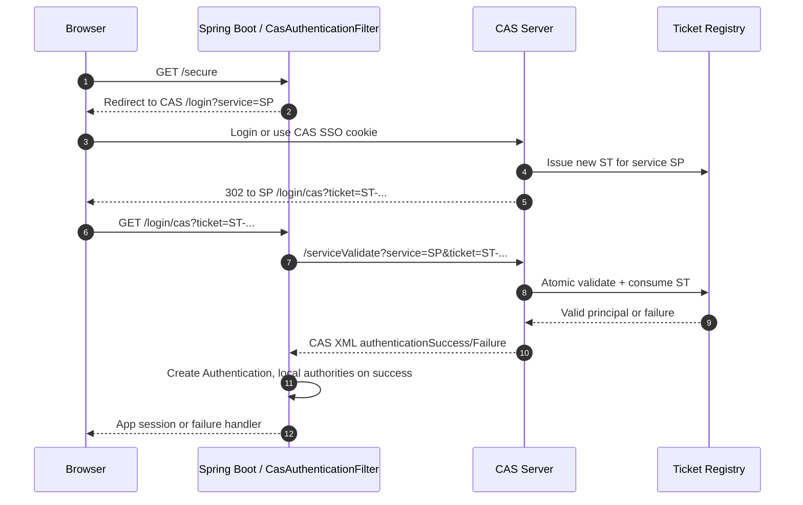

# Testing CAS with Valid, Expired, Reused, and Wrong-Service Service Tickets

## 1. Goals and Scope

**Central Authentication Service (CAS)** issues a **Service Ticket (ST)** to an application after a user authenticates at the CAS Server. The Spring Security application receives `ticket` from the browser and calls CAS to validate the ticket before creating an `Authentication` and web session. Every step can pass positive scenarios while still hiding security bugs if the application trusts expired tickets, accepts reused tickets, or allows a ticket issued for service A to be used at service B.

This lesson belongs to **SSO Testing**, focusing on four scenarios:

1. **Valid Service Ticket:** matching `service`, unexpired, never validated before.
2. **Expired Service Ticket:** unused, but past the lifetime permitted by CAS.
3. **Reused Service Ticket:** the same ticket presented to CAS a second time after a validation attempt.
4. **Wrong-Service Service Ticket:** an ST issued for service A but presented for validation with service B.

This article covers CAS Protocol 2.0 rules, HTTP requests/responses, Spring Security CAS client configuration, Java 17 testing, a client-layer JUnit/WireMock example, CAS Server sandbox testing strategies, and an error matrix. The `example.test` URLs and `ST-...` IDs are for learning only, not usable credentials. Never use production tickets, cookies, passwords, or user data to build test fixtures.

**The single most important rule in the CAS 2.0 spec: an ST is valid for exactly _one validation attempt_; whether validation succeeds or fails, CAS must invalidate the ticket.** In particular, if the first request sends the wrong `service` and receives `INVALID_SERVICE`, that ST **can no longer be rescued by resending it with the right service**.

### Learning Outcomes

- Distinguish Service Ticket, Ticket Granting Ticket, Ticket Granting Cookie, and Proxy Ticket.
- Call `/serviceValidate` properly with `service` and `ticket`; read XML success/failure responses accurately.
- Write tests for the four scenarios using a **fresh ticket for each scenario**, never reusing fixtures outside replay tests.
- Understand why expiration typically reports `INVALID_TICKET` and wrong service reports `INVALID_SERVICE` in CAS 2.0.
- Test boundary times with a fixed `Clock` or a CAS sandbox with controlled expiry policy instead of relying on `Thread.sleep`.
- Prove a single ST cannot be validated successfully on two CAS nodes concurrently.
- Verify `CasAuthenticationFilter`/`CasAuthenticationProvider` never creates an authenticated principal when CAS rejects a ticket.
- Diagnose service URL mismatches behind a reverse proxy/TLS termination.
- Protect tickets from access logs, redirects, tracing, browser history, and query-string leaks.
- Separate client stub tests from real CAS Server tests to avoid a false-green test suite.

## 2. Entities and Verification Points in CAS SSO

| Component | Where? | Purpose | Do Not Confuse With |
| --- | --- | --- | --- |
| **CAS Server** | Central identity service | Login, issue, and validate tickets | Not a local controller |
| **TGT – Ticket Granting Ticket** | CAS ticket registry | Represents the CAS-side SSO session | Not an ST, and never send TGT directly to an SP |
| **TGC – Ticket Granting Cookie** | Browser cookie for CAS | Links the browser to the CAS SSO session | Not the Spring app's authentication cookie |
| **ST – Service Ticket** | Passed by browser to application | One-time credential bound to a specific `service` | Not a long-lived session token |
| **SP/service** | Spring Security CAS client | Calls CAS validate, then creates local `Authentication` | Must never self-decode or self-verify an ST |
| **PT – Proxy Ticket** | Backend proxy scenario | One-time ticket for a `targetService` | `/serviceValidate` must not accept a PT |
| **PGT – Proxy Granting Ticket** | Server-side proxying service | Requests multiple PTs when authorized | Not an ST |
| **`CasAuthenticationToken`** | Spring SecurityContext after auth | Principal and local authorities | Created only after successful CAS validation |

**STs typically start with `ST-`**, but the prefix is merely a formatting convention. Never treat `startsWith("ST-")` as validation. Tickets are opaque: the CAS Server must look up the ticket registry and check service, lifecycle, policy, and expiration. Never infer username, issuer, or expiry by slicing the ticket string.

### Normal Flow



The CAS Server is responsible for **single-use, expiry, and service binding**; the Spring Security CAS client must **delegate verification to CAS over a trusted HTTPS channel**, never treating query parameters as proof of login.

## 3. CAS 2.0 Contract for the Four Cases

Per the CAS 2.0 specification:

- **Service binding:** a ticket is valid only for the service identifier sent in `/login?service=...` when CAS issued it.
- **Single-use:** a ticket is valid for **one validation attempt**, not just “one successful validation.”
- **Expiry:** CAS **should** expire unvalidated STs after a reasonable period. The spec **recommends a lifetime no longer than five minutes**, though deployments may set their own policy. **Five minutes is not an immutable constant across every CAS Server**.
- **Invalidation on mismatch:** if a ticket is still valid yet `service` mismatches, CAS returns `INVALID_SERVICE` and **invalidates** that ST.
- **Expired/unknown/reused:** must be rejected. CAS 2.0 normally uses `INVALID_TICKET`; body text may provide further detail depending on implementation.
- **Do not treat HTTP 200 as login success**: `/serviceValidate` can return **XML `authenticationFailure` inside an HTTP 200**.

| Case | ST State Before Request | Service Presented to CAS | Expected CAS Result | Consequence |
| --- | --- | --- | --- | --- |
| Valid | Fresh, unexpired | Correct service A | `authenticationSuccess` | ST consumed |
| Expired | Unused, past TTL | Correct A | `authenticationFailure`, usually `INVALID_TICKET` | ST rejected |
| Reused | Already validated once | Correct A | `authenticationFailure`, `INVALID_TICKET` | No new authentication created |
| Wrong service | Fresh, unexpired, issued for A | Service B | `authenticationFailure code="INVALID_SERVICE"` | ST A consumed despite failure |
| Wrong service then fixed to A | ST from row above | Correct A | `INVALID_TICKET` | Cannot retry the same ST |

For the **CAS 1.0** endpoint `/validate`, the response is plain-text `yes`/`no` lines rather than CAS 2.0 XML. For the **CAS 3.x** endpoint `/p3/serviceValidate`, the response can include attributes. This exercise uses **CAS 2.0 `/serviceValidate`** to keep XML semantics and failure codes consistent.

## 4. URLs, Query Parameters, and Service Identifiers

Assume the CAS Server:

```text
https://cas.example.test/cas
```

and the application has a public CAS login processing URL:

```text
https://portal.example.test/login/cas
```

Spring Security CAS uses `ServiceProperties.service` equal to the **exact registered service URL**. The browser begins the flow:

```http
GET /cas/login?service=https%3A%2F%2Fportal.example.test%2Flogin%2Fcas HTTP/1.1
Host: cas.example.test
```

After the user authenticates, CAS returns:

```http
HTTP/1.1 302 Found
Location: https://portal.example.test/login/cas?ticket=ST-NEW-EXAMPLE
```

The application receives the ticket on the **SP's** URL, then calls CAS **server-to-server**:

```http
GET /cas/serviceValidate?service=https%3A%2F%2Fportal.example.test%2Flogin%2Fcas&ticket=ST-NEW-EXAMPLE HTTP/1.1
Host: cas.example.test
```

Distinguish clearly:

- `/cas/login` and `/cas/serviceValidate` are **CAS Server endpoints**.
- `/login/cas` is the **Spring Security CAS client** endpoint receiving the ticket from the browser.
- `service` is the **SP URL for which CAS issued the ticket**, not the pre-login target page such as `/secure`.
- `ticket` is an opaque credential; URL-encode properly when constructing requests, without double-encoding or manual decode-and-concatenation.
- The public URL behind HTTPS termination may differ from an internal container URL. **CAS receives the service URL per public contract**, not `http://localhost:8080/login/cas`.

A service URL differing in scheme, hostname, port, path, trailing slash, or encoding may trigger `INVALID_SERVICE` depending on canonicalization/registry policy. Tests must assert the exact service identifier **issued and validated**, rather than guessing that CAS normalizes every variant the way browsers do.

## 5. Success Response: Don't Look Only at HTTP Status Codes

CAS 2.0 returns XML:

```xml
<cas:serviceResponse xmlns:cas="http://www.yale.edu/tp/cas">
  <cas:authenticationSuccess>
    <cas:user>alice</cas:user>
  </cas:authenticationSuccess>
</cas:serviceResponse>
```

This is an **example response body**, meaningful only when received from a **trusted CAS Server over verified TLS** after submitting a valid ST. CAS can return `<cas:attributes>` under CAS 3.x extensions; roles/business ACLs are **never automatically granted** merely because a user appears in XML.

End-to-end expectations:

1. CAS receives a fresh ST bound to the right service.
2. CAS validates and consumes the ticket.
3. The Java CAS Client parses `authenticationSuccess` and extracts the principal.
4. `CasAuthenticationProvider` uses `UserDetailsService`/`AuthenticationUserDetailsService` to load local authorities.
5. Spring Security builds an authenticated `CasAuthenticationToken`.
6. The browser receives a local session per configuration and accesses authorized resources.
7. The same ST cannot be validated at CAS again.

**Do not check only `HTTP 200`**; an `authenticationFailure` response inside HTTP 200 must be treated as an authentication failure.

## 6. Expired ST Case

An ST may be issued without the browser returning to the SP immediately because:

- The user lingered on an intermediate page.
- Redirects across reverse proxies were delayed or cached.
- A test client held the ticket and waited too long.
- Network issues hit CAS/SP connectivity.
- Clocks or validation policies were inconsistent across nodes.
- A ticket was issued right before a service registration changed.

Example validation request:

```http
GET /cas/serviceValidate?service=https%3A%2F%2Fportal.example.test%2Flogin%2Fcas&ticket=ST-EXPIRED-EXAMPLE HTTP/1.1
Host: cas.example.test
```

Example error response:

```xml
<cas:serviceResponse xmlns:cas="http://www.yale.edu/tp/cas">
  <cas:authenticationFailure code="INVALID_TICKET">
    Ticket expired or not recognized
  </cas:authenticationFailure>
</cas:serviceResponse>
```

The system must refuse to create a new `Authentication`. CAS 2.0 does not mandate a dedicated error code named `EXPIRED_TICKET`. Do not assert exact text like “expired” in production integration tests because messages may be customized, localized, or generalized to “ticket not recognized.”

### Deterministic Expiration Testing

**Avoid `Thread.sleep(5 * 60_000)`**: tests become slow, CI-flaky, and inaccurate if CAS TTL differs from five minutes. Prefer:

- **Unit/model:** inject `Clock.fixed` and advance the clock to before/at/after expiry.
- **CAS Server sandbox:** configure a short ticket expiration policy only in the test profile; use server fake-clock/time controls if the release supports them, or a short TTL with a bounded test harness.
- **Real deployment:** issue a ticket and validate after the configured TTL; keep tests isolated and never use production accounts.

A test at exact `expiresAt` should treat the ST as **expired**, though exact boundary behavior must align with the implementation and approved clock-skew policy. Never “fix” failures by raising TTL indefinitely.

## 7. Reused ST Case (Replay)

After the first successful validation:

```text
ST-ONE-123 + service=A -> authenticationSuccess
ST-ONE-123 + service=A -> authenticationFailure INVALID_TICKET
```

The CAS Server must guarantee **a single validation attempt** across all nodes. A “browser refresh on login callback” or user copying a URL containing `ticket` must never create a new CAS-authenticated session using the old ticket.

**Common pitfall:** if the browser already has an **application HTTP session** after login, subsequent requests to `/secure` can still succeed because of the **authenticated session's `SecurityContext`**, not because CAS accepted the ST again. Replay tests must call the **CAS validation endpoint** or clear/isolate the local session before resubmitting the ticket in a controlled flow. Otherwise tests confuse “keeping a valid session” with “ticket is reusable.”

### Expectations

- First CAS response: `authenticationSuccess`.
- Second CAS response with the same ST: `authenticationFailure`, typically `INVALID_TICKET`.
- The Spring Client creates no new authentication from the second response.
- If an app uses a custom stateless cache to bypass CAS validation, evaluate it separately; never call that behavior protocol-compliant multi-use CAS STs.

## 8. Wrong-Service ST Validation Case

CAS issues an ST for:

```text
service A = https://portal.example.test/login/cas
```

An attacker or test sends:

```http
GET /cas/serviceValidate?service=https%3A%2F%2Fpayments.example.test%2Flogin%2Fcas&ticket=ST-FOR-PORTAL HTTP/1.1
Host: cas.example.test
```

If the ST is still valid yet service B differs from the issued service, CAS 2.0 requires returning:

```xml
<cas:serviceResponse xmlns:cas="http://www.yale.edu/tp/cas">
  <cas:authenticationFailure code="INVALID_SERVICE">
    Ticket was issued for a different service
  </cas:authenticationFailure>
</cas:serviceResponse>
```

**Crucial:** CAS **must consume the ticket on the wrong-service validation attempt**. Therefore the next step:

```http
GET /cas/serviceValidate?service=https%3A%2F%2Fportal.example.test%2Flogin%2Fcas&ticket=ST-FOR-PORTAL HTTP/1.1
Host: cas.example.test
```

must fail, typically with `INVALID_TICKET`. Never write a test expecting “wrong service -> fix URL -> succeed” with the same ticket.

### Additional Service URL Variants to Test

- HTTP vs. HTTPS.
- `portal.example.test` vs. `portal.internal`.
- Implicit port 443 vs. 8443.
- `/login/cas` vs. `/app/login/cas`.
- Added or missing trailing slash.
- Extra query parameters outside the service contract.
- Single URL encoding vs. double URL encoding.
- Proxy sending `Host`/`X-Forwarded-Proto` mismatching the public URL.
- An overly broad regex/pattern in the CAS service registry.

**Do not assume all variants always return `INVALID_SERVICE`**: servers may normalize URLs, or the service registry may have specific matching policies. Tests must specify the exact identifier/canonicalization contract and confirm cross-service usage **is forbidden**. Never let a `.*` allowlist regex give a false-green “correct service” security test.

## 9. Why “Wrong Service Then Retry” Must Also Fail

A common testing mistake:

```text
Arrange: issue ST-1 for service A
Act 1: validate with B -> INVALID_SERVICE
Act 2: re-validate ST-1 with A -> expect SUCCESS    // WRONG
```

CAS 2.0 requires **one validation attempt**, whether it succeeds or fails. After `Act 1`, `ST-1` is already invalidated.

Correct test:

```text
ST-A1 -> validate(B) -> INVALID_SERVICE
ST-A1 -> validate(A) -> INVALID_TICKET   // ticket already consumed

ST-A2 -> validate(A) -> SUCCESS          // NEW ticket
```

Hence if a test reuses one ST across multiple cases, subsequent cases may all return `INVALID_TICKET` even when service matching works properly. Every independent case needs a fresh ticket; only **replay/invalidation** tests intentionally resubmit the same ticket.

### Atomicity of Validate-and-Consume

Two requests carrying the same ST arrive at CAS simultaneously:

```text
Pod A -> CAS node 1: validate(ST-X)
Pod B -> CAS node 2: validate(ST-X)
```

**Only one attempt may succeed**. The CAS ticket registry/lifecycle must execute validation + consumption with appropriate consistency/atomicity. Test concurrency when running a clustered CAS Server; never substitute a local `HashSet` on the SP.

## 10. `renew=true` Can Also Cause an ST to Be Rejected

CAS 2.0 supports `renew` on `/login` and `/serviceValidate`:

- `renew=true` on login forces the user to reauthenticate with primary credentials rather than relying solely on the SSO cookie.
- `renew=true` on validation requires the ST to have been issued **as a result of presenting primary credentials**, not merely from an existing SSO session.
- When this condition is not met, CAS may return `INVALID_TICKET` even for a fresh, unexpired ticket with the right service.

Example:

```http
GET /cas/serviceValidate?service=https%3A%2F%2Fportal.example.test%2Flogin%2Fcas&ticket=ST-FROM-SSO&renew=true HTTP/1.1
Host: cas.example.test
```

Do not take an ST rejected due to `renew` and retry with `renew=false` expecting success: the single-attempt rule still applies. Test `renew` **separately from the four main scenarios** to avoid confusing failure codes with expired/reused tickets.

Spring Security offers `ServiceProperties.setSendRenew(true)`, which enforces renew policy at both login and validation. Never toggle `renew` arbitrarily just to make a test pass.

## 11. Reading CAS XML and Error Codes Properly

The same HTTP status can carry two distinct bodies:

```xml
<cas:serviceResponse xmlns:cas="http://www.yale.edu/tp/cas">
  <cas:authenticationSuccess>
    <cas:user>alice</cas:user>
  </cas:authenticationSuccess>
</cas:serviceResponse>
```

```xml
<cas:serviceResponse xmlns:cas="http://www.yale.edu/tp/cas">
  <cas:authenticationFailure code="INVALID_TICKET">
    Ticket not recognized
  </cas:authenticationFailure>
</cas:serviceResponse>
```

Minimum CAS 2.0 codes:

| Code | Meaning | Application Action |
| --- | --- | --- |
| `INVALID_REQUEST` | Missing required parameter | Do not authenticate; fix client config |
| `INVALID_TICKET` | Bad, unknown, reused, expired ST, or `renew` mismatch | Do not create user; require a fresh ST via login flow |
| `INVALID_SERVICE` | Valid ST, but validation service mismatches issued service | Do not authenticate; ticket must be consumed |
| `INTERNAL_ERROR` | CAS processing error | Fail closed; alert/recover infrastructure |
| Other server-supplied codes | Server-release-specific extension | Log error category; never bypass validation |

Some Java CAS clients throw `TicketValidationException` on `authenticationFailure`. Tests must assert that failure **creates no principal**, not merely match exception message strings. Text bodies are diagnostic and may vary by locale/server version.

### XML Parser Security

Never parse XML with regex, never use a DOM parser with external entities enabled, and never trust `<cas:user>` from browser-supplied requests. Use the CAS client library, pin the CAS Server HTTPS URL, verify certificates, and check error semantics. XML responses are trustworthy only when received from the CAS Server across the right trust boundary.

## 12. Separating CAS Server and Spring Security Client Responsibilities

| Responsibility | CAS Server | Spring Security + Apereo CAS Java Client |
| --- | --- | --- |
| Issue ST for `service` | **Yes** | Redirect browser and receive ST |
| Check ticket existence | **Yes** | Present to CAS for validation |
| Check ticket expiry | **Yes** | Trust result and fail closed |
| Atomically consume ST | **Yes** | Never treat ST as reusable |
| Check service binding | **Yes** | Must pass exact `service` |
| Produce authentication success/failure XML | **Yes** | Parse and map errors |
| Load local roles/tenant | Not by default | **Application** decides |
| Local HTTP session/SecurityContext | No | **Application** |
| Test cluster expiry/one-time behavior | Appropriate place | Testable via CAS sandbox |
| Prevent credential leaks in app logs | — | **Application/proxy** |

A unit test mocking `TicketValidator` to return a successful assertion does not verify whether a real CAS Server enforces single-use or expiry. Conversely, a CAS Server protocol test returning failure XML does not prove the Spring filter cleared `SecurityContext`/avoided creating a local session: client behavior must be tested too.

## 13. Spring Security CAS Architecture and Correct Filter URL

Spring Security CAS integrates via these classes:

- `CasAuthenticationEntryPoint`: redirects browser to CAS `/login` with `service`.
- `ServiceProperties`: `service` URL, `sendRenew`, `authenticateAllArtifacts`.
- `CasAuthenticationFilter`: defaults to handling browser STs at `/login/cas`, reading query param `ticket` and invoking `AuthenticationManager`.
- `CasAuthenticationProvider`: calls `TicketValidator`, receives principal, loads local authorities.
- `Cas20ServiceTicketValidator`: CAS Java Client that calls `/serviceValidate` and parses CAS XML.
- `CasAuthenticationToken`: resulting Spring Security `Authentication` after validation.
- `UserDetailsService` / `AuthenticationUserDetailsService`: local accounts and `GrantedAuthorities`.
- `Cas20ProxyTicketValidator`: used when the app must validate **Proxy Tickets**, not the four standard ST tests.

**There is no standard `http.casLogin()` DSL equivalent to `oauth2Login()` that replaces full CAS client configuration in these releases.** Spring Security CAS typically requires manual bean/filter wiring.

Important: `ServiceProperties.service` must match the **exact `CasAuthenticationFilter` login processing URL on the public host**, not an arbitrary protected page. For example:

```text
CasAuthenticationFilter processes /login/cas
ServiceProperties.service =
    https://portal.example.test/login/cas
CAS /login service parameter = same URL
CAS /serviceValidate service parameter = same URL
```

If a reverse proxy terminates HTTPS to HTTP on an internal pod, never derive `service` from the raw container host. Configure a pinned public URL or stripped/normalized trusted forwarded headers.

## 14. Example Dependencies for Spring Boot 3 / Java 17

A Spring Boot 3.x project using Spring Security 6.x needs the **CAS module** and a compatible CAS Java Client, not `spring-boot-starter-security` alone. With Gradle and the Spring Boot BOM already configured:

```groovy
dependencies {
    implementation "org.springframework.boot:spring-boot-starter-web"
    implementation "org.springframework.boot:spring-boot-starter-security"
    implementation "org.springframework.security:spring-security-cas"

    // Check the Apereo CAS Client version pulled in by security-cas.
    // Only declare directly if you need to pin an approved version.
    // implementation "org.apereo.cas.client:cas-client-core:<approved>"

    testImplementation "org.springframework.boot:spring-boot-starter-test"
    testImplementation "org.springframework.security:spring-security-test"
    // If opting to mock the HTTP endpoint:
    // testImplementation "org.wiremock:wiremock:3.x.y"
}
```

This is a **`build.gradle` fragment**, not a complete project. Spring Security 6.x uses `jakarta.servlet` on Boot 3; never mix older CAS clients depending on `javax.servlet` when the project uses Jakarta.

Inspect resolved dependencies:

```bash
./gradlew dependencyInsight \
  --dependency spring-security-cas \
  --configuration runtimeClasspath

./gradlew dependencyInsight \
  --dependency cas-client-core \
  --configuration runtimeClasspath

./gradlew dependencyInsight \
  --dependency spring-security-test \
  --configuration testRuntimeClasspath
```

The modern CAS Java Client coordinates are `org.apereo.cas.client:cas-client-core`. Pick a compatible version per the Spring BOM and CVE/security review rather than forcing historical example versions. If using WireMock for testing, verify the artifact/version in your organization's Maven Central mirror.

## 15. JavaConfig: Wiring the CAS Client Without Faking Success

Example **configuration snippet** (requires package/imports, HTTPS certificates, a real CAS server, and an app context):

```java
@Bean
ServiceProperties casServiceProperties() {
    ServiceProperties properties = new ServiceProperties();
    properties.setService("https://portal.example.test/login/cas");
    properties.setSendRenew(false);
    return properties;
}

@Bean
Cas20ServiceTicketValidator casTicketValidator() {
    return new Cas20ServiceTicketValidator(
            "https://cas.example.test/cas");
}

@Bean
CasAuthenticationProvider casProvider(
        ServiceProperties properties,
        Cas20ServiceTicketValidator validator,
        UserDetailsService localUsers) {
    CasAuthenticationProvider provider = new CasAuthenticationProvider();
    provider.setServiceProperties(properties);
    provider.setTicketValidator(validator);
    provider.setAuthenticationUserDetailsService(
            new UserDetailsByNameServiceWrapper<>(localUsers));
    provider.setKey("portal-cas-provider");
    return provider;
}

@Bean
CasAuthenticationEntryPoint casEntryPoint(
        ServiceProperties properties) {
    CasAuthenticationEntryPoint entry =
            new CasAuthenticationEntryPoint();
    entry.setLoginUrl("https://cas.example.test/cas/login");
    entry.setServiceProperties(properties);
    return entry;
}
```

Example wiring `CasAuthenticationFilter` with `AuthenticationManager`/`SecurityFilterChain`:

```java
@Bean
SecurityFilterChain casSecurity(HttpSecurity http,
        ServiceProperties properties,
        CasAuthenticationProvider provider,
        CasAuthenticationEntryPoint entry) throws Exception {

    CasAuthenticationFilter filter = new CasAuthenticationFilter();
    filter.setServiceProperties(properties);
    filter.setAuthenticationManager(new ProviderManager(provider));

    return http
            .authorizeHttpRequests(auth -> auth
                    .requestMatchers("/", "/health").permitAll()
                    .anyRequest().authenticated())
            .exceptionHandling(ex -> ex.authenticationEntryPoint(entry))
            .authenticationProvider(provider)
            .addFilterAt(filter, CasAuthenticationFilter.class)
            .build();
}
```

These are **Spring JavaConfig fragments** needing real imports and dependency versions; they are not a standalone `javac` program. When wiring the filter into Spring Security, instantiate the filter once inside the chain; avoid also exposing `@Bean CasAuthenticationFilter`, which causes Boot to auto-register it as a servlet filter outside the Security chain.

**Security flow:**

- Valid ST ⇒ provider creates an authenticated token and loads local roles.
- Expired/reused/wrong-service ST ⇒ validator reports failure, and provider/filter creates no new authenticated principal.
- A previously authenticated local HTTP session may remain valid; new tests must isolate cookies/sessions to avoid confusion.
- If the CAS server is unreachable, validation failures must **fail closed**, never falling back to a username from `?ticket=` or a `user=` query param.
- Use HTTPS to the CAS Server and verify certificates/hostnames; never disable TLS validation because the sandbox uses a self-signed cert—supply a valid test truststore instead.

## 16. Three-Layer Testing Strategy

### Layer A — Java Model/Unit Tests

Build a fake ticket registry with an injected `Clock` and atomic consumption state. This layer verifies **policy and test logic** deterministically without an IdP/CAS Server. It **does not prove a real CAS deployment** conforms to the protocol.

### Layer B — CAS Client Contract Tests

Put an HTTP stub at `/cas/serviceValidate` and let `Cas20ServiceTicketValidator` call it. Verify the client:

- Parses `authenticationSuccess` into a principal.
- Throws `TicketValidationException` when XML reports `authenticationFailure`.
- Does not treat HTTP 200 as authentication success.
- Sends the configured service URL.
- Must not create a privileged `CasAuthenticationToken` on error responses.

**A static HTTP stub returning 200 success forever does not test single-use.** For testing the client parser, a stub suffices; for testing lifecycle, the stub needs stateful scenarios or calls to a real CAS Server sandbox.

### Layer C — CAS Server Sandbox / SP End-to-End

Stand up a test CAS realm with accounts/service registry, ticket expiration, ticket registry, and a real SP. Issue a **separate fresh ST per scenario**, checking HTTP/XML and the Spring client/session. This layer proves the deployed **CAS Server** enforces one-time/expiry/service matching accurately, even across multiple nodes.

| Layer | Tests Expiry? | Tests Service Binding? | Proves Real CAS Server? |
| --- | --- | --- | --- |
| Java model | Yes, with fixed Clock | Yes | No |
| CAS client stub | Client reacts properly to failure XML | Client sends right service string | No |
| CAS sandbox | **Yes** | **Yes** | Yes, on test deployment |
| SP browser E2E | Yes via delayed callback | Yes via public URLs | Yes, including HTTP session/proxy |

## 17. Standalone Java 17: Modeling Valid/Expired/Replay/Wrong-Service STs

The program below **compiles and runs with JDK 17** and produces deterministic output. It deliberately models key CAS Protocol 2.0 conditions:

- An ST is bound to `service` at issuance.
- Every validation attempt consumes the ST **even on wrong-service, renew-mismatch, or expired failures**.
- An ST expires at `now >= issuedAt + ttl`.
- `ConcurrentHashMap.compute` makes validate-and-consume **atomic per ticket within the same JVM**.
- Includes a concurrency test ensuring one ticket cannot succeed twice across two threads.

**Warning:** this is a fake CAS Ticket Registry for learning, **not a real CAS Server**. It does not issue cryptographically random tickets, lacks TGTs/sessions, uses no distributed persistence, performs no HTTP/TLS validation, and emits no protocol XML. Never copy this code to replace a production CAS Server.

Save `CasServiceTicketModelDemo.java`:

```java
import java.time.Clock;
import java.time.Duration;
import java.time.Instant;
import java.time.ZoneOffset;
import java.util.List;
import java.util.Map;
import java.util.concurrent.Callable;
import java.util.concurrent.ConcurrentHashMap;
import java.util.concurrent.CyclicBarrier;
import java.util.concurrent.ExecutorService;
import java.util.concurrent.Executors;
import java.util.concurrent.Future;

public final class CasServiceTicketModelDemo {

    enum Code {
        SUCCESS, INVALID_TICKET, INVALID_SERVICE, INVALID_REQUEST
    }

    record Ticket(
            String user,
            String issuedForService,
            Instant issuedAt,
            boolean issuedAfterPrimaryCredentials) {
    }

    record Result(Code code, String user) {
    }

    static final class CasModel {
        private final ConcurrentHashMap<String, Ticket> registry =
                new ConcurrentHashMap<>();
        private final Clock clock;
        private final Duration ttl;

        CasModel(Clock clock, Duration ttl) {
            this.clock = clock;
            this.ttl = ttl;
        }

        void issue(String ticketId, String user, String service,
                Instant issuedAt, boolean primaryCredentials) {
            if (registry.putIfAbsent(ticketId, new Ticket(
                    user, service, issuedAt, primaryCredentials)) != null) {
                throw new IllegalStateException("Duplicate ticket ID");
            }
        }

        Result validate(String ticketId, String service, boolean renew) {
            if (ticketId == null || ticketId.isBlank()
                    || service == null || service.isBlank()) {
                return new Result(Code.INVALID_REQUEST, null);
            }

            Result[] outcome = {
                    new Result(Code.INVALID_TICKET, null)
            };

            // Atomic check-and-remove for the SAME ticket ID.
            registry.compute(ticketId, (ignored, ticket) -> {
                if (ticket == null) {
                    return null;
                }

                Instant expiry = ticket.issuedAt().plus(ttl);
                if (!clock.instant().isBefore(expiry)) {
                    outcome[0] = new Result(Code.INVALID_TICKET, null);
                } else if (!ticket.issuedForService().equals(service)) {
                    outcome[0] = new Result(Code.INVALID_SERVICE, null);
                } else if (renew
                        && !ticket.issuedAfterPrimaryCredentials()) {
                    outcome[0] = new Result(Code.INVALID_TICKET, null);
                } else {
                    outcome[0] = new Result(
                            Code.SUCCESS, ticket.user());
                }
                return null; // Consume after ANY validation attempt.
            });

            return outcome[0];
        }
    }

    public static void main(String[] args) throws Exception {
        Instant now = Instant.parse("2026-11-07T10:00:00Z");
        Clock clock = Clock.fixed(now, ZoneOffset.UTC);
        CasModel cas = new CasModel(clock, Duration.ofMinutes(5));

        String portal = "https://portal.example.test/login/cas";
        String payments = "https://payments.example.test/login/cas";

        cas.issue("ST-VALID", "alice", portal, now, true);
        Result valid = cas.validate("ST-VALID", portal, false);
        System.out.println("valid=" + valid.code() + ":" + valid.user());
        System.out.println("validAgain="
                + cas.validate("ST-VALID", portal, false).code());

        cas.issue("ST-EXPIRED", "alice",
                portal, now.minusSeconds(301), true);
        System.out.println("expired="
                + cas.validate("ST-EXPIRED", portal, false).code());

        cas.issue("ST-WRONG", "alice", portal, now, true);
        System.out.println("wrongService="
                + cas.validate("ST-WRONG", payments, false).code());
        System.out.println("wrongThenCorrect="
                + cas.validate("ST-WRONG", portal, false).code());

        cas.issue("ST-RENEW", "alice", portal, now, false);
        System.out.println("renewMismatch="
                + cas.validate("ST-RENEW", portal, true).code());
        System.out.println("unknown="
                + cas.validate("ST-NO-SUCH-TICKET", portal, false).code());

        cas.issue("ST-RACE", "alice", portal, now, true);
        ExecutorService pool = Executors.newFixedThreadPool(2);
        CyclicBarrier start = new CyclicBarrier(2);

        Callable<Result> competing = () -> {
            start.await();
            return cas.validate("ST-RACE", portal, false);
        };

        Future<Result> first = pool.submit(competing);
        Future<Result> second = pool.submit(competing);
        List<Result> race = List.of(first.get(), second.get());
        pool.shutdown();

        long successes = race.stream()
                .filter(r -> r.code() == Code.SUCCESS).count();
        long failures = race.stream()
                .filter(r -> r.code() == Code.INVALID_TICKET).count();

        System.out.println("raceSuccessCount=" + successes);
        System.out.println("raceInvalidCount=" + failures);
    }
}
```

Run:

```bash
javac CasServiceTicketModelDemo.java
java CasServiceTicketModelDemo
```

**Exact stdout** for the program above:

```text
valid=SUCCESS:alice
validAgain=INVALID_TICKET
expired=INVALID_TICKET
wrongService=INVALID_SERVICE
wrongThenCorrect=INVALID_TICKET
renewMismatch=INVALID_TICKET
unknown=INVALID_TICKET
raceSuccessCount=1
raceInvalidCount=1
```

### Line-by-Line Explanation

- `valid=SUCCESS:alice`: fresh ST, matching service, and unexpired.
- `validAgain=INVALID_TICKET`: ST already consumed after success.
- `expired=INVALID_TICKET`: ticket past TTL; rejected.
- `wrongService=INVALID_SERVICE`: valid ST presented for B instead of A.
- `wrongThenCorrect=INVALID_TICKET`: the failed attempt with B **already consumed the ST**.
- `renewMismatch=INVALID_TICKET`: `renew=true` rejects a ticket issued from an SSO-only session in the fake model.
- `unknown=INVALID_TICKET`: ID never issued.
- `raceSuccessCount=1` and `raceInvalidCount=1`: within the same JVM, atomic `compute` lets only one thread win.

**Model limitations:** real CAS deployments have different expiry policies/ticket registries/clusters. Against a real CAS Server, never verify single-use solely via this `ConcurrentHashMap`. It uses a fixed `Clock` to eliminate test flakiness and proves nothing about a KDC/SSO session or Java CAS client.

## 18. Distinguishing Model Tests from Integration Tests with Real Assertions

If the test in section 17 passes, it only means **the test model we wrote** obeys the rules. It has not verified:

- Whether the CAS Server stores STs in a Redis/Hazelcast/JDBC ticket registry.
- Whether expired STs are purged at the right time per the CAS Server release.
- Whether CAS `/serviceValidate` returns exact CAS XML.
- Whether TLS trust/hostnames are validated properly by the Java CAS client.
- Whether the Spring CAS filter extracts the `ticket` query parameter and calls the right `TicketValidator`.
- Whether a clustered CAS Server enforces atomic consumption across nodes.
- Whether the local Spring `SecurityContext` is granted authorities even when CAS validation fails.
- Whether `ServiceProperties.service` holds the right public URL behind a reverse proxy.

Therefore, **both test suites must coexist**: unit/model policy and integration with real ticket validation. “Simulation tests pass” is not proof that a production CAS Server is configured safely.

## 19. JUnit 5 + WireMock: Testing Java CAS Client Success/Failure Parsing

**WireMock** can serve as an HTTP stub for `/cas/serviceValidate` to test `Cas20ServiceTicketValidator`. The example below is a **test class** for a Java 17 project with `spring-security-cas` or `cas-client-core`, `org.wiremock:wiremock` (3.x), JUnit Jupiter, and a test runner.

This sample **does not test a real CAS Server**; WireMock serves canned XML. Thus, this test verifies **client handling of XML success/failure**, while real ST single-use and expiry must be tested against a CAS Server sandbox.

Save `src/test/java/demo/cas/CasTicketValidatorContractTest.java`:

```java
package demo.cas;

import com.github.tomakehurst.wiremock.WireMockServer;
import org.apereo.cas.client.validation.Cas20ServiceTicketValidator;
import org.apereo.cas.client.validation.TicketValidationException;
import org.junit.jupiter.api.AfterEach;
import org.junit.jupiter.api.BeforeEach;
import org.junit.jupiter.api.Test;

import static com.github.tomakehurst.wiremock.core.WireMockConfiguration.options;
import static com.github.tomakehurst.wiremock.client.WireMock.aResponse;
import static com.github.tomakehurst.wiremock.client.WireMock.equalTo;
import static com.github.tomakehurst.wiremock.client.WireMock.get;
import static com.github.tomakehurst.wiremock.client.WireMock.urlPathEqualTo;
import static org.junit.jupiter.api.Assertions.assertEquals;
import static org.junit.jupiter.api.Assertions.assertThrows;

class CasTicketValidatorContractTest {

    static final String SERVICE =
            "https://portal.example.test/login/cas";

    WireMockServer fakeCas;
    Cas20ServiceTicketValidator validator;

    @BeforeEach
    void start() {
        fakeCas = new WireMockServer(options().dynamicPort());
        fakeCas.start();
        validator = new Cas20ServiceTicketValidator(
                "http://127.0.0.1:" + fakeCas.port() + "/cas");
    }

    @AfterEach
    void stop() {
        fakeCas.stop();
    }

    static String okXml() {
        return """
                <cas:serviceResponse xmlns:cas="http://www.yale.edu/tp/cas">
                  <cas:authenticationSuccess>
                    <cas:user>alice</cas:user>
                  </cas:authenticationSuccess>
                </cas:serviceResponse>
                """;
    }

    static String errorXml(String code) {
        return """
                <cas:serviceResponse xmlns:cas="http://www.yale.edu/tp/cas">
                  <cas:authenticationFailure code="%s">
                    Denied by CAS test stub
                  </cas:authenticationFailure>
                </cas:serviceResponse>
                """.formatted(code);
    }

    void stub(String ticket, String service, String xml) {
        fakeCas.stubFor(get(urlPathEqualTo("/cas/serviceValidate"))
                .withQueryParam("ticket", equalTo(ticket))
                .withQueryParam("service", equalTo(service))
                .willReturn(aResponse().withStatus(200)
                        .withHeader("Content-Type", "text/xml")
                        .withBody(xml)));
    }

    @Test
    void validTicketGivesPrincipal() throws Exception {
        stub("ST-VALID", SERVICE, okXml());

        String principal = validator
                .validate("ST-VALID", SERVICE)
                .getPrincipal().getName();

        assertEquals("alice", principal);
    }

    @Test
    void expiredTicketFailureIsNotLogin() {
        stub("ST-EXPIRED", SERVICE, errorXml("INVALID_TICKET"));

        assertThrows(TicketValidationException.class,
                () -> validator.validate("ST-EXPIRED", SERVICE));
    }

    @Test
    void reusedTicketFailureIsNotLogin() {
        // Stub simulates response after CAS Server consumes the ST.
        stub("ST-REPLAY", SERVICE, errorXml("INVALID_TICKET"));

        assertThrows(TicketValidationException.class,
                () -> validator.validate("ST-REPLAY", SERVICE));
    }

    @Test
    void wrongServiceFailureIsNotLogin() {
        String wrong =
                "https://payments.example.test/login/cas";
        stub("ST-WRONG", wrong, errorXml("INVALID_SERVICE"));

        assertThrows(TicketValidationException.class,
                () -> validator.validate("ST-WRONG", wrong));
    }
}
```

**Read the results carefully:**

- `validTicketGivesPrincipal` only proves the client parses `authenticationSuccess` accurately.
- `expiredTicketFailureIsNotLogin` checks that the client rejects `INVALID_TICKET`; **it does not create an actually expired ticket**.
- `reusedTicketFailureIsNotLogin` likewise checks failure XML only; **it does not prove a stub consumes tickets itself**.
- `wrongServiceFailureIsNotLogin` verifies the client rejects `INVALID_SERVICE`; server-side service binding must be tested separately.
- HTTP testing on `127.0.0.1` uses **HTTP solely for local WireMock tests**. In production, the CAS Server URL must use HTTPS with valid certificate chains and hostname trust.
- `@AfterEach` stops the WireMock server so other tests are unaffected.
- Do not assert the exact error message of `TicketValidationException`, since wording depends on CAS Java Client version/response.
- To test lifecycle in a stub, you can use a WireMock **Scenario** transitioning from STARTED to USED and then returning `INVALID_TICKET`, though that remains **test-defined behavior**, not proof of real CAS.

If the CAS Java Client is configured via Spring Boot BOM or Spring Security 7, check the version/package of `Cas20ServiceTicketValidator` in the dependency tree; the code above targets `org.apereo.cas.client.validation` in Apereo CAS Client 4.x.

## 20. Test the Spring Security CAS Filter, Not Just TicketValidator

Another test layer must verify `CasAuthenticationFilter`/`CasAuthenticationProvider` handles results properly:

- Anonymous request to `/secure` ⇒ `CasAuthenticationEntryPoint` redirects the browser to CAS login (usually HTTP 302).
- `GET /login/cas?ticket=ST-NEW` with validation success ⇒ Spring principal and authorities created, followed by redirect/session per success handler.
- `GET /login/cas?ticket=ST-EXPIRED` with `INVALID_TICKET` ⇒ authentication failure; **never** grants an authenticated session.
- Already-used ticket submitted a second time in a **new browser context** ⇒ failure.
- Wrong `service` ⇒ failure; fixing `service` while reusing the **old ST** ⇒ still failure.
- Missing `ticket` or malformed parameters ⇒ never creates an authenticated principal.
- CAS Server timeout/invalid certificate ⇒ never falls back to `permitAll`.

When using MockMvc, watch out for an **existing browser session**: if an earlier step logged in successfully, `GET /secure` may still return 200 via the old `HttpSession`. Therefore, each negative case must use a **fresh/empty `MockHttpSession`** or explicit logout without sharing `SecurityContext` with the happy case.

A **non-standalone** MockMvc test fragment (requires `@SpringBootTest`, `@AutoConfigureMockMvc`, test CAS config, and a test HTTP CAS Server):

```java
// Test uses local test CAS endpoint, not production CAS.
mvc.perform(get("/login/cas")
        .param("ticket", expiredTicket))
    .andExpect(status().is3xxRedirection());

// Do not conclude 302 = invalid ticket:
// must assert redirect points to failure URL and context is unauthenticated.
```

An HTTP 302 in the CAS filter can be either a **success redirect** or a **failure redirect** depending on handlers. Tests must verify the target URL, events, SecurityContext/session, call count to the fake CAS validator, and local role mapping.

### Why `@WithMockUser` Is Not Enough

`@WithMockUser` injects a fake Spring Security `Authentication`, bypassing `Cas20ServiceTicketValidator` and the CAS Server. It is useful for authorization/controller tests, **not** for proving ST expiry/replay/service binding. Likewise, passing a `CasAuthenticationToken` fixture directly without going through the provider is not a ticket validation test.

## 21. End-to-End with a CAS Server Sandbox: Generating Real STs

A protocol integration suite needs a **test CAS Server deployment** and **registered SPs**. Never use production accounts, Service Tickets, or SSO cookies in CI.

### Sandbox Setup

1. Test CAS Server has a test login policy/IdP or authorized fixture accounts.
2. CAS service registry registers **two distinct services**, e.g., A and B.
3. CAS ticket registry supports expiration and **cluster shared state** when testing distributed behavior.
4. TLS certificate/hostname trust matches the test CAS URL.
5. There is a way to obtain fresh STs after login/gateway per test policy (approved UI/browser automation or test-CAS fixture API).
6. Test account `alice` has a valid local SP user/role.
7. Ability to control time or ticket expiration policy **strictly in the sandbox environment**.
8. Test runner logs sanitized failure codes and never saves raw tickets into artifacts.

**One ST per test case**, except intentional replay cases. The CAS Server can use an SSO TGC to issue multiple consecutive STs within one user session, while each ST remains fresh and single-use.

### Case A — Valid

```text
Given: CAS issued ST-A1 for service A
When:  /serviceValidate(ticket=ST-A1, service=A)
Then:  authenticationSuccess + principal=alice
And:   no authenticationFailure
```

Use a different ST for another test. If the validator calls CAS twice due to an HTTP client retry, the test will see the ST consumed on the first call; avoid automatic validation retries because timeouts/aborted connections can cause unrecoverable failures.

### Case B — Expired

```text
Given: CAS issued ST-B1 for A, left past controlled expiry policy
When:  /serviceValidate(ticket=ST-B1, service=A)
Then:  authenticationFailure, usually INVALID_TICKET
And:   SP creates no new Authentication
```

Do not require the status body to contain the word “expired”; assert only the category and fail-closed behavior.

### Case C — Replay

```text
Given: CAS issued ST-C1 for A
When1: /serviceValidate(ticket=ST-C1, service=A)
Then1: success
When2: /serviceValidate(ticket=ST-C1, service=A)
Then2: INVALID_TICKET
```

If proving this at the Spring client layer, use **two isolated HTTP sessions** so an already-authenticated session does not mask the second attempt.

### Case D — Wrong Service

```text
Given: CAS issued ST-D1 for service A
When1: /serviceValidate(ticket=ST-D1, service=B)
Then1: INVALID_SERVICE
When2: /serviceValidate(ticket=ST-D1, service=A)
Then2: INVALID_TICKET (ticket already consumed)
```

Use a fresh `ST-A2` to prove service A still works properly after testing the B failure, without reusing `ST-D1`.

## 22. Replay Tests Must Inspect the Entire Lifecycle

CAS ST and local application sessions have **two separate lifecycles**:

```text
ST lifecycle at CAS:
  ISSUED -> FIRST VALIDATION ATTEMPT -> CONSUMED
       \\-> EXPIRY -> INVALID

HTTP session lifecycle at SP:
  ANONYMOUS -> CAS SUCCESS -> AUTHENTICATED
                               |
                               +-> protected requests can still use session
                               +-> logout/timeout -> anonymous
```

Key points:

- Consuming an ST **does not automatically log the user out of the application session**.
- The CAS TGT/TGC can remain alive and issue a **new ST** for service A within an SSO session; that is normal SSO behavior.
- An already-used ST cannot be used to **open a new session**.
- Getting 200 from `/secure` after login tests the local session, **not ST replay acceptance**.
- CAS logout/TGT invalidation is a separate mechanism; never turn STs into reusable tokens.
- Server-to-server CAS validation connections must maintain TLS trust; never let the browser call the validator URL and submit XML as self-asserted proof.

## 23. Testing Boundary Times and Different Clocks

A good test covers these checkpoints:

| Test Time | Example 5-Minute Test TTL | Model Expectation |
| --- | --- | --- |
| ST created | `T0` | Fresh, unused |
| `T0 + 299s` | 1 second remaining | Valid if service matches |
| `T0 + 300s` | Exact expiry | Expired under model `now >= expiresAt` |
| `T0 + 301s` | Past expiry | INVALID_TICKET |
| `T0 - 1s` | Clock behind | Verify policy does not widen replay window |
| CAS node A vs B skew | NTP drift | Must not accept expired ST due to skew beyond policy |

**Five minutes here is only an example TTL**, recommended by CAS 2.0 as the **maximum for unvalidated STs**, not a guaranteed value in every CAS Server deployment. In Apereo CAS, ticket expiration policies vary by release, service, and global configuration.

Never scatter `System.currentTimeMillis()` in unit tests: inject `java.time.Clock`. For CAS Server tests, use a test container with short TTL config or server-release-supported clock injection. Never alter NTP on a production host to test.

### When Validation Times Out

An HTTP client may send a request to CAS, CAS consumes the ST, and the response is lost to a timeout. Retrying with the same ST will fail, which is proper single-use behavior. The application should **restart the login flow to obtain a new ST** (if the user still has an SSO session) rather than disabling validation or caching “fake success” on timeout.

## 24. Testing Service Matching Behind a Reverse Proxy

A common source of `INVALID_SERVICE` errors is not an attacker, but misconfigured URLs:

```text
Browser public URL:  https://portal.example.test/login/cas
Nginx to app:       http://portal-pod:8080/login/cas
Spring service:     http://portal-pod:8080/login/cas  <- WRONG
CAS ticket issued:  https://portal.example.test/login/cas
```

If the Spring client uses an internal URL during validation, CAS may reject it. With `ServiceProperties`, the easiest verifiable approach is configuring a **fixed public service URL** matching the registered service.

Verify by:

1. Checking the `Location` returned by CAS `/login`.
2. Checking `service` sent by the CAS client to `/serviceValidate`.
3. Comparing the two values after exactly one URL decode.
4. Checking TLS termination and which `Forwarded`/`X-Forwarded-*` headers the app is allowed to trust.
5. Checking CAS service registry matching rules, paths, ports, and redirects.
6. Confirming a ticket issued for service B is **invalid** at service A, even on the same domain or for the same user.

Never let a browser send `X-Forwarded-Proto: https` and trust it as the public URL; the public edge must strip/overwrite forwarding headers, or the app must pin the service URL to prevent open redirects/misvalidation.

## 25. Racing Two Validation Attempts: Concurrency Testing

ST single-use must hold **even when two requests arrive nearly simultaneously**. Bugs often hidden here:

- Registry performing non-atomic `get` followed by `remove`.
- Clustered CAS Server with per-node ticket stores.
- Async cache replication causing node B to miss node A's consumption marker.
- Two HTTP requests routed by a reverse proxy to two different CAS nodes.
- CAS Server failover rolling back ticket deletion.
- Java CAS client auto-retrying after timeout, creating a second failure.
- Test assertions counting HTTP 200s instead of reading XML.

Race test:

```text
Arrange: issue ST-RACE for A, unexpired

Barrier:
  Thread 1 -> CAS node A: validate(ST-RACE, A)
  Thread 2 -> CAS node B: validate(ST-RACE, A)

Assert:
  count(authenticationSuccess) == 1
  count(authenticationFailure) == 1
  no second local authenticated session created solely from same ST
```

**The Java 17 demo in section 17 only verifies in-process atomicity**, because `ConcurrentHashMap.compute` locks per key. Clustered CAS deployments require testing the real ticket registry/consistency. Never claim a per-node local cache satisfies the protocol.

## 26. Distinguishing ST from Proxy Tickets and Stateless Ticket Cache

This topic addresses **Service Tickets**, not Proxy Tickets. Both are one-time CAS tickets at the CAS Server, yet their endpoints differ:

| Ticket Type | Issuance | Validation Endpoint | Characteristics |
| --- | --- | --- | --- |
| ST | CAS `/login?service=A` | `/serviceValidate` | Only for service A, single attempt |
| PT | CAS `/proxy?pgt=...&targetService=B` | `/proxyValidate` | For backend B, single attempt |
| PGT | Issued by CAS when service may proxy | Used to call `/proxy` | Can request multiple PTs; not an ST |

`/serviceValidate` **must not** return success if given a **PT**. `/proxyValidate` can accept both ST and PT per CAS 2.0, but use the right validator/configuration for your use case.

Spring Security CAS docs describe `StatelessTicketCache` to **cache PT authentication results** in certain stateless remoting flows. This **does not alter the CAS Server rule that an ST/PT validates only once**: if a backend caches `CasAuthenticationToken`, the second request may skip calling CAS. You must evaluate TTL/revocation/replay risks; never apply a PT cache workaround to Service Ticket tests and claim CAS one-time semantics do not matter.

## 27. Securing Tickets in HTTP, Logs, and CI

CAS STs normally travel in the query string `?ticket=ST-...` during browser redirects:

- Browser history.
- Reverse proxy access logs.
- APM traces, URL metrics, and analytics.
- Server request dumps.
- Referrer headers when pages load third-party resources.
- Screenshots/HAR files and issue trackers.
- Retry/load balancer logs.

Because an ST is a one-time bearer credential, you must:

1. Enforce **HTTPS** on browser → SP and SP → CAS validation.
2. Verify CAS server TLS certificates/hostnames; never `trustAll`.
3. Never write raw `ticket` values into logs, tracing spans, or support tickets.
4. Set `Referrer-Policy` and proper redirect policies to avoid leaking sensitive URLs.
5. Never forward CAS tickets through unrelated backend URLs.
6. Never store STs in `localStorage` or long-lived frontend state.
7. After login, redirect the browser to a clean URL stripped of `ticket` via the standard handler.
8. Use test IDs and a test CAS realm; never capture production tickets to replay.
9. When debugging, log result categories (`VALID`, `INVALID_TICKET`, `INVALID_SERVICE`), service alias, and correlation ID; minimize PII.
10. Never configure the client to skip CAS validation on endpoint timeout.

Never build a custom filter saying “if ticket starts with ST- then set SecurityContext” or parse the string for a username. The CAS Server is the **authority for ticket verification**.

## 28. Formal Test Matrix: Four Core Cases and Extensions

| ID | Scenario | Setup | Expected CAS | Expected SP |
| --- | --- | --- | --- | --- |
| ST01 | Fresh ST, matching service | ST-A1 issued for A | Success Alice | Authenticated if local policy allows |
| ST02 | Fresh ST, expired | ST-A2 past TTL | INVALID_TICKET | No principal created |
| ST03 | Successfully used ST | Validate ST-A3 twice | Success, then INVALID_TICKET | No new login on second call |
| ST04 | ST issued for A, validated by B | Fresh ST-A4 | INVALID_SERVICE | B does not authenticate |
| ST05 | ST-A4 after ST04 failure retried at A | No new ST issued | INVALID_TICKET | A does not authenticate |
| ST06 | ST absent from registry | Fake opaque ID | INVALID_TICKET | Does not authenticate |
| ST07 | Missing `ticket` | Param omitted | INVALID_REQUEST per endpoint | Does not authenticate |
| ST08 | Missing `service` | Param omitted | INVALID_REQUEST | Does not authenticate |
| ST09 | Unused ST, `renew=true` but SSO-only | Ticket from TGC | INVALID_TICKET | Does not authenticate |
| ST10 | Fresh ST after explicit primary login, renew true | Appropriately issued test CAS ST | Success if policy allows | Valid login |
| ST11 | Two concurrent ST validations | 2 nodes/threads, one ST | At most 1 success | Never grant 2 logins from one ST |
| ST12 | ST expired right at boundary | Controlled clock/TTL | Failure | Does not authenticate |
| ST13 | ST issued for HTTP A, validated HTTPS A | Two service identifiers | Success only per exact matching contract | Do not drop guard |
| ST14 | ST issued for /login/cas, validated /login/cas/ | Trailing slash mismatch | Per CAS service matching policy | Never silently rewrite |
| ST15 | ST issued for tenant A, validated tenant B | Separate registration | Failure | No cross-tenant access |
| ST16 | CAS HTTP 200 + authenticationFailure | Stub XML failure | Failure | Never treat HTTP 200 as success |
| ST17 | CAS Server timeout after consumption | Network failure | Retry ST may be invalid | Fail closed; request fresh ST |
| ST18 | Invalid CAS TLS certificate | Wrong test truststore | Cannot verify CAS | Fail closed |
| ST19 | CAS service registry allows overly broad URL | Config bug | Risk of cross-service acceptance | Security review/fail test |
| ST20 | Local Alice disabled despite CAS success | Directory policy | CAS success | SP denies local authorization/auth |
| ST21 | ST succeeds yet lacks local admin role | Alice employee | CAS success | 403 on admin |
| ST22 | CAS returns malformed XML | Parser error | No valid assertion | Fail closed |
| ST23 | CAS returns PT on /serviceValidate | PT fixture | Failure | Do not accept as ST |
| ST24 | Valid application session after ST consumed | Browser holds JSESSIONID | CAS not called again | App session may still return 200 |
| ST25 | Browser refreshes /login/cas?ticket=ST | Same ST | INVALID_TICKET if re-validated | Never create a new session |
| ST26 | CAS cache/registry failover | Two nodes | Single-use still holds | Do not accept replay |
| ST27 | Service URL from client-forged forwarded headers | Unsanitized proxy | Must catch misconfiguration | Never trust user request headers |
| ST28 | Oversized/malformed ticket | Invalid input | Must not crash server | Deny/rate-limit |
| ST29 | CAS serviceValidate wrong target host | Wrong validator URL | Must not accept trusted CAS XML | TLS fail-closed |
| ST30 | Unknown authenticationFailure code | CAS extension | Failure | Never log in on unfamiliar error codes |

Every **positive/negative ST test must use its own dedicated ST fixture**. Only ST03/ST05/ST11/ST25 intentionally issue competing or repeated requests.

## 29. Recommended Test Suite Layout

A maintainable layout:

```text
src/test/java/
  demo/cas/
    CasServiceTicketModelDemoTest.java
    CasTicketValidatorContractTest.java
    CasAuthenticationFilterTest.java
    CasServiceUrlContractTest.java
    CasTicketExpiryIntegrationTest.java
    CasTicketReplayIntegrationTest.java
    CasTicketWrongServiceIntegrationTest.java
    CasTicketClusterRaceIntegrationTest.java

src/test/resources/
  cas-test/
    cas20-success.xml
    cas20-invalid-ticket.xml
    cas20-invalid-service.xml
    service-registry-test.yaml
```

This is a **proposed layout**, not a claim that these files already exist or run automatically. Add only classes matching the test layers supported by your team; never force a full server cluster into a unit pipeline.

### Build Grouping

- **Fast unit suite:** Fake CAS model, URL contract/canonicalization, role mapping.
- **Client contract suite:** WireMock protocol success/failure, parser, fail-closed behavior.
- **Spring integration suite:** `CasAuthenticationFilter`/Provider + test CAS endpoint and session behavior.
- **CAS sandbox suite:** ST issuance, TTL, replay, wrong service, logout/session.
- **Cluster security suite:** Concurrency, failover, and CAS registry consistency, run in an approved test environment.

Only apply the label “CAS ST security QA passed” once the suite matching the **actual deployed environment** has run, not merely when a mock handler returns clean XML.

## 30. Anti-Patterns to Avoid

| Anti-Pattern | Why It Is Wrong | Correct Approach |
| --- | --- | --- |
| “Every `ST-*` ticket is valid” | Prefixes can be forged | CAS `TicketValidator` |
| Using HTTP 200 instead of `authenticationSuccess` | Failure XML often returns HTTP 200 | Parse CAS protocol |
| Using the same ST for all 4 cases | Ticket already consumed | Fresh ST per case |
| Wrong service then retry same ticket | Violates single-attempt rule | Expect `INVALID_TICKET` next |
| `Thread.sleep(300000)` in unit expiry tests | Slow/flaky tests | Inject `Clock`/controlled policy |
| Hardcoding TTL=5 minutes in all prod tests | CAS 2.0 only recommends 5m | Read actual policy and test contract |
| Non-atomic ST consumption in CAS Server | Cluster replay race | Shared consistent ticket registry |
| CAS client validating ST via local substring logic | No trust | CAS `/serviceValidate` |
| Using `/proxyValidate`/PT instead of testing ST | Alters scope/binding | Exact endpoint/ticket type |
| `ServiceProperties.service` set to internal HTTP URL | Differs from public CAS URL | Pin trusted public service URL |
| Creating `Authentication` on CAS timeout | Fail-open | Fail-closed; start a new flow |
| Mocking `TicketValidator` always-success and claiming prod CAS is secure | Never runs CAS lifecycle | Sandbox integration |
| Calling `@WithMockUser` a CAS ticket test | Bypasses validation | Real filter/provider integration |
| Getting 200 from local session after login and calling it ST replay | Session differs from ticket | Isolate cookies during replay |
| Logging raw tickets | Leaks bearer credential | Redact; use correlation ID |
| Skipping local disabled-user check | Identity differs from authorization | Local account policy |
| Disabling TLS hostname verification in tests | Could trust fake CAS | Supply test truststore |
| Treating unknown CAS error codes as success | Fail-open | Deny on every `authenticationFailure` |
| Letting clients supply arbitrary `service` URLs | Cross-service confusion | Approved service registry and fixed config |
| Auto-retrying validation after timeout | Ticket may already be consumed | Fresh ST/login flow |

## 31. Troubleshooting in Real Environments

| Symptom | Possible Cause | How to Check |
| --- | --- | --- |
| Login redirect loop | Expired/invalid ST or service mismatch | CAS XML code, service URL, TLS |
| CAS reports `INVALID_SERVICE` | Public URL mismatches issued service | `/login` service and `/serviceValidate` service |
| First call succeeds, second fails | Expected one-time ST behavior | Re-test with a fresh ST |
| All tests after wrong-service return `INVALID_TICKET` | Fixtures reusing the same ST | Isolate ticket issuance |
| `INVALID_TICKET` on first attempt | Ticket expired/unknown/consumed/renew mismatch | CAS registry/time policy, `renew` param |
| Client still logs in on HTTP 200 | Broken XML parsing or fake stub | CAS XML `authenticationFailure` handling |
| Spring returns 302 even on CAS failure | Failure redirect configured | Inspect `Location` and `SecurityContext` |
| Spring `/secure` returns 200 after replay | Old session still authenticated | Test with a fresh session |
| App turns anonymous principal into user | Fail-open custom handler | Deny on validator exception |
| App fails only on Kubernetes | Service URL/Host/proxy mismatch | `ServiceProperties`, forwarded trust |
| Expiry test flaky only on CI | Sleep/NTP/timing skew | Fixed `Clock` in unit, sandbox policy |
| CAS Nodes A and B both accept same ST | Inconsistent ticket registry | Cluster atomic validation test |
| CAS Server cert rejected | Bad truststore/SAN/expiry | Fix TLS, never trust-all |
| `/serviceValidate` returns HTML | Wrong endpoint, SSO/login redirect, or proxy | Check CAS base path/TLS |
| `/serviceValidate` returns `INVALID_REQUEST` | Missing `service`/`ticket` | Client URL encoding |
| CAS configured for proxy tickets but ST test fails | Wrong validator endpoint/type | `Cas20ServiceTicketValidator` vs `ProxyTicketValidator` |
| Unknown user despite CAS success | Local directory not provisioned | `UserDetailsService` and role policies |
| HTTP client retry causes `INVALID_TICKET` | First attempt already consumed on CAS | Avoid automatic validation retries |
| Tickets appear in traces | Logging raw query URLs | Redact ticket and cookie |

**Never “fix” issues by removing CAS validation, turning protected resources into `permitAll`, setting sessions directly from a username query param, or disabling HTTPS trust.**

## 32. Observability, Metrics, and Protecting Test Data

Measure with low-cardinality metrics:

```text
cas_st_validation_total{result="success"}
cas_st_validation_total{result="invalid_ticket"}
cas_st_validation_total{result="invalid_service"}
cas_st_validation_total{result="internal_error"}
cas_st_validation_latency_seconds
cas_sp_authentication_failure_total
cas_service_url_mismatch_total
```

Never use raw ticket IDs, usernames, dynamic full `service` query URLs, or browser session cookies as Prometheus labels. Use **service aliases/registered IDs** and redacted correlation IDs instead.

When investigating failures, record:

- Test ID (ST01...ST30).
- CAS release, client library version, and applied expiry policy.
- Service alias (A/B), not necessarily the full user-entered URL.
- CAS result code (never log the ticket).
- SP outcome (authenticated/anonymous/403).
- **Hashed/redacted** browser session ID or correlation ID.
- CAS Server node/ticket registry mode when testing clusters.
- Timestamps/NTP drift and reverse proxy routing path.

**Never store** raw `ticket=ST-...` in CI artifacts, screenshots, HAR files, issue comments, or test logs. Never share production keytabs, passwords, or cookies.

## 33. Pre-Release QA Checklist

- [ ] Test CAS server/realm and approved service registry A/B are defined.
- [ ] Tests use `/serviceValidate` for STs (not PT endpoints).
- [ ] Service URL matches across CAS login, Spring `ServiceProperties.service`, and validation requests.
- [ ] Fresh, unexpired ST with matching service returns `authenticationSuccess`.
- [ ] Expired ST returns failure; tests use actual policy TTL rather than hardcoding 5 minutes.
- [ ] Reusing an ST after successful validation returns `INVALID_TICKET`.
- [ ] Wrong-service ST returns `INVALID_SERVICE` and **is consumed**.
- [ ] Retrying a wrong-service ST with the right service still returns `INVALID_TICKET`.
- [ ] Each independent case uses its own fresh ST without unintended fixture reuse.
- [ ] Tests cover missing/unknown tickets, `renew` mismatches, and malformed XML.
- [ ] Concurrency test runs two attempts on the same ST, including against a CAS cluster where applicable.
- [ ] CAS Client parses success/failure XML accurately without relying on HTTP 200.
- [ ] Spring filter/provider creates an authenticated token only upon successful validation.
- [ ] Negative cases use fresh browser sessions uncontaminated by prior sessions.
- [ ] Local user active status/roles/tenant are checked after CAS validation.
- [ ] CAS timeouts/TLS failures fail closed.
- [ ] Public HTTPS URLs and reverse proxy forwarding are verified.
- [ ] No arbitrary service URLs or overly lenient registry regexes relax cross-service binding.
- [ ] Expiration tests use a fixed `Clock` or CAS sandbox controlled expiry.
- [ ] CAS Server registry/replication consistency satisfies one-time semantics.
- [ ] Never log STs, TGCs, TGTs, username secrets, or raw CAS XML containing PII.
- [ ] Negative tests (replay, wrong service, expired) execute against a real CAS sandbox.
- [ ] Test suite clearly separates fake models, HTTP stubs, and real server integration.

## 34. Self-Assessment Questions

**1. Can a Service Ticket be reused after CAS returns `authenticationSuccess`?**  
No. CAS 2.0 requires a ticket to be valid for a single validation attempt.

**2. What does CAS return when an ST is still valid but the request specifies the wrong service?**  
`INVALID_SERVICE`, and the ticket must be consumed.

**3. After `INVALID_SERVICE`, will resending the same ST with the right service succeed?**  
No; the ticket is already invalidated, so the next call normally returns `INVALID_TICKET`.

**4. Does CAS 2.0 mandate every ST expires after exactly 5 minutes?**  
No. The spec **recommends** unvalidated STs live no longer than 5 minutes; check the actual CAS deployment's expiration policy.

**5. Why is HTTP 200 insufficient to treat validation as successful?**  
CAS `/serviceValidate` returns XML that can contain `authenticationFailure` inside an HTTP 200 status.

**6. Do expired STs and replayed STs always return different error codes?**  
No. Both commonly return `INVALID_TICKET`. Do not rely on error body text to deduce the exact cause with certainty.

**7. When the browser already has a local session, is `/secure` returning 200 after the ST was consumed a bug?**  
Not by default. That can be the already-authenticated local `SecurityContext`/`HttpSession`. ST replay tests must use a fresh session or call CAS validation directly.

**8. What must `ServiceProperties.service` match?**  
The SP's public CAS login processing URL, e.g., `https://portal.example.test/login/cas`, used at both CAS login and `/serviceValidate`.

**9. If the Java client catches `TicketValidationException`, should it build a principal from a query username?**  
No. Fail closed and start a new login flow if appropriate.

**10. What does `renew=true` change?**  
It requires the ticket to have been issued from explicit primary authentication rather than solely a CAS SSO session. Failing this condition causes rejection.

**11. Why does WireMock test only the parser and not prove server-side single-use?**  
Because stub XML is programmed by the test; only a real CAS Server proves the ticket registry actually consumes tickets.

**12. How do you test a race between two requests with the same ST?**  
Send two concurrent validations to a CAS sandbox/cluster and assert at most one succeeds; the in-JVM Java demo checks only the atomic model.

**13. Is a ticket from CAS equivalent to a local `ADMIN` role?**  
No. CAS authenticates the principal; the application must apply local `UserDetails`/authorization.

**14. Why shouldn't tickets be logged in URLs?**  
An ST is a short-lived bearer credential that could be replayed during its validity window; logs widen the leak surface.

**15. Is a CAS one-time token the same as an OAuth2 access token or SAML Assertion?**  
No. They have distinct protocols, lifecycles, and validation rules. Never send an ST to an OAuth Bearer API or treat it as a signed JWT.

## 35. References

- [Apereo CAS — CAS Protocol 2.0 Specification](https://apereo.github.io/cas/8.0.x/protocol/CAS-Protocol-V2-Specification.html): section `2.5 /serviceValidate`, `2.5.3` failure codes, `3.1` ST binding, expiry, and **single-use even on failure**.
- [Apereo CAS — CAS Protocol Specification](https://apereo.github.io/cas/development/protocol/CAS-Protocol-Specification.html): development version and CAS extension behaviors; cross-check with your server release.
- [Apereo CAS — CAS Protocol Overview](https://apereo.github.io/cas/development/protocol/CAS-Protocol.html): protocol versions and validation endpoints.
- [Apereo CAS — Troubleshooting Guide](https://apereo.github.io/cas/development/installation/Troubleshooting-Guide.html): `INVALID_TICKET`, expired CAS tickets, service registry URL issues.
- [Spring Security — CAS Authentication](https://docs.spring.io/spring-security/reference/6.5/servlet/authentication/cas.html): `ServiceProperties`, `CasAuthenticationFilter`, `CasAuthenticationProvider`, client flow, stateless cache nuances.
- [Spring Security 6.5 — CasAuthenticationFilter API](https://docs.spring.io/spring-security/reference/6.5/api/java/org/springframework/security/cas/web/CasAuthenticationFilter.html): default `/login/cas`, ticket query param, stateful/stateless behavior.
- [Spring Security 6.5 — ServiceProperties API](https://docs.spring.io/spring-security/reference/6.5/api/java/org/springframework/security/cas/ServiceProperties.html): service URL, `sendRenew`, artifact configuration.
- [Spring Security 6.5 — CasAuthenticationProvider API](https://docs.spring.io/spring-security/reference/6.5/api/java/org/springframework/security/cas/authentication/CasAuthenticationProvider.html): `AuthenticationProvider` and ticket validation.
- [Spring Security — Project Modules](https://docs.spring.io/spring-security/reference/6.5/modules.html): `spring-security-cas` and `spring-security-test` modules.
- [Apereo Java CAS Client](https://github.com/apereo/java-cas-client): `Cas20ServiceTicketValidator`, `TicketValidator.validate(ticket, service)`, exceptions.
- [WireMock — Plain Java Usage](https://wiremock.org/docs/java-usage/): dynamic port, request stubbing, and JUnit test setup.
- [JUnit 5 User Guide](https://junit.org/junit5/docs/current/user-guide/): JUnit Jupiter lifecycle, assertions, and test structure.
- [OWASP — Authentication Cheat Sheet](https://cheatsheetseries.owasp.org/cheatsheets/Authentication_Cheat_Sheet.html): fail-closed and authentication trust boundaries.
- [OWASP — Session Management Cheat Sheet](https://cheatsheetseries.owasp.org/cheatsheets/Session_Management_Cheat_Sheet.html): local session lifecycle vs. one-time authentication credentials.
