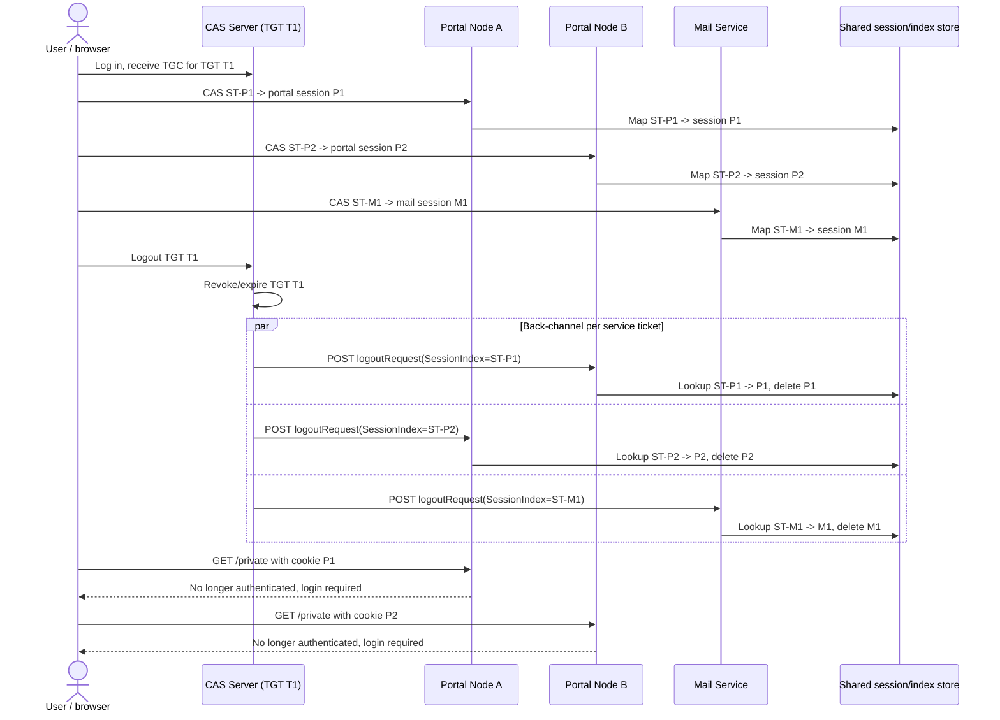

# Testing CAS Single Sign-Out Across Multiple Sessions and Nodes

**Module:** Spring Security – federation → SSO Testing.

**Goal:** test **CAS Single Sign-Out (SLO)** from the moment a user ends the SSO session at the CAS Server, CAS dispatches notifications to participating services, and each CAS client identifies the **exact service ticket and application session** to invalidate, until subsequent requests across **every application and every node** can no longer use the old session. This lesson focuses on **one TGT issuing multiple service tickets, multiple app sessions, multiple applications, multiple nodes behind a load balancer, cache/Redis/Spring Session, lost/duplicate callbacks, session fixation, and the difference between local logout and system-wide logout**.

**Key takeaway:** the CAS Server manages the **TGT/TGC** and service tickets tied to the SSO session; Java/Spring Security applications manage **`HttpSession`/`SecurityContext`**. CAS SLO is a **best-effort notification** asking services to invalidate their sessions, **not a magic command that automatically deletes `HttpSession` across every JVM**. To pass, you must prove service sessions were invalidated at the right applications—even when the SLO callback lands on a **different node from the one that created the session**; an HTTP 200 from the callback or merely losing the TGC is insufficient. CAS is **not a shared session manager for applications**.

This lesson uses illustrative domains `example.test`, service tickets `ST-...`, and synthetic session IDs; never put real TGTs/TGCs/STs, session cookies, user data, or raw `logoutRequest` payloads into logs, Git, or online tools. Spring/CAS filter snippets are **version-dependent configuration fragments**; the standalone Java 17 program in the hands-on section models the ticket → session mapping with deterministic stdout.

## 1. Three Session Layers the Test Team Must Distinguish

| Component | Belongs To | Purpose | When Does It Expire / Become Invalid? |
| --- | --- | --- | --- |
| **Ticket-Granting Ticket (TGT)** | CAS Server | Central SSO session; can issue multiple STs | CAS logout, expiry, revocation per CAS policy |
| **Ticket-Granting Cookie (TGC)** | Browser ↔ CAS domain | Browser presents TGT/session reference when contacting CAS | CAS logout/cookie expiry; not an app session cookie |
| **Service Ticket (ST)** | Issued by CAS for a service URL | Used by the client service to authenticate one turn with CAS | Usually single-use at `/serviceValidate`, yet ST ID is retained for **SLO correlation** |
| **HttpSession / JSESSIONID** | Each CAS client app | Holds Spring `SecurityContext` and app state | Local logout, timeout, CAS SLO when client invalidates, custom policy |
| **SessionMappingStorage** | CAS Java client or custom adapter | Links ST ID to `HttpSession`/session ID | After logout, session destroy/expiry/cleanup |
| **Spring Session (Redis/JDBC)** | Multi-node application | Stores `HttpSession` in a shared repository | Repository delete/expiry, app logout; **does not know CAS STs automatically** |
| **SecurityContext** | Spring Security | Principal, authorities, and authentication inside the app | Cleared/invalidated only when the local session is actually lost or revoked |

A user `alice` may hold **two distinct TGTs** across two browser profiles. SLO for the **first TGT** normally targets sessions/service tickets belonging to that TGT, **not automatically logging out every session of username `alice` organization-wide**. If “global logout of all sessions for user” is required, that is a separate revoke-all policy that must be defined explicitly—never conflate it with per-TGT SLO.

### 1.1. Tabs, Browser Contexts, and App Sessions

- Two tabs in the same browser profile normally share the **same app session cookie**: **two tabs do not automatically equal two application sessions**.
- Two separate browser profiles/incognito contexts normally have separate app sessions; they may also have **separate TGTs**.
- To accurately test **multiple app sessions spawned from one TGT**, the test sandbox must generate multiple STs under the **same TGT** and map them to two distinct app sessions (via controlled browser/cookie fixtures or a CAS test harness—never by copying production TGCs).
- The same `principal=alice` across two sessions with different TGTs must be tested as a **negative case**: logging out TGT-A must not arbitrarily destroy sessions from TGT-B.
- An app with **2 nodes** does not necessarily have **2 sessions**; a “node” is a JVM/pod handling requests, whereas a “session” is state tracked by the application.

**Key to testing:** **TGT → issued STs → each service's app session**, not “username → all sessions” and not “ST → TGT itself.”

## 2. How Does CAS SLO Work?

Apereo CAS distinguishes:
1. **Application logout** ends only one session at the application.
2. **CAS logout** ends the central SSO TGT/TGC session.
3. **CAS Single Logout** attempts to notify **participating service applications** so clients invalidate their local sessions.

CAS 8.x notes that SLO for the **CAS protocol** can be enabled by default; each registered service has a `logoutType` (e.g., `BACK_CHANNEL`, `FRONT_CHANNEL`, or non-participating). **Back-channel** is the per-service default and notifications may be dispatched asynchronously on a **best-effort** basis. Front-channel depends on the browser/JavaScript and the client's ability to receive the notice. Other protocols (SAML SLO/OIDC logout) have different behaviors and requirements and **must not be equated** with CAS protocol SLO merely because the XML carries the `samlp` namespace.



**Watch out:** the `ST-P1` callback arrives at **Portal Node B**, yet session P1 was created on Node A. If the mapping is just a `static Map` inside JVM A, B cannot find `ST-P1` and **fails to invalidate the session**. A load balancer with sticky sessions for browsers **does not guarantee** server-to-server callbacks from CAS carry the cookie/pinning to hit the same node. Passing multi-node tests requires a distributed session/index design or authenticated forwarding to the node holding the session.

## 3. Back-Channel Notification: What Is CAS Sending?

CAS protocol SLO typically uses a server-to-server **HTTP POST** to the service endpoint. Illustrative payload:

```http
POST /login/cas HTTP/1.1
Host: portal.example.test
Content-Type: application/x-www-form-urlencoded

logoutRequest=<URL-encoded-SAML-like-LogoutRequest>
```

Simplified XML **for explanation**, never treat as a verified message:

```xml
<samlp:LogoutRequest
    xmlns:samlp="urn:oasis:names:tc:SAML:2.0:protocol"
    xmlns:saml="urn:oasis:names:tc:SAML:2.0:assertion"
    ID="_logout_request_1"
    Version="2.0"
    IssueInstant="2026-11-07T03:00:00Z">
    <saml:NameID>alice</saml:NameID>
    <samlp:SessionIndex>ST-P1</samlp:SessionIndex>
</samlp:LogoutRequest>
```

**Critical semantics:**
- `SessionIndex` in a CAS SLO message, per Apereo CAS docs, usually carries the **ID of the CAS Service Ticket** used to authenticate at that service.
- `SessionIndex` is **not** `JSESSIONID`, **not** the `TGT`, and **not** the username.
- `NameID` is principal info inside the message; **never delete every session belonging to that username** simply because `NameID` is present.
- The service CAS client looks up `ST ID → HttpSession/session ID` to invalidate the exact session.
- Actual message formats/encodings can vary by CAS server/client version; verify the service's `logoutType` and corresponding docs.
- The `samlp` XML namespace here does not mean CAS protocol callbacks are protected like **SAML2 SP/IdP SingleLogoutService**. Evaluate source authentication and integrity for CAS SLO callbacks **separately**.

### 3.1. Why Match Exact ST Instead of Username?

Example:

```text
CAS TGT T1 (alice):
    ST-P1 -> Portal HttpSession P1
    ST-P2 -> Portal HttpSession P2
    ST-M1 -> Mail HttpSession M1

CAS TGT T2 (alice, different browser session):
    ST-P3 -> Portal HttpSession P3

When T1 logs out:
    Portal receives logout ST-P1 and ST-P2
    Mail receives logout ST-M1

Correct:
    invalidate P1, P2, M1
    keep P3 if SLO policy applies only to T1.

Wrong:
    invalidateAllSessionsByUsername("alice")
    -> P3 is also invalidated despite belonging to T2.
```

An “invalidate by principal” implementation can unintentionally cause a **denial-of-service** across the user's other sessions or break tenant isolation. Tests must clearly map **each ST** to **each app session**, and the `TGT → list of STs` relationship exists only on CAS/the test harness—never as a payload the portal blindly trusts.

### 3.2. One-Time Tickets Must Still Be Remembered for Logout

After the CAS client validates an ST at `/serviceValidate`:
- The ST is no longer valid for **logging in again**.
- CAS and the CAS client still need the **ST ID as a correlation key** for later SLO.
- The client should store `ST → application session ID` right after authentication succeeds and after session ID rotation per session fixation policy.
- If the session is recreated or its ID rotates while the map retains the old ID, SLO will look up the wrong or nonexistent session.
- The client should prune the map on session destroy/expiry and enforce a proper TTL/lifecycle to prevent memory leaks.
- Never log raw STs or echo STs back in redirect query strings after processing the ticket.

**One-time ticket ≠ no need to store SLO mapping.** Logout uses the ticket ID as a reference key; it does not re-redeem the ST for authentication.

## 4. Front-Channel CAS SLO and Differences from Back-Channel

Apereo CAS also describes **front-channel** callbacks sent via the browser, using AJAX/JSONP or iframes depending on configuration. Illustrative shape:

```text
GET https://portal.example.test/slo
    ?callback=<jsonp-callback>
    &logoutRequest=<base64-encoded-request>
    &_=<cache-buster>
```

**Characteristics:**
- The browser acts as the transport/sender; it can be disrupted by ad blockers, CSP, tracking prevention, cookie SameSite, and third-party context policies.
- Not every CAS client supports every front-channel shape; verify versions and the service registry.
- If a client handles only back-channel POSTs, a `GET` JSONP call may be ignored: CAS still displays the logout page while the app session survives.
- Iframes/AJAX may finish after the logout page renders, or fail due to network errors or the user closing the tab.
- Never open wildcard CORS or expose a GET endpoint that arbitrary users/attackers can invoke to invalidate sessions.
- Source verification and ST correlation must be checked per the actual CAS deployment, not merely by checking whether the request contains `logoutRequest`.

**Preferred for microservice/session-cluster architectures:** back-channel with network ACLs/mTLS and a shared session store is usually much easier to verify; if using front-channel, run real browser tests with cross-origin restrictions and a recovery/revocation strategy for lost callbacks.

### 4.1. Comparison Table

| Criterion | Back-Channel | Front-Channel |
| --- | --- | --- |
| Callback sender | CAS Server → app HTTP endpoint | Browser/AJAX/iframe to app |
| Typical HTTP shape | POST form field `logoutRequest` | GET with encoded `logoutRequest` and callback |
| Dependence on open browser page | Lower | Higher |
| Dependence on user cookies | Should not need user cookies | Can be impacted by browser cookie policies |
| Across load balancers | CAS connects to any node | Browser may be routed by cookie/same origin |
| Trust requirements | CAS callback auth, TLS, route ACLs, XML hardening | Source/correlation harder; do not rely on cookies alone |
| On callback failure | CAS SLO remains best-effort | Also best-effort, and easily interrupted by browser |
| Needs shared `ST→session` index | **Yes** with multiple pods | **Yes** if callbacks can hit another node |
| Recommendation | Test with real HTTP callbacks and clusters | Use only when client/browser support is proven |

## 5. SLO Registration on the CAS Server

In Apereo CAS 8.x, a registered service might define:

```json
{
  "@class": "org.apereo.cas.services.CasRegisteredService",
  "serviceId": "^https://portal[.]example[.]test/login/cas$",
  "name": "Portal sandbox",
  "id": 1201,
  "logoutType": "BACK_CHANNEL",
  "logoutUrl": "https://portal.example.test/cas/slo"
}
```

**This is a conceptual config example only**—JSON class names and service registry schemas are not guaranteed identical across every Apereo CAS release or store. Check current metadata and test in staging. The `logoutUrl` field, when set, directs callbacks to a **dedicated SLO endpoint** instead of POSTing to the initial `service` callback URL.

What to test in the service registry:
- Service `serviceId` is registered strictly, never with `.*` regexes or arbitrary hostnames.
- `logoutType=BACK_CHANNEL` for Portal/Mail when using POST callbacks. Use `FRONT_CHANNEL` only when client support exists.
- `logoutUrl` is a real receiving endpoint accessible **from the CAS Server** (DNS, TLS, firewall), not merely accessible from a browser.
- Registry enables SLO on the right services and is not accidentally disabled by profile/env-specific overrides.
- Users cannot supply a `service` parameter to point SLO targets at attacker-controlled URLs.
- Authenticated CAS callbacks are allowlisted/restricted per protocol and trust boundary.
- CAS SLO settings like `cas.slo.asynchronous` can dispatch callbacks asynchronously; tests must never treat the browser logout 200 timestamp as the instant of session invalidation.

### 5.1. CAS Logout Differs from Browser Redirects

`GET /cas/logout` invalidates the CAS SSO TGT and may, per policy, redirect the browser to a registered service via `service`. Yet **redirecting the browser to `/signed-out` does not mean all SLO messages have been processed**. Per Apereo CAS, `cas.logout.follow-service-redirects` may be disabled by default; never loosen the service registry just to “test the logout page.”

**Measure accurately:** before starting, agree on an **eventual invalidation** deadline fitting your SLO SLA (e.g., “under 5 seconds in staging” is a self-defined SLA, **not a CAS 5-second guarantee**). Tests must wait using bounded polling and verify responses for **all target app sessions**, rather than sleeping a fixed duration and guessing.

## 6. Apereo Java CAS Client: `SingleSignOutFilter` and Listener

**Spring Security CAS Authentication** and **Apereo Java CAS Client** documentation describe:
- `org.apereo.cas.client.session.SingleSignOutFilter` intercepts `logoutRequest` and consults the ticket→session mapping to invalidate `HttpSession`.
- `org.apereo.cas.client.session.SingleSignOutHttpSessionListener` cleans up mappings when sessions are destroyed or expire.
- `SingleSignOutFilter` must run in the proper filter order (recommended by CAS client docs to run **before other CAS client filters**).
- Spring Security examples configure `singleLogoutFilter` before `CAS_FILTER`; local logout and SLO callbacks are two distinct filter behaviors.
- Some Spring Security examples store mappings in an **in-JVM static Map**. That is **not distributed session mapping by default**.

Example Java web filter declaration (per Apereo Java CAS Client docs, **excluding the Spring Security filter chain**):

```xml
<filter>
  <filter-name>CasSingleSignOut</filter-name>
  <filter-class>
    org.apereo.cas.client.session.SingleSignOutFilter
  </filter-class>
</filter>
<filter-mapping>
  <filter-name>CasSingleSignOut</filter-name>
  <url-pattern>/*</url-pattern>
</filter-mapping>

<listener>
  <listener-class>
    org.apereo.cas.client.session.SingleSignOutHttpSessionListener
  </listener-class>
</listener>
```

**Version warning:** the `web.xml` snippet applies only if that CAS Java Client artifact matches the runtime **Servlet API**. Spring Boot 3/4 uses `jakarta.servlet`, while older CAS clients were compiled against `javax.servlet`. **Do not drop an old filter JAR into Boot 4 and ignore binary incompatibility.** Verify Maven dependency trees/Jakarta support, Spring Security major version, and Java version; Spring Security CAS docs also contain classic XML examples that must be translated accurately to modern `SecurityFilterChain`.

### 6.1. Filter Order Is a Test Subject, Not an Assumption

General flow:

```text
HTTP request
  ↓
Encoding / request security filters (if any)
  ↓
CAS SingleSignOutFilter: receives logoutRequest, maps ST → session
  ↓
CAS Authentication/Validation filters (login ticket)
  ↓
Spring SecurityFilterChain: SecurityContext/authorization
  ↓
Controller
```

Filters may be registered in the servlet container **outside** `FilterChainProxy` or inside the Spring Security chain depending on framework config. **Never register the same filter twice** accidentally via `@Bean Filter` and `FilterRegistrationBean`, which can run a request through it twice or in the wrong order. Verify via request/filter-chain tracing in a sandbox rather than reading config alone.

On CAS SLO callbacks, ensure the application's login entrypoint does not:
- Redirect the callback to CAS login (loop).
- Block the callback for lacking a browser session cookie.
- Fail Spring CSRF despite being a server-to-server POST (apply a **very narrow exemption** for the SLO endpoint and enforce alternative sender trust).
- Hit an API gateway expecting a browser `Authorization: Bearer` header.
- Read form parameters after the body was already consumed by another filter.

**Never disable CSRF across the whole app just to let SLO callbacks pass.** For back-channel endpoints, restrict the exemption to the exact path/method and require designed mTLS/source identity or CAS-specific validation.

### 6.2. Why `SingleSignOutHttpSessionListener` Matters

When a user logs out locally or a session expires:
- Stale `ST→session` mappings should be cleaned up to avoid memory leaks.
- Late SLO callbacks should be idempotent without harming newer sessions.
- If the session ID rotates, the mapping must point to the **current session**.
- Across multiple nodes, the listener must clean up the **distributed index**, not just a local map.

Do not assume the listener clears mappings in shared Redis automatically: verify your CAS client/custom adapter integrates with that store. Spring Session expiration events may require Redis Keyspace notifications and the right repository variant if relying on event-driven cleanup; **missing cleanup events must never let an old session “resurrect.”**

## 7. Cluster Hazard: A Local Static Map Is Not Enough

Broken design:

```text
    CAS login ST-P1 ------> Node A
                             localMap[ST-P1] = P1
                             localSession[P1] authenticated

    CAS SLO logout ST-P1 -> Node B
                             localMap does NOT contain ST-P1
                             Node B cannot invalidate P1

    Browser GET with P1 ---> Node A
                             SecurityContext still authenticated
                             SLO FAILED
```

**Sticky sessions do not reliably fix this**: the browser holds the app cookie, yet the CAS server's back-channel POST **carries no browser `JSESSIONID`** and the LB may route it to Node B. Tests must deliberately send the callback to another node to expose this bug.

### 7.1. A Verifiable Production Design

```text
                    +---------------------------+
                    | Redis/JDBC Shared Storage |
                    | Map ST -> current sess ID |
                    | HttpSession repository    |
                    | Revocation/tombstone TTL  |
                    +------------+--------------+
                                 |
                 +---------------+---------------+
                 |                               |
             Portal Pod A                    Portal Pod B
             Login P1                        SLO callback ST-P1
                 |                               |
           index ST-P1 -> P1                lookup ST-P1 -> P1
                 |                               |
           save Session P1                  delete P1 in shared store
                 |                               |
                 +-------------------------------+
                             |
                  GET /private with old P1
                     must be unauthenticated
```

**Two repositories with distinct responsibilities:**
1. **SessionRepository:** `sessionId → authenticated session data`, such as Spring Session Redis/JDBC.
2. **CAS Ticket Session Index:** `(service/tenant namespace, hashed or secret-protected ST ID) → current sessionId`; updated at login and upon session ID rotation.

Spring Session **does not auto-create an `ST→session` index** merely by being enabled; nor does the CAS client's default local `Map` know about Redis sessions. Write a custom adapter or pick a library/version supporting real distributed mapping, backed by integration tests.

### 7.2. What Does Spring Session Provide?

Spring Session `SessionRepository` supports reading/deleting sessions by ID. With an indexed repository, `FindByIndexNameSessionRepository` can query sessions by principal, yet **you should not use “find all sessions by username” in place of per-ticket SLO**. Specifically:
- Use the ST index to find the **exact** session ID.
- Call `SessionRepository.deleteById(sessionId)` to revoke the active app session in the shared store.
- When strict server-side revocation under concurrent requests is needed, account for request races/tombstones/revocation epochs.
- Remove the ST mapping or record processed notices for idempotency.
- Clean up stale mappings/expired sessions and namespace per application/tenant.
- Configure Redis repositories/indexes/events per your Spring Session version: never assume all repositories support identical principal indexing or event propagation.

**Warning on deleting the map before the session:** if you run `GETDEL(ST)` and crash before `deleteById`, the mapping vanishes while the session stays active. A resilient flow ensures **session revocation precedes acknowledgment/cleanup** and supports retries; for high guarantees, use transactions/outboxes, retried event consumers, or revocation markers per your architecture. Never report “SLO completed” merely because a ticket key was removed.

### 7.3. Login Session Fixation and ST Mapping

Spring Security includes session fixation protection; the ID can change on authentication success. For example:

```text
Before CAS ticket validation:  HttpSession OLD-123
After CAS authentication:      HttpSession NEW-456

WRONG mapping:
    ST-P1 -> OLD-123

RIGHT mapping:
    ST-P1 -> NEW-456
```

For CAS client filters, verify **when** the mapping is recorded, whether it updates on session ID change, and whether `HttpSessionIdListener`/Spring Session event handling stays in sync. If the CAS client stores a direct reference to a local `HttpSession`, behavior can diverge from a shared session repository; **never assume an `HttpSession` wrapper/proxy reference works across nodes**.

### 7.4. Two Races to Simulate

**Race A – logout during browser login:**
1. CAS issues an ST and the app begins validating it.
2. CAS SSO logs out / TGT expires and the SLO notice arrives.
3. The app has not yet written the `ST→session` mapping.
4. The “unknown ST” callback gets ignored.
5. The app finishes creating the session after the notice, leaving it alive even though the TGT logged out.

Mitigation: atomic association/negative tombstones/event holdbacks, state fencing, or verifying SSO revocation at login finalization per design. With a best-effort protocol, you cannot rely solely on network ordering; stress-test timing and fail closed when late.

**Race B – session revoked while a request is in flight:**
1. Request R1 already loaded `SecurityContext` from the shared session.
2. CAS SLO deletes the session in Redis.
3. R1 continues processing or writes session state on completion.
4. Subsequent requests may resurrect the session or side effects without revocation checks/lifecycle guards.

Mitigation depends on threat model: short-lived privileges, revocation epochs, authorization checks before sensitive side effects, session repository handling, optimistic concurrency, invalidation events, and browser isolation. **Never promise `deleteById` can retract an HTTP response already generated by an in-flight request.**

## 8. Spring Session Integration Fragment: After Verifying the CAS Callback

This is an **architectural code fragment**, not a controller verifying CAS `logoutRequest` on its own. An outer adapter layer must:
- Accept callbacks only from a trusted CAS Server per network/mTLS/authentication policy.
- Safely parse `logoutRequest` XML and extract the CAS ST `SessionIndex` per the CAS protocol/version.
- Validate context/issuer/message freshness if your deployed profile supports it; never trust raw `NameID`/query strings as user IDs.
- Invoke the service below only after producing a `VerifiedCasLogoutNotice`.

```java
package com.example.portal.slo;

import org.springframework.session.Session;
import org.springframework.session.SessionRepository;
import org.springframework.stereotype.Service;

@Service
public final class CasSessionRevoker {
    private final SessionRepository<? extends Session> sessions;
    private final CasTicketIndex ticketIndex;

    public CasSessionRevoker(
            SessionRepository<? extends Session> sessions,
            CasTicketIndex ticketIndex) {
        this.sessions = sessions;
        this.ticketIndex = ticketIndex;
    }

    public boolean invalidateVerifiedTicket(
            String verifiedCasServiceTicket) {
        // ONLY call after the callback has passed trust checks/parsing.
        String sessionId =
                ticketIndex.findSessionId(verifiedCasServiceTicket);
        if (sessionId == null) {
            return false;
        }

        // Revoke first; clean up mapping afterward.
        sessions.deleteById(sessionId);
        ticketIndex.removeIfMappedTo(
                verifiedCasServiceTicket, sessionId);
        return true;
    }
}
```

Interface to implement with Redis/JDBC per system requirements:

```java
package com.example.portal.slo;

public interface CasTicketIndex {
    String findSessionId(String serviceTicket);
    boolean removeIfMappedTo(String serviceTicket, String sessionId);
}
```

**These fragments are not a production SLO handler and cannot run standalone**: they require Spring Session dependencies, a `SessionRepository` bean, a `CasTicketIndex` implementation, authenticated CAS SLO ingress, session ID rotation integration, retries/TTL, an idempotency store, and atomicity/race tests. This service uses only the ST to look up a single session, never a username.

If storing raw STs in Redis:
- Restrict Redis/DB permissions, enable encryption, and audit log access.
- Consider an **HMAC-based index key** of the ST using an app-specific key to limit exposure of opaque tickets (ensuring CAS callbacks compute the same key).
- Set an index TTL no shorter than the app session lifetime requiring SLO unless another cleanup runs; still prune when sessions expire.
- Namespace keys by **CAS client application and realm/tenant/trust config** to prevent collisions and cross-application access.
- Never use user emails or role groups directly as index keys.

**Never implement a raw XML controller doing `String ticket = request.getParameter("logoutRequest")` followed by `findByPrincipalName(name).deleteAll()`.** That is easy to spoof, breaks per-ticket semantics, and lacks XML hardening.

## 9. Securing the CAS SLO Receiving Endpoint

CAS protocol back-channel logout XML **must not be assumed** to carry XMLDSig signatures like SAML2 Single Logout. Some CAS deployments send **unsigned** `logoutRequest` HTTP POSTs per the CAS client protocol. Build a trust boundary suited to your CAS version/config:
- Valid TLS, preventing downgrades or HTTPS bypasses.
- Only the CAS Server/CAS outbound egress identity may reach the SLO endpoint via **mTLS, authenticated gateway, or network policy/firewall/service mesh** as designed.
- If using signed notifications/profiles, verify signatures and trusted keys properly—never trust a certificate supplied in the request itself as authority.
- Restrict HTTP method, exact path, body size, content type, request rate, and timeout.
- Parse XML with a hardened parser (disable DTDs/external entities; block XXE, entity expansion, and XML bombs).
- Validate the message matches the CAS logout schema with a valid `SessionIndex`, rejecting arbitrary requests carrying internal session IDs.
- If ID/time/replay checks are supported, use server time and an idempotency store; never treat a message ID alone as source authentication.
- **Never use `X-Forwarded-For` as sole proof**, since headers can be spoofed if ingress fails to strip them.
- Callbacks need no browser session cookie; never rely on user cookies to authenticate server-to-server callers.
- Configure a **targeted CSRF exemption strictly for the SLO POST endpoint**, never disabling CSRF app-wide. Browser CSRF and CAS callback authentication are separate mechanisms.
- Never allow a callback carrying an arbitrary `ticket` to delete an entire user/account or sessions outside its service namespace.

### 9.1. SLO Destroys Sessions—Prioritize Fail-Safe Handling

If a spoofed `logoutRequest` can supply `SessionIndex=ST-of-victim`, it forces unwanted logouts on others (denial of service). Even though ST IDs are hard to guess, **randomness never replaces source authentication**. Test:
- HTTP POST from an untrusted internet client → blocked at gateway/mTLS.
- Malformed JSON/XML → rejected without touching sessions.
- Unknown `SessionIndex` → idempotent no-op, never bulk-logging out by `NameID`.
- `SessionIndex` belonging to another service → never invalidated.
- Replayed notice → no-op/safe status, never affecting newer sessions.
- Timestamp/signed-notice mismatch when required by contract → rejected.
- Never leak raw stack traces, tickets, or usernames in responses or logs.

**If CAS callbacks are blocked by a 403 CSRF error**, never fix it by disabling CSRF globally or setting `permitAll` on `/**`. Adjust only the SLO path with **verified alternative sender trust** and tested filter ordering.

## 10. Designing the Test Fixture: Multiple Apps, Multiple Sessions, Multiple Nodes

### 10.1. Staging Topology

```text
                   Browser/test harness
                          |
                      CAS Server
                       TGT-T1
                /          |         \
            ST-P1        ST-P2      ST-M1
              |            |          |
            Portal       Portal      Mail
          Session P1   Session P2  Session M1
             Node A       Node B      Node M
                \          /
                 \        /
           Portal Load Balancer
                    |
          Spring Session Redis
          Ticket->Session Index

CAS logout TGT-T1 sends:
   POST Portal SLO {SessionIndex: ST-P1}
   POST Portal SLO {SessionIndex: ST-P2}
   POST Mail SLO   {SessionIndex: ST-M1}

Separate TGT-T2 (same username alice):
   ST-P3 -> Portal Session P3
   MUST remain active if only TGT-T1 is logged out.
```

**The fixture must genuinely create two Portal sessions P1/P2**, not two tabs sharing a cookie. Use the IdP/CAS test harness to issue at least two STs under `TGT-T1` for one registered service across two independent app sessions, or use a test context managing separate CAS cookies and app sessions. Avoid copying production CAS cookies; if your test lab cannot easily create two app sessions under one TGT, explicitly document **1 session/1 TGT** and isolate the multi-session test into a standalone harness fixture—**never fake a PASS**.

### 10.2. Test Case Identifier Table

| Subject | Test Value | Same SSO `TGT-T1`? | Result After `TGT-T1` Logout |
| --- | --- | --- | --- |
| Portal app session P1 | `JSESSIONID=P1` / `ST-P1` | Yes | **Revoked** |
| Portal app session P2 | `JSESSIONID=P2` / `ST-P2` | Yes | **Revoked** |
| Mail app session M1 | `MAILSESSION=M1` / `ST-M1` | Yes | **Revoked** |
| Portal app session P3 | `JSESSIONID=P3` / `ST-P3` | **No; TGT-T2** | **Preserved** if policy scopes to `TGT-T1` |
| User `bob` session B1 | `ST-B1` from TGT-B | No | **Preserved** |
| Portal anonymous session X | Unauthenticated CAS session | No | Never treated as authenticated |
| In-flight R1 | Request loaded `SecurityContext` P1 pre-SLO | Belongs to `TGT-T1` | Must grant no new rights post-revocation; policy handles race |
| Fresh login P4 | `ST-P4` issued by CAS **after** `TGT-T1` logout on new auth | New TGT | May PASS if user genuinely re-logged in |

**Do not assert “after CAS logout, 401 must persist forever.”** When the browser sits on another IdP or the user signs in fresh, the app can create a new session. You only need to prove **old sessions P1/P2/M1** are no longer valid within scope; a redirect to CAS and fresh login does not make old sessions valid.

## 11. E2E Happy Path: From Login to Multi-Service Logout

### 11.1. Setup

- Isolated test CAS Server (non-production) with Portal/Mail in the service registry and back-channel SLO enabled per service.
- Portal deployed with **≥2 pods/nodes** behind an LB and a shared `HttpSession` repository for cross-node state.
- Distributed CAS `ST→app session` mapping instrumented to observe **masked identifiers**.
- Test Mail service with an SLO-capable CAS client; Mail's session backend is independent from Portal.
- Test CAS SSO user `alice`; user `bob` and separate `TGT-T2` as isolation fixtures.
- Test client retaining isolated app cookies and able to route callbacks intentionally to Pod A or Pod B to test cross-node delivery.
- Clocks/certs/DNS verified, CAS outbound able to POST SLO endpoints; test direct callbacks with mTLS/source auth per config.
- Metrics events enabled while redacting raw ST/TGT/TGC, session cookies, and `logoutRequest` XML.

### 11.2. Execution and PASS Criteria

**Step 1 – CAS Login:** test user logs into CAS, creating `TGT-T1`/TGC. Execute the CAS client login flow and obtain `ST-P1` for Portal. Portal validates the ST with CAS and establishes session P1. Record the `ST-P1→P1` mapping **internally** (hash/correlation, never raw logs).

**Step 2 – Create Multiple Sessions:** reuse `TGT-T1` in the lab to obtain `ST-P2` and an isolated Portal app session P2. Log into Mail with `ST-M1` to create M1. Confirm P1/P2/M1 all belong to `TGT-T1` in the CAS test registry/fixture.

**Step 3 – Controls:** create Alice's Portal P3 using **`TGT-T2`** and Bob's B1 using another TGT. Verify all sessions are active prior to SLO.

**Step 4 – Pre-Logout Check:** with individual cookies P1/P2/M1/P3/B1, GET `/whoami` or a protected resource. Expect authenticated responses for the right principals/tenants; never use `@WithMockUser`.

**Step 5 – Trigger CAS Logout:** from `TGT-T1`'s browser/harness, call `/cas/logout` via the allowed flow; verify `TGT-T1` can no longer issue new STs **without primary authentication**. Do not assert only HTTP 200 on the logout page.

**Step 6 – Observe CAS Callbacks:** CAS emits back-channel notices per registered service. Portal must receive/record **ST-P1 and ST-P2** separately; Mail receives `ST-M1`. POSTs hit the right SLO endpoints without requiring app user cookies.

**Step 7 – Force Cross-Node Delivery:** route the `ST-P1` notice to Portal Node B even though P1 was created on Node A, and conversely route `ST-P2` to Node A. This **catches local-Map bugs**. Use test ingress/harness/sandbox routing without altering production load balancers.

**Step 8 – Verify Shared Deletion:** the `ST→session` index resolves accurately; `SessionRepository` drops P1/P2; Mail drops M1. Mark PASS only once session IDs are actually invalidated/revoked, not merely when callbacks ack 200.

**Step 9 – Post-Logout Requests:** send GET requests to protected endpoints with **old cookies** P1/P2/M1 across **every eligible node**. Expect unauthorized/redirect to CAS login; strictly no authenticated `SecurityContext` from old sessions.

**Step 10 – Isolation:** P3 (`TGT-T2`) and Bob's B1 remain active if policy scopes logout to `TGT-T1`. SLO never bulk-revokes across all of username `alice`.

**Step 11 – Idempotency:** replay the `ST-P1` callback **inside the sandbox with an authenticated sender**. Expect a harmless no-op/ack per contract without invalidating P3 or resurrecting P1.

**Step 12 – Recovery:** simulate blocked CAS callbacks, offline nodes, or shared Redis timeouts. Mark SLO incomplete, verify alerts/retries/TTL strategies, and re-test; **never treat the CAS logout page as proof all apps logged out**.

### 11.3. Measurement Criteria

| KPI / Assertion | Meaning |
| --- | --- |
| CAS `TGT-T1` expired | Central CAS session has ended |
| Number of expected ST notices | Equals service ticket sessions in the CAS test registry |
| Actual SLO events received | May be lower when delivery fails |
| Exact per-ST mapping | Does not rely on username |
| Session deletion acknowledged | Shared session store recorded revocation |
| Authenticated request after delete | **Must be blocked across all nodes** |
| Unrelated sessions preserved | Does not revoke sessions from other TGTs |
| Callback latency | Eventual; compared against organization SLO SLA |
| Duplicate callback safety | Idempotent |
| Monitoring of missing callbacks | Pinpoints where best-effort SLO failed |
| PII/token sanitization | Never prints raw tickets/session cookies |

**The KPI “CAS logout returns HTTP 200” measures only the CAS endpoint and proves zero application sessions were invalidated.**

## 12. Standalone Java 17: SLO Across Two Portal Nodes and the Mail App

The program below **runs on Java 17** without Spring/CAS/Redis/networking. It models these principles:
- Two Portal sessions `P1`/`P2` and one Mail session `M1` under **`TGT-T1`**.
- Portal Node A and Node B share the same **logical shared session/ticket store**.
- Callback `ST-P1` arriving at Node B still deletes P1 created at Node A.
- Callback `ST-P2` arriving at Node A deletes P2 created at Node B.
- Mail receives `ST-M1` and invalidates M1 in its separate store.
- Duplicate `ST-P1` callbacks are no-ops.
- Session P3 (same username `alice` but from **`TGT-T2`**) is not deleted.

**Limitations:** this is an in-memory simulation **with no CAS logout XML parsing/signatures, `SessionRepository`, mTLS, threading/transactions/retries, session cookies, TTLs, or network security actions**. The `casTgtFixture` field is solely for explaining the test case; real CAS client apps generally **do not know TGT IDs** and never use TGTs as lookup keys.

File `CasClusterSloDemo.java`:

```java
import java.util.HashMap;
import java.util.Map;

public class CasClusterSloDemo {
    record AppSession(
            String sessionId, String user, String casTgtFixture) {}

    static final class SharedServiceStore {
        private final Map<String, String> ticketToSession = new HashMap<>();
        private final Map<String, AppSession> activeSessions = new HashMap<>();

        void login(String serviceTicket, AppSession session) {
            if (ticketToSession.containsKey(serviceTicket)) {
                throw new IllegalArgumentException("Duplicate service ticket");
            }
            ticketToSession.put(serviceTicket, session.sessionId());
            activeSessions.put(session.sessionId(), session);
        }

        boolean invalidateByServiceTicket(String serviceTicket) {
            String sessionId = ticketToSession.remove(serviceTicket);
            if (sessionId == null) {
                return false;
            }
            return activeSessions.remove(sessionId) != null;
        }

        boolean isActive(String sessionId) {
            return activeSessions.containsKey(sessionId);
        }
    }

    static final class Node {
        private final SharedServiceStore store;

        Node(SharedServiceStore store) {
            this.store = store;
        }

        boolean onVerifiedCasLogout(String serviceTicket) {
            return store.invalidateByServiceTicket(serviceTicket);
        }
    }

    public static void main(String[] args) {
        SharedServiceStore portal = new SharedServiceStore();
        SharedServiceStore mail = new SharedServiceStore();

        Node portalA = new Node(portal);
        Node portalB = new Node(portal);
        Node mailNode = new Node(mail);

        portal.login("ST-P1", new AppSession("P1", "alice", "TGT-T1"));
        portal.login("ST-P2", new AppSession("P2", "alice", "TGT-T1"));
        portal.login("ST-P3", new AppSession("P3", "alice", "TGT-T2"));
        mail.login("ST-M1", new AppSession("M1", "alice", "TGT-T1"));

        System.out.println("Portal P1 active: " + portal.isActive("P1"));
        System.out.println("Portal P2 active: " + portal.isActive("P2"));
        System.out.println("Mail M1 active: " + mail.isActive("M1"));

        System.out.println("SLO P1 via other node B: "
                + portalB.onVerifiedCasLogout("ST-P1"));
        System.out.println("SLO P2 via other node A: "
                + portalA.onVerifiedCasLogout("ST-P2"));
        System.out.println("SLO M1 via mail node: "
                + mailNode.onVerifiedCasLogout("ST-M1"));

        System.out.println("Duplicate ST-P1 harmless: "
                + !portalA.onVerifiedCasLogout("ST-P1"));
        System.out.println("All target sessions closed: "
                + (!portal.isActive("P1")
                && !portal.isActive("P2")
                && !mail.isActive("M1")));
        System.out.println("Other TGT session preserved: "
                + portal.isActive("P3"));
    }
}
```

Run in the file's directory:

```bash
javac CasClusterSloDemo.java
java CasClusterSloDemo
```

**Exact stdout:**

```text
Portal P1 active: true
Portal P2 active: true
Mail M1 active: true
SLO P1 via other node B: true
SLO P2 via other node A: true
SLO M1 via mail node: true
Duplicate ST-P1 harmless: true
All target sessions closed: true
Other TGT session preserved: true
```

### 12.1. Why Doesn't This Demo Prove Production SLO?

- `onVerifiedCasLogout` assumes the callback **already passed source authentication and safe parsing**; in reality CAS callbacks may be unsigned form XML needing mTLS/network auth.
- Both nodes share the same Java `portal` object to simulate a **shared store**, not two real processes. Network/Redis consistency, node crashes, session expiry, and LB routing remain untested.
- `HashMap` is not thread-safe; production requires atomic operations, transactions/tombstones, and event replay rules.
- `casTgtFixture` only labels the test case. Never use it to purge all sessions of a username, because CAS notifies **by ST**.
- The code does not simulate updating `ticket→sessionId` during Spring session fixation rotation.
- Production must verify old cookies on fresh HTTP requests fail after `SessionRepository.deleteById`.
- When callbacks reach Mail, Mail must process them within its **own store/session namespace**, never deleting Portal sessions using foreign STs.
- Duplicate callbacks must be idempotent; **HTTP 200 must still be paired with verifying “session is truly gone”** in E2E tests.

## 13. Lost Callback and Cluster Failure Scenarios

### 13.1. Callback Lands on the Wrong Node

**Setup:** Portal P1 on Node A, Node B receives `ST-P1`; local static map exists only on A.

**Expected:** With a cluster-safe implementation, Node B checks the shared index and revokes P1. With a local-only map, the test **FAILS** because cookie P1 remains authenticated via Node A. Never use sticky sessions as an excuse to skip this test.

### 13.2. Callback Arrives While Node A Is Down

**Setup:** P1 created on A, shut down A; CAS sends SLO to B.

**Expected:** B can still delete shared session P1 while Spring Session/index stays live. Once A restarts, P1 must never “reappear.” If the app uses local in-memory sessions on A, the design must forward events or replace the store.

### 13.3. CAS Callback Timeout or CAS Server Down

**Setup:** CAS logs out `TGT-T1`, yet the outbound POST to Portal times out or gets HTTP 5xx.

**Expected:** CAS SLO is **best-effort**: retries cannot be blindly assumed; the system observes missing callbacks and assesses remaining session risk. Policies may combine short session TTLs, periodic revalidation, revocation epochs, and circuit breakers, with a defined **SLA/security posture**. If immediate guaranteed global revocation is required, CAS SLO callbacks alone are insufficient.

### 13.4. Temporary Redis/Session Store Outage

**Setup:** Node B receives `ST-P1`, the index holds the mapping, yet Redis delete fails.

**Expected:** Never return fake business success; retry safely and keep the mapping for retries. Ensure in-flight requests do not extend the session past revocation. Alert on `SESSION_DELETE_FAILED` (without logging raw STs).

### 13.5. Duplicate or Out-of-Order Callbacks

**Setup:** CAS sends `ST-P1` twice, or `ST-P2` arrives before `ST-P1`.

**Expected:** Handle **idempotently, per ticket**. After the first call makes P1 inactive, the second is a no-op. `ST-P2` still cancels P2 without touching P3. Never assume CAS callbacks arrive in user login order.

### 13.6. Logout Right During Login

**Setup:** `TGT-T1` logs out before Portal finishes saving `ST→session`.

**Expected:** Prevent late-login from creating an authenticated P1 without a revocation marker. Tests use injection hooks/controlled barriers to reproduce the race; fixes depend on the store/adapter, such as transactions/tombstones or denying late authentication. Never add a hack checking the CAS cookie once and assuming safety.

### 13.7. Immediate Re-Login After Logout

**Setup:** CAS `TGT-T1` is revoked; the user reauthenticates and receives `TGT-T3`, `ST-P4`, and app session P4.

**Expected:** P4 authenticates normally since the user genuinely logged back in; **a delayed `ST-P1` callback must not revoke P4**. This tests precision of the `ticket→session` mapping and prevents username/reused-session-ID collisions.

### 13.8. Service SLO Disabled

**Setup:** Mail's registered service disables SLO via `logoutType`, or CAS callbacks are disabled.

**Expected:** CAS TGT logout does not automatically clear Mail session M1; tests must clearly record **SLO not configured/unsupported** rather than reporting PASS just because Portal invalidated cleanly. Design must explicitly accept or mitigate lingering local Mail sessions.

## 14. Comprehensive Test Matrix

| ID | Case | Expected Assertion |
| --- | --- | --- |
| SLO-01 | One app session, one ST, one node | SLO ST invalidates the exact `HttpSession` |
| SLO-02 | Two Portal sessions P1/P2 from same TGT | Both invalidated via two separate STs |
| SLO-03 | Portal + Mail from same TGT | Each app receives callback and deletes its own sessions |
| SLO-04 | Two tabs sharing app cookie | Do not pretend they are two sessions; one session logged out |
| SLO-05 | Two profiles, same username, two TGTs | Logging out TGT1 **does not** delete TGT2 session |
| SLO-06 | Portal P1 on Node A, callback hits Node B | Shared ST index invalidates P1 |
| SLO-07 | Portal P2 on Node B, callback hits Node A | Shared session store invalidates P2 |
| SLO-08 | Callback hits non-sticky load balancer | Works independently of browser cookies |
| SLO-09 | Node A shuts down before callback | Node B still invalidates shared session |
| SLO-10 | Node A restarts after revocation | Session is not resurrected |
| SLO-11 | CAS logout page returns 200 | **Not** yet marked SLO PASS |
| SLO-12 | `ST→session` mapping absent | Does not revoke arbitrary user; triggers QA FAIL/alert |
| SLO-13 | Mapping confuses ST vs `HttpSession` ID | Test catches wrong lookup |
| SLO-14 | Session ID rotates on login | Mapping points to final session ID |
| SLO-15 | CAS sends duplicate SLO POST | Idempotent; does not break newer sessions |
| SLO-16 | CAS sends callbacks out of order | Per-ticket revocation remains accurate |
| SLO-17 | `ST-P1` notice hits Mail service | Does not delete other Mail sessions |
| SLO-18 | Wrong principal in `logoutRequest` | Never bulk-deletes username sessions |
| SLO-19 | Forged internet callback | Blocked by sender trust/mTLS/policy |
| SLO-20 | Malformed XML/XXE/DTD | Reject parse; sessions untouched |
| SLO-21 | Wrong method/content type/path | No state mutation |
| SLO-22 | Unknown `SessionIndex` | No-op/appropriate ack; no bulk revocation |
| SLO-23 | SLO callback blocked by CSRF | Detects filter misconfig; uses narrow exemption |
| SLO-24 | Disabling CSRF globally | Test/security review must FAIL |
| SLO-25 | Callback returns 200 yet session persists | E2E FAIL |
| SLO-26 | Spring Session Redis delete failure | Retry/alert; no false ack |
| SLO-27 | CAS outbound network timeout | Best-effort gap detected; fallback policy active |
| SLO-28 | Delayed callback after new TGT | Only old ST session invalidated |
| SLO-29 | Logout while login mapping not yet saved | Tombstone/race policy prevents surviving session |
| SLO-30 | In-flight request re-saves session | Revocation policy prevents reactivation |
| SLO-31 | Redis TTL/expired mapping | No memory leak; never deletes newer session |
| SLO-32 | Session expired before SLO | Callback is an idempotent no-op |
| SLO-33 | Service `logoutType=BACK_CHANNEL` | Server POSTs exact configured `logoutUrl`/service |
| SLO-34 | Service `logoutType=FRONT_CHANNEL` | JSONP/iframe client-supported, browser-tested |
| SLO-35 | Service `logoutType` disabled | Recorded clearly as unsupported, no fake PASS |
| SLO-36 | Browser tab closed before front-channel SLO | Missing callback detected |
| SLO-37 | Multiple CAS client library versions | Compatible format/filter ordering contract |
| SLO-38 | Spring Boot 4 Jakarta vs old CAS `javax` client | Fails early on compile/integration if incompatible |
| SLO-39 | Protected request after logout on Node A | Unauthenticated |
| SLO-40 | Protected request after logout on Node B | Unauthenticated |
| SLO-41 | Independent `TGT-T2` session P3 | Remains authenticated per policy |
| SLO-42 | Bob session B1 | Not revoked |
| SLO-43 | Local portal logout only | CAS TGT survives; can re-SSO |
| SLO-44 | CAS logout without SLO client | CAS TGT invalid, app `HttpSession` may stay active |
| SLO-45 | Session cookie Secure/HttpOnly/SameSite | Matches policy; unexposed in telemetry |
| SLO-46 | Logs contain raw TGT/ST/TGC/`logoutRequest` | Privacy/security QA FAIL |
| SLO-47 | Callback storm, large XML, retries | Bounded resource usage, rate limits |
| SLO-48 | LB routes SLO URL to wrong service | Route/service namespace validation FAIL |
| SLO-49 | Multiple tenants share same hostname | ST index namespace prevents cross-tenant leakage |
| SLO-50 | Fresh login after logout | New TGT/ST/session work; old ST invalid |
| SLO-51 | All backend sessions are stateless JWT | CAS `HttpSession` SLO alone does not revoke JWTs; model separately |
| SLO-52 | Front-channel blocked by third-party cookies | Detects browser limitation; never misreports logout success |
| SLO-53 | Old session cookie reused after store delete | App must reject or trigger login |
| SLO-54 | Callback result audit entry | Has correlation/status but no raw credentials |
| SLO-55 | CAS logout propagation is asynchronous | Bounded eventual-check, not hardcoded immediate expectation |
| SLO-56 | CAS ticket validation fails during login | Creates no `ST→session` mapping or app auth |
| SLO-57 | Client local session invalidated manually | SLO index entry cleaned up |
| SLO-58 | Migration from local to Redis sessions | Cross-node callbacks still work |
| SLO-59 | CAS service registry wildcard | Reject overly broad/incorrect service targets |
| SLO-60 | Inconsistent node signing/trust config | Fail safe; no accidental login bypass |

**Evaluation rule:** every test case must identify *which TGT, which service ticket, which app session, which node, and which endpoint*; knowing only the username is insufficient. Negative tests **must actively induce failures** and prove other users' sessions remain intact, targeted sessions within SLO scope are gone, and spoofed callbacks are blocked.

## 15. Writing Automated Tests in the Project

### 15.1. Unit Tests

Focus on:
- `findSessionId(ticket)` returns only sessions in the right service namespace.
- `deleteById` is invoked solely for matched sessions; unknown tickets trigger no delete.
- Duplicate callbacks are idempotent.
- Session ID rotation and multiple sessions for the same user.
- Failed session deletes retain retry capability.
- Event ordering and key collisions.
- Explicit session revocation state/tombstones as required.
- Never logging raw STs.
- Never parsing raw XML via string `indexOf("<SessionIndex>")`.

**A unit test with a mock repository does not prove end-to-end SLO**; it checks adapter logic only.

### 15.2. Spring Integration Tests

Run Spring Security with the appropriate CAS client extension:
- Back-channel SLO filter/endpoint genuinely receives HTTP POSTs from an authenticated test gateway.
- Parses CAS `logoutRequest` accurately and invokes `SessionRepository`.
- Test Spring Session Redis/JDBC instance with a distributed index; never use a fake static map in cluster tests.
- `SecurityContext` exists before logout, and a fresh request with the old cookie loses it after the callback.
- HTTP CSRF policy exempts only the SLO path; other business POSTs still require CSRF.
- Simulate distinct application session IDs and verify logout targets only the selected ticket.
- Test node restarts/redeploys and Redis persistence/TTL.
- Test wrong envelopes, wrong callers, replays, and malformed XML.

Never use `@WithMockUser` as proof of a real CAS session. That annotation sets a fake Spring `SecurityContext`, bypassing CAS ST validation, the SLO filter, and session lifecycle.

### 15.3. E2E Browser + CAS + Multiple Pods

With a CAS Server sandbox, 2 Portal pods, Mail service, shared session store, load balancer, and real browser contexts:
1. Log in to issue STs under CAS TGT tracking.
2. Capture only hashed mapping IDs and status.
3. Trigger CAS logout.
4. Wait up to the **organization-defined SLO deadline** using bounded polling.
5. Verify all old session cookies across all nodes are unauthenticated.
6. Verify unrelated TGT/user sessions remain active.
7. Ensure CAS/Portal/Mail audit traces identify any service that missed a callback.
8. Test retries/failures/restarts and verify no unwanted session resurrection.

**Do not conflate** “opening multiple tabs” with “multiple sessions” when app cookies are shared. BrowserContext isolation must be explicit; if testing the same TGT across two contexts, build a controlled test fixture rather than copying production cookies.

### 15.4. Testcontainers and Production-Like Environments

In Java/Spring Boot CI:
- Use Testcontainers Redis/PostgreSQL (per CI policy) to run the shared session/index store.
- Spin up 2 Spring Boot instances on distinct ports sharing **one app's** Redis namespace.
- Test CAS IdP with service registry and local test credentials; no internet access needed.
- Test proxy routing callbacks to a different node from where the session was created.
- Separate Mail service with its own namespace and callback.
- Inject controlled CAS outbound delays/5xx, Redis outages, and node restarts.
- Store test certificates/keys in CI secrets; never keep raw session tickets or TGCs in test reports.

**Warning:** Testcontainers running Redis + two Spring instances **is not automatically a CAS SLO test**. You must include **real `ST→session` mapping and valid CAS callbacks** or an equivalent IdP sandbox; otherwise you are only testing session deletion.

## 16. Difference from Spring Security Concurrent-Session Control

Spring Security session management offers features like `maximumSessions(1)` or `SessionRegistry` to cap concurrent logins inside an app. This is **not CAS SLO**:
- Concurrent session control may expire a session when a new login occurs.
- CAS SLO requires tracking the **TGT/ST relationship** and receiving logout messages.
- In-memory `SessionRegistryImpl` is not a distributed multi-node registry unless integrated with shared sessions.
- Spring Session `FindByIndexNameSessionRepository` by principal works for admin logout-all, not as a substitute for `ST→session` correlation.
- Never enable `maximumSessions(1)` just to avoid testing multiple sessions; that alters business UX and does not fix cross-node callbacks.

If an app uses both CAS SLO and local session concurrency policies, test each independently as well as their interaction:
1. CAS logout of one TGT revokes only sessions linked to its STs per policy.
2. Concurrent session limits might expire an app session early; the later SLO callback should be an idempotent no-op.
3. Never let an expired session mapping accidentally point to a newer session.
4. For stateless REST apps using JWTs, invalidating `HttpSession` does not revoke JWTs; use token TTLs, introspection/revocation, PoP, or separate policies.

## 17. Practical Diagnosis by Symptom

| Symptom | Common Cause | What to Check |
| --- | --- | --- |
| CAS logout page renders yet Portal stays logged in | CAS SLO callback not sent or not processed | Registered service `logoutType`, callback traces |
| Portal Node A logs out while Node B stays active | Static local `ST→session` mapping or local `HttpSession` | Shared index/`SessionRepository` |
| CAS callback POST to Node B cannot find ST | ST mapping sits only on Node A | Cross-node callback test, store |
| LB sticky sessions enabled yet SLO still fails | CAS callback carries no browser cookie | Ingress route, distributed mapping |
| CAS callback returns 200 yet cookie still works | Filter acks without deleting actual `HttpSession` | Session repo readback + protected GET |
| Only P1 logs out while P2 survives | Only one ST handled or only current browser session checked | CAS registered ST list, multiple notices |
| P3 from another TGT also gets logged out | Wrongly scoped username-based revoke-all | ST/TGT fixture map, `findByPrincipalName` code |
| Mail does not log out | Mail SLO disabled or endpoint unreachable | CAS service registry, Mail listener |
| Callback gets 403 from Spring CSRF | SLO endpoint lacks proper exemption | CSRF matcher + sender auth |
| Callback redirects to CAS login | EntryPoint/filter order mishandles server POST | SLO filter order/matcher |
| SLO callback XML parse fails | Encoding/Content-Type/form parameter issue | CAS client filter, `CharacterEncodingFilter` |
| Parser reads wrong `SessionIndex` | Non-standard namespace/XML parsing | CAS client version and safe parser |
| SLO replay deletes a newer session | Old ST mapping points to reused session ID or overwrites map | Immutable mapping, unique keys, tombstones |
| Most callbacks arrive but a few drop | Async best-effort, network timeouts | Retries/metrics/short session TTL |
| Redis failure causes false SLO “PASS” | Deleted index first without deleting session | Operation order, ack semantics |
| Failures after Spring Boot 4 migration | Old Java CAS Client `javax.servlet` filter incompatible with Jakarta | Dependency tree/Servlet API |
| Local login succeeds yet ST mapping is empty | ST not registered after CAS service validation | Client auth success hook, fixation rotation |
| Callback arrives after session timeout | Stale ST index entry remains | Listener/expiration cleanup, idempotency |
| Browser logs out of CAS yet logs right back in | Another session/auto-login IdP or user re-logged in | TGT/TGC and app cookie lifecycle |
| Other apps stay logged in | CAS SLO not guaranteed on all services | App enrollment, `logoutType`, callback reachability |
| Back-channel callback firewalled | CAS host cannot reach internal app endpoint | CAS outbound DNS/TLS/network ACLs |
| Front-channel fails on Safari/Chrome | Browser/iframe/JSONP/cookie restrictions | Browser Network trace, front-channel support |
| App session ID unchanged after login | Session fixation policy disabled or wrong mapping | Spring session strategy/tests |
| Old P1 cookie still authenticated after delete | In-flight request re-save/session cache race | Shared session repository + revocation epoch |
| SLO callback leaks TGT/ST in logs | Verbose traffic logs, tracing | Redaction/secret scanning |
| `X-Forwarded-For` used to trust CAS | Spoofable proxy header | mTLS/server identity/network policy |

**Never “fix” issues by** disabling CSRF app-wide, setting `permitAll` on all routes, loosening CAS `serviceId` regexes, using browser session cookies to authenticate back-channel calls, deleting all sessions for a username, or abandoning SLO at the first dropped callback. Those changes cause out-of-scope session loss, security bypasses, or unreliable logouts.

## 18. Pre-Production CAS SLO Runbook

**A. Verify Contract**
- [ ] CAS protocol version/server/client supported; never confuse CAS SLO with SAML SLO/OIDC logout.
- [ ] Every registered service has exact `serviceId`, `logoutType`, and `logoutUrl`.
- [ ] CAS client has an SLO callback adapter compatible with the servlet/Jakarta runtime.
- [ ] Clear scope defined for “logout current TGT” vs. “logout all user sessions.”
- [ ] Session lifetimes, eventual consistency/SLO SLA, and lost-callback fallbacks approved.

**B. Verify Storage**
- [ ] `ST→appSession` mapping is created right after CAS ticket validation and session ID rotation.
- [ ] Mappings are scoped per service/tenant/IdP with proper TTL/cleanup.
- [ ] `HttpSession` truly resides in a shared store across multiple pods.
- [ ] Any node receiving a callback can revoke sessions created on another node.
- [ ] Redis outages, node crashes, or duplicate callbacks never cause false success or resurrect sessions.
- [ ] Sessions under other TGTs are not bulk-revoked due to matching usernames.

**C. Verify Callbacks**
- [ ] Endpoint reachable from the CAS Server with valid DNS/TLS/networking.
- [ ] Back-channel POST uses the expected content type and `logoutRequest` field.
- [ ] Sender is authenticated/trusted; XML parser resists XXE/DTDs and resource exhaustion.
- [ ] CAS client filter runs before the auth CAS filter, and listener cleanup works.
- [ ] Narrow CSRF exemption covers only SLO while protecting all other business POSTs.
- [ ] Raw STs, TGTs, TGCs, cookies, and `logoutRequest` never appear in logs or traces.

**D. Verify E2E**
- [ ] At least 2 Portal sessions + 2 Portal nodes + 1 other service under the same TGT in the fixture.
- [ ] Callback for P1 lands on a different node from where P1 was created.
- [ ] All targeted sessions lose authentication with old cookies.
- [ ] A session under a separate TGT remains active.
- [ ] Duplicate, lost, delayed, out-of-order, and forged callbacks are tested.
- [ ] Local logout and CAS global logout have distinct UX and documentation.
- [ ] Alerts fire on callback failures or SLO deadline breaches.
- [ ] Rollback plan exists if shared store or CAS service registry rollouts fail.

## 19. Self-Check Questions

**Q1. When a user logs out of CAS, does Portal's `HttpSession` expire automatically?**  
Not automatically. Only after CAS delivers an SLO callback to Portal and the CAS client **actually invalidates the exact session**, or the session expires per policy.

**Q2. What is `SessionIndex` in a CAS back-channel `logoutRequest`?**  
Per Apereo CAS SLO, it is the **CAS Service Ticket ID** linking the notice to the app session—not raw `JSESSIONID`, TGT, or user.

**Q3. Why are sticky sessions insufficient for back-channel SLO?**  
Because the CAS Server sends an independent POST usually **lacking the browser's app cookie** needed for LB pinning to the mapping node. You need a shared index/session store or reliable routing to the right node.

**Q4. Do two tabs sharing one cookie prove multi-session testing?**  
No. Two tabs typically share the same `HttpSession`; you need at least two **distinct session IDs** with separate STs verified under the same TGT in the test fixture.

**Q5. If one username holds two CAS TGTs, should logging out TGT-A delete both?**  
Per-TGT CAS SLO normally targets only sessions tied to STs from TGT-A. “Logout-all-by-user” is a separate policy requiring explicit decision and false-positive checks.

**Q6. The callback returned HTTP 200 and the CAS logout page rendered—is QA PASS?**  
No. You must test **old session cookies** against protected endpoints and confirm unauthenticated responses across all target nodes/services.

**Q7. Why can CAS client `SingleSignOutFilter` work on one node yet fail in a cluster?**  
Because the default/static JVM map and local `HttpSession` are not shared across nodes. You need distributed `ST→session` mapping and a shared session repository.

**Q8. If a CAS callback is dropped due to a network error, is the user guaranteed logged out everywhere?**  
No. CAS SLO is best-effort; you need monitoring, timeout/revocation policies, and risk controls beyond callbacks.

**Q9. Is calling `FindByIndexNameSessionRepository` to delete all sessions by username proper CAS SLO?**  
No, because it can destroy sessions from other TGTs. Map each ST in the SLO message to its exact local session.

**Q10. Does a back-channel callback need a browser CSRF token?**  
It normally has no browser session/token; apply a targeted CSRF exemption **and** authenticate the CAS server source via proper trust boundaries rather than disabling CSRF app-wide.

**Q11. Why can running `GETDEL(ST)` before `deleteById` fail?**  
The process might crash after deleting the mapping and before deleting the session, leaving no key to retry while the session stays active. Enforce proper operation ordering/retries or transactions/tombstones.

**Q12. Is front-channel logout supported by every CAS client?**  
No. Check client support, browser restrictions, and semantics; Apereo notes front-channel may be unsupported in some CAS clients.

## 20. Official Documentation and References

1. [Apereo CAS 8.x – Logout & Single Logout](https://apereo.github.io/cas/8.0.x/installation/Logout-Single-Signout.html): CAS logout vs. application logout, back/front channel, `logoutType`, `logoutUrl`, ST-as-SessionIndex, best-effort asynchronous notifications, and CAS not managing application sessions.
2. [Apereo CAS – Protocol Specification / Single Logout](https://apereo.github.io/cas/development/protocol/CAS-Protocol-Specification.html): back-channel `logoutRequest` POST, service ticket handling, fire-and-forget, client responsibility.
3. [Apereo Java CAS Client – Configuring Single Sign Out](https://github.com/apereo/java-cas-client): `SingleSignOutFilter`, `SingleSignOutHttpSessionListener`, filter ordering, and local session lifecycle.
4. [Spring Security – CAS Authentication / Single Logout](https://docs.spring.io/spring-security/reference/servlet/authentication/cas.html): local logout vs. CAS logout, filter/hook integration, static Map limitations, and listeners.
5. [Spring Session – Redis Configuration](https://docs.spring.io/spring-session/reference/configuration/redis.html): shared session storage, expiration events, indexed repository, and delete-by-ID.
6. [Spring Session – API Documentation](https://docs.spring.io/spring-session/reference/api.html): `SessionRepository` and session indexing/event semantics.
7. [Spring Security – Session Management](https://docs.spring.io/spring-security/reference/servlet/authentication/session-management.html): `SecurityContext` persistence, session fixation, and concurrent session handling.
8. [OWASP – Session Management Cheat Sheet](https://cheatsheetseries.owasp.org/cheatsheets/Session_Management_Cheat_Sheet.html): session ID rotation, logout, expiration, and state invalidation.
9. [OWASP – XML External Entity Prevention](https://cheatsheetseries.owasp.org/cheatsheets/XML_External_Entity_Prevention_Cheat_Sheet.html): XML parser protections for `logoutRequest`.
10. [OWASP – CSRF Prevention Cheat Sheet](https://cheatsheetseries.owasp.org/cheatsheets/Cross-Site_Request_Forgery_Prevention_Cheat_Sheet.html): distinguishing browser CSRF from authenticated server-to-server callbacks.
11. [Spring Security – CAS Security Reference](https://docs.spring.io/spring-security/reference/7.0/servlet/authentication/cas.html): example CAS `SingleSignOutFilter` configuration in Spring Security (cross-check against your active Jakarta/Boot version).

**Conclusion:** proper CAS SLO testing must prove **CAS TGT logout → exact callbacks sent per issued ST → CAS client on any node resolves `ST→exact application session` → session deleted in shared store → all subsequent requests with old cookies lose their authenticated `SecurityContext`**. At the same time, sessions from other TGTs stay intact, and duplicate callbacks or network failures are handled idempotently and visibly. Because CAS callbacks are only **best-effort notifications**, multi-session/multi-node testing requires clear storage, trust boundaries, and fallback revocation strategies rather than marking PASS based on the CAS logout page or callback HTTP 200.