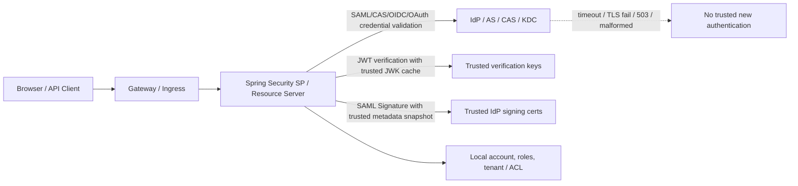
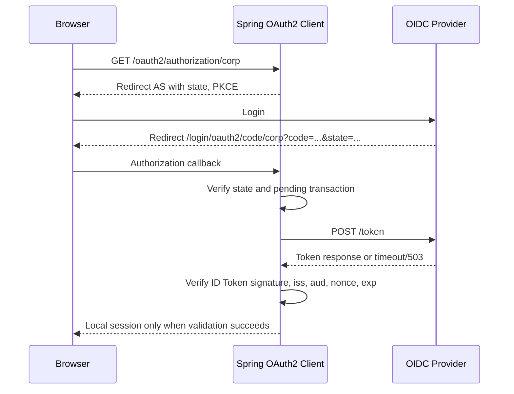

# Testing Network Errors, Timeouts, and Fail-Closed Behavior on Missing Trust in SSO

## 1. Problem and Scope

In **SSO/federation**, a Spring Security application depends on external identity systems: a CAS Server, OIDC Authorization Server, SAML Identity Provider (IdP), OAuth2 introspection, JWKS endpoint, Kerberos KDC, or identity-aware proxy. When the network is healthy, users log in and receive authorization. Yet **unresolvable DNS, TCP refused/reset, invalid TLS certificates, connect/read timeouts, HTTP 503s, malformed responses, or missing signing keys/IdP metadata** can leave the application without enough proof to trust a new identity.

The goal of testing is not merely catching exceptions, but **proving the application grants no protected access when mandatory authentication evidence is missing**. At the same time, understand bounded exceptions: a JWT already verified using an **available trusted public key** can be validated completely locally while the IdP is briefly unreachable; an already-authenticated, unexpired application session also has its own lifecycle. That is **not** a mechanism to skip authentication checks during failures.

This lesson belongs to **SSO Testing** in the **Spring Security – federation** module; examples target Java 17+, Spring Boot 3.x, and Spring Security 6.x (preferring 6.5.x). The `example.test` addresses and credentials are illustrative only; never use them directly in production.

### Learning Outcomes

1. Distinguish **missing credential**, **invalid credential**, **incomplete verification due to network error**, **validly verified**, and **authorized for business actions**.
2. Identify the network call points for CAS, OAuth2/OIDC Authorization Code, opaque introspection, JWT/JWKS, SAML, and Kerberos.
3. Choose safe **connect timeouts, read timeouts, deadlines**, and retry policies.
4. Simulate DNS failures, TCP resets, HTTP 429/503s, invalid TLS, latency, and malformed JSON/XML in a test harness.
5. Verify **fail-closed** behavior: never create an authenticated principal or expose protected data when trust is insufficient.
6. Understand the difference between 401, 403, and 5xx/503 in the HTTP contract.
7. Separate failing new logins from pre-existing valid browser sessions.
8. Never disable issuer, audience, signature, state/nonce, `InResponseTo`, or certificate validation during outages.
9. Write a Java 17 demo with exact output alongside JUnit/MockMvc/WireMock tests.
10. Operate with logging, metrics, circuit breakers, canaries, and negative tests.

## 2. The Fail-Closed Principle and Controlled Exceptions

**Fail closed**: whenever a mandatory condition to trust an authentication **remains unproven**, the security decision is **DENY**. It does not require every error to return HTTP 401. The system may return 401, a login redirect, 503, or a server error per protocol and exception mapping—so long as it creates no new principal/privileges and returns no protected data.

Three common states:

| State | Example | Handling |
| --- | --- | --- |
| Unverified | Client sends ST, authorization code, or unverified opaque bearer token | If the online verification endpoint fails, refuse to create authentication |
| Locally verified and still valid | JWT verified with a trusted cached key; `SAMLResponse` verified with a provisioned trusted IdP cert | May accept per trust/expiry/revocation/tenant policy without hitting IdP every request |
| Missing/broken trust | Invalid TLS cert; JWT `kid` lacks a trusted key; invalid SAML signature/issuer; bad OIDC state | Reject immediately even when the network is healthy |

**Key sentence to remember:** “IdP unreachable” differs from “no trusted evidence.” If the app truly holds complete locally verified, unexpired evidence, an IdP outage need not break that request. Conversely, **there is no way to mint a newly verified token by guessing when the online verifier does not answer**.

### What Must Strictly Be Avoided

```java
// ANTI-EXAMPLE: never do this in authentication logic.
try {
    return remoteIdentityProvider.verify(credential);
} catch (Exception outage) {
    return new User("anonymous", "ROLE_ADMIN");
}
```

Likewise, never switch on `anyRequest().permitAll()`, never assume `active=true` on opaque tokens, never read `X-User` from browsers, never disable TLS validation, and never trust unverified JWT signatures “to keep the service up.”

## 3. Trust Boundary Architecture and Failure Points



**Front-channel** flows traverse the browser: redirects to the IdP, returning OIDC callbacks, SAML HTTP-POST ACS, and CAS `ticket`s. **Back-channel** flows go from Spring to the IdP: OAuth token endpoint, CAS `/serviceValidate`, opaque introspection, JWKS fetches, and metadata refreshes. These channels carry different timeout and trust properties.

A browser callback does not become trustworthy merely because it hits the right URL. `code`, `state`, `SAMLResponse`, and `ticket` can all appear in attacker-crafted HTTP requests. The Spring provider or external verifier must validate every protocol rule before creating `Authentication`.

## 4. Classifying Network Errors and Authentication Errors

| Type | How to Simulate | Common Symptom | What to Verify |
| --- | --- | --- | --- |
| DNS failure | NXDOMAIN / test DNS container | `UnknownHostException` | Never fall back to unapproved endpoints |
| TCP connect refused | Test port with no listener | `ConnectException` | No authentication created |
| Connect timeout | Drop TCP SYN in sandbox | `ConnectTimeout` | Bounded deadline; fail closed |
| TCP reset | WireMock/Toxiproxy fault | Connection reset | Never blindly retry one-time codes/tickets |
| Read timeout | Stub delay past `readTimeout` | `SocketTimeoutException`/`HttpTimeoutException` | Never accept an unreceived body |
| Invalid TLS CA | Untrusted test HTTPS cert | `SSLHandshakeException` | Never trust-all |
| TLS hostname mismatch | SAN mismatches hostname | Hostname verification failure | Never disable hostname verification |
| HTTP 429/500/503/504 | Stub status | Upstream unavailable/overloaded | Never treat token as active |
| Malformed JSON/XML | Partial/garbled body | Parsing exception | Never extract user from fragments |
| Unexpected redirect | Redirect to unknown host | SSRF/trust confusion | Never follow untrusted discovery |
| JWKS cache miss | New token `kid` while JWKS down | Missing key | Reject unverified token |
| Wrong issuer/audience | Signed token for another service | Valid crypto key yet wrong context | Reject |
| State/nonce mismatch | Cross-browser OIDC callback | Protocol correlation failure | Reject |
| Clock skew/expiry | Invalid `exp`/`NotOnOrAfter` | Temporal token failure | Reject per bounded skew |
| Proxy header spoof | Client injects `X-Verified-User` | Spoofed user | Strip/overwrite + backend isolation |

**Every negative case needs at least one positive control** with valid credentials and a healthy network path, preventing “tests always error” from hiding broken configuration.

## 5. HTTP Rules: 401, 403, or 503?

Distinguish **security decision** from **HTTP status**:

- **401 Unauthorized / login redirect:** unauthenticated or invalid credential. Bearer Resource Servers normally use 401.
- **403 Forbidden:** authenticated user **lacks permission** (e.g., tenant/role/ACL forbids access).
- **503 Service Unavailable or 5xx:** upstream validation service timeout, DNS/TLS failure, or configuration outage. This indicates an operational fault rather than proving the credential invalid.
- **SAML/CAS browser flows:** Spring's authentication failure handler may redirect to a login/error page (3xx); you cannot assert every error returns 401.
- **Opaque token introspector:** dependency-unavailable exceptions may map differently by entry point/handler/version; do not assume Spring always returns 503.
- **Locally valid JWT:** may return 200 when authorities/local ACLs permit, even while the JWKS endpoint is down, because local cryptographic verification still passes.

**Test invariant:** zero unauthenticated access to protected endpoints, zero new sessions from unverified credentials, and zero role escalations. Only after that assert status codes per your app's contract.

Safe error body example:

```json
{
  "error": "authentication_temporarily_unavailable",
  "requestId": "correlation-test-123"
}
```

Never return raw tokens, stack traces, signing keys, CAS tickets, `SAMLResponse`, or client secrets.

## 6. Connect Timeout, Read Timeout, Deadlines, and Budgets

Back-channel path:

```text
resolve DNS
  -> TCP connect
  -> TLS handshake + certificate validation
  -> send HTTP request
  -> wait HTTP response
  -> read body
  -> parse token/JSON/XML
  -> signature + issuer + audience + time validation
  -> resolve local identity and permissions
```

- **Connect timeout** bounds TCP connection establishment.
- **Read/socket timeout** bounds waiting for response headers or body bytes.
- **Connection pool acquisition timeout** bounds waiting for a pooled connection.
- **Overall deadline** bounds total elapsed time across retries, parsing, validation, and proxy hops.
- **Clock skew** concerns token validity timestamps, **not** network connection timeouts.
- **Cancellation** when a browser/proxy closes a request must propagate to avoid exhausting threads.
- **Multi-layer timeouts** can yield actual latencies different from any single HTTP client timeout.

Illustrative **sample policy**: 1s connect, 2s read, 4s overall, at most one retry strictly on GET JWKS if permitted. This is **not a Spring Security default**. Review IdP/AS/KDC SLAs and test empirically before choosing bounds. Never raise timeouts to minutes to mask an unavailable service.

When a client hits a timeout, the conclusion is **unconfirmed**, not “authenticated successfully but the response was slow.”

## 7. Unsafe Retries with One-Time Credentials

Some operations may already have been processed by the server before the response was lost:

| Protocol / Operation | One-Time Semantics | Safe Behavior After Timeout |
| --- | --- | --- |
| CAS ST `/serviceValidate` | ST is valid for **one validation attempt** | Grant no principal; start a new flow for a fresh ST |
| OAuth2/OIDC `/token` code exchange | Short-lived, single-use code | Never guess tokens; normally start a new authorization flow |
| SAML Artifact Resolve | Artifact may be one-time per profile | Never blindly retry when outcome is uncertain |
| Opaque introspection | Usually read-only status check | Bounded retries per contract allowed, never fail-open |
| JWKS/metadata GET | May retry GET with backoff | Use strictly trusted endpoints/keys |
| Kerberos KDC | Stack has its own retries | Never bypass GSS validation on KDC errors |

**Crucial for CAS:** if CAS already consumed the ticket before the response reset, retrying the same ST returns `INVALID_TICKET`, which is correct. An app turning a timeout into success is an **authentication vulnerability**.

**Crucial for OAuth authorization codes:** the token endpoint may have exchanged the code before the SP got the response; retrying may return `invalid_grant`. Never synthesize a fake ID Token or fall back to an `email` query param.

## 8. CAS: Testing Network Failures on `/serviceValidate`

CAS login flow:

```text
Browser -> Spring /login/cas?ticket=ST-...
Spring CAS client -> CAS /serviceValidate?service=...&ticket=ST-...
CAS -> XML authenticationSuccess or authenticationFailure
Spring -> CasAuthenticationToken after valid success
```

When CAS fails to respond properly, `CasAuthenticationProvider`/`TicketValidator` cannot confirm the user. Test cases:

1. CAS hostname fails DNS resolution.
2. TCP connection refused/timed out.
3. CAS returns 503.
4. CAS returns HTTP 200 with `<cas:authenticationFailure code="INVALID_TICKET">`.
5. CAS returns malformed/empty XML.
6. CAS closes socket after consuming the ticket.
7. Invalid CAS certificate/hostname.
8. Expired or replayed CAS ticket.
9. CAS ST issued for service A validated with service B (`INVALID_SERVICE`).
10. Inconsistent CAS ticket registry cluster.

**CAS 2.0 requires an ST to be valid for one validation attempt even when that attempt fails**. Verify with a **real test CAS Server** to prove behavior rather than relying solely on custom XML HTTP stubs.

**Isolate stale Spring sessions:** if the browser already holds an authenticated `JSESSIONID`, a subsequent `GET /secure` may still return 200 even if a new ST fails validation. That is merely session continuity. Outage login tests must use a **fresh anonymous session**.

## 9. OIDC Authorization Code: The Token Endpoint Is a Trust Dependency

Standard steps:



If `/token` times out or returns 503:

- **Never** create an authenticated user from `code`/`state`.
- Never accept missing/broken `id_token`s or `email` query params.
- Never disable `state` or `nonce` “to make retries easier.”
- Never redirect the user to protected resources as if logged in.
- If the authorization code may already have been consumed, require a fresh transaction instead of retrying endlessly.
- Still record retries/timeouts in telemetry without raw codes.

Negative tests also include: `invalid_grant`; wrong client secret; malformed token responses; wrong issuer/audience/nonce; expired ID Token; lost browser session/RelayState-like state; unknown JWK `kid` while JWKS is down; callback hitting the wrong registration. These are not merely network bugs—they represent **missing trust**.

## 10. JWT Resource Server: Local Verification When JWKS Is Down

Unlike opaque tokens, signed JWTs **can be verified locally** using trusted public keys already in the JWK cache:

```text
JWT header kid=K1
Trusted JWK cache contains K1
JWT signature valid
iss=expected, aud=API, exp/nbf valid
Local role/tenant/ACL allows access
JWKS endpoint temporarily down
=> may ALLOW per policy
```

Opposite scenario:

```text
JWT header kid=K2
Trusted JWK cache only contains K1
JWKS fetch timed out
=> signature verification unavailable
=> DENY
```

This **does not** permit accepting arbitrary keys, skipping signature verification, accepting `alg=none`, fetching token-suggested `jku`/`x5u` URLs, or skipping issuer/audience/time checks. Cached JWKs provide only **already-trusted keys**; every JWT still undergoes cryptographic signature verification.

| Test | Key Cache | Network | JWT Claims | Expectation |
| --- | --- | --- | --- | --- |
| JWT signed K1 | K1 trusted | Down | Valid | May return 200 if authorized |
| JWT signed K2 | K2 unknown | Down | Otherwise valid | Reject |
| JWT signed K1 | K1 trusted | OK | Expired | Reject |
| JWT signed K1 | K1 trusted | OK | Wrong issuer/audience | Reject |
| JWT signed K1 | K1 revoked per policy | Down | Valid | Reject |
| JWT signed unknown algorithm | Mismatched key | OK | Valid | Reject |
| JWT signed K1 | K1 trusted | OK | Local user disabled | No business permission |

### Baseline Spring Boot Configuration

```yaml
spring:
  security:
    oauth2:
      resourceserver:
        jwt:
          issuer-uri: "https://idp.example.test/issuer"
          jwk-set-uri: "https://idp.example.test/issuer/.well-known/jwks.json"
          audiences: "api://orders"
```

This **example targets Spring Boot versions supporting `audiences`**. If your BOM omits that property, configure an audience validator explicitly; never assume `issuer-uri` alone suffices. Specifying both `issuer-uri` and `jwk-set-uri` can avoid startup discovery dependency while **still validating `iss`**. Check exact properties for your Spring Boot version.

## 11. Spring Security JWT `SecurityFilterChain`

For a Spring Boot 3 / Security 6.x app with `spring-boot-starter-oauth2-resource-server`:

```java
@Bean
SecurityFilterChain jwtApi(HttpSecurity http) throws Exception {
    return http
            .securityMatcher("/api/**")
            .sessionManagement(s -> s.sessionCreationPolicy(
                    SessionCreationPolicy.STATELESS))
            .authorizeHttpRequests(auth -> auth
                    .requestMatchers("/api/public").permitAll()
                    .requestMatchers("/api/admin/**")
                        .hasAuthority("SCOPE_admin")
                    .anyRequest().authenticated())
            .oauth2ResourceServer(oauth -> oauth
                    .jwt(Customizer.withDefaults()))
            .build();
}
```

This is a **JavaConfig fragment** needing imports and a trusted `JwtDecoder`. `authenticated()` does not replace local tenant/ACLs; a JWT carrying `SCOPE_admin` is valid only when the issuer and audience are authorized to grant it.

To customize JWKS fetch timeouts in Security 6.5:

```java
@Bean
JwtDecoder decoder(
        RestTemplateBuilder builder,
        @Value("${app.jwt.jwk-set-uri}") String jwks,
        @Value("${app.jwt.issuer}") String issuer) {

    RestOperations rest = builder
            .setConnectTimeout(Duration.ofSeconds(1))
            .setReadTimeout(Duration.ofSeconds(2))
            .build();

    NimbusJwtDecoder jwt = NimbusJwtDecoder.withJwkSetUri(jwks)
            .restOperations(rest)
            .build();
    jwt.setJwtValidator(JwtValidators.createDefaultWithIssuer(issuer));
    return jwt;
}
```

**This snippet is not a standalone Java file**; add imports for `JwtDecoder`, `NimbusJwtDecoder`, `JwtValidators`, `RestTemplateBuilder`, `RestOperations`, `@Value`, and `Duration`. `JwtValidators.createDefaultWithIssuer` checks default issuer/timestamps **without adding an audience validator**—add one per contract. Builder APIs can change across Boot/Security minor versions; check Javadocs for your release.

Test both **cold cache** (JWKS not yet fetched) and **warm cache** (K1 trusted): IdP outages affect them differently. Never extend JWK cache TTL indefinitely to hide key rotation/revocation errors.

## 12. Opaque Token Introspection: Deny When Online Verification Fails

A Resource Server can call `/introspect` per RFC 7662. Only when a **trusted AS** returns a valid response with `active=true` and matching claims does Spring have grounds to build `Authentication`.

```json
{
  "active": true,
  "sub": "alice",
  "scope": "orders:read",
  "exp": 1795000000
}
```

That JSON is valid only when received from the **trusted introspection endpoint** with proper transport, certificate, and client authentication. A browser POSTing `active=true` proves nothing.

| Upstream Result | Decision |
| --- | --- |
| 200, `active=true`, valid schema | Proceed to local authorization |
| 200, `active=false` | Reject invalid token |
| 200, missing `active` | Never default to true |
| 200, malformed JSON | Reject / unavailable |
| 401 due to bad client credentials | No verified result; alert configuration |
| 429/503/timeout | Unknown token status; deny new authentication |
| Invalid TLS | Reject |
| Cached success past TTL | Never reuse indefinitely |

If integrating online revocation, caching positive introspection results too long keeps revoked tokens active. Caches require **token-specific keys, issuer/audience/tenant binding, bounded TTLs, and acceptable revocation delays**. Never fall back to a default principal when the AS is down.

## 13. Spring Boot Opaque Introspection and Timeouts

OAuth2 Resource Server starter configuration, opaque branch:

```yaml
spring:
  security:
    oauth2:
      resourceserver:
        opaquetoken:
          introspection-uri: "https://idp.example.test/introspect"
          client-id: "orders-api"
          client-secret: "LOADED_FROM_SECRET_MANAGER"
```

`LOADED_FROM_SECRET_MANAGER` is strictly an **illustrative placeholder**, not a real secret. Use a secret manager and never commit credentials.

Spring Security 6.5 provides `SpringOpaqueTokenIntrospector` and `RestOperations`. Config fragment:

```java
@Bean
OpaqueTokenIntrospector introspector(
        RestTemplateBuilder builder,
        @Value("${app.introspection.uri}") String uri,
        @Value("${app.introspection.client-id}") String clientId,
        @Value("${app.introspection.client-secret}") String secret) {

    RestOperations rest = builder
            .basicAuthentication(clientId, secret)
            .setConnectTimeout(Duration.ofSeconds(1))
            .setReadTimeout(Duration.ofSeconds(2))
            .build();

    return new SpringOpaqueTokenIntrospector(uri, rest);
}
```

Requires imports, matching Boot BOM, and strict TLS validation. Newer branches use `RestClientOpaqueTokenIntrospector` with `RestClient`; do not mix 6.5 and 7.x APIs. If an upgrade removes `setConnectTimeout`, inspect the actual `RestTemplateBuilder` API and adapt for your release—**never remove timeouts**.

```java
@Bean
SecurityFilterChain opaqueApi(HttpSecurity http) throws Exception {
    return http
            .securityMatcher("/api/**")
            .authorizeHttpRequests(auth -> auth
                    .anyRequest().authenticated())
            .oauth2ResourceServer(oauth -> oauth
                    .opaqueToken(Customizer.withDefaults()))
            .build();
}
```

This is an **alternative branch to the JWT chain**, not implicitly combined on the same API path. An introspection outage **does not automatically make Spring Security return 503**; test actual exception handling and the no-access invariant.

## 14. SAML2: Metadata Endpoint Outage Does Not Always Fail XML Verification

A SAML SP usually configures a `RelyingPartyRegistration` holding provisioned **IdP signing certificates/trust metadata**. When the browser POSTs `SAMLResponse` to the ACS, the OpenSAML validator checks **locally**:

- Response/Assertion XML Signature per profile.
- `Issuer`, `Destination`, and `Recipient`.
- `AudienceRestriction`, `SubjectConfirmation`, and `InResponseTo`.
- `NotBefore`/`NotOnOrAfter`.
- Browser transaction/request repository.
- Local identity linking and tenant/role policy.

Therefore:

- **Metadata URL down + valid trusted cert + validly signed `SAMLResponse` passing all checks:** login can succeed per refresh/revocation policy.
- **Unknown signing cert + metadata down:** signature cannot be verified ⇒ reject.
- **Expired/revoked certificate per policy:** never allow reusing old keys indefinitely.
- **Bad XML Signature, audience/issuer/recipient/state/time:** reject even when the IdP metadata endpoint is healthy.
- **Cold startup lacking trusted metadata:** never trust keys embedded inside a browser-submitted `SAMLResponse`.

Spring Security's `Saml2WebSsoAuthenticationFilter` and `OpenSamlAuthenticationProvider` (exact class names vary by release) handle flow and validation. Never parse XML with regex or disable assertion signature checks to ride out an outage.

### SAML Negative Tests

```text
metadata timeout + trusted cert snapshot + valid signed SAML => potential success
metadata timeout + unknown IdP signer              => DENY
SAML signature invalid                              => DENY
SAML issuer mismatch                                => DENY
SAML audience/recipient mismatch                    => DENY
SAML expired/NotBefore future                       => DENY
SP-initiated SSO missing/mismatched InResponseTo     => DENY
SameSite cookie lost => no pending AuthnRequest     => DENY, not downgrade
```

If the system supports **SAML Artifact binding**, artifact resolution requires network calls and carries its own one-time semantics; test it separately from HTTP-POST local signature verification.

## 15. Kerberos/SPNEGO: KDC Outages and Cached Service Tickets

The KDC may become unavailable while a browser requests a `HTTP/portal@REALM` service ticket. Without a ticket, new logins generally cannot complete. However, a ticket already validly issued by the KDC can be verified locally by the JAAS/GSS acceptor using the service keytab under permitted policies.

Minimum tests:

1. KDC unavailable, browser has no valid TGT/ST ⇒ no new `Authentication` created.
2. Browser holds an unexpired valid ST with matching keytab/SPN ⇒ may authenticate per Kerberos policy even while KDC is offline.
3. Wrong SPN or wrong keytab/KVNO/enctype ⇒ deny.
4. Expired ticket or clock skew past policy ⇒ deny.
5. NGINX proxy strips `WWW-Authenticate: Negotiate` / `Authorization: Negotiate` ⇒ no bypass.
6. App ignores browser-supplied `X-Remote-User` as principal when the Kerberos validator fails.
7. Unreadable keytab ⇒ fail closed and alert; never fall back to anonymous permissions.

Never work around a KDC outage by granting `ROLE_ADMIN` to all domain principals or trusting raw username headers.

## 16. Proxy Authentication: Never Trust Client-Supplied Identities

When an edge proxy authenticates against an IdP and sends `X-Verified-User` to the backend:

```text
Public client request:
  X-Verified-User: admin

Gateway authenticates:
  auth service timeout

Correct:
  deny/challenge/error, NOT forward user header

Incorrect:
  proxy_pass raw X-Verified-User: admin
  backend RequestHeaderAuthenticationFilter trusts admin
```

Requirements:

1. Strip inbound client identity aliases: `X-User`, `X-Verified-User`, `X-Forwarded-User`, `SM_USER`, roles/groups headers.
2. Gateway overwrites the header with the verified principal from the auth service **only after success**.
3. Auth service unavailable ⇒ fail closed.
4. Backend reachable solely via the trusted proxy, enforced by firewall/`NetworkPolicy`/mTLS per design.
5. Spring `RequestHeaderAuthenticationFilter` **does not** verify identity; the app must still enforce local user/tenant/ACLs.
6. Never enable `setifempty`/`append` or anonymous-to-authenticated fallbacks during outages.

This is one of the highest-value negative tests: while the gateway cannot reach the IdP, a browser injecting `X-Verified-User: admin` must still be blocked from the admin page.

## 17. TLS Trust and Endpoint Allowlists

TLS is not merely “encryption”; it also verifies the **trusted server endpoint**. Test CAS/OIDC/introspection/JWKS/SAML metadata against:

- Unknown CA or expired certificate.
- Certificate SAN mismatching the hostname.
- Not-yet-valid or revoked certificate per policy.
- Redirect from HTTPS to HTTP.
- Redirect to a non-allowlisted hostname.
- Endpoint holding a valid certificate that is not the configured issuer/metadata URL.
- Expired mTLS client credential at the introspection endpoint.
- Truststore missing new CA after rotation.
- Server returning metadata containing an unapproved key despite HTTP 200.

Expectation: **never trust authentication data from an unverified channel**. Never fix tests using `trustAll`, `hostnameVerifier -> true`, or plaintext HTTP fallbacks. If sandboxes need self-signed certs, provision a controlled test CA/truststore.

## 18. Clock Skew and Network Timeouts Are Distinct Failure Modes

Temporal validity applies to:

- JWT/OIDC `exp`, `nbf`, `iat`, and nonce/state transaction freshness.
- SAML `IssueInstant`, `Conditions.NotBefore/NotOnOrAfter`, `SubjectConfirmationData.NotOnOrAfter`.
- CAS ST expiry.
- Kerberos clock skew and service ticket TTL.
- Spring Session idle/absolute expiry.

Use a fixed clock in unit tests:

```text
now = 2026-11-07T10:00:00Z
expiresAt = now + 60s => still valid
expiresAt = now       => expired
notBefore = now + 60s => not yet valid
```

Clock skew must stay bounded—never stretch token acceptance windows indefinitely because the network is slow. A timeout fetching JWKS **must never waive `exp`**, since timestamp validation still runs locally.

## 19. Existing Sessions and New Logins Must Be Tested Separately

A web app may hold an active local Spring Security session:

```text
T1: User Alice logs in successfully via IdP
T2: Server creates authenticated Alice session
T3: IdP outage
T4: Alice GETs /secure with still-valid session cookie
=> may return 200 per local session policy
```

This **does not** prove an IdP outage was bypassed. A **new** login from an anonymous browser during an IdP outage must still fail closed.

Test cases:

- Case A: fresh session → initiate SSO during outage → unauthenticated.
- Case B: existing authenticated session within TTL → behaves per policy.
- Case C: session invalidated/expired during outage → never recreates session from old cookie.
- Case D: action requiring **step-up MFA** while IdP is down → never upgrades assurance from a lower session.
- Case E: disabled user / revoked local role → application authorization fails closed.
- Case F: back-channel logout fails to arrive during IdP outage → runbook covers revocation delay/session TTL; never promise global logout completed.
- Case G: authenticated session denied by business ACL → still 403.

Testing with `@WithMockUser` or an existing session **cannot prove** the system handles new STs/codes/tokens safely during an outage.

## 20. Standalone Java 17: Decision Model on Missing Trust

The program below **compiles and runs without Spring or internet access**. It models a policy **after real validators return evidence**. Field `verified` is a **unit-test fixture flag**—never read it directly from HTTP requests in production.

Save `SsoOutageTrustDemo.java`:

```java
import java.time.Clock;
import java.time.Instant;
import java.time.ZoneOffset;

public final class SsoOutageTrustDemo {

    enum Flow {
        CAS_ONLINE, OIDC_CODE_ONLINE, OPAQUE_ONLINE,
        JWT_LOCAL, SAML_LOCAL
    }

    enum Network {
        OK, TIMEOUT, DNS_FAILED, TLS_FAILED
    }

    enum Decision {
        ALLOW, DENY_UNAVAILABLE, DENY_UNVERIFIED,
        DENY_ISSUER, DENY_AUDIENCE, DENY_TIME, DENY_CORRELATION
    }

    record Evidence(
            boolean verified,
            String issuer,
            String audience,
            Instant notBefore,
            Instant expiresAt,
            boolean correlationOk) {
    }

    static final class Policy {
        private final Clock clock;
        private final String issuer;
        private final String audience;

        Policy(Clock clock, String issuer, String audience) {
            this.clock = clock;
            this.issuer = issuer;
            this.audience = audience;
        }

        Decision decide(Flow flow, Network network, Evidence proof) {
            boolean online = flow == Flow.CAS_ONLINE
                    || flow == Flow.OIDC_CODE_ONLINE
                    || flow == Flow.OPAQUE_ONLINE;
            if (online && network != Network.OK) {
                return Decision.DENY_UNAVAILABLE;
            }
            if (proof == null || !proof.verified()) {
                return Decision.DENY_UNVERIFIED;
            }
            if (!issuer.equals(proof.issuer())) {
                return Decision.DENY_ISSUER;
            }
            if (!audience.equals(proof.audience())) {
                return Decision.DENY_AUDIENCE;
            }

            Instant now = clock.instant();
            if (proof.notBefore() == null || proof.expiresAt() == null
                    || now.isBefore(proof.notBefore())
                    || !now.isBefore(proof.expiresAt())) {
                return Decision.DENY_TIME;
            }

            if ((flow == Flow.OIDC_CODE_ONLINE || flow == Flow.SAML_LOCAL)
                    && !proof.correlationOk()) {
                return Decision.DENY_CORRELATION;
            }
            return Decision.ALLOW;
        }
    }

    public static void main(String[] args) {
        Instant now = Instant.parse("2026-11-07T10:00:00Z");
        Policy policy = new Policy(
                Clock.fixed(now, ZoneOffset.UTC),
                "https://idp.example.test", "api://orders");

        Evidence good = new Evidence(
                true, "https://idp.example.test", "api://orders",
                now.minusSeconds(5), now.plusSeconds(60), true);

        Evidence unverified = new Evidence(
                false, good.issuer(), good.audience(),
                good.notBefore(), good.expiresAt(), true);

        Evidence expired = new Evidence(
                true, good.issuer(), good.audience(),
                now.minusSeconds(90), now, true);

        Evidence wrongIssuer = new Evidence(
                true, "https://evil.example.test", good.audience(),
                good.notBefore(), good.expiresAt(), true);

        Evidence wrongAudience = new Evidence(
                true, good.issuer(), "api://other",
                good.notBefore(), good.expiresAt(), true);

        Evidence noState = new Evidence(
                true, good.issuer(), good.audience(),
                good.notBefore(), good.expiresAt(), false);

        System.out.println("opaqueHealthy="
                + policy.decide(Flow.OPAQUE_ONLINE, Network.OK, good));
        System.out.println("opaqueTimeout="
                + policy.decide(Flow.OPAQUE_ONLINE, Network.TIMEOUT, good));
        System.out.println("casDnsFailed="
                + policy.decide(Flow.CAS_ONLINE, Network.DNS_FAILED, good));
        System.out.println("oidcTlsFailed="
                + policy.decide(Flow.OIDC_CODE_ONLINE,
                        Network.TLS_FAILED, good));
        System.out.println("jwtTrustedCachedKey="
                + policy.decide(Flow.JWT_LOCAL, Network.TIMEOUT, good));
        System.out.println("jwtUnknownKey="
                + policy.decide(Flow.JWT_LOCAL,
                        Network.TIMEOUT, unverified));
        System.out.println("samlTrustedMetadata="
                + policy.decide(Flow.SAML_LOCAL, Network.TIMEOUT, good));
        System.out.println("samlNoCorrelation="
                + policy.decide(Flow.SAML_LOCAL, Network.OK, noState));
        System.out.println("jwtBadIssuer="
                + policy.decide(Flow.JWT_LOCAL, Network.OK, wrongIssuer));
        System.out.println("jwtBadAudience="
                + policy.decide(Flow.JWT_LOCAL, Network.OK, wrongAudience));
        System.out.println("jwtExpired="
                + policy.decide(Flow.JWT_LOCAL, Network.OK, expired));
        System.out.println("missingEvidence="
                + policy.decide(Flow.SAML_LOCAL, Network.OK, null));
    }
}
```

Compile/run Java 17+:

```bash
javac SsoOutageTrustDemo.java
java SsoOutageTrustDemo
```

**Exact stdout:**

```text
opaqueHealthy=ALLOW
opaqueTimeout=DENY_UNAVAILABLE
casDnsFailed=DENY_UNAVAILABLE
oidcTlsFailed=DENY_UNAVAILABLE
jwtTrustedCachedKey=ALLOW
jwtUnknownKey=DENY_UNVERIFIED
samlTrustedMetadata=ALLOW
samlNoCorrelation=DENY_CORRELATION
jwtBadIssuer=DENY_ISSUER
jwtBadAudience=DENY_AUDIENCE
jwtExpired=DENY_TIME
missingEvidence=DENY_UNVERIFIED
```

**Scope explanation:** This code does not verify TLS/JWT/SAML/CAS. `jwtTrustedCachedKey` represents a **JWT cryptographically verified via a trusted cache** with valid claims; `samlTrustedMetadata` represents a **Response verified by OpenSAML with a trusted certificate** and valid transaction. Whenever `verified=false`, even a healthy network yields `DENY`. Real apps must also enforce local roles, tenants, resource ACLs, and online revocation policies.

## 21. WireMock: Simulating Latency, HTTP 503, and Malformed Responses

**WireMock** supports fixed delays and fault injection. Example **Java test fragment**:

```java
WireMockServer server =
        new WireMockServer(WireMockConfiguration.options().dynamicPort());
server.start();

server.stubFor(get(urlEqualTo("/jwks"))
        .willReturn(aResponse().withStatus(503)));

server.stubFor(post(urlEqualTo("/introspect"))
        .willReturn(aResponse()
                .withStatus(200)
                .withFixedDelay(3000)
                .withBody("{\"active\":true}")));

server.stubFor(post(urlEqualTo("/token"))
        .willReturn(aResponse()
                .withFault(Fault.MALFORMED_RESPONSE_CHUNK)));
```

This is a **non-standalone fragment** requiring WireMock 3.x, imports, and test setup/teardown. With a 1s client read timeout, a 3s delayed response must never produce an authenticated result. `MALFORMED_RESPONSE_CHUNK` simulates a corrupted body.

WireMock docs caution that `CONNECTION_RESET_BY_PEER` **may behave differently on Windows vs. Unix**: Windows sometimes hangs instead of resetting. Avoid asserting OS-specific stack traces; prefer fixed delays or malformed responses for portable CI tests.

## 22. Java 17 / JUnit 5 Contract Test for HTTP Failures

The example below **runs inside a project with JUnit Jupiter and WireMock Java API installed**, using JDK `HttpClient` to verify transport behavior. It does not invoke Spring Security providers, so do not treat it as JWT/CAS validation testing.

Save `src/test/java/demo/sso/DependencyFaultContractTest.java`:

```java
package demo.sso;

import static com.github.tomakehurst.wiremock.client.WireMock.*;
import static com.github.tomakehurst.wiremock.core.WireMockConfiguration.options;
import static org.junit.jupiter.api.Assertions.*;

import java.net.URI;
import java.net.http.HttpClient;
import java.net.http.HttpRequest;
import java.net.http.HttpResponse;
import java.time.Duration;

import com.github.tomakehurst.wiremock.WireMockServer;
import org.junit.jupiter.api.AfterEach;
import org.junit.jupiter.api.BeforeEach;
import org.junit.jupiter.api.Test;

class DependencyFaultContractTest {

    WireMockServer server;
    HttpClient client;

    @BeforeEach
    void setup() {
        server = new WireMockServer(options().dynamicPort());
        server.start();
        client = HttpClient.newBuilder()
                .connectTimeout(Duration.ofSeconds(1))
                .build();
    }

    @AfterEach
    void cleanup() {
        if (server != null) {
            server.stop();
        }
    }

    HttpRequest getRequest(String path) {
        return HttpRequest.newBuilder()
                .uri(URI.create("http://127.0.0.1:"
                        + server.port() + path))
                .timeout(Duration.ofMillis(350))
                .GET()
                .build();
    }

    @Test
    void dependency503IsNotSuccess() throws Exception {
        server.stubFor(get(urlEqualTo("/jwks"))
                .willReturn(aResponse().withStatus(503)
                        .withBody("service down")));

        var response = client.send(getRequest("/jwks"),
                HttpResponse.BodyHandlers.ofString());

        assertEquals(503, response.statusCode());
        assertFalse(response.body().contains("\"keys\""));
    }

    @Test
    void delayedResponseTimesOut() {
        server.stubFor(get(urlEqualTo("/slow"))
                .willReturn(aResponse()
                        .withStatus(200)
                        .withFixedDelay(1500)
                        .withBody("{\"active\":true}")));

        assertThrows(java.net.http.HttpTimeoutException.class,
                () -> client.send(getRequest("/slow"),
                        HttpResponse.BodyHandlers.ofString()));
    }

    @Test
    void malformedBodyMustNotBeTrusted() throws Exception {
        server.stubFor(get(urlEqualTo("/jwks"))
                .willReturn(aResponse()
                        .withStatus(200)
                        .withBody("{bad-json")));

        var response = client.send(getRequest("/jwks"),
                HttpResponse.BodyHandlers.ofString());

        assertEquals(200, response.statusCode());
        assertFalse(response.body().startsWith("{\"keys\""));
        // Insufficient alone: a real JwtDecoder test must reject malformed JWKs.
    }
}
```

**Note:** This test relies on JDK `HttpClient`'s `HttpTimeoutException` when the request deadline expires; some platforms/transport wrappers throw a different subtype, so verify CI reliability and adjust timeouts/mocking accordingly. Loopback HTTP in tests never waives HTTPS/TLS requirements in production.

**Do not confuse:** testing “WireMock returns 503” only proves the HTTP client saw 503. To prove **Spring Security grants no access**, run a separate filter/provider integration test with a fake HTTP endpoint or test introspector/decoder bean.

## 23. MockMvc: Verifying Protected Handlers Do Not Run on Auth Failure

A unit test using `@WithMockUser` skips remote SSO verification, so **never** use it to prove CAS/OIDC/introspection/JWKS fail closed. Better:

1. Set up a Spring Boot test profile with a `SecurityFilterChain` protecting `/api/private`.
2. Inject a test `OpaqueTokenIntrospector` bean implementing the same interface as production.
3. Positive control: introspector returns a valid principal with `SCOPE_read` → reaches controller.
4. Invalid token test: introspector throws `BadOpaqueTokenException` → does not reach protected controller.
5. Network fault test: introspector throws `OAuth2IntrospectionException`/network wrapper → **does not reach controller**.
6. Assert the controller side-effect counter did not increment and the response contains no data.
7. For availability exceptions, HTTP status may be 401/500/503 depending on Spring release/handlers; assert status per defined contract.
8. Verify raw `Authorization` tokens never appear in exception responses or logs.
9. After failure, verify follow-up requests inherit no leftover `SecurityContext` from other tests.
10. For real HTTP fault injection, use WireMock/Toxiproxy so errors originate from the network layer.

Fake introspector fragment:

```java
@TestConfiguration
class UnavailableAuthTestConfig {

    @Bean
    @Primary
    OpaqueTokenIntrospector introspector() {
        return token -> {
            throw new OAuth2IntrospectionException(
                    "test introspection unavailable");
        };
    }
}
```

This is a **class requiring imports and JUnit wiring**. `OAuth2IntrospectionException` may be wrapped by Spring Security and mapped to 5xx; the crucial assertion is no principal granted. If server-side exception handling uses a custom `@ControllerAdvice`, ensure the advice **never** converts failures into `200 + secret`.

Sample protected controller:

```java
@RestController
class ProtectedController {

    final AtomicInteger calls = new AtomicInteger();

    @GetMapping("/api/private")
    String privateData() {
        calls.incrementAndGet();
        return "protected";
    }
}
```

Test with both fresh anonymous requests and un-introspectable bearer tokens; `calls` must remain zero. Never use `MockMvc.perform(...).with(user("admin"))` to test dependency outages.

## 24. Cold Cache vs. Warm Cache at Startup

At startup:

- OIDC Clients may require discovery metadata at startup or upon first use, depending on configuration.
- JWT Resource Servers may need JWKS/discovery, though Spring Security 6.5 with preconfigured `jwk-set-uri` can start independently of issuer discovery while still validating `iss`.
- SAML `RelyingPartyRegistration` can load from local trusted metadata or remote metadata. Fetch errors on cold startup can fail bean initialization.
- CAS clients may start normally yet fail when sending STs to CAS.
- Opaque introspection normally occurs when a Bearer request arrives, not once at startup.

| State | Dependency | Expectation |
| --- | --- | --- |
| Cold JVM, no JWK cached | JWKS down | Never accept unverified JWT |
| Warm JVM, K1 trusted cached | JWKS down | Can verify K1 JWTs per policy |
| Warm JVM, unknown K2 | JWKS down | Reject K2 |
| Cold SAML config lacking trusted metadata | Metadata down | Never accept unknown signer |
| Warm SAML trusted cert | Metadata down | Can verify valid SAML locally |
| CAS Server down | ST needs validation | No new authentication |
| Opaque introspection down | Token un-introspected | No new authentication |
| Valid existing session | IdP down | Follows TTL/session policy; no blanket wipe |

**Do not force startup to fail in every scenario**: Spring versions differ in lazy discovery/lazy fetch behavior; the security invariant is never accepting **unverified** inputs.

## 25. Multi-Tenant and Issuer Confusion During Upstream Failures

Two IdPs can issue identical `sub`/email values:

```text
IdP-A: iss=https://idp-a.example.test, sub=1001, email=alice@example.test
IdP-B: iss=https://idp-b.example.test, sub=1001, email=alice@example.test
```

If JWKS A is down, the app **must never** try B's key just because `kid` or email matches. Correct behavior:

1. Identify the approved issuer/registration from server-side config.
2. Verify the signature using the exact issuer's trusted key.
3. Check audience, expiry, and nonce/state/`InResponseTo` as required.
4. Map issuer + stable subject to the **local user ID**.
5. Check active account, tenant membership, roles, and resource ACLs.
6. If any mandatory condition is missing, deny instead of falling back to another tenant/issuer.

Negative tests: SAML Response B sent to ACS A; JWT with issuer A signed by key B; AS B opaque token introspected at endpoint A; CAS ST for service A used at B; trusted gateway times out while browser supplies `X-Tenant: admin`; cached roles for Alice North applied to Alice South.

## 26. Circuit Breakers, Retries, and Caches Must Never Fail Open

During an Authorization Server outage, a circuit breaker may open to avoid piling up requests:

```text
CLOSED: invoke trusted verifier with deadline
  -> repeated errors: OPEN
OPEN: return authentication unavailable / deny new auth
HALF_OPEN: send bounded probe
  -> success: return to CLOSED
```

**Wrong:**

```java
catch (IOException ex) {
    return new AuthenticatedUser("fallback", "ROLE_USER");
}
```

**Right (pseudocode):**

```java
catch (RemoteVerificationUnavailable ex) {
    metrics.recordAuthenticationDependencyFailure();
    throw ex; // HTTP error handler rejects new authentication
}
```

Any cached positive introspection results require strict TTL/revocation policies; **never** cache CAS ST or OAuth authorization code successes to create new sessions after a timeout.

### Retry Storms

If the gateway retries 3 times, the Spring HTTP client retries 3 times, and a mesh proxy retries 3 times, one login can trigger **27 outbound calls**, knocking over a struggling IdP. Enforce an overall retry budget, per-operation policies, backoff/jitter, circuit breakers, and concurrent connection caps.

**Never blindly retry one-time operations**: CAS ST, OIDC code, SAML Artifact. If the response drops after upstream consumption, start a fresh transaction.

## 27. Distinguishing Availability SLAs from Security Assurance

Some teams want SSO to keep working even when the IdP is unreachable. Classify business requirements carefully:

| Requirement | Permitted Architecture | Forbidden |
| --- | --- | --- |
| Existing sessions continue within TTL | Sessions with expiry and local revocation policy | Auto-extending indefinitely |
| JWT APIs avoid calling IdP per request | Trusted local JWT signature validation | Dropping signature/issuer/aud/time checks |
| SAML logins use cached trusted cert | Validate Response against trusted metadata | Trusting keys embedded by attacker responses |
| Opaque tokens require fast revocation | Online introspection with bounded availability | Caching `active=true` indefinitely |
| Short-lived CAS STs | CAS Server validates single-use | Trusting raw ticket strings |
| Step-up MFA for sensitive actions | Require fresh proof; deny when IdP unavailable | Treating a low-assurance session as MFA |
| Multi-tenant app roles | Local authorization from verified subject | Trusting raw email/role headers when auth fails |

Whenever availability conflicts with revocation/assurance, document the trade-off per threat model with security-team sign-off—never bury adjustments inside exception handlers.

## 28. Consolidated Test Matrix

| ID | Case | Expectation |
| --- | --- | --- |
| F01 | CAS DNS failure | No new `CasAuthenticationToken` created |
| F02 | CAS connect timeout | No login from ST |
| F03 | CAS response resets after consumption | Never self-accept; require fresh ST |
| F04 | CAS HTTP 200 + `authenticationFailure` | Never treat as success |
| F05 | OIDC token endpoint HTTP 503 | No new session created |
| F06 | OIDC code exchange read timeout | Never use code as principal |
| F07 | OIDC state mismatch | Reject |
| F08 | OIDC ID Token nonce mismatch | Reject |
| F09 | OIDC wrong issuer/audience | Reject |
| F10 | JWT K1 cached, JWKS down | Local verify may succeed |
| F11 | JWT unknown K2, JWKS down | Reject |
| F12 | Invalid JWT signature | Reject |
| F13 | Expired JWT | Reject |
| F14 | JWT wrong issuer/audience | Reject |
| F15 | JWT key revoked per policy | Reject |
| F16 | Opaque introspection `active=false` | Reject |
| F17 | Opaque introspection timeout | No new `Authentication` |
| F18 | Opaque malformed JSON | Reject |
| F19 | Opaque endpoint invalid TLS | Reject |
| F20 | Cached opaque status past TTL | Reject/revalidate |
| F21 | SAML trusted metadata, IdP down | Can verify locally |
| F22 | SAML unknown signer, metadata down | Reject |
| F23 | Tampered SAML signature | Reject |
| F24 | SAML wrong Recipient/Destination/Audience | Reject |
| F25 | SAML missing `InResponseTo` | Reject SP-initiated |
| F26 | Kerberos KDC down, client has no ticket | No new login |
| F27 | Valid Kerberos ST and keytab | May accept per policy |
| F28 | Wrong Kerberos keytab/SPN | Reject |
| F29 | Proxy auth timeout, client sends `X-Verified-User: admin` | Strip/deny |
| F30 | TLS cert from unknown CA | Reject connection |
| F31 | HTTP 429 + retries exhausted | Deny/unavailable |
| F32 | 2 replicas with cold/warm caches | Both obey trust policy |
| F33 | Valid existing session, IdP down | Follows session policy |
| F34 | Fresh unauthenticated session, IdP down | No login |
| F35 | Step-up MFA needing fresh proof, IdP down | Deny step-up |
| F36 | Valid token, disabled local user | Deny local authorization |
| F37 | `@WithMockUser` test during outage | Never accepted as validation proof |
| F38 | MockMvc controller invocation after exception | Protected handler does not run |
| F39 | Error body/metrics contain raw ticket/token | Catch and redact |
| F40 | IdP recovers | Positive login/trust verification resumes |

For each case, record **fault origin, timing, session/cache state, expected security decision, HTTP contract, and telemetry**. Never collapse 40 cases into a single request or reuse one stale session across tests.

## 29. Troubleshooting Failing Test Suites

| Symptom | Possible Cause | Verification Step |
| --- | --- | --- |
| New login returns 200 while IdP is down | Test accidentally kept authenticated session | Fresh session; inspect `SecurityContext` |
| JWKS down yet JWT still 200 | K1 was cached and validly verified | Inspect token `kid`, signature, and expiry |
| JWKS down yet K2 accepted | Verification bypass / fallback key | Audit `JwtDecoder` / issuer key selection |
| Introspection timeout yet roles granted | Fake introspector returned principal / stale cache | Audit bean overrides / cache / fallback |
| SAML metadata down yet login works | Trusted RP registration cached | Verify signature + trust snapshot policy |
| Unknown SAML signer accepted | Overly broad trust / disabled validator | Reject unsigned/untrusted |
| Invalid CAS ST yet `GET /secure` returns 200 | Existing local app session remains | Test with fresh session |
| Introspection returns 503 while test expected 401 | Exception mapping differs from contract | Assert no access first, then policy status |
| OIDC redirect loop | Token endpoint timeout / state / cookie issue | Pinpoint step and correlation |
| TLS handshake fails only in CI | Test truststore/SAN/clock mismatch | Use trusted test CA; never trust-all |
| Tests hang | Missing timeout / circuit breaker retry storm | Configure deadlines and pool timeouts |
| WireMock reset flaky on Windows | OS-specific fault simulation | Use fixed delay / malformed response |
| Wrong cross-tenant roles with warm cache | Cache key lacks issuer/tenant | Bind subject/issuer/tenant and local ACLs |
| `InResponseTo` lost after browser redirect | SameSite / session request repository | Fix session/cookie; never drop check |

Never “fix” issues by disabling Spring Security filters, skipping signature checks, extending TTLs indefinitely, or adding `permitAll` on protected URLs.

## 30. Logging, Metrics, and Incident Response

Redacted log example:

```text
event=sso_validation_unavailable
dependency=oauth_token_endpoint
cause=read_timeout
registration=corp
decision=deny_new_authentication
requestId=correlation-001
latencyMs=2030
```

Measure:

- `auth_attempt_total{result="success|invalid|unavailable"}`.
- `auth_dependency_latency_seconds`, `auth_timeout_total{stage="connect|read"}`.
- `jwt_jwks_cache_total{result="hit|miss"}`.
- `saml_validation_rejected_total{reason="signature|issuer|audience|time|state"}`.
- `cas_ticket_validation_error_total`.
- `oauth_introspection_unavailable_total`.
- `sso_fail_closed_total`.
- `session_continuity_during_idp_outage_total`.

Never log raw authorization codes, access/ID tokens, CAS ST/TGC, `SAMLResponse`, SPNEGO tickets, keytabs, cookies, or client secrets. Use PII-free correlation IDs.

During outages:

1. Separate failing new logins from active existing sessions.
2. Pinpoint the DNS/TCP/TLS/HTTP/parse/validation stage.
3. Inspect JWK cache hit/miss rates, pinned IdP certs, and trust versions.
4. Check retry budgets/rate limits and circuit breakers.
5. Never relax signature/issuer/audience/certificate checks for availability targets.
6. Upon recovery, re-run positive controls and negative tests confirming invalid credentials remain rejected.

## 31. Anti-Patterns to Avoid

| Anti-Pattern | Why It Is Wrong |
| --- | --- |
| Catching timeout and returning a default authenticated user | Privilege escalation |
| Reading `X-User` when proxy auth fails | Header spoofing |
| Treating HTTP 200 on introspection/SAML metadata as proof despite malformed body | Missing protocol validation |
| Treating missing `active` field as true | Fail-open opaque token |
| Picking any JWK key when `kid` is missing | Invalid signature acceptance |
| Disabling issuer/audience/expiry because JWKS endpoint is down | Token confusion/replay |
| Caching `active=true` indefinitely | Defeats token revocation |
| Retrying CAS ST/OIDC code after timeout and treating as success | Breaks one-time credential semantics |
| Skipping SAML signature check because metadata fetch failed | Assertion spoofing |
| Disabling TLS hostname verification | MITM |
| Disabling CSRF site-wide to fix OIDC callbacks | CSRF against browser sessions |
| Asserting every timeout returns HTTP 401 | Ignores infra/exception mapping |
| Using `@WithMockUser` to prove remote validation | Test bypasses provider |
| Reusing an authenticated session in fresh-login tests | False positive |
| Using raw tokens/tickets as metric labels | Data leakage / high cardinality |
| Cross-issuer local account linking by email | Cross-tenant identity confusion |
| Opening direct backend access when identity-aware proxy is down | Trust boundary bypass |
| Unbudgeted multi-layer retries | Cascading overload |
| Pinning untrusted metadata/keys from browser input | Trust injection |
| Using `Clock.systemUTC()` and long `Thread.sleep` for unit expiry | Flaky tests |
| Skipping local ACL checks post-validation | BOLA/IDOR |

## 32. Acceptance Checklist and Quick Questions

- [ ] All upstreams inventoried: CAS, OIDC code/token endpoints, introspection, JWKS, SAML metadata, KDC, external gateway auth.
- [ ] Positive controls pass under valid trust.
- [ ] Faults simulated: DNS, TCP, connect/read timeouts, TLS, HTTP 503, malformed responses.
- [ ] Connect, read, and overall deadlines enforced—no unbounded waits.
- [ ] One-time CAS STs and OAuth codes are never auto-retried blindly.
- [ ] Opaque introspection timeouts never return `active=true` or a principal.
- [ ] JWT cache hits and misses have distinct expected behaviors while keeping signature/issuer/audience/time validators mandatory.
- [ ] Cached valid SAML signers and unknown signers during metadata outages are tested separately.
- [ ] CAS and Kerberos are never bypassed when remote/KDC lacks valid proof.
- [ ] Proxies strip spoofed headers and never expose the backend directly.
- [ ] Fresh login tests stay isolated from existing authenticated sessions.
- [ ] Step-up MFA is never treated as satisfied when the IdP is down.
- [ ] HTTP statuses follow the product contract with zero protected data in error responses.
- [ ] TLS trust and hostname verification are never disabled.
- [ ] Multi-issuer/tenant account linking and object ACLs are tested.
- [ ] Logs and metrics redact tokens, tickets, cookies, keytabs, and PII.
- [ ] Post-outage recovery tests prove positive flows resume.
- [ ] Spring Security/Boot/WireMock versions in tests align with the BOM and Javadocs.

**Quick self-check:**

1. When CAS ST validation times out, may the SP treat the ticket as valid? **No.**
2. Can a JWT verified with a trusted cached key be used during a JWKS outage? **Yes, if the token and policy remain valid.**
3. What about a JWT with an unknown `kid` during a JWKS outage? **Reject.**
4. Is an opaque introspection 503 different from `active=false`? **Yes in root cause, yet neither grants new access.**
5. Does a SAML IdP metadata outage always invalidate signed `SAMLResponse`s? **No, if trusted metadata is provisioned and all checks pass.**
6. Can a lost OIDC `state` be skipped to “retry login”? **No.**
7. Should TLS certificate errors be fixed with trust-all? **No.**
8. When `@WithMockUser` supplies a principal, does it prove the remote validator works? **No.**
9. Is an existing session returning 200 during an IdP outage automatically fail-open? **No; evaluate against session policy.**
10. Why shouldn't timeouts always map to 401? **Invalid authentication differs from unavailable infrastructure; the invariant is granting no unauthorized access.**

## 33. Official References

- [Spring Security 6.5 – OAuth2 Resource Server JWT](https://docs.spring.io/spring-security/reference/6.5/servlet/oauth2/resource-server/jwt.html): JWT issuer/time verification, JWKS caching, `NimbusJwtDecoder`, and request timeouts.
- [Spring Security 6.5 – Opaque Token Introspection](https://docs.spring.io/spring-security/reference/6.5/servlet/oauth2/resource-server/opaque-token.html): `active=true` and `SpringOpaqueTokenIntrospector`.
- [Spring Security – OAuth2 Client Authorization Grant](https://docs.spring.io/spring-security/reference/servlet/oauth2/client/authorization-grants.html): authorization code, state/PKCE, `RestClientAuthorizationCodeTokenResponseClient`.
- [Spring Security – SAML2 Login Overview](https://docs.spring.io/spring-security/reference/servlet/saml2/login/overview.html): XML Signature, Issuer, Destination, Audience, and temporal validation.
- [Spring Security – SAML2 Authentication Responses](https://docs.spring.io/spring-security/reference/servlet/saml2/login/authentication.html): provider customization, default validators, and assertion processing.
- [Spring Security – CAS Authentication](https://docs.spring.io/spring-security/reference/servlet/authentication/cas.html): CAS filter, provider, ticket validation.
- [Apereo CAS – CAS Protocol 2.0](https://apereo.github.io/cas/8.0.x/protocol/CAS-Protocol-V2-Specification.html): one-time ST, service binding, error codes.
- [WireMock – Simulating Faults](https://wiremock.org/docs/simulating-faults/): connection resets, malformed responses, and platform caveats.
- [WireMock – Simulating Latency](https://wiremock.org/docs/simulating-latency/): delayed responses for timeout tests.
- [RFC 7662 – OAuth Token Introspection](https://www.rfc-editor.org/rfc/rfc7662): active token introspection semantics.
- [RFC 6749 – OAuth2 Authorization Framework](https://www.rfc-editor.org/rfc/rfc6749): authorization code/token endpoints, `invalid_grant`, and client errors.
- [OpenID Connect Core](https://openid.net/specs/openid-connect-core-1_0.html): `iss/aud/exp/nonce` ID Token validation.
- [OASIS SAML 2.0 Core](https://docs.oasis-open.org/security/saml/v2.0/saml-core-2.0-os.pdf): assertions, conditions, and subject confirmation.
- [OWASP Authentication Cheat Sheet](https://cheatsheetseries.owasp.org/cheatsheets/Authentication_Cheat_Sheet.html): trust boundaries and authentication failure handling.
- [OWASP Session Management Cheat Sheet](https://cheatsheetseries.owasp.org/cheatsheets/Session_Management_Cheat_Sheet.html): session lifecycle/logout/expiry.
- [OWASP SSRF Prevention Cheat Sheet](https://cheatsheetseries.owasp.org/cheatsheets/Server_Side_Request_Forgery_Prevention_Cheat_Sheet.html): trusted endpoints, redirect and allowlist controls.
