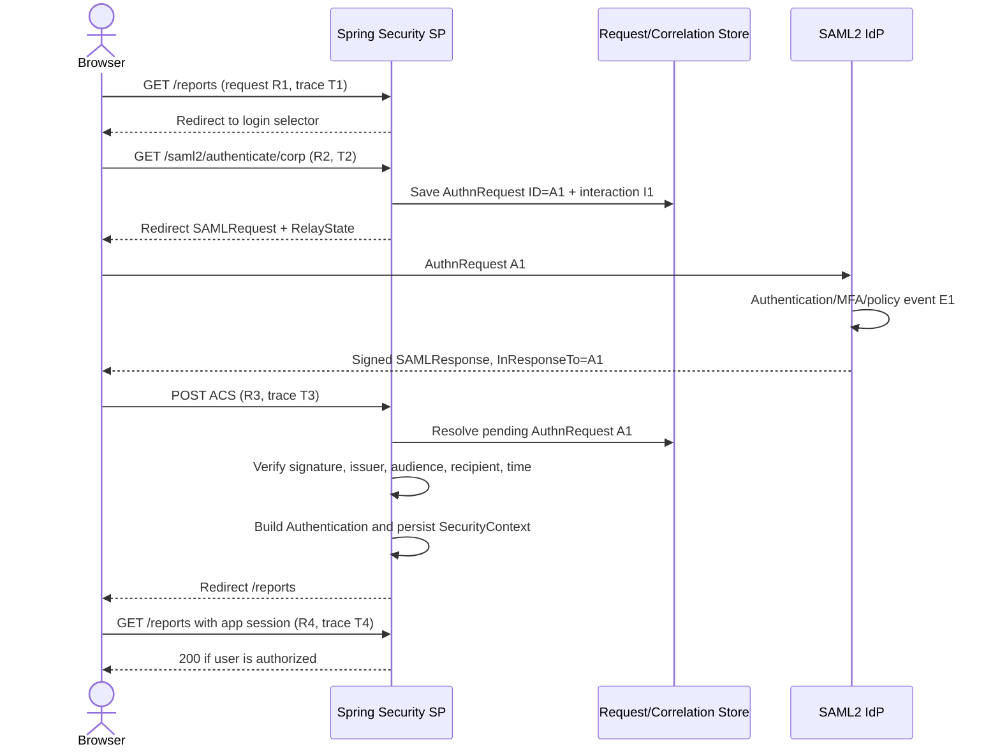

# Recording Correlation IDs Across Application Requests, AuthnRequest, and IdP Events

**Module:** Spring Security – federation → Observability and debugging.

**Goal:** learn how to link events across a federated SAML2 login: the initial HTTP request at the application (Service Provider/SP), creating and storing `AuthnRequest`, the redirect to the IdP, the login/MFA/policy event at the IdP, the `SAMLResponse` returning to the Assertion Consumer Service (ACS), the `InResponseTo`/signature verification outcome, and the created application session. Design logging/tracing sufficient to investigate issues across multiple pods, multiple tabs, and multiple IdPs, while **not leaking tokens, cookies, SAMLResponse, NameID, or personal data**, and without turning correlation IDs into an authentication mechanism.

**Key takeaway:** a single login journey involves **several distinct ID types**, not one single ID. `interaction_id` is an application-generated observability key; `http_request_id` describes a single HTTP request; `trace_id` describes distributed spans per W3C/OpenTelemetry; `AuthnRequest@ID` generated by the SP and `SAMLResponse@InResponseTo` correlate **per the SAML protocol**; `RelayState` preserves state per binding; and `idp_event_id` is the IdP's own audit ID **if the provider exposes one**. Never treat an ID from an HTTP header or unverified XML as proof that the user has logged in.

Examples use Java 17+, Spring Security Servlet/SAML2, and the simulated `example.test` domain. The Spring code below consists of **configuration fragments inside a real application**, while `SamlCorrelationDemo.java` in the practice section **compiles with plain JDK 17** and only simulates correlation principles without performing XML Signature verification.

## 1. Problem Statement: Why Is SSO Hard to Trace with Only HTTP Access Logs?

An unauthenticated `GET /reports` request from a browser can trigger a sequence of independent requests and systems:



**Questions that plain access logs cannot answer:**
- Did the IdP receive the right `AuthnRequest ID`, and which event did it emit?
- Did the IdP block due to MFA, conditional access, or SP configuration?
- Did the browser complete the POST to ACS, or close the tab after IdP login?
- Does `SAMLResponse@InResponseTo` match the pending request?
- Are the signature, IdP issuer, SP audience/recipient, and time constraints valid?
- Can a callback hitting pod B access request state created on pod A?
- Was the application session created and persisted, or did only an HTTP 302 success handler run?
- If the browser has two login tabs in parallel, which response belongs to which request?
- Did Spring authenticate the user, yet `/reports` returns 403 due to permissions/tenant?
- Why does the IdP show a "success" event while the SP has no authenticated session?

To answer these, you must create a **dedicated correlation ID for the SSO journey**, bind it to the AuthnRequest ID in **server-side state**, and link it to IdP-side audit data when a trusted data source exists.

## 2. Properly Distinguishing Correlation ID Types

| ID | Creator and Manager | Scope | Proper Role |
| --- | --- | --- | --- |
| `http_request_id` | Edge proxy or application | One HTTP request | Look up access logs, latency/status |
| `trace_id`, `span_id` | Tracing SDK/W3C context | One trace/span | Connect instrumented HTTP/service spans |
| `interaction_id` | Service Provider | One user-initiated SSO attempt | Group multiple HTTP requests, SAML IDs, and audit events |
| `AuthnRequest@ID` | SAML SP library | One single AuthnRequest | SAML correlation with Response `InResponseTo` |
| `RelayState` | SP per SAML binding | One SAML handshake | Look up server-side state, not a credential |
| `SAMLResponse@ID` | IdP | One SAML Response | Response audit/replay marker |
| `SAMLResponse@InResponseTo` | IdP based on AuthnRequest | References SP request | Answers `AuthnRequest@ID` |
| `SubjectConfirmationData@InResponseTo` | IdP | Subject bearer confirmation | Binds assertion to SP request if profile requires |
| `idp_event_id` | IdP audit system | One vendor event | Look up MFA/login/policy reason |
| `app_session_ref` | SP pseudonymizes session | One local app session | Check session persistence/expiration without leaking cookie |
| `app_user_ref` | App after verified identity mapping | One internal account | Audit verified authentication/authorization |

**Example**: 
- `AuthnRequest ID = _req-A91`;
- `SAMLResponse ID = _response-B44`;
- `SAMLResponse InResponseTo = _req-A91`;
- `interaction_id = I-2026-8f77`;
- `IdP event = idp-evt-c51`, but only if the IdP audit provides it;
- `trace_id GET /reports = T1`, `trace_id POST ACS = T3`, which may differ.

**Do not mistakenly set them all to the same value.** Each ID has a distinct purpose and lifecycle: SAML IDs are generated by the library per SAML rules, trace IDs come from observability, interaction IDs from the app, and session IDs from the framework. An attacker-supplied trace header **must never become a SAML request ID or authentication proof**.

## 3. W3C Trace Context Does Not Automatically Bridge Across the Browser and IdP

W3C Trace Context defines `traceparent` and `tracestate`. Example:

```http
traceparent: 00-2f4b1de8b76f4b8f98c9d35e625a117a-f5f34b1b9df7058d-01
```

The four parts are `version-trace_id-parent_id-flags`. When microservices call each other and propagate trace context properly, tracing systems can connect spans in the same trace. **That is not what SAML browser bindings guarantee:**

1. The SP returns 302 to the IdP, and **the browser makes a new request** to a different domain. It does not automatically copy the `traceparent` header from the SP response into the IdP request.
2. The IdP may be a service managed by another organization that neither accepts nor publishes OTel trace IDs.
3. The browser POSTing `SAMLResponse` to the ACS creates **a new HTTP request**; in most cases it will have a new span/trace.
4. If a reverse proxy propagates trace context within the same datacenter, the trace can remain continuous **within a single HTTP leg**, which does not prove an end-to-end SAML trace.
5. `tracestate` must not carry PII. Trace headers arriving from the Internet must be validated/rate-limited and must not be treated as security authority.
6. Sampling can drop critical spans; security event auditing must be designed independently.

**Solution:** maintain `interaction_id` server-side and map:
```text
interaction I1
  entry request R1, trace T1
  begin SAML request R2, trace T2
  AuthnRequest ID A1, RelayState opaque RS1
  IdP event E1 (optional)
  ACS request R3, trace T3
  Response ID B1, verified InResponseTo=A1
  session ref S1, after-login request R4/trace T4
```

You can use OpenTelemetry span links or log attributes to connect independent traces; **do not fabricate parent-child relationships across the browser**, and do not require the IdP to use the same sampling policy.

## 4. SAML AuthnRequest ID and InResponseTo Are the Most Important Axis

XML example for reading structure only:

```xml
<samlp:AuthnRequest
    xmlns:samlp="urn:oasis:names:tc:SAML:2.0:protocol"
    xmlns:saml="urn:oasis:names:tc:SAML:2.0:assertion"
    ID="_req-A91"
    Version="2.0"
    IssueInstant="2026-11-07T03:00:00Z"
    Destination="https://idp.example.test/sso">
  <saml:Issuer>https://portal.example.test/saml/sp</saml:Issuer>
</samlp:AuthnRequest>
```

After processing, the IdP issues a Response with its own ID:

```xml
<samlp:Response
    xmlns:samlp="urn:oasis:names:tc:SAML:2.0:protocol"
    xmlns:saml="urn:oasis:names:tc:SAML:2.0:assertion"
    ID="_response-B44"
    Version="2.0"
    InResponseTo="_req-A91"
    IssueInstant="2026-11-07T03:00:11Z"
    Destination="https://portal.example.test/login/saml2/sso/corp">
  <saml:Issuer>https://idp.example.test/metadata</saml:Issuer>
  <!-- Signature, Status, Assertion, and SubjectConfirmation omitted -->
</samlp:Response>
```

**The two XML snippets above are not valid SAML fixtures for login** because they lack signatures and full Response/Assertion elements. In a real environment, the signature must be verified using the IdP credentials in `RelyingPartyRegistration` and you must check:
- IdP `Issuer` matches the trusted source; Response/Assertion is signed per profile.
- `AudienceRestriction` is the SP EntityID; `Destination`/`Recipient` matches the ACS.
- `InResponseTo` matches the request initiated by **this browser session**.
- SubjectConfirmation, `NotBefore/NotOnOrAfter`, AuthnStatement, replay.
- XML Signature Reference is not wrapped/moved to another assertion.
- Do not trust an arbitrary certificate embedded inside an untrusted response.
- Account/tenant role mapping occurs after a verified SAML principal.

### 4.1. Do Not Use InResponseTo to Bypass the Security Request Repository

Even if an incoming response has `InResponseTo=_req-A91`, this is still **unverified input**. An attacker can craft XML and set this value. The SP may use it to **look up a candidate record**, but **cannot** grant `Authentication` based on string matching alone. The SAML provider must verify signatures and check the original session binding/one-time request.

If Redis lookup relies solely on RelayState or `InResponseTo` without binding to the original browser, there is a risk of login CSRF/login fixation. Spring Security documentation notes that `HttpSessionSaml2AuthenticationRequestRepository` provides natural session binding; if you use a cache-based request repository, you must supply equivalent trust/binding.

### 4.2. RelayState Is for Retrieving State, Not Proving Identity

In browser SSO, `RelayState` is usually an opaque string sent by the SP alongside `AuthnRequest` and echoed back with the response. Recommendations:
- Random token with TTL, bound to the browser/session and expected IdP/registration.
- Not `JSESSIONID`, username, email, raw return URL, token, or secret.
- Do not treat it as a signed SAML assertion; do not call `sendRedirect(RelayState)` arbitrarily.
- Do not write raw RelayState into access logs/analytics.
- For SAML HTTP Redirect/POST bindings, note the **80-byte** limit on RelayState per the specification; count bytes, not Unicode characters.
- In HTTP Redirect binding with a signed query string, RelayState may be part of the signed input; do not assume "RelayState is always unsigned".
- Even if integrity is protected, destination and browser correlation must still be valid.

## 5. Creating a Correlation Record at the Service Provider

When a user chooses to log in via IdP `corp`, the application creates `interaction_id` and stores a record in a trusted backend.

| Field | Data | Notes |
| --- | --- | --- |
| `interaction_id` | Random ID for a login journey | Not used as a credential |
| `entry_request_id`, `entry_trace_id` | Request/trace from GET resource or login picker | There may be no prior entry request |
| `start_request_id`, `start_trace_id` | Request starting SAML | One interaction has multiple HTTP requests |
| `authn_request_id` | Real SAML request ID from library | Unique, used to match `InResponseTo` |
| `relay_state_ref` | Fingerprint of opaque RelayState | Do not store raw lookup token in logs |
| `registration_id` | `corp`, `partner` | Selected only from allowed Spring registrations |
| `expected_idp_entity_id` | IdP Issuer/metadata trust config | Not user-specified |
| `sp_entity_id`, `acs_route` | Application metadata | May differ by tenant/IdP |
| `original_session_binding` | Server-side session/browser reference | Do not send raw session ID through IdP |
| `issued_at`, `expires_at` | UTC timestamps | TTL and time check |
| `idp_event_refs` | 0..N IdP vendor event IDs if available | Optional |
| `acs_request_id`, `acs_trace_id` | Request/trace receiving SAMLResponse | Not identical to start trace |
| `response_id_ref`, `in_response_to_ref` | Recorded with clear verified/unverified labels | Do not store raw XML |
| `auth_outcome` | VERIFIED, REJECTED, TIMEOUT | Outcome independent of IdP audit |
| `app_user_ref` | Internal pseudonym | Only after verified identity mapping |
| `post_auth_session_ref` | Post-login session fingerprint | No raw cookie |
| `node_id`/`app_version` | Instance handling steps | Helps investigate multi-pod flows |

**At a minimum**, you still need `interaction_id + AuthnRequest ID + expected IdP + original session binding + timestamp`. To join with IdP audit logs, if the vendor logs the raw AuthnRequest ID in audit, you can do an exact join within restricted-access scope; otherwise, you must conditionally use issuer, time, SP EntityID, audit event type, and confidence level.

### 5.1. 1:N Relationships Must Be Supported

A single login can have:
- Two HTTP requests at the app before redirecting.
- Multiple trace IDs before and after the IdP.
- IdP events for password challenge, MFA prompt, deny, or success.
- One AuthnRequest, multiple ACS attempts (e.g., rejected replay).
- One successful authentication, with session ID rotated for session fixation protection.
- Multiple business requests using the same app session after login.

Do not force `interaction_id` to be the unique key of **each log line**; it is the **event-grouping** key. Each event has its own `event_id` and explicit event type.

### 5.2. Illustrative Database Schema

```sql
CREATE TABLE saml_login_journey (
    interaction_id UUID PRIMARY KEY,
    registration_id VARCHAR(80) NOT NULL,
    expected_idp_ref VARCHAR(150) NOT NULL,
    authn_request_ref VARCHAR(160) UNIQUE NOT NULL,
    original_session_ref VARCHAR(160) NOT NULL,
    entry_trace_id VARCHAR(32),
    start_trace_id VARCHAR(32),
    created_at TIMESTAMPTZ NOT NULL,
    expires_at TIMESTAMPTZ NOT NULL,
    outcome VARCHAR(32) NOT NULL,
    completed_at TIMESTAMPTZ,
    user_ref VARCHAR(160),
    session_ref VARCHAR(160)
);

CREATE TABLE saml_login_event (
    event_id UUID PRIMARY KEY,
    interaction_id UUID REFERENCES saml_login_journey(interaction_id),
    event_type VARCHAR(80) NOT NULL,
    result_code VARCHAR(80),
    event_time TIMESTAMPTZ NOT NULL,
    source_system VARCHAR(80) NOT NULL,
    node_ref VARCHAR(80),
    trace_id VARCHAR(32),
    request_ref VARCHAR(160),
    saml_message_ref VARCHAR(160),
    vendor_event_ref VARCHAR(160)
);

CREATE INDEX saml_login_event_by_interaction
    ON saml_login_event(interaction_id, event_time);
```

This is an **illustrative schema**, not complete with production transactions/retention/protection. `authn_request_ref` can be an **HMAC** of the raw request ID in the logging/audit domain; the SAML request repository itself must still store the real request ID for protocol verification. If you need to query the IdP by raw ID, use only a privileged restricted lookup rather than spreading raw IDs into general logging/metrics.

Important: **The correlation store does not replace `Saml2AuthenticationRequestRepository`**. Audit ingestion can lag or drop events; security handshake state must have an independent lifecycle and validation, without relying on the logging system.

## 6. Spring Security: Where to Get the Exact AuthnRequest ID

Spring Security SAML2 Servlet uses:
- `Saml2WebSsoAuthenticationRequestFilter` creates `AuthnRequest` for `/saml2/authenticate/{registrationId}`.
- `Saml2AuthenticationRequestRepository` stores `AbstractSaml2AuthenticationRequest`.
- `HttpSessionSaml2AuthenticationRequestRepository` is the default implementation in the reference docs; it binds the request to the original browser/session.
- `CacheSaml2AuthenticationRequestRepository` supports distributed caching by RelayState, but **does not itself guarantee** session binding; a separate threat model is needed.
- `Saml2WebSsoAuthenticationFilter` and `Saml2AuthenticationTokenConverter` process the ACS.
- `OpenSaml5AuthenticationProvider` in Spring Security 7.x verifies the response/assertion per profile and builds the authenticated principal.
- `SecurityContextRepository` and the session strategy govern application persistence/rotation.

### 6.1. Observing Each Point at the Right Moment

| Hook | Reliable Observation | Must Not Be Claimed |
| --- | --- | --- |
| Request filter | HTTP request ID, trace ID, anonymous route | Login succeeded |
| Request repository `save` | SAML AuthnRequest ID, registration, binding | IdP received the request |
| HTTP 302/POST to IdP | SSO destination and binding | IdP authenticated the user |
| IdP audit API | Vendor events per permissions | SP received/verified Response |
| ACS entry | New callback/HTTP request arrived | Response has a valid signature |
| Repository `load`/`remove` | Pending request lookup/consume | SAML verification passed |
| SAML provider authenticated | Verified principal, authority source | Business resource authorized |
| Authentication success handler | Callback auth succeeded | App session definitely persisted |
| Subsequent session request | SecurityContext remains active | User holds all roles/tenants |
| Authorization decision | Permitted/denied resource | IdP login failed if denied |

**Do not log `saml.login.success` immediately when `removeAuthenticationRequest` returns a request.** The repository only checks request state; it does not replace signature/issuer/audience/recipient/time validations.

## 7. Java/Spring Security Fragment Recording an Event When Saving AuthnRequest

You can use a **decorator** around `Saml2AuthenticationRequestRepository`: emit `saml.authn_request.saved` only after `save` succeeds. This is a public extension point per the Spring Security Javadoc.

```java
package com.example.samlobs;

import jakarta.servlet.http.HttpServletRequest;
import jakarta.servlet.http.HttpServletResponse;
import org.slf4j.Logger;
import org.slf4j.LoggerFactory;
import org.springframework.security.saml2.provider.service.authentication
        .AbstractSaml2AuthenticationRequest;
import org.springframework.security.saml2.provider.service.web
        .HttpSessionSaml2AuthenticationRequestRepository;
import org.springframework.security.saml2.provider.service.web
        .Saml2AuthenticationRequestRepository;

public final class AuditedSamlRequestRepository implements
    Saml2AuthenticationRequestRepository<AbstractSaml2AuthenticationRequest> {

    private static final Logger LOG =
            LoggerFactory.getLogger(AuditedSamlRequestRepository.class);

    private final Saml2AuthenticationRequestRepository
            <AbstractSaml2AuthenticationRequest> delegate;
    private final SecurityAuditRefs refs;

    public AuditedSamlRequestRepository(SecurityAuditRefs refs) {
        this.delegate = new HttpSessionSaml2AuthenticationRequestRepository();
        this.refs = refs;
    }

    @Override
    public void saveAuthenticationRequest(
            AbstractSaml2AuthenticationRequest authn,
            HttpServletRequest request,
            HttpServletResponse response) {
        delegate.saveAuthenticationRequest(authn, request, response);
        if (authn != null) {
            LOG.info("event=saml.request.saved request_ref={} registration={} interaction_ref={}",
                    refs.requestRef(authn.getId()),
                    authn.getRelyingPartyRegistrationId(),
                    refs.interactionRef(request));
        }
    }

    @Override
    public AbstractSaml2AuthenticationRequest loadAuthenticationRequest(
            HttpServletRequest request) {
        return delegate.loadAuthenticationRequest(request);
    }

    @Override
    public AbstractSaml2AuthenticationRequest removeAuthenticationRequest(
            HttpServletRequest request,
            HttpServletResponse response) {
        var pending = delegate.removeAuthenticationRequest(request, response);
        if (pending != null) {
            LOG.info("event=saml.request.consumed request_ref={}",
                    refs.requestRef(pending.getId()));
        }
        return pending;
    }
}
```

```java
package com.example.samlobs;

// Application-implemented; not a built-in Spring bean.
// HMAC secret comes from secret manager, interaction comes from server-side state.
public interface SecurityAuditRefs {
    String requestRef(String rawAuthnRequestId);
    String interactionRef(jakarta.servlet.http.HttpServletRequest request);
}
```

**Illustrative** bean declaration in app config:

```java
@Bean
Saml2AuthenticationRequestRepository<AbstractSaml2AuthenticationRequest>
samlAuthenticationRequestRepository(SecurityAuditRefs refs) {
    return new AuditedSamlRequestRepository(refs);
}
```

**Limitations:** this is a **Spring integration fragment**, not runnable with plain `javac`. It requires the Spring SAML2 module, Servlet, SLF4J, a `SecurityAuditRefs` implementation, IdP/registration, and production configuration. `SecurityAuditRefs` must generate **pseudonymized references** from a server secret; do not use `hashCode()`/Base64 as PII protection. Do not log `authn.getSamlRequest()`, raw `RelayState`, or full redirect URLs.

If the app already uses a **distributed** request repository, the wrapper must decorate that exact repository rather than **accidentally replacing it with the HttpSession repository shown in the snippet** and breaking the cluster. To verify the filter picks up the right bean, write an integration test that issues an AuthnRequest and asserts the audit/ref logs and mapping record, without manually preflighting users/ownership.

### 7.1. Why Not Override AuthnRequest@ID to Equal the Trace ID?

SAML requires uniqueness per message ID and the library has its own ID generation mechanism. Even though trace IDs are usually random, using one as the SAML ID mixes two trust domains, risks collisions when tracing comes from untrusted clients, and gives no reason to alter the SAML protocol ID. **Keep the real `authn.getId()` and map it once**.

## 8. Servlet Filter Fragment Generating an HTTP Request ID

To assign a dedicated ID to **each HTTP request**, you can use an existing ingress/OTel ID. When an app-owned ID is needed so it does not depend on sampling, an illustrative servlet filter:

```java
package com.example.samlobs;

import jakarta.servlet.FilterChain;
import jakarta.servlet.ServletException;
import jakarta.servlet.http.HttpServletRequest;
import jakarta.servlet.http.HttpServletResponse;
import java.io.IOException;
import java.util.UUID;
import org.slf4j.MDC;
import org.springframework.web.filter.OncePerRequestFilter;

public final class ServerRequestIdFilter extends OncePerRequestFilter {
    @Override
    protected void doFilterInternal(
            HttpServletRequest request,
            HttpServletResponse response,
            FilterChain chain) throws IOException, ServletException {
        String id = UUID.randomUUID().toString();
        try {
            request.setAttribute("serverRequestId", id);
            MDC.put("request_id", id);
            response.setHeader("X-Request-ID", id);
            chain.doFilter(request, response);
        } finally {
            MDC.remove("request_id");
        }
    }
}
```

Only publish **server-generated non-secret request IDs**, and never use them as authentication tokens. If the ingress already issues `X-Request-ID`, define who owns/validates the header; clients can send arbitrary headers, so **do not trust inbound X-Request-ID as proof**. You can keep a length/charset-bounded `untrusted_client_request_id` separate from `server_request_id`.

**MDC and async:** MDC in many logging stacks is thread-local. When a request traverses servlet async/executors/Reactor, use supported context propagation and clean up context per lifecycle; otherwise user A's logs can bleed into user B's. `finally` only guarantees cleanup on the current thread. Never place PII, JWTs, NameID, or session cookies into MDC.

## 9. Events at ACS: Distinguishing Before and After Validation

**As soon as ACS receives POST** `/login/saml2/sso/{registrationId}`:
- Log `event=saml.acs.received`, `result=UNVERIFIED`.
- Log the new request ID/trace ID, node, route template, and registration if already resolved.
- You may log message size by bucket and HTTP status, not raw payload.
- Do not log principal, NameID, or `authenticated=true`.
- Do not read XML in a custom logging filter using regex or a parser without XXE/DTD protection.

**After the Spring SAML provider verifies the response**:
- Log `event=saml.authentication.verified`.
- Reconcile the accepted request ID with the pending server-side record, expected issuer, audience/recipient, and assertion validity.
- Log the app user pseudonym and session reference after mapping/rotation.
- Keep `response_id_ref`/`in_response_to_ref` in restricted audit when policy requires.
- If the provider rejects: log `event=saml.authentication.rejected`, a normalized **error code** (SIGNATURE_INVALID, UNKNOWN_ISSUER, WRONG_AUDIENCE, NOT_YET_VALID, EXPIRED, IN_RESPONSE_TO_MISMATCH, REPLAY...), without printing full exceptions containing PII/XML.

**An `InResponseTo` value extracted from unverified XML** may only be logged with an `unverified/candidate` label. Do not mark it as trusted linkage before validation. You can retain correlation to the error event in security audit without creating an authenticated session.

### 9.1. Spring Security Authentication Events

Spring Security emits `AuthenticationSuccessEvent`/`AuthenticationFailureEvent` when the app configures an appropriate `AuthenticationEventPublisher`:

```java
import org.springframework.context.ApplicationEventPublisher;
import org.springframework.context.annotation.Bean;
import org.springframework.context.annotation.Configuration;
import org.springframework.security.authentication.AuthenticationEventPublisher;
import org.springframework.security.authentication.DefaultAuthenticationEventPublisher;

@Configuration
public class AuthenticationPublisherConfig {
    @Bean
    AuthenticationEventPublisher authenticationEventPublisher(
            ApplicationEventPublisher events) {
        return new DefaultAuthenticationEventPublisher(events);
    }
}
```

Example listener that only logs **outcome category**, without printing raw Authentication credentials:

```java
import org.slf4j.Logger;
import org.slf4j.LoggerFactory;
import org.springframework.context.event.EventListener;
import org.springframework.stereotype.Component;
import org.springframework.security.authentication.event.AuthenticationSuccessEvent;
import org.springframework.security.authentication.event.AbstractAuthenticationFailureEvent;

@Component
class SafeAuthenticationEventListener {
    private static final Logger LOG =
            LoggerFactory.getLogger(SafeAuthenticationEventListener.class);

    @EventListener
    void onSuccess(AuthenticationSuccessEvent e) {
        LOG.info("event=authentication.provider.success type={}",
                e.getAuthentication().getClass().getSimpleName());
    }

    @EventListener
    void onFailure(AbstractAuthenticationFailureEvent e) {
        LOG.warn("event=authentication.provider.failure reason={}",
                e.getException().getClass().getSimpleName());
    }
}
```

**Do not assume** all SAML error paths publish an event: wiring of `AuthenticationEventPublisher`/manager, custom handlers, and framework version determine behavior. Verify with an integration test. This event proves the provider outcome **if emitted properly**; it does not prove that `SecurityContext` was persisted on the session or that the resource is authorized.

## 10. How to Obtain the IdP Audit Event ID

**There is no standard `idp_event_id` field across all SAML Responses.** Depending on the IdP, its security/audit console or API may record:
- The AuthnRequest ID the IdP received.
- SP EntityID and IdP tenant/realm.
- IdP-local event ID.
- User login, conditional access decision, MFA challenge/result, session reuse.
- SAML Response ID or vendor-specific request correlation ID.
- Timestamp, originating client, IP/user agent per policy.
- Sometimes **no request ID is logged**, only username/time.

**Do not assign an IdP event ID from user input or guess an event ID when the IdP does not expose one.** When no event exists, record `NOT_AVAILABLE`, while the SP auth outcome still rests on SAML validation.

### 10.1. Exact Joining When the IdP Logs AuthnRequest ID

In restricted audit:
1. The SP stores `AuthnRequest ID _req-A91` and `interaction I1` in server-side mapping.
2. IdP audit allows querying `received_request_id=_req-A91` within the trusted realm.
3. Cross-check **IdP issuer/tenant, SP EntityID, time window**, and event result.
4. Attach 0..N IdP events (MFA_REQUIRED, MFA_PASSED, TOKEN_ISSUED) to I1.
5. When the SP receives ACS, verify `InResponseTo=_req-A91` and SAML conditions.
6. Record linked event refs and match confidence; **an IdP event does not itself authenticate the SP session**.

If SP application logs only keep an HMAC fingerprint of the AuthnRequest ID while the IdP vendor has the raw ID, the two systems **cannot join via simple string comparison**. You need a **restricted lookup** or a correlation service that can transform the ID into the same fingerprint per policy.

### 10.2. When No Exact ID Exists at the IdP

In an investigative context, you can combine signals:
- SP EntityID, IdP registration/tenant, issuer.
- A sufficiently narrow UTC time window with synchronized clocks.
- Event type, MFA/policy status, and target application.
- Pseudonymous user info, if permitted and after verifying the source.
- Number of browser attempts/AuthnRequests issued.
- Vendor correlation ID when exposed.

This is only a **heuristic**. With multiple logins by one user, multi-tab flows, IdP session reuse, or time drift, timestamps/emails easily mismatch. Record `confidence=LOW/MEDIUM` and **never claim with certainty** that event X belongs to AuthnRequest A1.

### 10.3. Why Not Send an Arbitrary Trace ID Inside SAMLRequest?

Do not arbitrarily:
- Append `?trace_id=...` to the IdP SSO URL—the IdP may not support it, and it may leak into logs or be ignored.
- Add custom XML elements outside the SAML schema/extension contract, which can break signing/binding.
- Put a trace ID inside RelayState, which can break session state semantics or the 80-byte limit.
- Rely on HTTP `traceparent` surviving browser redirects—SAML profiles do not guarantee this.
- Let a third party observe a trace ID and spoof log correlation.

If both parties need cross-org tracing, use only an **IdP-supported extension/contract with data filtering and security review**. The best default flow still relies on AuthnRequest ID in restricted audit and an SP-owned correlation record.

## 11. Sanitized JSON Log Examples

**Request creation event:**

```json
{
  "timestamp": "2026-11-07T03:00:00.003Z",
  "event": "saml.request.saved",
  "result": "STORED",
  "service": "portal",
  "environment": "staging",
  "node": "pod-a",
  "registration": "corp",
  "expected_idp_ref": "corp-idp",
  "interaction_id": "I1",
  "server_request_id": "R2",
  "trace_id": "2f4b1de8b76f4b8f98c9d35e625a117a",
  "authn_request_ref": "hmac-request-7f1c",
  "session_ref": "hmac-session-44d2",
  "binding": "REDIRECT"
}
```

**Unverified callback event:**

```json
{
  "timestamp": "2026-11-07T03:00:11.001Z",
  "event": "saml.acs.received",
  "result": "UNVERIFIED",
  "node": "pod-b",
  "server_request_id": "R3",
  "trace_id": "ad94f72c76b34b249f3418c4f81d10c5",
  "route": "/login/saml2/sso/{registrationId}",
  "saml_response_size_bucket": "4-8KiB"
}
```

**When SAML provider and session succeed:**

```json
{
  "timestamp": "2026-11-07T03:00:11.090Z",
  "event": "saml.authentication.verified",
  "result": "SUCCESS",
  "registration": "corp",
  "interaction_id": "I1",
  "authn_request_ref": "hmac-request-7f1c",
  "response_ref": "hmac-response-9b70",
  "idp_ref": "corp-idp",
  "app_user_ref": "user-pseudonym-01",
  "session_ref": "hmac-session-new-77a0",
  "duration_ms": 11087
}
```

**When failed:**

```json
{
  "timestamp": "2026-11-07T03:00:11.090Z",
  "event": "saml.authentication.rejected",
  "result": "FAILURE",
  "failure_code": "IN_RESPONSE_TO_MISMATCH",
  "server_request_id": "R3",
  "registration": "corp",
  "raw_saml_response_logged": false
}
```

The HMAC refs above are **dummy example values**, not actual hash outputs. **Do not assign `interaction_id` to an unverified callback event merely because the user sent a matching RelayState or InResponseTo**; if needed, name the field `candidate_interaction_ref` until protocol validation succeeds.

### 11.1. Standardized Event Taxonomy

| Event | State | Meaning |
| --- | --- | --- |
| `auth.login.entry` | STARTED | User enters app or picks SSO |
| `saml.request.generated` | CREATED | SAML request built |
| `saml.request.saved` | STORED | Request repository saved successfully |
| `saml.request.redirected` | SENT_ATTEMPTED | SP issued response for browser to go to IdP |
| `idp.audit.event.observed` | OBSERVED | Vendor audit event reconciled |
| `saml.acs.received` | UNVERIFIED | Browser POSTed SAMLResponse |
| `saml.request.matched` | MATCHED | SAML validator verified correlation |
| `saml.authentication.verified` | SUCCESS | Provider accepted assertion |
| `saml.authentication.rejected` | FAILURE | Provider/flow rejected |
| `app.session.established` | ESTABLISHED | SecurityContext persisted |
| `app.session.continued` | ACTIVE | Subsequent request still authenticated |
| `app.authorization.denied` | DENIED | User logged in but lacks permission |
| `auth.login.timeout` | TIMEOUT | Pending handshake expired |

The steps above are **not required to always emit every log**; the app should define and test its instrumentation. Never use `SAML_LOGIN_SUCCESS` to denote a 302 redirect to the IdP or an IdP login success event before the SP has received the response.

## 12. Multiple Nodes, Multiple Tabs, and Session Rotation

### 12.1. Cross-Node Correlation

```text
GET /saml2/authenticate/corp  → pod A
  AuthnRequest A1 -> shared request repository
  Interaction I1  -> correlation store

POST /login/saml2/sso/corp    → pod B
  load A1 with original browser/session binding
  verify response
  lookup I1
  log result and session persistence
```

If the request repository lives in pod A's local session while ACS hits pod B, **the protocol can fail**. If the repository is shared while the correlation map is local, **login can pass while logs are missing**. Distinguish these two failures clearly so you do not open a vulnerability:
- The security repository must fail closed if no pending AuthnRequest is found.
- The correlation store should have a TTL and shared state, but **must never decide authentication**.
- Do not accept unsolicited responses or look up solely by raw RelayState to work around cache issues.
- If the app uses Spring Session Redis/JDBC, verify session cookies, TTL, and real pod routing.

### 12.2. Multiple Tabs in One Browser

```text
Browser session S1:
  Tab A: AuthnRequest A1 / interaction I1 / issuer corp
  Tab B: AuthnRequest A2 / interaction I2 / issuer partner

Correct:
  Response InResponseTo=A2 links to I2 after validation.
  Response InResponseTo=A1 links to I1 after validation.

Wrong:
  session.lastInteraction=I2
  Any SAMLResponse => I2
```

Do not store only a single "lastAuthnRequestId" in the session and expect it not to be overwritten. Check the actual behavior of `Saml2AuthenticationRequestRepository` for your version; if the implementation only supports one pending request per session, a two-tab flow must have explicit UX/failure handling. Correlation must not pretend to track multiple pending states that the security repository does not support.

### 12.3. Session Fixation Protection

Before login, Spring may create an HttpSession to store AuthnRequest. After SAML success, the session ID may rotate:

```text
pre_auth_session_ref  = hmac-session-old
post_auth_session_ref = hmac-session-new
interaction_id        = I1
```

Store the mapping safely in the audit record; **do not log raw old/new JSESSIONID**. A cookie present before login **does not prove the user is authenticated**. Only a post-login request carrying SecurityContext and appropriate permissions proves session persistence.

### 12.4. SameSite Cross-Site POST

IdPs typically POST SAMLResponse to the ACS from another site. A `SameSite=Lax` cookie may not be sent on a cross-site POST; `Strict` is even more restrictive. If the SP does not see the original cookie/request state, the `InResponseTo` lookup can fail.

Logs should show:
- Original `sessionRef` when saving AuthnRequest.
- Whether the ACS request carried the expected session binding (fingerprint/boolean only).
- Cookie configuration flags `SameSite`, `Secure`/`HttpOnly`, Domain/Path.
- Do not log raw cookies or request bodies to "debug".
- `SameSite=None; Secure` may be needed for some SAML POST flows per your threat model; **do not disable CSRF app-wide** or drop original-browser binding.

## 13. Runnable Java 17: Simulating Correct and Incorrect Correlation

The standalone exercise below demonstrates:
- One interaction I-101 has its own AuthnRequest ID and can attach an IdP event.
- `InResponseTo`/issuer/audience/browser binding must match before establishing an app session.
- Replayed responses, wrong browsers, and wrong IdPs are rejected.
- A second interaction **without an IdP audit event** can still complete SSO because audit availability is distinct from authentication.
- Output prints no raw SAMLResponse, cookies, or tokens.

**Important warning:** `signatureVerified` in the record **is only a test harness assumption**. Production must never accept a boolean from the browser; it must use Spring Security/OpenSAML to verify XML signatures/Issuer/Audience/Conditions. The HashMap in the demo is not thread-safe and is not a distributed request repository; fixed request IDs are used solely for deterministic stdout.

File `SamlCorrelationDemo.java`:

```java
import java.time.Instant;
import java.util.HashMap;
import java.util.HashSet;
import java.util.Map;
import java.util.Set;

public class SamlCorrelationDemo {
    static final String IDP = "https://idp.example.test/metadata";
    static final String SP = "https://portal.example.test/saml/sp";

    record Attempt(
            String interactionId, String requestId,
            String registrationId, String browserRef,
            Instant expiresAt) {}

    record ResponseFixture(
            String responseId, String inResponseTo,
            String issuer, String audience,
            String browserRef, String userRef,
            boolean signatureVerified) {}

    static final class Correlator {
        private final Map<String, Attempt> pending = new HashMap<>();
        private final Map<String, String> idpEvents = new HashMap<>();
        private final Map<String, String> sessions = new HashMap<>();
        private final Set<String> usedResponses = new HashSet<>();

        void issued(Attempt attempt) {
            if (pending.putIfAbsent(
                    attempt.requestId(), attempt) != null) {
                throw new IllegalArgumentException("Duplicate request ID");
            }
        }

        boolean observedIdpEvent(String requestId, String eventRef) {
            if (!pending.containsKey(requestId)
                    || eventRef == null || eventRef.isBlank()) {
                return false;
            }
            idpEvents.put(requestId, eventRef);
            return true;
        }

        boolean accept(ResponseFixture response, Instant now) {
            if (response == null || !response.signatureVerified()) {
                return false;
            }
            Attempt attempt = pending.get(response.inResponseTo());
            if (attempt == null
                    || usedResponses.contains(response.responseId())
                    || !attempt.browserRef().equals(response.browserRef())
                    || !IDP.equals(response.issuer())
                    || !SP.equals(response.audience())
                    || !now.isBefore(attempt.expiresAt())
                    || response.userRef() == null
                    || response.userRef().isBlank()) {
                return false;
            }
            pending.remove(response.inResponseTo());
            usedResponses.add(response.responseId());
            sessions.put(attempt.browserRef(), response.userRef());
            return true;
        }

        boolean hasIdpEvent(String requestId) {
            return idpEvents.containsKey(requestId);
        }

        String authenticatedUser(String browserRef) {
            return sessions.get(browserRef);
        }
    }

    public static void main(String[] args) {
        Correlator c = new Correlator();
        Instant now = Instant.parse("2026-11-07T03:00:00Z");

        Attempt first = new Attempt(
                "I-101", "_REQ-A", "corp",
                "browser-A", now.plusSeconds(120));
        c.issued(first);

        System.out.println("Interaction linked: "
                + "I-101".equals(first.interactionId()));
        System.out.println("IdP audit linked: "
                + c.observedIdpEvent("_REQ-A", "IDP-E42"));

        ResponseFixture valid = new ResponseFixture(
                "_RESP-1", "_REQ-A", IDP, SP,
                "browser-A", "U-100", true);
        System.out.println("Verified response accepted: "
                + c.accept(valid, now));
        System.out.println("Application session persisted: "
                + "U-100".equals(c.authenticatedUser("browser-A")));
        System.out.println("Replay rejected: "
                + !c.accept(valid, now));

        Attempt second = new Attempt(
                "I-102", "_REQ-B", "corp",
                "browser-B", now.plusSeconds(120));
        c.issued(second);

        ResponseFixture otherBrowser = new ResponseFixture(
                "_RESP-2", "_REQ-B", IDP, SP,
                "browser-A", "U-100", true);
        System.out.println("Cross-session rejected: "
                + !c.accept(otherBrowser, now));

        ResponseFixture wrongIssuer = new ResponseFixture(
                "_RESP-3", "_REQ-B", "https://evil.example.test",
                SP, "browser-B", "U-100", true);
        System.out.println("Wrong issuer rejected: "
                + !c.accept(wrongIssuer, now));

        System.out.println("IdP event optional: "
                + !c.hasIdpEvent("_REQ-B"));

        ResponseFixture secondValid = new ResponseFixture(
                "_RESP-4", "_REQ-B", IDP, SP,
                "browser-B", "U-200", true);
        System.out.println("Second response accepted: "
                + c.accept(secondValid, now));
    }
}
```

Compile and run:

```bash
javac SamlCorrelationDemo.java
java SamlCorrelationDemo
```

**Exact stdout:**

```text
Interaction linked: true
IdP audit linked: true
Verified response accepted: true
Application session persisted: true
Replay rejected: true
Cross-session rejected: true
Wrong issuer rejected: true
IdP event optional: true
Second response accepted: true
```

**Explanation:** the pending map uses `requestId` to link `InResponseTo` to the interaction; the IdP events map may be empty; a session is only created when request, issuer, audience, and browser match. The signature flag is set solely by a trusted test harness; there is no OpenSAML/TLS/HTTP, XML parser, real clock, nonce/RelayState, assertion replay cache, TTL cleanup, login CSRF, or database transactions. Therefore do not use this demo instead of a SAML security library; it teaches **how to think about correlation**, not an auth implementation.

## 14. What to Log to Avoid Data Leaks?

**Should be logged:** UTC event time, service/environment/pod, `interaction_id`, server request ID, trace/span IDs, IdP registration ref, expected issuer ref, binding, HMAC fingerprint of AuthnRequest ID, normalized error/result code, latency, and app/session pseudonymous refs after authentication.

**Do not write into general logs:**
- Raw SAMLResponse/SAMLRequest XML or Base64 form fields.
- Cookies (`JSESSIONID`, TGC), session IDs, OAuth/CAS tokens.
- SAML NameID/UPN/email, AttributeStatement groups unless required for investigation.
- Raw RelayState if it is a lookup secret.
- Passwords, OTPs, private keys, signing/decryption key material.
- Full redirect Location queries containing `SAMLRequest`/`RelayState`.
- `HttpServletRequest#getParameterMap()` at the ACS.
- Raw HTTP bodies/HARs from browsers containing assertions.
- Unsanitized user-controlled text with newlines/CRLF causing log injection.

OWASP recommends **interaction identifiers**, but also recommends masking/hashing session IDs and stripping tokens/PII. An AuthnRequest ID is not necessarily a credential, yet its distribution should be limited because it can help correlate individual behavior, especially alongside timestamps or NameID.

### 14.1. HMAC Fingerprints for IDs

A fingerprint can be computed with `HMAC-SHA256(auditKey, rawId)`, using truncated hex/base64url per collision-risk requirements. However:
- Keys come from a secret manager with managed rotation and versioning; **never hardcode**.
- Pods that need to join on the same ID must use the same key/version/normalization.
- Do not put the fingerprint into browser URLs as a ticket.
- Hashing/HMAC does not replace RBAC/retention; pseudonymized data can still constitute personal data.
- If the IdP uses a different key or no HMAC, two fingerprints cannot be compared directly to join; a restricted lookup from the raw ID in an audit service is required.
- If raw IDs must be retained for cross-system search, keep them in a restricted encrypted evidence/audit store, not in general application logs.

### 14.2. Tracing Headers Carry Their Own Risks

`traceparent`, `tracestate`, and vendor headers are **untrusted HTTP input** at the Internet edge. Bound their length/charset to prevent attackers from forcing high-cardinality traces, sampling floods, or leaking proprietary data in `tracestate`. Avoid sending client-supplied baggage/PII out to the IdP. Tracing never authorizes a request.

## 15. Time Correlation and Latency

A sample timeline:

```text
03:00:00.000Z   Browser starts /reports
03:00:00.030Z   SP saves AuthnRequest A1
03:00:00.100Z   Browser reaches IdP
03:00:01.400Z   IdP requests MFA
03:00:16.500Z   IdP issues SAMLResponse
03:00:16.650Z   SP ACS receives
03:00:16.705Z   SP verifies SAML
03:00:16.730Z   Session persisted

SP pre-redirect: 30 ms
IdP + human MFA: 16.4 seconds
Browser return: 150 ms
SP validation: 55 ms
Session persistence: 25 ms
Total journey: 16.73 seconds
```

These numbers are **illustrative, not a Spring benchmark**. `IssueInstant` from the SP, IdP timestamps, and ACS request time come from different hosts; NTP/UTC is required to compare them. If IdP audit ingestion is delayed, **event timestamp differs from ingest timestamp**. For latencies within a single process, prefer a monotonic clock; when comparing across hosts, account for uncertainty and clock offset.

### 15.1. Alerts by Last Observed Event

| Last Event Seen | Possibilities | Diagnosis |
| --- | --- | --- |
| `auth.login.entry` | SAML request not yet created | Login picker, security chain, routing |
| `saml.request.saved` | SP saved; browser/IdP may not have received | Redirect network, IdP endpoint |
| `idp.audit.event.observed` | IdP has audit; SP may not have received response | IdP outcome, ACS URL/callback |
| `saml.acs.received` | Browser POSTed; verification incomplete | Signature, request matching, session |
| `saml.authentication.rejected` | Provider rejected | Error code, metadata, skew, replay |
| `saml.authentication.verified` | SAML accepted | Spring session, mapping, authorization |
| `app.session.established` | SecurityContext persisted | Follow-up request, cookie delivery |
| `app.authorization.denied` | User logged in but lacks permission | Tenant membership/RBAC |
| `auth.login.timeout` | Pending flow expired | Browser interruption, IdP timeout |

If `saml.authentication.verified` is present yet the next GET to a protected route still redirects to login: the fault may be in `SecurityContextRepository`, cookie SameSite/Domain/Path, session rotation, Spring Session cluster, or a custom success handler; **do not assume the IdP login failed**.

## 16. Correlation Test Matrix

| ID | Case | Expected |
| --- | --- | --- |
| C-01 | Successful SP-initiated login | Entry, AuthnRequest, ACS, verified session link one interaction |
| C-02 | IdP audit has AuthnRequest ID | Exact join within right issuer/tenant/time |
| C-03 | IdP returns no event ID | Record unavailable, do not fabricate event |
| C-04 | IdP has multiple MFA events | Allow 1:N events on one interaction |
| C-05 | IdP reuses SSO session | Do not require a new password event |
| C-06 | Cross-browser redirect | T1/T2/T3 may differ; interaction still preserved |
| C-07 | Wrong InResponseTo | Reject, no authenticated session |
| C-08 | Unsigned/tampered response | Reject, do not log verified user |
| C-09 | Signed Response wrong audience | Reject even if request ID matches |
| C-10 | Signed Response wrong issuer | Reject |
| C-11 | Expired/NotBefore invalid | Reject and classify time code |
| C-12 | Replay same Response ID | Reject, do not open new session |
| C-13 | Raw RelayState is external URL | Do not use for redirect |
| C-14 | Cross-session callback | Reject due to original browser mismatch |
| C-15 | Two tabs, two AuthnRequests | Do not attach Tab A events to B |
| C-16 | Two IdPs/registrations | Namespaces do not mix |
| C-17 | IdP-initiated SSO | Do not fabricate AuthnRequest/InResponseTo |
| C-18 | ACS post missing cookie | Detect absent session binding, fail closed |
| C-19 | Session ID rotation | Pre/post refs still link, do not log raw |
| C-20 | Node A issues, node B receives | Shared repository + correlation store |
| C-21 | Cache TTL expired | Reject, with timeout code |
| C-22 | Audit store outage | Does not bypass SAML validator |
| C-23 | Client sets X-Request-ID | Separate server ID and not authentication |
| C-24 | Forged traceparent | Input validation, safe tracing policy |
| C-25 | OTel spans dropped by sampling | Audit result still queryable |
| C-26 | Audit ingestion delay | Do not immediately conclude event absent |
| C-27 | UTC clocks skewed | Warning/time window tolerates offset |
| C-28 | IdP event says success, ACS absent | SP must not record login success |
| C-29 | ACS received, wrong signature | Rejected with error code without leaking XML |
| C-30 | Auth verified, session lost | Detect session persistence gap |
| C-31 | Auth verified, resource 403 | Authorization separate from authentication |
| C-32 | Invalid input contains newline | Logging immune to injection/CRLF |
| C-33 | Logs contain raw SAMLResponse | QA FAIL, redaction required |
| C-34 | Logs contain cookie/tokens | QA FAIL |
| C-35 | Metrics label is AuthnRequest ID | QA FAIL: high cardinality |
| C-36 | Multi-tenant support query | RBAC blocks cross-tenant audit lookup |
| C-37 | HMAC key rotation | Consistent query/fingerprint version |
| C-38 | Logout then login again | New interaction, do not reuse pending ID |
| C-39 | Invalid IdP issuer audit matched by email | Do not treat heuristic as exact |
| C-40 | Pending request consumed but validation fails | Do not log login success |
| C-41 | Callback retry/duplicate | Event idempotency, replay blocked |
| C-42 | Message size/parse bomb | Bounded, fail-safe, sanitized logs |
| C-43 | Reverse proxy alters Host/ACS scheme | Audit clearly shows expected origin vs observed |
| C-44 | Browser drops cookie due to SameSite | Session refs/flags show where lost |
| C-45 | SecurityContext only exists during ACS request | Follow-up request QA FAIL |
| C-46 | New browser without cookie | Must not inherit old session |
| C-47 | Raw AuthnRequest ID in support ticket | Data minimization/audit policy review |
| C-48 | External input sets interaction ID | Must not hijack interaction lookup |
| C-49 | Login error before generating request | Entry event still investigable |
| C-50 | Application uses no trace exporter | Correlation still works via audit/request IDs |

**Do not just assert that log lines exist:** tests must run the real Spring SAML2 provider with a signed sandbox IdP Response, verify the security outcome, make a new post-login request, and verify logs do not leak credentials. `@WithMockUser` only mocks Authentication in Spring tests; **it does not prove AuthnRequest, InResponseTo, XMLDSig, or IdP audit matching**.

## 17. A Practical Investigation Workflow Using Interaction ID

Suppose a support ticket contains only `interaction_id=I1`:
1. **Check SP entry:** service/env/tenant, registration, start time, which HTTP request ID and trace ID started the login.
2. **Check AuthnRequest:** was a saved event recorded, what is the request fingerprint, expected issuer/ACS/binding, and was the browser redirected to the right IdP?
3. **Check IdP audit:** if an exact request ID and access exist, search IdP events within the right tenant/time range. If the IdP does not log request ID, mark low confidence.
4. **Check ACS:** was there a callback request? If not, check browser network, redirects, IdP response binding, load balancer, certs/proxy.
5. **Check request state:** did the pending request match the original browser/session, RelayState, and InResponseTo? If not, check multi-tab, session cookie SameSite, and Redis/shared state.
6. **Check SAML provider:** signature, issuer, audience, recipient, time, replay; do not disable the verifier "to get logs".
7. **Check app session:** was there an authenticated SecurityContext/session after callback? Did the session rotate/persist properly?
8. **Check business permissions:** if the final request returns 403, check role/tenant; do not conclude SAML failed.
9. **Record conclusion:** sanitized event IDs/trace IDs, outcome, and root cause; never paste raw assertions or cookies into the ticket.

### 17.1. Distinguishing "No Event" from "Error Event"

Missing an IdP event can be due to the IdP not logging request IDs, queue ingestion lag, retention policy, restricted audit permissions, the browser never reaching the IdP, or an IdP error. **Absence of an audit event ≠ proof that login failed or succeeded**. The SP outcome must rest on the SAML provider; IdP audit only helps pinpoint the stage/behavior.

### 17.2. Privacy and Long-Term Operations

- Use structured JSON logs with schema/version, UTC timestamps, and bounded event codes.
- Enforce retention per policy and read access via IAM/tenant scope.
- Never dump all logs containing raw SAML/PII into public dashboards.
- Use consistent HMAC correlation fingerprints across pods when cross-node lookup is needed.
- Never use `interaction_id`, `trace_id`, or `session_ref` as Prometheus metric labels.
- Do not let observability SDKs ship `tracestate` PII to external vendors outside contract.
- Have a fallback plan when the OTel exporter fails while security auditing must still persist.
- When detecting repeated replays/mismatches, alert by category; never print attacker-controlled XML or NameID into logs.

## 18. Checklist for Applying in a Spring Security System

**Design**
- [ ] Server-owned `interaction_id` exists for every SSO attempt.
- [ ] Mapping from library-generated AuthnRequest ID → interaction/session/registration/IdP.
- [ ] `InResponseTo` and `RelayState` are never treated as authentication proof.
- [ ] Request ID, trace ID, response ID, IdP event ID, and session ref are clearly distinguished.
- [ ] `IDP_INITIATED` flows without a pending request are supported and audited under their proper type.
- [ ] Multi-tab and cross-node state correlation are tested.

**Instrumentation**
- [ ] AuthnRequest issued/saved logged after save succeeds.
- [ ] ACS emits an UNVERIFIED event without logging raw SAMLResponse.
- [ ] Provider/handler emits VERIFIED/REJECTED events tested for real.
- [ ] Separate session persisted/continued and authorization outcome events exist.
- [ ] W3C trace context and MDC cleanup/async propagation are correct.
- [ ] Metrics labels have low cardinality and contain no PII.

**Security**
- [ ] Spring SAML signature/trust/issuer/audience/time/replay checks are never bypassed.
- [ ] AuthnRequest repository binds to the original browser/session.
- [ ] RelayState carries no session IDs/PII/arbitrary URLs.
- [ ] Session cookies/tokens/NameID never leak in logs/traces/tickets.
- [ ] HMAC secret has an owner/rotation, and audit lookup enforces tenant-scoped RBAC.
- [ ] Untrusted input is length-bounded, sanitized, and hardened against XML/log injection.

**QA**
- [ ] End-to-end signed SP-initiated SAML login is traceable by interaction I1.
- [ ] IdP vendor events can be joined when the IdP supplies data.
- [ ] Without a vendor event, the SP-side outcome can still be classified.
- [ ] Invalid/replayed/wrong-browser/wrong-issuer SAML never creates a session.
- [ ] Follow-up requests remain authenticated on the right session; other browsers lack access.
- [ ] Observability exporter outages never alter security decisions.

## 19. Self-Check Questions

**Q1. Why not use the trace ID as the AuthnRequest ID?**  
Because the SAML ID is a protocol field used to match `InResponseTo`, generated by the SAML library with its own uniqueness and trust requirements; trace ID is only for observability and inbound trace context may be untrusted.

**Q2. Why does a single login have multiple trace IDs?**  
The browser redirect to the IdP and the POST back to the ACS create independent requests; W3C trace context does not automatically propagate across a browser SAML flow. Use an SP-side interaction ID to connect them.

**Q3. Does the IdP always return an event ID inside SAMLResponse?**  
No. IdP events are audit/vendor-specific and may not be exposed. Never fabricate one if missing.

**Q4. Which Response attribute references AuthnRequest?**  
`SAMLResponse@InResponseTo`; the Response has its own `@ID`. SubjectConfirmationData may also carry `InResponseTo` per profile.

**Q5. If InResponseTo and RelayState match, is the user definitely authenticated?**  
No. You need a signed assertion/response, trusted issuer, audience, recipient, time, original session binding, and replay checks.

**Q6. Should raw RelayState, session cookies, and SAMLResponse be logged for debugging?**  
Not in general logs; use pseudonymized refs/sanitized events. Sensitive forensic data, if genuinely required, must reside in a secure evidence store.

**Q7. Does `AuthenticationSuccessEvent` prove SecurityContext was persisted?**  
No. You must verify the session repository and a subsequent independent HTTP request.

**Q8. If an IdP login success event exists while the SP has not received ACS, is an app session created?**  
No. The SP only creates Authentication after receiving and validating SAMLResponse.

**Q9. Why should metrics not use AuthnRequest ID as a label?**  
Every login creates a new ID, causing high cardinality and privacy risk. Use bounded labels and keep IDs in audit logs/traces.

**Q10. If the IdP only logs email and timestamp rather than request ID, can an exact event match be asserted?**  
No. That is a low-confidence heuristic; stronger provenance is required to draw a firm conclusion.

## 20. References

1. [Spring Security – Producing SAML2 AuthnRequests](https://docs.spring.io/spring-security/reference/servlet/saml2/login/authentication-requests.html): request filter, `Saml2AuthenticationRequestRepository`, and risks of non-session-bound cache/RelayState.
2. [Spring Security – Authenticating SAML2 Responses](https://docs.spring.io/spring-security/reference/servlet/saml2/login/authentication.html): token converter, `OpenSaml5AuthenticationProvider`, principal/validation hooks.
3. [Spring Security – SAML2 Login Overview](https://docs.spring.io/spring-security/reference/servlet/saml2/login/overview.html): browser SSO, request/response filters, and flow.
4. [Spring Security 7.x API – Saml2AuthenticationRequestRepository](https://docs.spring.io/spring-security/reference/api/java/org/springframework/security/saml2/provider/service/web/Saml2AuthenticationRequestRepository.html): `save/load/removeAuthenticationRequest` signatures.
5. [Spring Security – Authentication Events](https://docs.spring.io/spring-security/reference/servlet/authentication/events.html): `DefaultAuthenticationEventPublisher` and event listeners.
6. [OASIS SAML 2.0 Core](https://docs.oasis-open.org/security/saml/v2.0/saml-core-2.0-os.pdf): request/response ID, `InResponseTo`, issuer, assertions, conditions.
7. [OASIS SAML 2.0 Bindings](https://docs.oasis-open.org/security/saml/v2.0/saml-bindings-2.0-os.pdf): Redirect/POST binding, RelayState, and signature rules.
8. [OASIS SAML 2.0 Profiles](https://docs.oasis-open.org/security/saml/v2.0/saml-profiles-2.0-os.pdf): SP-initiated Web Browser SSO, bearer confirmation/correlation.
9. [W3C Trace Context Recommendation](https://www.w3.org/TR/trace-context/): `traceparent`/`tracestate` format, propagation/privacy.
10. [OpenTelemetry – Log Trace Context](https://opentelemetry.io/docs/specs/otel/compatibility/logging_trace_context/): structured `trace_id`/`span_id` fields.
11. [OpenTelemetry – Semantic Conventions](https://opentelemetry.io/docs/specs/semconv/general/trace/): span/event attributes and semantic naming.
12. [OWASP Logging Cheat Sheet](https://cheatsheetseries.owasp.org/cheatsheets/Logging_Cheat_Sheet.html): interaction identifiers, security events, data minimization/log injection.
13. [OWASP Session Management Cheat Sheet](https://cheatsheetseries.owasp.org/cheatsheets/Session_Management_Cheat_Sheet.html): session fingerprints, cookie secrecy, lifecycle.
14. [OWASP SAML Security Cheat Sheet](https://cheatsheetseries.owasp.org/cheatsheets/SAML_Security_Cheat_Sheet.html): assertion verification, replay, signature wrapping, and logging concerns.
15. [Spring Session Reference](https://docs.spring.io/spring-session/reference/): shared sessions in a cluster and session persistence.

**Conclusion:** A SAML login is well-observed when **application request → interaction ID → real AuthnRequest ID → IdP audit event if available → verified InResponseTo at ACS → Spring Authentication → application session on subsequent requests** can all be linked in a server-side audit store, even as trace IDs change when the browser traverses the IdP. Logs are for investigation; only SAML protocol verification and application policy decide authentication/authorization.