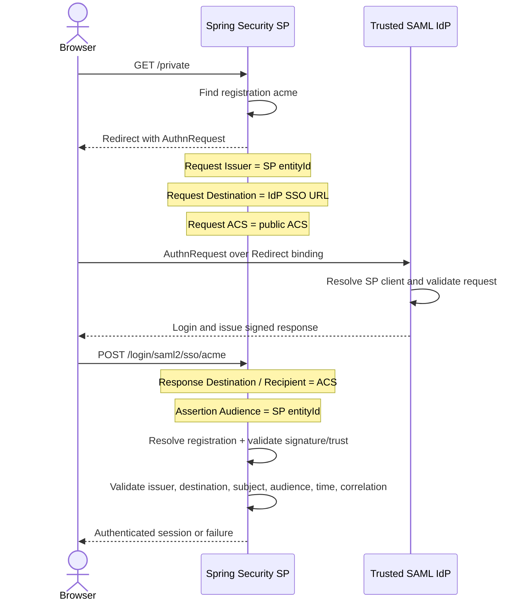

# Diagnosing entityId, ACS, Destination, or Audience Mismatches

## Learning Objectives

This lesson belongs to the **Observability and debugging** group of Spring Security – federation. After studying it, you will be able to:

1. Distinguish SP `entityId`, Assertion Consumer Service (ACS), `Response.Destination`, and `Assertion.AudienceRestriction`; know which fields are **identifiers** and which are **HTTP endpoints**.
2. Read both directions correctly: `AuthnRequest.Issuer` is the SP identifier and `AuthnRequest.Destination` is the IdP SSO URL; `Response.Issuer` is the IdP and `Response.Destination` is the SP ACS.
3. Explain the differences between `Response.Destination`, `SubjectConfirmationData.Recipient`, `AudienceRestriction/Audience`, `InResponseTo`, assertion validity periods, and signatures.
4. Reconcile SP metadata, IdP metadata, `RelyingPartyRegistration`, URLs behind a reverse proxy, and response data in a safe observation workflow.
5. Use Spring Boot 3 / Spring Security 6 / Java 17+ to configure an explicit public entityId/ACS, publish SP metadata, and receive SAMLResponse through the standard filter chain.
6. Diagnose typos, HTTP/HTTPS scheme issues, ports, trailing slashes, context paths, ingress rewrites, `registrationId`, metadata caching, and multi-IdP/tenant scenarios.
7. Distinguish errors rejected by the IdP before login, errors at the ACS before the validator runs, SAML signature/conditions errors, and local authorization errors after login.
8. Run a standalone Java 17 program to inspect a field mismatch matrix with deterministic stdout, without mistaking a string-comparison demo for cryptographic SAML validation.
9. Design test cases for wrong entityId/ACS/Destination/Audience/Recipient/Issuer, wrong signature, expired assertion, replay, and wrong tenant; never disable security checks just "to log in".
10. Coordinate the IdP owner, SSO platform, application, and ingress owner using a runbook with evidence, impact assessment, rollback, and post-fix QA.

## 1. Context: IdP Login Succeeds but SP Rejects

The Spring Security web application is the **SAML Service Provider (SP)**, while the identity provider is the **Identity Provider (IdP)**. A user opens a protected resource at the SP, is redirected to the IdP, logs in, and the browser POSTs a `SAMLResponse` back to the SP. Before issuing `Authentication`, the SP must check whether the response actually came from a trusted IdP, for the right SP, and at the right endpoint.

**You cannot conclude "SSO is working" simply because the IdP shows login success.** The IdP may have authenticated the user while issuing the assertion for another SP, sending to the wrong ACS, using an untrusted signing key, or setting the wrong Audience. SP rejection is correct security behavior.

For example, the Portal's public URL is:

```text
https://portal.example.org
```

Yet the backend runtime sits behind a proxy:

```text
http://portal-service.default.svc.cluster.local:8080
```

If Spring infers `ACS` from the internal address while the IdP uses the public address, a Destination/Recipient error can appear right after the login step. **Do not fix this by disabling Destination/Audience validation**; align the SP/IdP contract and ingress instead.

### 1.1. Reference Values for Examples

| Component | Assumed Value |
| --- | --- |
| SP public base URL | `https://portal.example.org` |
| Spring `registrationId` | `acme` |
| **SP entityId** | `https://portal.example.org/saml2/service-provider-metadata/acme` |
| **SP ACS** | `https://portal.example.org/login/saml2/sso/acme` |
| **IdP entityId** | `https://idp.partner.example.net/realms/acme` |
| **IdP SSO URL** | `https://idp.partner.example.net/realms/acme/protocol/saml` |
| Illustrative AuthnRequest ID | `_req-100` |
| SAML response binding | HTTP-POST |
| AuthnRequest binding | HTTP-Redirect |

These are **fixtures**, not real infrastructure configuration; hosts in `example.org` and `example.net` must not be assumed to exist as live services. All XML below is for structural reading only and lacks sufficient signatures/conditions for actual login.

## 2. Four Key Fields: All Look Like URLs, Different Meanings

| Field | Location | Creator or Declarer | Must Match |
| --- | --- | --- | --- |
| **SP entityId** | `RelyingPartyRegistration.entityId`, `SP EntityDescriptor@entityID`, `AuthnRequest.Issuer` | SP | SP client entityID trusted by IdP and Audience in assertion |
| **ACS** | `assertionConsumerServiceLocation`, `SP metadata AssertionConsumerService@Location` | SP | ACS URL allowlisted by IdP, actual HTTP route receiving response |
| **`Response.Destination`** | `samlp:Response@Destination` | IdP | Expected SP ACS endpoint receiving SAMLResponse |
| **`AudienceRestriction/Audience`** | `saml:Assertion/saml:Conditions` | IdP | SP entityId of the application allowed to consume the assertion |
| `SubjectConfirmationData.Recipient` | `Assertion.Subject.SubjectConfirmationData` | IdP | SP ACS/recipient per bearer subject confirmation |
| `AuthnRequest.Destination` | `samlp:AuthnRequest@Destination` | SP | IdP SingleSignOnService URL |
| `Response/Assertion.Issuer` | `saml:Issuer` | IdP | IdP entityId in trusted asserting-party metadata |
| `AuthnRequest.Issuer` | `saml:Issuer` | SP | SP entityId in IdP client registration |
| `InResponseTo` | Response and bearer confirmation | IdP | Valid AuthnRequest ID in SP-initiated SSO |

**Memory aid:**
- **entityId** answers "Who is the SP?".
- **ACS** answers "Where does the IdP send the response?".
- **Response Destination** answers "Which endpoint is this specific Response intended for?".
- **Audience** answers "Which SP is allowed to use this specific Assertion?".
- **IdP entityId** answers "Who is the trusted assertion issuer?".

Do not use the ACS in place of entityId just because both are HTTPS URLs. EntityID is a SAML identifier, not necessarily an endpoint returning HTTP 200. ACS is a real endpoint and must have proper routing/binding.

### 2.1. Two Opposite-Direction Destinations

```text
AuthnRequest.Destination (SP -> IdP):
https://idp.partner.example.net/realms/acme/protocol/saml

Response.Destination (IdP -> SP):
https://portal.example.org/login/saml2/sso/acme
```

A log saying only "Invalid Destination" without naming the message type easily leads to fixing the wrong side. Determine whether the error occurs **when the IdP receives AuthnRequest** or **when the SP receives SAMLResponse**.

### 2.2. Two Different Issuers

```text
AuthnRequest.Issuer:
https://portal.example.org/saml2/service-provider-metadata/acme

Response.Issuer (and usually Assertion.Issuer):
https://idp.partner.example.net/realms/acme
```

Spring Security uses the registered IdP entityId to verify the response source. The IdP uses the SP entityId declared in the request to look up the SP client config. **Never put the IdP entityId into Assertion Audience** or put the SP entityId into Response Issuer.

### 2.3. Recipient and Audience Are Distinct

```text
SubjectConfirmationData.Recipient:
https://portal.example.org/login/saml2/sso/acme

Assertion.Conditions.AudienceRestriction.Audience:
https://portal.example.org/saml2/service-provider-metadata/acme
```

Recipient normally points to the ACS for bearer subject confirmation; Audience is the identifier of the SP for which the assertion is intended. **A valid Response.Destination does not waive Recipient checking**, and **a valid Recipient does not waive Audience checking**.

## 3. SAML2 Flow and Verification Points



### 3.1. Failures Before Login at the IdP

If the IdP receives the request and reports "unknown application", "invalid issuer", "invalid client", or "invalid ACS", it may have failed to select the SP client:
- SP `AuthnRequest.Issuer` differs from the client entityID configured on the IdP.
- `AuthnRequest.Destination` has the wrong SingleSignOnService URL.
- `AssertionConsumerServiceURL` is not in the IdP's allowed ACS list or uses an incompatible binding.
- The IdP requires a signed AuthnRequest while the SP did not sign or its signing key is untrusted.
- Request is missing/uses wrong binding, stale request, or protocol option issue.

**At this point there is no valid SAMLResponse to check Audience**, so changing Audience just because "SSO failed" is out of order.

### 3.2. Failures After IdP Login

If the browser already POSTed to ACS, break it down by layer:
1. Which URL did the POST actually reach?
2. Did ingress return `404`/`403`/`502` before the backend, or did the Servlet app receive it?
3. Did `Saml2WebSsoAuthenticationFilter` match the route and locate `RelyingPartyRegistration`?
4. Did the signature/decryption provider pass?
5. Are Response Issuer and Destination right?
6. Are Assertion SubjectConfirmation, AudienceRestriction, time/correlation right?
7. Was Authentication created, yet local role/tenant authorization returned 403?

Do not lump every "error screen after login" into one cause.

## 4. Reading SP Metadata and IdP Metadata for the Right Purpose

### 4.1. SP Metadata

**Abbreviated XML example, without full certificates and profile declarations**:

```xml
<md:EntityDescriptor
    xmlns:md="urn:oasis:names:tc:SAML:2.0:metadata"
    entityID="https://portal.example.org/saml2/service-provider-metadata/acme">
  <md:SPSSODescriptor
      protocolSupportEnumeration="urn:oasis:names:tc:SAML:2.0:protocol">
    <md:AssertionConsumerService
        Binding="urn:oasis:names:tc:SAML:2.0:bindings:HTTP-POST"
        Location="https://portal.example.org/login/saml2/sso/acme"
        index="0"/>
  </md:SPSSODescriptor>
</md:EntityDescriptor>
```

Note carefully:
- `EntityDescriptor@entityID` must equal the exact **SP entityId** configured at the IdP.
- `AssertionConsumerService@Location` must equal the exact **public ACS URL** allowed by the IdP.
- Binding/index must match the response path. There may be multiple ACS entries with different indices/bindings; inspect which endpoint is actually selected.
- Signing/encryption credentials, entityID, and service locations must be synchronized per the metadata/trust agreement.

### 4.2. IdP Metadata

Abbreviated example:

```xml
<md:EntityDescriptor
    xmlns:md="urn:oasis:names:tc:SAML:2.0:metadata"
    entityID="https://idp.partner.example.net/realms/acme">
  <md:IDPSSODescriptor
      protocolSupportEnumeration="urn:oasis:names:tc:SAML:2.0:protocol">
    <md:SingleSignOnService
        Binding="urn:oasis:names:tc:SAML:2.0:bindings:HTTP-Redirect"
        Location="https://idp.partner.example.net/realms/acme/protocol/saml"/>
  </md:IDPSSODescriptor>
</md:EntityDescriptor>
```

- IdP metadata `EntityDescriptor@entityID` is the IdP issuer trusted by the SP.
- `SingleSignOnService@Location` is where the SP sends AuthnRequest, not where the IdP POSTs SAMLResponse.
- `KeyDescriptor` and signing certificates used for response/assertion verification must be configured per trust policy; they are intentionally omitted in the example to focus on URIs.
- Never fetch metadata/verification certs from a URL self-declared by an unverified `SAMLResponse`.

### 4.3. SP Metadata URL Is Not the ACS

Spring Security 6.5 provides the `saml2Metadata` DSL; when enabled, SP metadata is typically served at:

```text
/saml2/metadata
/saml2/metadata/{registrationId}
/saml2/service-provider-metadata/{registrationId}
```

And the default login routes to remember:

```text
GET /saml2/authenticate/{registrationId}       # initialize AuthnRequest
POST /login/saml2/sso/{registrationId}        # process SAMLResponse
```

An implementation may use an entityId shaped like a metadata URL, yet **semantically** entityId, metadata URL, and ACS remain three distinct roles.

### 4.4. Comparing Data Across the Right Three Systems

1. **SP runtime registration:** the configuration the running node actually uses, not just the YAML file in the repository.
2. **Public SP metadata:** the XML the IdP receives or has imported/cached.
3. **IdP SP-client configuration:** the approved SP EntityID and ACS allowlist/binding.

Only then inspect **SAML request/response data** in a controlled test environment. Arbitrary XML received from a browser must never override trust configuration.

## 5. Sample AuthnRequest: SP Calling IdP

```xml
<samlp:AuthnRequest
    xmlns:samlp="urn:oasis:names:tc:SAML:2.0:protocol"
    xmlns:saml="urn:oasis:names:tc:SAML:2.0:assertion"
    ID="_req-100"
    Version="2.0"
    IssueInstant="2026-11-07T10:00:00Z"
    Destination="https://idp.partner.example.net/realms/acme/protocol/saml"
    AssertionConsumerServiceURL="https://portal.example.org/login/saml2/sso/acme"
    ProtocolBinding="urn:oasis:names:tc:SAML:2.0:bindings:HTTP-POST">
  <saml:Issuer>
    https://portal.example.org/saml2/service-provider-metadata/acme
  </saml:Issuer>
</samlp:AuthnRequest>
```

**Not a valid production AuthnRequest:** the XML above is a skeleton for reading fields, lacking binding encoding, signatures, and all partner-specific constraints. In HTTP-Redirect binding, XML is encoded per the SAML Redirect binding profile; some IdPs require a URL-query signature.

### 5.1. What the IdP Must Match

| Request Field | Data to Match |
| --- | --- |
| `Issuer` | SP entityID of a registered client |
| `Destination` | Selected IdP SSO URL/binding |
| `AssertionConsumerServiceURL` | SP client's ACS allowlist |
| `ProtocolBinding` | IdP-supported response binding, typically HTTP-POST |
| `ID` | Correlation so the response binds to the right request |
| `IssueInstant` | Timestamp within policy |
| Signature | SP signs request with a credential trusted by the IdP if required |

**Variant:** AuthnRequest can request an ACS via `AssertionConsumerServiceIndex` instead of a direct URL; in that case compare the index against SP metadata and IdP client config. Do not flag an error merely because no URL appears in the request.

### 5.2. Which Field Must the IdP Not Accept Blindly from Untrusted Input?

Never accept an arbitrary `AssertionConsumerServiceURL` injected by an attacker into a forged AuthnRequest and redirect SAMLResponse there. The IdP must bind the request issuer to the SP client, validate ACS URL/binding, and enforce request signature policy. Unchecked wildcard redirects/ACS can cause token leakage.

## 6. Sample SAMLResponse: IdP Returning to SP

```xml
<samlp:Response
    xmlns:samlp="urn:oasis:names:tc:SAML:2.0:protocol"
    xmlns:saml="urn:oasis:names:tc:SAML:2.0:assertion"
    ID="_response-100"
    Version="2.0"
    IssueInstant="2026-11-07T10:00:40Z"
    Destination="https://portal.example.org/login/saml2/sso/acme"
    InResponseTo="_req-100">
  <saml:Issuer>https://idp.partner.example.net/realms/acme</saml:Issuer>
  <samlp:Status>
    <samlp:StatusCode Value="urn:oasis:names:tc:SAML:2.0:status:Success"/>
  </samlp:Status>
  <saml:Assertion ID="_assertion-100" Version="2.0"
                  IssueInstant="2026-11-07T10:00:40Z">
    <saml:Issuer>https://idp.partner.example.net/realms/acme</saml:Issuer>
    <saml:Subject>
      <saml:NameID>synthetic-user-001</saml:NameID>
      <saml:SubjectConfirmation
          Method="urn:oasis:names:tc:SAML:2.0:cm:bearer">
        <saml:SubjectConfirmationData
            Recipient="https://portal.example.org/login/saml2/sso/acme"
            InResponseTo="_req-100"
            NotOnOrAfter="2026-11-07T10:05:00Z"/>
      </saml:SubjectConfirmation>
    </saml:Subject>
    <saml:Conditions
        NotBefore="2026-11-07T09:59:00Z"
        NotOnOrAfter="2026-11-07T10:05:00Z">
      <saml:AudienceRestriction>
        <saml:Audience>
          https://portal.example.org/saml2/service-provider-metadata/acme
        </saml:Audience>
      </saml:AudienceRestriction>
    </saml:Conditions>
  </saml:Assertion>
</samlp:Response>
```

**Only an XML diagram for explanation.** It lacks signatures and complete validation fields; it must **never** be sent as a login SAMLResponse. A real SAMLResponse must go through a trusted provider verifying signature, conditions, subject, correlation, and replay per profile.

### 6.1. Checks After Receiving Response

| Field | Compared Against | Mismatch Causes |
| --- | --- | --- |
| `Response.Issuer` | Trusted IdP entityId | IdP issuer mismatch |
| `Response.Destination` | Registered public ACS and receiving endpoint | Destination mismatch |
| `Assertion.Issuer` | IdP issuer/trust of assertion | Assertion issuer mismatch |
| `SubjectConfirmationData.Recipient` | Valid SP ACS/recipient | Bearer confirmation failure |
| `AudienceRestriction/Audience` | SP entityId | Audience mismatch |
| `Response.InResponseTo` / `SubjectConfirmationData.InResponseTo` | Pending `AuthnRequest.ID` in SP-initiated flow | Correlation failure |
| `NotBefore` / `NotOnOrAfter` | Server time/allowed skew | Not yet valid/expired |
| Signature | Trusted IdP signing key/cert | Authentication must fail |
| `NameID` | Verified principal identity | Does not automatically grant role/tenant |

**Never replace Signature/Issuer checks with "the URL looks right".** An attacker can craft XML containing all those matching strings, with no signature or signed by an untrusted key.

### 6.2. Audience Differs from Recipient

A very common misconfiguration:

```text
SP entityId expected:
https://portal.example.org/saml2/service-provider-metadata/acme

IdP Assertion Audience sent:
https://portal.example.org/login/saml2/sso/acme

Result: Audience != SP entityId -> REJECT.
```

Even though the browser POSTed to the right ACS, Audience is wrong. The right fix is updating the **IdP SP client EntityID / Audience mapping**, not modifying the SP Audience validator.

### 6.3. Response Destination Matches but Recipient Is Wrong

```text
Response.Destination:
https://portal.example.org/login/saml2/sso/acme

SubjectConfirmationData.Recipient:
https://portal.example.org/login/saml2/sso/other

Result: bearer SubjectConfirmation invalid.
```

A bearer assertion with the wrong Recipient must not be accepted just because Response Destination matches. Subject confirmation must be verified by the SAML library with the right method, recipient, time, and request ID.

## 7. Where Does Spring Security 6 Process Each Field?

In the Spring Security SAML2 login flow:

1. `Saml2WebSsoAuthenticationRequestFilter` builds AuthnRequest from `RelyingPartyRegistration`; default endpoint `/saml2/authenticate/{registrationId}`.
2. The browser POSTs SAMLResponse to ACS; `Saml2WebSsoAuthenticationFilter` processes it, and the converter picks the registration from pending state/URL registrationId/issuer as applicable.
3. `AuthenticationManager` invokes the OpenSAML provider. In Spring Security **6.5** documentation, the provider is described as `OpenSaml5AuthenticationProvider`; other Spring Security 6 branches may use the provider matching their version.
4. The provider deserializes the response, verifies signature and trust, and decrypts when required.
5. The provider validates Response Issuer/Destination, assertion signatures, Subjects, Conditions, and AudienceRestriction per profile.
6. Upon success, Spring builds `Saml2Authentication`/`Saml2AuthenticatedPrincipal`; local app authorization must still verify permissions/tenants afterward.

**Do not start debugging Audience if the SAMLResponse never reached the filter, or if the signature was already rejected earlier.**

### 7.1. Fields in RelyingPartyRegistration

| Spring Security API | Meaning |
| --- | --- |
| `registration.getRegistrationId()` | Local key for an SP–IdP pair, e.g., `acme` |
| `registration.getEntityId()` | SP entityId, used for metadata/issuer/audience |
| `registration.getAssertionConsumerServiceLocation()` | Public ACS URL |
| `registration.getAssertionConsumerServiceBinding()` | Binding for the ACS |
| `registration.getAssertingPartyMetadata().getEntityId()` | Trusted IdP entityId |
| `registration.getAssertingPartyMetadata().getSingleSignOnServiceLocation()` | IdP SSO URL |
| `registration.getAssertingPartyMetadata().getVerificationX509Credentials()` | IdP public verification credentials |
| `registration.getSigningX509Credentials()` | SP credentials for signing when required |
| `registration.getDecryptionX509Credentials()` | SP credentials for decrypting assertions when required |

**`registrationId` is not the SP entityId**. It is only the key selecting Spring configuration; entityId may *include* registrationId in the template `{baseUrl}/saml2/service-provider-metadata/{registrationId}`, yet it must match the IdP client exactly.

### 7.2. URI Defaults to Remember

In Spring Security 6:
- Start SP-initiated login: `/saml2/authenticate/{registrationId}`.
- Default ACS: `/login/saml2/sso/{registrationId}`; the processing endpoint also supports other resolver patterns depending on configuration.
- Default SP entityId typically follows `{baseUrl}/saml2/service-provider-metadata/{registrationId}`.
- SP metadata can be published at `/saml2/metadata/{registrationId}` when the metadata DSL is enabled.

If you want a custom ACS, you must synchronize **both `saml2Login.loginProcessingUrl` and `RelyingPartyRegistration.assertionConsumerServiceLocation`, SP metadata, IdP client ACS/binding, and the ingress route**.

## 8. Spring Boot 3 + Spring Security 6: Illustrative Configuration

This is a **Spring Boot 3/Security 6/Java 17+** example, assuming an organization-approved test IdP or partner metadata. It is **not** a complete project with build plugins/wrapper and does not claim to log in against a real IdP without provisioned trusted metadata/certificates.

### 8.1. Dependencies

In a project's `build.gradle` that already includes the Spring Boot plugin and dependency-management/BOM:

```groovy
dependencies {
    implementation 'org.springframework.boot:spring-boot-starter-web'
    implementation 'org.springframework.boot:spring-boot-starter-security'
    implementation 'org.springframework.security:spring-security-saml2-service-provider'

    testImplementation 'org.springframework.boot:spring-boot-starter-test'
    testImplementation 'org.springframework.security:spring-security-test'
}
```

**Note:** OpenSAML artifacts may require adding the Shibboleth repository depending on version and build configuration. Check Spring Boot 3.x docs and the dependency graph; do not force Spring Security 7 dependencies into Boot 3 or disable validators because a dependency failed to resolve.

### 8.2. application.yml

```yaml
server:
  port: 8080
  forward-headers-strategy: framework

logging:
  level:
    root: INFO
```

The backend may run internally at `http://portal-svc:8080`, while the public URL established by the IAM/SSO owner is `https://portal.example.org`.

**Trust boundary:** `forward-headers-strategy: framework` is only safe when the proxy/ingress strips client-sent forwarded headers and sets verified values, and the origin cannot be reached directly. Even with static Java configuration for ACS/entityId, forwarded headers can still affect redirects/context URLs. Never trust `X-Forwarded-Host` from a browser.

### 8.3. Main Class

```java
package com.example.saml;

import org.springframework.boot.SpringApplication;
import org.springframework.boot.autoconfigure.SpringBootApplication;

@SpringBootApplication
public class SamlPortalApplication {
    public static void main(String[] args) {
        SpringApplication.run(SamlPortalApplication.class, args);
    }
}
```

Save at `src/main/java/com/example/saml/SamlPortalApplication.java`.

### 8.4. Security Configuration with Explicit Public SP entityId/ACS

```java
package com.example.saml;

import org.springframework.context.annotation.Bean;
import org.springframework.context.annotation.Configuration;
import org.springframework.security.config.Customizer;
import org.springframework.security.config.annotation.web.builders.HttpSecurity;
import org.springframework.security.saml2.provider.service.registration.InMemoryRelyingPartyRegistrationRepository;
import org.springframework.security.saml2.provider.service.registration.RelyingPartyRegistration;
import org.springframework.security.saml2.provider.service.registration.RelyingPartyRegistrationRepository;
import org.springframework.security.saml2.provider.service.registration.RelyingPartyRegistrations;
import org.springframework.security.web.SecurityFilterChain;

@Configuration
public class SamlSecurityConfig {

    @Bean
    RelyingPartyRegistrationRepository relyingPartyRegistrations() {
        // IdP metadata must be verified by owner/IAM beforehand.
        // URL below is a fixture, not guaranteed to be an existing endpoint.
        RelyingPartyRegistration acme = RelyingPartyRegistrations
            .fromMetadataLocation("https://idp.partner.example.net/metadata")
            .registrationId("acme")
            .entityId(
                "https://portal.example.org/saml2/service-provider-metadata/acme")
            .assertionConsumerServiceLocation(
                "https://portal.example.org/login/saml2/sso/acme")
            .build();
        return new InMemoryRelyingPartyRegistrationRepository(acme);
    }

    @Bean
    SecurityFilterChain securityFilterChain(HttpSecurity http)
            throws Exception {
        return http
            .authorizeHttpRequests(auth -> auth
                .requestMatchers("/", "/error").permitAll()
                .requestMatchers("/private/**").authenticated()
                .anyRequest().denyAll())
            .saml2Login(Customizer.withDefaults())
            .saml2Metadata(Customizer.withDefaults())
            .build();
    }
}
```

Save at `src/main/java/com/example/saml/SamlSecurityConfig.java`.

**Explanation:**
1. `RelyingPartyRegistrations.fromMetadataLocation(...)` builds the SP/IdP pair from trusted metadata; never take a URL from a request body/query to dynamically trust an arbitrary issuer.
2. `registrationId("acme")` is the local key, **not** the absolute IdP client ID.
3. `entityId(...)` pins the SP identifier and `assertionConsumerServiceLocation(...)` pins the ACS to the **public HTTPS URL**.
4. `saml2Login` installs the SAML login filter chain; `saml2Metadata` publishes SP metadata for the IdP.
5. If the IdP requires signed AuthnRequests, provision SP signing credentials; if the IdP encrypts assertions, provision SP decryption credentials. Never commit private keys to Git.
6. Metadata retrieval requires TLS/source trust; if using signed metadata, verify the signature per contract, or pin trusted certificates with a rotation plan.
7. Do not add a second `RelyingPartyRegistrationRepository` bean with different configuration and lose track of which bean is actually used.
8. When deploying, verify all nodes are running **the same entityId and ACS**, not config from an older build branch.

### 8.5. Controller After Successful SAML Login

```java
package com.example.saml;

import java.util.Map;
import org.springframework.security.core.annotation.AuthenticationPrincipal;
import org.springframework.security.saml2.provider.service.authentication.Saml2AuthenticatedPrincipal;
import org.springframework.web.bind.annotation.GetMapping;
import org.springframework.web.bind.annotation.RestController;

@RestController
public class PrivateController {

    @GetMapping("/")
    public String home() {
        return "SAML test portal";
    }

    @GetMapping("/private/me")
    public Map<String, String> whoami(
            @AuthenticationPrincipal Saml2AuthenticatedPrincipal principal) {
        return Map.of(
            "principal", principal.getName(),
            "mode", "SAML_TEST");
    }
}
```

Save at `src/main/java/com/example/saml/PrivateController.java`. With a valid logged-in test account, `/private/me` can return the NameID/principal of the test identity. Never print raw SAMLResponse, credentials, session cookies, real users' NameIDs, or `Authentication.toString()` to logs. For production APIs, local/tenant authorization is also required.

### 8.6. Fetching Runtime Metadata

Enable the metadata DSL and read it via the public URL, for example:

```bash
curl --fail --silent --show-error \
  https://portal.example.org/saml2/metadata/acme
```

There is no fixed stdout; output is SP metadata XML depending on configuration. Compare **`EntityDescriptor@entityID`** and **`AssertionConsumerService@Location`** with the values imported/allowlisted by the IdP.

If metadata shows `http://internal-service:8080`, fix the public URL/ingress/trusted forwarded headers configuration and re-fetch metadata. **Never download stale metadata, edit the text manually, and assume runtime is updated**.

### 8.7. Building and Testing

Using the project's Gradle wrapper:

```bash
./gradlew dependencyInsight --configuration runtimeClasspath --dependency spring-security-saml2-service-provider
./gradlew compileJava
./gradlew test
```

On Windows use `.\gradlew.bat`. A passing build does not prove end-to-end SAML login; you still need a test IdP, metadata, signing credentials, callback, and browser testing.

## 9. Diagnosing SP entityId Mismatches

### 9.1. A Concrete Case

```text
SP runtime entityId:
https://portal.example.org/saml2/service-provider-metadata/acme

IdP registered SP Entity ID:
https://portal.example.org/saml2/service-provider-metadata/acme-old
```

The IdP may reject the request because `AuthnRequest.Issuer` is unrecognized, or issue an assertion with the old Audience. You need to:
1. Read the runtime entityId from `RelyingPartyRegistration`.
2. Fetch current SP metadata.
3. Cross-check the IdP client entityID and metadata cache/version.
4. Pick one stable canonical entityId under change control.
5. Update both sides and verify the IdP accepts the new config.
6. Run positive and negative wrong-audience tests after cutover.

Never change the Audience validator to `startsWith("https://portal.example.org")` or a wildcard.

### 9.2. Cases Commonly Mistaken as "Identical"

- `https://portal.example.org/sp` vs `https://portal.example.org/sp/`.
- `https://portal.example.org/sp` vs `https://portal.example.org:443/sp`.
- `https://portal.example.org/sp` vs `http://portal.example.org/sp`.
- `https://portal.example.org/Sp` vs `https://portal.example.org/sp`.
- `https://portal.example.org/saml%2Fsp` vs `https://portal.example.org/saml/sp`.
- `https://portal.example.org/saml2/.../staging` vs `.../production`.
- Metadata URL `/saml2/metadata/acme` accidentally copied as ACS.
- SP entityId contains `registrationId=old` while the IdP client changed names.
- One node still serves an old entityId after a rolling deploy.

SAML entity IDs are identifiers under a **trust contract**. Do not normalize lowercase/paths/trailing slashes on your own simply because browser URIs look equivalent.

## 10. Diagnosing Wrong ACS or HTTP Route

### 10.1. IdP Allowed ACS Does Not Match Spring

```text
Spring expected ACS:
https://portal.example.org/login/saml2/sso/acme

IdP allowed ACS (wrong):
https://portal.example.org/login/saml2/sso
```

Possible symptoms:
- IdP rejects `AssertionConsumerServiceURL` before login.
- IdP POSTs response to the old path so the Spring filter misses it.
- Response Destination/Recipient points to a different path than expected.
- Browser hits a login loop when request state cannot be recovered.

You must synchronize **Spring ACS registration + SP metadata + IdP ACS allowlist + public routing + binding**.

### 10.2. Custom ACS Processing Path Must Be Updated in Two Places

Example configuration:

```java
.saml2Login(saml -> saml.loginProcessingUrl("/saml/consume"))
```

This is insufficient if `RelyingPartyRegistration.assertionConsumerServiceLocation` is still `/login/saml2/sso/acme`. You must set the new location and update SP metadata/IdP, ensuring the resolver still selects the right registration when the path omits `registrationId`.

### 10.3. Inspecting Requests Before Reaching the SAML Provider

| HTTP Symptom | Possibility |
| --- | --- |
| `404` at ACS | Ingress route, servlet context path, filter chain mismatch |
| `405` | HTTP method/binding differs from handler |
| `403` before provider | WAF/CSRF/access rules distinct from SAML validation |
| `413` / `431` | Proxy/container body/header size limit |
| `502` / `504` | Upstream health/network/timeouts |
| Repeated `302` | Session/cookie/registration/callback flow, do not jump to Audience |
| Provider throws `Saml2AuthenticationException` | SAML validation/registration, check reason stage |

**Do not disable CSRF globally** just because ACS uses POST; Spring `saml2Login` handles SAML endpoints appropriately. First verify the request reached the right SAML filter and SecurityFilterChain.

## 11. Diagnosing Response.Destination and Recipient

### 11.1. Internal HTTP vs. Public HTTPS Mismatch

```text
IdP Response.Destination:
http://portal-svc.default.svc.cluster.local:8080/login/saml2/sso/acme

SP expected ACS:
https://portal.example.org/login/saml2/sso/acme
```

Seeing the public URL in the browser is not enough: the IdP may have imported metadata generated from an internal hostname, or the proxy may strip a prefix differently from SP config.

Remediation steps:
1. Lock down the external ACS.
2. Configure SP registration/metadata to use the external ACS.
3. Check ingress TLS, host, port, and prefix.
4. Update the IdP ACS allowlist/metadata cache.
5. Test a new signed response through the public URL.
6. Verify exact Destination and Recipient both match.

### 11.2. Recipient Wrong Even Though Destination Matches

```xml
<saml:SubjectConfirmationData
    Recipient="https://portal.example.org/login/saml2/sso/other"
    InResponseTo="_req-100"
    NotOnOrAfter="2026-11-07T10:05:00Z"/>
```

If the response arrives at `/login/saml2/sso/acme`, the Recipient above is invalid for the corresponding bearer confirmation. Never skip SubjectConfirmation; inspect the IdP profile/ACS and issue a fresh response.

### 11.3. Missing Response Destination

Some bindings/profiles have case-specific rules regarding Destination. There is no universal "if absent, pass" rule. Let Spring/OpenSAML enforce the proper SAML2 security profile, recipient, signature, issuer, time, and correlation; if sufficient security evidence is lacking, reject.

## 12. Diagnosing AudienceRestriction

### 12.1. Setting Audience to the ACS

```text
SP entityId:
https://portal.example.org/saml2/service-provider-metadata/acme

Assertion Audience (wrong):
https://portal.example.org/login/saml2/sso/acme
```

This is an **Audience** error, even if Response Destination and Recipient match. Fix it in the **IdP SP-client EntityID/Audience setting**; never edit signed XML and never skip Audience validation.

### 12.2. Audience of Another SP

A signed assertion intended for Portal Finance must never be accepted at Portal HR even when:
- Same IdP and signing key.
- Same subject/email.
- Same domain, reverse proxy, or tenant owner.
- Browser shares an app session cookie.

Audience prevents assertion substitution between relying parties. Multi-tenant apps must check the exact SP registration; never use `contains("portal")` to accept.

### 12.3. Do Not Parse "First Audience"

SAML allows complex conditions/audience restriction structures and multiple assertions. A regex extracting `<Audience>` text from raw XML risks misreading or falling prey to XML signature wrapping. Rely exclusively on the **provider-verified assertion** and proper SAML Conditions structure.

## 13. Reverse Proxy and Forwarded Headers

### 13.1. Common Architecture

```text
Browser -- HTTPS --> Ingress/LB [public portal.example.org:443]
                  |
                  +-- HTTP private --> Spring Boot :8080

Expected response ACS:
https://portal.example.org/login/saml2/sso/acme

Incorrect inferred ACS:
http://portal-svc:8080/login/saml2/sso/acme
```

Causes:
- Spring derives URLs from the internal request.
- Ingress does not send `Forwarded` or `X-Forwarded-Proto/Host/Port`.
- Spring has not enabled trusted forwarded headers in the right topology.
- A path prefix `/app` is rewritten differently between SP and IdP.
- IdP caches stale SP metadata after deployment.
- One new pod and one old pod emit different metadata.

### 13.2. Do Not Trust Unauthenticated Forwarded Headers

```http
Forwarded: proto=https;host=portal.example.org
X-Forwarded-Proto: https
X-Forwarded-Host: portal.example.org
X-Forwarded-Port: 443
```

Clients can also send these headers themselves. Safety requirements:
1. The origin app only accepts traffic from trusted ingress/networks.
2. Ingress **strips/overwrites** browser-supplied forwarded headers.
3. Allowed host/scheme/port/prefix are configured and enforced.
4. The framework processes forwarded headers where appropriate; test from the **public route**.
5. mTLS/ACLs or equivalent protect the proxy-to-app boundary per security policy.
6. Never use client-controlled host/forwarded headers to select federation trust or metadata issuers.
7. Even with static external entityId/ACS, verify public redirects, login processing URL, and route rewrites.

### 13.3. Context Path and Trailing Slash

```text
Public ACS:
https://portal.example.org/app/login/saml2/sso/acme

Spring internal handler:
POST /login/saml2/sso/acme
```

If ingress strips `/app`, the contract must still use the **prefixed public ACS**. Errors happen when one side doubles `/app/app` or drops `/app`. Never "fix" Destination by dropping path segments when SAMLResponse is signed.

### 13.4. Cluster/Config Drift

A user hits node A to issue AuthnRequest, yet the callback lands on node B. If:
- Nodes have differing SP entityId/ACS or trust configs.
- Pending SAML request state sits only in node A's HttpSession without a shared store/sticky routing.
- Node B lacks the matching registrationId.
then intermittent Destination/InResponseTo/registration errors will appear.

Enforce uniform deployment revisions, an appropriate session strategy, health checks, and cross-node tests. **Never disable InResponseTo to hide cluster bugs**.

## 14. Multi-IdP, Multi-Registration, and IdP-Initiated Login

### 14.1. Each IdP Has Separate Trust

An application may configure:
- `acme` → IdP Acme issuer, SP entityId/ACS dedicated to Acme.
- `globex` → IdP Globex issuer, separate metadata verification certificates.

`Saml2AuthenticationTokenConverter` can resolve the registration from pending request/URL registrationId or response issuer as applicable. Never accept an arbitrary issuer by loading certs/trust from unverified XML.

### 14.2. Response Sent to the Wrong Registration Path

IdP Globex POSTing to `/login/saml2/sso/acme` can cause:
- Converter selecting the wrong registration.
- Verification cert mismatch.
- Response Issuer/Destination/Audience failure.
- Risk of granting the wrong tenant if a custom converter skips checks.

The fix is **the right route and contract**, never writing `if (anySamlAssertionIsSigned) accept`.

### 14.3. SP-Initiated vs. Unsolicited IdP-Initiated

In SP-initiated:
- SP generates AuthnRequest ID and saves correlation state.
- IdP Response/SubjectConfirmationData normally carries `InResponseTo`.
- SP must match against the pending request.

In IdP-initiated:
- There is no prior request; this is a separate profile/configuration with a different threat model.
- Never enable "allow unsolicited" merely because logout/callback lost state.
- Trust, signature, issuer, recipient, audience, time, replay, and tenant binding must still be enforced.

## 15. Other Failures Easily Confused with URI Mismatches

| Symptom | Remediation Direction |
| --- | --- |
| Signature invalid | IdP verification cert/metadata rotation, message tampering |
| Assertion expired | `NotOnOrAfter`, clock skew, replay, IdP/SP UTC |
| Not yet valid | `NotBefore`, clock mismatch |
| Cannot decrypt assertion | SP decryption private key/cert, encrypted assertion profile |
| Invalid `InResponseTo` | Pending request store, session cookie, duplicate callback |
| Unknown NameID / user | Local account linking, stable SAML subject, not Destination |
| SAML passes yet /admin 403 | Local authorization/tenant/roles, not Audience |
| Login loop | Session/SSO cookie, request state, proxy, redirect |
| Wrong binding | Redirect vs POST handling, IdP/SP metadata |
| Request body missing | WAF, proxy POST truncation, content-type/form handling |
| RelayState open redirect | Application redirect validation/correlation, not SAML identity |

**Never alter signature or Audience validators to "see if it goes through" in production.** For negative tests, use a test IdP and test signing keys.

## 16. Incident Resolution Runbook

### Step 1: Define Scope and Failure Stage

Record: environment, tenant, IdP, registrationId, public URL, node/config revision, UTC timestamp, request method/path/status, and error code. How many users/nodes are affected? Did the issue start after a DNS, cert, ingress, ACS, or entityId change?

### Step 2: Build a One-Line-Per-Field Contract Table

```text
Environment: STAGING
registrationId: acme
SP runtime entityId: https://portal.example.org/saml2/service-provider-metadata/acme
SP runtime ACS: https://portal.example.org/login/saml2/sso/acme
SP metadata entityID: [read from trusted SP output]
SP metadata ACS: [read from trusted SP output]
IdP registered SP entityID: [read from IdP admin config]
IdP registered ACS/binding: [read from IdP admin config]
Trusted IdP entityId: https://idp.partner.example.net/realms/acme
Trusted IdP SSO URL: https://idp.partner.example.net/realms/acme/protocol/saml
AuthnRequest Issuer/Destination: [test trace after redaction]
Response Destination: [test trace after redaction]
Subject Recipient: [test trace after redaction]
Assertion Audience: [test trace after redaction]
Signature / time / InResponseTo: PASS or FAIL independently
```

Never place raw SAMLResponse, real `NameID`/emails, cookies, private signing keys, full XML containing PII, or security tokens into support tickets. SP entityId/ACS URLs are normally in metadata, yet organizational data policies still apply.

### Step 3: Compare in the Right Order

1. Do runtime SP `entityId` and IdP-registered SP ID match identically?
2. Do runtime SP ACS and IdP ACS allowlist/binding match identically?
3. Does `AuthnRequest.Issuer` equal SP entityId?
4. Does `AuthnRequest.Destination` equal the trusted IdP SSO URL?
5. Does `Response.Issuer` equal the trusted IdP entityId?
6. Does `Response.Destination` equal the SP ACS?
7. Does `SubjectConfirmationData.Recipient` equal the recipient/ACS?
8. Does `Assertion.AudienceRestriction` match SP entityId?
9. Do `InResponseTo` and response correlation match the pending request?
10. Are signatures/trust, timestamps, replay, and subject confirmation valid?
11. Did the HTTP POST actually get handled by the SAML filter?
12. After authentication, did local authorization deny role/tenant?

### Step 4: Fix at the Source and Coordinate

- entityId mismatch → unify SP entityId across registration, metadata, and IdP client.
- ACS mismatch → unify public ACS, HTTP route, metadata, IdP allowlist, and binding.
- Response Destination mismatch → configure IdP to return the exact SP ACS.
- Audience mismatch → configure IdP to issue Audience equal to SP entityId.
- Recipient mismatch → configure IdP bearer confirmation toward the exact ACS.
- Issuer mismatch → fix IdP/SP trusted registration; never add wildcard trust.
- InResponseTo mismatch → fix session/request store/callback correlation.
- Signature fail → coordinate cert rotation/metadata trust; never disable verification.

### Step 5: QA and Rollback

Run baseline positive login plus negative wrong issuer, wrong audience, wrong destination, wrong recipient, wrong signature, expired assertion, and wrong request ID tests. Test public ingress, multi-node, metadata cache, and multiple tenants. Have canary/rollback plans when changing SP entityId/ACS; never update production IdP and production SP arbitrarily outside a change window.

## 17. Standalone Java 17+: URI Comparison Matrix Simulation

The program below illustrates a known contract and fields in a **fixture**; it does not parse XML and **does not verify signatures, SAML metadata trust, assertion conditions, replay, encryption, or sessions**. A `STRUCTURE_MATCH_ONLY` result is absolutely **not** authentication success.

File `SamlMismatchDemo.java`:

```java
import java.util.Objects;

public final class SamlMismatchDemo {
    static final String SP_ENTITY =
        "https://portal.example.org/saml2/service-provider-metadata/acme";
    static final String SP_ACS =
        "https://portal.example.org/login/saml2/sso/acme";
    static final String IDP_ENTITY =
        "https://idp.partner.example.net/realms/acme";
    static final String IDP_SSO =
        "https://idp.partner.example.net/realms/acme/protocol/saml";

    record Contract(
        String appEntity,
        String idpRegisteredEntity,
        String appAcs,
        String idpRegisteredAcs,
        String trustedIdpEntity,
        String trustedIdpSso) {}

    record Message(
        String requestIssuer,
        String requestAcs,
        String requestDestination,
        String responseIssuer,
        String responseDestination,
        String subjectRecipient,
        String audience,
        String pendingRequestId,
        String responseInResponseTo) {

        Message with(String field, String value) {
            return new Message(
                field.equals("requestIssuer") ? value : requestIssuer,
                field.equals("requestAcs") ? value : requestAcs,
                field.equals("requestDestination") ? value : requestDestination,
                field.equals("responseIssuer") ? value : responseIssuer,
                field.equals("responseDestination") ? value : responseDestination,
                field.equals("subjectRecipient") ? value : subjectRecipient,
                field.equals("audience") ? value : audience,
                field.equals("pendingRequestId") ? value : pendingRequestId,
                field.equals("responseInResponseTo") ? value : responseInResponseTo);
        }
    }

    static String inspect(Contract c, Message m) {
        if (!Objects.equals(c.appEntity(), c.idpRegisteredEntity()))
            return "ENTITY_ID_MISMATCH";
        if (!Objects.equals(c.appAcs(), c.idpRegisteredAcs()))
            return "ACS_MISMATCH";
        if (!Objects.equals(c.appEntity(), m.requestIssuer()))
            return "REQUEST_ISSUER_MISMATCH";
        if (!Objects.equals(c.appAcs(), m.requestAcs()))
            return "REQUEST_ACS_MISMATCH";
        if (!Objects.equals(c.trustedIdpSso(), m.requestDestination()))
            return "REQUEST_DESTINATION_MISMATCH";
        if (!Objects.equals(c.trustedIdpEntity(), m.responseIssuer()))
            return "RESPONSE_ISSUER_MISMATCH";
        if (!Objects.equals(c.appAcs(), m.responseDestination()))
            return "RESPONSE_DESTINATION_MISMATCH";
        if (!Objects.equals(c.appAcs(), m.subjectRecipient()))
            return "RECIPIENT_MISMATCH";
        if (!Objects.equals(c.appEntity(), m.audience()))
            return "AUDIENCE_MISMATCH";
        if (!Objects.equals(m.pendingRequestId(), m.responseInResponseTo()))
            return "IN_RESPONSE_TO_MISMATCH";
        return "STRUCTURE_MATCH_ONLY";
    }

    public static void main(String[] args) {
        Contract good = new Contract(
            SP_ENTITY, SP_ENTITY, SP_ACS, SP_ACS,
            IDP_ENTITY, IDP_SSO);
        Message message = new Message(
            SP_ENTITY, SP_ACS, IDP_SSO, IDP_ENTITY,
            SP_ACS, SP_ACS, SP_ENTITY, "_req-100", "_req-100");

        System.out.println("Baseline: " + inspect(good, message));

        Contract badEntity = new Contract(
            SP_ENTITY, SP_ENTITY + "-old", SP_ACS, SP_ACS,
            IDP_ENTITY, IDP_SSO);
        System.out.println("IdP SP entity: " + inspect(badEntity, message));

        Contract badAcs = new Contract(
            SP_ENTITY, SP_ENTITY, SP_ACS, SP_ACS + "-old",
            IDP_ENTITY, IDP_SSO);
        System.out.println("IdP ACS: " + inspect(badAcs, message));

        System.out.println("Request destination: " +
            inspect(good, message.with("requestDestination", SP_ACS)));

        System.out.println("Response destination: " +
            inspect(good, message.with("responseDestination",
                "http://portal-svc:8080/login/saml2/sso/acme")));

        System.out.println("Recipient: " +
            inspect(good, message.with("subjectRecipient", SP_ENTITY)));

        System.out.println("Audience: " +
            inspect(good, message.with("audience", SP_ACS)));

        System.out.println("Request issuer: " +
            inspect(good, message.with("requestIssuer", IDP_ENTITY)));

        System.out.println("Response issuer: " +
            inspect(good, message.with("responseIssuer", SP_ENTITY)));

        System.out.println("InResponseTo: " +
            inspect(good, message.with("responseInResponseTo", "_other")));
    }
}
```

Run with JDK 17+:

```bash
javac SamlMismatchDemo.java
java SamlMismatchDemo
```

**Exact stdout:**

```text
Baseline: STRUCTURE_MATCH_ONLY
IdP SP entity: ENTITY_ID_MISMATCH
IdP ACS: ACS_MISMATCH
Request destination: REQUEST_DESTINATION_MISMATCH
Response destination: RESPONSE_DESTINATION_MISMATCH
Recipient: RECIPIENT_MISMATCH
Audience: AUDIENCE_MISMATCH
Request issuer: REQUEST_ISSUER_MISMATCH
Response issuer: RESPONSE_ISSUER_MISMATCH
InResponseTo: IN_RESPONSE_TO_MISMATCH
```

### 17.1. Meaning of Each Test

- Wrong IdP-registered entity → **SP entityId contract** failure; IdP may block before login.
- Wrong IdP-registered ACS → **callback registration** failure; may be blocked before response.
- Wrong Request Destination → SP sends request to the wrong IdP SSO URL.
- Wrong Response Destination → IdP response points to a host/port/path other than SP ACS.
- Wrong Recipient → bearer SubjectConfirmation is not meant for the right ACS.
- Wrong Audience → assertion is not meant for this SP entityId.
- Wrong Request Issuer → SP claims to be the IdP or another SP.
- Wrong Response Issuer → response claims an issuer other than the trusted IdP.
- Wrong InResponseTo → response does not link to the pending AuthnRequest.

### 17.2. Security Limitations

`Objects.equals` on strings cannot distinguish an IdP-signed token from browser-crafted XML. Nor does it model multiple AudienceRestrictions, assertion signatures, time, replay, encryption, AuthnRequest index/binding, or IdP-initiated flows. Production uses **Spring Security/OpenSAML** and trust configuration; never create `Authentication` merely because the demo prints `STRUCTURE_MATCH_ONLY`.

## 18. SSO Test Matrix to Lock Down Failures

| Scenario | Change in **Test IdP/SP** | Expected Result |
| --- | --- | --- |
| Happy SP-initiated login | All entityId/ACS/Destination/Audience/trust match | Authenticated if role policy passes |
| Typo in SP entityId | IdP client EntityID differs from request issuer | IdP rejects |
| SP entityId differs by trailing slash | EntityID mismatch | Do not auto-normalize |
| IdP ACS missing registrationId | Wrong Reply URL | Reject/404 |
| IdP ACS wrong binding | HTTP-POST vs unsupported binding | Reject |
| IdP ACS uses internal HTTP | Differs from public HTTPS | Reject / fix proxy |
| Request Destination is ACS | Wrong direction | IdP rejects |
| Response Destination is IdP URL | Wrong direction | SP rejects |
| Response Destination internal port | `:8080` vs public HTTPS | SP rejects |
| Response Destination wrong context path | `/app` missing or duplicated | SP rejects |
| Subject Recipient wrong | Recipient = SP entityId | Bearer confirmation rejects |
| Audience equals ACS | Not SP entityId | SP rejects |
| Audience of another SP | Cross-SP substitution | SP rejects |
| Response Issuer differs from trusted IdP | Wrong realm/IdP | SP rejects |
| Unknown signing certificate | Untrusted signature | SP rejects |
| Unsigned response/assertion | Missing signature per policy | SP rejects |
| Wrong `InResponseTo` | Response references another request | Reject SP-initiated |
| Expired assertion | `NotOnOrAfter` in the past | Reject |
| Replay callback | Re-POST already-processed response | Reject per replay/correlation policy |
| IdP-initiated disallowed | Unsolicited response | Reject per config/policy |
| Proxy forged forwarded headers | Client sends spoofed host | Ingress strips/overwrites |
| One node uses old registration | Rolling deployment mismatch | Test catches config drift |
| IdP cached stale metadata | Old entityId/ACS | Reconcile, do not relax validators |
| SAML auth passes, business route 403 | Missing local permission | Correct: authorization denied |

### 18.1. MockMvc Is Not a SAML Signature Test

Spring Security test utilities can inject a mock SAML principal to test controller/authorization logic; that **does not prove** Response signature, Issuer, Destination, or Audience validation. To test the protocol, use a **test SAML IdP** with its own keys, issue a real response, and run the real Spring provider; to test browser redirects/POST/ingress, run E2E through the public test URL.

### 18.2. Security Invariants After Every Fix

- A wrong-SP audience cannot log in.
- A wrong destination/recipient cannot log in.
- A response issuer differing from the IdP registration cannot log in.
- An expired assertion or wrong `InResponseTo` cannot create a session.
- The SP never trusts arbitrary certificates or metadata from a raw response.
- One tenant can never accept another tenant's assertion.
- Successful SAML login never automatically grants admin privileges.

## 19. Safe Observability and Debugging

### 19.1. Do Not Dump SAMLResponse in Production

Base64 `SAMLResponse` can contain NameID, email, groups, subject confirmation, session information, and bearer assertions. Never paste it into public "online SAML decoders", Slack, or uncontrolled tickets. Browser SAML tracers should only be used against a test IdP with synthetic users and authorized devices/profiles.

### 19.2. Log Redacted Reason Codes

Example **custom-designed** log record, not default Spring output:

```json
{
  "event": "saml_authentication_failed",
  "registrationId": "acme",
  "node": "portal-a",
  "stage": "ASSERTION_VALIDATION",
  "reasonCode": "AUDIENCE_MISMATCH",
  "configRevision": "build-184",
  "correlationId": "server-generated-id",
  "result": "DENIED"
}
```

You may include UTC timestamp, HTTP method/path group, and signature pass/fail, but never log raw assertions, tickets, PII, JWTs, cookies, or private keys. For obscure errors, enable category loggers in the **lab**, limit time/retention, and review output before sending to support.

### 19.3. Never Fix by Bypassing Validation

**Practices never to use:**

```java
// ANTI-PATTERN: do not deploy in production.
boolean accept = samlXml.contains(expectedAudience)
              || samlXml.contains(expectedAcs);
```

Do not:
- Disable signature or Audience validation.
- Skip Recipient, Issuer, Destination, time, or `InResponseTo` checks.
- Allow wildcard ACS or any arbitrary issuer.
- Modify raw signed XML before the verifier and treat it as valid SAML.
- Download signing certificates from an untrusted URL inside the response.
- Increase clock skew unboundedly or accept replays.
- Map an arbitrary SAML attribute `role=admin` directly to administrative privileges.
- Use production identity data in test environments to make reproduction easier.

## 20. Quick Symptom-to-Action Lookup Table

| Symptom | Likely Failing Layer | What to Check First |
| --- | --- | --- |
| IdP: unknown service provider | SP EntityID/Issuer | SP `AuthnRequest.Issuer` vs IdP client |
| IdP: invalid reply/ACS URL | ACS allowlist/binding | SP metadata ACS vs IdP configuration |
| IdP: invalid Destination | AuthnRequest target | Trusted IdP SSO URL |
| Browser POST ACS 404 | Ingress/context path | Routing before the SAML validator |
| POST ACS 403 before auth | WAF/CSRF/security chain | Did endpoint reach the right filter? |
| Spring: invalid Destination | Response target | Response.Destination vs public ACS |
| Spring: invalid Recipient | SubjectConfirmation | Recipient vs ACS |
| Spring: invalid Audience | Assertion Conditions | Audience vs SP entityId |
| Spring: invalid Issuer | Asserting-party trust | Response/Assertion Issuer vs IdP entityId |
| Spring: signature invalid | Certificates/alg/trust | IdP verification creds and rotation |
| Spring: InResponseTo missing | Request state/session | AuthnRequest ID, cookies, node |
| Spring: assertion expired | Time/clock skew | UTC NTP, NotBefore/NotOnOrAfter |
| SAML login succeeds, API 403 | Local authorization | Local user/tenant/role policy |
| Only one node fails | Config/session drift | Running registration/revision |
| Fails only after domain migration | Metadata/cache/proxy | Old ACS/entityId at IdP |

## 21. Incident Closure Checklist

### SP/IdP Contract

- [ ] Runtime SP entityId matches SP metadata entityID and IdP-registered SP client ID.
- [ ] Public ACS URL across registration/metadata/IdP allowlist matches in path, scheme, port, and binding.
- [ ] AuthnRequest Issuer is SP entityId; Destination is trusted IdP SSO URL.
- [ ] Response/Assertion Issuer is trusted IdP entityId.
- [ ] Response Destination and Subject Recipient are valid for SP ACS.
- [ ] Assertion AudienceRestriction matches SP entityId exactly.
- [ ] InResponseTo, time, signature/trust, and subject confirmation remain validated.
- [ ] IdP/SP metadata cache refreshed; no production credentials used in lab.

### Runtime and Ingress

- [ ] `RelyingPartyRegistration` actually used by nodes is the right registration.
- [ ] `Saml2WebSsoAuthenticationFilter` handles POST ACS properly.
- [ ] Public HTTPS URL is not rewritten into an internal HTTP host.
- [ ] `Forwarded` headers come only from trusted proxies, never spoofed by browsers.
- [ ] Context prefix, trailing slash, port, and multiple ACS bindings verified.
- [ ] All app nodes and tenants have the right config/trust revision.
- [ ] Global CSRF or SAML security validators were not disabled.

### QA and Operations

- [ ] Positive SAML login verified with a synthetic user on the test IdP.
- [ ] Negative wrong entityId/ACS/Destination/Audience/Recipient/Issuer all fail.
- [ ] Wrong signature/expired/replayed assertions are rejected.
- [ ] SAML auth succeeds yet missing local role still returns 403.
- [ ] Logs redacted, no SAMLResponse/NameID/private keys/cookies leaked.
- [ ] IdP owner and SP owner confirmed the new configuration and metadata.
- [ ] Rollback/canary plan exists when changing entityId/ACS or rotating certs.
- [ ] Tested end-to-end behind ingress, not only mock auth.
- [ ] Never mark "DONE" while IdP login works yet the SP still rejects the response.

## 22. Self-Check Questions

**1. What is SP entityId?** It is the SP's SAML identifier, used in SP metadata and `AuthnRequest.Issuer`, and normally compared against Assertion Audience. It does not have to be an HTTP endpoint returning 200.

**2. What is ACS?** Assertion Consumer Service is the SP URL receiving SAMLResponse; it is distinct from SP entityId.

**3. Where does AuthnRequest Destination point?** To the IdP SSO endpoint.

**4. Where does Response Destination point?** To the SP's ACS.

**5. Is Response Issuer the same as AuthnRequest Issuer?** No; the response comes from the IdP while the request comes from the SP.

**6. What does Assertion Audience normally equal?** The SP entityId for which the assertion was issued.

**7. How does Recipient differ from Audience?** Recipient is the location receiving the bearer assertion/ACS; Audience is the SP entity allowed to use the assertion.

**8. Why does login succeed at the IdP while Spring rejects Audience?** Because the IdP authenticated the user yet issued the assertion for the wrong SP entityId, for instance containing the ACS or another SP's entityId.

**9. If ACS is wrong, is updating the URL at the IdP enough?** Not necessarily. You must synchronize Spring registration, metadata, processing URL/filter, ingress, and the IdP allowlist.

**10. Is registrationId the entityId?** No, registrationId is a local Spring key; entityId is a SAML identifier under the contract.

**11. Why does SP metadata have a URL-shaped entityId?** Because the default template can generate entityId under the metadata route; its role is still an identifier, not an ACS.

**12. Why does a reverse proxy cause Destination mismatch?** The backend sees HTTP/internal port while the public ACS is HTTPS/external hostname; metadata or IdP client config was built from the wrong URL.

**13. Can `X-Forwarded-Host` from a browser be trusted?** No. Ingress must strip/overwrite it, and the origin needs isolation and a host allowlist.

**14. If POST ACS returns 404, should you inspect Audience first?** No; the response may never have reached the SAML provider.

**15. What if Response Destination is right yet Subject Recipient is wrong?** Bearer subject confirmation must still be rejected.

**16. What if the signature is invalid yet every URL matches?** Still reject. Matching URLs do not prove a trusted source.

**17. What if the assertion has the right Audience yet is expired?** Still reject per Conditions/subject confirmation time.

**18. What if the IdP sends a response for tenant A to tenant B's path?** The SP must select the right registration/trust and reject when issuer, destination, or audience does not match.

**19. What if the pending request is lost after switching nodes?** Check session/request repository, cookies, load balancer, and correlation; never disable InResponseTo.

**20. Can `SamlMismatchDemo` be used as a SAML verifier?** No. It only compares fixture strings without checking signatures, trust, XML, replay, or time.

**21. Should full SAML TRACE be enabled in production?** Not by default; it can expose SAMLResponse and PII. Reproduce against a test IdP and log redacted reason codes.

**22. When is the issue considered fixed?** When positive E2E SAML login works, wrong URI/issuer/signature/time cases are still rejected, IdP/SP metadata are aligned, local authorization is accurate, and no node has config drift.

## Takeaway

Four core relationships:

```text
SP entityId       <-> IdP registered SP EntityID
SP ACS            <-> IdP allowed ACS / Response.Destination / Recipient
SP entityId       <-> Assertion AudienceRestriction/Audience
IdP entityId      <-> Response and Assertion Issuer

Additional:
AuthnRequest.Issuer      -> SP entityId
AuthnRequest.Destination -> IdP SSO endpoint
Response.InResponseTo    -> SP pending AuthnRequest ID
```

**Diagnose by contract and validation stage, not by disabling validation.** Always compare runtime `RelyingPartyRegistration` → SP/IdP metadata → IdP client config → controlled test trace → provider failure stage → positive/negative E2E tests.

### References

- [Spring Security 6.5 – SAML2 Login Overview and URI Patterns](https://docs.spring.io/spring-security/reference/6.5/servlet/saml2/login/overview.html)
- [Spring Security 6.5 – SAML Response Authentication](https://docs.spring.io/spring-security/reference/6.5/servlet/saml2/login/authentication.html)
- [Spring Security 6.5 – SAML2 Metadata](https://docs.spring.io/spring-security/reference/6.5/servlet/saml2/metadata.html)
- [Spring Security 6.5 – RelyingPartyRegistration API](https://docs.spring.io/spring-security/reference/6.5/api/java/org/springframework/security/saml2/provider/service/registration/RelyingPartyRegistration.html)
- [Spring Boot 3.5 – SAML Relying Party configuration](https://docs.spring.io/spring-boot/3.5/reference/web/spring-security.html)
- [OASIS – SAML 2.0 Core Specification](https://docs.oasis-open.org/security/saml/v2.0/saml-core-2.0-os.pdf)
- [OASIS – SAML 2.0 Profiles Specification](https://docs.oasis-open.org/security/saml/v2.0/saml-profiles-2.0-os.pdf)
- [OASIS – SAML 2.0 Bindings Specification](https://docs.oasis-open.org/security/saml/v2.0/saml-bindings-2.0-os.pdf)
- [OASIS – SAML 2.0 Metadata Specification](https://docs.oasis-open.org/security/saml/v2.0/saml-metadata-2.0-os.pdf)
- [OWASP – SAML Security Cheat Sheet](https://cheatsheetseries.owasp.org/cheatsheets/SAML_Security_Cheat_Sheet.html)
