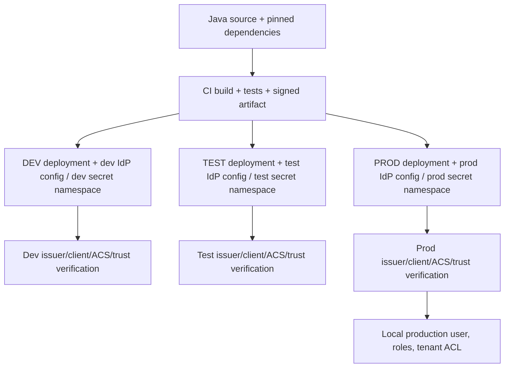

# Separating IdP Configuration Across Development, Test, and Production

## 1. Context and Expected Outcomes

A Java/Spring Security application supporting **federation/SSO** does not just have a single `issuer-uri` setting. It communicates with one or more Identity Providers (IdPs), Authorization Servers (ASs), SAML Asserting Parties, CAS Servers, or identity-aware gateways; each environment must have an **independent trust boundary**. If a production build accidentally uses a test environment's OIDC issuer, SAML certificate, or client secret, the application can authenticate the wrong users, grant roles in the wrong tenant, leak production credentials, or send assertions/tokens to unauthorized endpoints.

This article belongs to the **Deployment and Operations** group of the **Spring Security – federation** module. Specific topic: **“Separating IdP Configuration Across Development, Test, and Production”**. Examples use Java 17+, Spring Boot 3.x, and Spring Security 6.x/6.5; verify against your actual dependency BOM when deploying newer releases. URLs under `example.test`, realms, client IDs, and certificate IDs are illustrative—**not live resources**.

**End goal:** the exact same application artifact can progress through dev → test/staging → production while each deployment connects solely to the IdP, tenant/realm, credentials, issuer, audience, redirect/ACS, and local authorization policy **approved for that exact environment**. Misconfiguration must **fail cleanly** rather than silently falling back.

### After This Lesson You Can

1. Build an environment identity contract table covering OIDC/OAuth2, SAML2, CAS, JWT Resource Server, and proxy authentication.
2. Distinguish **Spring profiles**, **deployment environments**, **IdP tenants/realms**, and **trust anchors**.
3. Structure `application.yml`/`application-dev.yml`/`application-test.yml`/`application-prod.yml` with proper override precedence, avoiding mixed profiles.
4. Completely isolate client secrets, SAML SP private keys, API credentials, IdP verification certificates, and truststores.
5. Safely use Spring Boot Config Data, environment variables, `configtree:`, and a secret manager.
6. Keep OIDC `issuer-uri`, `client-id`, `redirect-uri`, and audiences isolated across environments.
7. Set SAML SP Entity ID/ACS/SLO, IdP Entity ID, and verification certificates per environment.
8. Understand CAS service URLs and CAS Server trust, preventing mispointing to the wrong service registry.
9. Add deployment guards/CI checks to block prod from using test issuers/certificates or dev keys.
10. Design cross-environment rejection tests, certificate/client-secret rotation, monitoring, and rollback.

## 2. Three Environments Are Not Three URL Strings

| Separation dimension | Development | Test/Staging | Production |
| --- | --- | --- | --- |
| IdP/AS | Local fake IdP or dev tenant | Independent test tenant, prod-like | Official tenant/realm |
| OIDC issuer | `http://127.0.0.1:9080/realms/dev` | `https://idp.test.example.test/realms/test` | `https://login.example.test/realms/prod` |
| OAuth client ID | `portal-dev` | `portal-test` | `portal-prod` |
| OAuth client secret | Quickly rotatable dev secret | Test secret from test vault | Production secret via prod secret store only |
| Browser callback | `http://127.0.0.1:8080/login/oauth2/code/corp` | `https://portal.test.example.test/login/oauth2/code/corp` | `https://portal.example.test/login/oauth2/code/corp` |
| SAML SP Entity ID | Dev SP entity | Test SP entity | Production SP entity |
| SAML ACS/SLO | Local test URL | Test public HTTPS URL | Production public HTTPS URL |
| IdP signing keys | Dev test keys | Test signing cert/key from test IdP | Production IdP trust anchors |
| SP private keys | Dev-only keys | Test-only keys | Production HSM/KMS/secret mount |
| Test users/groups | Synthetic | Synthetic, governed | Real production identities |
| Local roles/tenant links | Dev database | Test database | Prod IAM/database |
| Audience/Resource Server | Dev API audience | Test API audience | Prod API audience |
| Observability | Sanitized dev logs | Test metrics/traces | Locked-down production telemetry |
| Network | Loopback/test endpoints | Isolated staging networks | Strict private/public boundary |

**Matching profile names alone does not create isolation.** If `SPRING_PROFILES_ACTIVE=prod` yet `client-id=portal-test`, `issuer-uri=test`, or `SAML verification cert=test` slips into runtime via environment-variable overrides, wrongly mounted files, or a config server, that is still a **cross-environment trust violation**.

**Never use production IdP users, production signing private keys, or production client secrets in local development or CI.** Test IdPs should have synthetic users/groups reflecting production policies without real production data.

## 3. Environment, Profile, Registration, and Tenant: Four Distinct Concepts

- **Environment/deployment stage:** dev, test/staging, prod; governed by release and infrastructure teams. One image can run across multiple stages.
- **Spring profile:** a set of property sources/beans activated by Spring Boot (`dev`, `test`, `prod`). It is merely a **configuration selection mechanism**, not proof of trust.
- **OIDC `registrationId` / SAML `RelyingPartyRegistration.registrationId`:** identifier of a connection configuration **inside the application** (`corp`, `partner`). You can keep the name `corp` consistent across stages, while the underlying IdP values must differ.
- **IdP tenant/realm/issuer:** security authority identifier; the tenant display name in an admin console does not replace `iss` or the SAML Entity ID.

Example where `registrationId=corp` exists in both dev and prod:

```text
dev profile:
    registrationId: corp
    issuer: http://127.0.0.1:9080/realms/dev
    client-id: portal-dev
    redirect: http://127.0.0.1:8080/login/oauth2/code/corp

prod profile:
    registrationId: corp
    issuer: https://login.example.test/realms/prod
    client-id: portal-prod
    redirect: https://portal.example.test/login/oauth2/code/corp
```

These are not two clients of a single trust domain: **same local registrationId yet distinct issuer, client, redirect, and secret**. Never use `registrationId` alone as the key for local account linking. In OIDC, the stable identifier is **(verified issuer, subject `sub`)**, plus tenant/registration scope per policy. In SAML, use the verified IdP Entity ID and persistent NameID/qualifiers per profile—never join solely by email.

## 4. Threat Model: Consequences of Mixing Environments

| Mistake | Scenario | Impact |
| --- | --- | --- |
| Production points to test OIDC issuer | Test token `iss=test` trusted by prod backend | Test user accesses prod |
| Audience/API shared between test and prod | Test token `aud` also matches prod | Cross-environment token confusion |
| Production uses test OAuth client secret | Secret sits in CI logs or dev laptops | Credential leak; attacker impersonates client |
| Dev registers prod callback | Prod IdP redirects code to dev host | Authorization code leakage / login confusion |
| Prod SAML SP trusts test cert | Test IdP signs assertions accepted by prod | Cross-environment SAML authentication |
| Test SP uses production signing key | CI machines hold real key | Widened key exposure blast radius |
| Wrong SP Entity ID/ACS | IdP signs Response for another service | Destination/Recipient mismatch, login failure |
| CAS `ServiceProperties` uses prod service URL in test | ST issued for wrong service | `INVALID_SERVICE` or wrong grant if registry is overly broad |
| Shared session/cookie domain | Browser sends prod session to test | Session leakage / cross-environment confusion |
| Shared user directory/roles | Test grants `ROLE_ADMIN` matching prod user | Privilege escalation |
| `dev,prod` profiles enabled together | Later property source partially overrides | Unsafe hybrid config |
| Missing secret file with dev default | Production silently falls back to dev secret | Isolation breach, potentially hard to spot |
| Prod JWKS cache holds test keys | Wrong trust anchors | Token issuer/key confusion |
| SAML metadata auto-refreshes from untrusted URL | External party swaps cert/EntityID | Trust-store poisoning |

**Boundaries must block across multiple layers:** deployment manifests pick the right stage; config properties align; startup guards verify expected issuer/redirect/certs; validators verify every token/response; resource authorization still checks local users/tenants/ACLs.

## 5. Architecture Pattern: "Same Artifact, Different Trusted Configuration"

A solid pattern builds **one immutable artifact**, signs/scans it, and promotes the exact same digest across stages:



Do not rebuild code to bake prod URLs into source; avoid `if (prod) ...` scattered through controllers. **Separate code from config and secrets**, while enforcing an **environment-specific contract** that cannot be overridden by untrusted input.

A deployment policy:

1. CI builds a deterministic image digest.
2. Sign/scan dependencies and verify packages/SBOM.
3. Deploy that digest to dev with dev-only config/secrets.
4. Test signed SAML/OIDC/CAS flows in staging against the staging IdP.
5. Promote **the exact same digest** to prod with approved prod-only config/secrets.
6. App startup reads config and validates stage/issuer/trust references; fail startup/readiness on mismatch.
7. Run smoke SSO, local permission checks, and properly scoped health probes.
8. On failure, roll back **artifact + config version** per procedure; never turn on validator bypasses.

One image may run with different profiles, yet **secrets/certificates/IdP tenants must never replicate along with the image**.

## 6. Spring Profiles and Configuration Precedence to Master

Spring Boot supports:

- `application.yml`: shared baseline configuration.
- `application-dev.yml`: `dev` only.
- `application-test.yml`: `test` only.
- `application-prod.yml`: `prod` only.
- `spring.profiles.active`: activates profiles.
- `spring.profiles.default`: default profile when none is active.
- `spring.config.activate.on-profile`: enables individual YAML documents by profile expression.
- `spring.config.import`: imports Config Data/`configtree:`.
- Environment variables, command-line options, ConfigMaps, secret mounts, and external Config Data can **override** files inside the JAR per precedence rules.

**Never place `spring.profiles.active=prod` inside `application-prod.yml` or a YAML document activated by `spring.config.activate.on-profile`.** Spring Boot docs specify active/default profiles belong in non-profile-specific documents/sources. Safe operations let the **deployment pipeline** set `SPRING_PROFILES_ACTIVE=prod` explicitly, rather than having the app guess its environment from hostname.

Never activate `dev,prod` simultaneously: when multiple profiles are active, properties override by order, creating a hybrid issuer/secret/client-ID combination that does not exist at the IdP. Add a guard **requiring exactly one stage profile** and rejecting unexpected profiles.

### Configuration Does Not Equal Authorization

Activating the `prod` profile is not enough: client secrets/certs, issuer/audience, and local tenant ACLs must still be verified in practice. Implement **startup assertions** and **runtime protocol validators**, not just filenames.

## 7. Recommended File Structure

```text
src/main/resources/
  application.yml
  application-dev.yml
  application-test.yml
  application-prod.yml

src/test/resources/
  application-unit.yml
  saml/
    test-idp-metadata.xml        # test public metadata/fixtures only
  oidc/
    test-issuer-public-jwks.json # public TEST keys only

deployment/
  dev/
    values.yaml
  test/
    values.yaml
  prod/
    values.yaml

# DO NOT COMMIT TO GIT:
# .env.production
# client-secret.txt
# saml-prod-sp-private.key
# idp-admin-password
```

`deployment/*/values.yaml` files contain only **references** to secret names/volumes, never secret values. `application-prod.yml` contains no real private keys, refresh tokens, or client secrets.

Pick one naming convention for stages: e.g., `dev`, `test`, `prod`. Never mix `staging` and `test` while accidentally activating a `test` Spring profile for unit tests that have no test IdP server. Unit tests should use a dedicated profile such as `unit` or test-specific overrides that do not call external IdPs.

## 8. Shared `application.yml`: No Trust Secrets

Example using Spring Boot 3.x:

```yaml
spring:
  application:
    name: federation-portal
  profiles:
    default: none
  security:
    oauth2:
      client:
        registration:
          corp:
            provider: corp
            authorization-grant-type: authorization_code
            scope: [openid, profile, email]
            redirect-uri: "{baseUrl}/login/oauth2/code/{registrationId}"

server:
  servlet:
    session:
      cookie:
        http-only: true

management:
  endpoints:
    web:
      exposure:
        include: "health,info"
```

**Explanation:**

- `spring.profiles.default=none` establishes neither prod nor dev trust by default. The app must receive an active profile from deployment and enforce a runtime guard.
- Base config omits `issuer-uri`, `client-id`, and `client-secret`: these must be supplied per stage.
- `redirect-uri` can use Spring Security's default template, though because proxies can distort scheme/host, many prod deployments pin an **absolute redirect URI** per contract.
- `management.endpoints...` restricts web exposure; still enforce network ACLs/auth on actuator. `/actuator/env` and `configprops` can leak config if misexposed—never expose them publicly.
- `server.servlet.session.cookie.http-only` limits JS access without replacing `SameSite`/`Secure`/CSRF controls; tune per browser SSO bindings.

If an app supports both OAuth2 login and SAML login, do not enable both in one chain without defining login entry points and registration selection. Subsequent examples illustrate an OIDC-only baseline; SAML is an alternative config or needs explicit filter-chain separation.

## 9. Development Profile: Local IdP, Synthetic Data, No Prod Trust

`src/main/resources/application-dev.yml`:

```yaml
spring:
  security:
    oauth2:
      client:
        registration:
          corp:
            client-id: "portal-dev"
            client-secret: "${DEV_OIDC_CLIENT_SECRET}"
            redirect-uri: "http://127.0.0.1:8080/login/oauth2/code/corp"
        provider:
          corp:
            issuer-uri: "http://127.0.0.1:9080/realms/dev"

app:
  identity:
    stage: dev
    expected-oidc-issuer: "http://127.0.0.1:9080/realms/dev"
    expected-client-id: "portal-dev"
    expected-redirect-uri: "http://127.0.0.1:8080/login/oauth2/code/corp"
```

**Preconditions:** a local IdP actually runs on loopback port 9080; `DEV_OIDC_CLIENT_SECRET` is supplied by the dev runtime. `app.identity.*` are **custom application properties** read by a startup guard—**not checked automatically by Spring Security**.

In development, HTTP is acceptable **strictly for loopback and a test IdP**, never as an excuse to disable TLS verification when connecting dev to external systems. Never use actual production client IDs/secrets or production issuers for "convenient login."

Another option is having dev use a shared organizational HTTPS sandbox IdP, which must still be an isolated **dev tenant** separate from prod, with test users and scoped permissions. If dev and test share an IdP server host, at least realm/issuer, client registration, secrets, and key sets must maintain distinct trust boundaries.

## 10. Test/Staging Profile: Independent IdP and Public HTTPS Callbacks

`src/main/resources/application-test.yml`:

```yaml
spring:
  security:
    oauth2:
      client:
        registration:
          corp:
            client-id: "portal-test"
            client-secret: "${TEST_OIDC_CLIENT_SECRET}"
            redirect-uri: "https://portal.test.example.test/login/oauth2/code/corp"
        provider:
          corp:
            issuer-uri: "https://idp.test.example.test/realms/test"

app:
  identity:
    stage: test
    expected-oidc-issuer: "https://idp.test.example.test/realms/test"
    expected-client-id: "portal-test"
    expected-redirect-uri: "https://portal.test.example.test/login/oauth2/code/corp"
```

The Staging/Test IdP should support production-equivalent flows: authorization code + PKCE, client authentication, ID token signature/issuer/audience/nonce, signing key rotation, logout, group attributes, and redirect rules. However:

- Use synthetic identities; never import production user credentials.
- Register a dedicated **test callback**; never add prod redirects to a test client for "convenience."
- Pull secrets from the `test` vault namespace with RBAC scoped to test deployments.
- Token `iss` must differ from prod; audiences should separate test/prod so cross-environment API token acceptance is impossible.
- Never reuse prod SAML SP private keys or IdP signing certs in test.
- Test logs and APM must also redact tokens, SAMLResponses, cookies, and PII.

**Unit tests** need not spin up a real test IdP; use test-specific MockMvc fixtures/MockWebServer/containers. **Staging SSO integration tests** exercise the test IdP and real protocols.

## 11. Production Profile: Mandatory Secret Mount, No Dev Fallback

`src/main/resources/application-prod.yml`:

```yaml
spring:
  config:
    import: "configtree:/run/secrets/identity/"

  security:
    oauth2:
      client:
        registration:
          corp:
            client-id: "portal-prod"
            client-secret: "${oidc.client-secret}"
            redirect-uri: "https://portal.example.test/login/oauth2/code/corp"
        provider:
          corp:
            issuer-uri: "https://login.example.test/realms/prod"

app:
  identity:
    stage: prod
    expected-oidc-issuer: "https://login.example.test/realms/prod"
    expected-client-id: "portal-prod"
    expected-redirect-uri: "https://portal.example.test/login/oauth2/code/corp"
```

Config Tree layout:

```text
/run/secrets/identity/
  oidc.client-secret      # file content = production OAuth client secret
```

Spring Boot `configtree:` uses **filenames as property keys**, so `oidc.client-secret` from the file resolves as `${oidc.client-secret}`. Secret files should be mounted **read-only**, readable only by the authorized user/container, without unintended trailing newlines if the IdP secret is an exact string. Verify filenames and volume mounts in the real cluster.

**Never add `optional:` in front of `configtree:` in production** when you want deployment to reject missing secret mounts. Per Spring Boot Config Data, a missing non-optional location fails startup (`ConfigDataLocationNotFoundException`), enforcing no silent fallback. If a specific key file is missing even though the directory exists, unresolved placeholders or the validation guard must fail—never provide `${oidc.client-secret:dev-secret}` as a default.

**Never place production secrets directly in YAML, Git, Helm values, image layers, Dockerfile `ARG`s, CI output, or Actuator env endpoints.** Secret managers can inject values via K8s Secret mounts, CSI/Vault/KMS, or approved providers. A Kubernetes Secret alone is not a complete guarantee: enforce RBAC, encryption at rest, auditing, restricted pod exec, and backup governance.

## 12. Why ConfigTree Alone Does Not Create "Environment Security"

`spring.config.import=configtree:/run/secrets/identity/` simply **loads files as config properties**. It does not prove the file holds a real prod secret or belongs to the prod namespace. If Helm accidentally mounts `portal-test-idp-client` in prod, Spring still reads the string and client authentication may fail—or worse, due to misconfigured IdP/client trust, a cross-environment login could succeed.

Add layered defenses:

1. Namespace-bound deployment secret names (`portal-prod-idp-client`).
2. Minimal Kubernetes ServiceAccount/RBAC; workload identity reads only matching prod secrets.
3. Startup guard validating issuer, client ID, redirect/ACS, cert fingerprints, and secret **reference scope** without logging secret values.
4. Admission/policy-as-code blocking prod from referencing secret names containing `dev`/`test`.
5. CI schema validation on deployment manifests.
6. Runtime negative tests: dev tokens/SAML assertions must be rejected by prod.
7. Audit trails for secret rotation and rollback.

**Never compare secret values against hardcoded strings in source code.** Instead validate **secret reference/owner/version**, exercise client auth against the trusted AS, and observe AS results—never write secret hashes to logs without approval.

## 13. Spring Profile Precedence: Practical Ways Environments Get Mixed

Spring Boot loads profile-specific files alongside the base file; external properties, imports, and environment/command-line flags follow override precedence. Common pitfalls:

```bash
# Right intent, not yet full proof of trust:
SPRING_PROFILES_ACTIVE=prod java -jar federation-portal.jar

# Dangerous: two stage profiles active simultaneously.
SPRING_PROFILES_ACTIVE=dev,prod java -jar federation-portal.jar

# Dangerous: overriding prod client with a dev value.
SPRING_PROFILES_ACTIVE=prod \
SPRING_SECURITY_OAUTH2_CLIENT_REGISTRATION_CORP_CLIENT_ID=portal-dev \
java -jar federation-portal.jar
```

These are **illustrative Unix shell commands**. Production deployments use platform-native injection/secret mounts. Setting `SPRING_PROFILES_ACTIVE=prod` only picks a profile—it **does not stop** a higher-precedence property source from overriding the issuer or client ID. Therefore, build a startup guard inspecting **effective bound properties** after Spring binding rather than inspecting Git YAML files alone.

### Pitfall of `spring.profiles.active` Inside Profile-Specific Files

Per Boot docs, `spring.profiles.active` must not be declared inside `application-prod.yml` or a document activated by `spring.config.activate.on-profile`. Set active profiles in **deployment configuration** and verify them. Never leave an unexplained `spring.profiles.include=dev` in production.

### Pitfall of `optional:`

`optional:configtree:/run/secrets/identity/` tolerates missing paths. That makes sense in local dev with safe fallbacks, yet in prod it hides missing secret mounts if `client-secret` also has a weak default. In prod, keep imports non-optional and validation mandatory.

## 14. OIDC: Parameters That Must Belong to One Environment

| Property | Source / meaning | Verification condition |
| --- | --- | --- |
| `ClientRegistration.registrationId` | Local key, e.g., `corp` | Maps solely to approved provider in this stage |
| `client-id` | OAuth/OIDC client at IdP | Prod has its own prod client ID |
| `client-secret` | Confidential client credential | Stage-specific secret, never leaked |
| `provider.issuer-uri` | Official OIDC issuer | Matches exact ID Token/Discovery `iss` |
| `authorization-uri` | Authorization endpoint | Present in metadata of the exact issuer |
| `token-uri` | Token endpoint | HTTPS, right AS, trusted TLS |
| `jwk-set-uri` | Public signing keys | Within issuer's trust contract |
| `redirect-uri` | Client callback at SP | Exact redirect URI registered on client |
| `scope` | OIDC `openid` + attributes | Never grants roles/permissions automatically |
| `nonce` | Binds ID Token to auth flow | Must verify in OIDC login |
| `state` | Authorization response CSRF/correlation | Must match request/session |
| PKCE | Protects authorization code in flow | Enabled per client/AS policy |
| Client authentication method | Basic, post, `private_key_jwt`, etc. | Matches registration and stage secret/key |
| Logout/post-logout redirect | OIDC RP-Initiated Logout | Prod URL never mixed with test |

**Issuer is a security identifier, not merely a hostname.** Two realms on the same `https://login.example.test` have distinct issuers. Never normalize `iss` by stripping paths or trailing segments. Compare the exact issuer string per the IdP's OIDC specification.

Spring Security's default OIDC callback is `/login/oauth2/code/{registrationId}`. Behind TLS-terminating proxies, `{baseUrl}` can resolve wrongly if forwarded headers are not trusted/stripped properly; production can pin explicit absolute redirects. **Never let a client supply an arbitrary `X-Forwarded-Host` and use it to build an OAuth redirect URI.**

## 15. OIDC: Do Not Confuse Client Secret with JWT Verification Keys

An OIDC client relies on two kinds of trust material:

- `client-secret` or `private_key_jwt` credential proving **the app is authorized to call the token endpoint**.
- JWK Set public keys from the IdP proving **the signature on ID Tokens / access JWTs**.

Rotating a client secret does not change the IdP's signing keys. Rotating IdP signing keys does not change the client secret. Each has its own rotation cycle and scope.

Production must test all of:

1. Prod client ID + prod client credential calls the right token endpoint.
2. Dev/test client credentials are rejected by the prod endpoint.
3. Prod ID Token `iss` matches the configured issuer.
4. ID Token `aud` includes the exact client ID; nonce/exp/iat and `azp` rules match profile.
5. Access JWT `aud` contains the Resource Server/API audience, which may differ from the OAuth client ID.
6. Unknown `kid` triggers JWKS refresh from the **approved** URI—never trust a key pointed to by an arbitrary `jku` in the token.
7. Key rotation uses a safe overlap window; revoked keys fail after policy invalidation.
8. Group/role mappings from the prod issuer never implicitly trust identically named test groups.

A production service should not share **the same confidential client ID/secret** across web login and all backend jobs when scopes/roles can be separated.

## 16. JWT Resource Server: Environment-Specific Issuer, Audience, and Keys

Spring Boot / Spring Security 6.5 supports JWT configuration such as this **production-API-only** example:

```yaml
spring:
  security:
    oauth2:
      resourceserver:
        jwt:
          issuer-uri: "https://login.example.test/realms/prod"
          jwk-set-uri: "https://login.example.test/realms/prod/protocol/openid-connect/certs"
          audiences: "api://orders-prod"
```

`issuer-uri` validates `iss`; specifying `jwk-set-uri` directly can avoid startup discovery dependency **without dropping issuer validation**. Per Spring Security 6.5 docs, Boot provides the `audiences` property to validate `aud`. On other versions, configure an equivalent audience validator explicitly.

| Environment | Issuer | Audience |
| --- | --- | --- |
| dev | `http://127.0.0.1:9080/realms/dev` | `api://orders-dev` |
| test | `https://idp.test.example.test/realms/test` | `api://orders-test` |
| prod | `https://login.example.test/realms/prod` | `api://orders-prod` |

**Cross-environment negative test:** a token signed by the dev IdP with `aud=api://orders-dev` **must never** be accepted in prod, even if its payload has a matching email/role. If dev and prod ever shared a signing key, signature verification alone would be insufficient; issuer/audience/stage must still match, and independent signing keys should always be used.

Do not confuse a web OIDC **ID Token** with an API **Access Token**. A Resource Server validates access tokens per AS/audience/scope/API policy rather than accepting ID Tokens merely because signatures match.

## 17. SAML2: Values That Must Be Separated by Environment

For a SAML SP, each `RelyingPartyRegistration` pairs an SP and an IdP. Key variables:

| Attribute | Development | Test | Production |
| --- | --- | --- | --- |
| SP Entity ID | `urn:portal:sp:dev` | `urn:portal:sp:test` | `https://portal.example.test/saml2/service-provider-metadata/corp` |
| ACS URL | Local HTTP loopback | Test HTTPS callback | Prod HTTPS callback |
| SLO URL | Dev endpoint | Test endpoint | Prod SLO endpoint |
| IdP Entity ID/Issuer | Dev IdP | Test IdP | Prod IdP |
| IdP SSO/SLO endpoints | Dev | Test | Prod |
| IdP verification certificates | Dev signing certs | Test certs | Prod certs |
| SP signing private key | Dev-only | Test-only | HSM/KMS/mounted prod secret |
| SP decryption key | Dev-only | Test-only | Separate prod decryption credential if needed |
| NameID / attribute mapping | Dev synthetic users | Test synthetic users | Prod identity link policy |
| `InResponseTo` / RelayState | Local session | Test session | Prod session, cross-site cookie policy |

**Do not change only the IdP SSO URL.** If SP Entity ID or ACS still carries a test URL in prod, the IdP may issue SAMLResponses failing `Destination`/`Recipient` checks or—worse—post Responses to the wrong host.

### Spring Boot SAML Profile Example

An `application-prod.yml` fragment for a SAML app (separate from the OIDC-only example unless both are needed):

```yaml
spring:
  security:
    saml2:
      relyingparty:
        registration:
          corp:
            entity-id: "https://portal.example.test/saml2/service-provider-metadata/corp"
            acs:
              location: "https://portal.example.test/login/saml2/sso/corp"
            signing:
              credentials:
                - private-key-location: "file:/run/secrets/saml/sp-sign.key"
                  certificate-location: "file:/etc/identity/saml/sp-sign.crt"
            assertingparty:
              entity-id: "https://idp.example.test/saml/prod/entity"
              sso-url: "https://idp.example.test/saml/prod/sso"
              verification:
                credentials:
                  - certificate-location: "file:/etc/identity/saml/prod-idp-verification.crt"
```

This is an **illustrative config fragment**, not a ready-to-login IdP setup. Supply real keys/certificates, verified metadata/bindings, SLO if used, and match exact Spring Boot `Saml2RelyingPartyProperties` for your active BOM. IdPs may mandate signed AuthnRequests, XML encryption, or specific NameID formats/algorithms—never drop requirements when deploying.

Alternatively, load a **signed/approved IdP metadata snapshot** from a file or versioned trust artifact rather than fetching Internet metadata on every boot. Spring Security supports `RelyingPartyRegistrations.fromMetadataLocation(...)`; if using dynamic metadata, enforce trusted sources, refresh, and rollback policies. **Never read a metadata location from a request query, untrusted host, or user input.**

## 18. SAML: Separating Public Verification Certificates and Private Keys

Key types to keep distinct:

1. **IdP private signing key:** managed by the IdP; the SP **must never receive this private key**.
2. **IdP public verification certificate:** used by the SP to verify XML signatures; pin approved certs per exact IdP and stage.
3. **SP signing private key:** used by the SP to sign AuthnRequests/LogoutRequests/metadata when required; prod keys live strictly in prod secrets/HSM.
4. **SP public signing certificate:** trusted by the IdP to verify SP-originated messages.
5. **SP decryption private key:** if the IdP encrypts assertions for the SP, use a separate prod key; never confuse it with the signing key.
6. **TLS server certificate:** verifies HTTPS for IdP/SP hosts, not a substitute for XML Signature certificates.

**Both are "certificates," yet they serve different trust purposes.** The HTTPS cert of `idp.example.test` is not automatically the IdP's SAML signing cert. Verify metadata, metadata signatures, and certificate usage.

### Safe Rotation

- Add the trusted **new IdP verification cert** per approved metadata/policy before the IdP begins signing with the new key.
- During overlap, allow both old/new certs if security approves; never trust wildcard/unbounded keys.
- Monitor signed assertions using approved `KeyInfo`/fingerprints; never trust a cert hinted inside an assertion unless it is already in the trust store.
- Once the IdP retires the old key, remove it from the trust list and ship a new config version.
- For SP signing/private keys, coordinate SP metadata updates with the IdP; never delete the old private key before partners adopt the new public key.
- Test stages must run **rotation rehearsals** with test keys—never copy prod keys to staging.
- On key compromise, revocation/incident response may require **immediate rejection**, with no grace period despite availability impact.

Never embed raw private keys in Java classpath JARs, GitHub Actions output, Helm charts, public SAML metadata, or logs.

## 19. Cross-Environment SAML Acceptance Must Be Rejected

A test IdP can issue a validly signed SAMLResponse for a **test SP**. That must never make it valid at a **production SP**:

```text
TEST:
  Issuer = urn:example:idp:test
  Recipient = https://portal.test.example.test/login/saml2/sso/corp
  Audience = urn:portal:sp:test
  signer = test IdP key

PROD:
  Issuer = urn:example:idp:prod
  Recipient = https://portal.example.test/login/saml2/sso/corp
  Audience = https://portal.example.test/saml2/service-provider-metadata/corp
  signer = prod IdP key
```

Spring's OpenSAML provider must validate **signature, issuer, audience, destination/recipient, Conditions, SubjectConfirmation, InResponseTo**, and local user linking—not NameID alone. In a test environment, intentionally send a signed TEST assertion to an **authorized** PROD test endpoint and assert rejection (never perform this using unauthorized production identities).

Even when test and prod share an IdP hostname across different realms, `Issuer/Entity ID` and keys must bind precisely. Never use **email** as a cross-environment auth key when `NameID` can be reassigned/changed; use verified IdP + NameID/qualifiers + local mapping.

## 20. CAS: Stage-Specific Service URL and CAS Server Trust

A Spring Security CAS client typically uses:

- `CasAuthenticationEntryPoint.loginUrl` → CAS Server `/login`.
- `ServiceProperties.service` → public SP login processing URL, e.g., `https://portal.example.test/login/cas`.
- `Cas20ServiceTicketValidator` → CAS Server `/serviceValidate`.
- `CasAuthenticationFilter` → processes the `ticket` query param at `/login/cas`.
- Local `UserDetailsService`/`CasAuthenticationProvider` → assigns local roles.

Environment matrix:

| Stage | CAS Server | `ServiceProperties.service` |
| --- | --- | --- |
| dev | `http://127.0.0.1:8443/cas` (local assumption) | `http://127.0.0.1:8080/login/cas` |
| test | `https://cas.test.example.test/cas` | `https://portal.test.example.test/login/cas` |
| prod | `https://cas.example.test/cas` | `https://portal.example.test/login/cas` |

**An ST is bound to a specific `service` and valid for one validation only.** A test ST issued for a test service must never be accepted by prod CAS/SP. If prod `ServiceProperties.service` points to a test callback, CAS normally returns `INVALID_SERVICE` or users enter a redirect loop.

Never validate prod credentials against a test CAS Server or enable anonymous auth if prod CAS times out. Constrain registry URL patterns to exact services rather than wildcard `.*` across environments. With proxy TLS termination, pin the public service URL and strip/overwrite `Forwarded` headers.

## 21. Kerberos and Proxy Pre-Auth Also Need Isolation

A federated system may use Kerberos/SPNEGO or an IdP-aware proxy:

**Kerberos:**

- Dev/test use a separate Kerberos realm, test KDC, and HTTP service principal from prod wherever feasible.
- Test keytabs never contain production service keys.
- Production `HTTP/portal.example.test@REALM` must never be replaced by test `HTTP/portal.test.example.test@TEST.REALM`.
- Principal/domain group mappings to local roles belong strictly to the matching realm.
- When a keytab is wrong or the KDC fails, never fall back to accepting a raw username header.

**Proxy pre-auth:**

- The production edge gateway uses dedicated prod OIDC/SAML clients and prod trust certificates.
- Backend is not directly reachable from public networks; enforce mTLS/workload identity/firewalls/NetworkPolicies.
- Edge strips client-controlled `X-Verified-User`, `X-Auth-User`, and `SM_USER` before setting verified headers.
- A test gateway must never inject identity into a production backend.
- Auth service down ⇒ fail closed; never forward raw user headers from clients.
- Never share session encryption keys across dev/test/prod absent strictly reviewed exceptions; keep cookie domains separate.

**`@Profile("dev")` on a fake authentication bean must be guarded so it can never activate in production.** If prod accidentally runs with `dev,prod` active, an "always allow test users" bean can destroy all isolation.

## 22. SecurityFilterChain for OIDC Login: Keep Fake Dev Providers Out of Prod

A minimal Spring Security Servlet setup:

```java
@Configuration
class WebSecurityConfiguration {

    @Bean
    SecurityFilterChain web(HttpSecurity http) throws Exception {
        return http
                .authorizeHttpRequests(auth -> auth
                        .requestMatchers("/", "/error", "/health")
                            .permitAll()
                        .anyRequest().authenticated())
                .oauth2Login(Customizer.withDefaults())
                .build();
    }
}
```

This is a **Java 17+ fragment requiring imports and `ClientRegistrationRepository`**. `.oauth2Login()` configures the OIDC/OAuth login flow; runtime settings `spring.security.oauth2.client.registration.corp` and `provider.corp.issuer-uri` bind per profile. It **does not automatically enforce** `dev/test/prod` issuer separation if config is accidentally overridden.

When an app also exposes a JWT Resource Server API, separate `SecurityFilterChain`s using `securityMatcher("/api/**")` and `@Order`; API Bearer tokens must not implicitly accept web ID Tokens/sessions. If SAML2/RP is also present, configure explicit entry points and routes so method security cannot bypass across auth mechanisms.

**Never write**:

```java
// ANTI-PATTERN: production must never depend on any debug flag.
if (environment.acceptsProfiles(Profiles.of("dev"))) {
    return anyUserAsAdmin();
}
```

Instead of putting a "dev bypass mode" inside the prod artifact, use **test fixtures in test scope** or a real local test IdP, plus a guard blocking invalid active profiles.

## 23. Startup Guard: Inspect Effective Properties, Not Just Filenames

Because env vars, Helm, or CLI flags can override configs, a startup guard must inspect **effective bound properties**:

```text
Deploy declares stage=prod
  |
  v
Read effective OIDC issuer / client ID / redirect
Read effective SAML IdP Entity ID / ACS / signing + verification refs
Read active Spring Profiles and secret namespace/ref scope
  |
  v
Compare against approved production contract
  |-- mismatch --> Fail startup / not ready; alert
  |
  v
Initialize SSO trusted providers and serve traffic
```

You do not need to hardcode production secrets in Java. You can pin approved **issuer/redirect/client ID/IdP Entity ID/cert reference IDs** from a signed deployment manifest, policy-as-code, or startup guard variables. Yet to prevent an attacker from editing both "actual config" and "expected config" in the same secret mount, the expected contract should be governed by a **separate source/role** with change approvals.

Spring Boot supports `@ConfigurationProperties` and `@Validated` (with Jakarta Bean Validation). **Design fragment** example:

```java
@ConfigurationProperties(prefix = "app.identity")
@Validated
public record IdentityEnvironmentProperties(
        @NotBlank String stage,
        @NotBlank String expectedOidcIssuer,
        @NotBlank String expectedClientId,
        @NotBlank String expectedRedirectUri) {
}
```

For deeper checks, build a Spring `@Bean` via `SmartInitializingSingleton`/startup validator reading `ClientRegistrationRepository`, `RelyingPartyRegistrationRepository`, and the expected deployment contract. On mismatch, throw a configuration exception before the app reports ready. **`@NotBlank` only checks non-emptiness—it does not prove the issuer belongs to the stage**; add a real policy validator.

Never log client secrets, private keys, or raw IdP metadata with PII. Log only stage, approved issuer alias/client ID if permitted, public cert fingerprint, and config revision.

## 24. Standalone Java 17: Policy Checking the Right Environment

The program below **needs no Spring, IdP, Internet, or external libraries**. It models a **startup environment invariant** against a table of approved contracts. `secretRef`/`certRef` are **reference IDs only**, carrying no secret/certificate bytes. In production, load the approved contract from a source governed independently from runtime config.

File `IdpEnvironmentIsolationDemo.java`:

```java
import java.util.Locale;

public final class IdpEnvironmentIsolationDemo {

    enum Stage {
        DEV, TEST, PROD
    }

    enum Decision {
        PASS,
        DENY_STAGE,
        DENY_SECRET_REF,
        DENY_SECRET_SCOPE,
        DENY_TLS,
        DENY_OIDC_ISSUER,
        DENY_REDIRECT_URI,
        DENY_CLIENT_ID,
        DENY_SAML_ISSUER,
        DENY_SAML_ACS,
        DENY_CERT_SET
    }

    record Spec(
            String issuer, String redirect, String clientId,
            String samlIssuer, String samlAcs, String certRef) {
    }

    record IdpConfig(
            Stage stage, String oidcIssuer, String redirect,
            String clientId, String secretRef, String samlIssuer,
            String samlAcs, String certRef) {

        IdpConfig withIssuer(String next) {
            return new IdpConfig(stage, next, redirect,
                    clientId, secretRef, samlIssuer, samlAcs, certRef);
        }

        IdpConfig withRedirect(String next) {
            return new IdpConfig(stage, oidcIssuer, next,
                    clientId, secretRef, samlIssuer, samlAcs, certRef);
        }

        IdpConfig withSecretRef(String next) {
            return new IdpConfig(stage, oidcIssuer, redirect,
                    clientId, next, samlIssuer, samlAcs, certRef);
        }

        IdpConfig withSamlIssuer(String next) {
            return new IdpConfig(stage, oidcIssuer, redirect,
                    clientId, secretRef, next, samlAcs, certRef);
        }

        IdpConfig withSamlAcs(String next) {
            return new IdpConfig(stage, oidcIssuer, redirect,
                    clientId, secretRef, samlIssuer, next, certRef);
        }

        IdpConfig withCertRef(String next) {
            return new IdpConfig(stage, oidcIssuer, redirect,
                    clientId, secretRef, samlIssuer, samlAcs, next);
        }

        IdpConfig withClientId(String next) {
            return new IdpConfig(stage, oidcIssuer, redirect,
                    next, secretRef, samlIssuer, samlAcs, certRef);
        }
    }

    static Spec approved(Stage stage) {
        return switch (stage) {
            case DEV -> new Spec(
                    "http://127.0.0.1:9080/realms/dev",
                    "http://127.0.0.1:8080/login/oauth2/code/corp",
                    "portal-dev",
                    "urn:example:idp:dev",
                    "http://127.0.0.1:8080/login/saml2/sso/corp",
                    "ref:dev/saml-verification");
            case TEST -> new Spec(
                    "https://idp.test.example.test/realms/test",
                    "https://portal.test.example.test/login/oauth2/code/corp",
                    "portal-test",
                    "urn:example:idp:test",
                    "https://portal.test.example.test/login/saml2/sso/corp",
                    "ref:test/saml-verification");
            case PROD -> new Spec(
                    "https://login.example.test/realms/prod",
                    "https://portal.example.test/login/oauth2/code/corp",
                    "portal-prod",
                    "urn:example:idp:prod",
                    "https://portal.example.test/login/saml2/sso/corp",
                    "ref:prod/saml-verification");
        };
    }

    static IdpConfig configFor(Stage stage) {
        Spec spec = approved(stage);
        String scope = stage.name().toLowerCase(Locale.ROOT);
        return new IdpConfig(stage, spec.issuer(), spec.redirect(),
                spec.clientId(), "ref:" + scope + "/oidc-client",
                spec.samlIssuer(), spec.samlAcs(), spec.certRef());
    }

    static Decision check(Stage deployedStage, IdpConfig actual) {
        if (deployedStage == null || actual == null
                || actual.stage() != deployedStage) {
            return Decision.DENY_STAGE;
        }
        if (actual.secretRef() == null
                || actual.secretRef().isBlank()) {
            return Decision.DENY_SECRET_REF;
        }

        String scope = "ref:"
                + deployedStage.name().toLowerCase(Locale.ROOT) + "/";
        if (!actual.secretRef().startsWith(scope)) {
            return Decision.DENY_SECRET_SCOPE;
        }

        if (deployedStage == Stage.PROD
                && (!actual.oidcIssuer().startsWith("https://")
                    || !actual.redirect().startsWith("https://")
                    || !actual.samlAcs().startsWith("https://"))) {
            return Decision.DENY_TLS;
        }

        Spec expected = approved(deployedStage);
        if (!expected.issuer().equals(actual.oidcIssuer())) {
            return Decision.DENY_OIDC_ISSUER;
        }
        if (!expected.redirect().equals(actual.redirect())) {
            return Decision.DENY_REDIRECT_URI;
        }
        if (!expected.clientId().equals(actual.clientId())) {
            return Decision.DENY_CLIENT_ID;
        }
        if (!expected.samlIssuer().equals(actual.samlIssuer())) {
            return Decision.DENY_SAML_ISSUER;
        }
        if (!expected.samlAcs().equals(actual.samlAcs())) {
            return Decision.DENY_SAML_ACS;
        }
        if (!expected.certRef().equals(actual.certRef())) {
            return Decision.DENY_CERT_SET;
        }
        return Decision.PASS;
    }

    public static void main(String[] args) {
        IdpConfig dev = configFor(Stage.DEV);
        IdpConfig test = configFor(Stage.TEST);
        IdpConfig prod = configFor(Stage.PROD);

        System.out.println("devOnDev="
                + check(Stage.DEV, dev));
        System.out.println("testOnTest="
                + check(Stage.TEST, test));
        System.out.println("prodOnProd="
                + check(Stage.PROD, prod));
        System.out.println("devConfigOnProd="
                + check(Stage.PROD, dev));
        System.out.println("testIssuerOnProd="
                + check(Stage.PROD, prod.withIssuer(
                        approved(Stage.TEST).issuer())));
        System.out.println("testRedirectOnProd="
                + check(Stage.PROD, prod.withRedirect(
                        approved(Stage.TEST).redirect())));
        System.out.println("testSecretOnProd="
                + check(Stage.PROD, prod.withSecretRef(
                        "ref:test/oidc-client")));
        System.out.println("missingSecretOnProd="
                + check(Stage.PROD, prod.withSecretRef("")));
        System.out.println("httpIssuerOnProd="
                + check(Stage.PROD, prod.withIssuer(
                        "http://login.example.test/realms/prod")));
        System.out.println("testClientIdOnProd="
                + check(Stage.PROD, prod.withClientId("portal-test")));
        System.out.println("testSamlIssuerOnProd="
                + check(Stage.PROD, prod.withSamlIssuer(
                        approved(Stage.TEST).samlIssuer())));
        System.out.println("testAcsOnProd="
                + check(Stage.PROD, prod.withSamlAcs(
                        approved(Stage.TEST).samlAcs())));
        System.out.println("testCertOnProd="
                + check(Stage.PROD, prod.withCertRef(
                        approved(Stage.TEST).certRef())));
    }
}
```

Run with JDK 17+:

```bash
javac IdpEnvironmentIsolationDemo.java
java IdpEnvironmentIsolationDemo
```

**Exact stdout:**

```text
devOnDev=PASS
testOnTest=PASS
prodOnProd=PASS
devConfigOnProd=DENY_STAGE
testIssuerOnProd=DENY_OIDC_ISSUER
testRedirectOnProd=DENY_REDIRECT_URI
testSecretOnProd=DENY_SECRET_SCOPE
missingSecretOnProd=DENY_SECRET_REF
httpIssuerOnProd=DENY_TLS
testClientIdOnProd=DENY_CLIENT_ID
testSamlIssuerOnProd=DENY_SAML_ISSUER
testAcsOnProd=DENY_SAML_ACS
testCertOnProd=DENY_CERT_SET
```

### Nature and Limitations of the Demo

- `Stage.PROD` is a **trusted deployment stage defined by infrastructure**, never coming from browser queries or cookies.
- `approved(Stage.PROD)` models a contract governed by security/release teams. In production, use an approved config store/policy and ensure whoever edits deployed properties **cannot arbitrarily rewrite the approved contract**.
- `secretRef` is merely a **reference name**, not proof the secret exists, has the right owner, or holds the right value. Real deployments require secret-store RBAC and AS client authentication.
- `certRef` is merely an approved ID and **does not verify SAML signatures**. Runtime must load real certificate bytes and verify fingerprints/trust chains per policy.
- There is no HTTP, JWT, SAML XML, or session in the demo, so it **does not replace** Spring Security integration tests.
- Checking `https://` by string prefix is a simple guard; production needs a proper URI parser/allowlist and full TLS/hostname verification.
- If an application does not use SAML, omit SAML fields from the contract rather than inventing dummy SAML configs just to pass tests.

## 25. Testing Startup Configuration with Spring Boot and Effective Properties

Tests must verify the **real configuration loading path**, not merely a test-constructed `Map`:

1. Activate profile `dev`, inspect `ClientRegistrationRepository` or bound config, and assert issuer/client/redirect are dev.
2. Activate profile `test` and assert zero production client IDs/secrets/cert references appear.
3. Activate profile `prod` with valid test secret mounts and assert prod issuer/redirect/audience/cert references.
4. Activate profiles `dev,prod` and assert the startup guard **rejects** rather than applying last-wins overrides.
5. Prod missing secret mount ⇒ startup fails rather than inserting defaults.
6. Prod receiving `OIDC_CLIENT_SECRET` from dev namespace ⇒ rejected by policy/secret scope.
7. Prod receiving CLI `--spring.security.oauth2.client.registration.corp.client-id=portal-dev` ⇒ rejected.
8. Prod with dev/test `provider.corp.issuer-uri` ⇒ rejected.
9. Prod resource-server `audiences` set to test audience ⇒ rejected.
10. Prod SAML IdP cert reference set to test ⇒ rejected.

`ApplicationContextRunner` (Spring Boot Test) or `@SpringBootTest(properties=...)` tests context wiring; for profile-specific Config Data, run real integration startup tests to verify profile activation and load order. **`@TestPropertySource` does not replicate full Config Data precedence by default** and does not validate remote IdPs on its own.

Example **JUnit assertion fragment**:

```java
assertEquals("prod",
        environment.getProperty("app.identity.stage"));
assertEquals("https://login.example.test/realms/prod",
        environment.getProperty(
          "spring.security.oauth2.client.provider.corp.issuer-uri"));
```

These lines alone **do not prove the runtime issuer** if a custom `ClientRegistrationRepository` overrides Boot properties. Inspect the actual `ClientRegistration` or `RelyingPartyRegistration` beans in use. With a DB-backed dynamic registration repository, verify approved registrations from the repository, **not YAML alone**.

## 26. E2E Negative Tests: Production Must Reject Test Tokens/Assertions

Deployment-oriented testing matrix:

| Case | Input / action | Prod expected |
| --- | --- | --- |
| O1 | Access token signed by dev AS, `iss=dev` | Reject |
| O2 | Access token with test `aud=api://orders-test` | Reject |
| O3 | ID Token from test IdP used at prod callback | Reject issuer/audience/state |
| O4 | `code` from test authorization endpoint sent to prod `/token` | Reject |
| O5 | Test `redirect_uri` accidentally registered on prod client | Policy/config QA fail |
| O6 | Validly signed prod token yet expired `exp` | Reject |
| O7 | JWT with unknown `kid`/key from test JWK Set | Reject |
| O8 | JWT `iss=prod` yet signed with test key | Reject |
| S1 | Test IdP SAMLResponse sent to prod ACS | Reject signing cert/issuer/recipient/audience |
| S2 | SAMLResponse with test Recipient URL | Reject |
| S3 | SAMLResponse with test SP Entity ID in Audience | Reject |
| S4 | Test SP signing key mounted into prod | Startup/deployment policy fail |
| S5 | Test IdP certificate present in prod trust set | QA/security approval fail |
| S6 | Prod IdP signed Response yet mismatched `InResponseTo` | Reject |
| C1 | CAS ST issued for test service, validated at prod | `INVALID_SERVICE`/invalid, no principal |
| C2 | Prod CAS client points to test CAS Server | Startup policy fail |
| P1 | Test gateway header `X-Verified-User` sent directly to prod backend | Network deny |
| P2 | Gateway auth endpoint down, client sends raw username header | Deny |
| U1 | Identical email across dev/test/prod IdPs | No cross-linked local account |
| U2 | Test group `admins` shares name with prod group | No automatic prod admin grant |
| R1 | Prod client secret rotated | Old/test secret no longer valid |
| R2 | Rollback to older deployment image | Still uses **prod** trust config; never imports test |

**Never run negative tests against real production users or unauthorized production accounts.** Use approved canary/prod sandbox/test identities, signed test fixtures, and dedicated test routes. Cross-environment assertion tests must stay within authorized security testing boundaries.

## 27. CI/CD Policy Gates Blocking Cross-Environment Config Mixing

Implement **two categories of gates**:

### Static/Deployment Checks

- `application-prod.yml` contains no `http://127.0.0.1`, `localhost`, `idp.test`, or `*-dev` client IDs.
- No `*.key`, `.env.production`, or client secret values in repositories or artifact images.
- `SPRING_PROFILES_ACTIVE` specifies exactly one stage; reject `dev,prod`.
- Prod ConfigMaps never reference dev/test Secrets.
- TLS issuer/JWKS/IdP metadata URIs belong to the approved host/issuer allowlist.
- Prod redirect/ACS/SLO/Entity IDs match approved registrations.
- K8s ServiceAccounts carry minimal RBAC; namespace/team ownership matches.
- Image digests/tags are tested versions—never mutable `latest`.
- Dependencies are scanned and pinned via BOM/SBOM.

### Runtime/Contract Checks

- Bootstrap real config and validate expected issuer/client/redirect/ACS/certs.
- OIDC discovery metadata `issuer` matches configured issuer, not merely HTTP 200.
- JWKS keys come from approved URLs with audience/issuer validators active.
- SAML Responses from test signers are rejected by prod.
- Wrong CAS service URLs/test STs produce no authentication.
- Test users lacking local roles/tenants cannot access protected resources.
- Negative login tests return no protected data even if the IdP times out.
- Rotation/rollback tests never accept old revoked certs or dev secrets.

**Policy files must be reviewed independently.** A CI script grepping for a literal `example.test` from documentation is only a syntactic/static check; real deployments need an approved domain inventory and trust reference values.

## 28. Kubernetes Example: Stage, Secret Mount, and Immutable Image

**Illustrative** Deployment excerpt—missing Service, NetworkPolicy, RBAC, health probes, and real image digests:

```yaml
apiVersion: apps/v1
kind: Deployment
metadata:
  name: federation-portal
  namespace: portal-prod
spec:
  replicas: 2
  selector:
    matchLabels:
      app: federation-portal
  template:
    metadata:
      labels:
        app: federation-portal
        environment: prod
    spec:
      serviceAccountName: portal-prod
      containers:
        - name: app
          image: "registry.example.test/portal@sha256:REPLACE_WITH_APPROVED_DIGEST"
          env:
            - name: SPRING_PROFILES_ACTIVE
              value: "prod"
            - name: DEPLOYMENT_STAGE
              value: "prod"
          volumeMounts:
            - name: oidc-client
              mountPath: /run/secrets/identity
              readOnly: true
      volumes:
        - name: oidc-client
          secret:
            secretName: portal-prod-idp-client
            items:
              - key: client-secret
                path: oidc.client-secret
```

**Do not treat this manifest as runnable until image digests, secrets, trusted TLS endpoints, and security contexts are supplied.** Ensure K8s Secret `portal-prod-idp-client` resides in the prod namespace and is managed strictly through the secret pipeline, never copied from test. K8s ConfigMaps and Secrets have distinct update semantics: env vars from Secrets do not auto-update inside running processes, and mounted files update via kubelet with latency, yet Spring applications **do not automatically reload client registrations/secrets** without an active refresh mechanism.

For prod SAML private keys, use dedicated read-only volume mounts with strict file permissions. Consider HSM/KMS where compliance requires; never assume "a file inside a pod" equals an HSM-backed key.

### NetworkPolicy and Egress

- Dev pods cannot reach prod IdP admin APIs or prod secrets.
- Prod pods can call only allowlisted prod IdP/AS/CAS/JWKS endpoints.
- Backends accept traffic only from trusted ingresses/workloads.
- DNS egress, service mesh sidecars, and certificate stores use approved configurations.
- Never use a default egress proxy that could route IdP requests to test URLs undetected.

Kubernetes NetworkPolicies (with an enforcing CNI) govern network flows only; they **do not verify issuers, audiences, or signatures**. Combine network restrictions with application-level trust checks.

## 29. Reverse Proxies and Callback URLs When Moving from Test to Prod

Browser-facing URLs usually traverse a reverse proxy:

```text
Public:   https://portal.example.test
Ingress:  TLS termination
Backend:  http://portal-service:8080
OIDC callback: https://portal.example.test/login/oauth2/code/corp
SAML ACS:      https://portal.example.test/login/saml2/sso/corp
```

If Spring constructs `{baseUrl}` from `http://portal-service:8080`, the IdP may reject the redirect URI, or SAML `Recipient/Destination` will mismatch. Two options:

1. **Pin absolute production callback/ACS URLs** in the approved environment config.
2. If using dynamic `baseUrl`, configure trusted `Forwarded`/`X-Forwarded-*` processing properly, ensuring the public gateway strips client-sent forwarded headers and sets trusted values.

Never widen the IdP redirect allowlist to a wildcard `https://*.example.test/*` to fix a callback mismatch. In OIDC, exact redirect URI registration is a boundary against redirect/code leakage. In SAML, SP Entity ID, ACS, and IdP trust must match; never disable `Destination`/`Recipient` validators just to make login "finish."

## 30. IdP Metadata Discovery: Online vs Offline Trust Snapshots

### OIDC Discovery

`provider.corp.issuer-uri` can use OIDC discovery to fetch authorization/token/JWKS endpoints. The SP must verify metadata `issuer` matches the configured value—**never accept an arbitrary discovery URL from client input**. Pre-provisioning endpoints reduces IdP startup dependency, though updates/rotations must still follow approved policy.

### SAML Metadata

`RelyingPartyRegistrations.fromMetadataLocation(...)` can fetch IdP metadata. Prod IdP metadata must be approved; if the metadata URL goes down:

- If a valid trusted snapshot exists and policy permits, the SP can verify SAML locally.
- Without trust anchors or when a new signer key is unapproved, deny.
- Never pick a certificate from `KeyInfo` inside a browser-sent `SAMLResponse`.
- Never disable issuer/destination/recipient/audience/subject confirmation.

### JWT JWKS

Once `JwtDecoder` holds a trusted cached key, it can verify unexpired JWTs while the JWKS endpoint is temporarily down, subject to revocation policy. **Unknown `kid` + JWKS down must reject**—never borrow keys from another issuer or pick a random cached key. Caching is a **performance/availability mechanism**, not a shared trust domain between test and prod.

### CAS

CAS ST validation typically requires an online call to check TTL, single-use, and service binding. Never cache an `ST-...` result as a "reusable login credential" when CAS is down.

## 31. User Provisioning and Roles Must Separate Databases/Tenants

Dangerous failures are not limited to IdP credentials. If test and prod share a local user-role/tenant table, even verified SSO can grant the wrong privileges.

A solid mapping:

```text
verified protocol identity:
    OIDC: (iss, sub)
    SAML: (verified IdP Entity ID, persistent NameID + qualifiers)
    CAS: (approved CAS server, validated principal)
    Kerberos: (approved realm, service principal, principal)

    -> local identity link scoped to environment/tenant
    -> active user account
    -> local roles/entitlements
    -> resource ownership/ACL
    -> allow/deny
```

**Never use email as a unique key across environments.** Emails change, get recycled, or collide across test/prod. IdP group names such as `admins`, `developers`, or `engineering` may overlap while carrying entirely different permissions. Map verified attributes/groups solely via an allowlist scoped per issuer/registration, combined with local authorization.

Separate audit databases or at minimum explicit environment namespaces; prefer an **independent database/cluster** for prod. Never let test workflows modify prod group mappings or account links.

## 32. Secret Lifecycle: Provisioning, Leak Detection, Rotation, and Revocation

Secrets/certificates to manage separately by stage:

- OAuth confidential client secrets / `private_key_jwt` signing credentials.
- OIDC application session encryption/signing keys.
- SAML SP signing/decryption private keys.
- CAS service credentials/truststores and Kerberos keytabs.
- TLS/mTLS client keys and secret manager access tokens.
- IdP metadata verification trust anchors (public certs, still requiring approval).
- Resource Server JWK trust configuration (public, never blindly trusted across the board).
- Admin API credentials for provisioning and SCIM.

**Rotation has two sides:**

1. The AS/IdP admin updates the secret or public signing cert/key.
2. The application/deployment updates its runtime reference, loads the new version, recycles/refreshes clients, verifies login/validation, and revokes the old key on schedule.

For OAuth client secret rotation, some IdPs support **overlapping multiple secrets**, while others allow only one. Never assume overlap exists. Once an old secret is revoked, rolling back to an older deployment **must not** reintroduce a leaked secret. Coordinate secret rotation with deployment rollback plans.

For SAML signing cert rotation, test metadata/partner acceptance before cutover. For IdP verification certs, trust old/new strictly within approved overlap; compromised old keys bypass normal maintenance windows.

**Never grant dev/test permission to read prod secrets**, even when they run the exact same app image.

## 33. Rollback: Restore Artifacts Without Lowering Trust Policy

A failed deployment after rotating an IdP signing key may tempt operators to roll back the image. Distinguish:

- Rolling back the application binary.
- Rolling back the Spring Boot config version.
- Rolling back the approved IdP metadata/cert set.
- Rolling back/rotating the client secret.
- Rolling back local identity/role mappings.
- Rolling back network routing.

**Never roll the entire trust state back to a compromised/revoked key just to restore logins.** If an older app version cannot parse a new trust/cert format, apply a controlled patch/forward-fix or gate traffic rather than bypassing signature verification.

Post-rollback smoke tests:

- Prod OIDC issuer/client/redirect remain accurate.
- Prod SAML cert trust matches active IdP signing keys.
- Test IdP tokens/assertions remain rejected.
- Session integrity and step-up policies remain unrelaxed.
- Zero credentials in logs.
- Health/readiness does not trigger restart loops during transient IdP outages.

## 34. Monitoring: Log Public Identifiers, Never Leak Secrets

A safe startup log:

```text
environment=prod
activeProfile=prod
idpAlias=corp
oidcIssuer=https://login.example.test/realms/prod
oauthClientId=portal-prod
redirectHost=portal.example.test
samlIdpAlias=prod-saml
verificationCertFingerprint=sha256:TRUNCATED_APPROVED_VALUE
configRevision=release-2026-11-07
secretValue=REDACTED
status=READY
```

Fingerprint and version values here are placeholders; production must never print certificate chains or raw private keys. Logging full OAuth client registrations can leak client secrets; **forbid logging `ClientRegistration.toString()` or raw `Environment` without verified redaction**.

Metrics by stage/issuer alias (no raw tokens/users):

- `federation_config_validation_total{stage, result}`.
- `federation_idp_login_total{stage, provider, result}`.
- `federation_token_validation_failure_total{reason="issuer|audience|signature|time"}`.
- `federation_saml_validation_failure_total{reason="issuer|destination|recipient|cert"}`.
- `federation_jwks_cache_result_total{result="hit|miss"}`.
- `federation_redirect_mismatch_total`.
- `federation_secret_rotation_event_total`.
- `federation_cross_environment_rejection_total`.

Never use raw `sub`/NameID, SAMLResponse, Bearer tokens, client secrets, session cookies, or authorization codes as metric labels.

## 35. Liveness/Readiness and IdP Availability

A practical operational question: **Should an IdP outage cause every pod to restart continuously?**

- **Liveness:** the app is running and not deadlocked. During a temporary IdP outage, liveness should normally **not** fail merely because a remote service is down; restart loops worsen outages.
- **Readiness:** the app can serve workloads per product security contract. If every request requires an online IdP, readiness may be affected; if existing sessions or local JWT verification still work, not every endpoint is necessarily unavailable.
- **Startup guard:** wrong issuer/client/cert/secret mount is a config error that login retries cannot fix; **fail startup** or stay not-ready.
- **Remote IdP outage:** configure alerts, bounded retries, circuit breakers, and fail-closed error handling—never fail over to a test IdP by default.

An HA architecture with a **disaster recovery IdP** must establish an approved issuer/trust relationship in advance. Never treat "falling back from prod issuer to test issuer" as HA; that is **switching security authorities**.

## 36. CI/CD and Security Regression Test Matrix

| ID | Scenario | Expectation |
| --- | --- | --- |
| E01 | Dev profile with matching dev IdP | Pass |
| E02 | Test profile with matching test IdP | Pass |
| E03 | Prod profile with matching prod IdP | Pass |
| E04 | No active stage profile | Startup guard fails |
| E05 | `dev,prod` active simultaneously | Config fails |
| E06 | Prod missing `/run/secrets/identity/` | Config fails, no dev default |
| E07 | Prod `client-id=portal-dev` | Guard fails |
| E08 | Prod `issuer-uri=test` | Guard fails |
| E09 | Prod `redirect-uri=portal.test` | Guard fails |
| E10 | Prod `client-secret` from test namespace | Admission/secret policy fails |
| E11 | Prod `audiences=api://orders-test` | Guard/token validation fails |
| E12 | Test JWT signed by test key hits prod | Reject |
| E13 | JWT `iss=prod` yet unknown/test key | Reject |
| E14 | Prod JWT valid signature yet wrong audience | Reject |
| E15 | Prod ID Token `aud=portal-test` | Reject |
| E16 | OIDC authorization code sent to another stage's callback | Reject |
| E17 | Mismatched OIDC `state` or `nonce` | Reject |
| E18 | Prod SAML trusts test IdP cert | Guard fails |
| E19 | Test SAMLResponse sent to prod ACS | Reject |
| E20 | Test SAML `Recipient`, prod `Audience` | Reject |
| E21 | Prod SAML SP private key baked into test image | Artifact scan fails |
| E22 | Prod SP Entity ID/ACS/SLO wrong stage | Config/login fails |
| E23 | Correct SAML issuer yet invalid XML Signature | Reject |
| E24 | Test-service CAS ST sent to prod CAS/SP | Reject |
| E25 | CAS `ServiceProperties.service` points to test | Guard fails |
| E26 | Kerberos test keytab in prod | Deployment policy fails |
| E27 | Fake dev auth provider enabled in prod | Bean/profile guard fails |
| E28 | Proxy auth down + forged `X-Verified-User` | Deny |
| E29 | Prod JWKS cache miss on test key | Reject |
| E30 | Prod JWKS down while K1 trusted in cache | Validate locally if policy allows |
| E31 | Unknown `kid` while JWKS down | Reject |
| E32 | Proper secret rotation | Login continues working with approved current credential |
| E33 | Old revoked secret after rotation | Token exchange fails; no fallback |
| E34 | IdP signing cert rotation | Accepts approved keys only |
| E35 | Config rollback using revoked key | Fails / security review |
| E36 | Prod startup with CLI override to test issuer | Guard fails |
| E37 | Prod ConfigMap/Secret name from test namespace | Admission/RBAC rejects |
| E38 | Spoofed reverse proxy `X-Forwarded-Host` | Does not alter redirect/ACS |
| E39 | Local user disabled despite valid token | Deny |
| E40 | Test user email matches prod email | No cross-linking |
| E41 | Role `admins` from test realm | Never grants prod admin |
| E42 | Prod IdP offline, existing valid session | Follows session policy |
| E43 | Prod IdP offline, fresh online login | Fail closed |
| E44 | Missing metadata/trust cert on cold startup | Fails; never auto-trusts unknown |
| E45 | Exposed actuator env/client-secret | Security scan/redaction fails |
| E46 | Unapproved deployment config revision | Promotion blocked |

**Negative tests** must assert no new authenticated session, no protected response body, and no granted local roles—not status codes alone, since 302 can be a login error redirect. For SAML, use signed test assertions to test validation genuinely; `@WithMockUser` or manually injected `Saml2Authentication` fixtures **do not** verify IdP signatures.

## 37. Deployment Failure Classification and Diagnostics

| Symptom | Likely cause | What to check |
| --- | --- | --- |
| Dev login causes prod redirect loop | Issuer/client ID/redirect mixed across stages | Effective `ClientRegistration` and IdP registration |
| `invalid_redirect_uri` | Callback unregistered or wrong proxy scheme | Public redirect URI, exact match |
| OIDC discovery issuer mismatch | Pointing to wrong realm/tenant/path | Well-known metadata `issuer` |
| Prod `invalid_client` | Wrong/expired client secret or auth method | Approved secret version and AS client settings |
| Test JWT accepted by prod | Shared issuer/audience/keys or missing validator | Runtime `JwtDecoder`, `iss`/`aud`/key constraints |
| Unknown `kid` JWT after IdP rotation | Stale cache, new key not yet trusted | Approved JWKS endpoint/cache TTL |
| SAML `Invalid Destination/Recipient` | Wrong ACS/proxy host or mixed Entity ID | SP metadata and IdP registration |
| SAML Signature check fails after rotation | Prod verification cert not updated | Approved metadata/cert fingerprints |
| Test SAML user treated as prod local user | Linked by email without scoping issuer | Local identity key |
| CAS `INVALID_SERVICE` | `ServiceProperties.service` has wrong public URL | CAS login/validate `service` param |
| Prod pod crashes from missing secret mount | Non-optional `configtree:` right yet secret missing | K8s Secret/RBAC/volume |
| Prod runs with dev trust | Multiple profiles/config overrides, missing startup guard | `SPRING_PROFILES_ACTIVE`, property source priorities |
| Env var right yet custom bean uses test | Bean overrides Boot auto-config | Inspect beans/registration repositories |
| Dev TLS cert inside prod truststore | Wrong truststore mount or copied secret | Deployed cert fingerprints |
| Staging logs in with production account | Shared tenant/users | IdP registration and test user policy |
| User lacks local roles | Missing provisioning/group mapping | Verified issuer+sub/NameID link |
| IdP outage breaks liveness/causes restart loop | Health probes depend too broadly on remote endpoint | Separate liveness/readiness and failure modes |
| Login fails on rollback after key rotation | Artifact/config/key versions out of sync | Rollback matrix and security approval |

**Never fix these by disabling validation, adding wildcard redirects, dropping audience checks, trusting any IdP cert, or putting `permitAll` on protected routes.** Fix the exact configuration and re-run negative tests.

## 38. Runbook for Releasing a New Environment

**Preparation phase**

1. Create separate tenant/realm/issuer, client registrations, SAML SP metadata, CAS service entries, or KDC realms per product.
2. Create synthetic test accounts/groups, local user/tenant mappings, and permission matrices.
3. Generate OAuth client ID/secret, SP signing/decryption keys, trusted IdP verification certs, and API audiences.
4. Establish the approved environment contract: stage, issuer, client, redirect, ACS/SLO, cert fingerprint, secret reference, owner, and expiry.
5. Approve TLS/mTLS, network egress allowlists, ingress hosts, and cookie domains.
6. Create separate secret namespaces/volumes and verify RBAC/least privilege.

**Deployment phase**

7. Build/sign an immutable artifact and scan dependencies/images/secrets.
8. Set exact `SPRING_PROFILES_ACTIVE` and expected deployment stage.
9. Mount stage-specific `configtree:` secrets; reject missing prod secrets.
10. Run startup guards verifying effective properties and IdP registrations.
11. Verify public OIDC redirect URI/SAML ACS/Entity ID and proxy forwarding.
12. Verify liveness/readiness behavior when the remote IdP fails.

**QA/Promotion phase**

13. Run real successful SSO against the test IdP, not MockMvc fixtures alone.
14. Run negative tests for wrong issuer/audience/signature/ACS/state, expired tokens, and cross-environment rejection.
15. Run the local authorization matrix (active user, roles, tenant, ACL).
16. Run secret/key rotation rehearsals and fault/recovery tests.
17. Promote the exact same image digest to prod with approved prod config/secret references.
18. Verify a prod canary synthetic account per approved procedure.

**Operations phase**

19. Monitor unexpected issuers, redirect failures, signing cert fingerprints, expirations/rotations, cache misses, and login rates.
20. Audit who modifies IdP app registrations, secret managers, and Helm values.
21. When rolling back, preserve current approved trust policies—never re-enable revoked keys.
22. On suspected credential exposure, revoke per incident response, rotate in the affected stage, and assess cross-environment blast radius.

## 39. Self-Assessment Questions

**1. Does activating the `prod` Spring profile guarantee no test IdP is used?**  
No. External properties can override issuer/client/certs; use effective config guards and runtime validators.

**2. Should dev, test, and prod share one confidential client secret?**  
No. Each stage must have independent registrations/secrets and separate RBAC/trust scopes.

**3. Can OIDC `registrationId=corp` stay the same across environments?**  
Yes, since it is a local key. However, issuer, client ID, redirect URI, and credentials must be environment-specific.

**4. Is an OIDC issuer just the IdP hostname?**  
No. The issuer includes path/realm; `iss` must match the exact trusted issuer.

**5. Should prod accept an access token validly signed by the test IdP?**  
No. Prod requires approved signing keys **and** matching issuer/audience/context.

**6. Does `configtree:` guarantee a secret is a production secret?**  
No. It only loads files; secret mount namespaces, RBAC, and guards are still required.

**7. Why avoid `optional:configtree:` for prod secrets?**  
If the mount is missing, the app may keep starting and fall back or fail later; non-optional fails fast.

**8. Is a SAML IdP verification certificate the same as a TLS server certificate?**  
No. They have distinct trust purposes; never verify XML Signatures with arbitrary certs merely because HTTPS is valid.

**9. Should prod trust a test-IdP-signed SAML assertion if the user email matches?**  
No. The SP must verify the right IdP signing cert, issuer, audience, recipient, correlation, and time.

**10. When the IdP switches to a new signing key, what should happen?**  
Approve and roll out the trusted new verification key before cutover, test overlap, and retire the old key per policy.

**11. When prod sits behind an internal HTTP reverse proxy, what must the callback be?**  
The public HTTPS URL registered at the IdP, never the internal service URL.

**12. Why must user tables still be separated by environment?**  
Matching emails/NameIDs do not prove the same local user; roles and tenant links must bind to verified issuer/subject.

**13. What if the prod metadata endpoint goes down while a trusted cert snapshot exists?**  
Verify locally if policy permits, yet never auto-trust an unknown signer.

**14. Can an app rollback after key compromise restore a revoked key?**  
No. Trust revocation must remain enforced; use a forward fix and coordinate with the IdP if needed.

**15. Which tests matter most for preventing environment mixing?**  
Prod rejecting dev/test tokens and IdP-signed SAMLResponses; prod startup rejecting test issuer/client/cert/secret refs; local roles/tenants still enforced.

## 40. Final Pre-Production Checklist

- [ ] Single build/image digest with stage-specific externalized configuration.
- [ ] `SPRING_PROFILES_ACTIVE` sets one stage only, with a startup guard against mixing.
- [ ] Approved environment trust contract is governed independently.
- [ ] Dev/test/prod IdP tenants/realms/issuers are cleanly separated.
- [ ] Separate OAuth client IDs/secrets/redirects with no wildcard callbacks.
- [ ] OIDC `iss`, `aud`, `nonce`, `state`, and PKCE validations remain active.
- [ ] Resource Server issuer/audience/JWKS are stage-specific.
- [ ] SAML SP Entity ID/ACS/SLO, IdP Entity ID/SSO, and signing/verification/decryption keys match the stage.
- [ ] SAML signature, Issuer, Destination, Recipient, Audience, Conditions, and InResponseTo are never disabled.
- [ ] CAS server/service URLs and validation trust are stage-specific.
- [ ] Kerberos keytabs/SPN/realm and proxy auth trust match the environment where used.
- [ ] No production secrets/private keys in source, images, CI logs, or non-prod.
- [ ] Production secret mounts/`configtree:` are mandatory; missing ⇒ startup fails.
- [ ] Secret manager, namespace RBAC, read-only volumes, and auditing are active.
- [ ] TLS/mTLS, truststores, public proxy/callback URLs, and forwarded-header policies are accurate.
- [ ] Never accept arbitrary issuer/JWKS/metadata URLs from untrusted requests.
- [ ] Rotation plans and rollbacks never reintroduce revoked/compromised credentials.
- [ ] Startup/health monitoring distinguishes invalid config from transient IdP outages.
- [ ] Tests cover issuer/audience/signature/cert mismatches and cross-environment token rejection.
- [ ] Test confirming a test SAMLResponse to prod ACS fails.
- [ ] Tests cover local identity linking, disabled users, roles, and tenant/resource ACLs.
- [ ] No fake authentication beans or debug bypasses in prod.
- [ ] Traces/Actuator/logs are redacted with restricted network exposure.
- [ ] Signed deployment config revision, image digest, and secret ownership are recorded.
- [ ] Incident/secret-leakage runbook and authorized canary validation exist.

## 41. Official Documentation and Further Reading

- [Spring Boot 3.5 — Profiles](https://docs.spring.io/spring-boot/3.5/reference/features/profiles.html): profile activation/defaults, `@Profile`, profile-specific file rules, and `spring.profiles.active`.
- [Spring Boot — Externalized Configuration](https://docs.spring.io/spring-boot/reference/features/external-config.html): property source precedence, Config Data imports, `configtree:`, non-optional/optional locations, and placeholders.
- [Spring Boot — Configuration Properties](https://docs.spring.io/spring-boot/reference/features/external-config.html#features.external-config.typesafe-configuration-properties): `@ConfigurationProperties`/validation.
- [Spring Security 6.5 — OAuth2 Login Core Configuration](https://docs.spring.io/spring-security/reference/6.5/servlet/oauth2/login/core.html): client registrations, redirect URI templates, and provider properties.
- [Spring Security 6.5 — OAuth2 Client](https://docs.spring.io/spring-security/reference/6.5/servlet/oauth2/index.html): `client-id`, `client-secret`, `provider.issuer-uri`, and client authentication.
- [Spring Security 6.5 — JWT Resource Server](https://docs.spring.io/spring-security/reference/6.5/servlet/oauth2/resource-server/jwt.html): `issuer-uri`/`jwk-set-uri`, caching, and `audiences`.
- [Spring Security — SAML2 Login Overview](https://docs.spring.io/spring-security/reference/servlet/saml2/login/overview.html): `RelyingPartyRegistration`, IdP metadata/trust, ACS, Entity ID, and verification credentials.
- [Spring Boot — SAML2 Relying Party](https://docs.spring.io/spring-boot/3.5/reference/security/saml2.html): `spring.security.saml2.relyingparty.registration` and signing/decryption/verification credentials.
- [Spring Security — SAML2 Metadata](https://docs.spring.io/spring-security/reference/servlet/saml2/metadata.html): SP metadata generation and IdP exchange.
- [Spring Security — CAS Authentication](https://docs.spring.io/spring-security/reference/6.5/servlet/authentication/cas.html): `ServiceProperties` and `CasAuthenticationFilter`/`CasAuthenticationProvider`.
- [Apereo CAS — Protocol 2.0](https://apereo.github.io/cas/8.0.x/protocol/CAS-Protocol-V2-Specification.html): service binding and one-time STs.
- [OpenID Connect Core 1.0](https://openid.net/specs/openid-connect-core-1_0.html): issuer, audience, nonce, and ID Token validation.
- [RFC 6749 — OAuth2 Authorization Framework](https://www.rfc-editor.org/rfc/rfc6749): client registration, authorization code, and redirect URI.
- [RFC 8414 — OAuth2 Authorization Server Metadata](https://www.rfc-editor.org/rfc/rfc8414): discovery metadata/issuer.
- [OASIS — SAML 2.0 Profiles](https://docs.oasis-open.org/security/saml/v2.0/saml-profiles-2.0-os.pdf): SSO ACS, Recipient, Audience, Entity ID, and bindings.
- [Kubernetes — Secrets](https://kubernetes.io/docs/concepts/configuration/secret/): secret volume mounts, access controls, and lifecycle.
- [Kubernetes — Network Policies](https://kubernetes.io/docs/concepts/services-networking/network-policies/): network isolation.
- [OWASP — Secrets Management Cheat Sheet](https://cheatsheetseries.owasp.org/cheatsheets/Secrets_Management_Cheat_Sheet.html): credential scoping/rotation/auditing.
- [OWASP — SAML Security Cheat Sheet](https://cheatsheetseries.owasp.org/cheatsheets/SAML_Security_Cheat_Sheet.html): assertion trust boundaries.
- [OWASP — OAuth2 Cheat Sheet](https://cheatsheetseries.owasp.org/cheatsheets/OAuth2_Cheat_Sheet.html): redirect URI, state, PKCE, and client configuration.
