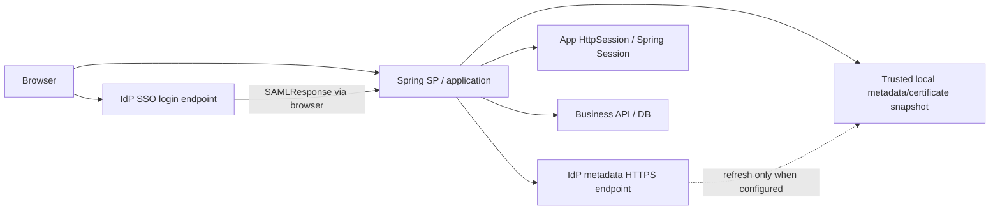
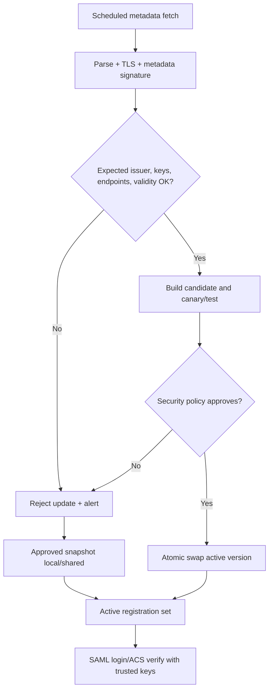

# Startup and Operation When Metadata Endpoints or the IdP Are Disrupted

**Module:** Spring Security – federation → Deployment and Operations.

**Goal:** Design, implement, and test a Spring Security SAML2 (Service Provider – SP) application that can **start up safely when the Identity Provider (IdP) metadata endpoint is temporarily unreachable**, while also handling situations properly when the **IdP SSO service itself goes down**. This guide distinguishes failure dependencies, vetted metadata storage options, signing key updates, Spring Security configuration, readiness/liveness, graceful degradation, retries/backoff, fault testing, operational runbooks, and recovery—**without ever relaxing signature/issuer/audience validation to "let people log in temporarily."**

**Foundational rule:** **The IdP metadata endpoint is not the IdP login endpoint**, and **losing the metadata endpoint does not mean the IdP stopped authenticating**. Conversely, **having fully cached metadata does not turn an offline IdP into one users can log into**. An SP can continue serving existing application sessions while the session store and business dependencies stay healthy, whereas new logins depend on the IdP or another registered IdP. A signed SAMLResponse already issued before the outage can be verified offline using already-trusted verification keys if still valid, matching a pending AuthnRequest and all security checks. **Without valid trusted metadata or trust keys, reject new authentications.**

Examples use Java 17+, Spring Security Servlet/SAML2, and illustrative `example.test` hostnames. Startup/metadata-refresh behavior can differ by **Spring Security 6.x/7.x, Boot BOM, `RelyingPartyRegistrationRepository` type, and bean wiring**; verify every operational claim against your exact release. Spring snippets do not run standalone, whereas `FederationOutageDemo.java` in the practice section compiles/runs on JDK 17 with deterministic stdout.

## 1. Four Failures That Are Easily Conflated

A federated SAML2 system has distinct network paths:



| Failure | What broke? | What can still work? |
| --- | --- | --- |
| **Metadata endpoint down** | SP cannot fetch/refresh XML metadata from IdP | IdP SSO endpoint can still log users in; SP uses existing still-trusted metadata |
| **IdP SSO endpoint down** | Browser cannot complete login/MFA at IdP | SP runs, serving APIs and existing app sessions; an already-issued signed SAMLResponse callback may still verify |
| **Trust material expired/invalid** | No policy-valid metadata/certs/keys to verify SAML | App can stay up and serve existing authenticated sessions, yet **must accept no new assertions** |
| **Session store/business dependency down** | Spring `SecurityContext` cannot save/load or business APIs fail | IdP remains online; SAML login may pass at IdP yet the app cannot establish sessions or serve business work |

**Do not automatically restart the entire application when IdP metadata returns HTTP 503.** If liveness depends on the IdP, Kubernetes may restart every pod while the fault lies outside the app, causing a cascading outage. **Do not tie every IdP issue to overall readiness** if doing so causes the load balancer to drain all pods and sever active user sessions.

### 1.1. Distinguish Three Critical URLs

Example:

```text
IdP metadata:
  https://idp.example.test/saml/metadata

IdP SingleSignOnService:
  https://idp.example.test/sso

SP Assertion Consumer Service (ACS):
  https://portal.example.test/login/saml2/sso/corp

SP metadata publication (if enabled):
  https://portal.example.test/saml2/metadata/corp
```

- The **IdP metadata** URL publishes XML containing `EntityDescriptor`, `IDPSSODescriptor`, `SingleSignOnService`, and `KeyDescriptor` (per profile).
- The **IdP SSO** URL receives AuthnRequests and performs authentication/MFA; it **need not share a host or uptime** with the metadata endpoint.
- The **SP ACS** URL is served by the application to receive and verify browser-POSTed SAMLResponses.
- The **SP metadata publication** URL is served by the SP so the IdP can register the SP; it **does not mean the SP is fetching IdP metadata**.
- HTTP 200 from IdP metadata only proves XML can download—not that login UI, MFA, credential stores, SAML signing, and callbacks work.
- HTTP 200 on the IdP SSO landing page does not prove a full SAML browser SSO flow works.

**To monitor accurately, measure availability for each stage separately.** A `GET metadata` health check cannot replace a browser login integration test.

## 2. Startup Depends on How `RelyingPartyRegistration` Is Built

In Spring Security, `RelyingPartyRegistration` models an SP/IdP pair and holds metadata/trust used to build AuthnRequests, pick SSO endpoints, and verify SAMLResponses. `RelyingPartyRegistrationRepository` supplies registrations to filters.

### 2.1. Option A: Fetch HTTPS Metadata During Bean Creation

Configuration fragment:

```java
@Bean
RelyingPartyRegistrationRepository registrations() {
    RelyingPartyRegistration corp = RelyingPartyRegistrations
        .fromMetadataLocation("https://idp.example.test/saml/metadata")
        .registrationId("corp")
        .entityId("https://portal.example.test/saml/sp")
        .assertionConsumerServiceLocation(
            "https://portal.example.test/login/saml2/sso/corp")
        .build();
    return new InMemoryRelyingPartyRegistrationRepository(corp);
}
```

**Risk:** if Spring creates this bean and `fromMetadataLocation` executes an HTTP request inline, the application depends on DNS/TLS/proxy/IdP metadata availability at **startup**. Metadata endpoint timeouts, TLS cert errors, malformed XML, missing matching `IDPSSODescriptor`, or wrong issuers can fail bean creation, causing **ApplicationContext startup failure** or slow boots. This comes from **how the bean is wired**, not a mandatory rule that every Spring SAML2 deployment must stay continuously online to boot.

### 2.2. Option B: Vetted and Locally Packaged Metadata

```java
@Bean
RelyingPartyRegistrationRepository registrations() {
    RelyingPartyRegistration corp = RelyingPartyRegistrations
        .fromMetadataLocation("classpath:metadata/idp-corp.xml")
        .registrationId("corp")
        .entityId("https://portal.example.test/saml/sp")
        .assertionConsumerServiceLocation(
            "https://portal.example.test/login/saml2/sso/corp")
        .build();
    return new InMemoryRelyingPartyRegistrationRepository(corp);
}
```

**Advantage:** the application boots from a **local trusted snapshot** without fetching HTTPS metadata at runtime startup. If the metadata endpoint temporarily returns 503 while IdP SSO stays online, new logins can continue working as long as the snapshot remains valid and the IdP signing key still matches.

**Disadvantage:** local files become stale after the IdP rotates SSO URLs, signing keys, or metadata policies. **Classpath files do not refresh/roll over on their own.** Establish an update and pre-deployment validation pipeline. If a snapshot is truncated, forged, expired under metadata freshness policy, or unapproved, never accept assertions with it.

### 2.3. Option C: Refreshable Metadata Repository with Trust Policy

Spring Security 7.1 documentation describes `AssertingPartyMetadataRepository` and `OpenSaml5AssertingPartyMetadataRepository`, built atop OpenSAML `MetadataResolver`, supporting **expiry-aware refresh** with an appropriate resolver implementation.

Two API styles appear in the docs:

```java
// Spring Security 7.1 API FRAGMENT; requires full SP configuration.
// Metadata source trusted per application conditions.
var metadataRepo = OpenSaml5AssertingPartyMetadataRepository
    .fromTrustedMetadataLocation(
        "https://idp.example.test/saml/metadata")
    .build();

// When XML metadata signature verification is needed, use the builder
// providing trusted verification credentials.
// Never use self-asserted certificate/KeyInfo inside untrusted XML
// to self-verify that same XML's signature.
var signedMetadataRepo = OpenSaml5AssertingPartyMetadataRepository
    .withMetadataLocation("https://idp.example.test/saml/metadata")
    .verificationCredentials(creds ->
        creds.add(trustedMetadataSigningCredential))
    .build();
```

**This is an illustrative fragment**: `trustedMetadataSigningCredential` must be a `Saml2X509Credential` provisioned via trust policy, and you still must map metadata into a `RelyingPartyRegistration` with SP EntityID, ACS, and credentials. Spring docs warn that **if verification credentials are not provided on the appropriate builder, metadata signature validation will not run**. Never interpret `fromTrustedMetadataLocation` as "automatically verifies every XML signature."

**Difference:** a refreshable repository **can** manage expiry/refresh, whereas `InMemoryRelyingPartyRegistrationRepository` built from a file/URL via `fromMetadataLocation` is typically a **bean-creation-time snapshot**. Never promise automatic refresh unless a real component/scheduler performs it.

### 2.4. Selection Table

| Approach | Cold start when metadata endpoint is down | IdP key changes | Cost / operations |
| --- | --- | --- | --- |
| Remote fetch in bean startup, uncached | **May FAIL/hang** if request is mandatory | Depends on fetch at restart | Simple yet fragile |
| Packaged local approved metadata | **PASSES** if file is valid | Needs pipeline/canary deploy of new snapshot | Stable, updated via releases |
| Shared last-known-good snapshot + async refresh | **PASSES** when a valid trusted snapshot exists | Allows verified refresh and atomic swap | Needs TTL/rollback/key overlap/metrics |
| Refreshable repository with trusted metadata source | Depends on whether resolver preloaded/cached | Per resolver expiry policy | Check version trust & failure semantics |
| Database config with no trusted bootstrap | Cannot start login safely if both DB & metadata drop | N/A | Requires a safe failure path |

**Choose per SLA/risk:** for services needing reliable operation while the IdP metadata URL is down, pre-approved snapshots (local or shared) paired with asynchronous refresh beat remote-only cold starts. When no snapshot can be trusted, **never continue SAML authentication on guessed trust**.

## 3. What Is in Metadata XML and Why Arbitrary Files Cannot Be Trusted?

Condensed example:

```xml
<md:EntityDescriptor
    xmlns:md="urn:oasis:names:tc:SAML:2.0:metadata"
    entityID="https://idp.example.test/metadata"
    validUntil="2026-11-14T00:00:00Z">
  <md:IDPSSODescriptor
      protocolSupportEnumeration="urn:oasis:names:tc:SAML:2.0:protocol">
    <md:KeyDescriptor use="signing">
      <ds:KeyInfo xmlns:ds="http://www.w3.org/2000/09/xmldsig#">
        <!-- Illustrative X.509 Certificate, not for real use -->
      </ds:KeyInfo>
    </md:KeyDescriptor>
    <md:SingleSignOnService
      Binding="urn:oasis:names:tc:SAML:2.0:bindings:HTTP-Redirect"
      Location="https://idp.example.test/sso"/>
  </md:IDPSSODescriptor>
</md:EntityDescriptor>
```

**This is not complete metadata XML ready to parse/verify**: `ds:X509Certificate` is omitted. Real metadata includes `EntityDescriptor` or `EntitiesDescriptor`, issuer/entity IDs, endpoints/bindings, signing/encryption credentials, `validUntil`, `cacheDuration`, and an XML signature per profile.

Verify before accepting any snapshot:
- Download source matches the exact issuer/tenant/service registration via a URL allowlist (never browser-supplied).
- TLS server identity/certificate, redirects, and hostname are verified; never disable certificate checks.
- If the profile requires **metadata signatures**, verify XMLDSig against a **pre-established trusted metadata signing key**.
- Metadata issuer/entityID matches the expected IdP; select the right `IDPSSODescriptor` within aggregates.
- Supported `SingleSignOnService` binding/Location and policy-compliant `KeyDescriptor use=signing` entries are present.
- Evaluate `validUntil` and `cacheDuration` per spec and organizational freshness policy; HTTP `Cache-Control`/ETag never overrides SAML metadata validity.
- Bound XML size, entity expansion, XXE/DTDs, entity descriptor count, redirects, timeouts, and internal-network SSRF on fetch.
- Never use a certificate from inside unverified XML as the "trusted root" to self-verify that XML.
- Metadata signature validation **differs** from SAML Response/Assertion signature validation; both require trust policies.
- Verify signing key identity/algorithms and rollover state; never admit an attacker key via a hijacked metadata fetch.

### 3.1. Distinguish Three Types of Certificates

| Certificate / Key | Where used? | During disruption |
| --- | --- | --- |
| TLS certificate of `https://idp.../metadata` | HTTPS transport to metadata server | Bad TLS → **do not fetch**; never `-k`/trust-all |
| Metadata XML signing certificate | Verifies metadata signature if policy requires signed metadata | Missing trust anchor → reject update |
| IdP SAML signing certificate | SP verifies `SAMLResponse`/Assertion | Missing trusted key → **accept no assertions** |

SP certificates used to **sign AuthnRequests** or **decrypt encrypted Assertions** are separate keys. A valid TLS certificate does not prove IdP metadata was signed with the right metadata-signing key, and old metadata holding one signing key cannot verify a response signed by the IdP with an unapproved new key.

**Never substitute a TLS cert for a SAML verification cert** merely because they share a hostname. Check `KeyUsage`, issuers, fingerprints, and separate trust sources.

## 4. Scenario A: Metadata Endpoint Down, IdP SSO Still Online

Example:
- Day 1: SP received and approved metadata `M1`, with signing key `K1`, EntityID `corp`, SSO URL `/sso`.
- Day 2: endpoint `/saml/metadata` returns HTTP 503.
- IdP `/sso` keeps running and signing assertions with `K1`.

**Expected outcome:**
1. SP boots cleanly using **still-valid M1**.
2. Users already holding an authenticated `HttpSession` are not disrupted.
3. For unauthenticated users, SP builds AuthnRequests pointing to the cached SSO URL.
4. IdP signs Responses with `K1`.
5. SP verifies signature/issuer/audience/recipient/InResponseTo/conditions/replay and establishes sessions normally.
6. Background refresh fails yet **neither deletes M1 nor replaces it with an empty snapshot**.
7. Dashboards show `metadata_refresh=FAILED` and snapshot age; alerts fire per freshness window.
8. Once the metadata endpoint recovers, vetted refresh runs and applies M2 if trust policy passes, without breaking sessions.

**What not to do:** never let a failed fetch wipe out an existing `RelyingPartyRegistration` or clear the verification key list. A flag `metadata_endpoint_up=false` only reflects refresh-source availability—it does **not automatically mean "authentication unavailable."**

### 4.1. Metadata Never Downloaded Even Once

Cold start with **no trusted snapshot** while the metadata endpoint is unreachable:
- Insufficient issuer/SSO endpoint/verification credentials to build a trustworthy SAML registration.
- The app may boot **non-SSO business functions** in a `LOGIN_NOT_CONFIGURED` state if architecture permits, yet **must never accept assertions or create fake authenticated sessions**.
- If business rules require SSO on every route and lack a degraded shell, startup should fail with a clear reason or mark unready per policy—**never unexpectedly fall back to HTTP Basic or anonymous forms**.
- Never pull a certificate from an incoming Response and trust it (unapproved TOFU).
- Supply a trusted snapshot from an artifact/secure config store or wait for IdP metadata recovery.

**Packaging an initial metadata snapshot in the image/build artifact** protects cold starts; multi-tenant deployments can use signed configuration bundles with inventory/auditing and distributed caching. Even when stored locally, once a snapshot ages past policy bounds, fail closed for SAML logins.

## 5. Scenario B: IdP SSO Offline While Metadata Still Loads

Example:
- HTTPS metadata endpoint still serves `M1`.
- IdP SSO endpoint blocks logins, MFA fails, DNS breaks, or it returns HTTP 503.
- SP has already-authenticated user A and new user B trying to sign in.

**Proper outcome:**
- **User A:** keeps accessing apps/resources while their app session remains valid, provided the session, session store, permissions, and resource backends remain healthy. Never re-authenticate a user with the IdP on every request unless the app explicitly mandates reauthentication/step-up.
- **User B:** cannot complete a new interactive SSO login; sees an IdP error or "SSO temporarily unavailable" page. Never fake authentication or grant anonymous users access to protected routes.
- **Responses issued by the IdP right before the outage:** if a browser just POSTed an unexpired signed SAMLResponse and the SP has the pending AuthnRequest and trusted verification keys, the SP can verify **locally** without calling IdP metadata/login endpoints during standard browser POST binding callbacks. If using **SAML Artifact Binding/back-channel resolution** or custom external calls, outcomes depend on those services.
- **Step-up/MFA:** if a business action requires fresh IdP authentication for sensitive operations, block/defer that action while the IdP is offline; never let an "old session" bypass assurance requirements.
- **SAML SLO:** local logout must work per session policy; IdP-initiated/protocol global SLO may fail to propagate, so never claim "globally logged out everywhere" merely because the portal renders `/signed-out`.

### 5.1. Availability Has Multiple Tiers During an Outage

| Capability | IdP metadata down, IdP SSO OK, M1 valid | Metadata OK, IdP SSO down | No trusted M1 |
| --- | --- | --- | --- |
| App HTTP process running | Yes | Yes | Possibly, depending on architecture |
| Health liveness | Usually UP | Usually UP | May stay UP if app process is healthy |
| Existing authenticated app sessions | Yes, if session/backend OK | Yes, if session/backend OK | Possibly, if session valid/accepted per policy |
| New interactive IdP login | Can succeed | **No** during outage | **No** |
| Accept valid already-issued POST SAMLResponse | Yes, if trust/conditions/pending valid | Yes, if local verification suffices | **No**, lacks trusted verification state |
| Dynamic metadata refresh | No | Yes | No, if source is down |
| Federated logout propagation | Depends on IdP/SLO endpoints | May fail | Not guaranteed |
| Business API authorization | Yes with valid session/roles | Yes with valid session/roles | Per existing state and policy; no new grants |

**Never confuse "login readiness" with "process readiness."** When authenticated via local `HttpSession`, business workflows can continue even when no new users can log in.

## 6. Scenario C: Metadata Expired or IdP Signing Key Changed

Metadata may carry `validUntil` or `cacheDuration`; operators need a clear policy:
- Refresh **before** expiration and alert well in advance.
- Retain a verified **last-known-good (LKG)** snapshot with timestamp, issuer, keyset, and source provenance.
- Reject any new snapshot if issuer/entityID changes outside a change request, signature fails, XML is malformed, or signing keys violate policy.
- Use the old snapshot strictly within **metadata validity + local risk policy**; **never extend indefinitely just because the IdP endpoint returns 503**.
- Once the old snapshot's trusted lifetime expires, block new authentications using it; govern existing app sessions under their own policy.
- Never revert keysets from newer metadata back to a stale older version served by an HTTP cache/proxy without monotonic version/expiry/fingerprint checks.
- Execute key rollover **K1 → K1+K2 → K2** with overlap; coordinate metadata and deployments.

### 6.1. Proper Rollover

```text
T0: trusted IdP metadata M1 has signing key K1
    SP accepts SAML assertions signed by K1.

T1: IdP publishes M2 with K1 and K2 during overlap.
    SP verifies M2, checks EntityID/endpoint/policy, atomic publish.
    SP accepts K1 or K2 per trusted registration.

T2: IdP starts signing assertions with K2.
    SP still verifies cleanly, without outage.

T3: Overlap/expired requests window ends per policy.
    IdP publishes M3 with K2 only; SP verifies, publishes, retires K1.

Failure: SP holds K1 only while IdP already signed with K2
    => SAML signature verification fails;
       NEVER disable signature checks to "restore SSO".
```

**Technical note:** `validUntil`/`cacheDuration` are metadata caching policies, whereas X.509 certificate lifetimes and trust rules for SAML signing credentials are separate matters. Never assume every OpenSAML default enforces a given field per your business policy. Check version/provider behavior and add explicit guard rails. Metadata-signing certificates and assertion-signing certificates can be independent.

### 6.2. Atomic Refresh Is Mandatory

A dynamic implementation should:
1. Fetch metadata into a **separate buffer** bounded by size, timeout, redirects, and SSRF protections.
2. Parse XML safely and verify metadata signature/TLS/source.
3. Verify expected IdP EntityID, SSO/SLO endpoints, algorithms, keyset/trust, and `validUntil`.
4. Evaluate planned rotations, unexpected issuer/key removals, and tenant ownership.
5. Build a candidate `RelyingPartyRegistrationRepository` or metadata repository snapshot.
6. Validate the candidate under load/canary/signed test fixtures.
7. **Atomically swap** the active reference and record the new version/fingerprint.
8. Keep old snapshots/revisions for rollback **only while they still satisfy security policy**.
9. If any step fails, keep the approved active version, emit a refresh failure event, and never publish half-parsed metadata.

Never mutate certificates one-by-one in a live mutable list where request threads might observe a half-old, half-new keyset. For multi-tenant systems, update per **registration** rather than breaking every IdP's logins because one issuer failed.

## 7. Configuring Spring Security with Local, Pinned IdP Metadata

This is a concrete implementation option keeping the metadata endpoint dependency **out of the app startup path**. Create `src/main/resources/metadata/idp-corp.xml` from a snapshot **fetched/verified through your security pipeline**, containing the right EntityID, SSO endpoint, and trusted IdP signing cert. **Never embed dummy XML from an article as a trusted file.**

```java
package com.example.federation;

import org.springframework.context.annotation.Bean;
import org.springframework.context.annotation.Configuration;
import org.springframework.security.config.Customizer;
import org.springframework.security.config.annotation.web.builders.HttpSecurity;
import org.springframework.security.saml2.provider.service.registration
        .RelyingPartyRegistration;
import org.springframework.security.saml2.provider.service.registration
        .RelyingPartyRegistrationRepository;
import org.springframework.security.saml2.provider.service.registration
        .RelyingPartyRegistrations;
import org.springframework.security.saml2.provider.service.registration
        .InMemoryRelyingPartyRegistrationRepository;
import org.springframework.security.web.SecurityFilterChain;

@Configuration
public class OfflineMetadataSamlConfiguration {
    @Bean
    RelyingPartyRegistrationRepository relyingPartyRegistrations() {
        RelyingPartyRegistration corp = RelyingPartyRegistrations
            .fromMetadataLocation("classpath:metadata/idp-corp.xml")
            .registrationId("corp")
            .entityId("https://portal.example.test/saml/sp")
            .assertionConsumerServiceLocation(
                "https://portal.example.test/login/saml2/sso/corp")
            .build();
        return new InMemoryRelyingPartyRegistrationRepository(corp);
    }

    @Bean
    SecurityFilterChain securityFilterChain(HttpSecurity http)
            throws Exception {
        http
            .authorizeHttpRequests(auth -> auth
                .requestMatchers("/status", "/error").permitAll()
                .anyRequest().authenticated())
            .saml2Login(Customizer.withDefaults());
        return http.build();
    }
}
```

**This is a Spring Boot app configuration fragment**, requiring `spring-security-saml2-service-provider`, BOM-compatible OpenSAML dependencies, a verified IdP metadata file, HTTPS/proxy config, app endpoints, and a Spring Boot main class. If the IdP mandates signed AuthnRequests or encrypted Assertions, add separate SP signing/decryption credentials—never drop those requirements because the metadata source is offline.

**Why does this architecture aid cold starts?** `fromMetadataLocation("classpath:...")` reads a file inside the artifact with no remote HTTP call at bean creation. It does **not** automatically refresh signing keys when the IdP rotates; operations must manage releases/pipelines. The metadata source is a trusted snapshot **only because it was vetted beforehand**, not by virtue of living on the classpath.

### 7.1. Using Spring Boot Properties Instead of Manual Beans

On Boot releases supporting `spring.security.saml2.relyingparty.registration.*.assertingparty.metadata-uri`, you can write:

```yaml
spring:
  security:
    saml2:
      relyingparty:
        registration:
          corp:
            entity-id: https://portal.example.test/saml/sp
            acs:
              location: https://portal.example.test/login/saml2/sso/corp
            assertingparty:
              metadata-uri: classpath:metadata/idp-corp.xml
```

**Property layout/version note:** Spring Boot version dictates exact property aliases and optional-field binding; check config metadata for your exact BOM and run integration tests. Like the Java bean, `classpath:` removes startup dependency on metadata HTTP **without removing the IdP SSO dependency**.

### 7.2. When to Use a Direct Remote URL?

If the startup contract intentionally mandates fetching the latest metadata online and the app has an explicit failover/retry startup budget, `fromMetadataLocation("https://...")` can be used. However:
- Budget DNS/TLS/connect/read timeouts within the deployment startup budget.
- Never retry infinitely inside a bean factory during an IdP outage.
- Emit a `SAML_METADATA_BOOTSTRAP_FAILURE` alert with logs excluding raw XML.
- Canary one pod while the IdP metadata endpoint is down to observe readiness and boot behavior.
- Verify HTTP proxies, allowed hosts, truststores, and redirects.
- Distinguish HTTP metadata fetch failures from parser/trust failures (malicious/stale).
- For high resilience, prefer **pre-fetched approved artifacts + async refresh** rather than retrying on startup "hoping the IdP comes up" in every pod.

### 7.3. Distinguish SP Metadata Publication from IdP Metadata Retrieval

```java
http
    .saml2Login(Customizer.withDefaults())
    .saml2Metadata(Customizer.withDefaults());
```

`saml2Metadata` lets the SP **publish SP metadata** (per docs: `/saml2/metadata` and per-registration paths). It is **not an IdP metadata refresh API** and does not mean the IdP endpoint is reachable. With a cached registration, the SP metadata endpoint can keep rendering even while the IdP is down, though SP issuer/ACS/keys must still be accurate.

## 8. Dynamic Refresh: Last-Known-Good Mechanism and Safe Implementation

For IdPs with automated rollovers, a common pipeline is:



A versioned record may look like:

```json
{
  "registration_id": "corp",
  "expected_idp_entity_id": "https://idp.example.test/metadata",
  "snapshot_id": "m-2026-11-07-01",
  "approved_at": "2026-11-07T09:00:00Z",
  "expires_at": "2026-11-14T00:00:00Z",
  "metadata_source_ref": "corp-idp-config",
  "verification_key_refs": ["K1", "K2"],
  "approval_result": "TRUSTED",
  "refresh_result": "SUCCESS"
}
```

**This data is minimized; it holds no private keys or raw certificates.** Store snapshots in a secured system with provenance, anti-rollback, and unauthorized-write protection. `approval_result` can never be set by browsers; it is produced by a verified pipeline. When refresh fails, **never overwrite the active snapshot** with null, yet distinguish a "valid snapshot" from an "expired snapshot."

### 8.1. Backoff, Jitter, and Avoiding Stampedes

If 200 pods boot together and fetch `https://idp.../metadata`, they can flood the IdP metadata server. Good design:
- **A single refresh worker/leader** or shared metadata distribution service—never let every browser request fetch XML.
- Use HTTP conditional GET/ETag/Last-Modified where supported, still enforcing metadata trust/expiry.
- Finite timeouts, exponential backoff with jitter, and retry budgets.
- Circuit breakers on refresh fetches **must never bypass SAML validators**.
- Retry transient 429/503/timeout errors per policy; never infinitely retry certificate mismatches, invalid issuers, bad XML, or tampered metadata signatures.
- Prevent concurrent workers from racing updates; use versioning/optimistic concurrency or compare-and-swap.
- Keep the metadata source URL a **fixed allowlist**, never injected from incoming `registrationId`/issuer.
- Never treat an arbitrary untrusted HTTP cache response as trusted state.
- Track `snapshot_age_seconds`/`refresh_failure_rate` and alert ahead of expiration.

Classification examples:

| Fetch outcome | Action | Continue logins? |
| --- | --- | --- |
| HTTP 304 and snapshot still valid | Keep active, update check status per policy | Yes if IdP SSO is online |
| DNS timeout / HTTP 503 | Keep LKG, retry with backoff | Yes while LKG remains trusted and IdP online |
| Malformed XML / XXE | Reject candidate, alert security | Only with valid LKG |
| EntityID outside allowlist | Reject / incident | Only with valid LKG |
| Invalid metadata signature | Reject / incident | Only with valid LKG |
| Valid IdP key rollover | Publish K1+K2 after checks | Yes |
| LKG expired per policy | Stop using LKG for new auth | No, until a trusted update arrives |
| Source HTTP online yet IdP SSO 503 | Metadata refresh may succeed | Cannot complete new interactive SSO |

### 8.2. Refresh Does Not Mean Accepting an "Unfamiliar New" Certificate

When a signed metadata trust anchor authorizes the IdP to rotate SAML response-signing keys, refresh can verify the candidate chain and publish valid keys. When fetching metadata solely over TLS without signature validation (where contracts don't mandate signed metadata), tooling must rely on another defined provenance/approval chain (pinning/release review). **Never perform TOFU on a URL appearing inside a `SAMLResponse`.**

When the IdP returns an unexpected signing key K3 in metadata:
- Verify the change came from the right IdP/issuer and trust anchors.
- Check change windows/change requests, signed metadata, overlap, validity, and auditing.
- If it fails policy, block the update; do not kill existing sessions solely because refresh failed.
- Never set `signatureValidation=false` or `trustAllCertificates=true` to "bring SSO back up."

## 9. Spring Boot and Kubernetes Liveness/Readiness/Probes

Spring Boot Actuator provides:
- `/actuator/health/liveness` – reflects whether the app process is healthy or needs restarting.
- `/actuator/health/readiness` – whether the app should accept traffic from the load balancer.
- `/actuator/health` or **custom health indicators** – health details of other dependencies.
- `ApplicationAvailability`/`LivenessState`/`ReadinessState` tied to container lifecycle.

**Key operational rule from Spring Boot docs:** liveness probes **should not depend on external systems**. If an IdP or shared Redis outage fails every liveness probe, Kubernetes restarts all pods in a storm, creating cascading failures. Readiness must also be designed carefully, especially for shared dependencies across all pods; marking everything DOWN can cut off requests the app could still serve.

### 9.1. Multi-Dimensional Health Signals

| Health signal | What it should reflect | Should it fail liveness when IdP metadata is down? |
| --- | --- | --- |
| `app_liveness` | Threads/process alive, no deadlock/fatal local state | **No** |
| `app_readiness` | App can serve useful traffic | Not necessarily; per business |
| `idp_metadata_refresh_status` | Last metadata HTTP fetch, age/expiry | No |
| `saml_trust_snapshot_valid` | Policy-valid trusted issuer/keys/metadata present | Can affect login capability, does not mean app is dead |
| `idp_sso_probe_status` | IdP SSO reachability (no real credentials sent) | Separate signal, does not prove end-to-end |
| `saml_new_login_available` | Valid trust + usable IdP login + registration | FAILS during IdP outage |
| `app_existing_session_available` | Local sessions/backend still serving | Can stay UP while IdP is down |
| `saml_acs_response_verify_available` | Valid trust, session/request state, provider healthy | Can stay UP with IdP SSO offline |
| `session_store_available` | Redis/JDBC, Spring Session | May affect readiness if all authenticated requests need it |

**Policy pattern:** keep app readiness UP when IdP metadata/SSO is down while business APIs and existing authenticated sessions still work; report degraded SSO via custom health and alerts. If the product is strictly a single SSO screen unable to do anything during an IdP outage, you may mark readiness DOWN **after evaluating** LB/global-outage impact. There is no single mandatory rule for all apps.

### 9.2. Illustrative Spring Boot Actuator Properties

```yaml
management:
  endpoints:
    web:
      exposure:
        include: health,info
  endpoint:
    health:
      probes:
        enabled: true
      show-details: when_authorized
  health:
    probes:
      add-additional-paths: true
```

Per Spring Boot docs, `/actuator/health/liveness` and `/actuator/health/readiness` work with Kubernetes; `management.endpoint.health.probes.add-additional-paths=true` can also expose `/livez`/`/readyz` on the main server port. **Verify property names for your exact Boot release** and secure `/actuator`: never expose IdP issuers, cert fingerprints, topology, or internal error details to anonymous callers.

Kubernetes example:

```yaml
livenessProbe:
  httpGet:
    path: /actuator/health/liveness
    port: 8080
  initialDelaySeconds: 10
  periodSeconds: 15

readinessProbe:
  httpGet:
    path: /actuator/health/readiness
    port: 8080
  periodSeconds: 5
  failureThreshold: 3
```

**This is a manifest fragment** without `apiVersion/kind/spec`. Choose probe ports/paths per your app and management config. If local metadata parsing or OpenSAML initialization is legitimately slow at startup, configure a `startupProbe` to avoid kubelet restart loops; if startup hangs on an un-timeouted remote fetch, adding a `startupProbe` **does not fix the root cause**—remove the dependency or bound timeouts.

### 9.3. Do Not Use `GET metadata` Health Checks as Proof of Login

A command like:

```bash
curl --fail --max-time 3 https://idp.example.test/saml/metadata
```

only checks DNS/TLS/HTTP responsiveness. It does not prove signed metadata is valid, the IdP SSO page is reachable, login/MFA works, SAMLResponse signatures pass, ACS works, or persistence works. If the metadata endpoint is protected by authentication/proxies, health checks may receive 401/403 even while SSO is online. Never substitute a probe for E2E tests.

## 10. Login, ACS, and Sessions During an IdP Outage

### 10.1. Unauthenticated Requests

```text
Browser GET /reports
  |
  v
App checks SecurityContext/session
  |
  +-- valid authenticated session ----> authorize /reports
  |
  +-- anonymous ----------------------> SP-initiated SAML login
                                         |
                                         +-- trusted registration unavailable
                                         |      -> safe local failure, no auth
                                         |
                                         +-- IdP login unavailable
                                         |      -> browser struggles/fails to complete SSO
                                         |         safe error, bounded retry
                                         |
                                         +-- IdP operational
                                                -> normal SAML browser flow
```

Do not let login failure handlers spin infinitely between `/reports` → IdP → error → `/reports`. During an IdP outage, UX should show a non-leaky error message with rate-limited/backed-off retry. **Never automatically fall back to local password login** unless the product has an independent break-glass policy.

### 10.2. SAMLResponse Callbacks Issued Before the Outage

The SP can still verify a Response after IdP SSO goes offline if:
- The Response was signed by a **key already trusted by the SP** in a trusted registration.
- Issuer/audience/destination/recipient/subject confirmation/timestamps are valid.
- `InResponseTo` matches a pending AuthnRequest for the right session/browser.
- Replay/one-time-use rules are satisfied.
- For encrypted assertions, the SP still holds decryption credentials.
- No runtime IdP network call is required (unlike SAML Artifact Resolution Service or custom APIs).
- The SP application session store remains healthy.

**Never let `NotOnOrAfter` or expired verification trust slide** merely because the IdP is down. A Response with Status Success and an invalid signature must still be rejected. Frame this accurately as **offline cryptographic verification**, never offline authentication accepting unverified tokens.

### 10.3. Already-Logged-In Users with Active App Sessions

In default stateful Servlet Spring Security, an authenticated user holds a `SecurityContext` in `HttpSession` per config; subsequent business requests normally do not touch the IdP. Conditions to continue serving:
- Session has not expired or been revoked, and cookies are valid.
- Spring Session Redis/JDBC (if used) remains reachable.
- Roles/tenant/resource authorization are enforced independently.
- If policy demands periodic re-authentication or step-up, fail closed when the IdP is unavailable.
- Never extend absolute session lifetimes indefinitely because of an IdP outage.
- Never create an "offline admin" via authorization bypasses.
- Session security stays only as strong as session fixation, CSRF, timeouts, and cookie policies.

### 10.4. Logout When the IdP Is Down

Possible outcomes:
1. **Local logout:** invalidates `HttpSession`/`SecurityContext` at the SP so the user can no longer use that session.
2. **Federated SAML Single Logout (SLO):** must send/receive `LogoutRequest`/`LogoutResponse` via the IdP `SingleLogoutService`, which may fail.
3. **Browser IdP session:** may remain active if the IdP never received `LogoutRequest`.
4. **Other applications:** local logout at this SP **does not automatically revoke** sessions elsewhere.

UX and audit logs should state "Logged out of this application" when only local logout succeeded—never claim full IdP SSO termination without confirmed SLO. Once the IdP recovers, the user may silently re-SSO if the old IdP session remains alive. SAML logout verification and redirect allowlists remain mandatory.

## 11. Multi-IdP and Tenants: Limiting Blast Radius

An SP may host registrations `corp`, `partner`, and `staff`:
- `corp` IdP metadata endpoint downtime must never wipe out `partner` and `staff` registrations.
- Refresh outcomes must be **per issuer/registration**—never replace the whole repository with an empty map when one source fails.
- Never fail over a user from `corp` IdP to `partner` merely because email addresses match; that is a different identity source with potentially different tenant/assurance levels.
- If an organization-managed identity broker supports fallback, register explicit trust/mappings and enforce MFA/account linking—never bypass automatically.
- When one IdP SSO is down, the login picker can show "Temporarily unavailable" for that tenant while keeping other choices working normally.
- Distinct IdPs have independent signing certificates, entity IDs, SSO URLs, and metadata expirations.
- Never allow a Response from IdP B to match an `InResponseTo` or `RelayState` from an AuthnRequest issued to IdP A.
- Trust repositories must never pick issuers from a browser-supplied URL; an issuer inside an unverified Response is **input**, not permission.
- Roll over one IdP per issuer via canary without causing a global outage.

### 11.1. Per-Tenant Health Status

```json
{
  "service": "portal",
  "application_status": "SERVING",
  "federation": {
    "corp": {
      "metadata_snapshot": "TRUSTED",
      "metadata_refresh": "DEGRADED",
      "interactive_sso": "AVAILABLE"
    },
    "partner": {
      "metadata_snapshot": "TRUSTED",
      "metadata_refresh": "OK",
      "interactive_sso": "UNAVAILABLE"
    }
  }
}
```

**Internal model only**—do not expose tenant IdP status/config/cert details publicly unless required. `interactive_sso=AVAILABLE` may be probe-inferred; only a synthetic browser login proves end-to-end health. Avoid sending real production user credentials in synthetic checks; use sandbox test identities with rate limits and approved accounts.

## 12. Standalone Java 17: Simulating Fail-Safe Behavior When Metadata/IdP Breaks

The program below **runs on JDK 17** without Spring or Internet access. It models the **policy layer**:
- Cold start without trusted metadata → blocks SAML login.
- Approved snapshot K1 present → app initializes.
- Metadata fetch fails → keeps valid LKG without clearing it.
- IdP SSO offline → logged-in users keep sessions; new interactive logins cannot finish.
- A Response **already genuinely verified by the SAML library** can complete offline with cached keys.
- Untrusted metadata updates are rejected without overwriting K1.
- Approved rollover K1+K2 publishes when source/trust pass.
- Policy-expired metadata → cannot verify new logins; old app sessions are not wiped solely because metadata expired.

**Limitation:** `signatureAlreadyVerified` is a **test-harness-simulated flag**; there is no XMLDSig, issuer/audience/recipient/clock skew/replay/cookie handling in the demo. **Production never accepts this flag from a request.** Java `Set` and records merely model snapshots; real metadata must be validated by Spring/OpenSAML and app session policies enforced by the framework. Timestamps are fixed for reproducible stdout.

Create `FederationOutageDemo.java`:

```java
import java.time.Instant;
import java.util.HashSet;
import java.util.Set;

public class FederationOutageDemo {
    private static final String EXPECTED_IDP =
            "https://idp.example.test/metadata";

    record Snapshot(
            String issuer,
            Set<String> trustedSigningKeyIds,
            Instant expiresAt) {
        Snapshot {
            trustedSigningKeyIds =
                    Set.copyOf(trustedSigningKeyIds);
        }

        boolean usable(Instant now) {
            return EXPECTED_IDP.equals(issuer)
                    && !trustedSigningKeyIds.isEmpty()
                    && now.isBefore(expiresAt);
        }
    }

    static final class SpRuntime {
        private Snapshot activeMetadata;
        private boolean idpOnline = true;
        private final Set<String> appSessions = new HashSet<>();

        boolean applyApprovedSnapshot(
                Snapshot candidate,
                boolean metadataTrustVerified,
                Instant now) {
            if (!metadataTrustVerified
                    || candidate == null
                    || !candidate.usable(now)) {
                return false;
            }
            activeMetadata = candidate;
            return true;
        }

        boolean hasUsableTrust(Instant now) {
            return activeMetadata != null
                    && activeMetadata.usable(now);
        }

        boolean canFinishNewInteractiveLogin(Instant now) {
            return hasUsableTrust(now) && idpOnline;
        }

        boolean canValidateAlreadyIssuedResponse(
                Instant now, String signingKeyId,
                boolean signatureAlreadyVerified,
                boolean pendingRequestMatched) {
            return hasUsableTrust(now)
                    && activeMetadata.trustedSigningKeyIds()
                            .contains(signingKeyId)
                    && signatureAlreadyVerified
                    && pendingRequestMatched;
        }

        void setIdpOnline(boolean value) {
            idpOnline = value;
        }

        void addAuthenticatedSession(String id) {
            appSessions.add(id);
        }

        boolean hasExistingSession(String id) {
            return appSessions.contains(id);
        }

        boolean trustsKey(String keyId) {
            return activeMetadata != null
                    && activeMetadata.trustedSigningKeyIds()
                            .contains(keyId);
        }
    }

    public static void main(String[] args) {
        Instant now = Instant.parse("2026-11-07T10:00:00Z");

        SpRuntime cold = new SpRuntime();
        System.out.println("Cold start without metadata: "
                + cold.hasUsableTrust(now));

        SpRuntime sp = new SpRuntime();
        Snapshot m1 = new Snapshot(
                EXPECTED_IDP, Set.of("K1"),
                now.plusSeconds(3600));
        System.out.println("Cold start with pinned metadata: "
                + sp.applyApprovedSnapshot(m1, true, now));

        sp.addAuthenticatedSession("session-A");
        System.out.println("Existing app session active: "
                + sp.hasExistingSession("session-A"));

        Snapshot untrusted = new Snapshot(
                "https://attacker.example.test/idp",
                Set.of("EVIL"), now.plusSeconds(3600));
        boolean rejected = !sp.applyApprovedSnapshot(
                untrusted, false, now);
        System.out.println("Bad refresh rejected, K1 retained: "
                + (rejected && sp.trustsKey("K1")));

        sp.setIdpOnline(false);
        System.out.println("New login during IdP outage: "
                + sp.canFinishNewInteractiveLogin(now));
        System.out.println("Existing session during outage: "
                + sp.hasExistingSession("session-A"));

        System.out.println("Previously signed callback accepted: "
                + sp.canValidateAlreadyIssuedResponse(
                    now, "K1", true, true));
        System.out.println("Unknown signing key rejected: "
                + !sp.canValidateAlreadyIssuedResponse(
                    now, "K-UNKNOWN", true, true));
        System.out.println("Invalid signature rejected: "
                + !sp.canValidateAlreadyIssuedResponse(
                    now, "K1", false, true));

        sp.setIdpOnline(true);
        System.out.println("Login after IdP recovers: "
                + sp.canFinishNewInteractiveLogin(now));

        Snapshot m2 = new Snapshot(
                EXPECTED_IDP, Set.of("K1", "K2"),
                now.plusSeconds(7200));
        System.out.println("Approved key overlap installed: "
                + sp.applyApprovedSnapshot(m2, true, now));
        System.out.println("K2 trusted after rollover: "
                + sp.trustsKey("K2"));

        Instant later = now.plusSeconds(7201);
        System.out.println("Expired metadata blocks new login: "
                + !sp.canFinishNewInteractiveLogin(later));
        System.out.println("Expired metadata keeps old app session: "
                + sp.hasExistingSession("session-A"));
    }
}
```

Compile and run:

```bash
javac FederationOutageDemo.java
java FederationOutageDemo
```

**Exact stdout:**

```text
Cold start without metadata: false
Cold start with pinned metadata: true
Existing app session active: true
Bad refresh rejected, K1 retained: true
New login during IdP outage: false
Existing session during outage: true
Previously signed callback accepted: true
Unknown signing key rejected: true
Invalid signature rejected: true
Login after IdP recovers: true
Approved key overlap installed: true
K2 trusted after rollover: true
Expired metadata blocks new login: true
Expired metadata keeps old app session: true
```

### 12.1. What the Demo Does Not Prove

- `hasUsableTrust` models only issuer/key ID/time—it **does not parse SAML metadata XML** or verify metadata signatures.
- `signatureAlreadyVerified=true` must come from a trusted SAML provider outside the demo; clients can never assert it.
- `canValidateAlreadyIssuedResponse` omits issuer/audience/destination/subject/time/replay checks to highlight **IdP HTTP availability vs local key verification**. Production must enforce all checks.
- `HashSet` is neither thread-safe nor distributed; it does not represent real `HttpSession`/Spring Session.
- `expiresAt` in the demo is a simulated security cutoff; real metadata `validUntil`/`cacheDuration` and certificate expiry need separate policies.
- Existing sessions remain in the example purely for illustration; reality also depends on cookies, session TTL, user revocation, reauthentication policies, session stores, and authorization.
- The Java demo makes no HTTP calls and tests no startup timing, circuit breakers, or readiness probes. Test those with Spring Boot, an IdP sandbox, and a fault-injecting proxy.

## 13. Startup/Availability Test Suite That Actually Proves Resilience

A test checking solely that `RelyingPartyRegistrationRepository` builds while metadata is online is **insufficient**. At minimum you need three layers:

1. **Unit/policy tests:** snapshot approval, trust key overlap, validity cutoffs, retries/backoff, per-registration status, graceful degradation, auth vs session behavior.
2. **Spring integration tests:** startup with local/remote metadata URIs, invalid XML/issuers/keys, Spring `SecurityFilterChain`, app readiness, SAML AuthnRequest/ACS validation, session persistence, and refresh repository semantics.
3. **Full E2E/failure injection:** browser/IdP sandbox, stopping the metadata service **separately** from the SSO service, stopping the SSO service, simulating Redis failure, rotating signing certs, restarting pods mid-outage, and testing callbacks/authorization.

**Passing a startup test** only shows the app context booted; **passing a login test** requires the IdP sandbox issuing a signed SAMLResponse, the SP verifying it, and a follow-up request holding a valid `SecurityContext`. **Passing an existing-session test** requires an independent request with the old cookie checking permissions—never `@WithMockUser` as proof of federated sessions.

### 13.1. Test Matrix: Metadata Endpoint

| ID | Injection | Expectation |
| --- | --- | --- |
| META-01 | Metadata HTTP 200, signed/approved XML | Fetch/parse/update succeeds |
| META-02 | Metadata endpoint HTTP 503, LKG valid, IdP SSO online | Cold start from approved snapshot PASSES; new logins still PASS |
| META-03 | Endpoint DNS fails, app uses remote fetch in bean | Startup fails/times out cleanly; never hangs forever |
| META-04 | Endpoint offline, no trusted snapshot exists | Accepts no new SAML assertions; safe failure |
| META-05 | Metadata endpoint TLS certificate untrusted | Fetch rejected; never disable TLS validation |
| META-06 | Metadata URL redirects to untrusted domain | Rejected per allowlist/SSRF policy |
| META-07 | Metadata XML malformed | Candidate rejected; valid LKG kept |
| META-08 | Metadata XML XXE/DTD payload | Safely parsed with no external entity resolution |
| META-09 | Metadata XML oversized | Aborted within size/time/resource bounds |
| META-10 | Metadata signed by unknown key | Rejected; never trust KeyInfo automatically |
| META-11 | EntityID mismatch | Update rejected; never trust a different IdP |
| META-12 | No matching `IDPSSODescriptor` | Unusable registration rejected |
| META-13 | SSO endpoint in XML swapped to unfamiliar host | Policy rejects or requires manual review |
| META-14 | Short `cacheDuration`/approaching `validUntil` | Refreshes before expiry / alerts |
| META-15 | LKG expired per policy | Not used to accept new assertions |
| META-16 | HTTP 304 Conditional GET | Keeps trusted active snapshot honoring expiry |
| META-17 | All IdP signing keys removed in candidate | Rejected / alert |
| META-18 | Approved K1→K1+K2 overlap | Both keys trusted per policy |
| META-19 | K1→K2 without overlap, SP un-updated | Detects signature failures; never disables verifier |
| META-20 | Metadata rolled back to very old version | Rejects downgrade/stale per policy |
| META-21 | Multiple pods refresh concurrently | No overwrite races or stampedes |
| META-22 | One IdP metadata fails, another IdP OK | Other registrations unaffected |
| META-23 | Shared metadata repository unavailable | Trusted local fallback or fail closed |
| META-24 | Refresh failure clears active keyset | QA FAIL; must preserve valid LKG |
| META-25 | Metadata endpoint online, IdP SSO down | New interactive logins still fail; probes separated |

### 13.2. Test Matrix: IdP SSO, Sessions, and Security

| ID | Injection | Expectation |
| --- | --- | --- |
| IDP-01 | IdP SSO DNS failure, M1 cached | App stays up; new SSO unavailable |
| IDP-02 | IdP SSO HTTP 503 | User sees safe failure, no redirect loop |
| IDP-03 | IdP MFA service down | Never skip step-up assurance |
| IDP-04 | IdP SSO down, session A active | A keeps accessing protected resources if policy allows |
| IDP-05 | IdP down, anonymous B | B cannot access protected resources |
| IDP-06 | IdP down, valid previously issued signed Response | ACS can verify offline if dependencies hold |
| IDP-07 | Response signed by unknown K2, cached K1 | Reject |
| IDP-08 | Response signature invalid/tampered | Reject; never switch to unsigned accept |
| IDP-09 | Response wrong Issuer | Reject |
| IDP-10 | Response wrong Audience/Recipient/ACS | Reject |
| IDP-11 | Response expired/not-yet-valid | Reject |
| IDP-12 | `InResponseTo` wrong original browser | Reject login fixation |
| IDP-13 | Replayed Response ID/Assertion ID | Reject |
| IDP-14 | Session backend Redis down | App auth/session may fail; distinguish from IdP |
| IDP-15 | Session A expires during outage | Never extend TTL indefinitely; require login |
| IDP-16 | Business requires reauth for payment | Deny/hold step-up while IdP is offline |
| IDP-17 | Local logout while IdP is down | Local session invalidated |
| IDP-18 | Federated SLO unresponsive | Never claim global logout completed |
| IDP-19 | Response uses SAML Artifact Binding | May require artifact resolution backchannel; test separately |
| IDP-20 | IdP recovers | New logins work again without app restart if configs valid |
| IDP-21 | User logs in anew after recovery | Fresh session; never reuse expired pending state |
| IDP-22 | IdP B healthy, IdP A offline | Only IdP A degraded; B still logs in |
| IDP-23 | Synthetic SSO user credential revoked | Health neither leaks nor bypasses user policy |
| IDP-24 | Liveness depends on IdP | QA FAIL: restart storm risk |
| IDP-25 | Readiness drains all pods when IdP down | QA policy review; assess existing-session impact |
| IDP-26 | Browser login error page auto-retries endlessly | QA FAIL; bounded retry/UX |
| IDP-27 | Invalid metadata fallback "trust certificate in Response" | QA FAIL / security incident |
| IDP-28 | App success handler redirects raw `RelayState` | QA FAIL / open redirect |
| IDP-29 | Reverse proxy Host/X-Forwarded-Host spoof | Emits no attacker ACS/SSO callback URL |
| IDP-30 | Session A valid yet user disabled locally | App authorization policy denies |
| IDP-31 | App metadata publisher reachable during IdP outage | Do not treat as proof of IdP availability |
| IDP-32 | Callback accepted only under right tenant registration | No cross-tenant trust |
| IDP-33 | Logs contain raw SAMLResponse/cookies | QA FAIL / PII leak |
| IDP-34 | Crash mid-refresh after fetch | Active trusted snapshot unchanged |
| IDP-35 | Restart one pod during IdP outage | Pod starts with approved snapshot and rejoins service |
| IDP-36 | Whole deployment restarts during metadata outage | Cold start succeeds only with packaged/shared approved snapshot |
| IDP-37 | Metadata refresh exceeds configured timeout | Aborts; no long bean/startup stall |
| IDP-38 | IdP signing key mismatch after recovery | Alerts; never silently switches trust |
| IDP-39 | Multiple SAML sessions after login | No unintended forced logout from metadata status |
| IDP-40 | Login with wrong IdP picked via URL | Never trust arbitrary issuer/discovery URLs |

## 14. Chaos Test Topology and Procedure

### 14.1. Production-Like Staging

```text
Browser / E2E runner
          |
    Ingress / TLS
          |
  +-------+--------+
  |                |
Portal Pod A    Portal Pod B
  |                |
  +-------+--------+
          |
     Spring Session Redis
          |
  RelyingPartyRegistration
  approved metadata snapshot
          |
     +----+------------------+
     |                       |
IdP metadata endpoint     IdP SSO endpoint
(fault inject 503)        (fault inject 503 separately)
```

Use an IdP sandbox where you can **disable the metadata HTTP route independently** from the SSO route, e.g., via reverse-proxy fault injection, without stopping the whole IdP if testing metadata only. Signing keys and SAML fixtures must belong to the sandbox, never production.

### 14.2. Test A: Metadata Offline at Cold Start

1. Package approved `idp-corp.xml` in the artifact.
2. Block `GET /saml/metadata` to the test IdP.
3. Boot a new pod.
4. Verify app context starts, readiness matches policy, and liveness is UP—**with zero remote HTTP metadata dependency at startup**.
5. With IdP `/sso` still online, initiate an AuthnRequest and complete a real SAML login.
6. Verify follow-up HTTP requests carry the right `SecurityContext`/session.
7. Confirm metadata refresh failure/age metrics record without crashing the pod.
8. Repeat with **no local approved metadata**: must authenticate no new users and log a controlled startup/trust failure.

### 14.3. Test B: IdP SSO Offline with Active Users

1. Log user A in while the IdP is online; keep the sanitized app cookie in the test harness.
2. Block `/sso` or the IdP authentication/MFA path.
3. User A calls `/reports` with their valid session; per policy, it continues working.
4. User B begins a new login; the browser cannot finish authentication.
5. Ensure the error page is safe with no infinite redirect loop.
6. Verify no unauthorized session is created for B and SAML validation stays enabled.
7. If a pre-issued signed SAMLResponse was generated by the IdP sandbox prior to failure, POST it to ACS with the original pending request: offline crypto verification can succeed if the profile needs no backchannel.
8. Restore the IdP; B logs in cleanly while A is not wrongly logged out.
9. Test A's local logout during the outage and separate SLO failure semantics.

### 14.4. Test C: Signing Certificate Rollover During Endpoint Disruption

1. Trusted M1 holds K1; IdP signs with K1.
2. IdP publishes M2 holding K1+K2; SP fetches, verifies, and approves it.
3. Block the metadata endpoint; IdP switches to signing with K2.
4. SP still verifies K2 thanks to already-approved M2.
5. On an SP still holding M1 (K1 only), new logins signed with K2 must FAIL signature checks—this is safe behavior, never a reason to drop the verifier.
6. Restore metadata and publish M3 (K2 only) per policy.
7. Verify rollback/canary, no arbitrary issuer/key acceptance, and keyset/expiry metrics.
8. Confirm all pods share the same active metadata version; an old M1 pod must not silently accept K2.

### 14.5. Test D: Session Backend Fails While IdP Is Healthy

1. Keep the IdP online and metadata trusted.
2. Induce failure in Redis/JDBC Spring Session.
3. SAML authentication may verify the assertion, yet the app cannot persist the session.
4. Classify the failure as `SESSION_STORE_UNAVAILABLE`, not `IDP_DOWN`.
5. Never serve protected resources in an unauthenticated session state.
6. Restore the store and retry a fresh flow; never reuse an already-consumed `SAMLResponse`.
7. Avoid liveness restart storms when Redis is a shared external dependency; balance readiness per service capability.

**E2E results must inspect actual session state**, not rely solely on HTTP 302 from a login success handler.

## 15. Observability: Four Signals That Must Stay Separate

### 15.1. Structured Events

| Event | When | Owning system |
| --- | --- | --- |
| `saml.metadata.bootstrap.loaded` | Trusted snapshot loaded | SP |
| `saml.metadata.bootstrap.failed` | Missing or invalid snapshot | SP |
| `saml.metadata.refresh.success` | Candidate verified/published | SP refresh worker |
| `saml.metadata.refresh.failed` | Fetch/parse/trust/timeout failure | SP refresh worker |
| `saml.metadata.expiring` | Approaching policy expiry | SP |
| `saml.idp.sso.degraded` | Synthetic probe or E2E failure | Observability |
| `saml.login.started` | SP generated AuthnRequest | Spring Security SP |
| `saml.acs.received` | Browser POSTed Response | SP |
| `saml.authentication.verified` | Signature/trust/conditions PASSED | SP |
| `saml.authentication.rejected` | Validation failure | SP |
| `app.session.continued` | Follow-up request stayed authenticated | App |
| `app.session.persistence.failed` | `SecurityContext` could not save | App/`SessionRepository` |
| `saml.slo.failed` | Federated logout incomplete | SP/IdP integration |

Never print raw `SAMLResponse`, `SAMLRequest`, `RelayState`, `NameID`, TGT/ST, cookies, access tokens, or signing/decryption private keys. Use sanitized correlation IDs, registration IDs, and error codes.

### 15.2. Low-Cardinality Metrics

Recommended:
- `saml_metadata_refresh_attempts_total{registration,result}`
- `saml_metadata_snapshot_age_seconds{registration}`
- `saml_metadata_snapshot_valid{registration}`
- `saml_idp_sso_probe_up{registration}`
- `saml_login_attempts_total{registration,result}`
- `saml_authentication_failures_total{registration,reason}`
- `saml_acs_verification_duration_seconds{registration}`
- `app_existing_session_requests_total{result}`
- `saml_registration_keyset_version{registration}` if tracking versions via a bounded label set.

**Never use AuthnRequest ID, Response ID, session ID, user ID, trace ID, or raw metadata URLs as metric labels**: they carry high cardinality and privacy risks. Combine logs, traces, and audits via correlation references to trace individual events.

### 15.3. Purpose-Driven Alerts

- Metadata refresh failed for several cycles **while LKG remains valid**: WARNING with remaining validity time.
- LKG approaching `validUntil`: HIGH ahead of cutoff.
- Signing key changed outside planned rotation or EntityID mismatch: SECURITY HIGH.
- SAML signature failures spiking after an IdP change: HIGH; never disable checks.
- Synthetic IdP SSO authentication path down: SERVICE DEGRADED.
- Session repository unavailable: APP AVAILABILITY HIGH.
- Kubernetes pods mass-restarting while IdP is down: readiness/liveness policy defect.
- One registration unavailable while others stay healthy: alert per issuer rather than paging everyone unnecessarily.
- SLO propagation failed: security/UX incident per risk.

**Distinguish outages from attacks:** an improperly signed IdP metadata response could indicate misconfiguration or compromise—never "silently retry" without preserving audits and provenance.

## 16. Production Incident Runbook

### 16.1. When the Application Fails to Start

**Step 1 – Pinpoint the exception:** did it come from `RelyingPartyRegistrations.fromMetadataLocation("https://...")`, DNS connect, TLS handshake, XML parser, entityID mismatch, or missing SAML key?

**Step 2 – Probe the live metadata endpoint outside the app:** DNS/TLS/HTTP status and response time. Never use `curl -k` or self-signed trust-all to "confirm" production.

**Step 3 – Inspect the trusted snapshot:** version, issuer, keyset, `validUntil`, and approval provenance; is local metadata packaged?

**Step 4 – If a valid snapshot exists:** start with the local/approved snapshot configuration per runbook; never load an XML file from an unverified email.

**Step 5 – If no snapshot exists:** keep login unavailable/safe failure, enabling degraded app mode only if architecture permits. Never instruct Spring to accept unsigned SAML.

**Step 6 – Restore the pipeline:** fetch signed/approved IdP metadata, verify issuer/certificates/endpoints and key overlap, canary test, and roll out.

**Step 7 – Prevent recurrence:** remove runtime remote dependencies, bound timeouts, alert before expiry, and add cold-start-chaos CI tests.

### 16.2. When the App Runs Yet Users Cannot Log In

1. Separate `metadata_refresh_status` from `IdP SSO login status`.
2. Check whether existing sessions still work; if so, do not drain all traffic blindly.
3. Check registration/ACS/IdP SSO URLs, browser 302 redirect chains, and IdP 5xx responses.
4. When `SAMLResponse` reaches ACS, inspect signature/issuer/audience/recipient/conditions/InResponseTo/replay before concluding the IdP is down.
5. If signatures fail after rollover, check the active metadata keyset version; never turn off verification.
6. If RequestState is missing due to SameSite/Redis, fix session/cookie/repository—never accept unsolicited Responses.
7. If login succeeds yet the next app GET route 302s back, check `SecurityContext` persistence/`SessionRepository`.
8. Upon recovery, run a fresh SP-initiated SSO sandbox user and observe the subsequent app session request.

### 16.3. When the IdP Rotates Certificates During Downtime

- Retrieve signed/approved metadata via an authenticated channel or standard operational channel—**never accept a certificate received inside a browser Response**.
- Confirm the expected issuer, planned key rotation, and effective timeline.
- Update verification keys with appropriate overlap; canary a signed K2 fixture.
- If K2 authenticity cannot be verified, **block new logins** rather than trusting K2 temporarily.
- Never use a TLS leaf certificate as a SAML signing cert.
- Never alter SP decryption keys carelessly such that old encrypted assertions cannot decrypt.
- Record hashes/fingerprints, approvals, and incident timelines without logging raw secrets.

## 17. Anti-Patterns to Eliminate

### 17.1. Synchronous Remote Fetch on Every Login

```java
// ANTI-PATTERN: do not fetch remote metadata on every request.
// Latency and IdP metadata dependency will multiply with login load.
RelyingPartyRegistration registration = RelyingPartyRegistrations
    .fromMetadataLocation(userSuppliedUrl)
    .registrationId("corp")
    .build();
```

This creates both high availability coupling and SSRF risk if the URL is client-controlled. Use allowlisted sources, cached approved registrations, and scheduled refreshes.

### 17.2. Fallback Accepting Unsigned Assertions

```text
if (idpMetadataUnavailable) {
    disableSignatureValidation();
    acceptAnyIssuer();
    loginByNameId();
}
```

**Totally wrong:** when the IdP goes down, trust strictness must stay intact or logins stop—never "relax temporarily." NameID/email inside an unverified assertion is untrusted input.

### 17.3. "Metadata URL Is Up So the IdP Is Healthy"

HTTP 200 on the metadata endpoint does not test login UI, credentials, MFA, IdP signing keys, or current SSO endpoints. Test browser SSO and response verification separately.

### 17.4. Restart-on-IdP-Unreachable Liveness

Marking liveness DOWN on an IdP 503 triggers pod restart storms and drops active sessions and in-flight business requests without helping the IdP recover. External dependencies need dedicated metrics/alerts, with readiness tuned to business needs rather than defaulting to down.

### 17.5. Immortal "Last-Known-Good"

Never keep cached XML forever ignoring `validUntil`, policy expiry, or key revocation. An IdP may revoke K1 due to compromise; keeping K1 forever becomes a trust bypass. LKG is valid **strictly within approved freshness/rotation policy**.

### 17.6. Wiping All Registrations Because One Tenant Failed

Replacing a global metadata repository with an empty map breaks logins for every IdP/tenant. Update atomically per registration with verified rollback.

### 17.7. Equating IdP Outage with All Sessions Being Logged Out

Valid local sessions need not call the IdP on every HTTP request (per session policy), yet if a user was revoked or permissions changed, the app must still apply authorization, expiry, and revocation. Never auto-extend TTLs because of an IdP outage.

### 17.8. Claiming Global Logout on Local-Only Logout

When the IdP SLO endpoint is down, the app can clear its local session, yet the IdP TGT and other apps may still remain logged in. UX and audits must state the exact scope accurately.

### 17.9. "Quick Fixes" Disabling SSL or XML Signatures

`curl -k`, `trustAll`, `disableMetadataSignatureValidation`, and `acceptUnsignedResponse` open MITM/forged-trust vulnerabilities. Diagnose certificates via proper tests/CA truststores rather than disabling checks.

## 18. SLO/BCP Design and SLA Targets

A Business Continuity Plan (BCP) should distinguish:
- **App startup RTO:** time from restart until a pod is ready with approved metadata.
- **New-login RTO:** depends on the IdP SSO provider; the SP cannot guarantee it alone while the IdP is down.
- **Metadata RPO:** maximum acceptable snapshot staleness, governed by metadata `validUntil` and local security policy.
- **Detection latency:** time to detect metadata refresh failure or IdP login unavailability.
- **Existing-session lifetimes:** absolute timeouts, idle timeouts, and step-up policies.
- **Key rollover margin:** K1+K2 overlap sufficient for refresh/rollout across all pods.
- **SLO guarantee:** CAS/SAML/OIDC logout propagation may depend on an online IdP; define limits and best-effort behavior.

Never treat the term `RPO` as license to keep metadata past expiration: freshness cutoffs are independent security policies. If requirements demand "everyone can still log in even if the IdP fails completely," design an **alternative pre-established identity provider/broker** or business-approved offline authentication with equivalent MFA/trust; **caching SAML metadata alone cannot solve that**.

### 18.1. Designing Break-Glass When Genuinely Required

For administrators needing emergency access while the IdP is down, an organization may approve **break-glass identities**:
- Very few accounts, independent MFA, not reliant on the same IdP.
- Minimal privilege scope, approvals/rotation, and vault storage.
- Dedicated high-severity alerts, audit logs/recording, time-bounded accounts, and post-incident review.
- Never turn on local username/password login for all users just because SAML returned 503.
- Never use unsigned SAML assertions or direct NameID mapping as break-glass.

This is an organizational baseline policy—**not an automatic safe fallback provided by Spring Security**.

## 19. Pre-Deployment Checklist

**Configuration**
- [ ] IdP entityIDs/SSO endpoints/ACS/bindings and signing verification credentials are inventoried.
- [ ] Metadata downloads use fixed trusted URLs or approved local artifacts.
- [ ] A trusted metadata snapshot exists for cold starts alongside an update plan.
- [ ] Policies cover `validUntil`/freshness/key revocation; stale metadata is never trusted indefinitely.
- [ ] Inbound request URLs are never used as metadata sources.
- [ ] Signing cert rotation K1+K2 is tested before cutover.
- [ ] TLS certs are never confused with IdP SAML signing certs or metadata signing certs.

**Availability**
- [ ] Metadata outages never automatically mark liveness DOWN.
- [ ] Readiness trade-offs between SSO and existing sessions are decided.
- [ ] App sessions/backends keep serving during IdP downtime per business rules.
- [ ] New logins fail closed when the IdP is down or trust snapshots are invalid.
- [ ] Timeouts/backoff/jitter and background refresh are configured—no per-request fetches.
- [ ] Multi-IdP failures are isolated per registration.
- [ ] SAML ACS offline verification uses only still-valid trusted keys and pending requests.

**Security**
- [ ] XML metadata signatures/trust are verified where required by contract.
- [ ] SAML Response/Assertion signature/issuer/audience/recipient/time/InResponseTo/replay checks remain enabled.
- [ ] TLS/signatures/CSRF are never disabled to work around outages.
- [ ] Unsigned or unknown-issuer Responses are never accepted when metadata expires.
- [ ] Raw SAMLResponse/RelayState/cookies/private keys are never logged.
- [ ] Session TTLs are never extended indefinitely; step-up fails closed.
- [ ] Local logout is distinct from federated SLO; user messaging is accurate.

**Operations / QA**
- [ ] Cold start tested with metadata endpoint returning 503 while IdP SSO is online.
- [ ] Cold start tested with no approved snapshot available.
- [ ] IdP SSO outage tested while metadata endpoint stays online.
- [ ] K1→K1+K2→K2 certificate rollover, signature failures, and rollbacks tested.
- [ ] Redis/session outages tested and distinguished from IdP outages.
- [ ] Multiple pods verified to hold matching metadata versions and pass cross-node callbacks.
- [ ] Health checks, alerts, incident runbooks, and recovery without restarts tested.
- [ ] CI runs full signed SAML Response integration tests, not MockMvc 302 alone.

## 20. Self-Check Questions

**Q1. Does a broken IdP metadata HTTP endpoint force a Spring SAML2 app to go down?**  
Not necessarily. If the app holds a valid `RelyingPartyRegistration`/trusted snapshot, logins can continue as long as IdP SSO remains up. However, configurations fetching remotely during bean creation **can** fail cold starts.

**Q2. Does reading `classpath:metadata/idp.xml` mean Spring refreshes keys automatically?**  
No. It is a static snapshot unless the app implements a separate update, redeploy, or refreshable repository.

**Q3. When IdP SSO is down yet metadata is cached, can new users log in?**  
Normally they cannot complete interactive login; cached metadata supplies only SSO endpoints and trusted keys, without authenticating on the IdP's behalf.

**Q4. Can a user with an active app session still view reports while the IdP is down?**  
Yes, if the session remains valid, app backends work, and authorization policy permits. Never use an IdP outage to skip timeouts or step-up checks.

**Q5. Once metadata passes `validUntil`, can LKG be used forever?**  
No. Enforce security policies on freshness/expiry; once expired, stop using it to verify new assertions per policy, though existing authenticated local sessions may continue.

**Q6. Does HTTP 200 from the metadata endpoint prove SSO login is healthy?**  
No. The metadata endpoint and IdP SSO/auth/MFA, browser callbacks, and signature validation are separate stages.

**Q7. If the IdP issued a signed SAMLResponse right before losing connectivity, can the returning callback pass?**  
Yes, if using browser POST binding and trust keys, pending requests, and all SAML conditions remain valid with no external backchannel needed. SAML Artifact Binding or custom IdP calls require separate assessment.

**Q8. Why not tie Kubernetes liveness to IdP health?**  
Because the IdP is an external dependency; IdP failures would make kubelet restart pods in a cascade even when the app process itself is completely healthy.

**Q9. How do you roll out IdP signing key K2 without downtime?**  
Publish and approve overlap metadata K1+K2 before the IdP starts signing with K2, canary test, then retire K1 post-transition per policy.

**Q10. Can a certificate from a raw SAMLResponse serve as a new trust anchor when metadata fetch fails?**  
No. An attacker can self-sign a Response and embed their own key; trust anchors must come from pre-approved sources.

**Q11. When the IdP is down, does SAML Single Logout guarantee all app sessions terminate?**  
No. Local logout clears the local app session, yet IdP SLO and downstream sessions may not receive logout messages.

**Q12. Why do readiness and new-login availability differ?**  
The app can still serve authenticated sessions and business APIs even when it cannot mint new logins; marking readiness DOWN on every IdP fault can needlessly destroy remaining availability.

## 21. Official References

1. [Spring Security – SAML2 Login Overview](https://docs.spring.io/spring-security/reference/servlet/saml2/login/overview.html): `RelyingPartyRegistrationRepository`, metadata locations, snapshot building, authentication endpoints.
2. [Spring Security – SAML2 Metadata](https://docs.spring.io/spring-security/reference/servlet/saml2/metadata.html): `AssertingPartyMetadataRepository`, `OpenSaml5AssertingPartyMetadataRepository` expiry-aware refresh, verification credentials, and SP metadata publication.
3. [Spring Security API – RelyingPartyRegistrations](https://docs.spring.io/spring-security/reference/api/java/org/springframework/security/saml2/provider/service/registration/RelyingPartyRegistrations.html): `fromMetadataLocation` supports HTTPS, classpath, file, and `fromMetadata(InputStream)`.
4. [Spring Security – Authenticating SAML2 Responses](https://docs.spring.io/spring-security/reference/servlet/saml2/login/authentication.html): signature/trust/issuer/audience/conditions and SAML providers.
5. [Spring Security – Producing SAML2 AuthnRequests](https://docs.spring.io/spring-security/reference/servlet/saml2/login/authentication-requests.html): request repository/session binding, RelayState, and request generation.
6. [Spring Security – SAML2 Logout](https://docs.spring.io/spring-security/reference/servlet/saml2/logout.html): federated SAML SLO vs local logout.
7. [Spring Boot – Actuator Endpoints and Kubernetes Probes](https://docs.spring.io/spring-boot/reference/actuator/endpoints.html): liveness/readiness, external systems, and cascading failures.
8. [OASIS SAML 2.0 Metadata Specification](https://docs.oasis-open.org/security/saml/v2.0/saml-metadata-2.0-os.pdf): `EntityDescriptor`/`IDPSSODescriptor`, `validUntil`/`cacheDuration`, keys/SSO endpoints.
9. [OASIS SAML 2.0 Core](https://docs.oasis-open.org/security/saml/v2.0/saml-core-2.0-os.pdf): issuer/audience/conditions/signatures.
10. [OWASP SAML Security Cheat Sheet](https://cheatsheetseries.owasp.org/cheatsheets/SAML_Security_Cheat_Sheet.html): signatures, request correlation/replay, and trusted IdP boundaries.
11. [OWASP XML External Entity Prevention Cheat Sheet](https://cheatsheetseries.owasp.org/cheatsheets/XML_External_Entity_Prevention_Cheat_Sheet.html): secure XML parsing, preventing XXE/entity expansion.
12. [OWASP Session Management Cheat Sheet](https://cheatsheetseries.owasp.org/cheatsheets/Session_Management_Cheat_Sheet.html): session lifetimes, logout, fixation, and cookie secrecy.
13. [NIST SP 800-63C – Federation and Assertions](https://pages.nist.gov/800-63-4/sp800-63c.html): federation assurance/cryptographic trust and assertion processing.

**Conclusion:** the resilient way to survive metadata endpoint or IdP disruptions is to **decouple bootstrap trust from remote HTTP dependencies**, retain a **still-valid trusted versioned metadata snapshot**, refresh with verification/atomic swaps/pre-expiry rollovers, measure **metadata freshness** and **IdP SSO availability** separately, keep liveness independent of the IdP, preserve valid app sessions, and **fail closed** on any unverifiable authentication. Cached metadata reduces startup coupling, yet **it can never replace the IdP for authenticating new users when the SSO service is genuinely offline**.