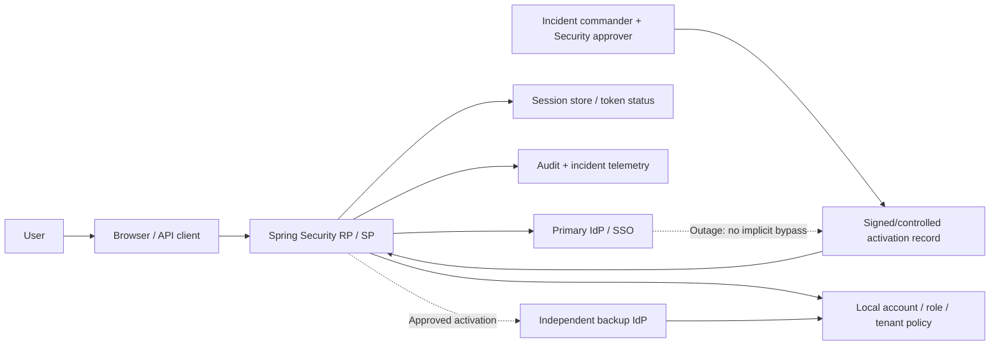

# Approved Contingency Plans Without Automatically Bypassing Authentication

## Learning Objectives

This article belongs to **Deployment and Operations** in the **Spring Security – federation** module. Upon completion, learners can:

1. Explain the difference between **SSO/IdP availability**, **user authentication**, and **local authorization**, and why an IdP outage never authorizes dropping the authentication layer.
2. Recognize failure modes across OIDC discovery/JWKS/token endpoints, SAML metadata/signatures, CAS ticket validation, Kerberos KDCs, proxy pre-authentication, session stores, network/TLS/DNS, and IAM directories.
3. Propose a **pre-approved contingency/fallback plan signed off by IAM, Security, operations, and owners**, complete with triggers, decision authority, scope, duration, risk controls, tests, and rollback.
4. Distinguish **bounded graceful degradation**, an **independent backup IdP** with separate trust, **break-glass** with separate identities and authenticators, **read-only mode**, **deferred queuing**, and **fail closed/503**—avoiding ad-hoc "fallback passwords."
5. Design state transitions `NORMAL → INCIDENT_DECLARED → APPROVED_ACTIVE → EXPIRED/RECOVERED`, ensuring emergency mode can never trigger merely because a frontend sends `?emergency=true` or a monitor sees an IdP error.
6. Bind activation to an **incident ID, two independent approvers when policy requires, window TTL, allowed actions/tenants/users, an approval record, and auditing**, denying everything outside scope by default.
7. Understand why switching IdPs must never auto-link users by email or grant `ROLE_ADMIN` from claims; verified issuer/subject linking, MFA/assurance, and local permissions remain mandatory.
8. Use **Spring Boot 3 / Spring Security 6 / Java 17+** to illustrate two OIDC client registrations with an **approval-gated authorization-request resolver**, blocking callbacks/authorization once contingency expires, plus method-level resource authorization.
9. Run a **standalone Java 17+** program modeling primary/backup policy, dual approval, TTL, source validation, MFA, roles, scope, and recovery with deterministic stdout.
10. Test failure injection, valid session continuity, revocation, pending requests, direct access, multi-node consistency, rotation, auditing, recovery, and tabletop exercises without using unauthorized production accounts or secrets.

## 1. Invariant Principle: Fall Back on Availability, Never by Skipping Authentication

In a federated system, a Spring Security application (Relying Party/Service Provider) relies on an **identity provider** to authenticate users. If the IdP suffers an outage, **new logins** may stop working. Operators feel pressure to restore service, yet replacing security checks with:

```java
// ANTI-PATTERN: never use this as a solution when the IdP is down.
if (!idpReachable) {
    return new UsernamePasswordAuthenticationToken(
        "emergency-admin", null, List.of(
            new SimpleGrantedAuthority("ROLE_ADMIN")));
}
```

creates an authentication and authorization bypass. An availability incident becomes **account takeover** and **privilege escalation**. The snippet above is **solely a dangerous anti-pattern**, never code to run in a system.

Standard operational rule:

> **If identity and permissions cannot be verified under an approved mechanism, deny access to resources requiring authentication.**

During an IdP outage, the application may:
- Continue serving requests on **already-authenticated valid sessions** within approved risk/legal bounds.
- Block actions requiring fresh reauthentication or MFA.
- Serve genuinely public content such as an incident status page.
- Queue tasks already fully authorized by the system that do not require immediate user interaction, backed by idempotency and audit contracts.
- Switch to a **pre-registered/pre-trusted backup IdP** strictly after procedural activation.
- Give operations recovery access through an independent administrative channel enforcing **strong authentication and least privilege**, never an anonymous "superuser" login page.
- Return `503 Service Unavailable` or an appropriate error state for new logins when no approved alternative satisfies policy.

### 1.1. Three Independent Questions

| Question | Answered by | During an IdP outage |
| --- | --- | --- |
| **Who is sending the request?** | SAML/OIDC/CAS/Kerberos/proxy IdP or an approved independent fallback | Never mint a "temporary" principal |
| **What are they allowed to do?** | Local account, tenant memberships, role/permission policy, SoD, expiry | Never skip local policy because the IdP is unreachable |
| **Which services can safely keep running?** | BCP/DR plan, service SLOs, business impact, mode restrictions | Reduce functionality if needed while preserving security |

**SSO availability is not authorization availability.** A healthy IdP combined with a broken local permission DB is still no reason to grant default roles. Conversely, readable local permissions do not prove an unauthenticated user has logged in.

### 1.2. Operational Example

A finance portal supports two operations:
- `REPORT_READ`: reading internal tenant reports, potentially allowed on a **session authenticated prior to the outage** if the account has not been revoked, the session remains valid, and the business owner accepts the risk window.
- `PAYMENT_APPROVE`: approving disbursements, requiring fresh MFA and maker-checker SoD; **blocked** without sufficiently fresh assurance evidence, even if the old session holds `ROLE_MANAGER`.

When the primary IdP fails, the plan may **block payment approvals**, preserve report reads for valid sessions with current-state checks, and let users pre-linked to a **backup IdP** sign in through the approved contingency channel. This is **not** "everyone sets a local password on the Portal."

## 2. Dependency Model and Failure Modes



### 2.1. What Each Failure Breaks

| Incident | Symptom | Primary impact | Never do this |
| --- | --- | --- | --- |
| OIDC Authorization Endpoint down | Browser redirects to IdP then errors/times out | New logins, step-up | Allow anonymous callers onto protected endpoints |
| OIDC Token Endpoint fails | Code callback cannot exchange for ID Token | Login callbacks | Accept `code`/query strings as user identity |
| OIDC discovery/metadata fails | `ClientRegistration` fails startup or metadata refresh | Startup / new auth depending on setup | Accept issuer/JWKS from a browser-supplied URL |
| JWKS retrieval fails | Cannot verify new tokens/keys | Token validation / login | Skip signatures or accept `alg=none` |
| Wrong IdP signing key / rotation bug | Signature validation fails | Authentication | Load an available key from an untrusted source |
| SAML IdP SSO endpoint fails | `AuthnRequest` is not processed | SP-initiated login | Build `Saml2Authentication` from unverified `SAMLResponse` |
| SAML metadata/cert error | SP does not trust assertions | Login | Disable Audience/Recipient/signature checks |
| CAS Server / ticket registry fails | Cannot issue/validate Service Tickets | CAS login, SLO | Accept expired, reused, or unvalidated tickets |
| Kerberos KDC fails | Cannot issue new TGTs/service tickets | Windows/Kerberos auth | Treat `REMOTE_USER` as verified by default |
| Proxy identity gateway fails | Missing verified headers/identity assertion | Pre-auth | Trust `X-Authenticated-User` from clients |
| Session store Redis/JDBC fails | Cannot load authenticated app session | Existing sessions | Grant admin because session couldn't be read |
| Local entitlement DB fails | Cannot check current permissions | Authorization | `return true` for every `@PreAuthorize` |
| Federation broker partial outage | One IdP/auth route stops working | Subset of users/partners | Auto-link issuer/subject by email |
| DNS/TLS/certificate expiry | TLS/discovery/redirects fail | Can impact multiple layers | Disable TLS verification or hostname checks |
| Multi-node network partition | Some pods reach IdP, others do not | Inconsistent results | Toggle different emergency flags per pod |

**Classify the root cause before activating contingency.** A callback 404 from a misconfigured ingress ACS is not an IdP-wide outage; flipping all users to a backup IdP widens the blast radius without fixing the bug.

### 2.2. Availability Needs Never Mean Fail-Open

In authorization, fail-open usually means: "Couldn't reach the IdP/permission service, so allow it." For security actions, **default to deny-by-default** and enforce current permissions at request/method/resource boundaries. True contingency means having **another trustworthy way to authenticate or defer the operation**, not replacing authentication with a flag.

### 2.3. What RTO and RPO Mean for IdP/SSO

- **RTO (Recovery Time Objective):** how quickly the organization aims to restore login flows and protected availability.
- **RPO (Recovery Point Objective):** acceptable data-update loss (e.g., user/group/entitlement changes) when restoring an IdP or directory.
- **Meeting RTO never permits stale-permission RPOs** that resurrect offboarded users.
- **Security RTO:** how quickly a deny/revoke path must take effect during ongoing incidents such as compromised accounts.
- **SSO SLO:** may differ from the app's SLO; optimizing uptime by bypassing authentication violates the security SLO.

Exact minutes/hours must be set by owners; no single Spring Security threshold fits every system.

## 3. Contingency Options: Comparing Choices

| Option | Where user authentication comes from | When to use | Limits / risks |
| --- | --- | --- | --- |
| **Primary IdP retry/backoff** | Primary IdP still works | Transient blips while IdP can still verify | Never retry infinitely / DoS |
| **Keep valid sessions** | Previously authenticated session | Low-risk actions when session policy permits | Authorities may age; does not restore new logins |
| **Secondary/backup IdP** | Separate trusted IdP with MFA & active user links | Verified primary outage with approval | Distinct issuer/sub, role mapping, assurance, keys |
| **DR replica of IdP** | Official replica under HA/DR design | Disaster recovery/cutover by IdP owner | Syncing keys, state, subject/issuer, and revocation |
| **Independent break-glass admin** | Independent creds + MFA, stored securely | Infra recovery when IAM/SSO is unavailable | Very few accounts, scoped, dual control, audited |
| **Read-only degraded mode** | Valid existing session or approved backup identity | Preserve read capabilities | Never let anonymous callers read sensitive data |
| **Pause/queue protected transactions** | Held until re-authenticated | High-risk approvals/payments/exports | Needs idempotency, retention, replay controls |
| **Public status page** | No login required | Incident comms with no sensitive data | Never leak account states or PII |
| **Block new logins (503)** | No sufficiently trusted fallback | No verified fallback exists | Impacts availability while preserving trust |

**Not all options are interchangeable.** A backup IdP supports new user logins, whereas infrastructure break-glass belongs strictly on a separate admin plane. A public `/status` page must never turn into a public financial API.

## 4. Contingency Plans Must Be Prepared and Approved Before Incidents

A runbook saying "on error, disable the security filter" is not a BCP. A real plan needs **owners, approvals, scope, execution paths, validation, and rollback**.

### 4.1. Mandatory Plan Documentation Fields

| Field | Required content |
| --- | --- |
| Plan ID/version | E.g., `SSO-BCP-2026-03`, owner, and versioning |
| System/tenant scope | Apps, regions, tenants, partners, and permitted operations |
| Threat model | Assessment of IdP outage, compromise, shared risk, phishing, replay |
| Trigger/criteria | Monitoring signals + human verification; avoid single-metric triggers |
| Declaring authority | Authorized incident commander / on-call role |
| Security approver | Independent IAM/Security approver |
| Segregation of duties | The activator cannot self-certify their own approval |
| Supported fallback | DR IdP or backup provider, signing keys/issuer/client configs |
| Allowed account classes | Who holds formally linked backup identities |
| Allowed actions | E.g., `REPORT_READ`, `SUPPORT_DIAGNOSE`; deny payments/admin |
| Authentication assurance | MFA, phishing resistance, `auth_time`, device/policy |
| Authorization | Active local account, current grants, tenant/resource limits |
| Duration/TTL | Absolute UTC start/end timestamps, auto-expire |
| Audit/evidence | Ticket ID, approvers, config revision, decisions, negative tests |
| Monitoring | Alerts on failover use, anomalies, backup auth errors, role denials |
| Revocation | How to kill sessions/tokens immediately on compromise |
| Recovery/rollback | Switch-back milestones, invalidation, and reconciliation |
| Exercises | Periodic tabletop and IdP failover drills with reviewer sign-off |
| Contact tree | App/IdP/network/SOC/management and escalation |

**Setting deadlines and scopes before an incident** prevents permanent privilege expansion under operational pressure.

### 4.2. Who Has Authority to Activate?

An example policy:
- SRE detects and verifies the primary IdP outage.
- The Incident Commander declares an incident backed by evidence.
- The Security/IAM owner approves **enabling the backup IdP** for a specific scope and expiry.
- The activation system writes a **server-controlled audit record**, signed or via an authenticated administrative API with strong MFA/mTLS, RBAC, and SoD.
- The app/ingress checks **record validity** on every critical request—never trusting client queries.
- Activation applies only to allowed tenants/actions and logs every use.
- Once TTL expires or recovery finishes, backup mode stops accepting new logins/requests per policy.

An "approver" is an **authenticated, authorized approver identity**, not a string `{"approvedBy":"security"}` submitted by the caller.

### 4.3. Activation Must Never Sit on a Public User API

Endpoints like:

```http
GET /enable-emergency?secret=123
POST /login?skipMfa=true
X-Emergency-Access: yes
```

are not safe contingencies. **Never** mark emergency control routes `@PermitAll`. Control planes should sit on isolated networks with dedicated account privileges, usable only by strongly authenticated operators backed by tickets and approval records. If the control UI itself uses the broken IdP, maintain a **pre-established independent operations channel**—never an anonymous shortcut.

## 5. State Machine: Never Transition from Disconnect Directly to "ALLOW"

```mermaid
stateDiagram-v2
    [*] --> NORMAL
    NORMAL --> SUSPECTED: Monitoring receives signals
    SUSPECTED --> NORMAL: False alarm / recovered
    SUSPECTED --> DECLARED: Incident commander confirms
    DECLARED --> ACTIVE: Security+Incident approvals; TTL & scope
    DECLARED --> NORMAL: Recovered before activation
    ACTIVE --> EXPIRED: TTL elapsed
    ACTIVE --> RECOVERED: Official switch-back
    ACTIVE --> REVOKED: Emergency security revocation
    EXPIRED --> NORMAL: Cleanup + audit
    REVOKED --> NORMAL: Cleanup + audit
    RECOVERED --> NORMAL: Verify + close incident
```



**This state machine is a custom policy design, not built-in Spring Security behavior.** Transitions must be enforced with transactions/signed policies and auditing.

### 5.1. Decision Table

| State | Primary login | Backup login | Existing sessions | High-risk actions |
| --- | --- | --- | --- | --- |
| `NORMAL` | Via primary IdP | **Cannot initiate** while plan inactive | Per session rules | Normal MFA/role/SoD |
| `SUSPECTED` | Bounded retries if primary reachable | Closed | Per current-state/session | Never lower assurance |
| `DECLARED` | May be unavailable | Closed until approvals complete | Per risk policy | Deny/queue if fresh auth needed |
| `ACTIVE` | Per availability/plan | **Allowed within scope/TTL** via trusted backup | Validate issuer/role/time | Usually deny or require trusted strong step-up |
| `EXPIRED` | Via primary if recovered | Stopped | Backup sessions/tokens handled per policy | Never keep emergency privileges |
| `REVOKED` | Per incident policy | Stopped immediately | Revoke/deny relevant sessions/tokens | Deny |
| `RECOVERED` | Primary restored | Stop issuing contingency logins | Migrate/revoke backup sessions cleanly | Reauthenticate/step-up per policy |

**Crucial distinction:** backup login activation lets *a specific group of users* sign in—it does not grant all users all roles. While backup is active, authorization still checks permissions inside the application.

### 5.2. TTL and Revocation Must Be Enforced per Request, Not Only at Startup

A feature flag `backupEnabled=true` read once at app startup will not turn off when TTL expires. If business rules end emergency mode at 14:00 UTC:
- New backup login requests after 14:00 are blocked.
- Pending OIDC callbacks arriving after 14:00 must not mint backup sessions (absent an explicit policy grace/cutover rule).
- Existing backup sessions must be revoked or strictly confined to a **defined window with current-state checks**.
- Emergency grants must never persist indefinitely in caches/JWTs.
- All pods must share the authoritative control record/revision; no single node may hold stale flags.

When the activation store is unreadable: **backup mode fails closed**. Never let a Redis/DB failure default to `active=true`.

## 6. Failure Detection and Deciding Whether Failover Is Needed

### 6.1. Reliable Health Signals

- OAuth2/OIDC authorization endpoint reachable from relevant networks/browsers.
- Token endpoint latency/error rates and callback `invalid_grant`/timeouts.
- OIDC discovery/`.well-known/openid-configuration` health and issuer/JWKS consistency.
- SAML `AuthnRequest`→`SAMLResponse` success ratio and IdP metadata/signature verification.
- CAS service ticket validation errors and ticket registry health.
- Kerberos AS/TGS failures and DNS/KDC reachability.
- TLS certificate expiry/OCSP/trust errors and DNS propagation.
- App session-store and permission-store current-state health.
- Official identity provider status pages/partner incident notices from verified sources.
- Cross-node traffic and affected tenants, not a single probe from one machine.

### 6.2. Distinguish Local Bugs from System-Wide Outages

If only one tenant hits `Audience mismatch` due to bad metadata, **enabling backup for all tenants is wrong**. If one pod has a broken JWKS cache, restarting or refreshing that cache is safer than failover activation. If the primary IdP is compromised rather than merely offline, do not keep trusting old tokens/signing keys under a normal availability plan.

### 6.3. Circuit Breakers in Their Proper Role

Circuit breakers/backoff can stop retry storms against an IdP or token endpoint, yet:
- Breakers decide only **whether to call the IdP right now**.
- They do **not** prove a user is authenticated.
- They do **not** create `Authentication` or admin roles.
- They do not replace backup IdP approval policies.
- Retries need bounds, jitter, timeouts, and metrics—never log auth tokens or credentials.

**Wrong:** `if (circuitBreakerOpen) return authenticated=true`. **Right:** breaker open → login failure/503, or backup redirect **only when the approval gate is active and the account is in scope**.

## 7. Fallback Option A: Continuing Valid Authenticated Sessions

### 7.1. Existing Sessions Are Not "Skipping Authentication"

A Spring web app normally holds `Authentication` in `SecurityContext`/`HttpSession`. If a user logged in via OIDC/SAML/CAS before the IdP went down, the app can read the existing session from the shared session store. Continuing that session is fundamentally different from creating a new session for an anonymous caller.

Consider continuing only when:
1. The prior session **was genuinely authenticated** by a trusted IdP.
2. The session has not expired or been revoked and remains bound to the right subject/issuer/app.
3. The local account is ACTIVE, and tenant memberships and permissions remain valid.
4. Policy does not require fresh reauthentication/MFA for that action.
5. Security response for compromise differs from outage; if IdP keys leaked, revoke trust/sessions per incident runbook.
6. If the local permission DB is unavailable, high-risk actions must deny—never trust cached admin privileges forever.
7. Sessions are governed across a shared store/multi-node cluster; never assume deleting a browser cookie alone revokes server-side sessions.

### 7.2. Common Mistakes

| Mistake | Consequence |
| --- | --- |
| "While the IdP is broken, session cookies stay valid forever" | Session fixation/theft and unrevoked stale roles |
| "Having a role in `SecurityContext` is enough" | Revoked roles may linger inside `HttpSession` |
| "If permission DB is down, trust cached admin" | Fail-open authorization |
| "Logging out of IdP ends every SP session automatically" | SAML/CAS/OIDC logout propagation has limits |
| "Signed JWT works even if user is disabled" | Self-contained tokens stay valid until `exp` without revocation gates |
| "Can read dashboard so can approve payments" | Action has separate step-up requirements |

### 7.3. Action-Level Rules

```text
if no verified prior authentication:
    DENY / require approved backup login
else if account disabled or token/session revoked:
    DENY
else if authorization store cannot establish current permission:
    DENY high-risk action
else if action needs fresh MFA and trusted reauthentication unavailable:
    DENY / queue, not auto-approve
else if session valid and resource policy permits:
    ALLOW within documented SLA
```

This is policy pseudocode, not a Spring Security default. Session thresholds and cache TTLs must be approved by Security/owners; Spring has no universal "IdP outage TTL."

## 8. Fallback Option B: Backup IdP with Separate Identity and Trust

A common strategy for critical systems is a **secondary independent OIDC/SAML IdP** with separate DNS/hosting, signing keys, client registrations, and authentication policies, tested ahead of time.

### 8.1. Never Switch to an Unregistered IdP

The application must already have:
- Exact backup issuer/entityID, HTTPS/TLS, and trusted JWKS/signing certificates.
- Backup OAuth2 client registration (ID/secret/redirect) or SAML relying-party registration with agreed ACS/SP entityIDs.
- Synthetic tests covering issuer, audience, nonce, signature, timestamps, subject, and MFA assurance.
- Approved identity links mapping backup subjects to the **same internal local account**.
- Local permission/tenant policies independent of arbitrarily replicable group names.
- An approval gate blocking activation outside incident windows.
- Revocation/logout/session invalidation and switch-back plans.
- Key/secret rotation governance, logging, per-issuer monitoring, and trusted metadata refreshes.

**Never accept a backup ID token into a primary RP on the theory "both have valid signatures."** Every token must be validated against the trust config of **its exact issuer/client**. Authenticated identity linking must use `(issuer, stable subject)`, never email alone.

### 8.2. Identity Linking Is Not Email Matching

Example:

```text
Primary:
issuer=https://login.primary.example/realms/corp
sub=primary-uid-1042

Backup:
issuer=https://login.recovery.example/realms/contingency
sub=backup-opaque-f39

Internal account:
accountId=acct-1042
active=true
tenant=finance
permission=REPORT_READ
```

A **pre-incident** approval workflow verified both external identities belong to `acct-1042`. When the backup IdP authenticates `backup-opaque-f39`, the app looks up the approved link and loads internal permissions. Without a link, **DENY**—never auto-link on matching email, phone, or display name.

### 8.3. Keep the Same Assurance Level or Explicitly Downgrade?

For workflows requiring MFA/phishing resistance, the backup must meet the **approved assurance contract**. If backup supports passwords only:
- Never treat `amr=["pwd"]` as MFA.
- Allow only operations whose risk policy genuinely permits that assurance level, or deny.
- Actions requiring fresh MFA need source-verified `acr`/`amr`/`auth_time`/SAML `AuthnContext` per issuer semantics.
- Never inflate assurance merely because `backupMode=true`.

**Changing identity providers does not alter financial, legal, or audit requirements.**

### 8.4. DR Replica vs Independent IdP

Two designs exist:
1. **DR replica** of the official IdP/issuer, syncing signing keys, configs, and user identities under an HA/DR strategy. If issuer, keys, or endpoints change, obey the OIDC/SAML trust contract—never assume DNS alone suffices.
2. **Independent backup IdP** with its own issuer/subjects and keys, requiring separate registrations/linking, approvals, and assurance mappings.

Never copy production private signing keys into an unmanaged dev IdP just for easy failover. When DR requires key sync, use **equally hardened DR infrastructure** per key management policy and threat model.

## 9. Fallback Option C: Break-Glass Must Never Become a Backdoor

**Break-glass** is for a small set of operators recovering infrastructure when the primary identity system is disrupted—not for giving all employees `ROLE_ADMIN`.

### 9.1. Characteristics of Emergency Accounts

- **Pre-provisioned**, identity-proofed, dedicated, never created automatically during failures.
- Strong authenticators independent of IdP outages, such as hardware MFA matched to risk.
- Minimal count and admin privileges scoped to specific resources/runbooks.
- Credentials stored in a secure vault and retrieved under dual control.
- Never share a `"breakglass123"` password in chat or Git.
- Usable only within an isolated admin network/plane or protected PAM/jump host.
- Tied to incident tickets, owners, time windows, session recording/auditing, and alerts.
- Rotate credentials/keys, review changes, and revoke emergency sessions afterward.
- Never used to bypass financial maker-checker/SoD controls.
- Never turn an admin plane route into a public website "emergency login."

### 9.2. Do Not Bolt `formLogin` onto the App at the Last Minute

In Spring Security:
```java
// ANTI-PATTERN: added mid-incident without a password store,
// strong factor, approval gate, rate limit, and session policy.
http.formLogin(Customizer.withDefaults());
```

Enabled unplanned, form login often relies on shared/weak passwords, lacks MFA, misaligns authorization, and is hard to audit. A local authentication channel is valid only when **fully architected, reviewed, approved, rehearsed, and hardened**.

### 9.3. Break-Glass for Infrastructure Is Not Business Login

Operators may need to:
- Restart IdPs/ingresses.
- Repair DNS/certificates, JWKS caches, or key rotations.
- Open incident communication channels.
- Reconcile directories/IdPs after restoration.

They are **not** automatically authorized to:
- Read all tenants' data.
- Self-approve payments.
- Export all customer PII.
- Mint permanent admin accounts.
- Disable all `authorizeHttpRequests` or auditing.

## 10. When No Suitable Fallback Exists: Fail Safely

When no approved backup IdP is available and new users cannot authenticate:
- Issue no authenticated sessions.
- Return an appropriate service status for new logins, such as `503 Service Unavailable` on a reviewed failure page.
- Never display raw IdP exceptions, client secrets, or token endpoint errors.
- Communicate status with public, non-leaky messages revealing no account existence.
- On APIs, standardize authentication vs availability errors; never return `200` with a fake "success" payload.
- Enforce retries/backoff and circuit breakers to prevent request storms.
- Keep CSRF, session fixation protection, TLS, cookie security, and account-lockout policies active.
- Never auto-approve queued pending business transactions once the IdP recovers.

**Good UX message:** "Unable to verify sign-in right now. Some features are temporarily paused; updates will be shared through official channels." Never mention internal endpoints or secrets.

## 11. Spring Boot 3 / Spring Security 6: Two Predefined OIDC Registrations

Illustrative architecture:
- Primary issuer `https://login.primary.example/realms/corp`, registration ID `primary`.
- Backup issuer `https://login.recovery.example/realms/contingency`, registration ID `standby`.
- Backup can **initiate** only when `EmergencyGate.isActive()` returns true from the **approval store**.
- Provider metadata/JWKS, tokens, and redirect callbacks remain verified by Spring Security's OIDC client under the right registration.
- Business methods check accounts, permissions, and mode—not merely whether a user is logged in.
- **No** fallback from request headers, email claims, anonymous users, or disabled accounts.

### 11.1. Dependencies

In a project using the Spring Boot 3 plugin and dependency management, Java 17:

```groovy
dependencies {
    implementation 'org.springframework.boot:spring-boot-starter-web'
    implementation 'org.springframework.boot:spring-boot-starter-security'
    implementation 'org.springframework.boot:spring-boot-starter-oauth2-client'
    testImplementation 'org.springframework.boot:spring-boot-starter-test'
    testImplementation 'org.springframework.security:spring-security-test'
}
```

This is an **integration example inside a Spring Boot project**, not a standalone `javac` program. SAML2/CAS/Kerberos federation modules need their own filters/providers and trust configs; two OIDC registrations do not cover other protocols automatically.

### 11.2. application.yml

```yaml
spring:
  security:
    oauth2:
      client:
        registration:
          primary:
            provider: primary
            client-id: portal-primary
            client-secret: "${PRIMARY_OIDC_CLIENT_SECRET}"
            authorization-grant-type: authorization_code
            scope: openid,profile
            redirect-uri: "{baseUrl}/login/oauth2/code/{registrationId}"
          standby:
            provider: standby
            client-id: portal-standby
            client-secret: "${STANDBY_OIDC_CLIENT_SECRET}"
            authorization-grant-type: authorization_code
            scope: openid,profile
            redirect-uri: "{baseUrl}/login/oauth2/code/{registrationId}"
        provider:
          primary:
            issuer-uri: https://login.primary.example/realms/corp
          standby:
            issuer-uri: https://login.recovery.example/realms/contingency
server:
  forward-headers-strategy: framework
  servlet:
    session:
      cookie:
        secure: true
        http-only: true
        same-site: lax
```

**Important technical notes:**

- Both issuer URLs above are **nonexistent placeholder fixtures**; running requires real test IdPs and client registrations.
- Fetch secrets from a secret manager/CI runtime; never commit them to source or logs.
- Issuers, JWKS, callbacks, and client IDs are **fixed trust configs**; never take `?issuer=...` from the browser.
- `issuer-uri` may perform provider discovery **when initializing `ClientRegistrationRepository`**. If one provider is offline while the app loads metadata at startup, startup may fail even though the other provider is healthy. That is a **DR risk to solve before production** via managed metadata/trust availability, startup/readiness tests, or explicit provider endpoints/configs supported by the library. Never bypass issuer validation or hardcode an arbitrary JWKS URL from input to mask an outage.
- Behind ingress, process `Forwarded`/`X-Forwarded-*` only from trusted proxies after stripping/overwriting; `{baseUrl}` must resolve to a public HTTPS callback.
- Never declare both issuers without backup trust reviews, runbooks, and user linking; adding a registration alone is not a contingency plan.
- Never use HTTP for production OIDC IdPs or callbacks.

### 11.3. `EmergencyActivation` and the Approval Store

Control data must be **written by an independent control plane**, never the browser. Sample design:

```text
activationId: ACT-7F2C
incidentId: INC-2026-1107
mode: APPROVED_ACTIVE
approvedByIncidentCommander: verified principal ICM-04
approvedBySecurity: verified principal SEC-08
scope: app=portal, tenant=finance, actions=[REPORT_READ]
validFrom: 2026-11-07T10:00:00Z
validUntil: 2026-11-07T12:00:00Z
revoked: false
version: 52
auditHash: server-calculated
```

**Never let callers submit these fields to "become approved."** The approval service must verify identities, roles, separation of duties, signatures/credential strength, incident tickets, and monotonic revisions; control records need transactions/auditing, TTLs, and shared availability.

Java domain API example — service code integrated with a **protected** repository; these are Spring/Java 17 classes, requiring a concrete repository/storage implementation to run:

```java
package com.example.contingency;

import java.time.Clock;
import java.time.Instant;
import java.util.Optional;
import org.springframework.stereotype.Service;

record Activation(
        String incidentId,
        Instant validFrom,
        Instant validUntil,
        String incidentApproverId,
        String securityApproverId,
        boolean revoked) {

    boolean approvedAt(Instant now) {
        return !revoked
            && incidentId != null && !incidentId.isBlank()
            && incidentApproverId != null
            && securityApproverId != null
            && !incidentApproverId.equals(securityApproverId)
            && validFrom != null && validUntil != null
            && !now.isBefore(validFrom)
            && now.isBefore(validUntil);
    }
}

interface EmergencyActivationRepository {
    Optional<Activation> currentApprovedActivation();
}

@Service
public final class EmergencyGate {
    private final EmergencyActivationRepository approvals;
    private final Clock clock;

    public EmergencyGate(
            EmergencyActivationRepository approvals, Clock clock) {
        this.approvals = approvals;
        this.clock = clock;
    }

    public boolean isActive() {
        try {
            return approvals.currentApprovedActivation()
                    .filter(a -> a.approvedAt(clock.instant()))
                    .isPresent();
        } catch (RuntimeException storeUnavailable) {
            // Fail closed; log only reason code/correlation.
            return false;
        }
    }
}
```

**Files and scope:** package `com.example.contingency`; each `public` top-level type must live in a matching file, so the snippet shows package-private types alongside public `EmergencyGate` in `EmergencyGate.java`. Declare a `@Bean Clock.systemUTC()` and an `EmergencyActivationRepository` implementation for startup. **Never** use a local in-memory flag as the policy source in multi-node production.

**Crucially:** the code checks only that two approver strings differ—it **does not verify on its own that those two people actually hold Incident Commander and Security roles** or verify approval signatures. That belongs to the repository/control plane and authorization workflow. Seeing two IDs in JSON does not prove dual approval.

### 11.4. `GatedAuthorizationRequestResolver`: Backup Stays Closed When Primary Fails

`DefaultOAuth2AuthorizationRequestResolver` in Spring Security 6 creates OAuth2 Authorization Requests from client registrations, including `state`/`nonce` for OIDC. Wrap the resolver with the gate to return `null` whenever backup is unapproved, **never minting a token or bypassing authentication**.

File `GatedAuthorizationRequestResolver.java`:

```java
package com.example.contingency;

import jakarta.servlet.http.HttpServletRequest;
import org.springframework.security.oauth2.client.registration.ClientRegistrationRepository;
import org.springframework.security.oauth2.client.web.DefaultOAuth2AuthorizationRequestResolver;
import org.springframework.security.oauth2.client.web.OAuth2AuthorizationRequestResolver;
import org.springframework.security.oauth2.core.endpoint.OAuth2AuthorizationRequest;
import org.springframework.security.oauth2.core.endpoint.OAuth2ParameterNames;

public final class GatedAuthorizationRequestResolver
        implements OAuth2AuthorizationRequestResolver {

    private final DefaultOAuth2AuthorizationRequestResolver delegate;
    private final EmergencyGate gate;

    public GatedAuthorizationRequestResolver(
            ClientRegistrationRepository registrations, EmergencyGate gate) {
        this.delegate = new DefaultOAuth2AuthorizationRequestResolver(
                registrations, "/oauth2/authorization");
        this.gate = gate;
    }

    @Override
    public OAuth2AuthorizationRequest resolve(HttpServletRequest request) {
        return allowed(delegate.resolve(request));
    }

    @Override
    public OAuth2AuthorizationRequest resolve(
            HttpServletRequest request, String registrationId) {
        if ("standby".equals(registrationId) && !gate.isActive()) {
            return null;
        }
        return allowed(delegate.resolve(request, registrationId));
    }

    private OAuth2AuthorizationRequest allowed(
            OAuth2AuthorizationRequest authorizationRequest) {
        if (authorizationRequest == null) {
            return null;
        }
        String registrationId = authorizationRequest.getAttribute(
                OAuth2ParameterNames.REGISTRATION_ID);
        if ("standby".equals(registrationId) && !gate.isActive()) {
            return null;
        }
        return authorizationRequest;
    }
}
```

**Notes:**
- Returning `null` from the resolver means **no redirect flow starts**—it does not return HTTP 403 on its own. Spring still needs a request authorization rule denying the backup path when the resolver declines.
- The `resolve(request, registrationId)` overload also checks the gate; test any custom authorization flow invoking that overload.
- The resolver blocks **login initiation** only; also block late callbacks and existing backup sessions once activation expires.
- Do not merely hide the standby link in HTML: attackers can call `/oauth2/authorization/standby` directly.
- The `primary` registration continues using normal Spring OIDC validation; "primary unhealthy" never turns `gate.isActive()` true.
- OAuth2/OIDC state, nonce, signature, issuer/audience/expiry validation must still run via Spring and the provider.

### 11.5. `SecurityFilterChain`: Deny Backup Route When Gate Is Closed

File `SecurityConfig.java`:

```java
package com.example.contingency;

import java.time.Clock;
import jakarta.servlet.http.HttpSession;
import org.springframework.context.annotation.Bean;
import org.springframework.context.annotation.Configuration;
import org.springframework.security.config.annotation.method.configuration.EnableMethodSecurity;
import org.springframework.security.config.annotation.web.builders.HttpSecurity;
import org.springframework.security.core.context.SecurityContextHolder;
import org.springframework.security.oauth2.client.authentication.OAuth2AuthenticationToken;
import org.springframework.security.oauth2.client.registration.ClientRegistrationRepository;
import org.springframework.security.web.SecurityFilterChain;
import org.springframework.security.web.authentication.SavedRequestAwareAuthenticationSuccessHandler;

@Configuration
@EnableMethodSecurity
public class SecurityConfig {

    @Bean
    Clock clock() {
        return Clock.systemUTC();
    }

    @Bean
    SecurityFilterChain filterChain(
            HttpSecurity http,
            ClientRegistrationRepository registrations,
            EmergencyGate gate) throws Exception {

        var resolver = new GatedAuthorizationRequestResolver(
                registrations, gate);
        var success = new SavedRequestAwareAuthenticationSuccessHandler();

        return http
            .authorizeHttpRequests(auth -> auth
                .requestMatchers("/", "/status", "/error").permitAll()
                // If resolver declines to initiate standby, deny this URL.
                .requestMatchers("/oauth2/authorization/standby").denyAll()
                .anyRequest().authenticated())
            .oauth2Login(oauth -> oauth
                .authorizationEndpoint(endpoint ->
                    endpoint.authorizationRequestResolver(resolver))
                .successHandler((request, response, authentication) -> {
                    if (authentication instanceof OAuth2AuthenticationToken t
                            && "standby".equals(
                                t.getAuthorizedClientRegistrationId())
                            && !gate.isActive()) {
                        SecurityContextHolder.clearContext();
                        HttpSession session = request.getSession(false);
                        if (session != null) session.invalidate();
                        response.sendError(403, "Emergency login not active");
                        return;
                    }
                    success.onAuthenticationSuccess(
                            request, response, authentication);
                })
                .failureHandler((request, response, exception) ->
                    response.sendError(
                        503, "Federated authentication unavailable")))
            .build();
    }
}
```

**Protection points analysis:**

- `oauth2Login` keeps standard **OIDC Authorization Code**; no `formLogin` or anonymous login fallback is configured.
- `GatedAuthorizationRequestResolver` refuses to initiate `standby` if approval is inactive. Downstream `AuthorizationFilter` denies that URL whenever the redirect filter declines. **When the gate is active**, the OAuth2 redirect filter runs ahead of authorization rules and sends the browser to the trusted backup IdP; verify this with MockMvc/browser integration tests.
- `successHandler` blocks a **late standby callback** if activation expired between initiation and callback. It clears `SecurityContext` and invalidates the session; it is one defense layer, not a substitute for request-time policy.
- Valid `primary` callbacks flow normally through `SavedRequestAwareAuthenticationSuccessHandler`.
- `failureHandler` returns `503` on authentication failures in this filter; **never** mutate `Authentication` or mint admin. Production should distinguish user cancellations/bad credentials (4xx) from provider outages (503) so observability stays accurate; this snippet uses a generic message to keep safety in focus.
- `@EnableMethodSecurity` enables `@PreAuthorize`. URL-level `authenticated()` is only the outer gate; keep local entitlement/tenant policies inside business services.
- **Never disable CSRF globally.** Browser forms and transactions require CSRF protection and secure cookies.
- If an IdP outage occurs before Spring builds `ClientRegistration` via metadata discovery, this `SecurityFilterChain` **cannot rescue startup**. Solve startup resilience per section 11.2.
- Never use `/status` to expose raw tokens, internal circuit-breaker states, user lists, admin control endpoints, or secrets.

**Completeness note:** This is an **illustrative configuration requiring integration tests**; it omits `EmergencyActivationRepository`, account stores, issuer-specific authorization policies, and cluster session revocation, so do not treat it as a turnkey production failover system.

### 11.6. Method Authorization: Backup Permits Only Approved Operations

File `ContingencyPolicy.java`—account data uses an in-memory map **strictly for learning**, never production:

```java
package com.example.contingency;

import java.util.Map;
import java.util.Set;
import org.springframework.security.core.Authentication;
import org.springframework.security.oauth2.client.authentication.OAuth2AuthenticationToken;
import org.springframework.security.oauth2.core.oidc.user.OidcUser;
import org.springframework.stereotype.Component;

@Component("contingencyPolicy")
public final class ContingencyPolicy {
    private record Key(String issuer, String subject) {}
    private record Account(
        boolean active, Map<String, Set<String>> permissions) {}

    private static final String PRIMARY =
        "https://login.primary.example/realms/corp";
    private static final String BACKUP =
        "https://login.recovery.example/realms/contingency";

    private final EmergencyGate gate;
    private final Map<Key, Account> approvedLinks = Map.of(
        new Key(PRIMARY, "primary-uid-1042"),
        new Account(true,
            Map.of("finance", Set.of("REPORT_READ", "PAYMENT_APPROVE"))),
        new Key(BACKUP, "backup-opaque-f39"),
        new Account(true, Map.of("finance", Set.of("REPORT_READ")))
    );

    public ContingencyPolicy(EmergencyGate gate) {
        this.gate = gate;
    }

    public boolean canRead(Authentication authentication, String tenant) {
        return hasPermission(authentication, tenant, "REPORT_READ");
    }

    public boolean canApprovePayment(
            Authentication authentication, String tenant) {
        // In this plan, backup is NOT allowed to approve payments.
        if (!(authentication instanceof OAuth2AuthenticationToken token)
                || !"primary".equals(
                    token.getAuthorizedClientRegistrationId())) {
            return false;
        }
        return hasPermission(authentication, tenant, "PAYMENT_APPROVE");
    }

    private boolean hasPermission(
            Authentication auth, String tenant, String action) {
        if (!(auth instanceof OAuth2AuthenticationToken oauth)
                || !auth.isAuthenticated()
                || !(oauth.getPrincipal() instanceof OidcUser oidc)) {
            return false;
        }

        String registrationId = oauth.getAuthorizedClientRegistrationId();
        String issuer = oidc.getIdToken().getIssuer().toString();
        String subject = oidc.getIdToken().getSubject();

        if ("primary".equals(registrationId)) {
            if (!PRIMARY.equals(issuer)) return false;
        } else if ("standby".equals(registrationId)) {
            if (!BACKUP.equals(issuer)
                    || !gate.isActive()
                    || !"REPORT_READ".equals(action)) {
                return false;
            }
        } else {
            return false;
        }

        Account a = approvedLinks.get(new Key(issuer, subject));
        return a != null && a.active()
            && a.permissions().getOrDefault(tenant, Set.of())
                .contains(action);
    }
}
```

**Constraints to understand:**
- The OIDC principal was built by Spring OIDC login after validation; the code never verifies raw browser JWTs itself or trusts `issuer`/`sub` from request params.
- Both external identities in the demo are **pre-provisioned**. Production needs an approved `external_identity_link(issuer,subject,internalAccountId)` table, never email merging.
- Backup's local `REPORT_READ` permission **does not include `PAYMENT_APPROVE`**; backup mode never grants admin.
- `gate.isActive()` runs **on every method-policy evaluation**, not just at login. Once the gate expires, backup-route access must fail.
- Account active/tenant grants here are an **in-memory fixture**; production uses a DB/current-state authorization store supporting revocation, expiry, cache invalidation, SoD, and object-level checks.
- Real systems must separate role claims from a backup IdP from local business roles—never copy `groups=["admin"]` from tokens into `ROLE_ADMIN`.
- `canApprovePayment` on primary **also requires MFA freshness, transaction ownership, maker-checker, risk limits, and idempotency**; this snippet does not cover full financial business controls.

### 11.7. Protected Business Services

```java
package com.example.contingency;

import org.springframework.security.access.prepost.PreAuthorize;
import org.springframework.stereotype.Service;

@Service
public class ReportService {

    @PreAuthorize("@contingencyPolicy.canRead(authentication, #p0)")
    public String read(String tenant) {
        return "Report for " + tenant;
    }
}
```

Keep payment-approval endpoints/services separate from reports. For `PAYMENT_APPROVE`, method policy must enforce `@contingencyPolicy.canApprovePayment(...)` **plus** approved MFA/SoD/resource-level checks. During emergency mode, **halt** financial approvals completely when equivalent assurance is absent—never fold them into read-only scope.

### 11.8. Why Not Check Only the URL or Only the Callback Gate?

A user who logged in via backup while the gate was active still holds an `HttpSession` after the gate expires. Checking the gate only at `/oauth2/authorization/standby` lets that user keep opening resources. You must:
- Check mode and current permissions at **resource/method boundaries**.
- Revoke/expire backup sessions/tokens per runbook.
- When IdP trust is compromised, never continue existing sessions under ordinary outage rules.
- Verify all nodes share the same activation revision and mode.
- Test old cookies immediately after TTL and recovery.
- For WebSockets or long-running jobs, enforce risk-specific invalidation and reauthorization.

## 12. Other Scenarios: SAML2, CAS, Kerberos, and Proxy Pre-Authentication

Two OIDC registrations solve **OIDC Login** only. Multi-protocol environments need matching policies.

### 12.1. SAML2

- An SP can define multiple `RelyingPartyRegistration` entries for primary and backup SAML IdPs.
- Each IdP has pre-configured **entityId, SSO endpoints, and signing certificates**—never pull certs from `SAMLResponse`.
- SP entityId/ACS/public URLs must match each IdP's metadata/trust contract.
- Backup activation must gate **SP-initiated AuthnRequests** and acceptance of callbacks/unsolicited messages per policy—not just hide login links.
- Never drop `Response.Destination`, `AudienceRestriction`, `SubjectConfirmationData.Recipient`, `InResponseTo`, signatures, or timestamp checks.
- When failover switches IdP issuers/NameIDs, require approved identity mappings—never auto-link by email.
- SAML Single Logout has limitations and needs independent session revocation; backup logins do not auto-invalidate primary sessions.
- If a primary signing key leaks, run incident trust revocation rather than merely "adding another IdP."

### 12.2. CAS

- A CAS Server outage can break ticket issuance and validation.
- **Never** accept expired, already-used, or unvalidated service tickets.
- Never replace CAS ticket validation with `if (serviceTicket != null) authenticated`.
- A backup CAS Server needs matching architecture, ticket registry, keys, and session policies—or an **explicitly configured and controlled** alternate protocol.
- Already-authenticated SP app sessions may survive CAS downtime; policies must still check accounts and roles.
- SLO callbacks can arrive late or be dropped; never treat IdP recovery as proof all SP sessions were revoked.
- Switching from CAS to OIDC during contingency is a **separate protocol migration** requiring identity linking, trust, assurance, and permission tests.

### 12.3. Kerberos/SPNEGO

- KDC/DC outages prevent issuing new tickets, though cached tickets may remain valid within their Kerberos lifetime.
- Valid service tickets must pass GSS signature/SPN/keytab/replay/time checks at the acceptor—never treat `Authorization: Negotiate` as proof without verification.
- KDC replica/AD DC failover requires matching realm, SPN, keytab, and time sync per policy; never add a "Kerberos bypass" when KDCs drop.
- Credential compromise differs from KDC outages: old tickets may need revocation/response per threat model.
- Switching protocols to a backup OIDC IdP does not automatically prove the same principal: require stable identity mappings.
- Never put production keytabs into labs to test outages.

### 12.4. Reverse Proxy / Identity Gateway

- Gateways must verify upstream IdP assertions, strip client-supplied identity headers, overwrite trust headers, and connect to origins via mTLS/ACLs.
- During a gateway outage, the app must never trust browser-sent `X-User`/`X-MFA`.
- A "fail-open proxy" lets every request forge an identity—far worse than returning 503.
- Switching the gateway to a backup requires verifying issuer/source, assurance, replay, and tenant/account status.
- Session and token scopes must still be enforced at the app/resource server.

## 13. Plans for Sessions, JWTs, Refresh Tokens, and Logout

### 13.1. Browser and API Channels Have Distinct Lifecycles

| Component | When primary IdP is down | Conditions to continue | How to revoke |
| --- | --- | --- | --- |
| Spring `HttpSession` | Can persist | Authenticated, unexpired session + current-state policy | Shared session store, deny list / account epoch |
| OIDC browser ID Token used at login | Does not auto-refresh per request | App session policy, post-login trust | App logout/session revocation; OP logout if applicable |
| OAuth2 JWT access token | Valid until `exp` | Resource server verifies signature, issuer/aud/scope, and status policy | Introspection/deny/token version/short TTL per design |
| Refresh token | AS may be unreachable | Issue no new tokens while AS is unavailable | Revoke at AS upon recovery and app grants |
| SAML SP session | Can persist | Prior verified bearer assertion, session TTL, current account state | App session index + SLO when supported |
| CAS TGT/ST | Depends on CAS server/registry | Ticket must validate per profile; never reuse STs | CAS registry/clients SLO |
| Kerberos TGT/service ticket | Cached tickets may remain | GSS validation, expiry, SPN/keytab | Security response per realm/ticket/session policy |
| Break-glass admin session | Relies on independent channel | Incident-scoped, short TTL, MFA | PAM/session kill, credential rotation |

**An account disabled during an outage must be denied** once the local account store reflects it; never keep sessions open merely because the IdP is unreachable. If the local account store is also down, sensitive actions must fail closed.

### 13.2. Reauthentication, `auth_time`, and `acr`

OIDC `acr`/`amr`/`auth_time` convey assurance context per OP contract. A backup IdP emitting `acr="mfa"` does not automatically share the primary's meaning; exact allowed values are per-issuer. Never accept `mfa=true` from a request body, profile, or header. For freshness-gated actions, an old authenticated session is insufficient while the IdP is down.

### 13.3. Revoking When Emergency Mode Ends

When failover ends:
1. Close new backup login authorization requests.
2. Close incomplete callbacks falling outside expired windows.
3. Bump account/session assurance epochs or invalidate backup sessions per runbook.
4. Revoke relevant backup refresh grants/tokens at the provider where supported.
5. Strip scoped emergency roles and temporary entitlements.
6. Require users to reauthenticate through primary once available; avoid silent auto-linking.
7. Verify old cookies/JWTs/WebSocket sessions lose backup privileges after cutoff.
8. Retain audit/incident evidence per retention policy without storing secrets.

## 14. Standalone Java 17+: A Non-Fail-Open Contingency Policy

The **pure JDK 17+** program below models **separate approval** for backup access and user evaluation without Spring, networking, or an IdP. It **does not verify JWT signatures, SAML assertions, or real IAM approvers**; `verifiedByTrustedProvider` and approver IDs in fixtures are Java-simulated test data.

### 14.1. File `SafeContingencyDemo.java`

```java
import java.time.Duration;
import java.time.Instant;
import java.util.Map;
import java.util.Objects;
import java.util.Set;

public final class SafeContingencyDemo {
    static final String PRIMARY =
        "https://login.primary.example/realms/corp";
    static final String BACKUP =
        "https://login.recovery.example/realms/contingency";
    static final Instant NOW =
        Instant.parse("2026-11-07T10:30:00Z");

    record Identity(String issuer, String subject) {}

    record Account(boolean active, Set<String> permissions) {}

    record Proof(
        boolean verifiedByTrustedProvider,
        String issuer,
        String subject,
        boolean strongMfa,
        Instant authenticatedAt) {}

    record Approval(
        boolean declared,
        String incidentApprover,
        String securityApprover,
        Instant from,
        Instant until,
        boolean revoked,
        Set<String> actions) {

        boolean active(Instant now) {
            return declared && !revoked
                && incidentApprover != null
                && securityApprover != null
                && !incidentApprover.equals(securityApprover)
                && from != null && until != null
                && !now.isBefore(from) && now.isBefore(until);
        }
    }

    static final Map<Identity, Account> ACCOUNTS = Map.of(
        new Identity(PRIMARY, "primary-alice"),
        new Account(true,
            Set.of("REPORT_READ", "PAYMENT_APPROVE")),
        new Identity(BACKUP, "backup-alice"),
        new Account(true, Set.of("REPORT_READ")),
        new Identity(BACKUP, "backup-disabled"),
        new Account(false, Set.of("REPORT_READ"))
    );

    static String decide(
            Proof proof, Approval approval, String action) {
        if (!proof.verifiedByTrustedProvider()) {
            return "DENY_UNVERIFIED";
        }
        if (!PRIMARY.equals(proof.issuer())
                && !BACKUP.equals(proof.issuer())) {
            return "DENY_ISSUER";
        }
        Account account = ACCOUNTS.get(
            new Identity(proof.issuer(), proof.subject()));
        if (account == null || !account.active()) {
            return "DENY_ACCOUNT";
        }
        if (PRIMARY.equals(proof.issuer())) {
            return account.permissions().contains(action)
                ? "ALLOW_PRIMARY" : "DENY_PERMISSION";
        }
        if (!approval.active(NOW)) {
            return "DENY_BACKUP_DISABLED";
        }
        if (!approval.actions().contains(action)) {
            return "DENY_SCOPE";
        }
        if (!proof.strongMfa()) {
            return "DENY_MFA";
        }
        Instant authenticated = proof.authenticatedAt();
        if (authenticated == null
                || authenticated.isBefore(
                    NOW.minus(Duration.ofMinutes(10)))
                || authenticated.isAfter(NOW.plusSeconds(30))) {
            return "DENY_STALE";
        }
        return account.permissions().contains(action)
            ? "ALLOW_RESTRICTED" : "DENY_PERMISSION";
    }

    public static void main(String[] args) {
        Approval off = new Approval(false, null, null,
            NOW.minusSeconds(60), NOW.plusSeconds(600), false,
            Set.of("REPORT_READ"));
        Approval on = new Approval(true,
            "incident-commander", "security-owner",
            NOW.minusSeconds(60), NOW.plusSeconds(600),
            false, Set.of("REPORT_READ"));
        Approval expired = new Approval(true,
            "incident-commander", "security-owner",
            NOW.minusSeconds(3600), NOW.minusSeconds(1),
            false, Set.of("REPORT_READ"));

        Proof primary = new Proof(true, PRIMARY,
            "primary-alice", true, NOW.minusSeconds(60));
        Proof backup = new Proof(true, BACKUP,
            "backup-alice", true, NOW.minusSeconds(60));

        System.out.println("Primary normal: "
            + decide(primary, off, "REPORT_READ"));
        System.out.println("Backup without approval: "
            + decide(backup, off, "REPORT_READ"));
        System.out.println("Approved backup read: "
            + decide(backup, on, "REPORT_READ"));
        System.out.println("Payment in backup: "
            + decide(backup, on, "PAYMENT_APPROVE"));
        System.out.println("Unknown issuer: "
            + decide(new Proof(true, "https://unknown.example",
                "backup-alice", true, NOW), on, "REPORT_READ"));
        System.out.println("Unverified assertion: "
            + decide(new Proof(false, BACKUP,
                "backup-alice", true, NOW), on, "REPORT_READ"));
        System.out.println("No MFA: "
            + decide(new Proof(true, BACKUP,
                "backup-alice", false, NOW), on, "REPORT_READ"));
        System.out.println("Stale MFA: "
            + decide(new Proof(true, BACKUP,
                "backup-alice", true, NOW.minusSeconds(7200)),
                on, "REPORT_READ"));
        System.out.println("Disabled account: "
            + decide(new Proof(true, BACKUP,
                "backup-disabled", true, NOW), on, "REPORT_READ"));
        System.out.println("Expired activation: "
            + decide(backup, expired, "REPORT_READ"));
        System.out.println("Revoked activation: "
            + decide(backup,
                new Approval(true, "ic", "security",
                    NOW.minusSeconds(60), NOW.plusSeconds(600),
                    true, Set.of("REPORT_READ")),
                "REPORT_READ"));
        System.out.println("Recovery mode: "
            + decide(backup, off, "REPORT_READ"));
    }
}
```

Run:

```bash
javac SafeContingencyDemo.java
java SafeContingencyDemo
```

**Exact stdout:**

```text
Primary normal: ALLOW_PRIMARY
Backup without approval: DENY_BACKUP_DISABLED
Approved backup read: ALLOW_RESTRICTED
Payment in backup: DENY_SCOPE
Unknown issuer: DENY_ISSUER
Unverified assertion: DENY_UNVERIFIED
No MFA: DENY_MFA
Stale MFA: DENY_STALE
Disabled account: DENY_ACCOUNT
Expired activation: DENY_BACKUP_DISABLED
Revoked activation: DENY_BACKUP_DISABLED
Recovery mode: DENY_BACKUP_DISABLED
```

### 14.2. Interpreting Results

- Primary login succeeds under normal policy when account, issuer, and permission match.
- Unapproved backup → **DENY** even though the simulated proof is verified.
- Backup approved by two independent approvers within TTL for scoped `REPORT_READ` → `ALLOW_RESTRICTED`.
- Backup cannot perform `PAYMENT_APPROVE`, even with MFA: **sensitive functions are never widened**.
- Unknown issuers, unverified proofs, missing MFA, stale MFA, and disabled accounts all DENY.
- Expired, revoked, or recovered activations stop granting backup privileges.
- Even though `Approval` holds two IDs, the demo **does not prove those individuals hold the two roles**: production control planes must verify approver identities, roles, and signatures/provenance.
- The program fixes `Instant NOW` for deterministic stdout; production uses a synchronized server `Clock` and explicit policy expirations.
- The demo cannot revoke `HttpSession`, JWTs, or CAS/SAML tickets; those belong to dedicated integrations.
- The unused `Objects` import in the test source is unnecessary for compilation and can be dropped; extra imports do not change stdout.

## 15. Governing Approvals and Data in Real Operations

### 15.1. Approval Is Not a Boolean

You must prove:
1. The Incident Commander **authenticated via an independent channel** and holds that role.
2. The Security approver is a different principal/person when dual control is required.
3. The approval applies to the exact plan version, app, tenants, actions, and time window.
4. No revocation has occurred.
5. Activation records have integrity, audit revisions, and a single source of truth.
6. The control store stays reachable during primary IdP outages, yet **never fails open** if the store itself goes down.
7. Post-recovery, nothing can re-activate backup from cached flags or replayed old approvals.

Fields like `declared=true` and `approvedBySecurity=alice` in a browser HTTP request **are insufficient**. The control service must authenticate requests, verify signatures/approval workflows, and enforce authorization.

### 15.2. Auditing Actions During Emergency Mode

| Audit field | Purpose |
| --- | --- |
| Incident ID / plan revision | Links to the approved BCP |
| Actor + issuer + stable subject link ID | Who authenticated via primary/backup |
| Approval IDs/roles | Who enabled it and what scope was granted |
| Mode/state/version | Confirms all nodes enforce the same policy |
| Start/end/revoked timestamps | Bounds the time window |
| Requested action/resource/tenant | Verifies scope and least privilege |
| Local permission decision | Proves authorization remained enforced |
| MFA assurance/freshness reason | Prevents self-asserted factors |
| Provider failure stage | Distinguishes auth vs availability failure |
| Session/token revocation outcome | Verifies privilege removal after expiry |
| Config/signing key revision | Reconciles trust post-recovery |

Never log passwords, OTPs, raw JWTs/SAMLResponses, access/refresh tokens, signing private keys, client secrets, session cookies, or full PII unnecessarily.

### 15.3. Immediate Alerts on Break-Glass Use

Using an emergency account must alert the SOC and owners immediately—not merely write a log line. Review every admin command, target, duration, and outcome. Afterward, rotate credentials, hold a postmortem, and recertify access.

## 16. Testing and Rehearsing Contingency Plans

### 16.1. Minimum Four Testing Layers

**Unit/policy tests:** state machine, expiration, dual approval, issuer mapping, role/tenant scopes, invalid approvals, clock skew, and deny-by-default.

**Spring MockMvc tests:** OAuth2 authorization request resolver declines backup initiation when inactive, backup URL is denied, callback paths and `@PreAuthorize` resource policies hold, and failure handlers mint no `Authentication`. Use mock principals solely to test policy—**never** report OIDC E2E PASS using mock `oidcLogin()`.

**Integration tests with test IdPs:** real primary and backup OIDC providers, verified token signatures/JWKS/issuer/audience/state/nonce, browser login, callbacks, mid-flight deactivation, metadata outages, key rotations, and invalid signatures.

**End-to-end disaster drills:** synthetic users, separate sessions/tokens, multi-node clusters, fault injection, activation approvals, emergency windows, recovery, token/session revocation, and audit reconciliation—never break production IdPs to test.

### 16.2. Negative Test Matrix

| Scenario | Expectation |
| --- | --- |
| Primary healthy, backup unapproved | Backup initiation denied |
| Primary times out, monitor reports "DOWN" | **Never auto-activate backup** |
| User appends `?emergency=true` | Server-side policy unchanged |
| Browser sends `X-Enable-Backup: true` | Mode unchanged |
| Approval has incident commander only | Backup denied |
| Approval has Security approver only | Backup denied |
| Both approvers are the same person | Backup denied |
| Approval record TTL expires | Backup initiation and request policy denied |
| Approval revoked between OIDC redirect and callback | Callback creates no usable backup session |
| Approval store times out | Backup mode fails closed |
| Backup ID Token missing signature/issuer/audience | Spring OIDC validation fails |
| Valid backup issuer yet unknown subject | No JIT email linking; denied |
| Linked backup subject yet disabled local user | Denied |
| Backup has `amr=["pwd"]` when strong MFA required | Denied / step-up |
| Backup has self-asserted `mfa_enabled=true` profile claim | Insufficient assurance |
| Backup read-only `REPORT_READ` | Allowed only within scope when policy passes |
| Backup `PAYMENT_APPROVE` | Denied as outside approved actions |
| Backup tries accessing another tenant | Denied |
| Old primary session alive yet local role revoked | Corresponding action denied |
| Old primary session needs fresh MFA | Denied/queued when unverifiable |
| Backup session kept past expiry | Denied / revoked per runbook |
| Old backup JWT access token has distant `exp` | Resource server denies via token version/status policy |
| Spring app authorization DB down | High-risk actions denied; no auto-admin |
| One pod has stale policy revision | Inconsistent denials alerted without bypass |
| Browser switches IdP/subject mid-flow | Never auto-links to same internal account |
| Wrong SAML response Audience during contingency | SP rejects without dropping Audience validation |
| Reused CAS ticket | Rejected |
| Kerberos service ticket with wrong SPN | Rejected |
| Client spoofs `X-Authenticated-User` to proxy | Origin/ingress blocks or strips; unauthenticated |
| IdP logged out yet app session remains | Test old cookies and explicit app revocation |
| Primary recovers | Backup does not stay open indefinitely |
| Replaying old approval record | Rejected by revision/TTL/revocation |
| No sufficiently trusted fallback | Login returns `503`/deny; no anonymous fallback |

### 16.3. Illustrative Drill Timeline

```text
T-14 days Plan/architecture/IdP trust & ACL reviewed
T-7 days  Synthetic accounts, backup client and scoped IAM links ready
T-2 days  Security & Ops approve test window and rollback
T0        Inject simulated primary outage in isolated staging
T+2 min   Confirm new primary login fails safely, no anonymous bypass
T+5 min   Incident declaration and independent approvals
T+6 min   Activate backup for tenant finance, REPORT_READ only
T+8 min   Verify backup signed OIDC login and local permission checks
T+10 min  Confirm PAYMENT_APPROVE still denied
T+20 min  Revoke activation; verify old backup session/tokens denied
T+25 min  Restore primary, verify trusted login and signed assertions
T+30 min  Reconcile sessions/roles/keys/audit and close drill
```

**Timings are illustrative only**, not standard SLAs. Enterprises must define RTO/RPO, incident severity, resource constraints, and approval windows.

### 16.4. Evidence to Retain

- Test environment and synthetic fixture IDs.
- Plan version, change ID, approvers, and scope/TTL.
- Primary outage injection method **without impacting production**.
- Outcomes of authenticated logins, negative requests, and reason codes.
- Redacted token validity checks from provider logs.
- Evidence of backup session/token revocation after expiry/recovery.
- Multi-node config versions, cache consistency, and alert traces.
- Recovery/migration state and open issues.
- Protected audit records containing no raw tokens or credentials.

## 17. Live Incident Runbook

### Phase A – Detect, Isolate, and Assess

1. Pinpoint the symptom: provider login, token exchange, JWKS, SAML/CAS/Kerberos validation, DNS/TLS, client app nodes, or authorization store?
2. Determine scope: users/tenants/apps/partners, new logins vs existing sessions, and degraded modes.
3. Distinguish **outage** from **suspected compromise**; compromise requires trust/key/session revocation rather than automatically preserving old sessions.
4. Open the incident, recording UTC timestamps, on-call owner, metrics, and business impact.
5. Check whether an approved current BCP exists, backup IdP is configured, and MFA/trust/permissions were rehearsed.
6. Never deploy `"permitAll"` or disable signatures as a hotfix.
7. Communicate with users via approved status channels without leaking secrets or PII.

### Phase B – Decide the Response Path

1. Can primary recover quickly via network/routing/cert/IdP-owner runbooks?
2. Which existing sessions remain valid, and what scope can safely continue?
3. Are backup identities/issuers/subject links/MFA sufficient for each user group?
4. Which actions must deny or queue until fresh authentication is possible?
5. Is an independent break-glass admin plane needed for infrastructure recovery?
6. Incident Commander and Security owner confirm risk/SoD/TTL/scope through the protected workflow.
7. Without full approval/trust/permission, **do not activate**—stay failed closed.

### Phase C – Activate and Observe

1. Publish the activation record through the authorized control plane, never a public app route.
2. Verify every node picks up the same policy revision.
3. Test real backup OIDC/SAML validation on a synthetic account within the right tenant/scope.
4. Verify account linking and local roles—never map emails or arbitrary `"admin"` groups.
5. Exercise negative paths: wrong issuer, stale MFA, cross-tenant access, high-risk actions, expired approval.
6. Watch backup login rates, auth failures, session revocations, approvals, and anomalous access.
7. Never widen scope automatically when users report access issues; require fresh approval.
8. On any trust anomaly, revoke activation immediately and switch to deny.

### Phase D – Recover and Close

1. Confirm primary IdP/keys/certs/metadata and role sync are healthy—not merely HTTP 200.
2. Reconcile newly created/deleted users, disabled accounts, tenant memberships, and pending events.
3. Stop new backup logins and revoke/expire backup sessions and token grants per BCP.
4. Verify old cookies/bearer tokens are denied backup privileges after cutoff.
5. Restore fresh MFA/step-up requirements on high-risk actions.
6. Confirm all nodes return to `NORMAL` mode with no stale activation cache.
7. Rotate any break-glass credentials/keys used; audit commands and revoke temporary access.
8. Close the incident only when the security owner signs off on access policy—not merely service health.
9. Write the postmortem: trigger, approvals, blast radius, RTO/RPO, gaps, and drill improvements.

## 18. Operational Mistakes to Recognize

| Mistake | Why it is unsafe | Proper handling |
| --- | --- | --- |
| `anyRequest().permitAll()` when IdP is down | Turns a protected app public | Fail closed; approved backup |
| `if (!idpUp) authenticated=true` | Skips user authentication | Never forge principals |
| Turning on `formLogin` with a shared backup password | Lacks user proof, MFA, lockout, SoD | Controlled independent PAM/break-glass |
| Accepting unsigned ID Tokens/JWTs/SAML | Identity forgery possible | Validate signature/issuer/audience/time |
| Accepting `alg=none` | Bypasses JWT verification | Library validation per trusted OP |
| Same email on backup IdP ⇒ auto-link | Account takeover / collision | Approved stable issuer/subject links |
| Copying prod signing private key to test backup | Expands compromise blast radius | Protected DR key management |
| Opening backup whenever circuit breaker is OPEN | Monitoring is not approval | Incident + Security authorization |
| Only hiding the backup link | Direct URL still callable | Server-side request resolver gate + deny |
| Checking gate only at login start | Pending callbacks/sessions outlive expiry | Guard callbacks + method access + revoke |
| Backup user holds `ADMIN` claim | Claims do not equal local permissions | IAM role mapping / SoD |
| Reusing primary OIDC `acr` rules for backup | IdP semantics differ | Per-issuer assurance contract |
| Keeping session role snapshots forever | Revoked grants stay allowed | Current-state permissions / epoch |
| `return true` on local authz DB outage | Fail-open authorization | Deny high-risk, alert |
| Marking emergency API `@PermitAll` | Anyone can flip mode | Independent authenticated control plane |
| Activation flag without TTL | Emergency lasts forever | Auto-expire, revoke, revision |
| Not testing old sessions after restore | Lingering privileges | Revocation tests, shared session index |
| Testing only `GET /health` on backup | Does not prove OIDC trust/MFA | Full code flow, signature, audience, policy |
| Keeping trust in old tokens after primary compromise | Forged credentials/assertions possible | Incident trust cutover, revoke sessions |
| Sending OTP/password resets to prod emails in lab | Impacts real users | Synthetic/test sandbox data |
| Omitting approval trails | No accountability | Incident-linked audit logs |

## 19. Practice: Choosing Approaches by Scenario

### Scenario 1 – Primary IdP Down for 5 Minutes, Valid Read-Only Sessions

**Facts:** Many users are already logged in; `REPORT_READ` needs no fresh step-up, local account DB and session store are healthy, and no compromise indicators exist.

**Approach:** Continue existing valid sessions **per approved policy**, verifying active local accounts and permissions. Fail closed/503 on new logins until the IdP recovers or approved backup activates. `PAYMENT_APPROVE` stays gated on fresh MFA policy.

### Scenario 2 – IdP Token Endpoint Down, Pre-Staged Backup IdP

**Facts:** Backup OIDC issuer/JWKS/client secret/subject links are pre-verified; dual approvers confirmed the incident; activation TTL is active; scope is finance tenant read-only.

**Approach:** Open the `standby` registration via the server-side gate, validate signed ID Tokens against the backup issuer, local account, and roles. Deny users lacking an approved external link. Revoke mode and sessions when TTL expires.

### Scenario 3 – Suspected Primary Signing Key Compromise

**Facts:** Not a mere availability outage; attackers may forge assertions or hijack sessions.

**Approach:** Trigger the security incident runbook, remove trust/rotate keys, and revoke related sessions/token grants. Never continue existing sessions under an availability assumption. Any backup IdP must have genuinely independent trust, security approval, and verified assurance/account linking.

### Scenario 4 – Local Permission DB Down While IdP Is Healthy

**Facts:** OIDC logins succeed, yet the app cannot verify current role/tenant grants.

**Approach:** Never assign everyone `ROLE_USER`/`ROLE_ADMIN` and never assume IdP groups alone suffice. Serve a public status page if appropriate; deny protected resources requiring current permissions per policy.

### Scenario 5 – CAS Server Outage While SP Holds Active Sessions

**Facts:** A browser session already authenticated via CAS before the outage; another user has not logged in yet.

**Approach:** Keep existing sessions if policy permits and local entitlements stay valid; new logins must use CAS upon recovery or an approved backup mechanism. Never accept a browser-asserted `ticket` string without CAS validation.

### Scenario 6 – Temporary Kerberos DC/KDC Outage

**Facts:** Cached Kerberos tickets may remain valid; new tickets cannot be issued.

**Approach:** Accept only verified, unexpired GSS tickets—never treat `Authorization: Negotiate` as proof without verification. Address DC failover/KDC availability; never trust unverified remote user headers.

## 20. Pre-Production Checklist

### Architecture and Trust

- [ ] Approved primary/backup identity trust model and threat assessment exist.
- [ ] Backup issuer/entityID/JWKS/certs and client IDs form a fixed allowlist.
- [ ] OIDC state/nonce/issuer/audience/signature/expiry remain active in contingency.
- [ ] SAML signature/Audience/Destination/Recipient/conditions remain active.
- [ ] CAS ST validation, Kerberos GSS acceptors, or trusted proxy provenance remain intact.
- [ ] Backup account links use stable issuer/subject—never email auto-linking.
- [ ] Session/token revocation works across all nodes and resources.
- [ ] Permission DB/policy outages fail closed.
- [ ] HTTP/TLS, startup metadata discovery, and DR DNS are tested.
- [ ] Secrets are never shared between prod/test or committed to Git.

### Process and Approvals

- [ ] BCP has owner, version, risks, RTO/RPO, and contact tree.
- [ ] Clear triggers and personnel exist to separate outages from compromises.
- [ ] Incident Commander and independent Security approvals enforced per policy.
- [ ] Activation records are signed/protected, never browser-supplied.
- [ ] Scope/TTL, allowed actions, tenants, user classes, and revocation are documented.
- [ ] Control plane is decoupled from the IdP outage with MFA/roles/SoD.
- [ ] Break-glass admins are not unbounded business-app superusers.
- [ ] Backup never auto-activates from monitors or circuit breakers.
- [ ] Rollback/switch-back and credential rotation procedures exist.
- [ ] Redacted incident, approval, and access logs are retained.

### Testing and QA

- [ ] Primary outage creates no anonymous authenticated sessions.
- [ ] `?emergency=true`, headers, and user profiles cannot enable backup.
- [ ] Unapproved backup initiation is denied.
- [ ] Backup callbacks are denied once approval TTL expires or is revoked.
- [ ] Accepted backup tokens must pass issuer/audience/signature checks.
- [ ] Unknown/disabled/unlinked users and wrong tenants are denied.
- [ ] Payment/admin actions stay denied under read-only backup.
- [ ] Fresh MFA/assurance per issuer is tested.
- [ ] Primary existing-session policy on current roles/TTL is tested.
- [ ] Backup sessions/JWTs/tokens are revoked at cutoff.
- [ ] Startup metadata/JWKS outages are tested.
- [ ] Multi-node policy revisions and activation TTLs stay synchronized.
- [ ] Primary restoration leaves no persistent shadow admin grants.
- [ ] Tabletop and fault-injection drills run against test IdPs isolated from production.

## 21. Self-Check Questions

**1. Should the app drop `authenticated()` when the IdP goes down?**

No. That is fail-open and lets unauthenticated callers into protected resources. Use an approved contingency plan or fail closed.

**2. Does a pre-configured backup IdP still need an approval gate?**

Yes, if contingency policy mandates activation only after a verified and approved incident. Having backup trust config does not authorize using it at all times.

**3. Is a monitor reporting `IdP DOWN` enough to auto-enable backup?**

No. Monitoring is an availability signal, not authorization covering trust, risk, and scope.

**4. Is "continuing pre-outage sessions" the same as bypassing authentication?**

No, provided the session was IdP-verified, remains valid and unrevoked, and action policy allows it. Never keep old sessions alive indefinitely or allow admin actions when permissions cannot be checked.

**5. What if the permission DB is also down?**

Never grant default permissions. High-risk actions must fail closed per policy; public non-sensitive status pages may stay available.

**6. Can a user with the same email at the backup IdP be treated as the same account?**

No. Require an approved identity link between issuer+stable subject and the internal account ID.

**7. Why does backup need its own assurance contract?**

Because `acr`/`amr`/MFA semantics differ across IdPs; a string `"mfa"` does not guarantee equivalent authentication strength.

**8. What does an OPEN circuit breaker mean?**

The client limits calls to a failing upstream. It does not create `Authentication` or replace failover approval.

**9. Does break-glass require MFA?**

It must meet the approved threat model/assurance: strong independent authenticators, vault/PAM, session auditing, and least privilege—never a shared password in code.

**10. Why isn't hiding the Backup link in the UI enough?**

Browsers can hit `/oauth2/authorization/standby` directly. Enforce a server-side gate and deny fallback paths.

**11. Why isn't blocking login initiation alone enough?**

A callback started before activation expired can arrive afterward, and existing backup app sessions persist. Enforce callback gates, method policies, and session revocation.

**12. When should `503` be returned?**

When authentication cannot be served due to an upstream outage and no trusted fallback is active. HTTP status should reflect availability honestly rather than faking success.

**13. Can a backup ID Token be sent to an API as an access token?**

No. OIDC ID Tokens belong to RP clients; APIs require access tokens with matching issuer/audience/scopes and resource-server validation.

**14. Can an OIDC discovery failure at startup impact both primary and backup?**

Yes. If the repository requires both providers' metadata at initialization, one unavailable issuer can fail startup. Test recovery/startup and trust metadata strategies upfront.

**15. When the primary IdP signing key is compromised, is keeping old sessions still safe?**

No. Compromise differs from outage. Stop trust and revoke affected sessions/tokens per incident response.

**16. Does an `Approval` record with two IDs prove two real approvers signed off?**

No. The control plane must verify identities, roles, signatures, SoD, tickets, and audits; self-asserted IDs in JSON are not enough.

**17. When backup mode TTL expires while a user holds an old cookie, what must happen?**

The app must deny/revoke backup privileges and sessions per policy, not merely disable new login links.

**18. What if one pod still holds an old active flag?**

That is cache/revision drift. Nodes must check the shared authoritative policy and fail closed whenever unable to verify.

**19. Does primary MFA carry over automatically to backup?**

Not by default. Backup proofs must be verified against backup issuer/subject, authentication context, and freshness.

**20. Why shouldn't break-glass admins get payment approval rights?**

Break-glass exists for minimal-privilege infrastructure recovery; business approvals carry separate SoD, transaction integrity, and audit rules that SSO outages do not erase.

**21. Which tests prove a contingency plan is truly safe?**

Negative paths for unapproved/expired/unknown issuers, disabled accounts, wrong tenants, missing MFA, and payments; late callbacks; old cookies post-expiry; multi-node consistency; recovery; and auditing.

**22. When can the incident be closed?**

Only once the primary IdP's trust and health are verified, permissions and revocations reconciled, backup mode closed, emergency sessions/credentials handled, and Security/owners sign off.

## Remember

**Real SSO contingency is never a path to bypass authentication.** When the primary IdP is unavailable:

```text
1) Verify incident and scope
2) Keep only pre-authenticated valid sessions under approved policy
3) For new logins, use only trusted/pre-registered alternative IdP
4) Require independent approvals, scope and expiry before activation
5) Verify backup token/assertion + issuer/subject + MFA/assurance
6) Enforce local active account + tenant + permission + SoD
7) If proof or policy missing, DENY / 503; never create fake principal
8) On recovery, close backup, revoke temporary sessions/grants and audit
```

**Five boundaries never to break:**

- **Availability differs from authentication:** a broken service never turns a stranger into a user.
- **Authentication differs from authorization:** valid issuer/subject does not grant roles/resources.
- **Monitoring differs from approval:** an outage alert never authorizes failover on its own.
- **Backup login differs from infrastructure break-glass:** admin recovery is not a business superuser.
- **Activation differs from permanent validity:** TTL, scope, revocation, and reauthentication must be checked at request time.

### References

- [Spring Security – OAuth2 Login, ClientRegistration, and authorization flow](https://docs.spring.io/spring-security/reference/servlet/oauth2/login/core.html)
- [Spring Security – Advanced OAuth2 Login Configuration and request resolvers](https://docs.spring.io/spring-security/reference/servlet/oauth2/login/advanced.html)
- [Spring Security – OAuth2 Authorization Grant and DefaultOAuth2AuthorizationRequestResolver](https://docs.spring.io/spring-security/reference/servlet/oauth2/client/authorization-grants.html)
- [Spring Security – Method Security and @PreAuthorize](https://docs.spring.io/spring-security/reference/servlet/authorization/method-security.html)
- [Spring Security – Authentication Persistence and Session Management](https://docs.spring.io/spring-security/reference/servlet/authentication/session-management.html)
- [Spring Security – OAuth2 Resource Server JWT Validation](https://docs.spring.io/spring-security/reference/servlet/oauth2/resource-server/jwt.html)
- [Spring Security – SAML2 Login Overview](https://docs.spring.io/spring-security/reference/servlet/saml2/login/overview.html)
- [Spring Session – Reference Documentation](https://docs.spring.io/spring-session/reference/)
- [NIST SP 800-63B-4 (2025) – Authentication and Authenticator Management](https://pages.nist.gov/800-63-4/sp800-63b.html)
- [NIST SP 800-63C-4 – Federation and Assertions](https://pages.nist.gov/800-63-4/sp800-63c.html)
- [OWASP – Authorization Cheat Sheet: Deny by Default](https://cheatsheetseries.owasp.org/cheatsheets/Authorization_Cheat_Sheet.html)
- [OWASP – Authentication Cheat Sheet](https://cheatsheetseries.owasp.org/cheatsheets/Authentication_Cheat_Sheet.html)
- [OWASP – Session Management Cheat Sheet](https://cheatsheetseries.owasp.org/cheatsheets/Session_Management_Cheat_Sheet.html)
- [OWASP – OAuth 2.0 Cheat Sheet](https://cheatsheetseries.owasp.org/cheatsheets/OAuth2_Cheat_Sheet.html)
