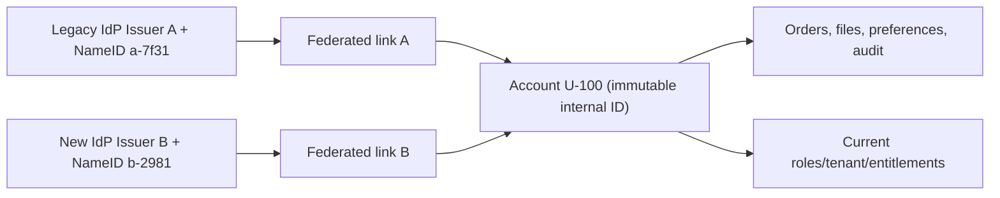
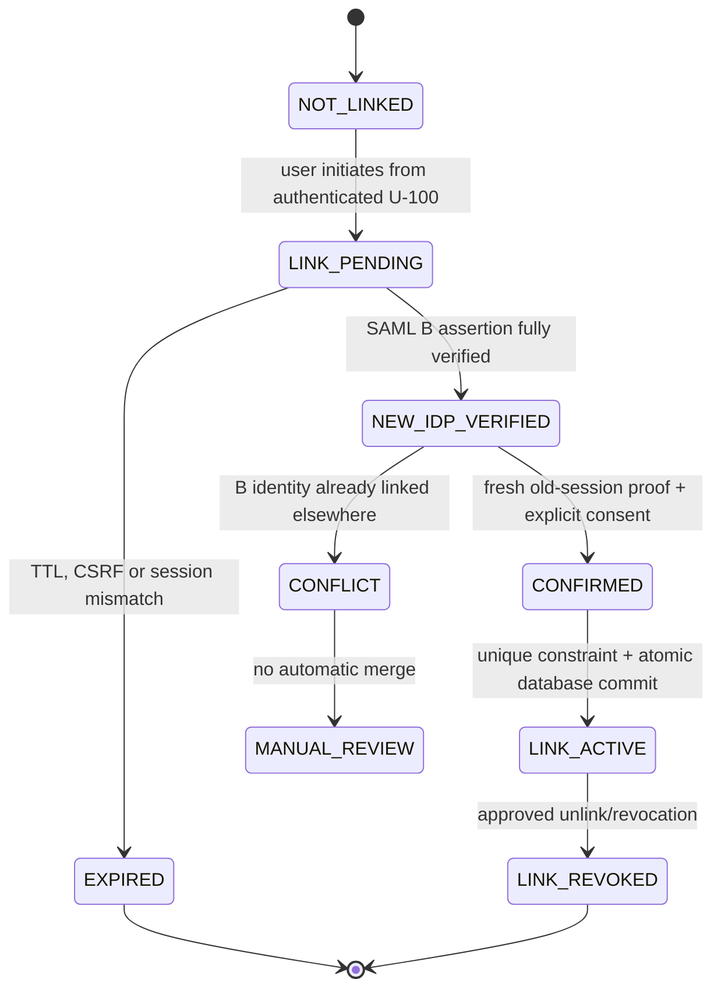

# Preserving Stable User Identity and Account Linking When Switching IdPs

**Module:** Spring Security – federation → Migration and Upgrade.

**Objective:** Execute an Identity Provider (IdP) migration in a Java/Spring Security application so **users continue signing into the exact same internal account**, preserving data, history, approved permissions, and security constraints. This guide identifies identity keys across SAML2/CAS/OIDC, models the **federated identity → stable application account** mapping, designs a secure account-linking workflow, performs controlled migration from old IdP to new IdP, handles changes to NameID/Issuer/SP EntityID, tests parallel transition, rollback, operations, and anti-account-takeover verification.

**Core principle:** **The application account has its own immutable ID** (e.g., `account_id=U-100`). Each IdP supplies a **federated identifier scoped to that source**; the application **never uses matching email, display name, raw `NameID`, or username to merge two identities automatically**. When a user switches IdPs, the system adds a **verified link** from the new identity to the **same `account_id`**, rather than creating a new account or migrating data by email string. If proof is insufficient, **pause linking and route to a verification workflow** rather than "temporarily matching" just to keep login smooth.

This article uses Java 17+, Spring Security SAML2 Servlet, `example.test` IdP/SP hostnames, and illustrative identifiers. Spring config fragments require a full project, a trusted IdP sandbox/metadata/certificate, and a real database. The standalone Java 17 program in the practice section runs with the JDK alone and **does not validate SAML XML/signatures**; it models the checks that must run after Spring Security has verified the assertion.

## 1. Why Can Switching IdPs Lose Accounts or Cause Account Takeover?

A system initially uses IdP A:

```text
IdP A (issuer=https://legacy-idp.example.test/metadata)
  -> SAML NameID="a-7f31"
  -> portal application
  -> account_id="U-100"
  -> documents/orders/roles/settings bound to U-100
```

When switching to IdP B:

```text
IdP B (issuer=https://new-idp.example.test/metadata)
  -> SAML NameID="b-2981"
  -> portal application
  -> ? which account ?
```

If current code uses `userRepository.findByEmail(samlEmail)` to decide the account, risks include:
- **Account takeover:** an account at IdP B may supply the same email or a recycled email, pointing erroneously to U-100.
- **Visible data loss:** the app creates a new U-900 instead of U-100, making the user think their history vanished.
- **Cross-tenant merge:** two organizations sharing the same local-part name/email get mixed together.
- **Email change/reassignment:** person A changes addresses, and the old mailbox is reassigned to person B.
- **Permission inconsistency:** group claims at the new IdP differ from the old groups, causing unexpected privilege loss or escalation outside policy.
- **Difficult rollback:** after auto-merging by email, it becomes impossible to tell who originally owned which records.
- **Session confusion:** old sessions from IdP A retain legacy roles while the new link enforces a different policy.

To prevent this, separate **human identity at the IdP** from **immutable account identity in the application**, and store evidence for every link.

## 2. Distinguishing Identifier Types

| Type | Example | Stable Across IdP Switch? | How to Use? |
| --- | --- | --- | --- |
| App `account_id` | `U-100` or UUID | **Yes** if designed properly | Primary key for domain data |
| SAML `Issuer` | `https://legacy-idp.example.test/metadata` | Usually changes per IdP | Mandatory namespace |
| SAML `NameID` | `a-7f31` | **Not guaranteed** across a new IdP | Subject within specific issuer and scope |
| SAML `NameID Format` | `persistent`, `transient`, `emailAddress` | Can change | Contract defining subject semantics |
| SAML `NameQualifier` | IdP identifier | May differ by issuer | Additional scope when present |
| SAML `SPNameQualifier` | SP EntityID | May change per SP | Crucial for pairwise identifiers |
| SAML `AttributeStatement` | `employeeNumber`, `mail`, `groups` | Never assumed | Attribute data requiring trust/data governance |
| OIDC `iss` + `sub` | `issuer.example#sub-839` | Usually changes when switching OPs | OIDC identity key scoped by issuer |
| CAS principal ID | `person-47` | Deployment-dependent | Namespaced by CAS server/realm |
| Email | `user@example.test` | **Not guaranteed** | Contact/profile, not default identity key |
| Username/UPN | `user@tenant.example.test` | Can be renamed/reassigned | Display/login hint, not assumed unique |
| HR/SCIM anchor | Internal employee/person GUID | Only if lifecycle/uniqueness are governed | Can serve as audited account-resolution evidence |
| IdP signing certificate | K1/K2 | Changes on rollover | Assertion trust, **not a user ID** |
| Spring `registrationId` | `legacy`, `modern` | Locally renameable | Selects `RelyingPartyRegistration`, not itself the issuer |

**Key distinction:** a `persistent` SAML NameID is normally stable **within a specific IdP–SP relationship**; there is no guarantee two different IdPs issue the same value. Even **the same IdP** can emit a different persistent pairwise NameID if SP EntityID, federation broker, NameID policy, or `SPNameQualifier` changes. `transient` is **unsuitable as a durable user key**.

### 2.1. A Federated Identifier Is Not a Bare Username String

NIST SP 800-63C defines a standard federated identifier as: **federated identifier = issuer identifier + subject identifier**. The issuer is mandatory because independent IdPs can emit **the exact same subject string for different people**. In SAML2, beyond the issuer, consider **NameID Format and qualifiers/SP scope** per the real contract; in multi-protocol systems, add protocol/registration trust domain.

Example:

```text
(issuer=IdP-A, subject=12345) -> account U-100
(issuer=IdP-B, subject=12345) -> account U-200

The two "12345" strings look identical, yet are NOT the same federated identity.
```

**Never normalize away namespaces:** never drop the issuer, never compare NameIDs case-insensitively arbitrarily, never strip leading zeros, and never trim identifiers unless the issuer has an explicit canonicalization policy. `NameID` is an identifier with issuer-defined semantics, not an email to lowercase out of habit.

### 2.2. SAML NameID and Qualifiers

A real signed assertion might contain:

```xml
<saml:Subject xmlns:saml="urn:oasis:names:tc:SAML:2.0:assertion">
  <saml:NameID
    Format="urn:oasis:names:tc:SAML:2.0:nameid-format:persistent"
    NameQualifier="https://legacy-idp.example.test/metadata"
    SPNameQualifier="https://portal.example.test/saml/sp-v1">a-7f31</saml:NameID>
</saml:Subject>
```

This is only a **NameID illustration fragment**, not a signed assertion for login. Correctness must be evaluated inside a **verified Response/Assertion** context: issuer, trusted signing certificate, audience, destination, recipient, conditions, subject confirmation, and `InResponseTo`.

- `Format=persistent` indicates persistent identifier semantics within the profile; **not globally unique by default**.
- `NameQualifier` may state the identifier's namespace/issuer; handle properly even when omitted per SAML spec and IdP contract.
- `SPNameQualifier` can bind a pairwise subject to the SP. If SP EntityID changes, the emitted NameID may change.
- `Format=transient` is unstable across login sessions; never map it as a durable account key.
- `Format=emailAddress` represents an email-shaped identifier; **does not guarantee mailbox ownership or immutability**.
- `Format=unspecified` requires an explicit profile agreement; never infer a stable subject from the format name.
- With an IdP broker, `Issuer` may be the broker rather than the upstream IdP; verify **who is issuing the assertion** and whether **upstream identity mapping** is preserved.

**Privacy note:** SAML persistent identifiers carry privacy considerations; avoid broadcasting them in uncontrolled logs and never share a pairwise identifier with another RP unless permitted by contract.

## 3. Sustainable Design Principle: One Account, Many Federated Links



When migrating:
1. Keep `account_id` immutable.
2. **Do not UPDATE all foreign keys in orders/comments/tables** to switch from A to B; business data references `account_id`, not IdP NameID.
3. Add `FederatedIdentityLink(B, b-2981 → U-100)` **only after proof**.
4. During the parallel phase, link A and link B coexist (if policy permits).
5. When retiring IdP A, disable/revoke **link A** after the canary/rollback window.
6. Never delete U-100 because IdP A disappears; business account lifecycle is separate.
7. Roles/tenant access are determined by application policy, not auto-copied from old IdP claims to new claims.

### 3.1. Invariants to Maintain

- One identity key within an issuer/trust namespace maps to **at most one active internal account** at a time.
- One internal account **may have multiple identity keys** once validly linked.
- Same `NameID` under a different issuer does not mean the same user.
- A revoked link **must never allow login**, even if assertions are otherwise valid.
- A disabled/terminated account cannot be "resurrected" by logging in through the new IdP.
- Linking operations require an authenticated existing account session plus freshly verified proof; never treat email as sufficient proof.
- Account linking and system access require audit trails/approvals; never let users arbitrarily pick target accounts.
- Changing signing certs/metadata for **the same IdP issuer and subject** is normally a trust rollover, **not a trigger to create a new account**.
- `registrationId` is Spring config; production mappings should key on trusted issuer/SP namespace, with a dedicated migration if local registration IDs are renamed.

## 4. Recommended Data Model

Illustrative relational schema; this is a **design template** to adapt to your real RDBMS, tenant rules, privacy protections, and concurrency:

```sql
CREATE TABLE app_account (
    account_id UUID PRIMARY KEY,
    tenant_id UUID NOT NULL,
    state VARCHAR(24) NOT NULL,
    created_at TIMESTAMPTZ NOT NULL,
    CONSTRAINT ck_account_state
        CHECK (state IN ('ACTIVE', 'DISABLED', 'TERMINATED'))
);

CREATE TABLE federated_identity_link (
    link_id UUID PRIMARY KEY,
    account_id UUID NOT NULL REFERENCES app_account(account_id),
    tenant_id UUID NOT NULL,
    protocol VARCHAR(16) NOT NULL,
    issuer_id TEXT NOT NULL,
    nameid_format TEXT NOT NULL,
    name_qualifier TEXT NOT NULL DEFAULT '',
    sp_name_qualifier TEXT NOT NULL DEFAULT '',
    subject_lookup_key VARCHAR(128) NOT NULL,
    registration_ref VARCHAR(128) NOT NULL,
    state VARCHAR(24) NOT NULL,
    evidence_ref UUID NOT NULL,
    created_at TIMESTAMPTZ NOT NULL,
    revoked_at TIMESTAMPTZ,
    version BIGINT NOT NULL DEFAULT 0,
    CONSTRAINT ck_link_state
        CHECK (state IN ('ACTIVE', 'REVOKED', 'PENDING'))
);

CREATE UNIQUE INDEX uq_federated_identity_key
ON federated_identity_link (
    tenant_id, protocol, issuer_id, nameid_format,
    name_qualifier, sp_name_qualifier, subject_lookup_key
);

CREATE INDEX ix_federated_link_account
ON federated_identity_link (account_id, state);

CREATE TABLE identity_link_evidence (
    evidence_id UUID PRIMARY KEY,
    account_id UUID NOT NULL REFERENCES app_account(account_id),
    method VARCHAR(40) NOT NULL,
    approval_state VARCHAR(32) NOT NULL,
    verified_at TIMESTAMPTZ NOT NULL,
    expires_at TIMESTAMPTZ,
    operator_ref VARCHAR(128),
    audit_reference VARCHAR(128) NOT NULL
);
```

**Explanation and mandatory implementation notes:**
- `account_id` is IdP-independent and serves as the primary key for business data.
- `issuer_id` is the canonical trusted issuer; never set it from an arbitrary display name or user-supplied `registrationId`.
- `protocol` distinguishes SAML2, OIDC, and CAS (which have different identity-scoping rules).
- `nameid_format`/`name_qualifier`/`sp_name_qualifier` are normalized in a controlled way; SQL uses empty strings for absent values **only when the contract defines this precisely**. Avoid `NULL` leaking duplicates in unique indexes because several SQL engines allow multiple `NULL`s in `UNIQUE`.
- `subject_lookup_key` can be an HMAC of the raw subject using a key managed in a secret manager (with key versioning for rotation), or an encrypted deterministic lookup compliant with policy. Never use bare SHA-256 on human-readable employee IDs/emails and pretend they are anonymized.
- `registration_ref` is for operations and auditing; canonical account identity namespacing must rely on issuer and SP scope.
- `tenant_id` must match the account; add a **composite foreign key or trigger/transaction constraint** to prevent a Tenant A link row from pointing to a Tenant B account.
- Keeping `state=REVOKED` inside the unique index means **an identity key is not silently reused**; this security choice preserves history. If policy permits relinking, require a dedicated procedure rather than deleting rows and letting users re-register.
- `evidence_ref` points to the verified linking decision; store full provenance without raw tokens.
- The unique index guards against races and duplicates; the business service must also use **transactions and conditional state transitions**.
- Strictly restrict delete/modify permissions on links; audit every change and ensure controlled rollback.

### 4.1. Update Only Links, Never Rewrite History

Example:

```text
app_account:
    U-100, tenant=T1, state=ACTIVE

federated_identity_link:
    OLD: (SAML2, issuer-A, persistent, subj-A7) -> U-100
    NEW: (SAML2, issuer-B, persistent, subj-B2) -> U-100

business_order:
    order-1.owner_account_id = U-100
business_file:
    file-9.owner_account_id = U-100
audit_record:
    action.actor_account_id = U-100
```

After migration, `business_order`, `business_file`, and `audit_record` **do not change primary/foreign keys**. New audit entries may record the issuer/link ID to identify the login path, but user history tied to `account_id` is never "shifted" to someone else.

### 4.2. Should Matching Emails Automatically Create Identity Links?

**Not by default.** An email can:
- change aliases;
- be recycled when an employee leaves;
- be signed by an IdP under an attribute without verified mailbox ownership;
- collide across multi-tenant setups via shared domain aliases/UPNs;
- vary in casing or Unicode normalization;
- become unstable during organizational mergers or email migrations;
- be shared across group accounts / shared mailboxes.

If an organization uses email as **an attribute for account resolution**, there must be a trust agreement verifying uniqueness, authoritative lifecycle, verified ownership, a no-reassignment policy, and explicit conflict checks—`mail.equalsIgnoreCase` is never enough. NIST 800-63C requires attributes used for resolution to **uniquely identify** the subscriber prior to linking.

## 5. Valid Evidence for Account Linking

NIST SP 800-63C permits one RP account to bind multiple federated identifiers, but linking functions must require an **authenticated session of the RP account**; authenticate through an already-linked identity before adding a new one.

### 5.1. Option A – User Proves Control of Both the Old Account and the New IdP

Scenario where the user can still access the legacy IdP:

1. Browser visits account settings using an authenticated **U-100** session established via the known IdP A link.
2. Application requires **fresh reauthentication/step-up** per risk policy to mitigate session hijacking.
3. User clicks "Link New IdP"; the app creates a random, short-TTL `link_transaction_id` server-side bound to the session, U-100, and target issuer.
4. Redirect to the exact registered **IdP B registration**, never allowing a user-supplied issuer URL.
5. IdP B authenticates and posts a signed SAMLResponse to the right ACS; Spring verifies signature/issuer/audience/Recipient/InResponseTo/conditions/subject.
6. App extracts the **verified new federated identifier** from the trusted SAML mapping and binds it to the browser's initiated transaction.
7. Display verified summary details and right tenant; request explicit user confirmation—never rely on email.
8. Inside **one database transaction**, verify U-100 is ACTIVE, link B is not bound to another account, link A is still valid, freshness/CSRF/one-time challenge pass; insert link B→U-100.
9. Record audit log and notify the account owner through a registered channel without sending raw tokens/NameIDs; apply a cooldown if risk policy requires.
10. Verify login via IdP B in a **fresh browser context**, returning U-100 with right permissions without creating another account.
11. Only disable link A after canary and the rollback window finish.

**Never treat a login callback from IdP B alone as enough to link**: it proves the user controls a B identity, **not** that the B identity belongs to U-100. You need an authenticated U-100 session plus a transaction started in account settings, or an administrative process with equivalent evidence.

### 5.2. Option B – Enterprise Bulk Migration via Authoritative Identity Mapping

If users no longer have access to IdP A at cutover:
- Inventory a **lifecycle-governed person/account anchor** (e.g., internal HR person ID / SCIM `externalId`), never relying solely on email.
- Prove the HR/SCIM source is authoritative for the exact tenant/workforce, stable, non-reassigned, and sufficiently distinct.
- Collect `old IdP subject ↔ person anchor ↔ new IdP subject` over an **authenticated, authorized migration channel**, never via unprotected emailed CSVs.
- Generate **proposed links**, detecting collisions, many-to-one/many-to-many cases, missing IDs, stale accounts, and service accounts.
- Apply least privilege and **two-person approval** for privileged links or exceptions.
- For uniquely verified links, apply transactionally with version/unique constraints, auditing, and canarying.
- For ambiguous cases, **quarantine** for identity-admin investigation (never auto-create/merge).
- Post-migration, notify users and provide a way to report mis-links.
- If linking across distinct organizations, comply with data-sharing rules and federation agreements; "same email" across tenants is insufficient.

**Emphasis:** An HR anchor is valid evidence only with a uniqueness/no-reassignment policy, provenance, and lifecycle governance. `employeeNumber` or `externalId` may not be stable in every enterprise; verify empirically.

### 5.3. Option C – Account Recovery When Neither Factor Is Available

When the user no longer has IdP A, lacks a clear HR mapping, and has only an email:
- Do not auto-link.
- Use an approved recovery workflow: identity proofing, helpdesk with two-party review, verified historical evidence, and social-engineering-resistant out-of-band verification.
- For privileged accounts, require additional approvals, revoke stale sessions, and apply post-link monitoring.
- Recovery decisions must record reason, evidence, operator, expiry, and rollback path.
- Never treat "enter email and click magic link" as sufficient proof in all cases; mailboxes can be reassigned or compromised.
- If identity cannot be proven, a separate new account may be created **without importing U-100's data**.

## 6. State Machine Model for Linking



**Do not add an `EMAIL_MATCHED → LINK_ACTIVE` state**. An email match may create a `REVIEW_CANDIDATE`, never an authentication proof.

### 6.1. Security Controls on a Link Transaction

| Control | Purpose |
| --- | --- |
| Authenticated U-100 session | Prevents anonymous browsers from picking an account ID |
| Fresh auth / step-up | Mitigates stolen sessions attaching an attacker identity |
| Browser/session-bound transaction ID | Prevents login CSRF and account-linking CSRF |
| CSRF protection on link start/confirm | Prevents third-party sites from binding an IdP |
| Exact IdP registration/issuer | Prevents an IdP B response from being accepted under IdP A |
| Verified SAMLResponse | Signature, Issuer, Audience, Recipient, Conditions, `InResponseTo` |
| One-time challenge, TTL | Prevents replaying old callbacks |
| Explicit confirmation | Prevents accidental or hijacked linking |
| Existing key uniqueness | Prevents one B subject from pointing to two accounts |
| Active account/tenant checks | Prevents cross-tenant links and disabled-account resurrection |
| Transaction isolation, row versioning | Prevents races between two concurrent linking requests |
| Audit + user notification | Detects and rolls back wrong links |
| Recovery/unlink controls | Prevents locking out the last access method without a recovery path |

`RelayState` in SAML flows can serve as an opaque pointer to the transaction, yet is **never an authentication proof**. Avoid placing raw account IDs/emails in `RelayState` or using `RelayState` directly as a redirect URL.

## 7. Spring Security: Configuring Two IdPs in Parallel

In Servlet SAML2, one SP can configure two `RelyingPartyRegistration`s:

```text
/saml2/authenticate/legacy
    -> old IdP metadata/SSO/signing trust

/saml2/authenticate/modern
    -> new IdP metadata/SSO/signing trust

/login/saml2/sso/legacy
/login/saml2/sso/modern
    -> callbacks, verified by matching registration/issuer
```

**Never select an IdP automatically solely from email domain or matching NameID.** The login picker selects an allowed registration; server-side policy enforces tenant and expected issuer. IdP metadata, entityID/ACS URL, and signing/decryption credentials must be registered at each IdP.

Java/Spring fragment (using Spring Security SAML2 Servlet with the appropriate BOM):

```java
package com.example.migration;

import org.springframework.context.annotation.Bean;
import org.springframework.context.annotation.Configuration;
import org.springframework.security.config.Customizer;
import org.springframework.security.config.annotation.web.builders.HttpSecurity;
import org.springframework.security.saml2.provider.service.registration
        .RelyingPartyRegistration;
import org.springframework.security.saml2.provider.service.registration
        .RelyingPartyRegistrationRepository;
import org.springframework.security.saml2.provider.service.registration
        .RelyingPartyRegistrations;
import org.springframework.security.saml2.provider.service.registration
        .InMemoryRelyingPartyRegistrationRepository;
import org.springframework.security.web.SecurityFilterChain;

@Configuration
public class DualIdpSecurityConfiguration {
    @Bean
    RelyingPartyRegistrationRepository relyingParties() {
        RelyingPartyRegistration legacy = RelyingPartyRegistrations
            .fromMetadataLocation("classpath:idp/legacy.xml")
            .registrationId("legacy")
            .entityId("https://portal.example.test/saml/sp-legacy")
            .assertionConsumerServiceLocation(
                "https://portal.example.test/login/saml2/sso/legacy")
            .build();

        RelyingPartyRegistration modern = RelyingPartyRegistrations
            .fromMetadataLocation("classpath:idp/modern.xml")
            .registrationId("modern")
            .entityId("https://portal.example.test/saml/sp-modern")
            .assertionConsumerServiceLocation(
                "https://portal.example.test/login/saml2/sso/modern")
            .build();

        return new InMemoryRelyingPartyRegistrationRepository(
            legacy, modern);
    }

    @Bean
    SecurityFilterChain securityFilterChain(HttpSecurity http)
            throws Exception {
        http
            .authorizeHttpRequests(auth -> auth
                .requestMatchers("/", "/error", "/signed-out").permitAll()
                .anyRequest().authenticated())
            .saml2Login(Customizer.withDefaults());
        return http.build();
    }
}
```

**Limitations:** the fragment above only runs in a full Spring Boot app with **real trusted IdP metadata** in the two local files, the `spring-security-saml2-service-provider` dependency, accurate HTTPS/ACS, signing keys, and protected login picker/routes. The IdP may require signed AuthnRequests and encrypted Assertions—configure SP credentials per contract. Hostnames/certificates in this article are not real accounts.

**Never load new metadata files from arbitrary URLs** as a trust source just like `classpath:`; the pipeline must check entityID/issuer, signing keys, metadata signature/TLS, `validUntil`, and key rollover. During IdP migration, keeping both registrations for a staged period aids rollback, yet allowed paths/tenants must be restricted.

### 7.1. Checking the Authentication's IdP After Verification

Spring Security 7 uses `OpenSaml5AuthenticationProvider` and introduces `Saml2AssertionAuthentication`; `getRelyingPartyRegistrationId()` identifies the verified registration. The familiar Spring Security 6 `Saml2AuthenticatedPrincipal` API is **marked deprecated in Spring Security 7.x**; Spring Security 7 favors `Saml2ResponseAssertionAccessor` from credentials to access assertion details. **Do not upgrade an app assuming every principal continues to implement `Saml2AuthenticatedPrincipal`.**

Service fragment receiving **the `Authentication` object after Spring Security verification**:

```java
package com.example.migration;

import org.springframework.security.core.Authentication;
import org.springframework.security.saml2.provider.service.authentication
        .Saml2AssertionAuthentication;

public final class TrustedSamlSubjectAdapter {
    private final TrustedRegistrationDirectory directory;

    public TrustedSamlSubjectAdapter(
            TrustedRegistrationDirectory directory) {
        this.directory = directory;
    }

    public VerifiedSubject fromAuthentication(Authentication auth) {
        if (!(auth instanceof Saml2AssertionAuthentication saml)
                || !saml.isAuthenticated()) {
            throw new IllegalStateException(
                "Expected verified SAML2 assertion authentication");
        }

        String registrationId =
                saml.getRelyingPartyRegistrationId();
        String trustedIssuer =
                directory.expectedIssuer(registrationId);

        // Use getName() only if principal-name policy guarantees
        // it is a stable subject within the exact SAML issuer/SP scope.
        String subject = saml.getName();
        if (subject == null || subject.isBlank()) {
            throw new IllegalStateException("Missing subject");
        }
        return new VerifiedSubject(trustedIssuer, subject);
    }

    public record VerifiedSubject(String issuer, String subject) {}

    public interface TrustedRegistrationDirectory {
        String expectedIssuer(String registrationId);
    }
}
```

**Limitations and safety points:**
- This fragment **uses Spring Security 7.x**; it does not run standalone and does not yet handle `NameID Format`/`NameQualifier`/`SPNameQualifier`. Where qualifiers matter, a real adapter must inspect the verified assertion via `Saml2ResponseAssertionAccessor` or an appropriate converter rather than inferring from `getName()` alone.
- `directory.expectedIssuer(registrationId)` is a **server-owned allowlist from `RelyingPartyRegistration`**, never an HTTP request parameter or unverified SAML attribute.
- `Authentication.getName()` may be NameID or a custom converter's principal name. **If legacy login used email as principal name, do not treat that email as a stable subject**. Verify the IdP contract and configure the converter.
- On Spring Security 6, `Saml2Authentication` and `Saml2AuthenticatedPrincipal` may be used; isolate the adapter per version and run shared identity-link unit tests.
- In practice, **account lookup / unlinked denial** must sit in the authentication pipeline or an authorization gate **before granting a session or resource access**, not merely inside a `/whoami` controller after the user already holds an authenticated session.
- Never invoke the adapter on `Saml2AuthenticationToken` (unverified input) or deserialize principals from JSON manually.
- Never read `auth.getCredentials()` to log raw `SAMLResponse`s; credentials/assertions contain sensitive data.

### 7.2. Placing Account Resolution at the Right Authentication Boundary

In Spring Security 7.x, docs describe `OpenSaml5AuthenticationProvider#setResponseAuthenticationConverter(...)` and `ResponseAuthenticationConverter` for customizing principal/authorities **after provider assertion processing**; use it to resolve the verified federated identity into an internal principal, or use a dedicated policy gate if architecture specifies. You must:
1. Keep the provider's **default SAML validators** (signature, issuer, audience, destination, time, subject, correlation, replay).
2. Extract trusted registration/issuer/subject via the exact converter API and the provider-processed signed assertion.
3. Look up the link record by full identity key (issuer/scope/subject) in the database.
4. Fail authentication if no link exists and JIT enrollment is disallowed; never fall back to email.
5. Check account ACTIVE, tenant, link ACTIVE, and effective access policies.
6. Construct `Authentication` containing the internal `accountId` principal and authorities **recomputed** per app policy.
7. Audit the outcome and persist the session per Spring Security.
8. Test that unauthenticated/invalid SAMLResponses cannot reach account-mapping code as verified identities.

**Do not** bury lookup inside a success handler while forgetting the framework already established `SecurityContext`; if using a success handler for a registration/linking flow, isolate the pending session and block protected resources until linking completes. Prefer enforcing directly in the provider/converter or a tested authorization gate.

## 8. Stable Identity Across IdP Changes Is Different from Metadata Signing Key Rotation

Distinguish:
- **Signing key rotation under the same issuer**: IdP typically keeps emitting the same NameID; update trusted verification credentials without changing the account identity key.
- **Metadata URL change while issuer/entityID stays identical**: usually does not change identity; verify source/trust/issuer.
- **IdP issuer change**: creates a new namespace even if subject strings match. Requires migration/linking.
- **NameID policy change under the same issuer**: NameID may shift from `emailAddress` to `persistent`; requires identity remapping even with identical cert/issuer.
- **SP EntityID/ACS registration change**: pairwise persistent NameIDs may change; requires mapping planning.
- **Adding a broker/federation hub**: SP may see the broker issuer with a stable broker subject; migration logic must preserve upstream binding at the broker and audit it.
- **Migrating from SAML2 to OIDC**: subject key is `iss + sub` (often pairwise per client); never equate OIDC `sub` with SAML NameID or email.
- **Migrating from CAS to SAML**: a CAS principal ID may match a SAML attribute, yet requires a verified cross-protocol account link.
- **Tenant change / organizational merger**: always verify data ownership, account status, and retention; never merge by matching name.

### 8.1. Decision Table

| Change | New Federated Link Needed? | Action |
| --- | --- | --- |
| K1→K2 signing key, same issuer/subject | Normally no | Roll over trust metadata with overlap |
| Metadata endpoint HTTP URL changes, issuer/subject unchanged | No if trust/contract unchanged | Revalidate trusted metadata |
| IdP A→B, different issuer | **Yes** | Reconcile and link explicitly |
| Persistent SAML NameID changes due to SP EntityID | **Yes** | Map old→new with evidence |
| User email changes | **No** | Update profile/contact; `account_id` unchanged |
| Per-login transient NameID | Cannot be used as persistent key | Require trusted stable subject attribute |
| New OIDC OP issuer, different `sub` | **Yes** | New `iss+sub` link |
| Broker changes upstream while broker `sub` remains stable | Possibly not at RP | Test broker continuity/assurance |
| Tenant merge | Needs review/approval | Never auto-merge |
| User disabled or employee departed | Do not create new link | Deny/revoke per lifecycle |

## 9. Phased Migration Rollout

### Phase 0 — Inventory and Freeze Assumptions

Record per app/tenant:
- IdP issuer/entityID, SSO endpoints, NameID Format/qualifiers, `SPNameQualifier`, SP EntityID.
- Attributes used to identify users: NameID, `employeeNumber`, object ID, SCIM `externalId`, email/UPN.
- Do any existing foreign keys mistakenly use email or IdP ID as primary key?
- User provisioning: JIT, SCIM sync, database import, manual accounts.
- Active users, disabled accounts, privileged/service accounts, guest users, orphaned accounts.
- Assurance/MFA levels and group/role mappings.
- Session lifetimes, Spring Session, SLO, and step-up policies.
- Do IdP A/B sign assertions with a valid trust chain?
- Where link evidence is stored, security auditing, and admin approval permissions.

**Output:** a **proposed** mapping table with provenance, uniqueness validation, and counts of missing/conflicting records. Never write ACTIVE links from an email-only import.

### Phase 1 — Normalize the Account Identity Layer

- Create an immutable `account_id` for every app user if one does not already exist.
- Migrate business foreign keys to `account_id` using transactional migrations/backups; keep a compatibility layer for legacy systems.
- Create the unique federated link index on issuer/scope/subject.
- Keep existing links from IdP A and verify account lookup returns accurately.
- Test session/role mapping and disabled-account enforcement.
- Keep raw NameIDs out of table names, log lines, and link parameters.

If account tables currently use email as PK, plan a dedicated DB migration with zero-downtime dual-write/read, backfill verification, and constraint switching. **Never simply run `UPDATE email` across tables** while ignoring auditing and data consistency.

### Phase 2 — Register IdP B Without Expanding Permissions Yet

- Fetch IdP B metadata over a trusted channel; verify issuer, signing certificate, bindings, ACS, and signing/decryption requirements.
- Add `modern` registration alongside `legacy`; test signed SAML Responses/`InResponseTo`.
- Lock NameID format/pairwise scope and confirm IdP B emits a stable subject; if IdP B emits only email/transient, negotiate a stable identifier.
- Set up attribute/tenant and role mappings; never copy IdP B groups straight to `ROLE_ADMIN`.
- Restrict access to pilot users and protect linking endpoints.
- Seed proposed links via verified HR mapping or dual-auth; do not auto-activate everyone.

### Phase 3 — Identity Match Dry Run and Conflict Resolution

```text
old issuer+subject       app account       new issuer+subject       result
A + subj-007            U-100             B + pair-900            UNIQUE_CANDIDATE
A + subj-008            U-101             B + pair-901            UNIQUE_CANDIDATE
A + subj-009            U-102             B + pair-901            CONFLICT
A + subj-010            U-103             (missing)               HOLD
A + subj-011            disabled U-104    B + pair-903            DENY
A + subj-012            tenant T1         B + pair-904 (T2)       TENANT_MISMATCH
```

- **`UNIQUE_CANDIDATE`** does not equal a VERIFIED link: authoritative evidence is still needed.
- **`CONFLICT`:** never pick "first match wins" or overwrite; identity admins must investigate.
- **`HOLD`:** retain IdP A or recover identity proof.
- **`DENY`:** disabled accounts must never be reactivated.
- **`TENANT_MISMATCH`:** reject and audit source data.
- Track counts, uniqueness, coverage, and rejected/hold rates by cohort; never expose subjects in metrics/logs.

### Phase 4 — Pilot and Dual-Run

- Pilot a small group spanning multiple account types: ordinary, privileged, service, guest, disabled, renamed email, shared mailbox, duplicate names.
- Pilot users link IdP B and verify **before/after `account_id`** stays identical.
- Sign in with IdP A, then log out and re-authenticate with IdP B in a separate browser profile; never let a stale app session mask issues.
- Verify data, tenant permissions, step-up, audit trails, and sessions.
- When signing in via B, never auto-create JIT account U-900 if no link exists.
- Measure login failures, link conflicts, account mismatches, and support tickets.
- Configure the SSO picker to direct enabled users to B while keeping A as a controlled fallback.
- Rehearse canary rollback: B unavailability must never relax A trust checks.

### Phase 5 — Controlled Cutover

- Freeze mapping edits and commit the final batch of approved links.
- Deploy config/metadata and enable B for expanding cohorts.
- Confirm B's SAML signing key trust, emitted subjects, issuer, and ACS are verified.
- Verify users resolve to U-100 via B with zero duplicate accounts.
- Recompute roles/tenant policies; never assign permissions from raw legacy group names.
- Evaluate session handling: allow A sessions to finish TTL or require B reauthentication? Decide via threat model.
- Under high risk or IdP A compromise, revoke old sessions and links rapidly in a controlled way.
- Monitor spikes in `UNKNOWN_FEDERATED_IDENTITY`/`CONFLICT`/`ACCOUNT_DISABLED`; never fall back to email matching to suppress errors.
- Maintain a support path for users missing proof rather than auto-merging.

### Phase 6 — Monitor, Revoke IdP A, and Close Migration

- Once coverage targets are met, disable new logins via IdP A; keep link records/audits per retention and rollback policies.
- Revocation should transition `ACTIVE→REVOKED`, not delete all records immediately.
- Verify local sessions, federated SLO, and downstream applications.
- Update onboarding, recovery, credential/metadata rotation, and operator runbooks.
- Archive `account_id` continuity evidence, link approvals, security test reports, and exception lists.
- After the retention/recovery window, revoke A keys/config per security policy; never keep IdP A trust open indefinitely.

## 10. Permissions and Accounts: Valid Authentication Does Not Guarantee Valid Authorization

Even when link B→U-100 resolves to the right account, IdP B might emit:
- `groups=["Finance", "Admin"]` with different semantics than A.
- Empty `department` or renamed attributes.
- Different `MFA`/`AuthnContextClassRef` than required.
- Tenant/organization attribute out of sync with HR.
- User active in identity B while internal account is disabled.
- SAML session assurance lower than step-up policy.

**Hence two steps are needed:**
1. **Authentication / account resolution:** verified SAML identity + ACTIVE federated link → internal U-100.
2. **Authorization:** U-100 holds explicit entitlements for the resource/action/tenant at request time per internal policy and trusted attributes. If data is missing, deny rather than granting by default.

### 10.1. Never Turn a Raw Group String into a High-Privilege Role

Example:

```text
Old IdP A: group="Admin" meant "Portal Admin in tenant T1"
New IdP B: group="Admin" meant "Directory Viewer in tenant T2"

WRONG: if (groups.contains("Admin")) grant ROLE_ADMIN

RIGHT: verified issuer + tenant + contractual attribute mapping
       + account entitlement/approval -> app granted authorities
```

Keep internal `account_id` and app entitlements decoupled from raw SAML attributes. For privileged roles: require reauthorization/manual approval, policy versioning, MFA/step-up, and active account status. Never copy `ROLE_SUPERADMIN` just to make a pilot "pass."

### 10.2. JIT Provisioning and SCIM Require Clear Authorization Rules

- If JIT creation is enabled for IdP B, **create a new account only when certain this identity is a genuinely new person** per policy; never when matching email with an unlinked U-100.
- If SCIM syncs users/groups, SCIM data is authoritative only per agreed source and lifecycle; never assume an IdP B SCIM `externalId` equals a legacy SAML NameID.
- Provisioning can race with login: DB unique constraints ensure an identity key belongs to one account only, while transactions handle conflicts.
- Disable/deprovision must propagate to app account/link state rather than passively waiting for the IdP to stop issuing assertions.
- Guest/B2B users from external tenants must pass through allowlisted issuer/tenant mappings.
- When a user changes departments, their identity link may remain stable while permissions change; test role recalculation so permissions never go stale.

## 11. Runnable Java 17 Demo: Linking Two IdPs to One Stable Account

This snippet uses no Spring and shows only the logic required **after authentication proofs have been verified and bound**. Compile and run with `javac`/`java` on Java 17.

**Invariants in the demo:**
- Account U-100 is already mapped to the old IdP.
- A new IdP with a different subject yet similar-looking email **does not auto-map**.
- Linking succeeds only with **fresh verified proof from the old IdP bound to U-100**, new IdP proof from the same server-side linking flow, and explicit user confirmation.
- Disabled accounts, non-allowlisted issuers, expired proofs, missing consent, and conflicts where the new identity is already mapped to U-200 are all rejected.
- After linking, both A and B resolve to U-100; rollback using identity A still works until revoked.
- Uses an internal `Proof` record assumed already verified; users/browsers **must never be allowed to send `verified=true`** in a real app.

File `IdpMigrationLinkDemo.java`:

```java
import java.time.Duration;
import java.time.Instant;
import java.util.HashMap;
import java.util.Map;
import java.util.Set;

public class IdpMigrationLinkDemo {
    static final String OLD = "https://legacy-idp.example.test/metadata";
    static final String NEW = "https://new-idp.example.test/metadata";

    record IdentityKey(String issuer, String subject) {}

    record Proof(
            IdentityKey key, String linkingFlow,
            Instant verifiedAt, boolean signatureVerified) {}

    static final class LinkStore {
        private final Set<String> trustedIssuers = Set.of(OLD, NEW);
        private final Map<IdentityKey, String> links = new HashMap<>();
        private final Map<String, Boolean> activeAccounts = new HashMap<>();

        void addAccount(String account, boolean active) {
            activeAccounts.put(account, active);
        }

        void seedApprovedLink(IdentityKey identity, String account) {
            if (!trustedIssuers.contains(identity.issuer())
                    || !activeAccounts.containsKey(account)
                    || links.putIfAbsent(identity, account) != null) {
                throw new IllegalArgumentException("Invalid initial link");
            }
        }

        String resolve(Proof proof) {
            if (proof == null || !proof.signatureVerified()
                    || !trustedIssuers.contains(proof.key().issuer())) {
                return null;
            }
            String account = links.get(proof.key());
            return account != null
                    && Boolean.TRUE.equals(activeAccounts.get(account))
                    ? account : null;
        }

        boolean link(
                String account, Proof oldProof, Proof newProof,
                Instant now, boolean explicitConfirmation) {
            if (!explicitConfirmation
                    || !Boolean.TRUE.equals(activeAccounts.get(account))
                    || !fresh(oldProof, now)
                    || !fresh(newProof, now)
                    || !OLD.equals(oldProof.key().issuer())
                    || !NEW.equals(newProof.key().issuer())
                    || !oldProof.linkingFlow()
                            .equals(newProof.linkingFlow())
                    || !account.equals(resolve(oldProof))) {
                return false;
            }

            String existing = links.get(newProof.key());
            if (existing != null) {
                return existing.equals(account);
            }
            links.put(newProof.key(), account);
            return true;
        }

        private boolean fresh(Proof proof, Instant now) {
            if (proof == null || !proof.signatureVerified()
                    || proof.key() == null
                    || proof.key().subject() == null
                    || proof.key().subject().isBlank()
                    || proof.linkingFlow() == null
                    || proof.linkingFlow().isBlank()
                    || proof.verifiedAt() == null) {
                return false;
            }
            Duration age = Duration.between(proof.verifiedAt(), now);
            return !age.isNegative() && age.compareTo(
                    Duration.ofMinutes(5)) <= 0;
        }

        void disableAccount(String account) {
            activeAccounts.put(account, false);
        }
    }

    public static void main(String[] args) {
        Instant now = Instant.parse("2026-11-07T03:00:00Z");

        LinkStore store = new LinkStore();
        store.addAccount("U-100", true);
        store.addAccount("U-200", true);

        IdentityKey oldKey = new IdentityKey(OLD, "old-subject-7");
        IdentityKey newKey = new IdentityKey(NEW, "pairwise-2981");
        IdentityKey conflictKey = new IdentityKey(NEW, "assigned-to-U-200");

        store.seedApprovedLink(oldKey, "U-100");
        store.seedApprovedLink(conflictKey, "U-200");

        Proof oldProof = new Proof(oldKey, "flow-1", now, true);
        Proof newProof = new Proof(newKey, "flow-1", now, true);

        System.out.println("Old IdP resolves U-100: "
                + "U-100".equals(store.resolve(oldProof)));

        System.out.println("Matching email does not auto-link: "
                + (store.resolve(newProof) == null));

        System.out.println("Dual-proof linking accepted: "
                + store.link("U-100", oldProof, newProof, now, true));

        System.out.println("New IdP resolves U-100: "
                + "U-100".equals(store.resolve(newProof)));

        System.out.println("Old identity kept for rollback: "
                + "U-100".equals(store.resolve(oldProof)));

        Proof conflicting = new Proof(
                conflictKey, "flow-1", now, true);
        System.out.println("Already-linked identity rejected: "
                + !store.link("U-100",
                        oldProof, conflicting, now, true));

        Proof wrongFlow = new Proof(
                new IdentityKey(NEW, "another-new-subject"),
                "different-flow", now, true);
        System.out.println("Wrong linking flow rejected: "
                + !store.link("U-100",
                        oldProof, wrongFlow, now, true));

        Proof stale = new Proof(
                new IdentityKey(NEW, "stale-subject"),
                "flow-1", now.minusSeconds(400), true);
        System.out.println("Stale proof rejected: "
                + !store.link("U-100",
                        oldProof, stale, now, true));

        Proof noConsent = new Proof(
                new IdentityKey(NEW, "unconfirmed-subject"),
                "flow-1", now, true);
        System.out.println("Consent required: "
                + !store.link("U-100",
                        oldProof, noConsent, now, false));

        Proof unknownIssuer = new Proof(
                new IdentityKey("https://evil.example.test/idp",
                        "attacker-subject"),
                "flow-1", now, true);
        System.out.println("Untrusted issuer rejected: "
                + !store.link("U-100",
                        oldProof, unknownIssuer, now, true));

        store.disableAccount("U-100");
        System.out.println("Disabled account cannot login: "
                + (store.resolve(newProof) == null));

        System.out.println("Disabled account cannot link: "
                + !store.link("U-100",
                        oldProof, noConsent, now, true));
    }
}
```

Run:

```bash
javac IdpMigrationLinkDemo.java
java IdpMigrationLinkDemo
```

**Exact stdout:**

```text
Old IdP resolves U-100: true
Matching email does not auto-link: true
Dual-proof linking accepted: true
New IdP resolves U-100: true
Old identity kept for rollback: true
Already-linked identity rejected: true
Wrong linking flow rejected: true
Stale proof rejected: true
Consent required: true
Untrusted issuer rejected: true
Disabled account cannot login: true
Disabled account cannot link: true
```

**Explanation:**
- `IdentityKey(issuer, subject)` is a simplified model; SAML production must also account for NameID Format/qualifiers/SP namespace.
- `Proof` in the demo is constructed directly by `main`, **not submitted by a browser**. Production creates evidence **only after Spring Security SAML signature + trust + subject validations** and server-side linking-flow confirmation.
- `resolve` checks account active status; role/tenant checks are omitted so the illustration stays focused on identity linking.
- `link` keeps link A after adding B for rollback; production must apply a cutover/revocation schedule.
- `HashMap` and check-then-put are **not thread-safe** and do not guard against concurrent link races. Production requires DB transactions, unique indexes, optimistic/row locking, and key-ownership constraints.
- Freshness checks only 5 minutes and a flow string for the demo; production requires random nonces, session binding, CSRF, single-use consumption, an issuer registration allowlist, and assurance/MFA policies.
- `signatureVerified` is a model assumption; reading such a boolean from an HTTP request would be dangerous.
- Does not generate or validate SAML XML; omits OpenSAML, decryption, `InResponseTo`, SubjectConfirmation, `ReplayCache`, signed metadata, and real login/logout.
- Email is absent from lookup to emphasize that **contact attributes are not identity keys**.
- Fixed timestamps exist solely for deterministic stdout, not as real SAML assertions.

## 12. Concurrency, Duplicate Links, and Data Rollback

### 12.1. Two Browsers Linking the Same New IdP Identity Concurrently

Risk:

```text
Request A: SELECT identity B-new -> not found
Request B: SELECT identity B-new -> not found
Request A: INSERT B-new -> U-100
Request B: INSERT B-new -> U-200
```

Without `UNIQUE`, the same external identity could map to two accounts → ambiguity/takeover. Protections:
- DB unique key on issuer/scope/subject even when a link is revoked (per clear policy).
- Execute inside a transaction checking target account ACTIVE, tenant, evidence, and current link version.
- Use `INSERT ... ON CONFLICT DO NOTHING` (or equivalent) and verify owner; if owner differs → **`CONFLICT`**.
- Never use "last write wins" or silently reassign `account_id` on conflict.
- Return safe errors without letting the caller infer another owner's email or account ID.
- Audit link attempts and rate-limit to deter spam/fraud.
- Key idempotency on the authenticated linking transaction; never use `SAMLResponse` ID as a credential.

### 12.2. True Rollback

If switching to IdP B fails:
1. Pause new link creation / disable B authentication path per runbook.
2. Retain or re-enable IdP A **if its trust and validity window remain intact**; never blindly trust an expired or compromised IdP.
3. Keep internal `account_id`/domain data stable; never roll back business data by NameID.
4. For validly approved B links, you may keep them ACTIVE while temporarily disabling registration B; if B is compromised, revoke B links and sessions per policy.
5. For faulty links, move them to `QUARANTINE`, freeze high-risk actions, and perform controlled unlinking/repair backed by evidence.
6. Address sessions issued by B: log out locally or revoke per risk. Disabling IdP B's endpoint alone **does not immediately end active B app sessions**.
7. Reconcile logs and user notifications; cross-account incidents require incident response and data-exposure assessment.
8. Once B recovers, re-run canary/unique-mapping tests before reopening cohorts.

**Do not delete link A on day one of cutover** if rollback depends on A; yet never keep A forever once A loses trust. The rollback window is a security decision, not "keep indefinitely for convenience."

### 12.3. Controlled Unlinking

- Allow only the account owner in a fresh authenticated session or authorized admins to execute.
- Never allow a user to remove their **last federated link** without an approved recovery route.
- Upon unlinking identity B, all subsequent logins via B must fail mapping.
- Assess active sessions: you may need to invalidate sessions created via link B to prevent lingering access.
- Audit who, when, proof/approval, and rollback reason without logging raw tokens.
- Relinking B to a different account requires a reviewed ownership-transfer workflow; never allow free reuse if the other account is disabled.
- NIST 800-63C requires that once a federated identifier link is removed from an RP account, that ID can no longer access the account.

## 13. Common Failure Modes and How to Detect Them

| Symptom | Likely Cause | Investigation / Fix |
| --- | --- | --- |
| Account looks blank after switching IdP | App created a new JIT account | Check issuer+subject link and creation policy |
| Old account taken over | Auto-matched email/UPN | Freeze linking, revoke sessions, audit, verify owners |
| Same subject yet two users | Subject collision across issuers | Mandatory issuer namespacing |
| NameID changed after changing SP EntityID | Per-SP pairwise persistent ID differs | Migration mapping scoped by SP |
| User changed email and cannot log in | Email used as user primary key | Internal account ID and stable subject |
| User logs in via B and gets U-200 | Wrong link B→U-200 | Link evidence review, quarantine |
| Tenant T2 user accesses T1 data | Tenant not enforced | Composite constraints + authorization |
| Disabled user can still log in | JIT re-creates / ignores account state | Deny linked inactive accounts |
| Admin role appears after migration | Group name semantics changed | Per-issuer claims mapping and entitlement approval |
| SAML Response validated, app returns 403 | Separate authorization | Check tenant/role; never bypass |
| SAML Response rejected | Wrong issuer/audience/ACS/signature | IdP registration/metadata/certs |
| IdP B emits transient subject each time | Wrong format | Configure persistent/stable attribute contract |
| Two SP registrations mix identities | Keyed only by `registrationId` or subject | Full issuer+scope key |
| OIDC `sub` equals SAML NameID for different accounts | Different protocol/issuer contexts | Explicit cross-protocol links |
| Two users share an email | Ambiguous account resolution | Never auto-merge; manual review |
| Link race creates duplicates | Missing DB unique / transaction | Unique identity key, atomic link |
| User cannot prove IdP A | Missing dual-auth proof | Authoritative HR mapping / recovery |
| Link A removed yet rollback fails | Cutover lacked fallback plan | Rollback window / secure recovery |
| Old sessions stay active after revoke | Sessions not invalidated | Session registry / revocation policy |
| SLO cannot reach old IdP | Federation logout unavailable | Do not claim global logout |
| Browser tab 2 links wrong account | Lost state/session binding | One-time server-side transaction |
| Email-verified claim used as owner proof | Overly strong assumption | Trust agreement and no-reassignment proof |
| Signing key rollover changes identity | Account keyed by certificate fingerprint | Signing cert is not a user identity |
| Auditor cannot trace why link exists | Missing evidence record | Immutable audit/approval |
| Metrics expose NameID | Raw subject used as label | Use low-cardinality labels/pseudonyms |
| Username at IdP B matches old user | "Same name equals same person" | Deny unmatched identity |
| Bulk CSV mapped out of order | Joined by row index, not unique anchor | Deterministic dry-run keyed join |
| Pilot passes only with `@WithMockUser` | Real SAML2 not tested | Signed sandbox IdP end-to-end |
| Spring upgrade drops principal attributes | API 6→7 changes | Update adapter and version tests |
| Link B succeeds, profile gets overwritten | Code replaces app account with IdP user | Keep internal `account_id`; sync profile separately |
| Broker changes pairwise subject | Upstream/broker mapping changed | Test continuity before cutover |

## 14. Mandatory Pre-Production Test Suite

| ID | Scenario | Expected |
| --- | --- | --- |
| MIG-01 | Old link A logs in | Returns exact internal U-100 |
| MIG-02 | Verified link B logs in | Returns **same U-100**, creates no account |
| MIG-03 | Same email from B without link | **No auto-link** |
| MIG-04 | Same subject string across issuers A/B | Never treated as same user |
| MIG-05 | Per-login SAML transient NameID | Never used as durable identity |
| MIG-06 | Persistent SAML with new `NameQualifier`/`SPNameQualifier` | Mapped in exact namespace, user not lost |
| MIG-07 | SP EntityID changes, pairwise ID changes | Pre-approved migration link or controlled hold |
| MIG-08 | Signing cert K1→K2, subject preserved | No duplicate account created |
| MIG-09 | IdP metadata URL changes, issuer preserved | Account identity unchanged |
| MIG-10 | IdP B different issuer yet same subject as A | No auto-link |
| MIG-11 | OIDC `iss+sub` string-matches SAML NameID | No auto cross-protocol merge |
| MIG-12 | CAS principal matches email | No auto-map |
| MIG-13 | IdP B claims recycled email | No takeover of U-100 |
| MIG-14 | User changes email in IdP B | Remains U-100 via stable link |
| MIG-15 | Valid non-expired A link proof and valid B proof | Linking allowed after consent |
| MIG-16 | Only B proof, no U-100 session | No link |
| MIG-17 | Old session hijacked/stale | Reauth/step-up required |
| MIG-18 | Linking CSRF from another browser | Reject |
| MIG-19 | Forged `RelayState` or link-flow mismatch | Reject |
| MIG-20 | SAML Response missing signature | Reject |
| MIG-21 | Valid signature yet wrong audience/recipient | Reject |
| MIG-22 | `InResponseTo` differs from pending request | Reject |
| MIG-23 | Replayed Response/Assertion | Reject |
| MIG-24 | B subject already linked to U-200 | `CONFLICT`, no overwrite |
| MIG-25 | Two concurrent linking requests | Single unique ownership |
| MIG-26 | U-100 disabled | Cannot log in or link via A or B |
| MIG-27 | Tenant T2 subject tries linking to Tenant T1 U-100 | Reject |
| MIG-28 | Group `Admin` from issuer untrusted for this role | Never auto-grants `ROLE_ADMIN` |
| MIG-29 | User B authenticated yet lacks entitlement | Resource returns 403 |
| MIG-30 | Verified unique SCIM/HR mapping | Links per approved evidence |
| MIG-31 | Duplicate/missing HR anchor | HOLD / manual review |
| MIG-32 | Shared mailbox matching email | HOLD, no auto-merge |
| MIG-33 | IdP B lacks stable subject support | Migration blocked / profile fix |
| MIG-34 | Link B revoked | Login via B loses U-100 access |
| MIG-35 | Link A still within rollback window | A still maps U-100 if trust valid |
| MIG-36 | Link A revoked | Login via A fails mapping |
| MIG-37 | Existing B sessions after revoke | Session revocation policy enforced |
| MIG-38 | Spring Session across multiple pods | Same account/tenant on pod A and B |
| MIG-39 | Parallel multi-tab linking | Link flows never cross-contaminate |
| MIG-40 | Mis-ordered custom `AuthenticationSuccessHandler` | Unlinked user cannot enter protected app |
| MIG-41 | Concurrent JIT provisioning | Unique identity key and account lifecycle hold |
| MIG-42 | Account linking audit missing | QA FAIL per audit policy |
| MIG-43 | Post-link/unlink notification | Sent to right user, no raw NameID leaked |
| MIG-44 | Link rollback on privileged user | Two-person approval / revalidation |
| MIG-45 | Erroneously created duplicate account U-900 | No auto data merge; separate remediation |
| MIG-46 | Bad metadata cert in pilot | Reject SAML, no trust-all |
| MIG-47 | Different NameID casing / leading zeros | No invalid normalization against contract |
| MIG-48 | Unknown IdP issuer presenting old subject | Reject untrusted issuer |
| MIG-49 | SLO while IdP A is down | Do not assume global logout completed |
| MIG-50 | Low-cardinality migration metrics | No raw identity/email labels |
| MIG-51 | Raw `SAMLResponse` in logs | QA FAIL / privacy issue |
| MIG-52 | Fresh browser context B after linking | Logs into U-100 via real signed SAML flow |
| MIG-53 | Unlinked browser context | Never inherits another session |
| MIG-54 | App domain records post-migration | Foreign keys/`account_id` intact |
| MIG-55 | Rollback B→A | Data continuity and access policies hold |
| MIG-56 | Phased rollout cohort disabled | Only selected users/tenants migrate |
| MIG-57 | IdP B outage during dual-run | Fallback to A only if still trusted/approved |
| MIG-58 | Spring 7 `Saml2AssertionAuthentication` | Adapter reads right registration/name |
| MIG-59 | Spring 6 `Saml2AuthenticatedPrincipal` | Compatibility test, do not hardcode 7 contract |
| MIG-60 | Per-SP subject changes after relaunch | Issuer+SP scope mapping stays accurate |

**Definition of Done:**
- Both IdP A and B verified with real signed `SAMLResponse`s from sandbox; never bypass OpenSAML.
- At least one pilot cohort proves `account_id` and business data continuity.
- Cross-issuer, email collision, replay, disabled, cross-tenant, and concurrent-link tests **all fail closed**.
- Link evidence, access roles, session policies, and rollback are verified.
- Zero unresolved/high-risk collisions remain before official cutover.
- Unlinked accounts are handled via guided remediation; never enable a global email fallback.
- Monitoring tracks by issuer/cohort/tenant without exposing PII/subjects in labels.
- New link rows become ACTIVE only with verified linking evidence.

## 15. E2E Runbook for Testing Migration on an IdP Sandbox

1. **Preparation:** register SP at IdP A and B, pin metadata/signing keys, two valid `registrationId`s; test users A/B have authoritative mappings.
2. **Baseline data:** create U-100 with orders/settings/roles; save `account_id` and approved link A.
3. **Sign in via IdP A:** browser context 1 logs in via A; Spring verifies SAML and returns internal U-100.
4. **Open account-link page:** require current U-100 session + fresh reauthentication and CSRF token; create server-side TTL link transaction.
5. **Sign in via IdP B to prove new key:** browser flow bound to transaction, signed Response from B, verified issuer/subject/NameID scope; do not grant business rights yet merely because B succeeded.
6. **Confirm and commit:** consent recorded, unique constraint passes, link B→U-100 ACTIVE, audit event carries provenance.
7. **Clear app cookies, fresh browser context:** log in via B and confirm `account_id=U-100` with data/orders/roles intact per policy.
8. **Negative collisions:** test same email on another user; same subject on another issuer; new identity already linked to another account; wrong tenant; expired link challenge.
9. **Replay/mismatch:** tamper with `RelayState`, `InResponseTo`, or replay an old SAML Response—must reject and create no link.
10. **Privileged roles:** admin users must go through dedicated role policy, never auto-generating admin from a similar group name in B.
11. **IdP A fallback:** when B is temporarily down, A still logs into U-100 if within trust/rollback window.
12. **Disable old link:** once cutover is approved, revoke link A; subsequent A logins are rejected and existing sessions handled per policy.
13. **Rollback drill:** disable B registration and restore A under approved conditions, confirming U-100/data stay intact; never re-enable A if compromised.
14. **Finalize:** archive sanitized audit evidence, notify users, and review exceptions/collisions and migration closure criteria.

**Never treat `@WithMockUser("same-email")` as an E2E test:** it bypasses SAML signature/issuer/NameID scoping and the linking flow. Use browser/IdP or signed fixtures verified by the real Spring Security provider.

## 16. Monitoring, Support, and Incident Response

### 16.1. Accurate, Low-Cardinality Metrics

- `federation_login_total{registration,result}`.
- `identity_link_attempts_total{source_idp,target_idp,result}`, using allowlisted registration names only.
- `identity_link_conflicts_total{tenant_tier,category}`; never use raw tenant ID if tenant count is high.
- `migration_unlinked_logins_total{registration,cohort}`.
- `migration_account_id_continuity_checks_total{result}`.
- `identity_link_review_queue_size{category}`.
- `federation_role_mapping_denials_total{registration,reason}`.
- `identity_link_revocations_total{reason}`.

**Never use raw NameID, email, `sub`, `account_id`, or `interaction_id` as metric labels.** Those values pose high-cardinality and privacy risks. Logs need pseudonym/HMAC correlation refs with appropriate retention/RBAC.

### 16.2. Structured Events

```json
{
  "event": "identity.link.created",
  "timestamp": "2026-11-07T03:00:00Z",
  "result": "SUCCESS",
  "source_registration": "legacy",
  "target_registration": "modern",
  "account_ref": "acct-hmac-13d",
  "new_identity_ref": "identity-hmac-925",
  "evidence_method": "DUAL_VERIFIED_SSO",
  "approval_ref": "approval-773",
  "link_transaction_ref": "link-55c",
  "tenant_ref": "tenant-pseudonym",
  "raw_saml_response_logged": false
}
```

- Never log raw `SAMLResponse`s, JWTs, cookies, NameID/Email, HR employee details, or raw `RelayState`.
- On failed SAML responses, **never log the identity as a verified user**.
- Emit events: `LINK_PROPOSED`, `LINK_VERIFIED`, `LINK_CREATED`, `LINK_REJECTED`, `LINK_REVOKED`, `ACCOUNT_DISABLED`, `CONFLICT_DETECTED`, `MIGRATION_ROLLBACK`.
- Restrict audit read access with an incident review process and time bounds.
- On suspected mis-link or takeover, freeze sensitive actions, revoke sessions/links, investigate data access, and notify per organizational/legal obligations.

### 16.3. Runbook When a User Reports "Switching SSO Lost My Account"

1. Never ask users to send `SAMLResponse`s, cookies, or screenshots containing tokens in standard tickets.
2. Gather support reference, registrations A/B, app account pseudonym, and UTC time window.
3. Verify whether Spring SAML authentication **passed signature/issuer/audience**.
4. Check which link the verified issuer + subject key from B resolves to; never look up by email alone.
5. If B's key is unlinked: use dual-auth or approved HR resolution; never auto-merge.
6. If B's key maps to a different account: quarantine the link, preserve evidence, and trigger a security incident review.
7. If B's key maps to U-100 yet data appears empty: check tenant/authorization/`account_id` queries rather than editing links on a hunch.
8. If roles are missing: check group mapping, provisioning, and entitlements.
9. If the login callback succeeds yet the next request loses the session: check session/SameSite/`SecurityContext` instead of blaming identity mapping.
10. If the user is disabled: never create a new account to bypass it.
11. After remediation, run a fresh B login + data continuity test and audit the outcome.
12. Record lessons learned regarding namespacing, recovery, and mapping policies.

## 17. Release and Security Checklist

**Identity design**
- [ ] Internal `account_id` is IdP-independent and unchanged after migration.
- [ ] Federated identity key includes trusted issuer + subject and qualifiers/SP scope where applicable.
- [ ] Transient SAML NameIDs are never used as durable account keys.
- [ ] OIDC `iss+sub`/SCIM anchors/CAS principals are handled within their own namespace/protocol.
- [ ] Email and display name are attributes only; no auto-linking.
- [ ] Multi-tenant constraints and disabled/terminated account policies are explicit.

**Linking and proof**
- [ ] Linking requires an authenticated RP session and fresh auth/step-up.
- [ ] New IdP `SAMLResponse` is actually verified by the provider.
- [ ] One-time server-side linking intent, TTL, CSRF, session binding, and explicit user confirmation.
- [ ] Unique constraints/transactions prevent races and duplicate ownership.
- [ ] HR/SCIM mapping is authoritative, unique, and audited; manual review on ambiguity.
- [ ] Unlink/revoke/recovery workflows and no-last-link-without-recovery policy exist.
- [ ] Privileged account links require approvals, notifications, and cooldowns.

**Spring Security**
- [ ] A/B `RelyingPartyRegistration`s match Issuer/SP EntityID/ACS/trust.
- [ ] Account mapping runs **after protocol validation** yet **before business authorization**.
- [ ] Spring Security 6/7 principal/converter API differences are tested.
- [ ] `Saml2AssertionAuthentication`/`Saml2ResponseAssertionAccessor` and registration lookup match the BOM.
- [ ] Signature/Issuer/Audience/Recipient/InResponseTo/Conditions/Replay are never disabled.
- [ ] Session fixation, SameSite, SLO, and step-up policies remain intact across cutover.

**Rollout**
- [ ] Inventory, dry-run, and collision reports reviewed.
- [ ] Piloted across multiple cohorts and account types.
- [ ] Audit proves `account_id` stability and continued business data access by the right owner.
- [ ] Feature flags, canary, dual-run, and rollback window approved.
- [ ] IdP A disabled/revoked on schedule rather than keeping trust open indefinitely.
- [ ] Monitoring for missing links/duplicate accounts and incident response are clear.
- [ ] No PII/SAML tokens logged; low-cardinality metrics.

## 18. Self-Check Questions

**Q1. Why shouldn't you change the user's primary key in the database when switching IdPs?**  
Because all orders, files, and audits are tied to the stable application account. Changing the PK to match NameID breaks data links and complicates rollback. Keep `account_id` and add a new federated link.

**Q2. Two IdPs emit the same `NameID=12345`—is that the same person?**  
No. Subjects are scoped within an issuer namespace; NIST requires pairing issuer with subject because independent IdPs can collide on subject strings.

**Q3. Is a persistent NameID guaranteed to stay unchanged under a new IdP?**  
No. It is typically an identifier issued by **the current IdP** for an SP scope; changing IdP or SP entityID can change the persistent NameID.

**Q4. Is a matching email signed by IdP B enough to auto-link U-100?**  
No. B only asserts attributes within B's trust agreement, without proving B's identity owns account U-100. You need an authenticated U-100 session + verified B proof or an approved authoritative resolution.

**Q5. The user already logged into IdP B—why require confirming the link in account settings?**  
SAML B proves subject B authenticated at IdP B. Linking transfers access to an existing internal account, requiring proof of control over both the target account and identity B to prevent hijacking.

**Q6. Does rotating IdP A's signing cert require creating a new account link?**  
Usually no if the trusted issuer and subject semantics stay unchanged. Rotating certificates is a key rollover; account identity should never be keyed on cert fingerprints.

**Q7. Why enforce a DB unique constraint on issuer+subject+scope?**  
So a single external identity can never map to two internal accounts simultaneously, even under concurrent linking requests.

**Q8. When a user is disabled, can JIT create a new account via IdP B so they can log in?**  
No. Account lifecycle must be enforced; never let JIT bypass disabled status.

**Q9. What requires attention regarding principals in Spring Security 7?**  
`Saml2AuthenticatedPrincipal` is marked deprecated; `Saml2AssertionAuthentication` and `Saml2ResponseAssertionAccessor` are preferred for assertion details. Test version-specific adapters and do not assume `getName()` is a stable subject if the converter is customized.

**Q10. What is the risk of two tabs in the same browser linking A/B?**  
Link-flow state can be overwritten, binding response B to the wrong account. Use a one-time server-side challenge bound to session, target account, expected issuer, and TTL.

**Q11. If users no longer have access to IdP A, how do you migrate accounts?**  
Use an authoritative HR/SCIM mapping with uniqueness/provenance or an approved account recovery workflow. Never auto-link by matching email/username.

**Q12. Should link A be deleted right after the first user logs in through B?**  
Not by default. Keep link A during the rollback window if still trusted, then revoke per security policy; never keep it if IdP A is compromised.

## 19. Official Documentation

1. [NIST SP 800-63C – Federation and Assertions](https://pages.nist.gov/800-63-4/sp800-63c.html): federated identifiers combining issuer+subject, account linking, account resolution, unlinking, and attribute governance.
2. [NIST SP 800-63C – Common Federation Requirements](https://pages.nist.gov/800-63-4/sp800-63c/Federation/): issuer/subject identifier semantics and trust relationships.
3. [OASIS SAML 2.0 Core](https://docs.oasis-open.org/security/saml/v2.0/saml-core-2.0-os.pdf): NameID Formats `persistent`/`transient`/`emailAddress`, qualifiers, subject identifiers, and privacy.
4. [OASIS SAML 2.0 Profiles](https://docs.oasis-open.org/security/saml/v2.0/saml-profiles-2.0-os.pdf): Web Browser SSO, NameID/NameIDPolicy, and subject confirmation.
5. [OASIS SAML 2.0 Metadata](https://docs.oasis-open.org/security/saml/v2.0/saml-metadata-2.0-os.pdf): EntityID, signing keys, endpoints, and SP/IdP trust contracts.
6. [Spring Security – SAML2 Login Overview](https://docs.spring.io/spring-security/reference/servlet/saml2/login/overview.html): SAML filters, `RelyingPartyRegistrationRepository`, and assertions.
7. [Spring Security – Authenticating SAML Responses](https://docs.spring.io/spring-security/reference/servlet/saml2/login/authentication.html): `OpenSaml5AuthenticationProvider`, `ResponseAuthenticationConverter`, principal/authority mapping, and validators.
8. [Spring Security 7 – SAML2 Migration](https://docs.spring.io/spring-security/reference/7.1-SNAPSHOT/migration/servlet/saml2.html): `Saml2AssertionAuthentication`/`Saml2ResponseAssertionAccessor` and deprecation of `Saml2AuthenticatedPrincipal`.
9. [Spring Security – RelyingPartyRegistrations API](https://docs.spring.io/spring-security/reference/api/java/org/springframework/security/saml2/provider/service/registration/RelyingPartyRegistrations.html): metadata-based registration.
10. [OpenID Connect Core 1.0](https://openid.net/specs/openid-connect-core-1_0.html): `iss`/`sub` user identification per OpenID Provider and pairwise subjects.
11. [RFC 7643 – SCIM Core Schema](https://datatracker.ietf.org/doc/html/rfc7643): `id`, `externalId`, schema, and provisioning identifiers.
12. [OWASP Authentication Cheat Sheet](https://cheatsheetseries.owasp.org/cheatsheets/Authentication_Cheat_Sheet.html): secure authentication, reauthentication, and account lifecycle.
13. [OWASP Session Management Cheat Sheet](https://cheatsheetseries.owasp.org/cheatsheets/Session_Management_Cheat_Sheet.html): session fixation, expiry, logout, and secure cookies.
14. [OWASP SAML Security Cheat Sheet](https://cheatsheetseries.owasp.org/cheatsheets/SAML_Security_Cheat_Sheet.html): SAML assertion verification, issuer/audience/recipient, signature wrapping, and replay.
15. [OWASP Logging Cheat Sheet](https://cheatsheetseries.owasp.org/cheatsheets/Logging_Cheat_Sheet.html): identity-linking audits, interaction IDs, and PII protection.

**Conclusion:** Safe IdP migration is not "fixing login emails." Instead, the application must maintain an **immutable `account_id`**, keep **federated identity links carrying issuer+subject+SAML scope**, add new IdP links based on **verified and approved evidence**, use DB transactions/unique constraints to block duplicates/conflicts, verify roles/tenant/session policies, and roll out via dual-run/canary/rollback. **Never use matching email or a namespace-less raw NameID as proof to grant access to an existing account.**