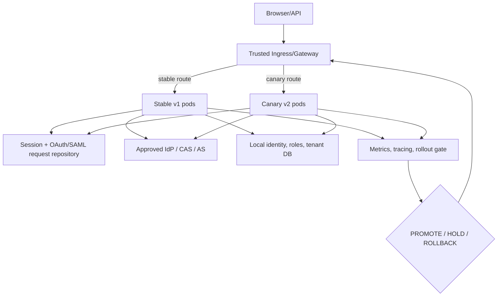
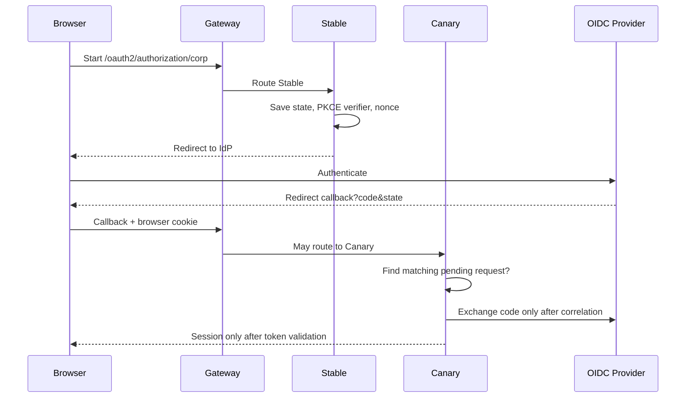

# Testing, Traffic Shifting, and Controlled Rollback Plans When Upgrading SSO/Federation

## 1. Context, Problem, and Objectives

A Spring Boot application using **Spring Security – federation** may upgrade Spring Security/OpenSAML, switch Identity Providers (IdP), migrate OAuth/OIDC client registrations, change SAML metadata/certificates, migrate CAS integrations, move local sessions to Spring Session Redis, or deploy new binaries on Kubernetes. These changes affect **identity and trust boundaries**; simply seeing an HTTP 200 web page after a release does not prove login is secure.

An SSO session may start on the **Stable** version yet receive its callback on the **Canary** version. If the two versions use incompatible `OAuth2AuthorizationRequestRepository`, `Saml2AuthenticationRequestRepository`, `HttpSession`, cookies, relay state, or serialization, the system can enter redirect loops, lose `state`/`InResponseTo`, throw wrong issuer/audience errors, assign roles to the wrong tenant, or execute incomplete logouts.

This lesson belongs to **Migration and Upgrade** and has three target outcomes:

1. A complete pre/post-migration **test plan**, covering unit, integration, end-to-end, security-negative, and rollback rehearsal tests.
2. A phased **traffic shift plan** with measurable gates, separating request weights from SSO login-flow cohorts.
3. A **controlled rollback plan** returning traffic to Stable, handling in-flight callbacks/sessions, and preserving mandatory trust/credential revocations rather than blindly restoring every old configuration.

Examples follow Java 17+, Spring Boot 3.x, Spring Security 6.x/6.5, Spring Session, and Kubernetes/Istio where needed. `example.test` names, service URLs, image tags, and numeric thresholds are learning examples only, not a live system or mandatory Spring SLOs.

### Non-Negotiable Invariants

- **If fresh authentication cannot be verified, never construct a new `Authentication`.**
- **Issuer, audience, XML Signature, token signature, Recipient, Destination, `state`, `nonce`, PKCE, `InResponseTo`, and replay checks are never disabled during canary or rollback.**
- **Every local role, tenant, active account status, and object-level ACL is enforced in both versions.**
- **A severe security incident must halt/reverse traffic even if overall login success looks healthy.**
- **Rolling back a binary does not authorize restoring a revoked key or unapproved issuer trust.**

## 2. Choosing the Right Type of Transition

| Change | State Potentially Impacted | When Is Rollback Feasible? |
| --- | --- | --- |
| Spring Security filter chain / API upgrade | `SecurityContext`, principal types, authorization matchers | While session/schema and authorization semantics remain compatible |
| OAuth2/OIDC IdP issuer A → B | `iss`/`sub`, JWK keys, client ID/secret, state, logout | While old IdP, local links, and trust policies remain valid |
| SAML SP Entity ID / ACS / metadata change | IdP registration, pending `AuthnRequest`, XML signatures/certs | While IdP still recognizes old SP and old cert is unrevoked |
| CAS client/server migration | ST validation, `ServiceProperties.service`, CAS Server | While service URL/trust and ST lifecycle align; never replay ST |
| JWT → opaque introspection | JWK trust, online AS dependency, revocation policy | While API/token semantics, audience, and client contracts align |
| Local sessions → shared Redis | Session cookies, serialized principals, state repositories, CSRF | When v1 can read v2 records or controlled re-login is accepted |
| Kubernetes binary v1 → v2 | Pod routing, callbacks, readiness, persistent state | When binary/config/DB formats remain compatible |
| Tenant/role mapping migration | `(issuer, sub)` local links, authority mapping | Without losing identity or causing cross-tenant escalation |

**Avoid bundling multiple high-risk changes into a single release whenever separable.** For instance, upgrade Spring Security with the IdP issuer kept constant first, then switch issuers; a callback error becomes far easier to isolate.

## 3. Trust Contract and Success Criteria Before Writing Tests

Build a versioned, owned **SSO Migration Contract**:

| Attribute | Stable | Canary | Rule |
| --- | --- | --- | --- |
| External hostname | `portal.example.test` | Same host or separately approved host | HTTPS; never trust client-supplied `Host`/`Forwarded` |
| OIDC issuer | Issuer A | A or B per migration scope | Exact `iss`, allowlist |
| OIDC client ID | Client v1 | Client v2 if changing IdP | Dedicated redirect URI/secret, no wildcards |
| OIDC callback | `/login/oauth2/code/corp` | Same or approved separate path | `state`/PKCE/nonce correlated |
| SAML SP Entity ID | SP v1 | Preserved or SP v2 | Audience and SP metadata aligned |
| SAML ACS/SLO | IdP-registered URLs | IdP-registered URLs | Destination/Recipient/SLO signatures |
| IdP verification key | Approved cert set | Approved cert set | Never trust test/unknown certs |
| CAS service URL | `https://portal.example.test/login/cas` | Same or new service registration | ST valid only for exact service and once |
| Local user link | Verified issuer+subject | Compatible mapping | Never join on bare email |
| Session format | v1 | v2 | Cross-version read/write or affinity |
| Local permissions | Existing roles/ACL | Equivalent or versioned policy | Never silently widen privileges |
| Rollback artifact | Stable digest | Canary digest | Immutable, signed/pinned |

**Security success** = zero unverified tokens/assertions accepted, zero role/tenant escalations. **Functional success** = users log in/out accurately, valid sessions persist, APIs return 200/403 per policy. **Reliability success** = flow completion and latency within error budget. All three must pass.

## 4. Routing Architecture and Where State Lives



A single login takes **at least two round-trips to the application**: starting the authorization request and receiving the callback from the IdP. Routing 5% per HTTP request does not guarantee the callback lands on the same version that created the pending request.

State to inventory: `HttpSession`/Spring Session Redis, OAuth2 `OAuth2AuthorizationRequestRepository`, PKCE verifier, OIDC `nonce`, SAML `Saml2AuthenticationRequestRepository`, `RelayState`, `InResponseTo`, CSRF token, cookie domain/`SameSite`/`Secure`, replay ledger, logout state, local `SecurityContext`, cached authorized clients, signing/decryption keys, and account links.

**Two primary approaches:** (A) shared state that is **compatible and bound to the right browser**; (B) trusted route affinity or separate registered callback endpoints. **Never** disable `state`/`InResponseTo` to work around unreadable sessions.

## 5. Pre-Release Discovery: Inventory and Baseline

Gather:

1. Spring Boot/Security/Session, Java version, OpenSAML/CAS client, BOM/transitive crypto dependencies.
2. List of `SecurityFilterChain`s with matchers/order, custom filters, principal converters, and method security.
3. OIDC discovery/issuer, client registration IDs, token/JWKS endpoints, redirect URIs, `state`/`nonce`/PKCE policies.
4. SAML IdP/SP entity IDs, metadata, ACS/SLO, HTTP bindings, sign/encrypt requirements, verification public certs and SP private credentials.
5. CAS `/login`/`/serviceValidate`, `ServiceProperties.service`, ST/PGT/PT use cases.
6. JWT `iss`/`aud`, allowed algorithms/JWKs; opaque token introspection and caching.
7. Session provider and serialization, cookie name/path/`SameSite`, Redis namespace, TTL, and failover.
8. Local database schema, identity links, active flags, group-to-authority mappings, tenant/ACL rules.
9. Gateway/ingress/mesh architecture, routing cookies, SSL termination, and forwarded-header trust.
10. IdP-side rate limits, allowed callbacks, metadata propagation delays, and certificate rotation windows.
11. Stable image digest, approved config/trust revision, backups, and verified rollback route.
12. Observability: flow completion, callback correlation errors, signature failures, logout, latency, and error budget.

**Baseline by protocol/registration/browser**; never mix login flows with health checks or static assets. Define "login completed" as establishing a validated `Authentication` and valid local session/token, not just an HTTP 302 callback.

## 6. Change Ticket and Go/No-Go Ownership

A change ticket must list: change ID, objective, old/new digests, dependency versions, approved trust contract, IdP owner, security approver, release owner, SRE/on-call, test lead, change window, rollback deadline, rollback manifest, data migration plan, security hard stops, metric thresholds, minimum sample size, dashboard links, and staging evidence.

| Role | Responsibility |
| --- | --- |
| Application owner | Code changes, compatibility, feature flags, service behavior |
| IdP admin | Client registration, issuer, SAML metadata, ACS/SLO, key/trust updates |
| Security | Signature/issuer/audience/replay tests; approval of trust and negative tests |
| QA/Test lead | Unit, integration, browser E2E, cross-version/rollback rehearsal |
| SRE/Platform | Traffic weights, readiness, monitoring, stable routes and route reversal |
| Data owner | Session/DB schema and identity-link compatibility |
| Incident commander | Emergency stop and status communication |

**Emergency security rollback should be pre-authorized**, without waiting for canary sample thresholds or a meeting. Route operators must know the exact reviewed Stable manifest and how to verify the route reversed.

## 7. Transition Phases and Stop Gates

| Phase | Activities | Exit Criteria |
| --- | --- | --- |
| P0 Discovery | Inventory, baseline, owners, rollback feasibility | Approved migration contract |
| P1 Build | Immutable artifact, dependency/security scan | Build/unit pass |
| P2 Contract | OIDC/SAML/CAS, provider/validator tests | Positive + negative pass |
| P3 Staging | Browser E2E, cross-version sessions, chaos | Rollback drill pass |
| P4 Prod preflight | Effective config, certs, session store, routes | Go decision |
| P5 Dark/synthetic | Healthy canary, isolated synthetic logins | Security contract pass |
| P6 Canary | Traffic 1→5→25→50%, gated at each step | Samples/SLO/security pass |
| P7 Cutover | 100% new traffic to v2, Stable kept warm | Approved |
| P8 Soak/drain | Monitor callbacks/sessions/logout/in-flight requests | Past rollback window |
| P9 Cleanup | Retire old registrations/keys per policy, release report | Sign-off |

**Never skip rollback rehearsal**; if v2 sessions cannot be read by v1, a binary rollback can turn into a mass logout. Document forced re-login UX if required.

## 8. OIDC Authorization Code Across Stable and Canary

Spring Security has the authorization endpoint `/oauth2/authorization/{registrationId}` and default callback `/login/oauth2/code/{registrationId}`. A flow runs:



**Issue:** v2 fails to read v1's `HttpSessionOAuth2AuthorizationRequestRepository`, or a cookie's path/domain changed → missing `state`. You need **browser-bound** shared session state, signed trusted route affinity, or separate v1/v2 callback URLs registered accurately at the IdP.

**Never** treat `code` as authentication proof. Code exchange requires the right token endpoint, client auth/PKCE, ID Token `iss`, `aud`, signature, `nonce`, timestamps, and local subject mapping. Callbacks lacking a pending request must fail closed.

### When Changing the IdP Issuer

If v1→v2 switches issuer A→B, users may receive new `sub` values; map via verified `(issuer, sub)` plus local enrollment/tenant checks. Never auto-link by matching email. When running dual issuers during migration, enforce an **approved allowlist + routing policy + distinct audience** with an end date, never allowing A/B tokens to cross services.

## 9. SAML2 `AuthnRequest` and ACS Callback Across Two Versions

Spring Security SAML2 emits `AuthnRequest` from `/saml2/authenticate/{registrationId}` and stores pending requests via `Saml2AuthenticationRequestRepository`; the default ACS listens at `/login/saml2/sso/{registrationId}`. Default SP Entity ID takes the form `{baseUrl}/saml2/service-provider-metadata/{registrationId}`, customizable.

A signed HTTP-POST Response must validate: XML signature via approved IdP verification certificate, `Issuer`, `Destination`, `Recipient`, `AudienceRestriction`, `NotBefore`/`NotOnOrAfter` times, `SubjectConfirmation`, `InResponseTo`, NameID, and local identity policy.

### Cutover Risks

- Stable sends `AuthnRequest`, Canary receives the Response without a pending request.
- IdP has not registered v2's ACS, or Response Audience still names the old SP Entity ID.
- Canary uses a verification cert/issuer from the wrong environment.
- v2 signs `AuthnRequest` with an SP key the IdP doesn't yet trust.
- Encrypted Assertion requires an old SP decryption key missing from Canary.
- SAML SLO callback lands on a version lacking logout request/session state.
- Reverse proxy generates an internal HTTP URL causing `Destination`/`Recipient` mismatch.
- Separate v1/v2 replay ledgers accept the same `Response.ID`/`Assertion.ID` again.

**Never drop signature, audience, recipient, `InResponseTo`, or replay validations.** If dual ACS/SP Entity IDs are needed, the IdP admin must approve matching registrations/metadata rather than just declaring arbitrary URLs in Spring Boot.

## 10. Two SAML Migration Strategies

**Strategy A: preserve the SP contract.** Both versions share the same Entity ID/ACS/IdP/certs while backend code changes. Fits Spring Security version upgrades when custom request/session repositories stay compatible. Advantage: minimal IdP-side edits. Risk: session/serialization and OpenSAML behavior may differ.

**Strategy B: register SP v1 and SP v2 separately.** Two approved metadata/ACS routes exist. The user cohort is chosen before emitting `AuthnRequest` so callbacks return to the matching version; easy to isolate trust, yet identity linking/NameID/issuer/certs may change and the IdP may limit registrations. Never assume identical NameIDs across two SPs.

In both strategies, test SLO, encrypted assertions, signing cert rotation, and reverse proxies thoroughly. **Never auto-accept unsolicited `SAMLResponse`s** just to work around lost callback state when the product supports only SP-initiated SSO.

## 11. SAML Request Repository and Session Fixation

`Saml2AuthenticationRequestRepository` holds `AbstractSaml2AuthenticationRequest` to verify `InResponseTo`. Spring Security includes a session-based repository; a custom distributed cache keyed by `RelayState` must enforce anti-replay, TTL, and browser/tenant binding. Looking up requests purely by attacker-supplied `RelayState` without browser context binding weakens login-fixation defenses.

Tests:

1. Stable emits `AuthnRequest`, Canary handles callback in same browser: succeeds if shared state is compatible.
2. Canary emits, Stable handles callback: succeeds or routes back to v2 per intentional affinity.
3. Browser X submits Browser Y's `RelayState`: reject.
4. Wrong `InResponseTo` or missing pending request: reject.
5. Replay of same signed Response/Assertion IDs: reject.
6. Wrong issuer/audience/recipient: reject.
7. Invalid XML Signature / untrusted cert: reject.
8. ACS receives encrypted assertion with unapproved key: reject.
9. SAML `LogoutRequest` with wrong signer: never logs out another user.
10. Redis/request store outage: fail closed when correlation is unavailable.

Tests using `@WithMockUser` or `authentication(Saml2Authentication)` **do not prove** any XML Signature validation; integration tests require real signed SAML fixtures and the OpenSAML provider.

## 12. CAS Service Ticket: Cannot Retry Across Route Switches

A CAS Service Ticket `ST-...` is issued for the exact `ServiceProperties.service` and is valid for **a single validation attempt** (including failed attempts per CAS 2.0). When Stable calls `/serviceValidate`, CAS may consume the ST; if the response drops, Canary **cannot reuse that ST to retry** and pretend it verified.

```text
CAS issues ST-ONE for https://portal.example.test/login/cas
Stable validates ST-ONE at CAS
CAS consumes ST-ONE, network reply lost
Canary retries ST-ONE => INVALID_TICKET
Correct: no new Authentication; start fresh CAS login transaction
```

Keep the exact public `ServiceProperties.service` URL or register a separate v2 service. A wrong service returns `INVALID_SERVICE` and consumes the ticket. In canary tests, verify success, expired, replayed, wrong-service, network-timeout, local role mapping, and session creation cases. Never treat CAS STs as reusable bearer tokens in traffic mirroring.

## 13. JWT, Opaque Introspection, and Multi-Issuer Migration

**JWT Resource Server** validates tokens offline using trusted JWK public keys along with `iss`, `aud`, `exp`, `nbf`, algorithm, and role/tenant policies. When changing issuers, never trust keys from issuer B for tokens claiming issuer A. Unknown `kid` and JWKS timeouts ⇒ reject. When using `JwtIssuerAuthenticationManagerResolver` for multi-issuer support, issuers must sit in an **approved allowlist**—never create decoders for arbitrary `iss` claims.

**Opaque token introspection** requires `active=true` from a trusted Authorization Server; timeouts/503s must never grant a principal. Any positive caching must have bounded TTL, revocation, and issuer binding; never reuse one token's cached introspection success to authorize another token.

**A dual-issuer window** is a security policy change, not just a library upgrade. Define which endpoints accept A/B tokens, time bounds, audience rules, account mapping, migration token TTL, logout/revocation, and the path to remove legacy trust. Never open all APIs to accept all issuers indefinitely.

## 14. Local Session Continuity and Bidirectional Serialization

Spring Session Redis shares `HttpSession` across pods, yet does not automatically guarantee Java class / serialized `SecurityContext` compatibility across Spring Security upgrades.

| Session Origin | Request Target | What Must Be Tested |
| --- | --- | --- |
| Stable v1 | Stable v1 | Baseline |
| Stable v1 | Canary v2 | Deserialize principal, roles, CSRF, pending OIDC/SAML requests |
| Canary v2 | Stable v1 | Can rollback read new sessions? |
| Canary v2 | Canary v2 | New version |
| Stable SSO started | Canary callback | Complete `state`/PKCE/nonce or `InResponseTo` |
| Canary SSO started | Stable callback | Compatible state or route affinity |
| Stable logout | Canary next request | Session invalidation observed |
| Canary logout | Stable next request | No authenticated session remains |

If incompatible, choose route affinity / callback segregation or **approved forced re-login**, never silently dropping sessions. Test cookie domain/path/`SameSite`/`Secure`, load balancer session affinity, Redis namespace/TTL, session-store outages, and session fixation prevention.

**Sticky routing never replaces signature/state validation**; pod crashes must still fail closed. Dev/test/prod Redis namespaces must be isolated.

## 15. Database and User Identity Mapping: Expand-Contract

If migration shifts identity links from email to `(issuer, sub)` or SAML NameID:

1. **Expand:** add new tables/columns/indexes while Stable can still read.
2. **Backfill:** link only identities with verified provenance; never guess same user from matching email.
3. **Dual-read** during an approved window; any dual-write must be idempotent/consistent.
4. **Canary:** verify disabled users, duplicate emails, stale roles, and cross-tenant ACLs.
5. **Rollback:** keep the schema readable by v1, or document forced re-login / data migration constraints.
6. **Contract:** drop legacy data/trust after the rollback window and sign-off.

Never run destructive schema migrations before proving v1 can read v2 data. If v2 changes role semantics, v1 must never default unknown authorities to `ROLE_ADMIN` or any broad role. Binary rollback does not undo DB writes, IdP group edits, or issued sessions.

## 16. Mandatory Testing Layers

| Layer | Objective | Evidence |
| --- | --- | --- |
| Static/build | Dependency API changes, CVEs, `SecurityFilterChain` order | Build/scan report |
| Unit | Principal conversion, issuer+subject linking, roles/ACL, gate logic | JUnit |
| Contract | OIDC token/JWKS responses, SAML metadata, CAS XML, timeouts | Stub/test IdP |
| Integration | Spring filters/providers/repositories, Redis session compatibility | Boot tests |
| Browser E2E | Authorization redirect→callback→session, sign-in/out | Test IdP/browser |
| Protocol security | Signed SAML, OIDC `iss`/`aud`/nonce/state, replay | Negative fixtures |
| Traffic | Callbacks from stable→canary and canary→stable or right affinity | Ingress test |
| Load/chaos | IdP latency, Redis downtime, canary pod restart | Controlled fault injection |
| Recovery | Traffic reversal, binary/config rollback, session/user impact | Drill evidence |

**Unit/mock principal tests do not replace protocol tests.** Real signed test `SAMLResponse`s are required to test XML validators; the OIDC test AS must sign ID Tokens; the CAS sandbox must enforce one-time STs.

## 17. Positive Test Cases: OIDC

- Anonymous request to protected route initiates `/oauth2/authorization/corp` accurately.
- `state` is cryptographically random and bound to the right pending transaction.
- PKCE challenge/verifier matches AS policy; OIDC `nonce` is bound.
- Callback `/login/oauth2/code/corp` locates the browser's matching auth request.
- Authorization code exchanges at the approved token endpoint with valid client auth.
- ID Token verified for signature, issuer, audience, nonce, and timestamps.
- Local user linked via verified `issuer+sub` with right roles/tenant.
- Login creates an authenticated session; protected resource returns 200 when authorized.
- Employee lacking admin role receives 403.
- OIDC logout/`end_session` behaves per registration, leaving zero zombie app sessions.
- State created by Stable is accepted by Canary when shared-session policy permits, and vice versa.
- When route affinity is designed, callbacks land on the originating version without trusting arbitrary client headers.

## 18. Positive Test Cases: SAML2, CAS, and JWT

**SAML2:**

- `AuthnRequest` reaches the right IdP, signed if IdP requires.
- `SAMLResponse`/Assertion carries approved signature and accurate Issuer/Destination/Recipient/Audience.
- Conditions/`SubjectConfirmationData`/time/`InResponseTo` are valid.
- NameID/attributes map to local user/tenant/permissions.
- SP Entity ID/ACS/SLO metadata match the IdP config for that stage.
- Encrypted assertion decrypts with the approved SP private key.
- SLO Request/Response signatures and correlation are valid.
- Cross-version callbacks succeed when compatible or properly affined.

**CAS:**

- Fresh unexpired ST for exact service → `authenticationSuccess`; ticket consumed.
- Stale/expired/replayed/wrong-service ST → failure.
- Local session post-CAS auth works; CAS outage fails closed when ST is unvalidated.

**JWT/Opaque API:**

- Valid JWT signature/`iss`/`aud`/time → request authorized per local ACL.
- JWT with unknown `kid`/wrong issuer/audience/expired → reject.
- Opaque introspection `active=true` from right AS → authorize; `active=false`/timeout → deny.

## 19. Security-Negative Test Matrix

| Test | Injection | Expected |
| --- | --- | --- |
| SEC01 | OIDC token with invalid signature | Reject |
| SEC02 | OIDC wrong issuer | Reject |
| SEC03 | OIDC wrong audience | Reject |
| SEC04 | OIDC wrong nonce | Reject |
| SEC05 | OAuth `state` from another browser | Reject |
| SEC06 | Wrong PKCE verifier or reused code | Reject |
| SEC07 | Test-issuer JWT sent to prod API | Reject |
| SEC08 | Expired JWT / unknown key / disallowed alg | Reject |
| SEC09 | Unsigned or signature-tampered SAML Response | Reject |
| SEC10 | Wrong SAML issuer/audience/recipient | Reject |
| SEC11 | Missing/mismatched SAML `InResponseTo` | Reject |
| SEC12 | Replayed SAML `Response.ID`/`Assertion.ID` | Reject |
| SEC13 | SAML `LogoutRequest` with invalid signature | Never logs out victim |
| SEC14 | Expired/reused CAS ST | Reject |
| SEC15 | CAS ST for service A validated at B | Reject + consumed per CAS |
| SEC16 | Opaque introspection `active=false`/timeout | Deny new authentication |
| SEC17 | Client sends forged `X-Verified-User` | Strip/deny |
| SEC18 | Same email across issuers | Never auto-link user |
| SEC19 | `admins` group from untrusted IdP | Never grant prod admin |
| SEC20 | Disabled user with still-valid signed token | Deny local access |
| SEC21 | Cross-tenant resource ID | 403 |
| SEC22 | Lost CSRF/session at Canary | Fail closed, never bypass |
| SEC23 | Key revoked before rollback | Never re-trust revoked key |
| SEC24 | Canary response bypasses default SAML validator | Hard stop |
| SEC25 | Invalid identity accepted even once | Emergency rollback |

A **failing** security test must block promotion even if login success rates look great. HTTP 302 alone is not success (it could redirect to an error page); assert an authenticated session and local authorization at the end of the flow.

## 20. Performance, Fault Injection, and Soak Testing

Track the flow stages:

```text
login_started -> redirect to IdP -> IdP authentication
  -> callback received -> token/SAML/CAS validation
  -> local principal and authority mapping
  -> authenticated session
  -> protected resource authorization
  -> login_terminal
```

Chaos scenarios:

- OIDC token endpoint HTTP 503/timeout, retry-budget exhaustion.
- Cold/warm JWKS cache, unknown `kid`, key rotation.
- SAML metadata refresh down while cached trusted cert stays valid.
- Redis session outage between `AuthnRequest` and callback.
- Canary pod dies right after creating OAuth `state` / SAML `AuthnRequest`.
- CAS validation response lost after ST is consumed.
- Proxy TLS termination causes wrong redirect/Recipient.
- IdP rate-limit 429 and login traffic bursts.
- CSRF token or session invalidation across versions.
- Parallel login tabs in the same browser; replay attempts.
- Local user directory latency causing timeouts; user disabled mid-session.
- Cross-version SLO/logout and long-lived connection draining.

Measure terminal success, p50/p95/p99, state mismatches, TLS/issuer/signature errors, session loads, Redis latency, IdP rate limits, and backend saturation. **Never mirror raw user tokens, authorization codes, `SAMLResponse`s, or CAS STs**; they may be single-use credentials and cause side effects.

## 21. Choosing a Traffic-Shifting Approach

| Approach | Strengths | SSO Risks |
| --- | --- | --- |
| RollingUpdate | Simple when changing binary only | Callbacks/sessions cross versions |
| Blue-green | Fast route switch | Flow starts in blue, finishes in green |
| Weighted canary | Limits blast radius and measures metrics | Request weight differs from login cohort |
| Session/cohort-based canary | Keeps user/login flows stable | Requires signed routing state and expiry |
| Separate OIDC/SAML callbacks | Clear v1/v2 flows | Complex IdP registrations/ACS/entityIds |
| Feature flag | Enables code paths per group | Must never disable security validators |
| Shadow/dark launch | Compares non-sensitive processing | Raw ST/code/artifact replay or credential leak |
| DNS cutover | Easy host switch | DNS caching and open connections slow rollback |

Before choosing, answer: **which version owns each SSO transaction, how are callbacks routed, and can the other version read the session?** Without answers, HTTP-request traffic shifting can break logins even when every pod is ready.

## 22. Canary Schedule and Gate Conditions

Illustrative example (not a production default):

| Step | Stable | Canary | Gate |
| --- | ---: | ---: | --- |
| Internal synthetic | 100% | 0% public | Signed E2E/negative pass |
| 1% | 99% | 1% | User cohort, minimum sample, zero security events |
| 5% | 95% | 5% | Login/state parity, latency SLO |
| 25% | 75% | 25% | Session/authorization parity, IdP capacity |
| 50% | 50% | 50% | SLO/logout, error budget, and rollback readiness |
| 100% new | 0% new | 100% new | Explicit Go approval |
| Soak/drain | Stable warm | New primary | Observe in-flight callbacks and sessions |
| Cleanup | Stable retired | New stable | Post-change sign-off |

A 5% weight is the **fraction of routed requests** in the service mesh, not automatically 5% of new login users. Measure by terminal login flows and cohorts, not `/actuator/health` requests. Users with sticky existing sessions may distribute differently from weights.

**Never increase traffic merely because 5 minutes passed** when sample size is too low. Conversely, a single forged assertion accepted across just 10 flows triggers an **emergency stop**. Thresholds must reflect real baselines and error budgets rather than mechanical copying.

## 23. Measuring Metrics Accurately Without Leaking Secrets

Suggested metrics:

```text
sso_login_started_total{version,protocol,registration}
sso_login_terminal_total{version,protocol,registration,result}
sso_login_duration_seconds{version,protocol,registration}
sso_state_mismatch_total{version,protocol}
sso_signature_invalid_total{version,protocol}
sso_token_endpoint_error_total{version,registration}
sso_session_compatibility_failure_total{source,target}
sso_logout_failure_total{version,protocol}
sso_route_selected_total{version,routeClass}
sso_trust_violation_accepted_total{version}
```

Define the denominator = **completed terminal flows** with success/failure outcomes, not just clicks on the login URL; track abandoned/outstanding flows separately with bounded TTLs. An HTTP 302 from a callback is not a terminal success. Never use raw `state`, SAML `RelayState`, NameID, OAuth codes, CAS tickets, cookies, Bearer tokens, private keys, or user emails as metric labels.

Compare Stable and Canary across matching browser/IdP/region/tenant mixes; never treat raw success across 2 users as sufficient. Correlation errors should distinguish attack-driven `state` mismatches from affinity-lost sessions, yet **neither may grant authentication**.

## 24. Illustrative Gate: Security Hard Stops and Reliability SLOs

| Signal | Illustrative Threshold | Decision |
| --- | --- | --- |
| Unverified token/assertion accepted | Strictly 0 | Emergency revert |
| Approved issuer/cert/secret guard failed | 0 | Stop before public exposure |
| Cross-version state compatibility known broken | 0 | Block or revert |
| Terminal completed login samples | ≥200 | If short: HOLD |
| Terminal login success | ≥99% | If below: reliability rollback |
| Correlation failures | ≤0.5% | If above: reliability rollback |
| Login processing p95 | ≤1800 ms | If above: reliability rollback |
| Unauthorized role/tenant escalation | 0 | Emergency revert |
| IdP timeout/503, Redis failures | Within agreed error budget | Hold/rollback |
| Missing dashboard or stable route | 0 missing | Do not promote |

**Thresholds 200, 99%, 0.5%, and 1800 ms exist solely for the code example.** In practice, use owned baselines/SLOs, confidence intervals, and appropriate hold times. For authentication bypass, no minimum sample is needed.

## 25. Standalone Java 17: Deciding PROMOTE, HOLD, or ROLLBACK

This **standalone Java SE** example models only a policy gate fed by reliably collected metrics. It **does not control Istio**, verify SAML/JWT, or replace change approvals. Save as `FederationCutoverGateDemo.java`:

```java
public final class FederationCutoverGateDemo {

    enum Decision {
        PROMOTE,
        HOLD_INSUFFICIENT_SAMPLE,
        HOLD_INVALID_METRICS,
        BLOCK_INCOMPATIBLE_STATE,
        ROLLBACK_SECURITY,
        ROLLBACK_RELIABILITY
    }

    record Limits(long minCompleted,
                  double minSuccessRate,
                  double maxCorrelationErrorRate,
                  long maxP95Millis) {
    }

    record Window(long completed,
                  long successful,
                  long correlationFailures,
                  long untrustedAccepted,
                  long p95Millis,
                  boolean approvedTrust,
                  boolean compatibleSession) {
    }

    static Decision evaluate(Limits limits, Window window) {
        if (!window.approvedTrust() || window.untrustedAccepted() > 0) {
            return Decision.ROLLBACK_SECURITY;
        }

        if (!window.compatibleSession()) {
            return Decision.BLOCK_INCOMPATIBLE_STATE;
        }

        if (window.completed() < 0
                || window.successful() < 0
                || window.successful() > window.completed()
                || window.correlationFailures() < 0
                || window.correlationFailures() > window.completed()
                || window.untrustedAccepted() < 0
                || window.p95Millis() < 0) {
            return Decision.HOLD_INVALID_METRICS;
        }

        if (window.completed() < limits.minCompleted()) {
            return Decision.HOLD_INSUFFICIENT_SAMPLE;
        }

        double success = (double) window.successful() / window.completed();
        double correlation = (double) window.correlationFailures()
                / window.completed();

        if (success < limits.minSuccessRate()
                || correlation > limits.maxCorrelationErrorRate()
                || window.p95Millis() > limits.maxP95Millis()) {
            return Decision.ROLLBACK_RELIABILITY;
        }

        return Decision.PROMOTE;
    }

    public static void main(String[] args) {
        Limits limits = new Limits(200, 0.99, 0.005, 1800);
        Window healthy = new Window(500, 498, 0, 0, 900, true, true);
        Window small = new Window(40, 40, 0, 0, 700, true, true);
        Window errors = new Window(500, 475, 11, 0, 900, true, true);
        Window slow = new Window(500, 499, 0, 0, 2100, true, true);
        Window untrusted = new Window(10, 10, 0, 1, 500, true, true);
        Window badTrust = new Window(500, 499, 0, 0, 800, false, true);
        Window incompatible = new Window(500, 499, 0, 0, 800, true, false);
        Window badData = new Window(500, 550, 0, 0, 800, true, true);
        Window correlation = new Window(500, 499, 4, 0, 800, true, true);

        System.out.println("healthy=" + evaluate(limits, healthy));
        System.out.println("small=" + evaluate(limits, small));
        System.out.println("errors=" + evaluate(limits, errors));
        System.out.println("slow=" + evaluate(limits, slow));
        System.out.println("untrustedAccepted=" + evaluate(limits, untrusted));
        System.out.println("unapprovedTrust=" + evaluate(limits, badTrust));
        System.out.println("incompatibleSession="
                + evaluate(limits, incompatible));
        System.out.println("invalidMetrics=" + evaluate(limits, badData));
        System.out.println("stateCorrelation=" + evaluate(limits, correlation));
    }
}
```

Run on Java 17+:

```bash
javac FederationCutoverGateDemo.java
java FederationCutoverGateDemo
```

**Exact** stdout:

```text
healthy=PROMOTE
small=HOLD_INSUFFICIENT_SAMPLE
errors=ROLLBACK_RELIABILITY
slow=ROLLBACK_RELIABILITY
untrustedAccepted=ROLLBACK_SECURITY
unapprovedTrust=ROLLBACK_SECURITY
incompatibleSession=BLOCK_INCOMPATIBLE_STATE
invalidMetrics=HOLD_INVALID_METRICS
stateCorrelation=ROLLBACK_RELIABILITY
```

Explanation: `untrustedAccepted` triggers immediate rollback even with only 10 samples; `small` holds due to insufficient samples; `stateCorrelation` 4/500 = 0.8% exceeds 0.5%; `healthy` achieves 498/500 = 99.6% success and 900 ms p95, passing the sample gate. `BLOCK_INCOMPATIBLE_STATE` forbids promotion; if Canary already receives public traffic, revert the route and handle in-flight sessions.

In practice, verify trusted metric sources, window durations, missing-data rates, IdP/user distributions, and change-owner approval before executing traffic actions.

## 26. Istio VirtualService: Shifting 5% of Request Traffic

Example with two Kubernetes Services `portal-stable` and `portal-canary` in namespace `portal-prod`, with a valid TLS host on the gateway:

```yaml
apiVersion: networking.istio.io/v1
kind: VirtualService
metadata:
  name: portal
  namespace: portal-prod
spec:
  hosts:
    - portal.example.test
  gateways:
    - portal-gateway
  http:
    - name: portal
      route:
        - destination:
            host: portal-stable.portal-prod.svc.cluster.local
            port:
              number: 8080
          weight: 95
        - destination:
            host: portal-canary.portal-prod.svc.cluster.local
            port:
              number: 8080
          weight: 5
```

This is an **illustrative manifest snippet**; real Service selectors/ports/Gateways/TLS, RBAC, and change approvals are required. Istio may use the Gateway API instead of `VirtualService` depending on the cluster. **Weighted routing only splits requests**; it does not guarantee session or SSO callback affinity.

For an emergency revert, the route can change to:

```yaml
route:
  - destination:
      host: portal-stable.portal-prod.svc.cluster.local
      port:
        number: 8080
    weight: 100
  - destination:
      host: portal-canary.portal-prod.svc.cluster.local
      port:
        number: 8080
    weight: 0
```

Apply commands must use **reviewed manifests from the real deployment repository**, never ad-hoc routes built from user inputs during an emergency. Switching routes does not immediately tear down existing HTTP connections or in-flight callbacks; manage draining and transaction TTLs.

## 27. Kubernetes RollingUpdate Is Not a Canary Cohort

A Kubernetes Deployment `RollingUpdate` replaces Pods gradually via `maxUnavailable`/`maxSurge`. It **does not control** 1/5/25% ratios per SSO user.

```yaml
apiVersion: apps/v1
kind: Deployment
metadata:
  name: portal-canary
  namespace: portal-prod
spec:
  replicas: 2
  strategy:
    type: RollingUpdate
    rollingUpdate:
      maxUnavailable: 0
      maxSurge: 1
  selector:
    matchLabels:
      app: portal
      track: canary
  template:
    metadata:
      labels:
        app: portal
        track: canary
    spec:
      containers:
        - name: portal
          image: registry.example.test/portal:v2-candidate
          ports:
            - containerPort: 8080
          readinessProbe:
            httpGet:
              path: /actuator/health/readiness
              port: 8080
            initialDelaySeconds: 5
            periodSeconds: 5
```

Production needs pinned immutable image digests, secrets, namespace isolation, resource limits, and probes. A green Pod readiness probe does not prove `state`, `nonce`, or `InResponseTo` work. Spring Session shared Redis can help, yet bidirectional v1↔v2 class serialization must be tested.

```bash
kubectl -n portal-prod rollout status deployment/portal-canary
kubectl -n portal-prod describe deployment portal-canary
kubectl -n portal-prod get pods -l track=canary
```

`kubectl rollout undo` only **rolls back the Deployment revision**. It does not adjust Istio/Gateway traffic weights. When using separate `stable` and `canary` Services, **reverse the route first, then roll back binary/config as needed**.

## 28. Blue-Green, Session Affinity, and Shadow Traffic

**Blue-green**: switches routes quickly between two clusters, yet pending SSO transactions may still call back into the other cluster. Require shared-state compatibility or version-aware callback routing. DNS cutovers have TTL/caching so reversal isn't instant; an L7 route switch can be more precise depending on architecture.

**Affinity**: pick the cohort before starting the authorization request; browser callbacks follow the same cohort via a routing cookie issued and verified by the trusted gateway—never trust client-sent `X-Canary: true`. If a v2 pod crashes, enforce fallback per policy or require a fresh login rather than dropping validation.

**Shadow/dark launch**: mirror only **synthetic or sanitized non-sensitive requests**. Never mirror real authorization codes, SAML Artifacts, CAS Service Tickets, or `SAMLResponse`s containing assertions/cookies: one-time semantics create replay, security, and privacy issues. Never let shadow data write real accounts, sessions, or roles.

**Feature flags**: toggle code paths by cohort only; never use a flag to "disable signature checks" to pass a gate.

## 29. Rollback Runbook: Reverse Traffic First, Assess State Second

During an incident:

1. **Decision:** halt promotion; record reason, version, metrics, and security impact. If security was bypassed, trigger emergency incident response.
2. **Freeze:** stop automated rollouts from increasing weights and halt metadata/cert edits.
3. **Reverse route:** shift 100% of newly eligible traffic back to Stable via approved ingress/Istio/Gateway config.
4. **Verify route:** confirm via per-version metrics rather than trusting command exit codes alone.
5. **Drain:** monitor in-flight callbacks/auth requests, user sessions, and long-lived connections.
6. **Decide binary rollback:** if needed, restore known Stable image/config revisions; check schema/session serialization.
7. **Trust check:** keep only approved issuers/keys; never restore revoked or compromised certs/secrets.
8. **User impact:** controlled forced re-login may be necessary if v2-created sessions are unreadable by v1.
9. **Validate:** run positive SSO and security-negative tests on the Stable route after reversal.
10. **Reconcile:** DB/user links/session invalidations may require separate rollback or forward-fix.
11. **Report:** timestamps, owners, affected cohorts, root cause, events, and remediation.

Example commands **for approved environments only**, assuming the route file already exists in the system's deployment repo:

```bash
kubectl -n portal-prod rollout status deployment/portal-canary
kubectl -n portal-prod apply -f deploy/portal/route-stable.yaml
kubectl -n portal-prod rollout undo deployment/portal-canary
kubectl -n portal-prod describe deployment portal-canary
```

`deploy/portal/route-stable.yaml` is an **illustrative** pipeline artifact path, not guaranteed to exist. Never run destructive session/Redis or DB rollback commands arbitrarily.

## 30. Things That Cannot Be Rolled Back with One Command

| Component | Limitation |
| --- | --- |
| Traffic weights | Controls new routing only; in-flight flows still exist |
| Deployment image | Does not automatically revert Spring config, IdP metadata, or DB |
| OIDC client registration | Old client/secret may already be deleted or revoked |
| SAML IdP signing cert | Compromised/revoked keys must never be re-trusted |
| SAML SP Entity ID / ACS | IdP may already have dropped the old registration |
| Session serialization | v1 may fail to read v2 sessions, forcing re-login |
| Database schema | Destructive migrations may be irreversible |
| User linking | New account mappings may require data reconciliation |
| Local roles/permissions | Security entitlements must not be undone unchecked |
| Opaque token revocation | AS may have revoked tokens—cannot "unrevoke" on rollback |
| Logout state | Rollback never revives an invalidated session |

**Rollback targets must pair with a "rollback feasibility boundary"**: up to which point reverting old code stays safe, and past which point only forward recovery works. If key rotation was part of an incident, never restore the old key even if doing so causes temporary login failures.

## 31. Rehearsal: Controlled Fault Drills in Staging

A credible rehearsal includes:

1. Deploy Canary with approved test IdP/cert/issuer; Stable and Canary share a compatible session store.
2. Execute successful synthetic OIDC/SAML/CAS logins on Stable.
3. Shift 5% to Canary; measure terminal outcomes, local roles, and tenant ACLs.
4. Create OIDC `state` on Stable and deliberately route the callback to Canary per test route; verify shared state or affinity.
5. Create SAML `AuthnRequest` on Canary and send the signed Response to Stable; verify `InResponseTo` or intentional routing.
6. Kill a Canary pod while awaiting callback; verify failover never drops validation.
7. Simulate Redis outage / serialization incompatibility; verify the gate blocks promotion.
8. Simulate unknown JWKS `kid` / IdP metadata outage; verify trust-snapshot behavior.
9. Retry an already-consumed CAS ST; verify rejection.
10. Send a signed `SAMLResponse` with wrong issuer/audience; verify rejection.
11. Canary login succeeds yet wrong tenant or disabled role; verify 403.
12. Execute traffic reversal and confirm Stable login/session behavior.
13. Test logout/SLO after rollback, confirming zero zombie sessions.
14. Report downtime/re-login rate, rollback execution duration, and failure categories.
15. Sign off on rehearsal results and update runbooks before production.

Use **synthetic users / test IdPs**; never take real production tokens or sessions for fault injection.

## 32. Emergency Rollback Triggers and Actions

| Trigger | Action |
| --- | --- |
| Untrusted assertion/JWT accepted | Emergency traffic revert + security incident |
| `state`/nonce/PKCE/`InResponseTo` bypassed | Emergency revert |
| Cross-tenant/role privilege escalation | Emergency revert + revoke affected sessions |
| Login session created from unvalidated credential | Emergency revert |
| Canary session serialization fails | HOLD / route revert; fix compatibility |
| Rising SAML callback wrong ACS / Entity ID | Hold/rollback; coordinate with IdP admin |
| Spike in 5xx / token endpoint errors | Hold/rollback per error budget |
| IdP rate-limiting due to retry storm | Freeze traffic; bounded retries |
| Missing telemetry or rollback route unavailable | Do not expand Canary |
| Unapproved key rotation | Block deployment; never trust unknown key |
| Destructive DB migration completed | Consider forward-fix, never blind downgrade |

A **signature/issuer/audience validation** failure is a security issue that can never be excused by high overall login success.

## 33. Case Study: Upgrading Spring Security While Keeping the IdP

Hypothetical example:

- Stable Spring Security 6.4, Canary 6.5.
- OIDC issuer/redirect/client and SAML Entity ID/ACS/certs **kept unchanged**.
- Changes to custom principal mapping and Spring Session serialization.
- 1% canary for opted-in test users; controlled shared Redis.

**Initial test phase:** v2-created sessions fail to deserialize on v1. Since rollback could drop sessions, **`BLOCK_INCOMPATIBLE_STATE`**; do not expose public traffic until fixed or until version-affinity / forced re-login UX is approved.

**After fix:** 500 completed logins, 498 successes, 0 correlation errors, 900 ms p95, negative tests pass → eligible to **`PROMOTE`** per the sample gate.

**After weight increase:** 500 completed, 475 successes, 11 state mismatches, 900 ms p95 → **`ROLLBACK_RELIABILITY`**; likely IdP/session affinity/serializer bug. Never "fix" it by disabling OIDC state verification.

**If a wrong-issuer SAML assertion is observed being accepted:** **`ROLLBACK_SECURITY`** immediately even with 999/1000 logins succeeding; triage incident and audit affected sessions.

## 34. Troubleshooting During the Cutover Window

| Symptom | Possible Cause | Check |
| --- | --- | --- |
| OAuth callback loop on Canary | Lost `state`/session | Auth request repository, cookies, routing |
| OIDC `invalid_grant` | Code reused/timed out, client/redirect mismatch | Token endpoint, PKCE, registration |
| OIDC wrong issuer | IdP B token hitting RP trusting A | Effective issuer and JWK config |
| SAML `InResponseTo` mismatch | Unshared pending request or different browser | SAML request repository |
| SAML `Invalid Recipient/Destination` | Wrong ACS / public HTTPS URL | SP metadata / proxy |
| SAML signature fails on v2 | Verification cert or OpenSAML behavior changed | Approved key fingerprints |
| Encrypted assertion decryption fails | Missing SP decryption key | Secret mounts / key rotation |
| CAS `INVALID_SERVICE` | Public `ServiceProperties.service` differs | IdP/CAS registration |
| CAS `INVALID_TICKET` on retry | ST consumed on first attempt | Fresh CAS login |
| 403 on Canary only | Role/tenant mapper changed | Local authorization tests |
| Redis `ClassNotFoundException` | Incompatible serialized session type | Cross-version deserialization |
| Session still valid after logout | Invalidation not shared | Session store / logout request |
| 5% route yet 20% callback errors | Per-request weighted routing, flow not sticky | Cohort routing stats |
| Traffic reverted yet errors persist | IdP trust/DB/config also changed | Approved config revision |
| `kubectl rollout undo` doesn't shift traffic | Istio route still points to Canary | `VirtualService`/Gateway |
| Readiness green yet logins fail | Probe doesn't test SSO contract | Synthetic auth flow and terminal metrics |

**Diagnose without logging secrets:** use anonymized correlation IDs, protocol/registration/version, error categories, and latency; never log `SAMLResponse`, JWTs, CAS STs, OAuth codes, cookies, or keys.

## 35. Post-Cutover: Soak, Cleanup, and Reporting

Do not delete Stable the moment 100% of new traffic reaches Canary. Wait through an approved window long enough for **in-flight authorization codes, pending `AuthnRequest`s, cookies, sessions, logout flows**, and monitoring cycles. When migrating account links/metadata, retire old mappings/certs only after IdP/security confirmation.

Post-change report requirements: revision/image digests, effective trust config identifiers (no secret values), weight timeline, baseline/canary metrics, completed flows, failures, security-negative test results, callback/session compatibility, key rotation status, rollback drill evidence, user impact, corrective actions, and owner sign-off.

Close the rollback window **only when rollback is no longer needed and legacy secrets/registrations are revoked per policy**. Never retain a compromised old key "just in case we need to roll back someday." When forced re-login is unavoidable, notify user support / incident response per product policy.

## 36. Acceptance Checklist

- [ ] Trust contract, old/new versions, image digests, config revisions, and approvals documented.
- [ ] OIDC `iss`/`aud`/`nonce`/`state`/PKCE/callback verified.
- [ ] SAML IdP/SP metadata, Entity ID/ACS/SLO, signatures, and `InResponseTo` verified.
- [ ] CAS service URL and ST one-time/expiry/wrong-service tests pass.
- [ ] JWT/opaque trust, key rotation, and introspection failures fail closed.
- [ ] Local issuer+subject account linking, disabled users, roles, and tenant ACLs tested.
- [ ] Stable↔Canary sessions/CSRF/auth-request repositories are compatible or route affinity is explicit.
- [ ] Zero raw tokens/codes/tickets/Responses in shadow traffic.
- [ ] Signed protocol E2E tests executed against test IdP, not just `@WithMockUser`.
- [ ] Security-negative tests for signature, issuer, audience, state, and replay pass.
- [ ] Redis/session store/cookie/`SameSite`/proxy/HTTPS compatibility passes.
- [ ] Metrics measure terminal login outcomes by version/IdP/browser cohort.
- [ ] Canaries enforce minimum samples, hold times, and approved thresholds.
- [ ] Security-critical events override minimum sample waits.
- [ ] Traffic controller/`VirtualService` Stable route manifest reviewed.
- [ ] Rollback drill covers traffic reversal, binary/config assessment, and sessions.
- [ ] Revoked signing keys, client secrets, and IAM policies are never rolled back.
- [ ] Expand-contract DB/schema migration and forward recovery evaluated.
- [ ] SRE, IdP admin, security approver, and on-call assigned.
- [ ] 100% cutover only after Go decision; Stable kept warm through soak window.
- [ ] Incident logs/metrics leak zero credentials or PII.
- [ ] Post-change report/sign-off and retirement plan completed.

## 37. Self-Check Questions and Official Sources

**1. Does a 5% HTTP request canary mean 5% of SSO users?** No. Routing may send multiple requests within one flow to different versions.

**2. OIDC `state` was created on v1, callback hits v2, and v2 lacks the request—how should it behave?** Fail closed or route back to v1 via approved affinity; never drop `state`.

**3. Can a signed SAML Response be accepted when `InResponseTo` mismatches?** Not in an SP-initiated flow per contract; reject it unless a separate reviewed unsolicited policy applies.

**4. If a CAS Service Ticket loses its response after validation, can it be retried to log in?** The ticket may already be consumed; start a fresh login flow for a new ST rather than fabricating Authentication.

**5. Does `kubectl rollout undo` change Istio weights?** No; it rolls back the Deployment revision; the route controller updates separately.

**6. Why shouldn't a revoked IdP signing certificate be rolled back?** Because trust revocation carries security weight independent of code version.

**7. Is shared Redis session always compatible?** No. Java object/principal serialization can differ across Spring Security versions; test bidirectionally.

**8. Is an HTTP 302 callback enough to prove login success?** No; it might redirect to an error page; require a terminal authenticated outcome.

**9. When is a security hard stop triggered?** Whenever an untrusted credential is accepted, privilege escalation occurs, or state/nonce/signature checks are bypassed; never wait for minimum samples.

**10. When does the rollback window end?** After soak/monitoring, handling in-flight callbacks/sessions, sign-off, and approved trust/secret cleanup.

### Official Sources

- [Spring Security – OAuth2 Login Advanced](https://docs.spring.io/spring-security/reference/servlet/oauth2/login/advanced.html): authorization request repository, callbacks, and token endpoints.
- [Spring Security – OAuth2 Login Core](https://docs.spring.io/spring-security/reference/servlet/oauth2/login/core.html): callback URI templates.
- [Spring Security – SAML2 Overview](https://docs.spring.io/spring-security/reference/servlet/saml2/login/overview.html): RP/IdP registrations, Entity ID, and ACS.
- [Spring Security – SAML Authentication Requests](https://docs.spring.io/spring-security/reference/servlet/saml2/login/authentication-requests.html): state repository, session, and `RelayState`.
- [Spring Security – SAML Authentication Responses](https://docs.spring.io/spring-security/reference/servlet/saml2/login/authentication.html): default validations.
- [Spring Security – SAML Metadata](https://docs.spring.io/spring-security/reference/servlet/saml2/metadata.html): SP metadata and IdP coordination.
- [Spring Security – CAS Authentication](https://docs.spring.io/spring-security/reference/servlet/authentication/cas.html): CAS filter/provider, ticket validation.
- [Spring Security – JWT Resource Server](https://docs.spring.io/spring-security/reference/servlet/oauth2/resource-server/jwt.html): issuer/JWK/time verification.
- [Spring Session – Redis Spring Boot Guide](https://docs.spring.io/spring-session/reference/guides/boot-redis.html): shared `HttpSession`.
- [Kubernetes – Deployment Rolling Updates](https://kubernetes.io/docs/tasks/run-application/update-deployment-rolling/): `RollingUpdate` strategy and progress.
- [Kubernetes – Rollout Undo](https://kubernetes.io/docs/reference/kubectl/generated/kubectl_rollout/kubectl_rollout_undo/): reverting deployment revisions.
- [Istio – Traffic Shifting](https://istio.io/latest/docs/tasks/traffic-management/traffic-shifting/): weighted route shifting.
- [Apereo CAS – Protocol 2.0](https://apereo.github.io/cas/8.0.x/protocol/CAS-Protocol-V2-Specification.html): ST single-use/service binding.
- [OpenID Connect Core 1.0](https://openid.net/specs/openid-connect-core-1_0.html): issuer/audience/nonce and token validation.
- [OWASP – SAML Security Cheat Sheet](https://cheatsheetseries.owasp.org/cheatsheets/SAML_Security_Cheat_Sheet.html): signed Response/assertion and replay defenses.
- [OWASP – OAuth2 Cheat Sheet](https://cheatsheetseries.owasp.org/cheatsheets/OAuth2_Cheat_Sheet.html): state, PKCE, redirect safety.
- [OWASP – Session Management Cheat Sheet](https://cheatsheetseries.owasp.org/cheatsheets/Session_Management_Cheat_Sheet.html): session expiry/invalidation and cookie security.
