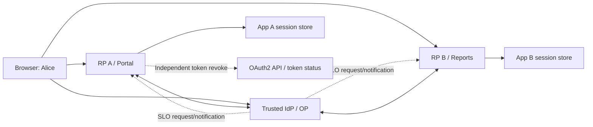
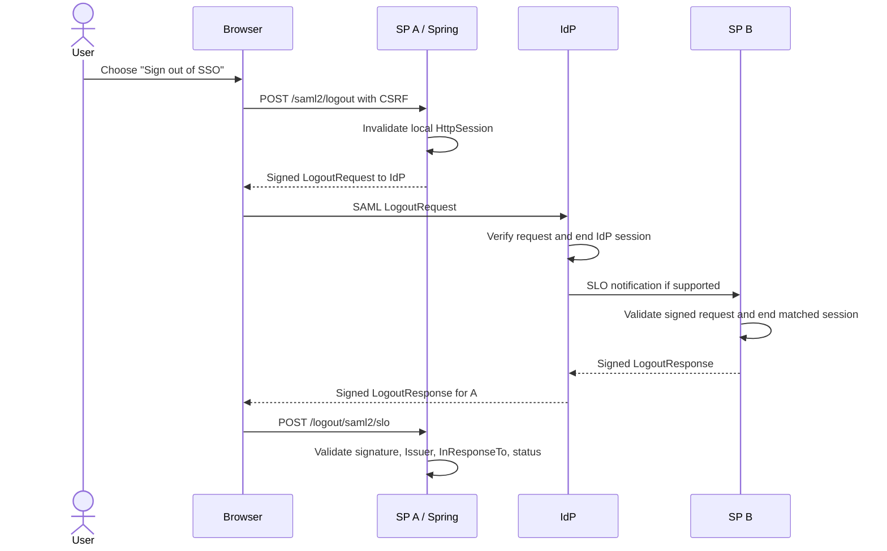
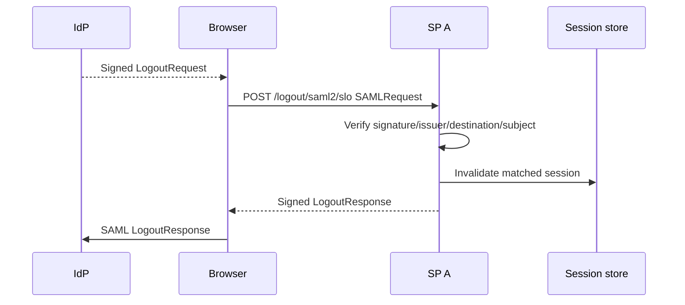
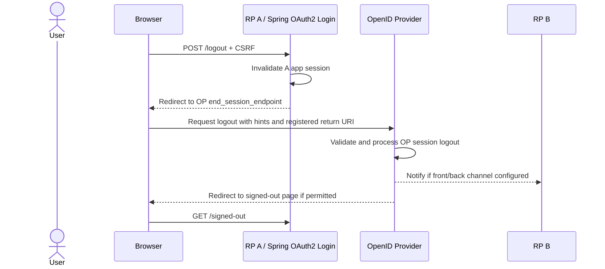

# Implementing Local Logout and Single Logout with Failure-Flow Testing

## Learning Objectives

This is a **comprehensive practice** exercise for Spring Security federation (Spring Boot 3, Spring Security 6, Java 17+). Afterward, learners must be able to distinguish **local logout** from **Single Logout (SLO)**, implement and test SAML2/OIDC flows, respond properly when an application or IdP fails to respond, and never claim "logged out everywhere" while sessions remain active.

Specifically, you will:
1. Identify app `HttpSession`, IdP/OP SSO sessions, browser cookies, SAML `SessionIndex`, OIDC `sid`/`sub`, OAuth2 access/refresh tokens, and per-app scope.
2. Configure `LogoutFilter`, `SecurityContextLogoutHandler`, `CsrfLogoutHandler`, and `LogoutSuccessHandler` for safe local logout via CSRF-protected POST.
3. Separate `POST /logout` (local) from `POST /saml2/logout` (RP-initiated SAML SLO), using `.saml2Logout(...)` and `RelyingPartyRegistration` with IdP SLO metadata and SP signing credentials.
4. Explain IdP/AP-initiated SAML SLO: signed `LogoutRequest`, `LogoutResponse`, issuer/destination, `NameID`, `SessionIndex`, `InResponseTo`, `RelayState`, and `PartialLogout` outcomes.
5. Configure OIDC RP-initiated logout with `OidcClientInitiatedLogoutSuccessHandler`/`end_session_endpoint` and exact `post_logout_redirect_uri`; understand why it is insufficient if RP B does not support logout notifications.
6. Describe OIDC Front-Channel/Back-Channel Logout and signed `Logout Token` (issuer, audience, sid/sub, events, jti, timestamps, replay).
7. Design a lab with two applications A/B and one IdP using synthetic users, separate signing certificates, and a shared session store where needed.
8. Test successful logout, partial logout, timeouts, invalid signed messages, wrong issuer/audience, replay, stale correlation, CSRF, cookie SameSite, and multi-node.
9. Run a **standalone Java 17+** example with deterministic stdout simulating local/full/partial/replay states, while recognizing simulation limits.
10. Write safe logs/metrics, decision tables, checklists, and runbooks without disabling signature verification or CSRF "to make logout work".

## 1. Why Logging Out of Portal Does Not Mean Exiting SSO

Suppose user Alice logged in through the same IdP into:
- **RP A:** `portal-a.sso-lab.test`, holding session A in Spring `HttpSession` or Spring Session.
- **RP B:** `reports-b.sso-lab.test`, holding a separate session B.
- **IdP:** holds its own SSO session/browser cookie capable of issuing a new login.
- **API:** may accept an issued OAuth2 access token outside the app session.
- **Browser:** stores cookies per domain/path and `SameSite` policy.

When A handles a valid local logout, it deletes session A. B still has session B, and the IdP still holds its SSO cookie. Revisiting A may redirect to the IdP and silently log in again, creating a **new session** without prompting for a password. That behavior does not prove local logout failed: to verify, retain the **old A cookie** and check whether it can still access a protected resource.

### 1.1. Logout Levels and Scope

| Type | Who Initiates | What Is Handled | Not Automatically Guaranteed |
| --- | --- | --- | --- |
| Local logout A | User / app A | `HttpSession` A, `SecurityContext`, CSRF token, remember-me if enabled | IdP session, B session, API JWT |
| SAML SP-initiated SLO | A sends signed `LogoutRequest` via browser to IdP | A local logout, IdP logout, notifications to SPs per profile | All participants received / logged out |
| SAML IdP/AP-initiated SLO | IdP sends signed `LogoutRequest` to A/B | SP verifies source and invalidates matched session | Offline SPs logged out |
| OIDC RP-initiated logout | A redirects browser to OP `end_session_endpoint` | OP session and supported front/back logout notifications | RP B logout if not integrated |
| OIDC front-channel | OP notifies via browser/iframe | RP clears session if browser conditions permit | Third-party-cookie restrictions unaffected |
| OIDC back-channel | OP sends signed Logout Token server-to-server | RP maps `sid`/`sub` and invalidates matching app sessions | Browser cookies cleared, all access tokens revoked |
| CAS Single Sign-Out | CAS Server sends logout notification | Client maps validated CAS ticket to app session | Same as OIDC/SAML protocols |
| Kerberos/Windows logout | OS/KDC/service policy | Ticket cache/logon session per configuration | HTTP sessions at all SPs expire automatically |

**Never collapse "logout A succeeded" and "system-wide logout succeeded" into one status.**

### 1.2. Sample State Matrix

| Action | Session A | Session B | IdP Session | API JWT |
| --- | --- | --- | --- | --- |
| Not logged out, user logged in | Active | Active | Active | May still be valid |
| Local logout A only | Inactive | Active | Active | May still be valid |
| Complete SLO (within A/B/IdP scope) | Inactive | Inactive | Inactive | Depends on token revocation policy |
| Partial SLO, B offline | Inactive | May remain active | Logged out or unknown | Depends on policy |
| IdP logout while A missed callback | May remain active | May remain active | Inactive | Depends on policy |

Each cell can be a distinct infrastructure component. **Deleting the browser's IdP cookie** does not invalidate B's server session; **destroying A's `HttpSession`** does not revoke a JWT used directly at an API.

## 2. Different IDs Must Be Mapped Properly

| Field | Nature | Used For |
| --- | --- | --- |
| App `JSESSIONID`/`SESSION` | Application session cookie/ID | Locate and invalidate a session at the RP |
| OIDC `sid` | Session ID issued by OP scoped to issuer | Link OP session to RP session when supported |
| OIDC `sub` | Opaque subject ID per issuer | Per-user logout within one OIDC client, not a single app session |
| SAML `NameID` | Authenticated assertion subject | Identify the SAML session user per profile |
| SAML `SessionIndex` | IdP authentication-session reference | Match one or more SAML sessions per contract |
| SAML `LogoutRequest.ID` | Logout request identifier | Correlate `LogoutResponse.InResponseTo` / replay |
| `RelayState` | Opaque flow state across binding | Bind request/response/binding; not identity proof |
| OIDC Logout Token `jti` | Logout Token identifier | Detect duplicates/replay per policy |
| CAS `ST` | Validated Service Ticket | Link ticket/session per CAS client SLO |
| API access token `jti` | Token ID if present | Token tracking/revocation, not SAML SessionIndex |

One user can have multiple browsers, devices, and sessions. Never log out **someone else** merely because an email/display name matches or a browser message contains `{"sub":"alice"}`. Signed/trusted SLO messages must be validated **before** computing matched sessions.

### 2.1. Diagram



## 3. Proper Local Logout in Spring Security 6

Spring Security Servlet supports `GET /logout` as a confirmation page when CSRF is enabled and **`POST /logout` with valid CSRF** to mutate state. `LogoutFilter` invokes logout handlers including:
- `SecurityContextLogoutHandler`: invalidates `HttpSession` and clears the security context and authentication per configuration.
- `CsrfLogoutHandler`: clears the old CSRF token.
- Remember-me handler: clears remember-me cookies/persistent tokens if enabled.
- `LogoutSuccessEventPublishingLogoutHandler`: can publish logout events.
- `LogoutSuccessHandler`: determines the redirect/status after local cleanup.

**Never choose state-changing GET** just to make link clicks easier. A malicious web page could force a browser to hit the GET URL and log the user out (logout CSRF).

### 3.1. Configuring Local Logout

Place the following inside a Spring `@Configuration` class in a Spring Boot project with security/web starters:

```java
@Bean
SecurityFilterChain appSecurity(HttpSecurity http) throws Exception {
    return http
        .authorizeHttpRequests(auth -> auth
            .requestMatchers("/", "/signed-out", "/error").permitAll()
            .anyRequest().authenticated())
        .logout(logout -> logout
            .logoutUrl("/logout")
            .logoutSuccessUrl("/signed-out")
            .invalidateHttpSession(true)
            .clearAuthentication(true))
        .build();
}
```

This is a **Spring fragment**, not a standalone Java file. The project needs class imports/beans. In an app using OIDC/SAML, add `oauth2Login` or `saml2Login` as appropriate. `logout` above is **local only**; it does not emit a SAML `LogoutRequest` or an OP logout request.

### 3.2. CSRF-Protected HTML Form POST

With Thymeleaf integrated with Spring CSRF:

```html
<form th:action="@{/logout}" method="post">
  <button type="submit">Sign out of Portal</button>
</form>
```

With plain HTML, render the real token from the server:

```html
<form action="/logout" method="post">
  <input type="hidden" name="_csrf" value="SERVER_CSRF_TOKEN"/>
  <button type="submit">Sign out</button>
</form>
```

`SERVER_CSRF_TOKEN` is only an explanatory placeholder—**never** hardcode a token. For SPAs, use the Spring-supported `CsrfToken` header pattern. The old CSRF token is cleared on logout, and a fresh token may be needed after login/logout.

### 3.3. Never Just Delete the Cookie Instead of Using LogoutFilter

```java
// ANTI-PATTERN, never use as logout implementation:
response.addHeader("Set-Cookie", "JSESSIONID=; Max-Age=0");
```

Deleting only the cookie does not guarantee the session was invalidated server-side. In Redis/JDBC, the old session ID may still live on, and if an attacker already captured it, they can still send requests. Use `LogoutFilter`/`SecurityContextLogoutHandler` and **test the old cookie**.

### 3.4. Local Logout and Data Categories

| What Is Cleared? | When | Avoid Misconceptions |
| --- | --- | --- |
| `HttpSession` | App browser session | Does not automatically clear IdP/B |
| `SecurityContextHolder` | Every standard logout | Not an AS revocation |
| Remember-me cookie/token store | If remember-me enabled | Must clear persistent token store |
| CSRF token | Session logout | New token after logout needs refresh |
| `Clear-Site-Data` | When reviewed and browser-supported | Does not clear cookies on another IdP origin |
| SPA local state | After logout/redirect | Does not revoke already-copied access tokens |
| Server-side access/refresh grants | Per OAuth2 revoke policy | Spring browser logout does not revoke all |
| WebSocket / long-lived sessions | When required by policy | Requires explicit disconnect/reauthorization |

## 4. SAML2 SLO: Both Directions and Mandatory Conditions

Spring Security Servlet 6.5 supports:
- **RP/SP-initiated SLO:** user `POST`s to the SP logout trigger; SP clears local session, creates a signed `samlp:LogoutRequest` to the IdP, receives `samlp:LogoutResponse`, and validates it.
- **AP/IdP-initiated SLO:** IdP sends a signed `LogoutRequest` to the SP SLO endpoint; SP verifies it before invalidating the session, then issues a signed `LogoutResponse`.
- The IdP can coordinate multiple participating SPs depending on metadata/profile, session state, and network. **Not every IdP supports SLO.**

### 4.1. RP-Initiated SLO Sequence



Because A already invalidated the local session **before** the IdP returns `LogoutResponse`, an IdP timeout must never cause A to "re-authenticate" or roll back. The proper outcome is: **LOCAL_LOGOUT_DONE** and **SLO_OUTCOME_UNKNOWN/PARTIAL**.

### 4.2. IdP-Initiated SLO Sequence



**Never parse raw XML and delete sessions by `NameID` string before SAML provider verification.** Act only on a trusted SAML message after verifying issuer, signing cert, subject/session binding, and replay conditions.

### 4.3. Message Structure

| Field | Role | What Must Be Verified |
| --- | --- | --- |
| `LogoutRequest.ID` | Correlation/replay | Unique, not previously processed |
| `Issuer` | SP or IdP entityID per direction | Exact trusted registration |
| `Destination` | Recipient of LogoutRequest/LogoutResponse | Exact SLO URL from metadata |
| `NameID` | User subject | Matches principal; never inferred from email |
| `SessionIndex` | IdP authentication-session reference | Never confused with `JSESSIONID` |
| `NotOnOrAfter` | Expiry if used by profile | Reject stale messages |
| `LogoutResponse.InResponseTo` | Replies to issued request | Matches pending request |
| `RelayState` | Opaque state across binding | Binds flow and prevents open redirects |
| `StatusCode` | `Success` / `PartialLogout` / failure | Never claim complete when partial |
| XML signature | Origin and integrity | Trusted cert, signed portion/binding |

### 4.4. Illustrative LogoutRequest (Not a Valid Message)

```xml
<samlp:LogoutRequest
  xmlns:samlp="urn:oasis:names:tc:SAML:2.0:protocol"
  xmlns:saml="urn:oasis:names:tc:SAML:2.0:assertion"
  ID="_logout-100" Version="2.0"
  IssueInstant="2026-11-07T10:00:00Z"
  Destination="https://idp.sso-lab.test/saml/slo">
  <saml:Issuer>https://portal-a.sso-lab.test/saml/sp</saml:Issuer>
  <saml:NameID>synthetic-alice-001</saml:NameID>
  <samlp:SessionIndex>_idp-session-17</samlp:SessionIndex>
</samlp:LogoutRequest>
```

Merely **field illustration**; lacks signature and transport binding. Never feed unsigned raw XML like this to a production endpoint.

### 4.5. LogoutResponse and Partial Logout

```xml
<samlp:LogoutResponse
  xmlns:samlp="urn:oasis:names:tc:SAML:2.0:protocol"
  xmlns:saml="urn:oasis:names:tc:SAML:2.0:assertion"
  ID="_logout-response-100" InResponseTo="_logout-100"
  Version="2.0" IssueInstant="2026-11-07T10:00:12Z"
  Destination="https://portal-a.sso-lab.test/logout/saml2/slo">
  <saml:Issuer>https://idp.sso-lab.test/saml/idp</saml:Issuer>
  <samlp:Status>
    <samlp:StatusCode
       Value="urn:oasis:names:tc:SAML:2.0:status:PartialLogout"/>
  </samlp:Status>
</samlp:LogoutResponse>
```

This is likewise **unsigned XML for explanation**, not a sample usable for real login/logout. When the IdP reports `PartialLogout`, the app must treat global SLO as incomplete; nonetheless, A's local session is already terminated. Even on an SLO response `Success`, understand the participant-acknowledgement scope guaranteed by the IdP rather than assuming all legacy systems logged out.

## 5. Implementing Spring Boot 3 / Security 6 SAML2 SLO

Example for a dedicated **SAML test application**; actual IdP metadata, keys, and HTTPS hostnames are prepared by the learner in a sandbox.

### 5.1. Gradle Dependencies

In a project already configured with the Spring Boot plugin and compatible dependency management/BOM:

```groovy
dependencies {
    implementation 'org.springframework.boot:spring-boot-starter-web'
    implementation 'org.springframework.boot:spring-boot-starter-security'
    implementation 'org.springframework.security:spring-security-saml2-service-provider'
    testImplementation 'org.springframework.boot:spring-boot-starter-test'
    testImplementation 'org.springframework.security:spring-security-test'
}
```

Depending on Boot/Security version, OpenSAML artifacts may require the appropriate repository; check Spring docs for your exact version. Never use Spring Security 7 APIs in a Spring Boot 3 project without migrating.

### 5.2. `application.yml`: Metadata and SP Signing Key

```yaml
spring:
  security:
    saml2:
      relyingparty:
        registration:
          idp-lab:
            signing:
              credentials:
                - private-key-location: "file:/run/secrets/rp-signing.key"
                  certificate-location: "file:/run/secrets/rp-signing.crt"
            singlelogout:
              url: "https://portal-a.sso-lab.test/logout/saml2/slo"
            assertingparty:
              metadata-uri: "https://idp.sso-lab.test/metadata"
server:
  forward-headers-strategy: framework
  servlet:
    session:
      cookie:
        secure: true
        http-only: true
        same-site: lax
```

These URLs are **fixtures and do not represent a real system**. IdP metadata must contain `SingleLogoutService`, the SP signing private key must be PKCS#8 with matching trusted cert, the IdP must permit the SP client/entityID, and logout endpoints/bindings must match. **Never commit private keys**, and never take metadata URLs from browser input.

### 5.3. SAML Metadata with SingleLogoutService

```xml
<md:EntityDescriptor
  xmlns:md="urn:oasis:names:tc:SAML:2.0:metadata"
  entityID="https://idp.sso-lab.test/saml/idp">
  <md:IDPSSODescriptor
    protocolSupportEnumeration="urn:oasis:names:tc:SAML:2.0:protocol">
    <md:SingleLogoutService
      Binding="urn:oasis:names:tc:SAML:2.0:bindings:HTTP-POST"
      Location="https://idp.sso-lab.test/saml/slo"/>
  </md:IDPSSODescriptor>
</md:EntityDescriptor>
```

This is a truncated metadata snippet merely showing where SLO is advertised; real metadata includes signing certificates, SSO endpoints, and required fields. `singlelogout.url` in Boot is the **SP endpoint receiving callbacks**, not the IdP SLO URL. The IdP location comes from `SingleLogoutService`.

### 5.4. Two Endpoints: Local and SAML SLO

File `src/main/java/com/example/saml/SamlSecurityConfig.java`:

```java
package com.example.saml;

import org.springframework.context.annotation.Bean;
import org.springframework.context.annotation.Configuration;
import org.springframework.security.config.Customizer;
import org.springframework.security.config.annotation.web.builders.HttpSecurity;
import org.springframework.security.web.SecurityFilterChain;

@Configuration
public class SamlSecurityConfig {
    @Bean
    SecurityFilterChain filterChain(HttpSecurity http) throws Exception {
        return http
            .authorizeHttpRequests(auth -> auth
                .requestMatchers("/", "/signed-out", "/error").permitAll()
                .anyRequest().authenticated())
            .saml2Login(Customizer.withDefaults())
            .logout(logout -> logout
                .logoutUrl("/logout")
                .logoutSuccessUrl("/signed-out")
                .invalidateHttpSession(true))
            .saml2Logout(saml -> saml.logoutUrl("/saml2/logout"))
            .build();
    }
}
```

Per Spring Security 6.5:
- `POST /logout` → **local logout only**.
- `POST /saml2/logout` → **RP-initiated SAML2 SLO**.
- `POST /logout/saml2/slo` → **protocol endpoint** for signed AP/IdP-initiated `SAMLRequest` or `SAMLResponse` replying to the RP request.
- Both user buttons must send POST requests with proper CSRF.
- `saml2Logout` requires IdP `SingleLogoutService` metadata + configured signing credentials; calling the DSL alone will not make an IdP without SLO support suddenly support it.
- Without separating the two URLs as shown, the default `POST /logout` for a SAML user can initiate SLO.
- With multiple `SecurityFilterChain`s, verify matchers for SAML SLO protocol endpoints; never add `permitAll` for arbitrary signed/unsigned XML bypassing provider validation.
- Reverse proxies must emit the exact external `https` scheme/hostname/path and strip untrusted forwarded headers.

### 5.5. Two Distinct UI Buttons

```html
<!-- Thymeleaf automatically includes CSRF in forms when properly integrated -->
<form th:action="@{/logout}" method="post">
  <button type="submit">Sign out of Portal only</button>
</form>
<form th:action="@{/saml2/logout}" method="post">
  <button type="submit">Sign out of SSO across supported apps</button>
</form>
```

Never wire both buttons to the same `/logout` with different labels. Test in a browser to verify CSRF tokens, signed LogoutRequests, post-logout redirects, and session outcomes.

### 5.6. When LogoutResponse Arrives Late

Spring Security's SAML2 logout request repository stores pending `LogoutRequest` details to match `RelayState`/`InResponseTo` when the response returns. In clustered apps, test callbacks arriving at a different node from the originating node, session invalidation, pending request store TTL, and SameSite cookies. Never disable the correlation validator to hide lost-state errors.

## 6. OIDC RP-Initiated Logout with OP End-Session

An OIDC RP at A performs local logout and can then redirect the browser to the OP's `end_session_endpoint` if supported by the provider. `post_logout_redirect_uri` must appear in the OP's exact allowlist. The OP may ask the user to confirm, end the OP session, and then **may** send logout notifications to supported RPs.

### 6.1. OIDC Client `application.yml`

**Separate OIDC project** (do not paste straight into a SAML project without multi-protocol design):

```yaml
spring:
  security:
    oauth2:
      client:
        registration:
          lab:
            provider: lab
            client-id: portal-a
            client-secret: "${OIDC_LAB_CLIENT_SECRET}"
            authorization-grant-type: authorization_code
            scope: openid,profile
            redirect-uri: "{baseUrl}/login/oauth2/code/{registrationId}"
        provider:
          lab:
            issuer-uri: https://idp.sso-lab.test/realms/lab
```

When applied, `${OIDC_LAB_CLIENT_SECRET}` is the Spring environment placeholder `\${OIDC_LAB_CLIENT_SECRET}`, with the secret supplied by a secret manager. Never use real IdP URLs in a sandbox without approval.

### 6.2. `OidcClientInitiatedLogoutSuccessHandler`

File `src/main/java/com/example/oidc/OidcSecurityConfig.java`:

```java
package com.example.oidc;

import org.springframework.context.annotation.Bean;
import org.springframework.context.annotation.Configuration;
import org.springframework.security.config.Customizer;
import org.springframework.security.config.annotation.web.builders.HttpSecurity;
import org.springframework.security.oauth2.client.oidc.web.logout.OidcClientInitiatedLogoutSuccessHandler;
import org.springframework.security.oauth2.client.registration.ClientRegistrationRepository;
import org.springframework.security.web.SecurityFilterChain;
import org.springframework.security.web.authentication.logout.LogoutSuccessHandler;

@Configuration
public class OidcSecurityConfig {

    @Bean
    LogoutSuccessHandler oidcLogout(
            ClientRegistrationRepository registrations) {
        var h = new OidcClientInitiatedLogoutSuccessHandler(registrations);
        h.setPostLogoutRedirectUri("{baseUrl}/signed-out");
        return h;
    }

    @Bean
    SecurityFilterChain security(
            HttpSecurity http, LogoutSuccessHandler oidcLogout)
            throws Exception {
        return http
            .authorizeHttpRequests(auth -> auth
                .requestMatchers("/", "/signed-out", "/error").permitAll()
                .anyRequest().authenticated())
            .oauth2Login(Customizer.withDefaults())
            .logout(logout -> logout
                .logoutUrl("/logout")
                .logoutSuccessHandler(oidcLogout)
                .invalidateHttpSession(true))
            .build();
    }
}
```

**Meaning and limits:**
1. `LogoutSuccessHandler` runs **after local logout**; it redirects the browser to OP logout when supported by the client registration/OP metadata.
2. `setPostLogoutRedirectUri` uses `{baseUrl}` and `/signed-out`. The IdP must register the exact public HTTPS post-logout redirect, never trusting an arbitrary browser `returnUrl`.
3. `id_token_hint` is handled by the handler per IdP/flow; never assemble unsigned JSON yourself.
4. If the OP lacks end-session support or the endpoint is unreachable, A's local logout still occurred, yet **OP/B logout is not promised**.
5. When the OP retains an SSO cookie, a local-only variant does not end the IdP session. For local-only OIDC logout, use `logoutSuccessUrl("/signed-out")` instead of the OIDC logout success handler.
6. B requires its own OP notification integration; redirecting to the OP only proves the RP **requested** logout.

### 6.3. OIDC RP-Initiated Sequence



Never treat a `GET /signed-out` 200 response as proof that B logged out. Always test the old B cookie.

## 7. OIDC Front-Channel and Back-Channel Logout

### 7.1. Front-Channel

The OP may deliver notifications via browser/iframe/redirect. Depending on browser, third-party cookie restrictions, `SameSite`, and anti-tracking, the RP may not be able to read its session. If a deployment relies on front-channel, test major browsers and handle partial delivery; never blindly enable third-party cookies or disable CSRF globally.

### 7.2. Back-Channel Logout Token

The OP posts a **signed JWT Logout Token** to the RP's endpoint, independent of browser cookies. Example decoded claims for reading (**not a valid JWT**, unsigned):

```json
{
  "iss": "https://idp.sso-lab.test/realms/lab",
  "aud": "portal-a",
  "iat": 1794045600,
  "jti": "logout-jti-001",
  "sid": "op-session-opaque-43",
  "events": {
    "http://schemas.openid.net/event/backchannel-logout": {}
  }
}
```

**Must validate**:
- Signature / approved algorithm / signing key / JWKS of the **configured issuer**.
- Exact `iss`, right `aud` for the RP/client (and token time claims).
- `events` contains the exact `http://schemas.openid.net/event/backchannel-logout` object.
- `sid`, `sub`, or both are present; `nonce` **must be absent**.
- `jti`/replay policy and `iat`; if `exp` is present, validate it and reject stale tokens per local profile.
- If `sid` is present, target the matching session; if only `sub` is present, semantics may target all sessions of that subject in that client. Never delete sessions of other clients/issuers.
- Never accept unsigned browser JSON `{"sub":"alice"}` to delete Alice's sessions.

### 7.3. Spring Security OIDC Back-Channel

In Spring Security Servlet 6.x with `oidcLogout` DSL support (verify your project's exact version), you can add:

```java
@Bean
SecurityFilterChain filterChain(HttpSecurity http) throws Exception {
    return http
        .authorizeHttpRequests(auth -> auth.anyRequest().authenticated())
        .oauth2Login(Customizer.withDefaults())
        .oidcLogout(oidc -> oidc
            .backChannel(Customizer.withDefaults()))
        .build();
}
```

This is a **standalone configuration example**—do not paste verbatim into the SAML sample; client/OP and session registry must be wired. Endpoint per Spring Security docs:

```text
POST /logout/connect/back-channel/{registrationId}
```

**Requirements:**
- OP supports back-channel and has the RP's exact HTTPS logout URI registered.
- `OidcSessionRegistry` maps OP session/`sid`/`sub` to app sessions; `aud` prevents a token for client A from clearing client B.
- `OidcBackChannelLogoutHandler` and session event publisher/cleanup appropriate for the version.
- Session cookie name: the handler defaults to `JSESSIONID`; if Spring Session uses `SESSION`, configure the handler with `setSessionCookieName("SESSION")`.
- Multi-node session store and shared registry/revocation design so a callback hitting node X invalidates a session created on node Y.
- Negative tests for wrong signature, `iss`, `aud`, `events`, `nonce`, `sid`/`sub`, and replay.
- Ensure the endpoint is **protocol-validated**, not a public POST taking an arbitrary `sub` and querying the database to delete sessions.
- The browser may still carry the old cookie, yet the server must deny access after invalidation.

### 7.4. OIDC Logout Differs from Token Revocation

RP/OP logout does not automatically cause:
- Unexpired OAuth2 JWT access tokens to be rejected by offline resource servers.
- Refresh tokens with `offline_access` to be revoked under every policy.
- API keys / `client_credentials` to be deleted.
- WebSocket sessions or other mobile clients to disconnect automatically.

If you need "log out all devices" or offboarding, implement token revocation/introspection/denylists, account/session epochs, action-time authorization, and full endpoint coverage. Never promise guarantees beyond protocol support.

## 8. CAS SLO and Kerberos/SPNEGO: Do Not Conflate Protocols

### 8.1. CAS Single Sign-Out

CAS Server maintains TGT sessions and Service Tickets (ST). CAS SLO normally requires the client to track ticket-to-session mappings after validated login, receive logout notifications from a trusted source, and invalidate the matching `HttpSession`.

Checklist:
- Service Tickets are verified by the CAS client at login; never treat a raw ticket string as identity.
- When CAS TGT/logout occurs, does the CAS server notify participating SPs?
- Can the client listener/filter for your CAS client version find sessions by ticket key?
- Is the multi-node ticket→session mapping stored in a shared store?
- Are signed/trusted protocol notifications protected against spoofing/replay?
- Are partial deliveries/timeouts recorded?
- Local logout at A does not automatically kill the CAS TGT; conversely, CAS logout must notify A/B.

**Never use an OIDC end-session URL as CAS SLO** when the application uses native CAS tickets.

### 8.2. Kerberos/SPNEGO

Kerberos service tickets/TGTs and app `HttpSession`s operate at different layers. `LogoutFilter` clears the Spring app session, yet the browser/OS may still automatically send `GSS-APREQ` to re-authenticate via `Authorization: Negotiate`; that is a **new authentication**, not the old cookie coming back to life.

There is no universal HTTP SLO across all Kerberos apps analogous to SAML2 SLO. Broad revocation requires Windows/AD/KDC/OS ticket policies, account disabling, app session termination, and separate security response. Never trust `REMOTE_USER` or raw `Authorization: Negotiate` text without GSS verification.

### 8.3. Reverse Proxy Pre-Auth

When a gateway owns the IdP session:
- Local app logout does not automatically log out the gateway.
- The gateway may immediately re-pre-authenticate the next request.
- Client-supplied `X-User`/`X-Logout`/`X-MFA` headers must be stripped/overwritten; the origin must not be public, and proxy→app needs an authenticated channel.
- Gateway logout notifications require source attestation and issuer/subject/session binding; never let browsers log out other users.

## 9. Lab Architecture: Two RPs and One IdP

Build a sandbox:
- SAML2 IdP or OIDC OP with dedicated test realm/users/metadata/signing keys.
- RP A `https://portal-a.sso-lab.test`, RP B `https://reports-b.sso-lab.test`.
- Synthetic users `alice-qa` and `bob-qa`.
- Separate client registrations/SP entityIDs, ACS, SLO endpoints, secrets/certs, and app session stores.
- Test browser profiles; when automation retains cookies, store them only in secret-protected test artifacts.
- Production-like gateway, session store, and network policies if testing multi-node.
- Test harness able to simulate B unreachable / IdP timeout **only inside the sandbox**.

**Note:** browser cookie domains ignore ports. If A and B both use `localhost` on different ports with the same `JSESSIONID`/Path cookie, they will collide; use distinct hostnames/paths or configure distinct cookie scopes/names.

### 9.1. Baseline State to Measure

Before each test case:
1. Browser logs Alice into A; confirm protected `/private` returns 200.
2. Browser logs Alice into B via the same IdP SSO session; confirm protected `/private` returns 200.
3. Capture test-only old session cookie handles for A and B.
4. Confirm the IdP still holds an authenticated SSO session.
5. Record session-store entries and IdP session references via **authorized lab APIs/logs**.
6. If an API uses JWTs, record token status/expiry without logging raw JWTs.
7. Use a fresh browser profile to distinguish old-cookie access from a new SSO login.

### 9.2. Local Logout A Test

- `POST /logout` on A with CSRF → old A session becomes invalid.
- Call `GET /private` on A with the **old A cookie** without following re-login: must not return a protected response.
- Old B cookie can still `GET /private` on B with 200.
- IdP SSO session can still issue a new login when the browser visits A.
- Local logout A log must record only `LOCAL_DONE`, never `GLOBAL_DONE`.
- POST without CSRF must be blocked; GET must not mutate state.

### 9.3. SAML SLO Complete Test

- A/B share synthetic user, with IdP SLO metadata/trust configured.
- A `POST /saml2/logout`, emitting a signed `LogoutRequest`.
- IdP verifies it, terminates the IdP SSO session, and notifies B per protocol.
- B verifies the signed message, invalidates B's session, and returns `LogoutResponse`.
- A verifies signed `LogoutResponse`/`InResponseTo`/status.
- Old A/B cookies are denied; IdP session no longer grants silent SSO.
- Record complete only if participant scope was genuinely confirmed; if one RP missed the callback, mark partial.

### 9.4. AP-Initiated SLO Test

- User logs out directly at the test IdP.
- IdP sends signed SAML `LogoutRequest`s to SPs.
- SPs invalidate matched sessions only **after** signature/issuer/destination/session validation.
- SPs return signed `LogoutResponse`s; IdP aggregates statuses.
- Test duplicate/replayed requests so they do not log out a **new session** or another user.

### 9.5. OIDC RP / Back-Channel Test

- A/B are separate OIDC clients; OP supports end-session and back-channel (when tested).
- A `POST /logout` invalidates the local session and redirects the browser to OP `end_session_endpoint`.
- OP ends its session and sends a signed Logout Token matching RP B's `aud`/`sid`/`sub`.
- B validates the Logout Token and invalidates B's local session.
- Old B cookie is denied. If B does not support notifications, **do not promise** global logout.
- Test OP missing the endpoint, wrong post-logout URI, invalid token signatures, and old JWT access tokens remaining valid per policy.

## 10. Mandatory Failure Test Suite

| Case | How to Simulate **in the Test Lab** | Expected Result |
| --- | --- | --- |
| Valid local POST | Valid CSRF | App session invalidated; IdP/B unchanged |
| Local POST missing CSRF | Omit token | 403; request must not log out |
| `GET /logout` | CSRF enabled | Confirmation page, no state change |
| Cross-site forged browser logout | POST from another origin without token | CSRF rejected |
| Logout A twice | Re-submit logout | Safe/idempotent; does not log back in |
| Full SAML SLO | Valid signatures/correlation, B reachable | Old A/B sessions denied |
| AP-initiated SAML | Valid IdP-signed `LogoutRequest` | SP logs out matching session |
| SAML wrong signature | Untrusted key/cert | Reject; do not delete wrong session |
| SAML wrong issuer | Another IdP outside trusted entity | Reject |
| SAML wrong Destination | SLO endpoint mismatch | Reject |
| SAML missing/stale `InResponseTo` | Response mismatches `LogoutRequest` | Reject response |
| SAML replayed request ID | Resend same request | Reject/handle idempotently per replay policy |
| SAML wrong `NameID` | Message targets another user | Do not log out target user |
| SAML wrong `SessionIndex` | Index mismatch | Do not log out unrelated session |
| SAML expired timestamp | Stale request | Reject |
| SAML `PartialLogout` | B offline/times out | A logged out locally, global partial |
| IdP SLO timeout | IdP returns no response | A logged out locally, global unknown |
| SAML metadata lacks `SingleLogoutService` | IdP lacks support | Do not claim SLO is configured |
| OIDC OP lacks end-session endpoint | Missing from metadata | Local only / not global |
| Unregistered OIDC post-logout URI | Invalid URI | OP rejects; no arbitrary redirect |
| Unsigned OIDC Logout Token | Unverified token | Reject; do not clear B |
| OIDC wrong issuer | Wrong `iss` | Reject |
| OIDC wrong client | Wrong `aud` | Reject; do not clear other clients |
| OIDC missing both `sid` and `sub` | No session identifier | Reject |
| OIDC Logout Token contains `nonce` | Violates spec | Reject |
| OIDC wrong `events` | Not a logout event | Reject |
| OIDC duplicate `jti` | Replay | Reject/idempotent per policy |
| OIDC different `sid` | No session match | Do not delete other sessions |
| Back-channel B unreachable | HTTP timeout/502 | Partial/alert; never fake complete |
| Spring Session store down | Cannot invalidate B session | Log/alert; do not report complete |
| Multi-node callback at B | Different node receives event | Shared registry revokes properly |
| Browser blocks third-party cookies | Front-channel drops cookie | Do not treat RP as handled |
| Logout A then immediate SSO login | OP session still alive | Distinguish **new** session from old |
| API access JWT still valid | Offline resource server validation | Follows separate revocation policy |
| Browser switches user mid-flow | Alice → Bob | Do not delete Bob's session |
| CAS ticket logout replay | Duplicate/stale CAS message | Do not invalidate wrong session |
| Kerberos SPNEGO auto-login | Browser still holds TGT | Recognize new auth, not old cookie |
| Reverse proxy wrong public URL | SAML Destination mismatch | Fix metadata/ingress; never disable checks |
| Signing key rotation | Message signed with old/other key | Validate per trusted rotation policy |

### 10.1. Do Not Treat HTTP 200 as Proof of SLO

A 200/302 response or `/signed-out` page only confirms UI/redirect behavior. Always test:
- **Old A cookie** and **old B cookie** against protected endpoints.
- Session registry/Redis/JDBC state after logout.
- OP/IdP session and silent SSO behavior in a fresh/old browser profile.
- Old JWT access tokens against the resource server per revocation targets.
- Logout callbacks hitting another node; browser/cookie `SameSite` restrictions.

### 10.2. MockMvc Does Not Replace SAML/OIDC Protocol Tests

With Spring Security MockMvc:
```java
mvc.perform(post("/logout")
        .with(user("synthetic-alice"))
        .with(csrf()))
    .andExpect(status().is3xxRedirection());
```

This is a **JUnit test fragment** (requires `MockMvc`/Spring Security imports) checking handlers/routing; it does not prove a signed SAML `LogoutRequest` or OP Logout Token was sent.

Negative local logout when CSRF is enabled:

```java
mvc.perform(post("/logout").with(user("synthetic-alice")))
    .andExpect(status().isForbidden());
```

Static imports in the test class:

```java
import static org.springframework.security.test.web.servlet.request.SecurityMockMvcRequestPostProcessors.user;
import static org.springframework.security.test.web.servlet.request.SecurityMockMvcRequestPostProcessors.csrf;
import static org.springframework.test.web.servlet.request.MockMvcRequestBuilders.post;
import static org.springframework.test.web.servlet.result.MockMvcResultMatchers.status;
```

Use a real test IdP with signed `LogoutRequest`/`LogoutResponse` or JWT Logout Tokens to verify signatures/issuer/correlation. Mock `oidcLogin()` injects a fake principal and **does not** test OP browser cookies or back-channel notifications.

## 11. Standalone Java 17+: Simulating Local / Full / Partial / Logout Replay

This program has **no network, IdP, XML Signature, JWT, or real HttpSession**. It only illustrates states and the rule "untrusted messages do not trigger logout". Flags `trustedMessage` and `timely` are supplied by the Java test fixture and **must never** come from client request bodies/headers in production.

File `LogoutFlowDemo.java`:

```java
import java.util.HashMap;
import java.util.HashSet;
import java.util.Map;
import java.util.Set;

public final class LogoutFlowDemo {
    private final Map<String, Boolean> sessions = new HashMap<>();
    private final Set<String> processedRequests = new HashSet<>();

    void reset() {
        sessions.clear();
        sessions.put("A", true);
        sessions.put("B", true);
        sessions.put("IdP", true);
        processedRequests.clear();
    }

    void localLogout(String app) {
        if (!"A".equals(app) && !"B".equals(app)) {
            throw new IllegalArgumentException("Not an RP");
        }
        sessions.put(app, false);
    }

    String singleLogout(
            String requestId,
            boolean trustedMessage,
            boolean timely,
            boolean bReachable) {
        if (!trustedMessage || !timely) {
            return "REJECT_UNTRUSTED";
        }
        if (!processedRequests.add(requestId)) {
            return "REJECT_REPLAY";
        }
        // Model only after the protocol message has been verified.
        sessions.put("A", false);
        sessions.put("IdP", false);
        if (!bReachable) {
            return "PARTIAL";
        }
        sessions.put("B", false);
        return "COMPLETE";
    }

    String snapshot() {
        return "A=" + (sessions.get("A") ? "IN" : "OUT")
             + ",B=" + (sessions.get("B") ? "IN" : "OUT")
             + ",IdP=" + (sessions.get("IdP") ? "IN" : "OUT");
    }

    public static void main(String[] args) {
        LogoutFlowDemo lab = new LogoutFlowDemo();

        lab.reset();
        System.out.println("Initially: " + lab.snapshot());
        lab.localLogout("A");
        System.out.println("Local A: " + lab.snapshot());

        lab.reset();
        System.out.println("Forged: " +
            lab.singleLogout("_forged", false, true, true));
        System.out.println("After forged: " + lab.snapshot());

        lab.reset();
        System.out.println("SLO full: " +
            lab.singleLogout("_req-1", true, true, true));
        System.out.println("After full: " + lab.snapshot());
        System.out.println("Replay: " +
            lab.singleLogout("_req-1", true, true, true));

        lab.reset();
        System.out.println("SLO timeout B: " +
            lab.singleLogout("_req-2", true, true, false));
        System.out.println("After timeout: " + lab.snapshot());

        lab.reset();
        System.out.println("Stale request: " +
            lab.singleLogout("_req-3", true, false, true));
        System.out.println("After stale: " + lab.snapshot());
    }
}
```

Run:

```bash
javac LogoutFlowDemo.java
java LogoutFlowDemo
```

**Exact stdout:**

```text
Initially: A=IN,B=IN,IdP=IN
Local A: A=OUT,B=IN,IdP=IN
Forged: REJECT_UNTRUSTED
After forged: A=IN,B=IN,IdP=IN
SLO full: COMPLETE
After full: A=OUT,B=OUT,IdP=OUT
Replay: REJECT_REPLAY
SLO timeout B: PARTIAL
After timeout: A=OUT,B=IN,IdP=OUT
Stale request: REJECT_UNTRUSTED
After stale: A=IN,B=IN,IdP=IN
```

**Explanation:**
- `Local A` invalidates only A; B and IdP sessions remain active.
- `Forged` is untrusted so all three remain active.
- `SLO full` models all participants logging out.
- `Replay` with the same ID must be rejected per replay/idempotency policy.
- `SLO timeout B` yields **PARTIAL**—A and IdP are out while B remains active.
- `Stale request` must never terminate sessions.

**Never deploy `singleLogout(...)` as an HTTP SLO endpoint**: it performs no signature/issuer/audience/recipient/`SessionIndex`/nonce verification, has no session correlation or expiry policy, and is not concurrency-safe. Production uses Spring Security/OpenSAML/OIDC handlers configured for the IdP.

## 12. Multi-Node, Storage, Cookies, and Token Revocation

### 12.1. Node A Receives Logout While Session Lives on Node B

A cluster of `portal-1`/`portal-2`/`portal-3` must never rely on per-JVM `Map<String,HttpSession>` state for IdP-initiated logout. You need:
- A shared session store or clear session-routing architecture.
- Mapping from IdP sessions (SAML `SessionIndex`, OIDC `sid`, trusted issuer + subject + client) to local RP session IDs.
- A pending logout request repository sufficient to correlate `InResponseTo` when the callback lands on another node.
- Revocation/tombstone/TTL entries so old sessions on another node cannot "come back to life".
- Race testing: Alice's logout arrives just before Alice starts a new login session; the old `LogoutRequest.ID` must not wrongly invalidate the new session.
- Shared revisions/metrics to detect stale nodes.
- Spring Session Redis **does not automatically provide full federation session correlation**; integrate an appropriate registry.

### 12.2. Browser Cookies Ignore Ports

Two apps at `localhost:8081` and `localhost:8082` using `JSESSIONID` on the same host/path can overwrite each other's cookies, breaking "B logs out with A" tests. Use distinct test hostnames or properly scoped/named cookies, verifying `Domain`/`Path`/`Secure`/`SameSite`/`HttpOnly`.

Cross-site SAML HTTP-POST and OIDC front-channel iframes may require different cookie settings; never blindly disable `SameSite` or CSRF. Back-channel avoids browser cookie reliance yet requires trusted JWT Logout Tokens and an RP session registry.

### 12.3. Access/Refresh Tokens Are Excluded from Default App Logout

- Unexpired **JWT access tokens** may still be accepted by APIs if resource servers validate offline, regardless of app browser logout.
- **Refresh tokens** require AS revocation policies; `offline_access` carries separate semantics.
- **Opaque tokens** may require introspection/revocation.
- **Service-to-service client credentials/API keys** are unaffected by user SSO logout.
- "Log out all devices" or offboarding requires current-state user status, session epochs, or denylists checked across all applications/APIs/clients.
- On account compromise, never broadcast SLO alone and assume privileges are revoked.

## 13. Runbook When SLO Partially Fails

### 13.1. Detection and Triage

| Symptom | Check First |
| --- | --- |
| `POST /logout` returns 403 | CSRF, HTTP method, and `SecurityFilterChain` |
| App A remains authenticated after POST | `LogoutFilter`, `HttpSession`/`SecurityContextRepository` |
| No SAML `LogoutRequest` generated | `saml2Logout` DSL, SP signing creds, IdP SLO metadata |
| IdP rejects `LogoutRequest` | Signature, issuer/entityID, destination, `NameID`/`SessionIndex` |
| IdP fails to notify B | Participant registry, SLO binding, B availability |
| B returns HTTP 400 | Signature/issuer/destination/correlation/replay |
| A rejects `LogoutResponse` | `InResponseTo`, pending state, `RelayState`, status, signature |
| IdP SLO timeout | Local A done; global unknown |
| OIDC OP does not redirect back | `end_session` support / registered return URI / browser interaction |
| OIDC back-channel returns 400 | Logout Token `iss`/`aud`/`events`/`sid`/`sub`/`jti` |
| B session stays active | Session registry mapping, store, notification delivery |
| One node retains A session | Shared store / invalidation propagation |
| Logout then immediate re-login | IdP session alive; new auth, not old session |
| API JWT still valid | Token revocation policy, not HTTP session |

### 13.2. Actions When B Fails to Log Out

1. Keep A **locally logged out**; never roll back to an authenticated session.
2. Determine whether the IdP session exited or remains unknown.
3. Record state `SLO_PARTIAL` or `SLO_UNKNOWN`, never `GLOBAL_COMPLETE`.
4. Inform clearly: "Signed out of Portal; some other applications may still hold active sessions."
5. Use **approved** retry/queue mechanisms preserving signatures, session bindings, and expiry/replay semantics.
6. For security incidents, perform server-side session/token revocation through an authorized control plane.
7. When B recovers, reconcile pending notifications and verify old cookies are denied.
8. Verify session caches and peer nodes do not resurrect permissions.
9. Record incident correlation ID, scope, IdP/registration/participant, and redacted reason codes.
10. Fix root cause (TLS/proxy, session store, metadata, certs, SOP/cookies); never disable validation.

### 13.3. Safe Logs and Metrics

Application-designed log example:

```json
{
  "event": "federated_logout",
  "protocol": "SAML2",
  "registrationId": "idp-lab",
  "result": "PARTIAL",
  "reasonCode": "PARTICIPANT_TIMEOUT",
  "correlationId": "srv-generated-501",
  "configRevision": "release-2026-11",
  "node": "portal-a-2"
}
```

Metrics: `logout_local_success_total`, `logout_slo_started_total`, `logout_slo_complete_total`, `logout_slo_partial_total`, `logout_invalid_signature_total`, `logout_oidc_backchannel_rejected_total`, `logout_session_invalidation_failure_total`, `logout_pending_timeout_total`.

**Never write raw `SAMLResponse`/Logout Tokens, `NameID`/email/`sub`, session cookies, client secrets, or private signing keys** into logs, metrics, or tickets. A server-generated correlation ID and reason code suffice for most diagnostics.

## 14. Production Checklist

### Security and Protocol
- [ ] Local logout uses POST + CSRF and `LogoutFilter`, invalidating the server session and clearing context.
- [ ] UI distinguishes "app logout only" from "SSO logout" matching the actual endpoints.
- [ ] SAML IdP metadata includes `SingleLogoutService` with the right binding/Location.
- [ ] SP has secure signing private key/cert and accurate IdP trust.
- [ ] SP/IdP validate SAML `LogoutRequest`/`LogoutResponse` signatures, issuer, destination, status, `NameID`/`SessionIndex`, request correlation, and replay.
- [ ] OIDC OP advertises `end_session_endpoint` when using RP-initiated logout.
- [ ] `post_logout_redirect_uri` is exact-registered, preventing open redirects.
- [ ] OIDC back-channel Logout Token validates signature/`iss`/`aud`/`events`/`sid|sub`/time/replay.
- [ ] Never accept unsigned XML/JSON from browsers for SLO.
- [ ] Never confuse CAS SLO or Kerberos tickets with OIDC/SAML.

### Infrastructure
- [ ] Both apps have distinct cookie domains/paths/names without localhost port collisions.
- [ ] Multi-node app sessions, revocation state, and registries are consistent.
- [ ] SAML pending `LogoutRequest` store works when callbacks hit another node.
- [ ] Back-channel OP-to-RP endpoint is reachable over HTTPS with trust and monitoring.
- [ ] `SameSite`, `Secure`, CSRF, proxy hostnames, and public SLO endpoints are accurate.
- [ ] Session invalidation occurs server-side, not solely by deleting cookies.
- [ ] Old access/refresh tokens have separate revocation/expiry policies.
- [ ] Re-login via IdP is not confused with an un-invalidated old session.
- [ ] Cross-tenant, user-switching, and replay tests pass.

### QA and Experience
- [ ] Local A old cookie is denied; B cookie remains active under local-only design.
- [ ] Complete SLO denies old A/B cookies and terminates the IdP session.
- [ ] Invalid signatures/issuer/audience/expired/replayed messages are rejected.
- [ ] Wrong `sid`/`SessionIndex` never logs out the wrong user.
- [ ] Partial/timeout outcomes never report "signed out everywhere".
- [ ] Synthetic users, test IdP, and browser E2E tests are in place.
- [ ] Logs capture per-participant status, timeouts, and redacted correlation IDs.
- [ ] Runbooks exist for retries, revocation, and incident response.
- [ ] Never rely solely on MockMvc `@WithMockUser` to declare SLO verified.

## 15. Self-Check Questions

**1. Does local logout on A terminate the IdP session?** Not by default. Session A becomes invalid while IdP and B keep separate sessions.

**2. Why can a user log back in without a password after local logout?** The IdP SSO cookie remains; revisiting initiates a **new authentication**.

**3. Does `POST /logout` need a CSRF token?** With Spring Security's default CSRF enabled, yes.

**4. What does `SecurityContextLogoutHandler` do?** Clears the security context and invalidates `HttpSession` per configuration.

**5. Which is the SAML SLO trigger in the sample?** `POST /saml2/logout`; `POST /logout` is local; `POST /logout/saml2/slo` is the protocol callback.

**6. How does SAML RP-initiated differ from IdP-initiated?** RP sends a signed `LogoutRequest` to the IdP; IdP-initiated has the IdP send a trusted signed `LogoutRequest` to the SP.

**7. Why does `SessionIndex` differ from `JSESSIONID`?** One identifies the IdP's authentication session in SAML; the other is the RP app's `HttpSession` ID.

**8. Why must `InResponseTo` match?** Prevents accepting a `LogoutResponse` from another request or a replay.

**9. What does `PartialLogout` mean?** Not all participants completed logout; report partial/unknown status.

**10. Why not POST a hand-crafted unsigned XML `LogoutRequest` and clear sessions?** Because anyone can forge it; trusted signature/issuer/destination/session binding is required.

**11. What is OIDC `end_session_endpoint` for?** The RP requests OP logout via the browser when supported by the OP.

**12. Can OP `post_logout_redirect_uri` be arbitrary?** No, it must be exact-registered/allowlisted on the OP.

**13. Does OIDC RP-initiated logout force B's session to end?** Not necessarily if OP and B do not support/configure logout notifications.

**14. What is an OIDC Back-Channel Logout Token?** A signed JWT issued by the OP to the RP containing logout `events` and `sid`/`sub` per spec.

**15. May a Logout Token contain `nonce`?** No, the spec forbids it.

**16. What if a Logout Token is just unsigned JSON containing `sub`?** Reject; never use it to clear user sessions.

**17. Why does the Java simulation report PARTIAL when B times out?** Because A and IdP logged out while B stayed active.

**18. Should A's session be restored after an IdP timeout?** No, local logout already succeeded.

**19. How does cookie `SESSION` instead of `JSESSIONID` affect setup?** The OIDC back-channel handler/session mapping may need matching cookie-name configuration.

**20. Why does a passing MockMvc logout not prove SLO?** MockMvc does not call a real IdP or test signed XML/JWTs, browser cookies, or notifications to B.

**21. Does Kerberos have global HTTP SLO like SAML2?** No; OS tickets and app `HttpSession`s are separate layers, and the browser can re-authenticate via SPNEGO.

**22. If B's old cookie still works after SLO, what is the conclusion?** B failed to log out within scope; inspect notification/mapping/store and report partial/unknown.

**23. Do unexpired API JWTs expire automatically after browser SLO?** Not necessarily; they follow the Authorization Server / resource server's revocation/expiry policy.

**24. What should be logged if SLO fails to complete?** Correlation ID, protocol, trusted registration, failure stage, participant status, and version—never raw tokens/cookies/PII.

## Key Takeaways

**Local logout** ends one application's session. **Single Logout** is coordinated logout across SAML2/OIDC/CAS protocols depending on the IdP and participating RPs; therefore you can never claim "all sessions ended" solely because A returned HTTP 200 or redirected cleanly.

```text
LOCAL A:
POST /logout + CSRF -> invalidate A HttpSession
B session: may remain
IdP SSO: may remain
API tokens: follow separate policy

SAML SLO:
Signed LogoutRequest/Response, trusted issuer,
Destination, NameID, SessionIndex, InResponseTo,
participant ACK/status, partial failure handling

OIDC SLO:
RP end_session_endpoint, registered return URI,
OP front/back-channel notifications,
validated Logout Token + sid/sub-to-session mapping

QA:
old cookies A/B, issuer/signature/replay negative tests,
multi-node/session store, API token revocation scope
```

**Prioritize security invariants:** never accept forged logout messages, never log out the wrong user, never resurrect destroyed sessions, and never report global completion while any participant remains unconfirmed.

### References

- [Spring Security 6.5 – Handling Logouts](https://docs.spring.io/spring-security/reference/6.5/servlet/authentication/logout.html)
- [Spring Security 6.5 – Performing SAML2 Single Logout](https://docs.spring.io/spring-security/reference/6.5/servlet/saml2/logout.html)
- [Spring Security – OIDC Logout, RP-initiated & back-channel](https://docs.spring.io/spring-security/reference/servlet/oauth2/login/logout.html)
- [Spring Security 6.5 – OidcClientInitiatedLogoutSuccessHandler API](https://docs.spring.io/spring-security/reference/6.5/api/java/org/springframework/security/oauth2/client/oidc/web/logout/OidcClientInitiatedLogoutSuccessHandler.html)
- [Spring Security – CSRF considerations for logout](https://docs.spring.io/spring-security/reference/6.5/servlet/exploits/csrf.html)
- [Spring Security – Testing Logout](https://docs.spring.io/spring-security/reference/servlet/test/mockmvc/logout.html)
- [Spring Session – Reference Documentation](https://docs.spring.io/spring-session/reference/)
- [OpenID Connect RP-Initiated Logout 1.0](https://openid.net/specs/openid-connect-rpinitiated-1_0.html)
- [OpenID Connect Back-Channel Logout 1.0](https://openid.net/specs/openid-connect-backchannel-1_0.html)
- [OpenID Connect Front-Channel Logout 1.0](https://openid.net/specs/openid-connect-frontchannel-1_0.html)
- [OASIS SAML 2.0 Core](https://docs.oasis-open.org/security/saml/v2.0/saml-core-2.0-os.pdf)
- [OASIS SAML 2.0 Profiles – Single Logout](https://docs.oasis-open.org/security/saml/v2.0/saml-profiles-2.0-os.pdf)
- [OWASP Session Management Cheat Sheet](https://cheatsheetseries.owasp.org/cheatsheets/Session_Management_Cheat_Sheet.html)
- [OWASP CSRF Prevention Cheat Sheet](https://cheatsheetseries.owasp.org/cheatsheets/Cross-Site_Request_Forgery_Prevention_Cheat_Sheet.html)
