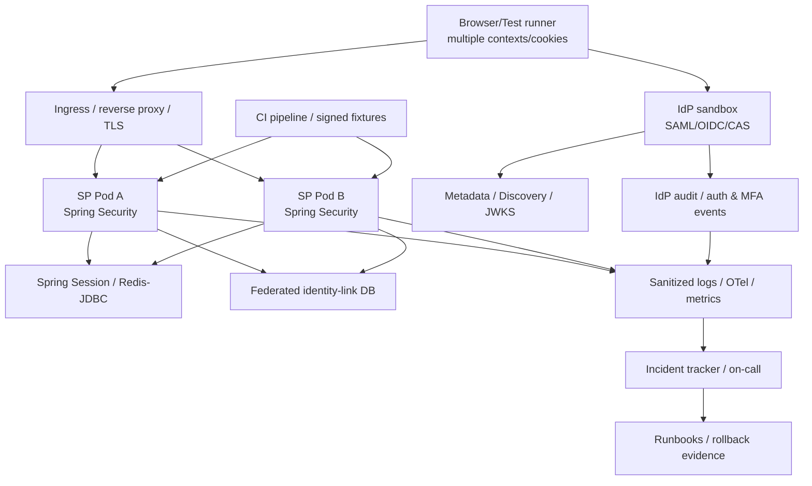
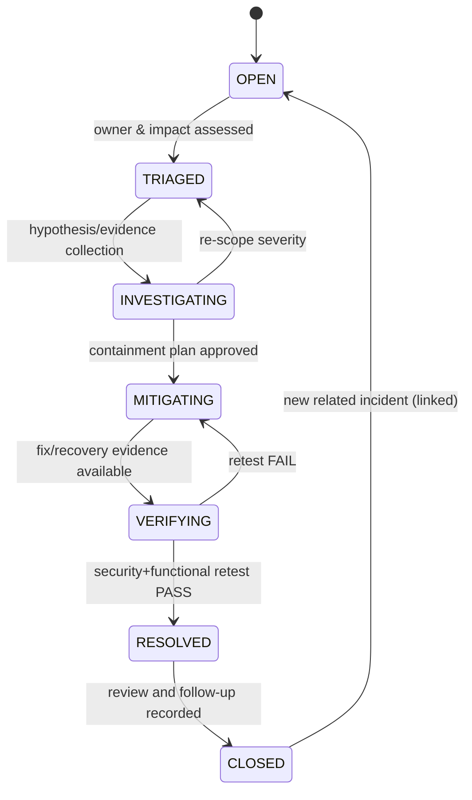

# Building a Security Test Suite, Incident Tracker, and Federation Operations Runbook

**Module:** Spring Security – federation → Comprehensive Practice.

**Objective:** build an end-to-end **federated authentication** operations toolkit for a Java/Spring Security application: (1) a **security test suite** with test cases, fixtures, assertions, CI, and evidence; (2) an **incident tracker** with severity, status, ownership, handling history, rollback decisions, and closure evidence; and (3) **operations runbooks** for IdP/metadata/certificate incidents, SAML/OIDC/CAS SSO, sessions, logout, account linking, multi-tenancy, and recovery. All three artifacts must connect via **stable test/incident/correlation identifiers**, protect sensitive data, and provide verifiable PASS/FAIL criteria.

**Security thesis:** "The IdP returned a 200 login page", "the HTTP callback returned 302", "a MockMvc unit test with `@WithMockUser` passed", or "an incident ticket was filed" **do not prove login security**. Results are trustworthy only when you verify **the real protocol + state/cryptographic validation + application sessions and permissions + negative cases blocked + incidents with owners and recovery evidence**. The test suite must prioritize defects leading to **unauthorized login, account takeover, cross-tenant bypass, misgranted privileges, or unrevoked sessions**, before UX or performance.

This guide covers Java 17+, Spring Security Servlet 6.x/7.x, SAML2, OpenID Connect (OIDC), CAS, and a sandbox IdP. **Not every application uses all three protocols:** the test suite must enable each protocol per actual deployment configuration rather than assuming a CAS logout message is identical to SAML2 SLO or an OIDC Logout Token. Example endpoints, issuers, IDs, ticket tables, and timestamps here are simulated data. The standalone Java 17 program in section 12 illustrates decision/gating logic and the incident lifecycle; **it does not parse or verify real XMLDSig/JWTs**. In production, use Spring Security/OpenSAML/JWT decoder libraries—never write a custom validator.

## 1. Deliverables and Definition of Done

| Deliverable | Required Contents | Primary Users | PASS Evidence |
| --- | --- | --- | --- |
| **Security test suite** | Scope, threat model, environments, matrix, automation, negative tests, CI gates, signed fixtures, evidence index | Developers, QA, AppSec | Reproducible test runs, explicit assertions, security controls intact |
| **Incident tracker** | Ticket schema, severity, status, owner/on-call, detection, impact, timeline, evidence, next action, resolution/review | On-call, IAM, SRE, AppSec, Support | Every incident has provenance, decisions, and recovery verification |
| **Federation runbook** | Diagnose, contain, recover, rollback, IdP contacts, certificate/metadata rotation, session/token revocation, post-incident follow-up | SRE, IAM, security responders | Tabletop drills and scenario fault injection |
| **Operational dashboard** | Login failures/SLO gaps, metadata age, trust expiry, IdP outages, session continuity, incident aging, high-risk unresolved items | On-call / incident commander | Alerts measure real capability without leaking secrets |
| **Release evidence pack** | CI builds + signed SAML/OIDC/CAS E2E reports, known risks, security exceptions, sign-off | Release manager / AppSec | Critical gates PASS, zero unhandled blockers |

**Definition of Done (DoD):**
1. SSO assets are inventoried: app/Relying Party, IdP, issuer, protocol, environment, tenant, ACS/redirect URI, logout, signing/trust keys, and metadata/discovery endpoints.
2. At least **one SAML2 SP-initiated happy path** runs against a real sandbox IdP, with callback verified by the framework and a follow-up request with the fresh cookie accessing a protected route. If OIDC/CAS are deployed, include matching E2E runs.
3. Negative tests prove forged responses, wrong issuer/audience, mismatched requests, token replay, and cross-session attempts **create no `Authentication`/app session**.
4. Session/SLO checks run **across multiple nodes** when deployed as a cluster; HTTP 200 callbacks leaving sessions active must FAIL.
5. Account linking uses solely verified `issuer+subject` (with SAML scope where needed), never auto-merging by email; disabled users and cross-tenant requests are blocked.
6. Pipelines record results with timestamps and commit/build/IdP-fixture versions; artifacts contain zero tokens/PII.
7. A simulated incident moves from detection through remediation and **VERIFYING → RESOLVED based on rerun evidence**, not merely a "fixed" comment.
8. Runbooks are rehearsed for at least one metadata outage, signing key rollover, and logout propagation failure.
9. Responders know exactly which events **require incident response** versus routine operational faults, distinguishing symptoms, impact, root cause, and exploit evidence.
10. Open security exceptions record scope, owner, and expiry; never use "known issue" to waive critical regressions.

Do not force a uniform test-case count across every app; the matrices below are an **exercise framework** where each case must map to an actual protocol/deployment. Never mark an unconfigured feature "PASS": use `NOT_APPLICABLE` with rationale and approval instead of faking green.

## 2. Test Lab Architecture



### 2.1. Recommended Environments

- **Unit:** validate policy for account mapping, state machines, session revocation, ticket-to-session indexes, URL allowlists, and risk classification; no real IdP required.
- **Spring integration:** `ApplicationContext`/`SecurityFilterChain`, MockMvc filters, real `SessionRepository`/Testcontainers Redis, repository lookups, and ACS response verification with profile-complete signed fixtures; avoid mocking away the security control under test.
- **Federation E2E:** test IdP emits **signed SAMLResponse, signed OIDC ID Token, and CAS service tickets** per contract across real browser contexts and network routes.
- **Chaos/staging:** decouple metadata URLs from IdP login URLs, inject TLS errors, timeouts, pod restarts, key revocations, Redis interruptions, and cross-node SLO callbacks.
- **Production canary:** approved synthetic accounts/services only—never forge assertions, disrupt real user sessions, or probe partner IdPs without permission; emit minimized telemetry.

**Fixture invariant:** tests mutate accounts, tenants, tickets, and sessions strictly inside the sandbox namespace. All signed samples use protected test keys, contain zero production credentials, and never use production private keys to forge assertions. Keep secrets in the CI secret manager; teardown cleans up test sessions, caches, and users per policy.

### 2.2. Pre-Test Inventory

| Field | Example (Simulated) | Control |
| --- | --- | --- |
| `service_id` | `portal-web` | Stable app identifier |
| `environment` | `staging` | Never mixed with production |
| `protocol` | `SAML2` | Dedicated suite per protocol |
| `registration_id` | `corp` | Spring server-owned allowlist |
| `idp_issuer` | `https://idp.example.test/metadata` | Exact trusted issuer |
| `sp_entity_id` | `https://portal.example.test/saml/sp` | Audience and metadata contract |
| `acs_url` | `https://portal.example.test/login/saml2/sso/corp` | Destination/Recipient |
| `slo_url` | `https://portal.example.test/logout/saml2/slo` | SAML2 logout, never confused with CAS |
| `idp_metadata_version` | `approved-M2` | Keyset K1+K2, expiry |
| `session_repository` | `spring-session-redis` | Shared across cluster |
| `identity_link_policy` | `issuer+subject+scope` | Never matches by email |
| `business_resource` | `/api/reports/weekly` | Where authorization is verified |
| `risk_tier` | `high` | Governs depth and retest frequency |
| `oncall_team` | `iam-oncall` | Operational escalation owner |

These values are examples only. Inventories must match real configs and IdP contracts; never accept an IdP issuer from user query parameters. Source of truth for registrations/trust belongs to IAM/AppSec.

## 3. Threat Model: Identifying What Can Go Wrong

**Assets to protect:** account `U-100`, session cookies, business APIs, data ownership/tenants, SAML assertions, OIDC ID/access/refresh tokens, CAS service tickets/TGTs, signing/decryption keys, metadata trust, audit trails, and incident evidence.

**Trust boundaries:**
- Browser → SP: requests/headers/form parameters are **untrusted** by default.
- IdP → browser → SP ACS: `SAMLResponse` requires **cryptographic validation**; browser delivery never makes a message trustworthy.
- OIDC redirect callback: authorization code/state travel through the browser; token endpoint/JWKS/issuer validation completes authentication.
- CAS server → service/client: service tickets must validate with trusted CAS; SLO callback sender/auth requires its own contract.
- SP → DB/session: internal mappings require unique keys, RBAC, TTLs, and atomic operations.
- SP ↔ IdP metadata/JWKS: trust sources must be pinned/verified per contract; key rotation must never create a "trust-all fallback".
- Logs/traces/incident attachments: sanitized data with access controls and retention.

### 3.1. Attacks and Defects That Must Be Tested

- Forged `SAMLResponse`, unsigned assertions, XML Signature Wrapping, wrong issuer, wrong Audience/Recipient/Destination, expired assertions, `InResponseTo` mismatch, and replay.
- Login CSRF / response fixation when original browser/session binding is lost, or `RelayState`/`state` is guessed or submitted from another browser.
- OIDC `state`/`nonce`/PKCE mismatch, wrong `iss`/`aud`/`azp`, `exp`/`nbf`, JWKS `kid`/`alg` confusion, code reuse, and open redirect URIs.
- CAS ticket replay, wrong service validation, spoofed back-channel SLO callbacks, and static `ST → session` maps failing across multiple nodes.
- Session fixation, CSRF, cross-site `SameSite` POSTs, `Secure`/`HttpOnly` cookies, and stale privilege retention / step-up bypass.
- Email-based account linking, cross-issuer subject collisions, disabled-account resurrection, and cross-tenant authorization bypass.
- Metadata trust / key rotation: accepting spoofed keys, stale metadata, insecure TLS, XML XXE, and SSRF.
- IdP outages, dropped callbacks, Redis timeouts, multi-tab/multi-IdP races, and concurrent logout/login races.
- Log injection, leaking raw tokens/assertions/session cookies, high-cardinality metrics, and missing incident evidence.
- Authentication succeeding while business resources return 403 (do not automatically blame federation), or returning 200 with insufficient roles (authorization bypass).

### 3.2. Requirement → Evidence Matrix

| Security Requirement | Technical Test | Evidence |
| --- | --- | --- |
| Only trusted IdPs can log users in | Untrusted Issuer / unknown key rejected | Framework auth failure, no new session |
| No assertion/token replay | Submit same message twice in isolated test | Second rejected, replay status recorded |
| No cross-session login | Wrong browser request/`nonce`/`state` | Session A unaffected; no auth in B |
| No cross-tenant access | Signed tenant B user requests tenant A data | 403 with zero data leakage |
| No email auto-linking | Same email, different `issuer+subject` | No account takeover; queued for review |
| SLO invalidates target session | Real SLO notification to another node | Old cookie unauthorized across all nodes |
| Safe key rollover | `K1 → K1+K2 → K2` signed fixtures | Valid K2 accepted only after trust approval |
| Incident closure evidence | Fail → fix → signed retest + owner approval | Ticket `RESOLVED` with linked run IDs |

**Never write a new custom SAML/JWT parser to "test" the library:** tests should generate fixtures from a test IdP/AS environment and exercise the **real Spring Security provider**. Standalone unit tests model only post-verification business logic.

## 4. Test Suite Structure in the Project

Suggested repository layout (descriptive—you do not need to create these exact files to follow the guide):

```text
federation-security/
  README.md
  scope/
    registrations.yml
    data-classification.md
    threat-model.md
    ownership.md
  testcases/
    saml2.yml
    oidc.yml
    cas.yml
    session-and-authorization.yml
    operations.yml
  fixtures/
    signed-saml/
      fixture-index.yml
    oidc/
      fixture-index.yml
    cas/
      fixture-index.yml
  src/test/java/
    .../unit/
    .../integration/
    .../e2e/
  env/
    idp-sandbox.yml
    trust-snapshot.yml
    fault-injection.yml
  ci/
    pipeline.yml
    evidence-policy.yml
  incidents/
    schema.md
    redacted-board-example.csv
    closure-template.md
  runbooks/
    idp-unavailable.md
    metadata-key-rotation.md
    saml-validation-failure.md
    logout-partial.md
    account-linking.md
    incident-escalation.md
  reports/
    run-manifest.json
    sanitized-results.json
    findings.md
```

**Never commit:** private keys, production metadata tokens, raw `SAMLResponse`s, OTPs, browser cookies, refresh tokens, service tickets, real users' emails/`NameID`s, or account recovery evidence. `fixture-index.yml` tracks fixture IDs, test signer key references, and checksums; signed fixtures containing sensitive data are stored only as encrypted, access-controlled test artifacts.

### 4.1. Standard Test Case Format

```yaml
id: SAML-NEG-003
title: Reject SAMLResponse with wrong Audience
protocol: SAML2
feature: login
priority: P0
risk: cross_service_authentication
environment: staging
owner_role: appsec
preconditions:
  - "Registered SP corp and signed sandbox response fixture"
  - "Browser session has one pending AuthnRequest"
action:
  - "Send sandbox-signed assertion with Audience for a different SP"
expected:
  - "SAML authentication rejected by provider"
  - "No authenticated SecurityContext persisted"
  - "GET protected route with original cookie remains unauthorized"
  - "Sanitized failure reason is recorded"
evidence:
  - "test_run_id"
  - "request_ref"
  - "failure_category"
  - "session_assertion"
security_constraints:
  - "No raw SAMLResponse or cookie in logs"
  - "No Signature/Audience validator disabled"
```

This is an **illustrative case-management schema**, not a built-in Spring DSL. If building a custom test runner, standardize the parser/schema and mapping to JUnit/Testcontainers/Playwright. `priority=P0` in a test case denotes **severity if the requirement fails**, not that a P0 incident has occurred.

### 4.2. Stable Test ID Rules

- Domain prefixes: `SAML-NEG-...`, `OIDC-NEG-...`, `CAS-...`, `SES-...`, `OPS-...`.
- Never change a test ID when renaming a test case; use versioning/changelogs.
- Every test carries an `owner_role` and links to requirements/controls (ASVS/NIST/OASIS/OIDC per version).
- Each run's result is `PASS, FAIL, BLOCKED, SKIPPED_APPROVED, NOT_APPLICABLE`; never treat `SKIP` as `PASS`.
- Every `FAIL` creates a **finding**; if production is impacted or exploitation risk is active, triage escalates it to an **incident** per policy.
- Flaky tests retain failure signals, carry a root-cause owner, and have a quarantine expiry; never delete cases just to turn the pipeline green.

## 5. SAML2 Security Test Matrix

Assumes SP-initiated Web Browser SSO via Spring Security SAML2. Signed cases must use authorized sandbox IdPs/keys, never real user assertions.

| ID | Test | Expected |
| --- | --- | --- |
| SAML-01 | SP-initiated login against right IdP | Signed response verified; session authenticated |
| SAML-02 | Unauthenticated browser visits protected route | Redirect/login flow; never 200 private content |
| SAML-03 | `AuthnRequest` with valid ID/Issuer/ACS | Pending request stored under right registration |
| SAML-04 | IdP returns signed Response with matching `InResponseTo` | Matches pending, verifies profile |
| SAML-05 | Response missing required signature | Reject; no `SecurityContext` created |
| SAML-06 | Assertion signed by unknown key | Reject; never auto-trust embedded `KeyInfo` |
| SAML-07 | XML signature modified after signing | Reject |
| SAML-08 | Signature Wrapping / duplicate IDs | Reject; parser/validator ignores unsigned elements |
| SAML-09 | Wrong IdP Issuer despite valid XML signature | Reject untrusted issuer |
| SAML-10 | Wrong Audience SP EntityID | Reject |
| SAML-11 | Wrong Recipient or Destination ACS | Reject |
| SAML-12 | Unknown `InResponseTo` | Reject |
| SAML-13 | `InResponseTo` from another browser | Reject login CSRF / fixation |
| SAML-14 | Replay same Response/Assertion ID | Reject on second attempt |
| SAML-15 | Expired Assertion | Reject; never widen skew arbitrarily |
| SAML-16 | Future `NotBefore` | Reject outside configured skew |
| SAML-17 | Requested `AuthnContext`/MFA weaker than policy | Reject / step-up per contract |
| SAML-18 | Invalid or forged `RelayState` | No untrusted redirect; no authorization |
| SAML-19 | Browser tabs A/B with two pending requests | No cross-contamination of response, session, or registration |
| SAML-20 | IdP-initiated response when SP policy forbids it | Reject unsolicited response |
| SAML-21 | Valid SAML auth yet disabled local app account | Deny protected access |
| SAML-22 | Same `NameID` string from another issuer | Never auto-link internal account |
| SAML-23 | Different `NameQualifier`/`SPNameQualifier` scope | Never mis-map user |
| SAML-24 | XML DTD/XXE/entity expansion payload | Reject / safe parse with bounded resources |
| SAML-25 | Oversized ACS POST | Bounded HTTP rejection; no resource exhaustion |
| SAML-26 | Browser omits original session cookie at ACS | Fail closed; investigate `SameSite` |
| SAML-27 | Metadata signing key rollover `K1+K2` | Approved keys accepted; unknown keys rejected |
| SAML-28 | Metadata endpoint down while trusted snapshot valid | Startup/login follows policy; never trust-all |
| SAML-29 | ACS callback hits node B, request issued on node A | Shared request/session store matches, or safe reject |
| SAML-30 | Authenticated cookie across pod A/B | Same logical session; no unauthorized resurrection |
| SAML-31 | SP local logout vs. SAML SLO | Report exact scope only; old cookie invalid |
| SAML-32 | RP-initiated SLO signed request/response | Matches IdP SLO contract and destroys session |
| SAML-33 | AP-initiated signed `LogoutRequest` | Verify issuer/signature; invalidate targeted session |
| SAML-34 | Unsigned / wrong-issuer SLO | Reject; never bulk-logout other users |
| SAML-35 | Lost, out-of-order, or replayed logout | Idempotent, observable, no false success |
| SAML-36 | Success handler redirects raw `RelayState` | Open redirect rejected |
| SAML-37 | Validation succeeds yet role is missing | Authenticated ≠ authorized; 403 proper |
| SAML-38 | Signed response yet wrong tenant | Deny account mapping / cross-tenant access |
| SAML-39 | Reverse proxy `Host` spoofing ACS URL | Canonical external URL allowlist enforced |
| SAML-40 | `SAMLResponse` and session cookies appear in logs | **QA FAIL / privacy incident** |

**Note:** on Spring Security 7.x, the provider may be `OpenSaml5AuthenticationProvider`, whereas 6.x has different API paths and principals; tests must use the **actual BOM**. A test that parses XML and checks `InResponseTo` via string comparison **does not replace** OpenSAML validation. For `SAML-26`, `SameSite` and session-bound repositories must be designed for cross-site POSTs without disabling original-browser binding.

## 6. OIDC/OAuth2 Login and Token Validation Matrix

**Distinction:** OAuth2 Authorization Code/PKCE is an authorization protocol; **OIDC** adds identity authentication via the **ID Token**. API Resource Servers validate **access tokens** by issuer/audience/scope—never use an ID Token as a bearer API token unless permitted by contract.

| ID | Test | Expected |
| --- | --- | --- |
| OIDC-01 | Valid Authorization Code Flow + PKCE | Login via OP, verified ID Token, session |
| OIDC-02 | Callback `state` mismatches pending request | Reject, no session |
| OIDC-03 | Missing/altered `nonce` | Reject ID Token per policy |
| OIDC-04 | Wrong `code_verifier` | Token exchange fails |
| OIDC-05 | Reused authorization code | Rejected by OP; no re-login |
| OIDC-06 | Invalid ID Token JWS signature | Reject |
| OIDC-07 | ID Token `iss` differs from trusted OP | Reject |
| OIDC-08 | ID Token `aud` omits client ID | Reject |
| OIDC-09 | Multi-audience `azp` invalid when required | Reject |
| OIDC-10 | Expired ID Token / invalid `nbf` | Reject |
| OIDC-11 | Unknown JWK `kid` or disallowed `alg` | Reject; never switch algorithms freely |
| OIDC-12 | Identical `sub` from two different `iss` | Never map to same internal account |
| OIDC-13 | Identical email yet different `iss+sub` | Never auto-link |
| OIDC-14 | Unallowlisted redirect URI / open redirect | Authorization request rejected |
| OIDC-15 | Discovery/JWKS endpoint timeout | Never skip signature checks; explicit cache policy |
| OIDC-16 | Key rotation overlap in JWKS | New key trusted via approved issuer/source |
| OIDC-17 | OAuth access token with wrong `aud` | Resource server rejects |
| OIDC-18 | Access token missing scope/role | 403 per app policy |
| OIDC-19 | Expired bearer token | 401; no refresh bypass |
| OIDC-20 | Refresh token rotation / reuse detection | Per OP contract; reused token denied |
| OIDC-21 | Back-channel Logout Token invalid signature | Reject; never revoke arbitrary sessions |
| OIDC-22 | Valid back-channel logout `sid`/`sub` | Revoke exact target sessions per OP policy |
| OIDC-23 | Wrong RP-initiated logout URI / unallowlisted redirect | Reject or safe fallback |
| OIDC-24 | API accepts ID Token as access token | Security QA FAIL |
| OIDC-25 | Confusing OAuth client `registrationId` with OP issuer | Trusted issuer is source of truth |
| OIDC-26 | Multiple browser tabs OAuth state | Never overwrite or mix state |
| OIDC-27 | Session cookie `SameSite`/CSRF | No login CSRF / session fixation |
| OIDC-28 | User disabled after valid OIDC token | App authorization/lifecycle denies |
| OIDC-29 | Client secret leaked in CI logs | Secret redaction and incident |
| OIDC-30 | IdP outage while existing app session valid | Existing session policy independent of interactive login |

Spring Security docs cover `oauth2Login`, `OidcClientInitiatedLogoutSuccessHandler`, and OIDC Back-Channel Logout mechanisms **when configured per the OP contract**. **Never assume** enabling SAML logout enables OIDC back-channel or CAS SLO. Logout endpoints, token semantics, and replay validation differ across protocols.

## 7. CAS Protocol, Session, and Logout Matrix

In CAS, distinguish the **Ticket-Granting Ticket (TGT)** on the CAS Server, the TGC cookie on the CAS domain, per-service **Service Tickets (ST)**, and the application's **`HttpSession`**. CAS **Single Sign-Out** normally sends a `logoutRequest` carrying `SessionIndex=<ST ID>`—which does **not have identical semantics to a SAML2 SP `LogoutRequest` `SessionIndex`**.

| ID | Test | Expected |
| --- | --- | --- |
| CAS-01 | Valid service ticket for exact `service` | CAS client authenticates; app session created |
| CAS-02 | Replay ST after single use | Reject |
| CAS-03 | ST issued for service A sent to service B | Reject wrong service |
| CAS-04 | Invalid CAS server trust/TLS | Never disable server certificate verification |
| CAS-05 | Browser loses TGC while app session remains | Understand session layers; never fake global logout |
| CAS-06 | CAS TGT logout after logging into 2 apps | SLO callbacks reach exact registered services |
| CAS-07 | `SessionIndex` in CAS `logoutRequest` maps `ST → HttpSession` | Destroys only matching app session |
| CAS-08 | Portal node A creates session; node B receives SLO | Distributed `ST → session` mapping revokes cleanly |
| CAS-09 | Duplicate SLO callback | Idempotent; never destroys newer sessions |
| CAS-10 | Forged SLO callback from Internet | Authenticated CAS sender policy rejects |
| CAS-11 | Missing SLO while CAS logout page returns 200 | **Never** mark downstream sessions PASS |
| CAS-12 | Two tabs sharing one cookie | One app session; never fake two |
| CAS-13 | Same user holding two distinct CAS TGTs | Logging out TGT1 leaves TGT2 session intact per policy |
| CAS-14 | Browser blocks front-channel SLO | Detect browser-dependent failure |
| CAS-15 | Misrouted CAS metadata / service registry | Exact `serviceId`/`logoutType`/`logoutUrl` |
| CAS-16 | Redirect/logout loop or blocked CSRF filter | Narrow SLO endpoint contract; never disable CSRF app-wide |
| CAS-17 | Session fixation after CAS login | `ST → current session` binding updated |
| CAS-18 | Incompatible `javax.servlet` vs. `jakarta.servlet` CAS client | Fails early at compile/integration; no hacks |
| CAS-19 | Local portal logout while CAS TGT stays alive | User may silently re-SSO; UX explains clearly |
| CAS-20 | Raw CAS test payload logged verbatim | QA FAIL / secret exposure |

**CAS SLO pass verification is not measured by counting HTTP 200 callbacks**, but by sending a follow-up request to every app using the **old cookie, which must be unauthenticated**, even across different nodes; confirm sessions from other TGTs remain untouched. With Spring Session, a distributed **`ST → session` index** is still required if the CAS client stores mappings locally.

## 8. Cross-Cutting Tests: Sessions, Authorization, Multi-Tenancy, Observability

| ID | Scenario | Expected |
| --- | --- | --- |
| SES-01 | Unauthenticated user hits protected route | 302 login or 401 per context; never 200 data |
| SES-02 | User authenticates; next request uses new cookie | `SecurityContext` persisted |
| SES-03 | Session ID rotates on login | No fixation; old ID unusable |
| SES-04 | `Secure`/`HttpOnly`/`SameSite` cookies per risk | Never leaked or sent out of context |
| SES-05 | Cross-site POST to protected business route without CSRF | 403; narrow SLO/ACS exemptions only per contract |
| SES-06 | Idle/absolute session timeout | Stale request forces reauth |
| SES-07 | Account disabled while session alive | Access/revocation policy enforced |
| SES-08 | Step-up MFA required for sensitive operation | Weak or freshness-expired session denied |
| SES-09 | Tenant B user hits tenant A API | 403, zero data leakage |
| SES-10 | Role mapping from new IdP with different semantics | Never auto-grant admin |
| SES-11 | Signed assertion carrying another account's email | Never auto-link |
| SES-12 | Multiple sessions/pods | Shared state consistent and revocable |
| SES-13 | Redis/session store unavailable | Fail safe; never resurrect authenticated sessions |
| SES-14 | Concurrent logout racing an in-flight request | Never resurrect state / verify revocation |
| SES-15 | Attacker-controlled redirect URL parameter | Open redirect rejected |
| SES-16 | Spoofed trace/header/user-supplied correlation ID | Never used for auth; sanitize |
| SES-17 | Logs/HTTP captures contain raw assertions/tokens/cookies | QA FAIL |
| SES-18 | Metrics use subject/request IDs as labels | QA FAIL due to cardinality/privacy |
| SES-19 | Revoked `issuer+subject` link | Login denied; no JIT resurrection |
| SES-20 | Two link transactions racing onto two accounts | DB uniqueness/concurrency blocks takeover |
| SES-21 | IdP A outage while IdP B healthy | Failure isolated per registration |
| SES-22 | Production key rotation across multiple versions | Canary/pods hold consistent trusted keys |
| SES-23 | System clock skew | Reject outside bounded policy; alert NTP |
| SES-24 | TLS across reverse proxy/SP/IdP | Canonical scheme/`Host`/origin trust |
| SES-25 | Signing/decryption key secret rotation | Zero plaintext leaks; rollback policy |
| SES-26 | Audit exporter offline | Authentication controls never bypassed |
| SES-27 | Signed Response replayed in same session | Reject |
| SES-28 | Old app session cookie after logout | Unauthenticated across all nodes |
| SES-29 | Fresh login after logout | Valid new auth; old session stays revoked |
| SES-30 | Email-only account recovery | Never auto-takes over account |

**The most critical test is checking an independent request after login or logout.** Mocking an authentication context inside a controller test **cannot** verify SAML/CAS/OIDC handshakes, session fixation protection, cookie delivery, or multi-node persistence.

## 9. Automation: Unit → Integration → E2E → Chaos

### 9.1. Unit and Policy Tests

Targets:
- `issuer+subject` identity keys and tenant allowlists;
- deterministic role mapping and inactive-account denials;
- CSRF / return-URL allowlist policies;
- SLO ticket/session indexing and single-use/replay rules;
- incident severity classification, transition rules, and closure evidence;
- metadata refresh candidate approval/rejection and trusted key snapshots;
- retry/backoff ceilings;
- redaction and metric-label allowlists.

Use JUnit 5 parameterized tests, AssertJ, and Mockito in real projects. Never mock the Spring SAML provider and claim the mock result proves "SAML signature verified"; mock upstream services only **beyond the trust boundary** to test business logic.

### 9.2. Spring Boot Integration Tests

Test layers:
- `@SpringBootTest` with the runtime `SecurityFilterChain`.
- `@AutoConfigureMockMvc` for HTTP routing/authorization, using `spring-security-test` fixtures at the **appropriate layer**.
- Testcontainers Redis/JDBC for Spring Session and unique identity-link storage.
- Real SAML response verification with signed sandbox fixtures and trusted test signing certificates; never accept unsigned XML just for tests.
- Real `Saml2AuthenticationRequestRepository` and original browser session binding.
- OIDC token decoder against signed fixtures / JWKS test server or OP sandbox verifying issuer/audience/nonce/state.
- CAS client `serviceValidate` / SLO callback sandbox verifying cross-node behavior.
- HTTP CSRF on business actions; narrow SSO-specific exemptions only where required by the framework.

**Spring Security config fragment** (use only in an app with configured registrations and a sandbox IdP):

```java
package com.example.federation;

import org.springframework.context.annotation.Bean;
import org.springframework.context.annotation.Configuration;
import org.springframework.security.config.Customizer;
import org.springframework.security.config.annotation.web.builders.HttpSecurity;
import org.springframework.security.web.SecurityFilterChain;

@Configuration
class FederationSecurityConfig {
    @Bean
    SecurityFilterChain federationFilterChain(HttpSecurity http)
            throws Exception {
        http
            .authorizeHttpRequests(auth -> auth
                .requestMatchers("/health", "/login-error").permitAll()
                .requestMatchers("/admin/**").hasRole("ADMIN")
                .anyRequest().authenticated())
            .saml2Login(Customizer.withDefaults())
            .saml2Logout(Customizer.withDefaults());
        return http.build();
    }
}
```

**Not standalone:** requires `spring-security-saml2-service-provider`, `RelyingPartyRegistrationRepository`, real sandbox metadata/keys, controllers, and an SLO contract. Enable `saml2Logout` only when the IdP supports SAML SLO and the SP has signing credentials; never paste a blanket config into an OIDC/CAS app and assume every protocol is tested.

### 9.3. Scoped MockMvc Smoke Test

```java
package com.example.federation;

import org.junit.jupiter.api.Test;
import org.springframework.beans.factory.annotation.Autowired;
import org.springframework.boot.test.autoconfigure.web.servlet.AutoConfigureMockMvc;
import org.springframework.boot.test.context.SpringBootTest;
import org.springframework.test.web.servlet.MockMvc;

import static org.springframework.test.web.servlet.request.MockMvcRequestBuilders.get;
import static org.springframework.test.web.servlet.result.MockMvcResultMatchers.status;

@SpringBootTest
@AutoConfigureMockMvc
class AnonymousRouteSecurityTest {
    @Autowired MockMvc mvc;

    @Test
    void anonymousCannotReadAdminAs200() throws Exception {
        mvc.perform(get("/admin/"))
            .andExpect(result -> {
                int code = result.getResponse().getStatus();
                if (code == 200) {
                    throw new AssertionError(
                        "Anonymous user received admin resource");
                }
                if (code < 300 || code >= 500) {
                    throw new AssertionError(
                        "Unexpected response status: " + code);
                }
            });
    }
}
```

**Prerequisites:** the real app defines `/admin/` and a matching filter chain; unauthorized responses may be 302 login, 401, or 403 depending on entry point/CSRF/context. This test proves only that an **anonymous route does not return HTTP 200** under those assumptions—it **does not prove** SAML/IdP signatures were verified or user roles work. E2E suites must add signed sandbox `SAMLResponse`s and post-login authorization requests without conflating test levels.

### 9.4. Browser and Sandbox IdP E2E

1. Browser context A requests a protected route; record a correlation ref (never the raw cookie).
2. SP issues an `AuthnRequest` ID or OAuth2 `state`/PKCE, or CAS service redirect accordingly.
3. Sandbox IdP handles login/MFA per policy and signs the assertion/token with test keys.
4. Browser returns to ACS / OIDC callback / CAS client `serviceValidate`.
5. App establishes `SecurityContext`, session cookie, and principal mapped to the right `account_id`/tenant.
6. New GET request to protected API: assert resource matches user/tenant/role.
7. Browser context B with another identity: cannot reuse context A.
8. Negative signed/invalid fixtures: wrong issuer/audience/nonce/`RelayState` must reject.
9. Trigger local logout and federated logout per protocol; verify old session cookies fail across all nodes.
10. Simulate IdP SSO/metadata/JWKS outages and Redis network chaos; record expected degraded capability.
11. Capture sanitized `test_run_id`, `case_id`, build SHA, environment, expected/actual, timestamps, and trusted event codes.
12. Clean up test accounts/sessions; never keep raw HAR/`SAMLResponse` files in general artifacts.

### 9.5. Suggested CI/CD Pipeline

```yaml
name: federation-security
on:
  pull_request:
  push:
    branches: [main]
jobs:
  unit-and-integration:
    runs-on: ubuntu-latest
    permissions:
      contents: read
    steps:
      - uses: actions/checkout@v4
      - uses: actions/setup-java@v4
        with:
          distribution: temurin
          java-version: '17'
          cache: maven
      - name: Run deterministic unit and integration gates
        run: mvn -B -ntp verify
      - name: Archive sanitized test reports
        if: always()
        uses: actions/upload-artifact@v4
        with:
          name: federation-test-reports
          path: target/surefire-reports/
```

**This CI config is illustrative only if using GitHub Actions and Maven.** It omits IdP sandbox and Testcontainers provisioning: real projects add isolated ephemeral IdP/Redis/test CA services, secret injection, job permissions/approvals, integration test tags, and artifact secret-scanning rules. Pin `actions@v4` by commit SHA or per organization trust policy before production. Never expose signed production credentials to public runners.

### 9.6. Release Gates

| Gate | Rule |
| --- | --- |
| G0 – Build reproducibility | Source/BOM/tests build cleanly; SBOM/scans per policy |
| G1 – SAML/OIDC/CAS core auth | Applicable protocol suite PASSes |
| G2 – Negative security | Forged/expired/replayed/cross-tenant responses DENIED |
| G3 – Session/logout | Session fixation & revocation tests PASS |
| G4 – Identity mapping | No email auto-linking; account ID continuity |
| G5 – Operational chaos | Metadata/IdP outages, key rotation, and node restarts follow runbooks |
| G6 – Privacy/evidence | Zero raw secrets/PII in reports/logs |
| G7 – Incident review | Unresolved P0/P1 blockers have recorded decisions and owners |
| G8 – Sign-off | QA/AppSec/IAM/SRE approval per RACI |

**Never bypass G2 via "expected flaky" or hardcode `AUTHENTICATED=true` in test fixtures.** When a gate does not apply, record an approved `N/A reason`; on failure, block the release per policy and open an incident/finding based on impact.

## 10. Incident Tracker

### 10.1. Distinguishing Finding, Defect, Incident, and Change

- **Finding:** test output showing a missing control in sandbox; production may not be affected.
- **Defect:** software bug requiring code/config fix; not necessarily an active incident.
- **Security incident:** suspected or confirmed threat activity or real exposure affecting confidentiality/integrity/availability requiring formal response.
- **Operational incident:** IdP/metadata/session-store disruption affecting service availability, with or without an attacker.
- **Change request:** planned work such as key rollover or metadata update; not an incident unless it goes wrong.
- **Problem/RCA:** long-term root-cause analysis across one or more incidents.

A failing security test in CI creates a finding/defect; if the same flaw exists in production or exploitation evidence appears, triage promotes it to an incident. **Never mark every test failure P0, nor downgrade dangerous production-exploitable flaws to "just a test".**

### 10.2. Required Board Fields

| Field | Example or Rule |
| --- | --- |
| `incident_id` | `INC-FED-2026-001`, unique |
| `title` | "SAML Response accepted for wrong Audience" |
| `created_at`, `detected_at` | UTC ISO 8601 |
| `reported_by/source` | `CI gate SAML-10`, alert, user, IdP |
| `environment` | staging / production |
| `service/registration/protocol` | portal / corp / SAML2 |
| `category` | `AUTH_BYPASS`, `IDP_OUTAGE`, `SLO_GAP`, `KEY_ROTATION`... |
| `severity` | SEV0 / SEV1 / SEV2 / SEV3 per policy |
| `priority` | Triage/remediation priority; may differ from severity |
| `impact_scope` | Affected accounts/tenants/services, pseudonymized |
| `confirmed_vs_suspected` | Never assume certainty without evidence |
| `status` | `OPEN`, `TRIAGED`, `INVESTIGATING`, `MITIGATING`, `VERIFYING`, `RESOLVED`, `CLOSED` |
| `owner`/`incident_commander` | Accountable person/team actively engaged |
| `security_approver` | Decides trust/rollback/exceptions |
| `idp_contact` | Vendor contact reference; store no credentials |
| `first_response_due_at` | Per internal SLA; never invent arbitrary times |
| `next_update_at` | Stakeholder communication cadence |
| `last_update_at` | UTC |
| `correlation_refs` | Sanitized trace/request/authn/incident refs |
| `test_case_ids` | `SAML-10`, `SES-28` |
| `evidence_links` | Restricted artifacts with RBAC |
| `containment_action` | Disable IdP registration, revoke keys/sessions... |
| `rollback_action` | Revert config/version or disable feature |
| `customer_impact` | Yes / no / undetermined with grounded metrics |
| `root_cause` | Confirmed only after investigation |
| `fix_commit/config_version` | Remediation version |
| `retest_run_id` | Run proving remediation |
| `review_approval` | AppSec/IAM/SRE per severity |
| `resolution_at`/`closed_at` | Recorded only in the matching state |
| `postmortem_link` | RCA, preventive actions |

ID fields are not bearer secrets, yet a reference paired with PII can still reveal staff/infrastructure details; limit general dashboards to authorized responders.

### 10.3. Simulated Incident Board Example

| ID | SEV | Status | Issue | Owner Role | Required Evidence | Next Action |
| --- | --- | --- | --- | --- | --- | --- |
| INC-FED-001 | SEV1 | MITIGATING | ACS callback creates session despite wrong `Audience` in staging regression | AppSec + backend | Signed negative fixture, no-session retest | Roll back custom validator and run G2 |
| INC-FED-002 | SEV2 | INVESTIGATING | IdP metadata HTTP 503, LKG valid, IdP SSO OK | IAM + SRE | Snapshot age, login canary, refresh logs | Restore metadata source; avoid restart storm |
| INC-FED-003 | SEV1 | VERIFYING | CAS SLO callback on node B fails to revoke session on node A | Backend + SRE | Cross-pod old-cookie test, redacted ST-map refs | Verify shared `ticket → session` index |
| INC-FED-004 | SEV1 | TRIAGED | OIDC state mismatch ignored in sandbox | AppSec | Real framework callback denial test | Block release; assess impact |
| INC-FED-005 | SEV2 | OPEN | New IdP email matches old account without link | IAM | Identity-link DB record + access audit | Quarantine auto-link; run dual-proof |
| INC-FED-006 | SEV3 | RESOLVED | Session correlation logs missing trace after ACS | Observability | Sanitized run ID, trace joins | Close after verifying data minimization |

Severities in this table are **illustrative** and reflect no real incident. Assign SEV by likelihood, blast radius, exploitability, and real business impact—not user count alone.

### 10.4. CSV Schema for Tool Import

```csv
incident_id,status,severity,protocol,service,registration,category,owner_role,test_case_id,environment,detected_at,next_update_at,evidence_ref
INC-FED-101,TRIAGED,SEV2,SAML2,portal,corp,METADATA_REFRESH,sre,SAML-28,staging,2026-11-07T03:00:00Z,2026-11-07T04:00:00Z,evidence-redacted-101
INC-FED-102,VERIFYING,SEV1,CAS,portal,corp,SLO_GAP,iam,CAS-08,staging,2026-11-07T03:10:00Z,2026-11-07T03:30:00Z,evidence-redacted-102
```

This CSV is only a **structural sample**, not a live production board. After import, enforce types/required fields/validation, RBAC, immutable event history, time zones, and exclude raw `SAMLResponse`s/tickets from attachments. Every row must link to a real ticket with versioning/auditing.

### 10.5. State Machine and Semantics



**Never permit `OPEN → CLOSED` just for "cannot reproduce".** Reaching `RESOLVED` requires mitigation evidence and a negative-test rerun; `CLOSED` requires review/communication per policy. If responders must mark a false positive, use terminal state `DISMISSED` with evidence and separate approval rather than faking `PASS`.

### 10.6. Incident Severities

- **SEV0 (crisis):** signs of active widespread exploitation, severe identity/privilege compromise, or large-scale signing-key/identity-trust compromise; activate security incident commander per policy.
- **SEV1 (critical):** feasible authentication bypass, cross-tenant data access, high-risk broken SLO/revocation, or widespread inability to log into a critical app.
- **SEV2 (moderate):** partial IdP degradation, single-tenant login outage, metadata refresh failure while valid LKG remains, or bug with a safe workaround.
- **SEV3 (low):** missing log correlation, minor warning/UX defect, or monitoring gap that does not weaken security controls.

**This is an example taxonomy for organization approval**, not a fixed SLA mandated by NIST/OWASP. An IdP outage on a mission-critical service can escalate to SEV1/SEV0 by impact; invalid signed metadata may signal compromise and require immediate escalation.

### 10.7. RACI / Responsibility Matrix

| Task | Responsible | Accountable | Consulted |
| --- | --- | --- | --- |
| SAML/OIDC/CAS trust contract | IAM federation engineer | IAM service owner | IdP vendor, AppSec |
| Authentication/authorization code | Backend developer | App technical owner | AppSec, QA |
| Multi-node session/SLO | SRE + Backend | Platform owner | IAM |
| Security test suite | QA automation + AppSec | Release security approver | Backend, IAM |
| Monitoring / on-call response | SRE on-call | Incident commander | IAM, Support |
| Confirm exploitability / data exposure | AppSec / IR | Security incident lead | Privacy/Legal as needed |
| Approve signing key rollover | IAM/PKI owner | Security key owner | SRE |
| External user communication | Support / Communications | Incident commander | Legal/Privacy/Customer Success |
| Incident closure and RCA | Assigned owner | Incident commander | QA/AppSec/IAM |

Even when a vendor IdP manages keys, your organization must still assign an **owner to verify metadata/key changes** before the SP trusts them. "IdP is working on it" never justifies leaving the on-call owner blank.

## 11. From a Failing Test to a Grounded Incident

Example: `SAML-10` detects the SP accepting a signed assertion whose `Audience` belongs to another service.

### 11.1. Evidence Flow

```text
CI run RUN-401
   |
   +-- Case SAML-10 FAIL
   |     fixture_ref=f-signed-wrong-aud
   |     expected=reject
   |     actual=authenticated app session
   |
   +-- Finding FIND-401 created
   |
   +-- Triage production exposure?
         |
         +-- no deployment yet -> release-blocking defect
         |
         +-- deployed/exploitable/unknown -> Incident INC-FED-001
                                        |
                                        +-- owner, severity, impact
                                        +-- containment/rollback
                                        +-- verify session revocation
                                        +-- patch default validators
                                        +-- rerun signed negative test
                                        +-- approval/recovery
```

Minimum evidence:
- `build_sha` / artifact version, Spring Security BOM, IdP metadata version/key refs.
- Case ID, fixture ID, test runner version, UTC timestamp, environment.
- **Expected vs. actual** security outcome—not merely HTTP status.
- Session presence/absence after callback and follow-up request.
- Sanitized correlation ID/trace, IdP/SAML issuer ref, rejection code.
- Approved mitigation action, owner, and rollback decision.
- Rerun pass link and evidence review status.

**Never paste raw assertions/cookies into incident descriptions**; store forensic artifacts in restricted encrypted storage if Legal/IR needs them. Separate **evidence integrity** from dashboard text: signed artifact manifests/checksums and access logs can support incident policy.

### 11.2. Triaging: Symptom Differs from Root Cause

| Symptom | Possible Cause | Do Not Jump to Wrong Conclusion |
| --- | --- | --- |
| Login 302 loop | `SameSite` cookie, session persistence, wrong ACS, IdP SSO | "Wrong password" |
| IdP login page 200 | Only IdP UI is reachable | "Full SSO PASS" |
| Signed response rejected | Key rollover, Audience/Recipient, Issuer, clock skew, `InResponseTo` | "Disable signature check" |
| Existing users OK, new users fail | IdP SSO down, metadata trust expired, OAuth token endpoint | "App is unhealthy" |
| CAS logout page OK yet app session active | Lost SLO message, local ST mapping, wrong node | "Logout done" |
| OIDC JWKS fetch fails | Network/discovery stale, key mismatch | "Trust arbitrary `kid`" |
| User switches IdP and sees empty account | Auto-provision / missing identity link | "Data was deleted" |
| 403 after successful login | Role/tenant authorization mapping | "SAML assertion invalid" |
| Logs contain `NameID` and `SAMLResponse` | Unsafe logging filter / debug mode | "Harmless in test env" |

## 12. Standalone Runnable Java 17: Mini Security Gate + Incident Board

`FederationSecurityDrill.java` trains **two responsibilities**:
- The **security gate** evaluates fixtures marked by the harness as signed/verified or invalid, enforcing issuer, audience, `InResponseTo`, time window, and replay. Every negative test must be rejected.
- The **SLO** component tracks a `service ticket → application session` map; a callback invalidates only the linked session, and duplicate callbacks are no-ops.
- The **incident board** enforces `TRIAGED → MITIGATING → VERIFYING` before `RESOLVED`; it blocks moving to `VERIFYING` without evidence and blocks closing without rerun proof.
- The test harness prints each `PASS` and total checks without networks, tokens, or real accounts.

**Important:** the `signatureVerified` boolean in the demo **is not a trusted browser input**. Production must rely on Spring Security/OpenSAML/JWT decoder/CAS ticket validation to establish trust. This example tests **business logic and state transitions**, not E2E.

```java
import java.time.Instant;
import java.util.HashMap;
import java.util.HashSet;
import java.util.Map;
import java.util.Set;

public class FederationSecurityDrill {
    static final Instant NOW =
            Instant.parse("2026-11-07T03:00:00Z");
    static final String IDP = "https://idp.example.test/metadata";
    static final String SP = "https://portal.example.test/saml/sp";

    record SamlFixture(
            String responseId, String issuer, String audience,
            String inResponseTo, Instant notBefore, Instant expiresAt,
            boolean signatureVerified) {}

    static final class SamlGate {
        private final Set<String> usedResponses = new HashSet<>();

        boolean accept(SamlFixture f, String expectedRequestId) {
            if (f == null || !f.signatureVerified()
                    || !IDP.equals(f.issuer())
                    || !SP.equals(f.audience())
                    || !expectedRequestId.equals(f.inResponseTo())
                    || NOW.isBefore(f.notBefore())
                    || !NOW.isBefore(f.expiresAt())) {
                return false;
            }
            return usedResponses.add(f.responseId());
        }
    }

    static final class ServiceSessions {
        private final Map<String, String> ticketToSession = new HashMap<>();
        private final Set<String> active = new HashSet<>();

        void create(String ticket, String sessionId) {
            if (ticketToSession.putIfAbsent(ticket, sessionId) != null) {
                throw new IllegalArgumentException("Ticket duplicate");
            }
            active.add(sessionId);
        }

        boolean logoutVerifiedTicket(String ticket) {
            String session = ticketToSession.remove(ticket);
            return session != null && active.remove(session);
        }

        boolean active(String sessionId) {
            return active.contains(sessionId);
        }
    }

    enum Status { OPEN, TRIAGED, MITIGATING, VERIFYING, RESOLVED }

    static final class Ticket {
        Status status = Status.OPEN;
        String evidenceRef = "";
    }

    static final class IncidentBoard {
        private final Map<String, Ticket> tickets = new HashMap<>();

        void open(String id) {
            if (tickets.putIfAbsent(id, new Ticket()) != null) {
                throw new IllegalArgumentException("Incident duplicate");
            }
        }

        boolean move(String id, Status next, String evidence) {
            Ticket ticket = tickets.get(id);
            if (ticket == null) return false;
            boolean allowed = switch (ticket.status) {
                case OPEN -> next == Status.TRIAGED;
                case TRIAGED -> next == Status.MITIGATING;
                case MITIGATING -> next == Status.VERIFYING;
                case VERIFYING -> next == Status.RESOLVED;
                case RESOLVED -> false;
            };
            if (!allowed) return false;
            if ((next == Status.VERIFYING
                    || next == Status.RESOLVED)
                    && (evidence == null || evidence.isBlank())) {
                return false;
            }
            ticket.status = next;
            if (evidence != null && !evidence.isBlank()) {
                ticket.evidenceRef = evidence;
            }
            return true;
        }

        Status status(String id) {
            return tickets.get(id).status;
        }
    }

    static int passed = 0;

    static void check(String id, boolean condition) {
        if (!condition) {
            throw new AssertionError(id);
        }
        passed++;
        System.out.println("PASS " + id);
    }

    public static void main(String[] args) {
        SamlGate saml = new SamlGate();

        SamlFixture good = new SamlFixture(
                "RESP-1", IDP, SP, "REQ-1",
                NOW.minusSeconds(10), NOW.plusSeconds(60), true);
        check("saml-valid", saml.accept(good, "REQ-1"));
        check("saml-replay", !saml.accept(good, "REQ-1"));

        SamlFixture unsigned = new SamlFixture(
                "RESP-2", IDP, SP, "REQ-1",
                NOW.minusSeconds(10), NOW.plusSeconds(60), false);
        check("saml-unsigned", !saml.accept(unsigned, "REQ-1"));

        SamlFixture wrongIssuer = new SamlFixture(
                "RESP-3", "https://evil.example.test/idp",
                SP, "REQ-1",
                NOW.minusSeconds(10), NOW.plusSeconds(60), true);
        check("saml-wrong-issuer",
                !saml.accept(wrongIssuer, "REQ-1"));

        SamlFixture wrongAudience = new SamlFixture(
                "RESP-4", IDP, "https://other-sp.example.test",
                "REQ-1", NOW.minusSeconds(10),
                NOW.plusSeconds(60), true);
        check("saml-wrong-audience",
                !saml.accept(wrongAudience, "REQ-1"));

        SamlFixture wrongRequest = new SamlFixture(
                "RESP-5", IDP, SP, "REQ-OTHER",
                NOW.minusSeconds(10), NOW.plusSeconds(60), true);
        check("saml-wrong-request",
                !saml.accept(wrongRequest, "REQ-1"));

        SamlFixture expired = new SamlFixture(
                "RESP-6", IDP, SP, "REQ-1",
                NOW.minusSeconds(120), NOW.minusSeconds(1), true);
        check("saml-expired",
                !saml.accept(expired, "REQ-1"));

        ServiceSessions sessions = new ServiceSessions();
        sessions.create("ST-A", "session-A");
        sessions.create("ST-B", "session-B");

        check("slo-exact-target",
                sessions.logoutVerifiedTicket("ST-A")
                && !sessions.active("session-A")
                && sessions.active("session-B"));
        check("slo-duplicate-idempotent",
                !sessions.logoutVerifiedTicket("ST-A"));

        IncidentBoard board = new IncidentBoard();
        board.open("INC-FED-001");
        check("incident-triaged",
                board.move("INC-FED-001", Status.TRIAGED, ""));
        check("incident-mitigating",
                board.move("INC-FED-001", Status.MITIGATING, ""));
        check("incident-no-evidence-no-verify",
                !board.move("INC-FED-001", Status.VERIFYING, ""));
        check("incident-verify-with-evidence",
                board.move("INC-FED-001",
                    Status.VERIFYING, "RUN-FIX-401"));
        check("incident-resolve-with-rerun",
                board.move("INC-FED-001",
                    Status.RESOLVED, "RUN-RETEST-402")
                && board.status("INC-FED-001") == Status.RESOLVED);

        System.out.println("TOTAL_PASS=" + passed);
    }
}
```

**Command:**

```bash
javac FederationSecurityDrill.java
java FederationSecurityDrill
```

**Exact stdout:**

```text
PASS saml-valid
PASS saml-replay
PASS saml-unsigned
PASS saml-wrong-issuer
PASS saml-wrong-audience
PASS saml-wrong-request
PASS saml-expired
PASS slo-exact-target
PASS slo-duplicate-idempotent
PASS incident-triaged
PASS incident-mitigating
PASS incident-no-evidence-no-verify
PASS incident-verify-with-evidence
PASS incident-resolve-with-rerun
TOTAL_PASS=14
```

### 12.1. Limitations to State Explicitly

- `SamlFixture` **neither parses XML nor checks X.509/XMLDSig**. A test-supplied `signatureVerified` flag does not prove an attacker cannot forge payloads on a real server. Never accept boolean/issuer/subject values from requests as an authenticated principal.
- The gate checks only issuer, audience, `InResponseTo`, timestamps, and basic replay; **production also enforces** destination, recipient, subject confirmation, exact signature-reference validation, conditions, account/tenant checks, original session binding, and key trust.
- `usedResponses` is a local `HashSet`, neither thread-safe nor distributed; production needs a robust request repository / replay cache / lifecycle.
- `ticketToSession` only models CAS `ST → local session`. Real CAS SLO needs authenticated callbacks, verified `SessionIndex`, a shared session store, and fail-safe multi-node deletion.
- `IncidentBoard` lacks a durable DB, RBAC, audit history, SLAs, evidence hashes, and approvers; production requires all of them. A string `RUN-RETEST-402` is only a mock ref; real systems **must verify artifact existence, signatures/provenance/QA PASS, and valid approvers** before transitioning to `RESOLVED`.
- The code omits CSRF/mTLS, logging, multi-tenancy, NIST incident workflows, and real rollbacks; it is a lab drill illustrating invariants.
- Never run test code emitting signed invalid tokens against a production IdP; use an authorized sandbox.

## 13. Runbook 1 — IdP SSO Unavailable

**Trigger:** synthetic SSO canary fails, widespread login callback timeouts, or IdP 5xx. Never rely solely on HTTP GET metadata checks.

**Detect / Triage**
1. Identify affected issuers/registrations/tenants, UTC start time, error rates, and impacted apps.
2. Separate the IdP login/MFA/SSO endpoint from **metadata/JWKS** and SP sessions/backends.
3. Inspect browser redirects, IdP audits, and network DNS/TLS; never log raw codes, `SAMLResponse`s, or credentials.
4. Check whether currently authenticated users still work. **IdP outages usually block new logins without invalidating existing app sessions.**
5. Classify severity by business impact, claim ownership, and notify IAM / the IdP vendor.

**Contain**
6. Do not restart the entire app fleet when the IdP is unresponsive; liveness probes must measure process health while external dependencies act as capability signals.
7. Enable a safe failure page with bounded retry/backoff and curb redirect loops.
8. Never turn on local fallback passwords for all users or accept unsigned SAML to "ride out an outage".
9. If a **pre-registered and approved** backup IdP exists, fail over cohorts per playbook; never auto-match emails across another IdP.
10. Operations requiring fresh auth / step-up must fail closed while the IdP is unavailable.

**Recover**
11. Once the IdP recovers, run real browser E2E: authentication + app session + authorization.
12. Confirm no unexpected keys/metadata appeared and stale sessions did not resurrect.
13. Update the incident with timeline, telemetry-backed user impact, IdP incident ref, and canary run.
14. Mark `RESOLVED` only when new logins succeed and negative signature/state tests still `PASS`.

**Never declare "metadata 200 means the IdP is healthy".** Key/value metadata endpoints and SSO endpoints can fail independently.

## 14. Runbook 2 — Metadata, Discovery/JWKS, and Signing Keys

**Trigger:** spike in SAML signature failures, OIDC `unknown kid`, metadata URL down, expiring keys, or issuer mismatch.

**Diagnose**
1. Collect trusted issuer/entityID, registration, metadata/JWKS version, and current IdP signing keys `K1`/`K2`.
2. Distinguish TLS certificates, metadata XML signing certificates, and IdP SAML response-signing certificates; they are **not automatically the same**.
3. For OIDC, issuer discovery/JWKS must come from the trusted source; `kid` is a selector, **never a reason to trust any new key appearing in a response**.
4. For SAML, verify metadata XML signature/trusted source (per profile), `EntityDescriptor`, `IDPSSODescriptor`, `validUntil`/`cacheDuration`, and signing keys.
5. Check clock skew/NTP, wrong Audience/Recipient, and stale pod metadata snapshots before concluding a key was compromised.
6. Never run `curl -k`/trust-all or load certificates from untrusted XML assertions as trust anchors.

**Contain/Rotate**
7. For planned rotation: publish/pin `K1+K2` metadata **before** the IdP switches to signing with `K2`, canary-test, then retire `K1` after overlap.
8. For unplanned keys: retain the valid last-known-good trust set, quarantine the candidate, and contact the IdP/PKI owner.
9. On real key compromise: trigger a security incident, revoke trust, assess assertion forgery windows, invalidate affected sessions per approved incident response, rotate keys, and audit account access. Integrity may outweigh availability.
10. Use atomic snapshot swaps; never publish half-parsed metadata or delete all IdP registrations because one tenant failed.
11. If the metadata endpoint is down while a valid cached trusted snapshot exists and IdP SSO stays online, logins may continue per policy. Once the snapshot's trusted validity expires, **do not keep using it indefinitely** to accept assertions.

**Verify/Close**
12. Test signed `K1`/`K2` fixtures, wrong key, wrong issuer, expired metadata, and follow-up app session checks.
13. Verify CI G2/G5 PASS, audit the approved change, and obtain security-owner review.
14. Keep rollback ready, yet **never roll back to a compromised key**.

## 15. Runbook 3 — SAML Response Rejected or Login Loop

**Trigger:** surge of 400s at ACS, `InResponseTo mismatch`, signature/audience failures, or browsers looping back to the IdP endlessly.

**Diagnose**
1. Verify exact SP registration, IdP Issuer, trust keys, and the proxy-advertised external ACS URL.
2. Compare `AuthnRequest@ID` with `SAMLResponse@InResponseTo` **after trusted validation**; never accept on raw string matches alone.
3. Check original-browser/session binding, `HttpSession` repository, multi-tab request state, and `SameSite` cross-site POSTs.
4. Check Signature/Response vs. Assertion signing profile, `AudienceRestriction`, `SubjectConfirmationData.Recipient`, `Destination`, and `Conditions`.
5. Distinguish IdP authn success from the SP accepting the signed Response; an IdP audit showing `"SUCCESS"` **does not mean** an app session was authenticated.
6. If the login success handler runs yet the next request gets 302, check `SecurityContextRepository`, session fixation, and Redis—never disable SAML signatures.

**Contain**
7. Break redirect loops; display a safe error page with a support ref without logging raw SAML XML.
8. Never widen clock skew indefinitely; fix NTP or IdP config.
9. Never disable `InResponseTo`/session binding or enable unsolicited SSO when prohibited by policy.
10. Canary corrected IdP/SP metadata rather than making blind global edits.
11. Test fresh app sessions and role/tenant authorization, not merely HTTP 302.

**Verify**
12. `SAML-04,05,09,10,11,12,13,14,15,19,26,29` and `SES-02` PASS.
13. Link root cause to error code/route/correlation/ref; notify users per policy.

## 16. Runbook 4 — Federated Logout Fails to Revoke Sessions

**Trigger:** user logged out of CAS/IdP yet the portal session stays authenticated, or an SLO callback returned 200 while access persists.

**Diagnose**
1. Identify the protocol: CAS SLO `logoutRequest(SessionIndex=ST)`, SAML2 `LogoutRequest`/`LogoutResponse`, or OIDC Back-Channel Logout Token. **Never treat those payloads as the same format.**
2. Verify `logoutType`/`ServiceRegistry`/`SingleLogoutService`/`end_session_endpoint` and matching registration.
3. For CAS, inspect `ST → app session` mapping; callbacks can hit a node other than where the session was created. Sticky browser sessions **do not guarantee** server-to-server callbacks hit the right node.
4. For SAML2, verify signed `LogoutRequest`/`Response`, expected principal/session, trust keys/issuer, and replay.
5. For OIDC, verify Logout Token signature, `iss`/`aud`/`iat`/`jti`/`sid` or `sub`, and `events` claim per spec—never accept a bare query `sid` as proof.
6. Check local sessions via the shared `SessionRepository`; a 200 callback ack does not prove deletion.
7. Separate logging out one TGT from "logging out every session for this username"; never bulk-revoke by `NameID`/email unless mandated by separate policy.

**Contain/Recover**
8. If active compromise is suspected, revoke impacted sessions/tokens per IR policy via trusted internal controls, never by sending guessed STs.
9. Fix authenticated SLO ingress/filter ordering, narrow CSRF exemptions, distributed `ST → session`/Redis deletion, and idempotency.
10. Test duplicate/delayed/lost callbacks, node restarts, and in-flight request races.
11. Test old browser cookies across **all apps and pods** to confirm unauthorized, while sessions under other TGTs/users stay active.
12. If best-effort outbound IdP callbacks were dropped, communicate logout scope transparently and enforce fallback session TTL/revocation.
13. Attach sanitized rerun IDs and before/after evidence before moving `VERIFYING → RESOLVED`.

## 17. Runbook 5 — Users Linked to the Wrong Account on IdP Migration

**Trigger:** matching emails let a new subject access account `U-100`, or users see blank profiles/accounts after migration.

**Contain**
1. Stop the offending **automatic account linking / JIT fallback** without disabling all trust keys.
2. If account takeover is possible, declare a security incident, freeze risky actions, and revoke affected sessions/links per policy.
3. Never hastily delete or merge business data; preserve audit evidence and provenance.
4. Query solely by **verified `issuer+subject`** (including SAML `NameID` Format/`NameQualifier`/SP scope where needed; OIDC `iss+sub`) and internal `account_id`.
5. Verify tenant, `ACTIVE`/`DISABLED` status, roles, HR/SCIM anchors, and mapping approvals.
6. When ownership is unclear, quarantine proposed links; never auto-link on matching email/UPN.

**Recover**
7. Require dual proof (authenticated RP account + verified new IdP) or an authoritative verified HR/SCIM mapping; handle ambiguous cases with manual recovery.
8. Enforce transactions + unique DB constraints so one external identity points to only one app account.
9. After fixing, verify both legacy and new IdP logins resolve cleanly to `U-100` with exact business data and role mappings and zero privilege escalation.
10. Approve rollback/cutover, notify impacted users, complete root-cause analysis, and monitor duplicate-account rates.

## 18. Runbook 6 — Multi-Node, Session Store, or Authorization Incidents

**Trigger:** login succeeds on Pod A yet Pod B redirects to the IdP with no session; users get unexpected 403s or old sessions still work after revocation.

1. Separate **authentication** (verified SAML/OIDC/CAS) from **authorization** (roles/tenant/business policy).
2. Inspect Spring Session Redis/JDBC, cookie `Domain`/`Path`/`Secure`/`SameSite`/`HttpOnly`, and session ID rotation.
3. Inspect shared SAML request repositories and session-bound pending `AuthnRequest`s when ACS lands on Pod B.
4. Inspect Redis outages, TTL/evictions, per-environment/tenant key prefixes, and consistency.
5. Inspect revocation tombstones/epochs and concurrent request re-saves during SLO.
6. If a user is authenticated yet gets 403: check disabled accounts, tenant memberships, and role mappings—**never "fix" it with `permitAll("/api/**")`.**
7. If the process is healthy while the IdP is down: liveness should not depend on the IdP; readiness reflects business service capability/traffic decisions.
8. Restore the session store; never inject `SecurityContext` from unvalidated cookies.
9. Test `SES-02,03,06,08,09,12,13,14,28` and signed SSO E2E on every pod.
10. Close the incident once state stabilizes with no session resurrection and role/tenant tests `PASS`.

## 19. Observability, SLIs, SLOs, and Alerts

### 19.1. Structured Logs

```json
{
  "timestamp": "2026-11-07T03:10:00Z",
  "event": "federation.authentication.rejected",
  "environment": "staging",
  "service": "portal-web",
  "protocol": "SAML2",
  "registration": "corp",
  "result": "FAILURE",
  "reason_code": "AUDIENCE_MISMATCH",
  "interaction_ref": "i-hmac-7d19",
  "authn_request_ref": "a-hmac-8e22",
  "trace_id": "fe0189d6b66c4e7d9045776b1d45a112",
  "node": "portal-pod-b",
  "raw_saml_logged": false
}
```

**Never log** raw `SAMLResponse`s, OAuth codes/ID Tokens, CAS ST/TGT/TGCs, browser cookies, `NameID`s, emails/UPNs, account recovery proofs, or private keys. Log only event codes, registration refs, and HMAC-pseudonymized identities when truly needed. Privileged audits may keep encrypted evidence with proper retention.

### 19.2. Recommended Metrics

| Metric | Meaning | Cardinality |
| --- | --- | --- |
| `federation_auth_attempts_total{protocol,registration,outcome}` | Login success/failure rate | Bounded labels |
| `federation_validation_failures_total{reason,registration}` | Signature/audience/issuer/replay failures | Allowlisted reason codes |
| `federation_login_duration_seconds{registration}` | End-to-end latency from app start to session | No user labels |
| `federation_slo_target_sessions_total{protocol,result}` | Expected vs. revoked sessions | Aggregate |
| `federation_metadata_age_seconds{registration}` | Last-known-good age | Registration allowlist |
| `federation_idp_sso_probe_up{registration}` | SSO probe status | Never treat as E2E success |
| `federation_session_store_errors_total{reason}` | Redis/JDBC failures | Bounded reasons |
| `federation_account_link_conflicts_total{category}` | Collisions / suspected takeovers | No email/subject labels |
| `federation_incident_open_total{severity,status}` | On-call backlog | Bounded label count |
| `federation_incident_age_seconds{severity}` | Aging of unresolved incidents | No incident ID labels |

**Never put `user_id`, `NameID`, `SessionID`, `trace_id`, `AuthnRequest` ID, or `Incident` ID into Prometheus labels.** They have unbounded cardinality and can contain personal data. Keep IDs inside protected logs/audit stores.

### 19.3. SLIs/SLOs Are Organization-Defined Targets

Discussion examples—**not guarantees from Spring or NIST**:
- Login success SLI for **valid synthetic requests** per IdP registration, separating legitimate invalid user logins from system failures.
- Authentication latency SLI measured cleanly across app/IdP stages (human MFA alters distributions compared to automated probes).
- Logout correctness SLI: share of target sessions unauthenticated within an internal eventual deadline.
- Metadata freshness SLI: snapshots remaining within trusted policy validity.
- Incident response SLI: `detect → triage`, `triage → containment`, and `recovery → verified closure` times.
- Security SLI: count of high-risk unresolved auth-bypass / account-takeover findings.

An organization may target `99.9% successful synthetic login` and a multi-second logout deadline per contract, yet **never label that a "CAS/SAML/OIDC guarantee"**. Best-effort SLO and IdP dependencies mean immediate logout guarantees cannot hold without a dedicated revocation layer.

### 19.4. High-Priority Alerts

- Spike in SAML signature/audience/replay failures → AppSec/IAM.
- Unexpected new SAML signing key / metadata issuer mismatch → security incident candidate.
- OIDC unknown `kid` / discovery trusted source changed → IAM/PKI.
- CAS SLO callbacks delivered while old sessions remain active → on-call P1 review.
- Multi-tenant authorization bypass → immediate security escalation.
- Stale metadata approaching `validUntil` or expiring key certificates → planned change alert.
- IdP SSO outage while existing app sessions remain OK → degraded capability; avoid pod restart storms.
- Linking conflicts / duplicate account activity → IAM/IR.
- Tokens/cookies detected in logs → secrets/privacy incident and log access restriction.
- Incident missing owner/next update or breaching SLA → escalation.

## 20. Incident Communications and Evidence Hygiene

### 20.1. Internal Update Template

```text
Incident: INC-FED-001
Status: MITIGATING | Severity: SEV1 | Owner: AppSec + Backend
Affected capability: SAML login validation in staging
Observed: Wrong-Audience signed fixture accepted unexpectedly
Confirmed production impact: NOT YET DETERMINED
Containment: Release blocked, custom validator disabled in canary
Next action: Restore default validation path; rerun SAML-10 & regression
Next update: scheduled per incident policy
Evidence: restricted RUN-401, config version R-18
Sensitive data: no SAMLResponse/cookies/tokens included
```

For production, clearly distinguish **confirmed vs. suspected**, affected cohorts, security risk, grounded ETAs only, owner, and next update. Never publish exploitable details while an incident remains uncontained; coordinate with AppSec/Legal/Privacy/Communications per policy.

### 20.2. "Safe-to-Share" Evidence vs. Restricted Evidence

| Type | Allowed in General Tracker? | Conditions |
| --- | --- | --- |
| Test case ID, build SHA, result, reason code | Yes | Contains no PII |
| Sanitized HTTP status / route template | Yes | No full query URLs carrying tokens |
| HMAC fingerprint of `AuthnRequest`/session | Restricted | RBAC / retention |
| IdP audit event reference | Per permissions | May correlate to real people |
| Raw `SAMLResponse`, ID/access token, CAS ST/TGT | **No** | Approved encrypted forensic store only |
| Cookies, session IDs, secrets, private keys | **No** | Restricted response procedure |
| User email / `NameID` / employee number | Strictly limited | Purpose/consent/tenancy requirements |
| Signed artifact checksum/manifest | Yes | Contains no sensitive payload itself |
| Full HAR/pcap | **No** in general board | Sanitized / restricted archive only |

**Never assume raw Base64 or hex SHA-256 of an email is anonymous.** Use keyed HMACs and security access policies; if an identifier can still link back to a person, treat it as protected data.

### 20.3. Linking Tickets to Test Runs

Example:
- `INC-FED-001` → finding `FIND-401` → case `SAML-10` → baseline `RUN-401 FAIL`.
- Containment change `R-18`, canary rollout.
- Fix commit `abcdef0`, updated Spring BOM/validator config.
- Rerun `RUN-402 PASS` on the signed wrong-audience fixture and all login happy paths.
- Sandbox session readback: zero authenticated sessions on rejected responses.
- Owner + AppSec sign-off.
- Follow-up action: add test permanently to gate G2 and monitor anomalies.

Editing a UI error message and closing the ticket does not prove the security bug was fixed.

## 21. RACI Across an On-Call Shift (On-Call Handoff)

**Before shift:**
1. Check IdP registrations, approved metadata versions, and trust-key fingerprints.
2. Review planned certificate rotations and `validUntil`/JWKS TTLs.
3. Review P0/P1/P2 incident board, owners, next updates, and open security exceptions.
4. Check dashboards for auth outcomes, logout gaps, session-store health, and per-tenant IdP health.
5. Check last canary `PASS` (without altering production user credentials).
6. Know runbook locations, vendor contacts, and approval authorities.

**During shift:**
7. When an alert fires, claim the ticket, triage impact/severity, and start a UTC timeline.
8. Follow the decision tree so IdP outages are not conflated with SAML validation/cookie/role errors.
9. Contain via least-risk actions (roll back release, disable affected registration, revoke compromised keys/sessions).
10. Engage IAM/AppSec/SRE/vendor per runbook; never leave all owners "waiting".
11. Record every config change with a change ID and rollback option.
12. Maintain update cadence per severity without guessing ETAs.

**End of shift:**
13. Hand off every unresolved incident with current state, impact, next update, evidence, and receiving owner.
14. Never close tickets merely because an alert cleared; re-verify signed E2E + session/authorization tests.
15. Add postmortem actions to the backlog with owners/due dates, and update runbooks if gaps emerged.

## 22. Tabletop Drills: Integrated Practice

### 22.1. Drill A — Metadata Certificate `K2` Rotates During an IdP Outage

**Setup:** staging SP holds approved `K1`; IdP publishes `K1+K2` with `K2` activation pending; metadata URL returns 503. Then IdP SSO starts signing with `K2`.

**Team actions:**
1. Check inventory: SP's active keyset and source metadata version.
2. Distinguish the HTTP metadata outage from a key mismatch.
3. Check whether `K2` was pre-approved.
4. If `K2` is already in the trusted `K1+K2` snapshot: signed `K2` E2E SSO should `PASS`.
5. If unapproved: new `K2` responses must `FAIL`; never disable signature verification.
6. File an incident/change per impact with owner/vendor contacts.
7. Publish `K2` solely via approved channels with canary/regression checks.
8. Rerun `SAML-06,27,28` and check existing app sessions.
9. Close on evidence; never accept "login works now" while skipping negative tests.

**PASS criteria:** trust was not weakened, issuer never drifted outside contract, login recovered via an approved snapshot, and audit trails are complete.

### 22.2. Drill B — Valid CAS SLO Callback Hits the Wrong Pod

**Setup:** `P1` logged into Portal Pod A; CAS SLO POSTs `SessionIndex=ST-P1` to Pod B; client holds only a static per-JVM ticket map on A.

**Team actions:**
1. Observe the CAS callback returns HTTP 200 while `P1` stays active on Pod A.
2. Identify exact root cause: `ST → HttpSession` mapping is not distributed.
3. Refuse to wipe all sessions by username as a workaround.
4. Implement a shared `ST → session` index / `SessionRepository` or authenticated event routing.
5. Test duplicate, lost, and out-of-order callbacks, node restarts, and Redis outages.
6. Verify `P1`'s old cookie is denied on both A and B while `P2` under another TGT remains active.
7. File `INC-FED-003`, recording initial `FAIL` and post-fix `PASS` run IDs.

**PASS criteria:** no false acks, no cross-user logouts, and no reliance on sticky browser routing to fix server-to-server callbacks.

### 22.3. Drill C — Email Auto-Linking Causes Account Misbinding

**Setup:** IdP A holds `U-100`; IdP B emits the same email for another subject/tenant, and the app auto-maps by email.

**Team actions:**
1. Triage account takeover vs. false duplicate.
2. Disable auto-linking, revoke affected sessions/links per policy, and preserve evidence.
3. Cross-check trusted `issuer+subject+tenant`, internal `account_id`, and authoritative HR/SCIM anchors if present.
4. Never merge business data or grant elevated permissions on colliding emails.
5. Implement dual-proof linking or manual recovery.
6. Add `SES-11,19,20,30` to CI and test cross-tenant/session boundaries.
7. Record incident severity/impact and complete an identity-governance postmortem.

**PASS criteria:** unverified identity B cannot enter `U-100`, and the legitimate user has safe recovery.

### 22.4. Drill D — Missing OIDC Nonce and Forged Logout Token

**Setup:** sandbox OP returns a signed ID Token with the wrong `nonce`; later a spoofed HTTP caller sends an unsigned logout token to the back-channel endpoint.

**Team actions:**
1. Verify OIDC login is rejected per the `nonce`/`state` contract.
2. Reject both ID Tokens and logout tokens even though they parse as JWTs.
3. Verify OP issuer/JWKS/audience/`alg`, `sid`/`sub`, and replay claims on logout per spec.
4. Separate auth failures from availability; never turn off validation to turn E2E green.
5. Close the ticket based on `OIDC-03,06,07,08,21,22 PASS` and app session readbacks.
6. Confirm zero raw JWTs were logged.

**PASS criteria:** both forged payloads are blocked, and target sessions revoke only upon verified logout proof.

## 23. Common Mistakes and How to Fix Them

| Mistake | Why It Is Dangerous | Fix |
| --- | --- | --- |
| MockMvc `@WithMockUser` PASS ⇒ SAML security PASS | Skips IdP, crypto, and sessions | Real signed E2E + framework provider |
| Testing only HTTP 302 to IdP | Never verifies Response or session | Browser + callback + protected request |
| HTTP 200 from SLO callback ⇒ logout PASS | Session may survive on another pod | Cross-node old-cookie verification |
| Disabling signature/Audience/`nonce` on test failure | Authentication bypass | Diagnose trust/metadata/config |
| Signing malformed test fixtures with production key | Key exposure / touches production | Isolated sandbox CA/IdP |
| Auto-linking IdPs by email | Account takeover / merging | Verified `issuer+subject` + proof |
| Deleting failing test cases from CI | Loses regression detection | Fix/triage/quarantine with expiry |
| Making every failure SEV0/P0 | Alert fatigue, broken triage | Impact + exploitability + scope |
| Marking liveness DOWN on any IdP outage | Restart storms, drops live sessions | Capability metrics, process liveness |
| Closing incidents without a rerun | Unproven fix | `VERIFYING → RESOLVED` evidence |
| Pasting raw `SAMLResponse` into tracker | Leaks user data/tokens | Sanitized refs, restricted evidence |
| Unbounded login auto-retries | Redirect loops / IdP overload | Bounded retries / backoff UX |
| Caching metadata forever | Trusts stale/revoked keys | Expiry/approval/atomic refresh |
| Skipping old-cookie checks after logout | False confidence in revocation | Server session readback across pods |
| Treating IdP login success as SP authenticated | Browser callback may still fail | SP provider + session verification |
| Multi-tenant index without namespaces | Cross-tenant mixing | Scoped issuer/tenant/registration |
| Logs contain only raw username and timestamp | Confuses concurrent requests / leaks PII | Interaction refs + request IDs |
| Putting `permitAll` on SLO callback unconditionally | Forged logout / DoS | Authenticated sender / trust boundary |
| Conflating CAS and SAML `LogoutRequest` | Wrong `SessionIndex` semantics | Protocol-specific handlers/tests |
| Staging tests don't match production versions | Upgrade regression blind spots | Version/BOM/metadata manifests |

## 24. Session-by-Session Practice Plan

**Session 1 – Inventory and Threat Model (Inputs):**
- Table all IdP/SP registrations, protocols, trust keys, ACS/callback/logout URLs, and expected tenants.
- Choose protected business resources and demo users (standard/privileged/disabled/other-tenant).
- Lock high-risk negative tests and privacy restrictions.
- Deliverable: inventory + threat model + test case catalog IDs.

**Session 2 – Automated Test Suite:**
- Implement unit policy tests and Spring Security integration tests.
- Build sandbox IdP signed fixtures and browser E2E for SAML/OIDC/CAS matching the app.
- Use Testcontainers or isolated Redis if clustered; test session SLO across 2 pods.
- Deliverable: CI run manifest, sanitized results, and SAML/OIDC/CAS negative evidence.

**Session 3 – Incident Board:**
- Design schema, statuses, severities, owners, evidence, and board RBAC permissions.
- Import 3–5 fictional records and rehearse moving from finding to incident.
- Run `FederationSecurityDrill.java` and observe the no-proof-no-close rule.
- Deliverable: example incident tracker, operational RACI, and user comms template.

**Session 4 – Runbooks / Chaos:**
- Metadata 503 decoupled from IdP SSO 503.
- `K1 → K1+K2` rollover, forged issuer, and cross-pod CAS SLO callback.
- Account-link collision / disabled-user incident.
- Deliverable: markdown runbooks, timelines, and fix/rollback evidence.

**Session 5 – Release Review:**
- Rerun security gates; inspect negative tests and PII scans.
- Triage unresolved items and explicit security exceptions.
- IAM/AppSec/SRE/QA sign-off; rehearse one incident tabletop.
- Deliverable: release evidence pack and postmortem improvement plan.

### 24.1. Suggested Grading Rubric

| Weight | Criterion |
| --- | --- |
| 30% | Security tests perform real protocol validation; negative cases fail closed |
| 15% | Session/SLO and cross-node verification accurate |
| 15% | Incident tracker captures owner, SEV, timeline, state, and evidence |
| 15% | Runbooks clearly cover detect, contain, recover, retest, and rollback |
| 10% | Safe account/tenant identity mapping |
| 10% | Logs, traces, redaction, and CI reproducibility |
| 5% | Tabletop/chaos handoff and onboarding docs |

This is a **training rubric**, not an independent compliance standard. A P0 authentication bypass cannot be offset by polished documentation; security gates are mandatory.

## 25. Production Handover Checklist

**Protocol / Security**
- [ ] SAML signature, issuer, audience, destination, recipient, `InResponseTo`, time, and replay are validated by the framework.
- [ ] OIDC `state`, `nonce`, PKCE, ID Token issuer/audience/`alg`/`kid`, and API access token scope/audience are tested.
- [ ] CAS service ticket validation and exact SLO `SessionIndex → session` mapping are tested.
- [ ] Zero tests accept unsigned, wrong-issuer, or cross-tenant users as authenticated.
- [ ] Account linking never relies on email; internal account IDs are stable.
- [ ] Session fixation, CSRF, `SameSite`, session expiry/step-up, and logout policies are accurate.
- [ ] Callback/IdP registrations are never chosen from untrusted browser inputs.
- [ ] SAML XML/metadata parsing is safe; JWKS keys come from trusted sources.

**Automation**
- [ ] Stable IDs and requirement mappings; runnable suite per protocol.
- [ ] Fixtures from approved sandboxes with checksums, provenance, and teardown.
- [ ] Unit/integration/E2E/chaos scopes clearly separated; never fake PASS with mocks.
- [ ] CI enforces release gates and build manifests with zero secrets in artifacts.
- [ ] Failing negative tests create findings with owners and retest requirements.
- [ ] Cross-pod, multi-tenant, and multi-tab scenarios tested where topology demands.
- [ ] No broad CSRF disablement or `permitAll` to silence failing tests.

**Incidents & Operations**
- [ ] Severity taxonomy and impact sources approved.
- [ ] Tickets hold owner/on-call, UTC timeline, next update, and evidence refs.
- [ ] Workflow `OPEN → TRIAGED → INVESTIGATING → MITIGATING → VERIFYING → RESOLVED → CLOSED`.
- [ ] Closure requires negative reruns, session readbacks, and approvals.
- [ ] Runbooks exist for IdP outages, metadata/JWKS/certs, SAML failures, logout gaps, identity linking, and session stores.
- [ ] Vendor IdP, escalation, incident commander, and IR contacts standardized.
- [ ] Liveness/readiness external-dependency policies prevent restart storms.
- [ ] Rollbacks and key revocations fail closed without accepting unknown assertions.
- [ ] Postmortem actions have owners/due dates and feed back into CI/runbooks.

**Privacy**
- [ ] `SAMLResponse`, ID Tokens, access tokens, CAS tickets, cookies, and `NameID` never appear in routine logs.
- [ ] Metric labels are low-cardinality.
- [ ] Forensic evidence is restricted/encrypted with retention and auditing.
- [ ] Incident boards exclude unnecessary credentials/PII.
- [ ] Data-subject/tenant access and notifications follow organizational legal policy.

## 26. Self-Check Questions

**Q1. Why have both unit tests and E2E tests against a sandbox IdP?**  
Unit tests are fast and verify isolated policy, yet they cannot prove signed `SAMLResponse`s/JWTs/CAS service tickets are validated by the framework or sessions persist. E2E over the real protocol catches integration and browser/IdP defects.

**Q2. Is HTTP 200 from a CAS/SAML logout callback enough to mark PASS?**  
No. You must send a protected request using the old cookie to target nodes/apps and confirm revocation while unrelated sessions remain unaffected.

**Q3. Does an IdP login event showing `SUCCESS` prove the app has an authenticated user?**  
No. The browser may never have reached the ACS/callback; the SP must validate the response and create a session.

**Q4. Can SAML signature validation be turned off to make lab runs faster?**  
Not for a security verification suite. Business-policy unit tests may mock upstream verification while **explicitly stating protocol checks are excluded**, whereas full E2E must verify signed assertions.

**Q5. What roles do `state`, `nonce`, and PKCE play in OIDC?**  
`state` binds the authorization callback to the request for CSRF defense; `nonce` binds the ID Token to the login flow against token replay/substitution; PKCE binds the authorization code to the client instance. They serve distinct purposes and never replace signature/issuer/audience validation.

**Q6. Why can SAML logout and CAS SLO not share one parser?**  
Payloads, sender trust, `SessionIndex` semantics, and session correlation differ; CAS SLO sends an ST ID inside `SessionIndex` of a SAML-like `LogoutRequest`, unlike the standard SAML2 SP `SessionIndex` contract.

**Q7. How does an incident differ from a finding?**  
A finding is a test discovery; an incident is a situation with active risk/impact requiring response. Dangerous deployed/exploitable findings escalate to security incidents; never label every CI failure a production breach.

**Q8. When may an incident be closed?**  
After containment/recovery and a **verified negative retest** in the right environment, with owner/AppSec approval and updated impact/communications/RCA—never merely because an alert cleared.

**Q9. If the metadata endpoint is down while IdP SSO works, should you restart the entire app?**  
Usually no. With a valid cached trusted metadata snapshot, the app can still log users in and serve sessions; separate health/refresh metrics from liveness.

**Q10. Why not auto-link by email when changing IdPs?**  
Emails can change, collide, or be reassigned; federated identities require trusted `issuer+subject` and verified linking evidence to avoid account takeover and cross-tenant merging.

**Q11. What differs when testing sessions/logout in Kubernetes versus one JVM?**  
Shared session repositories and ticket/request mappings across nodes, callbacks hitting different pods, old-cookie retests on both A and B, and race/restart/Redis failure scenarios.

**Q12. When a signing key shows signs of compromise, what is the right choice?**  
Trigger IR, revoke trust and affected sessions per policy, approve replacement keys, and verify signed E2E—never enable `trust-all` to preserve availability.

**Q13. What evidence should the test suite store without exposing sensitive data?**  
Stable case/run/build IDs, expected/actual outcomes, normalized reasons, HMAC correlation refs, approved artifact checksums, and session-existence results; store raw assertions/tokens/cookies only in restricted forensic vaults when truly needed.

**Q14. Are detection latency and incident closure times fixed Spring SLOs?**  
No. They are business/SRE/IR targets determined by risk, operational contracts, IdP capabilities, and internal policy.

## 27. Official References and How to Use Them

1. [Spring Security – SAML2 Login](https://docs.spring.io/spring-security/reference/servlet/saml2/login/): browser SSO, `AuthnRequest`/Response flow, SP-side validation.
2. [Spring Security – SAML2 Authentication Requests](https://docs.spring.io/spring-security/reference/servlet/saml2/login/authentication-requests.html): request repository / `RelayState` / session-bound requests.
3. [Spring Security – SAML2 Authentication Responses](https://docs.spring.io/spring-security/reference/servlet/saml2/login/authentication.html): principal/issuer/assertion validation, response handling.
4. [Spring Security – SAML2 Logout](https://docs.spring.io/spring-security/reference/servlet/saml2/logout.html): RP-/AP-initiated SLO, logout endpoints, signing credentials, local vs. federated logout.
5. [Spring Security – OAuth2 Login Advanced](https://docs.spring.io/spring-security/reference/servlet/oauth2/login/advanced.html): authorization redirects, user info, OIDC ID Token verification.
6. [Spring Security – OIDC Logout](https://docs.spring.io/spring-security/reference/servlet/oauth2/login/logout.html): local, RP-initiated, and back-channel logout.
7. [Spring Security – OAuth2 Resource Server JWT](https://docs.spring.io/spring-security/reference/servlet/oauth2/resource-server/jwt.html): JWT signature, issuer, and configured audience/scope checks.
8. [Spring Security – Session Management](https://docs.spring.io/spring-security/reference/servlet/authentication/session-management.html): `SecurityContext`/session fixation, concurrent sessions.
9. [Spring Session – Reference](https://docs.spring.io/spring-session/reference/): distributed session repository / Redis / JDBC.
10. [Apereo CAS – Logout/Single Logout](https://apereo.github.io/cas/8.0.x/installation/Logout-Single-Signout.html): CAS TGT/ST back/front-channel SLO, best-effort delivery.
11. [OASIS SAML 2.0 Core](https://docs.oasis-open.org/security/saml/v2.0/saml-core-2.0-os.pdf): Response/Assertion/Issuer/Audience/Conditions/Signature.
12. [OASIS SAML 2.0 Profiles](https://docs.oasis-open.org/security/saml/v2.0/saml-profiles-2.0-os.pdf): Web Browser SSO and SLO profiles.
13. [OpenID Connect Core 1.0](https://openid.net/specs/openid-connect-core-1_0.html): ID Token, `nonce`, issuer/audience/`sub`, auth code flow.
14. [OpenID Connect Back-Channel Logout 1.0](https://openid.net/specs/openid-connect-backchannel-1_0.html): logout token signature/`events`/`sid`/`jti`.
15. [OAuth 2.0 Security Best Current Practice – RFC 9700](https://www.rfc-editor.org/rfc/rfc9700.html): OAuth authorization flow hardening, PKCE, and redirect URI considerations.
16. [OWASP ASVS 5.0.0](https://asvs.owasp.org/): mapping verification requirements to test cases using stable versions and versioned IDs.
17. [OWASP Web Security Testing Guide](https://owasp.org/www-project-web-security-testing-guide/): authentication/session/authorization testing methodology and evidence.
18. [OWASP SAML Security Cheat Sheet](https://cheatsheetseries.owasp.org/cheatsheets/SAML_Security_Cheat_Sheet.html): signed SAML security, replay, and XML attacks.
19. [OWASP Session Management Cheat Sheet](https://cheatsheetseries.owasp.org/cheatsheets/Session_Management_Cheat_Sheet.html): session fixation, expiry, logout, and cookies.
20. [OWASP Logging Cheat Sheet](https://cheatsheetseries.owasp.org/cheatsheets/Logging_Cheat_Sheet.html): interaction identifiers, sanitized events, and secrets/PII.
21. [NIST SP 800-61 Rev. 3 (2025)](https://csrc.nist.gov/pubs/sp/800/61/r3/final): incident response aligned with NIST CSF 2.0 covering preparation, detection/investigation, containment/mitigation, recovery, and governance; **never infer fixed SLAs from NIST**.
22. [NIST SP 800-63C Federation](https://pages.nist.gov/800-63-4/sp800-63c.html): `issuer+subject` federated identifiers and account-linking risk.
23. [Spring Boot – Actuator Health Probes](https://docs.spring.io/spring-boot/reference/actuator/endpoints.html): liveness/readiness and external dependency availability.
24. [OWASP XML External Entity Prevention](https://cheatsheetseries.owasp.org/cheatsheets/XML_External_Entity_Prevention_Cheat_Sheet.html): safe XML parsing and XXE protections.

**Conclusion:** A complete federation operations toolkit is not just test scripts. It is an **evidence-driven lifecycle**: **threat model → test cases / happy+negative flows → validated security outcomes and sessions/permissions → monitoring/findings → incidents with owner/status/impact → containment/rollback → rerun PASS → review and runbook/CI updates**. Every protocol—SAML2, OIDC, CAS—requires the proper verifier and trust boundary without mixing semantics; every incident must close with **recovery evidence**, never merely HTTP 200, a "success" log, or a promise that it was fixed.