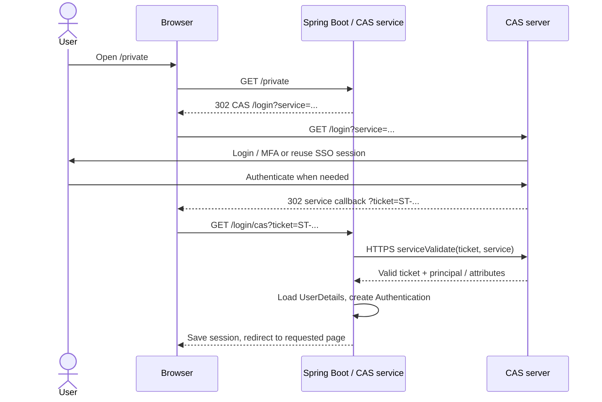

# Setting Up `spring-security-cas` and a Jakarta Servlet-Compatible CAS Client Library

## Learning Objectives

After this lesson, you will be able to:

- Explain the responsibilities of `spring-security-cas` and Apereo `cas-client-core` in a **Servlet** Spring Boot application using CAS SSO.
- Choose dependencies compatible with **Jakarta Servlet** on Spring Boot 3 / Spring Security 6, align versions, and recognize errors caused by leftover `javax.servlet.*`.
- Configure `ServiceProperties`, `CasAuthenticationEntryPoint`, `CasAuthenticationFilter`, `CasAuthenticationProvider`, and `Cas20ServiceTicketValidator` to handle a **service ticket**.
- Create a Spring Security authenticated session after CAS validates the ticket, map users/roles, and protect subsequent requests.
- Test the redirect, callback, and ticket validation flows; distinguish local logout from CAS Single Logout; avoid configuring two filters that process the same ticket.

## 1. Context: The Application Is a CAS Client, Not a CAS Server

**Central Authentication Service (CAS)** is both a Single Sign-On system and the name of an authentication protocol. A CAS server provides a centralized login page, maintains the SSO session, and issues a **service ticket (ST)** to a registered application. Your application is a **CAS service/client**: it redirects the browser to CAS, receives the ticket at the callback, and asks the CAS server to validate the ticket.

In the Spring ecosystem there are two related but distinct components:

| Component | Artifact / Package | Responsibility |
| --- | --- | --- |
| Spring Security CAS integration | `org.springframework.security:spring-security-cas`, package `org.springframework.security.cas` | Plugs CAS authentication into `AuthenticationManager`, `SecurityFilterChain`, `SecurityContext`, and Spring Security authorization |
| Apereo Java CAS Client Core | `org.apereo.cas.client:cas-client-core`, package `org.apereo.cas.client` | Provides CAS protocol mechanics and `TicketValidator` implementations such as `Cas20ServiceTicketValidator`; also includes standalone servlet filters |
| CAS server | An independently operated SSO service | Authenticates users, manages CAS sessions, issues and validates service tickets |
| Spring Boot application | Service registered at CAS | Manages the application's own sessions, roles, and functional permissions |

**Do not confuse with OIDC/SAML:** a CAS server can support multiple protocols, but `spring-security-cas` integrates the **CAS protocol**. If the system chooses OpenID Connect, `oauth2Login()` is a different mechanism; if it chooses SAML 2.0, `saml2Login()` is a different mechanism. Do not wire all three mechanisms to the same callback merely because they are all called SSO.

### 1.1. CAS Service Ticket Flow



A CAS **service ticket** is typically an opaque, short-lived string bound to a specific **service URL** and cannot be reused after validation. It is not an OAuth access token, OIDC ID token, or SAML assertion. The browser sending `?ticket=...` is not enough for the application to trust the user; **the server must validate the ticket** with CAS and verify the result.

## 2. The Jakarta Servlet Barrier When Upgrading to Spring Boot 3

Spring Framework 6, Spring Security 6, and Spring Boot 3 migrated from Java EE `javax.servlet.*` APIs to Jakarta EE `jakarta.servlet.*`. For example:

```java
// Jakarta Servlet: used with Spring Boot 3 / Spring Security 6
import jakarta.servlet.Filter;
import jakarta.servlet.http.HttpServletRequest;
import jakarta.servlet.http.HttpServletResponse;
```

An older CAS filter may have been compiled against:

```java
// Legacy Java EE: NOT directly compatible with Jakarta Servlet
import javax.servlet.Filter;
import javax.servlet.http.HttpServletRequest;
import javax.servlet.http.HttpServletResponse;
```

These are **two different Java types**: even though the `Filter` name matches, an instance of `javax.servlet.Filter` does not become a `jakarta.servlet.Filter` just by adding a new servlet-api dependency. You must replace it with an **artifact compiled for Jakarta** and align related dependencies.

### 2.1. Selection Matrix

| Item | Guidance for Spring Boot 3.x / Spring Security 6.x Projects | How to Verify |
| --- | --- | --- |
| JDK | Java 17 or higher; choose a version matching your project's Boot release | `java -version`, toolchain config |
| Web stack | Servlet MVC; do not use WebFlux as the template for Servlet CAS | `spring-boot-starter-web`, servlet container managed by Boot |
| Spring CAS | `spring-security-cas` **same version** as other Spring Security modules | Inspect Gradle/Maven dependency tree and BOM |
| CAS Client Core | Apereo **4.x** line compatible with Jakarta Servlet | Artifact `org.apereo.cas.client:cas-client-core` and actual API/JAR |
| Apereo patch milestone | **4.1.1** per the advisory on CAS client validating **JWT tickets** published 27/05/2026 | If validating JWT tickets, assess impact and upgrade to a patched release |
| Servlet API | `jakarta.servlet.*` | Do not add `javax.servlet-api` to mask namespace errors |

**Note:** `spring-security-cas` and `cas-client-core` follow **two independent versioning schemes**. For instance, `spring-security-cas` 6.x does not mean the CAS client must be 6.x. Let the Spring Boot BOM manage Spring Security module versions and declare the chosen client core explicitly via dependency/constraint.

Apereo disclosed a vulnerability in May 2026 for the **case where the Java CAS client validates tickets issued as JWTs** and recommended upgrading to client **4.1.1**. Standard opaque CAS service tickets do not automatically imply JWT ticket mode. Determine your actual protocol/config when assessing scope of impact. Even when not using JWT tickets, keep patches updated and verify the dependency tree per project policy.

### 2.2. Easily Confused Class and Artifact Names

- `org.springframework.security.cas.web.CasAuthenticationFilter` is the **Spring Security filter** handling the CAS callback inside `SecurityFilterChain`.
- `org.springframework.security.cas.authentication.CasAuthenticationProvider` is the provider that validates the ticket via `TicketValidator` and maps the principal to an `Authentication`.
- `org.springframework.security.cas.web.CasAuthenticationEntryPoint` redirects unauthenticated users to CAS login.
- `org.apereo.cas.client.validation.Cas20ServiceTicketValidator` is the **Apereo client** used to validate CAS service tickets per the CAS 2 protocol.
- `org.apereo.cas.client.authentication.AuthenticationFilter` and the validation filters in CAS client core are a **separate set of servlet filters**. They represent an alternative integration approach; do not stack them onto the Spring Security CAS filter at the same callback.
- Artifact `org.apereo.cas.client:cas-client` is the **parent/aggregator POM**; the core JAR dependency to declare is `cas-client-core`.
- Legacy examples containing `org.jasig.cas.client.*`, `javax.servlet.*`, or `WebSecurityConfigurerAdapter` must be re-evaluated rather than copied verbatim into Boot 3.

## 3. Installing Jakarta-Compatible Dependencies

### 3.1. Gradle Groovy DSL

In a project **already using** the Spring Boot 3 plugin and dependency management/BOM configuration, the `dependencies` block in `build.gradle` can look like:

```groovy
dependencies {
    implementation 'org.springframework.boot:spring-boot-starter-web'
    implementation 'org.springframework.boot:spring-boot-starter-security'

    implementation('org.springframework.security:spring-security-cas') {
        // Use the vetted CAS client core version declared below.
        exclude group: 'org.apereo.cas.client', module: 'cas-client-core'
    }
    implementation 'org.apereo.cas.client:cas-client-core:4.1.1'

    testImplementation 'org.springframework.boot:spring-boot-starter-test'
    testImplementation 'org.springframework.security:spring-security-test'
}
```

Explanation:

1. `spring-boot-starter-web` provides the **Servlet** runtime. Do not mix a pure WebFlux runtime into this pattern.
2. `spring-boot-starter-security` and `spring-security-cas` provide the filter chain and Spring CAS classes; **the BOM must manage them as one compatible version set**.
3. `cas-client-core:4.1.1` is pinned to make the client version explicit and meet the patch milestone noted above. When the project uses separate dependency governance/constraints, apply an equivalent version management approach and verify the build.
4. The `exclude` on the CAS dependency avoids pulling in a transitive client core version different from the one explicitly chosen by the project. Do not exclude CAS client classes completely from runtime because `Cas20ServiceTicketValidator` is still needed.
5. `jakarta.servlet-api` is normally managed by the starter/container; do not add `javax.servlet-api` or force a servlet-api version mismatched with the container just to work around errors.

If your project's Spring Boot BOM does not manage `spring-security-cas`, manage a **Spring Security BOM** on the same supported version line; do not manually enter a `spring-security-cas` version different from `spring-security-web`/`core`.

### 3.2. Maven

In a Maven project **already configured with the Spring Boot parent/BOM**, the corresponding dependencies are:

```xml
<dependencies>
    <dependency>
        <groupId>org.springframework.boot</groupId>
        <artifactId>spring-boot-starter-web</artifactId>
    </dependency>
    <dependency>
        <groupId>org.springframework.boot</groupId>
        <artifactId>spring-boot-starter-security</artifactId>
    </dependency>
    <dependency>
        <groupId>org.springframework.security</groupId>
        <artifactId>spring-security-cas</artifactId>
        <exclusions>
            <exclusion>
                <groupId>org.apereo.cas.client</groupId>
                <artifactId>cas-client-core</artifactId>
            </exclusion>
        </exclusions>
    </dependency>
    <dependency>
        <groupId>org.apereo.cas.client</groupId>
        <artifactId>cas-client-core</artifactId>
        <version>4.1.1</version>
    </dependency>
</dependencies>
```

### 3.3. Inspecting the Dependency Tree Before Running

```bash
./gradlew dependencyInsight --configuration runtimeClasspath --dependency spring-security-cas
./gradlew dependencyInsight --configuration runtimeClasspath --dependency cas-client-core
./gradlew dependencies --configuration runtimeClasspath
./gradlew compileJava
```

On Windows, you can use `.\gradlew.bat` instead of `./gradlew`. For Maven, use `mvn dependency:tree`.

Output depends on your project, so there is no fixed stdout. Key points to verify: `spring-security-core`, `spring-security-web`, and `spring-security-cas` share the same version; CAS client core resolves to the expected artifact/version; actual servlet filters no longer depend on the legacy `javax.servlet` namespace; and there are no duplicate CAS callback registrations. When using a third-party starter, inspect that starter's actual transitive dependencies.

## 4. Configuring the CAS Server and Service URL

Suppose the system uses:

| Property | Example URL |
| --- | --- |
| CAS server base | `https://sso.example.org/cas` |
| CAS login | `https://sso.example.org/cas/login` |
| Application public base | `https://portal.example.org` |
| **Service callback** | `https://portal.example.org/login/cas` |
| Spring filter callback path | `/login/cas` |

The CAS server must **register/allow the service** at `https://portal.example.org/login/cas`. When Spring Security requires authentication, `CasAuthenticationEntryPoint` sends the user to CAS login with the `service` parameter. CAS then redirects back to **that service URL** with `ticket`. When validating the ticket, the client must pass the matching service; CAS can reject it if the scheme, host, path, or other critical parts mismatch.

For example, three places must agree:

- `ServiceProperties.service = "https://portal.example.org/login/cas"`
- `CasAuthenticationFilter.setFilterProcessesUrl("/login/cas")`
- CAS server service registry accepts `https://portal.example.org/login/cas`

**Reverse proxy/ingress:** if Tomcat runs internally on `http://app:8080` while browsers connect via `https://portal.example.org`, the CAS service URL must reflect the registered **public address**. Only trust forwarded headers from proxies you control; never derive the callback URL from an arbitrary client-supplied `Host` header. Verify context path, port, trailing slash, and URL encoding. Use trusted HTTPS from the application to the CAS validation endpoint.

## 5. Spring Boot 3 + Spring Security 6 Example with CAS Service Tickets

Example structure:

```text
src/main/java/com/example/cas/
    CasDemoApplication.java
    CasSecurityConfiguration.java
    DemoController.java
src/main/resources/
    application.yml
```

This is a **Servlet Spring Boot application**, requiring the dependencies from Section 3, Java 17+, and an actually configured CAS server. Individual classes cannot be compiled standalone with `javac` without Spring dependencies. The code demonstrates Spring Security 6 wiring via `SecurityFilterChain`; the example host URLs are not a live CAS server.

### 5.1. `application.yml`

```yaml
app:
  cas:
    server-base-url: https://sso.example.org/cas
    service-url: https://portal.example.org/login/cas

server:
  servlet:
    session:
      cookie:
        http-only: true
        secure: true
```

In a local environment without a public HTTPS callback and a correspondingly registered CAS server, you can only verify build/wiring; SSO login requires a real integration environment. In production, URLs and truststores/certificates should come from centrally managed environment configuration.

### 5.2. Startup Class

```java
package com.example.cas;

import org.springframework.boot.SpringApplication;
import org.springframework.boot.autoconfigure.SpringBootApplication;

@SpringBootApplication
public class CasDemoApplication {
    public static void main(String[] args) {
        SpringApplication.run(CasDemoApplication.class, args);
    }
}
```

Save as `CasDemoApplication.java`. This is a standard entrypoint; there is no predetermined output because logs depend on Boot profiles, the servlet container, and the environment.

### 5.3. Spring Security CAS Configuration

```java
package com.example.cas;

import org.apereo.cas.client.validation.Cas20ServiceTicketValidator;
import org.springframework.beans.factory.annotation.Value;
import org.springframework.context.annotation.Bean;
import org.springframework.context.annotation.Configuration;
import org.springframework.security.authentication.ProviderManager;
import org.springframework.security.cas.ServiceProperties;
import org.springframework.security.cas.authentication.CasAuthenticationProvider;
import org.springframework.security.cas.web.CasAuthenticationEntryPoint;
import org.springframework.security.cas.web.CasAuthenticationFilter;
import org.springframework.security.config.annotation.web.builders.HttpSecurity;
import org.springframework.security.core.userdetails.User;
import org.springframework.security.core.userdetails.UserDetailsService;
import org.springframework.security.provisioning.InMemoryUserDetailsManager;
import org.springframework.security.web.SecurityFilterChain;
import org.springframework.security.web.authentication.session.ChangeSessionIdAuthenticationStrategy;
import org.springframework.security.web.context.HttpSessionSecurityContextRepository;

@Configuration
public class CasSecurityConfiguration {

    @Bean
    ServiceProperties serviceProperties(
            @Value("${app.cas.service-url}") String serviceUrl) {
        ServiceProperties properties = new ServiceProperties();
        properties.setService(serviceUrl);
        properties.setSendRenew(false);
        return properties;
    }

    @Bean
    CasAuthenticationEntryPoint casEntryPoint(
            ServiceProperties serviceProperties,
            @Value("${app.cas.server-base-url}") String casBase) {
        CasAuthenticationEntryPoint entryPoint = new CasAuthenticationEntryPoint();
        entryPoint.setServiceProperties(serviceProperties);
        entryPoint.setLoginUrl(casBase + "/login");
        return entryPoint;
    }

    @Bean
    CasAuthenticationProvider casProvider(
            ServiceProperties serviceProperties,
            UserDetailsService userDetailsService,
            @Value("${app.cas.server-base-url}") String casBase) {
        CasAuthenticationProvider provider = new CasAuthenticationProvider();
        provider.setServiceProperties(serviceProperties);
        provider.setTicketValidator(new Cas20ServiceTicketValidator(casBase));
        provider.setUserDetailsService(userDetailsService);
        provider.setKey("portal-cas-provider");
        return provider;
    }

    @Bean
    SecurityFilterChain securityFilterChain(
            HttpSecurity http,
            ServiceProperties serviceProperties,
            CasAuthenticationEntryPoint entryPoint,
            CasAuthenticationProvider provider) throws Exception {

        HttpSessionSecurityContextRepository repository =
                new HttpSessionSecurityContextRepository();

        // Filter belongs inside the Spring Security chain; do not expose as a duplicate @Bean Filter.
        CasAuthenticationFilter casFilter = new CasAuthenticationFilter();
        casFilter.setFilterProcessesUrl("/login/cas");
        casFilter.setServiceProperties(serviceProperties);
        casFilter.setAuthenticationManager(new ProviderManager(provider));
        casFilter.setSecurityContextRepository(repository);
        casFilter.setSessionAuthenticationStrategy(
                new ChangeSessionIdAuthenticationStrategy());

        return http
                .authorizeHttpRequests(auth -> auth
                        .requestMatchers("/", "/error").permitAll()
                        .anyRequest().authenticated())
                .exceptionHandling(ex -> ex.authenticationEntryPoint(entryPoint))
                .securityContext(sc -> sc.securityContextRepository(repository))
                .authenticationProvider(provider)
                .addFilterAt(casFilter, CasAuthenticationFilter.class)
                .build();
    }

    @Bean
    UserDetailsService users() {
        // Demo: local account matched by CAS principal "alice".
        // Placeholder password is not used for CAS authentication.
        return new InMemoryUserDetailsManager(
                User.withUsername("alice")
                        .password("{noop}not-used-for-cas")
                        .roles("READER")
                        .build());
    }
}
```

Save as `CasSecurityConfiguration.java`. The `com.example.cas` package name must match the Java directory and fall under `@SpringBootApplication` component scanning.

Explanation of each link in the chain:

1. **`ServiceProperties`:** holds the `service` URL. `sendRenew(false)` allows CAS to reuse an existing SSO session; when business requirements demand fresh authentication, configure `renew` per CAS policy.
2. **`CasAuthenticationEntryPoint`:** when a request is unauthenticated, `ExceptionTranslationFilter` invokes the entry point to redirect the browser to the CAS login endpoint.
3. **`CasAuthenticationFilter`:** listens on callback `/login/cas`, extracts `ticket`, and passes an authentication request to `AuthenticationManager`.
4. **`CasAuthenticationProvider`:** uses `Cas20ServiceTicketValidator` to ask the CAS server whether the ticket is valid for the service; receives the principal and loads the application account/authorities via `UserDetailsService`. Does not handle CAS passwords inside the application.
5. **`ProviderManager`:** wraps the provider capable of validating service tickets. In systems with multiple authentication mechanisms, ensure the filter's manager/provider matches the overall architecture.
6. **`HttpSessionSecurityContextRepository`:** saves `SecurityContext` after the callback so subsequent requests recognize the login session. With Spring Security 6, custom authentication filters must not rely solely on setting `SecurityContextHolder` for a single request.
7. **`ChangeSessionIdAuthenticationStrategy`:** rotates the session ID upon login to mitigate session fixation. Also verify your product's session concurrency/timeout policies.
8. **`addFilterAt`:** places the CAS filter at the right position in the Spring Security filter chain. Instantiating the filter **inside the method** prevents Spring Boot from auto-registering that filter bean a second time outside the filter chain.
9. **`.authenticationProvider(provider)`:** registers the provider on the chain configuration, while the filter is also given a manager containing the provider rather than relying on an inferred manager.
10. **CSRF:** the configuration does not disable CSRF globally. The example CAS service ticket callback uses GET, while state-changing methods remain protected by default.

**Production note:** `InMemoryUserDetailsManager` and `{noop}` only illustrate mapping after CAS has authenticated the user. Never use demo accounts as real authorization data. In production, look up users, lock status, tenants, roles, and formal mappings; never automatically grant admin privileges to every CAS principal.

### 5.4. Demo Controller

```java
package com.example.cas;

import org.springframework.security.core.Authentication;
import org.springframework.web.bind.annotation.GetMapping;
import org.springframework.web.bind.annotation.RestController;

@RestController
public class DemoController {
    @GetMapping("/")
    String home() {
        return "Public endpoint";
    }

    @GetMapping("/private")
    String privatePage(Authentication authentication) {
        return "Signed in as " + authentication.getName();
    }
}
```

Save as `DemoController.java`.

When the CAS server authenticates user `alice`, returns a valid service ticket, and the application has a mapping for `alice`, `GET /private` will display:

```text
Signed in as alice
```

This is the **expected HTTP output when the environment is fully integrated**, not the stdout of a standalone program run. Without CAS configured, you cannot assume the login flow succeeds based solely on `compileJava`.

### 5.5. Choosing Java DSL vs Legacy CAS Documentation

Some Spring Security CAS docs still illustrate **XML namespace** config because this integration dates back to older Spring Security generations. The goal of Java DSL is to map the beans/roles accurately, not to copy `WebSecurityConfigurerAdapter` (which has been replaced in modern projects). Cross-check class/setter names against the Java API of your exact version and build `SecurityFilterChain` explicitly.

If the application has **multiple `SecurityFilterChain` beans**, ensure the `/login/cas` callback belongs to the chain containing the CAS filter, and protected resources use the right entry point. An overly narrow `securityMatcher` can prevent the callback from reaching the CAS filter at all.

## 6. Choosing Between Spring Security CAS and Apereo's Servlet Filters

Apereo Java CAS Client provides filter sets for Servlet applications that do not use Spring Security as their primary authentication layer. For example, `org.apereo.cas.client.authentication.AuthenticationFilter` can redirect to CAS, and ticket validation filters can handle responses per CAS client config.

| Integration Approach | Layer Handling Login | Where Auth State Is Held | Authorization |
| --- | --- | --- | --- |
| **Spring Security CAS** | `CasAuthenticationEntryPoint`, `CasAuthenticationFilter`, `CasAuthenticationProvider` | `SecurityContextRepository` and Spring session strategy | `authorizeHttpRequests`, authorities, method security |
| **Apereo CAS client Servlet filters directly** | Apereo's authentication and ticket validation filters | Servlet request/session and assertion per client library | Application must integrate an appropriate authorization mechanism |
| **OIDC/SAML via CAS server** | `oauth2Login()` or `saml2Login()` per chosen protocol | OIDC/SAML integration mechanisms | Spring Security authorization after authentication |

Do not register the full Apereo filter suite **and** the Spring CAS filter together on `/login/cas`. A service ticket could be validated/consumed twice, or one filter might complete the redirect while the other fails to persist `SecurityContext`.

Apereo client 4.x using Jakarta Servlet also lets standalone filters run in a Jakarta servlet container; however, **being on the classpath does not mean you must register them**. For the `spring-security-cas` pattern in Section 5, you need `Cas20ServiceTicketValidator` from client core without adding the parallel Apereo filter chain.

### 6.1. Authentication and Authorization Must Be Separated

CAS may authenticate user `alice`, yet Spring Security still decides which APIs or business actions that user can access:

| Step | Who Is Responsible? |
| --- | --- |
| User enters password/MFA | CAS server |
| Verify ST matches the right service | CAS server, via the `TicketValidator` call |
| Map `alice` to an application account | `UserDetailsService`/account linking logic |
| Assign `ROLE_READER`/`ROLE_ADMIN` per policy | Application |
| Block `/admin` when role is missing | Spring Security authorization |
| Create, invalidate, and renew app session | Application and session framework |

A successful CAS login **does not mean** every user holds `ROLE_ADMIN`. If the CAS principal does not exist in the local user store, the application may deny login or trigger a provisioning workflow per policy.

## 7. Sessions, Single Logout, and Proxy Tickets

### 7.1. Two Sessions to Understand

- **CAS SSO session:** managed by the CAS server; allows users to log into multiple applications without re-entering passwords.
- **Application session:** managed by the application via cookies/sessions and `SecurityContextRepository`. Expiring the app session does not necessarily expire the CAS session.

Spring Security's local `/logout` typically clears only the application's own state. **CAS Single Logout (SLO)** must be designed explicitly: a logout notification mechanism from CAS to services, session invalidation handling, corresponding endpoints/filters/listeners, and multi-node deployment behavior.

Apereo CAS client includes `SingleSignOutFilter` and supporting components. Do not blindly wire it as a second authentication filter; verify logout methods, filter ordering, callbacks, and session mapping for your chosen version. A successful browser logout does not guarantee every other service is immediately logged out unless SLO is actively working.

### 7.2. Service Tickets vs Proxy Tickets

- **Service ticket (ST):** issued for a registered service, normally validated once to log into a web app.
- **Proxy-granting ticket (PGT):** received by a service in a proper proxy flow in order to request proxy tickets.
- **Proxy ticket (PT):** allows one service to call another service on the user's behalf in the CAS proxy model.

The code in Section 5 uses `Cas20ServiceTicketValidator` for **service tickets** and does not support proxy tickets by default. When proxying is required, configure `Cas20ProxyTicketValidator`, proxy callback, proxy-granting ticket storage, trusted proxy policy, and request correlation. Never use `acceptAnyProxy` as a shortcut to bypass validation errors.

### 7.3. Opaque Service Tickets vs JWT Tickets

The May 2026 Apereo advisory concerns **CAS clients validating tickets issued as JWTs**. Never assume every `ST-...` is a JWT, or try to parse/verify it using OIDC logic. Identify your actual CAS protocol/ticket format before choosing a validator and assessing patches. If using JWT ticket validation, review the advisory and upgrade client core as recommended.

## 8. Testing from Dependencies to End-to-End SSO

A testing workflow can follow this order:

1. **Build graph:** run `dependencyInsight`, verify Spring CAS + Jakarta client core; confirm no legacy Java EE servlet filters remain.
2. **Compile:** run `./gradlew compileJava` or `./gradlew test` on the project with CAS dependencies. If import errors occur, verify exact class names and APIs for the actual version rather than mechanically renaming namespaces.
3. **CAS service registry:** register the public callback `https://portal.example.org/login/cas`, ensuring CAS accepts the exact scheme/host/path.
4. **Unauthenticated redirect:** open `/private` in a browser with no app session, expecting a redirect to `CAS /login` with the exact `service` URL.
5. **CAS callback:** log in at CAS; the ticket must return to `/login/cas?ticket=...` on the right chain and host.
6. **Validation:** observe the server-side request to `/cas/serviceValidate`; a valid response maps the principal to the application account.
7. **Session:** refresh `/private`; subsequent requests must use the app session without re-validating the old service ticket.
8. **Negative tests:** forged/expired/already-used ticket, tampered `service`, nonexistent account, user missing roles, CAS server temporarily unavailable. None of these cases may pass authentication when the ticket is invalid.
9. **Logout:** test local logout separately, SLO if implemented, and behavior when multiple apps share CAS.

Illustrative commands:

```bash
./gradlew compileJava
./gradlew test
./gradlew bootRun
curl -I https://portal.example.org/private
```

When unauthenticated, `curl -I` may return `302` with `Location` pointing to CAS. Because HEAD requests may be handled differently from GET by proxies/controllers, verify the SSO flow with a real browser. Being able to run the commands above **does not mean** full login has been tested if no CAS server exists yet.

## 9. Troubleshooting Common Issues

| Symptom | Possible Reason | Check / Resolution |
| --- | --- | --- |
| `NoClassDefFoundError: javax/servlet/Filter` | Legacy library/filter uses Java EE | Inspect `dependencyInsight`, upgrade to Jakarta CAS client, remove old javax filters |
| `ClassCastException` between two `Filter` types | Mixing javax and jakarta | Use only filters and containers in the Jakarta namespace |
| `NoSuchMethodError` in CAS client/Spring Security | Transitive dependency pulled a mismatched version | Align Spring BOM; check core/ABI JARs; rebuild dependency graph |
| Does not redirect to CAS | Entry point not wired, URL unprotected, or handled by another chain | Check `ExceptionTranslationFilter`, `authorizeHttpRequests`, `SecurityFilterChain` |
| CAS returns "invalid service" | CAS service registry does not match URL | Compare `ServiceProperties.service`, `service` param sent, and service registry |
| Ticket rejected | Ticket expired/already used or validated with a different service | Check callback, host/proxy, and ensure ticket is validated only once |
| Redirect loop back to CAS | Auth not saved, callback bypassed CAS filter, session cookie missing | Check `HttpSessionSecurityContextRepository`, chain matcher, cookies, and proxy |
| Callback returns 404 or misses filter | `/login/cas` rewritten or filter path mismatch | Compare `setFilterProcessesUrl` and public callback URL |
| CAS authenticates yet returns 403 | Missing authority or application rule rejects | Check `UserDetailsService`, `GrantedAuthority`, and `hasRole` |
| Valid CAS user cannot enter app | Missing local account / wrong mapping | Check principal string, tenant, and user registration/sync workflow |
| CAS ticket processed twice | Both Apereo validation filter and Spring filter are active | Use a single authentication mechanism for the callback |
| Next request loses login | Auth not saved to session or LB drops session | Check `SecurityContextRepository`, session affinity/store, cookies |
| TLS error during ticket validation | JVM does not trust CA or cert hostname mismatch | Configure proper truststore/CA; never disable certificate validation |
| Logged out of app yet SSO remains | App logout does not clear CAS session | Implement/test CAS SLO per requirements |
| Concerns about JWT ticket CVE | Unpatched client core in deployments using JWT tickets | Check Apereo advisory 27/05/2026; upgrade client core to 4.1.1 |

**Debug rule:** log paths and errors at a reasonable level, but never log service tickets, session cookies, passwords, or assertions containing sensitive data publicly. Tickets can appear in callback URLs, so watch web access logs, analytics, and telemetry.

## 10. Production Readiness Checklist

- CAS URL, service callback, and registry use **HTTPS**, with certificate verification from JVM to CAS.
- Clean dependency tree; Spring Security modules aligned by BOM; Jakarta-compatible `cas-client-core` version checked against advisories.
- CAS callback handled by exactly **one filter chain**, with no duplicate servlet filters.
- Tickets validated server-side via the proper protocol; never accept a `ticket` query value merely because it starts with `ST-`.
- `SecurityContextRepository`, session fixation protection, timeouts, and `Secure`/`HttpOnly`/`SameSite` cookies properly configured.
- CSRF for state-changing operations remains enabled and verified.
- Clear user mapping/authorization; never auto-assign admin privileges from untrusted attributes.
- Handling for CAS unavailability, timeouts, validation failures, active sessions, and per-component logout.
- CAS SLO/proxy tickets enabled only when required and backed by dedicated tests.
- When upgrading Boot/Security/CAS client or changing Tomcat/containers, re-run classpath, callback, ticket validation, and end-to-end SSO checks.

## 11. Self-Check Questions

**1. Why do both `spring-security-cas` and `cas-client-core` appear in dependencies?**

The Spring Security module provides the entry point/filter/provider and integrates with `SecurityContext`. Apereo client core provides ticket validator implementations and CAS protocol handling used by the provider.

**2. Why can't the old `javax.servlet` CAS filter library be used directly on Boot 3?**

Because Spring Boot 3 uses `jakarta.servlet`; the two packages are incompatible at the Java type/bytecode level. A Jakarta-compatible library is required, and adding both servlet APIs cannot fix it.

**3. `ServiceProperties.service` is `https://portal.example.org/login/cas` but the CAS server only allows `http://localhost:8080/login/cas`. Result?**

CAS may refuse to issue or validate tickets due to mismatch with the registered service. Public callbacks, service registry, and trusted proxy settings must align.

**4. CAS authenticated `alice`, yet `/admin` returns 403. Is this a CAS bug?**

Not necessarily. CAS authenticates identity, while the application checks authorization. Missing `ROLE_ADMIN` is a valid reason to return 403.

**5. Why must `SecurityContext` be saved after the callback?**

If authentication only happens on the request carrying the ticket without persisting to a session/repository, the next request reverts to unauthenticated and triggers a redirect loop.

**6. Why shouldn't Apereo authentication/validation servlet filters and `CasAuthenticationFilter` both be enabled on the same callback?**

They can both read/validate the ticket, manage sessions differently, and cause login to fail. Choose one primary authentication coordinator.

**7. Which scenario does the May 2026 Apereo advisory highlight?**

Java CAS client deployments configured to **validate tickets issued as JWTs**. Evaluate the actual client version running and upgrade to **4.1.1** as recommended when in scope.

## Summary

In Spring Boot 3 / Spring Security 6, proper CAS integration means pairing **Spring Security CAS filter/provider** with **Jakarta Servlet-capable Apereo CAS client core**, then accurately configuring the CAS `service` URL and ST validation flow. Spring Security persists sessions and enforces authorization; the CAS server handles initial identity authentication. Inspect the dependency tree, avoid javax/jakarta mixing, and prevent duplicate filter registration before investigating SSO failures.

### References

- [Spring Security – CAS Authentication](https://docs.spring.io/spring-security/reference/servlet/authentication/cas.html)
- [Spring Security – CAS Module Dependencies](https://docs.spring.io/spring-security/reference/6.5/modules.html)
- [Spring Security – CasAuthenticationFilter API](https://docs.spring.io/spring-security/site/docs/6.3.5/api/org/springframework/security/cas/web/CasAuthenticationFilter.html)
- [Spring Security – CasAuthenticationProvider API](https://docs.spring.io/spring-security/site/docs/6.3.5/api/org/springframework/security/cas/authentication/CasAuthenticationProvider.html)
- [Apereo Java CAS Client](https://github.com/apereo/java-cas-client)
- [Maven Central – cas-client-core 4.1.1](https://central.sonatype.com/artifact/org.apereo.cas.client/cas-client-core/4.1.1)
- [Apereo advisory – Java CAS Client JWT Vulnerability Disclosure, 27/05/2026](https://www.apereo.org/news/2026/java-cas-client-jwt-vulnerability-disclosure)
