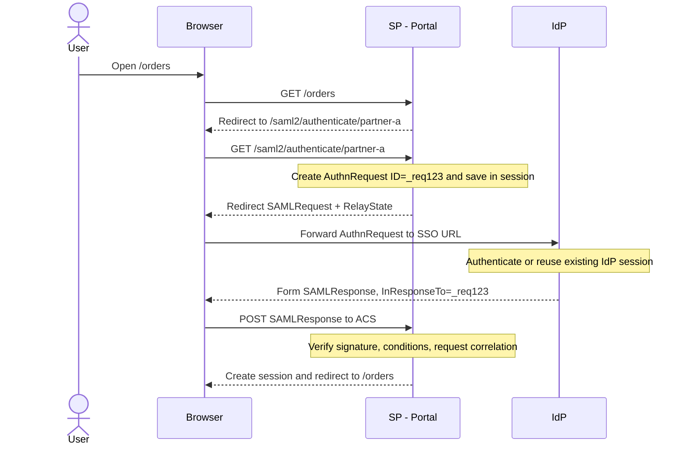
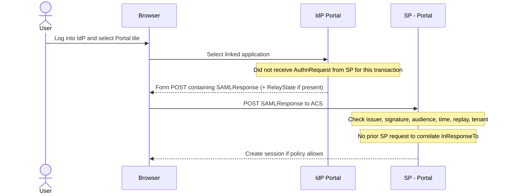

# Distinguishing Service Provider-Initiated and Identity Provider-Initiated Login

**Topic:** Spring Security – federation / SAML2 Model.

In SAML 2.0 Web Browser Single Sign-On (SSO), a user can initiate login from the **application being accessed (Service Provider, SP)** or from the **identity portal (Identity Provider, IdP)**. Both cases use a SAML Response/Assertion to establish identity at the SP, yet they **differ in starting point, presence of `AuthnRequest`, ability to correlate request–response via `InResponseTo`, browser state management, and attack surface**.

This lesson focuses on the standard Web Browser SSO flow, where the SP is a Spring Security Servlet application. SAML is not OAuth2/OIDC; names like `AuthnRequest`, `SAMLResponse`, `RelayState`, and `ACS` do not map one-to-one with `state`, authorization code, or OIDC ID Tokens.

## 1. Concepts and Participating Parties

| Component | Role |
| --- | --- |
| **Service Provider (SP)** / Relying Party | Application requiring user login; receives and verifies assertions and creates its own application login session |
| **Identity Provider (IdP)** / Asserting Party | System authenticating the user (password, MFA, Kerberos, passkey…) and issuing SAML Responses/Assertions to the SP |
| **Browser (user agent)** | Redirects the user, carrying `SAMLRequest` or `SAMLResponse` via HTTP Redirect/POST bindings |
| **AuthnRequest** | Authentication request message created by the SP; typically contains `ID`, `Issuer`, `Destination`, `AssertionConsumerServiceURL`, and optional authentication context requests |
| **SAML Response** | Message sent by the IdP to the SP; typically contains one or more `Assertion`s, processing status, and related authentication metadata |
| **Assertion** | Contains user identity, authentication method/timestamp, and usage conditions; may carry `NameID` and `AttributeStatement` |
| **ACS (Assertion Consumer Service)** | Endpoint at the SP receiving SAML responses, usually via HTTP POST from the browser |
| **InResponseTo** | Attribute linking a response or bearer `SubjectConfirmationData` to the `ID` of the `AuthnRequest` the SP previously sent |
| **RelayState** | State passed alongside messages across a binding; usually helps return to the original resource, yet **does not by itself prove identity or session validity** |
| **RelyingPartyRegistration** | Spring Security configuration mapping an SP to a trusted IdP: issuer/entity ID, SSO URL, verification certificates, ACS, and related keys |

Hypothetical example:

- SP: `https://portal.example.com` — Spring Boot business application.
- IdP: `https://login.partner.example` — partner identity system.
- Registration ID in Spring Security: `partner-a`.
- Default SP ACS: `https://portal.example.com/login/saml2/sso/partner-a`.
- SP authentication request initiation endpoint: `https://portal.example.com/saml2/authenticate/partner-a`.

Hostnames are purely illustrative. In real deployments, entity IDs and endpoints must match metadata, TLS/hosts, and each partner's configuration.

**Core point:** both flows return the same kind of **SAML Response**, yet only in **SP-initiated** is the SP guaranteed to have initiated a prior request and have grounds to match the response to that request. A validly signed SAML Response alone does not tell whether the current browser intentionally started a login session.

## 2. SP-Initiated SSO — Application-Initiated Login

### 2.1. Standard Flow

1. The user opens a protected URL, e.g. `GET https://portal.example.com/orders`. The SP detects there is no authenticated session.
2. The SP selects which IdP to use (perhaps from tenant or an IdP discovery page), creates a `<samlp:AuthnRequest>` with a fresh ID, and saves the corresponding request in session state or a trusted repository. The SP may save the return destination in `SavedRequest` or related state.
3. The browser is redirected to the IdP's Single Sign-On endpoint via HTTP Redirect binding; some IdP configurations use HTTP POST binding. Redirect typically shows `SAMLRequest` and `RelayState` parameters in the URL.
4. The IdP checks `AuthnRequest`, authenticates the user or reuses an active IdP session, and issues a `<samlp:Response>` and assertion signed per the federation contract.
5. The browser POSTs `SAMLResponse` to the SP's ACS. A solicited response **normally carries `InResponseTo="_req..."` matching the issued request ID**.
6. The SP retrieves the saved request, verifies request–response correlation, signature, issuer, recipient/destination, audience, time window, subject confirmation, and other checks; only then does it create an application session.
7. The user is sent to the protected URL if that URL is safe and belongs to the application. From this point on, the **SP manages the session and authorization**, even though the IdP authenticated the identity.



**Identification clue in network traces:** prior to `POST /login/saml2/sso/partner-a`, there is a request at the SP to `/saml2/authenticate/partner-a` and a `SAMLRequest` sent to the IdP. `InResponseTo` in the response must correlate with a request ID saved by the SP **for that exact transaction/browser**, not merely match an arbitrary ID string carried inside the response.

### 2.2. Meaning of Correlation and State

Suppose the SP created `AuthnRequest ID="_r-7c42"`. When the IdP replies:

```xml
<samlp:Response
    xmlns:samlp="urn:oasis:names:tc:SAML:2.0:protocol"
    ID="_response-a9"
    InResponseTo="_r-7c42"
    Destination="https://portal.example.com/login/saml2/sso/partner-a"
    Version="2.0"
    IssueInstant="2026-11-07T03:00:00Z">
    <!-- Illustrative correlation field; complete response requires Issuer,
         Status, Assertion, signature, and matching conditions -->
</samlp:Response>
```

This is an **illustrative XML snippet**, not a SAML Response usable for login. In a real system, the SP must verify `InResponseTo="_r-7c42"` against a **pending request created by the application** and state bound to the browser session per policy; never synthesize a dummy request or trust only the ID declared by the response itself.

Note that `InResponseTo` may appear in both Response and bearer `SubjectConfirmationData`, depending on profile/IdP. Cases to test separately:

- Valid `InResponseTo`, pending request matches the right session and has not expired: proceed with remaining checks.
- `InResponseTo` absent in an SP-initiated transaction where correlation is required: **reject**; do not automatically fall back to IdP-initiated mode to “rescue” the request.
- `InResponseTo` present yet wrong or already consumed: **reject**.
- Response with valid signature yet coming from an IdP of a different tenant than selected or landing on an unregistered ACS: **reject**.

In Spring Security, `Saml2WebSsoAuthenticationRequestFilter` creates `AuthnRequest`; by default `HttpSessionSaml2AuthenticationRequestRepository` saves the request in `HttpSession`. `Saml2WebSsoAuthenticationFilter` processes the SAML Response and uses `Saml2AuthenticationTokenConverter` to look up the registration/request prior to verification.

**Security benefit:** the SP can tie creating a new session to an action that occurred at the application itself, reducing the risk of an attacker forcing a victim's browser into a session for another account. This works when the request is bound to the SP-side session and consumed once. If switching to a cache looked up by `RelayState` or `InResponseTo` without binding to the browser/session, re-evaluate **login CSRF/session fixation** risks.

### 2.3. When to Choose SP-Initiated?

- Users open deep links such as `/orders/123` or start from a specific application.
- The application needs to **preserve login intent**, restore a safe path after callback, or run tenant-based IdP discovery.
- Application-specific authentication rules are needed: `ForceAuthn`, `RequestedAuthnContext`, `NameIDPolicy` (must be negotiated with the IdP), or control over creating a new transaction.
- Sensitive systems prioritizing blocking **unsolicited SAML Responses** and verifying request–response correlation.
- Multiple partners/tenants exist and the application must pick the trusted registration for the right organization.

**Do not automatically conclude SP-initiated forces the user to re-enter a password.** If the IdP already has a session, a fresh `AuthnRequest` can still be satisfied without prompting the user again. Requiring re-authentication needs IdP-supported parameters and policies such as `ForceAuthn`, not merely switching flow types.

## 3. IdP-Initiated SSO — Portal-Initiated Login

### 3.1. Standard Flow

1. The user logs into the **IdP portal**, such as a dashboard displaying an application tile “Partner Portal.”
2. The user clicks the app tile. **The SP did not send an `AuthnRequest` for this login**.
3. The IdP unilaterally builds a SAML Response/Assertion targeting a preconfigured SP using its entity ID, audience, ACS, certificate, and user attributes. This is an **unsolicited response** in SAML terminology.
4. The IdP returns an HTML form containing `SAMLResponse`; the browser automatically or on user click POSTs to the SP's ACS, optionally carrying a mutually agreed `RelayState`.
5. The SP verifies the SAML Response just as in any SAML transaction: trusted IdP origin, signature, recipient/destination, audience, timing, anti-replay, subject confirmation, account/tenant, and permissions.
6. If **SP policy allows** IdP-initiated login and the response is valid, the SP creates an application session and redirects to a default page or an allowed path.



**Identification clue:** the browser receives `SAMLResponse` from the IdP portal and POSTs directly to the ACS. No `SAMLRequest`/`AuthnRequest` was issued by the SP for this transaction. `InResponseTo` is typically **absent** from unsolicited responses (and matching bearer subject confirmation), because no SP-issued request ID exists to reference.

**Do not confuse:** if a user already has an IdP session, opens an application link, and the SP creates an `AuthnRequest`, that is still **SP-initiated**, even if the IdP does not ask for a password. Conversely, a login started from an IdP portal sending a `SAMLResponse` straight to the ACS is **IdP-initiated**, even if the user completed MFA beforehand.

### 3.2. Trade-Offs of IdP-Initiated SSO

**Business advantages:** integrates smoothly with employee/partner “app launchers”; users pick applications right inside the identity portal; the SP does not have to initiate an `AuthnRequest` during the transaction.

**Critical drawbacks:**

- The SP has no pending `AuthnRequest`, so it **cannot check `InResponseTo` against an SP-sent request in that transaction**.
- The SP has no default proof that this browser intentionally initiated login at the SP. OWASP warns this carries **login CSRF** risk; for example, an attacker exploits a valid response for **the attacker's own account** to log the victim into the SP under that account. A genuine signature on the response does not eliminate this risk by itself.
- The application struggles to restore deep links without mutually designed state; `RelayState` from the IdP may be attacker-controllable or lack integrity protection in some bindings.
- The SP cannot pass `RequestedAuthnContext`/`ForceAuthn` on a nonexistent request; assurance level depends on the IdP and agreed federation policy.
- Logging in from the IdP portal does not automatically keep SP logout synchronized with the IdP; both sides' sessions retain independent lifecycles.

**Recommendation:** prefer SP-initiated when you control the flow. Enable IdP-initiated only for business needs, compatibility, or app-launcher designs, documenting the risks and SP mitigations. Never enable it assuming “if SAML login works, unsolicited responses must be safe.”

### 3.3. Minimum Requirements If Unsolicited Responses Must Be Allowed

1. **Allowlist per IdP and registration:** accept responses only from configured issuers, signed by that exact IdP's certificate, at the right ACS/entity ID; never infer trusted IdPs from URLs, email domains, or unverified fields.
2. **Comprehensive SAML verification:** signature on the exact consumed element, issuer, `Destination`, `AudienceRestriction`, `SubjectConfirmationData Recipient`, `NotBefore`/`NotOnOrAfter`, `Conditions`, response status, allowed algorithms, and encryption policy. Guard against XML Signature Wrapping.
3. **SP-side anti-replay:** cache assertion/response IDs scoped by IdP/tenant and acceptance window, rejecting reuse after first consumption; enforce tight timestamp/clock-skew checks. Request `OneTimeUse` when supported by the IdP, yet **never treat that attribute alone as having a replay cache**.
4. **Login CSRF controls:** assess session-swapping/login-intent risk per application; require going through SP-initiated flows for sensitive operations, require explicit selection/consent before linking an identity to an existing account; never auto-link accounts by email.
5. **Restrict `RelayState`:** ideally use an opaque target token issued by the SP/broker or an allowlisted relative path. If accepting URLs, verify scheme/host/path after normalization, blocking `https://evil.example`, `//evil.example`, `javascript:`, tricky encoded URLs, and open redirects. When no valid target exists, redirect to a safe default landing page.
6. **Prevent tenant confusion:** map identities via a namespaced tuple such as `issuer + NameID` per agreed format (or a stable IdP-issued user ID) plus internal tenant, never granting privileges based on matching emails across two organizations.
7. **Session lifecycle controls:** session fixation protection, HTTPS/Secure/HttpOnly/SameSite cookies appropriate for POST callbacks, session lifetimes, privilege revocation, and IdP outage handling; never log assertion contents or secrets.
8. **Contractual binding and monitoring:** explicit policy stating which registrations permit IdP-initiated login, owners for certificates/metadata, rotation schedules, and alerts on rejected response spikes.

In SAML Profiles, “unsolicited” is a valid scenario under protocol agreement, **not an instruction for the SP to skip verification**. Policies for strict request correlation vs. accepting unsolicited responses must stay clearly separated.

## 4. Direct Comparison of the Two Flows

| Criterion | **SP-initiated** | **IdP-initiated** |
| --- | --- | --- |
| Who starts? | SP when the user visits a protected app/link or clicks the SP's login button | IdP when the user clicks an app tile/launcher or the IdP initiates federation |
| `AuthnRequest` from SP? | **Yes** | **No** for that specific transaction |
| First message at browser | Usually `SAMLRequest` via HTTP Redirect/POST from SP to IdP | Usually `SAMLResponse` from IdP to SP's ACS |
| `InResponseTo` | Expected/verified against issued request ID (including subject confirmation per profile) | No SP request ID, so unsolicited responses normally lack `InResponseTo` |
| Pre-login SP session state? | Can store `AuthnRequest` and `SavedRequest`; Spring Security defaults to `HttpSession` repository | No SP-issued request to correlate; another SP browser session might already exist |
| Restoring deep links | Straightforward when `SavedRequest`/`RelayState` are controlled | Needs return-target agreement; prefer fixed/allowlisted targets |
| Requesting re-authentication | SP can pass options like `ForceAuthn` if supported by IdP | No `AuthnRequest` to request those options in the transaction |
| Specific risks | Lost request state, wrong `InResponseTo`, `SameSite`/proxy dropping sessions | Login CSRF, unsolicited/replay, untrusted `RelayState`, tenant confusion |
| Signature/issuer/audience checks | **Mandatory** | **Mandatory** |
| Requires IdP session? | May reuse existing session or perform fresh authentication | Usually starts at IdP portal with an already-authenticated session |
| Priority for new designs | Usually **preferred** | Used when app launcher/compatibility is needed with extra controls |

**Do not equate IdP-initiated with “only the IdP decides who can log in.”** In both flows, the IdP authenticates the user; the two flow names solely describe **which party initiated the SAML transaction**.

## 5. HTTP Perspective, SAML XML, and Commonly Confused Fields

### 5.1. SP-Initiated: Correlated Request/Response

Abbreviated sequence:

```http
GET /saml2/authenticate/partner-a HTTP/1.1
Host: portal.example.com

HTTP/1.1 302 Found
Location: https://login.partner.example/sso?SAMLRequest=...&RelayState=...

POST /login/saml2/sso/partner-a HTTP/1.1
Host: portal.example.com
Content-Type: application/x-www-form-urlencoded

SAMLResponse=...&RelayState=...
```

**This is an illustrative diagram, not a runnable HTTP transcript:** lines from multiple hosts and multiple requests are condensed; `SAMLRequest`/`SAMLResponse` hold binding-encoded messages. HTTP Redirect typically uses deflate + Base64 + URL encoding for requests, while HTTP POST binding uses Base64 XML in forms; message signing depends on binding and metadata. There is no universal rule that “AuthnRequest is always unsigned” or “Response always has only one Assertion.”

In XML, `AuthnRequest` `ID` and `InResponseTo` are not client-invented session tokens to resubmit arbitrarily. Spring Security checks correlation against the saved request and performs SAML validation. If the IdP sends `InResponseTo="_wrong"`, never try to route that response into an unsolicited flow.

### 5.2. IdP-Initiated: Unsolicited Response

Abbreviated sequence:

```http
GET /my-apps HTTP/1.1
Host: login.partner.example

POST /login/saml2/sso/partner-a HTTP/1.1
Host: portal.example.com
Content-Type: application/x-www-form-urlencoded

SAMLResponse=...&RelayState=%2Fdashboard
```

This is **not a mandatory layout** for every IdP: portal paths, form generation, `RelayState` format, and bindings may vary. Depending on policy, the IdP may or may not send `RelayState`. If `RelayState` is missing, the SP should use a default landing page. Never treat `RelayState=%2Fdashboard` as “signed” or “server-verified” without integrity binding per the actual protocol/binding/configuration.

### 5.3. Which Attributes Must Be Verified?

- **`Issuer`:** must be the exact IdP the SP is configured to trust; with multiple IdPs, ensure issuer A is never mapped to registration B merely because ACS paths look alike.
- **`Signature`/X.509:** verify XML signatures and ensure the consumed assertion is the protected content; check trust anchors, algorithm policy, and rollover. TLS to the ACS does not replace SAML signature verification.
- **`AudienceRestriction`:** assertion was genuinely issued for this SP entity ID; verify tenant/registration by design.
- **`Destination` and `Recipient`:** response and subject confirmation target the exact ACS where the SP receives them; reject unconfigured hosts/paths.
- **`NotBefore`, `NotOnOrAfter`, `IssueInstant`, `AuthnInstant`:** check validity windows and clock skew; reject expired tokens rather than extending arbitrarily for clock drift.
- **`InResponseTo`:** when an `AuthnRequest` exists, must match the valid pending request bound to the transaction/browser per config; for unsolicited flows, never fabricate nonexistent correlation.
- **`NameID` and attributes:** usable only after SAML validation completes; account/tenant mapping, user lockouts, and `GrantedAuthority` belong to the SP's authorization layer.

Claiming “the response is signed so it is definitely the right user” is incomplete: a signature proves the content was issued by a trusted IdP, **not** that the message was meant for this ACS, this tenant, has not been replayed, or was intentionally initiated by the current browser.

## 6. Direct Mapping to Spring Security Servlet

Spring Security SAML2 Login provides both an **`AuthnRequest` initiation endpoint** and a **`SAMLResponse` processing endpoint**. Determining SP-initiated vs. IdP-initiated depends on transaction origin, not a controller annotation.

| Spring Security component | Responsibility |
| --- | --- |
| `Saml2WebSsoAuthenticationRequestFilter` | Creates and dispatches `AuthnRequest`; handles `/saml2/authenticate/{registrationId}` by default |
| `Saml2AuthenticationRequestRepository` | Saves and retrieves created requests for SP-initiated flows |
| `HttpSessionSaml2AuthenticationRequestRepository` | Default repository storing requests in `HttpSession` |
| `Saml2WebSsoAuthenticationFilter` | Receives `SAMLResponse` at default ACS `/login/saml2/sso/{registrationId}` |
| `Saml2AuthenticationTokenConverter` | Converts HTTP request into a token, resolving `RelyingPartyRegistration` and correlated request if any |
| `OpenSaml5AuthenticationProvider` | Default provider documented in Spring Security 7.1: verifies SAML Response/Assertion |
| `SecurityContext` + session | Stores authenticated state at SP post-verification; authorization is a separate step |

OpenSAML provider names depend on version: for example, Spring Security 6.x uses a different OpenSAML generation than Security 7.x. Do not copy custom validators/providers across major versions without checking JavaDoc and migration notes.

### 6.1. Basic Spring Boot and Spring Security Configuration

This example targets **Spring Boot 4.1.x / Spring Security 7.1.x, Java 17+ on Servlet MVC**. These are **files of a Maven application**, not standalone Java code runnable with `javac` alone. Replace IdP metadata, domains, and certificates for your real environment. On Boot 3.5, the SAML starter differs; do not apply the POM below verbatim to Boot 3.

Minimal `pom.xml` (SAML depends on OpenSAML requiring the Shibboleth repository):

```xml
<?xml version="1.0" encoding="UTF-8"?>
<project xmlns="http://maven.apache.org/POM/4.0.0"
         xmlns:xsi="http://www.w3.org/2001/XMLSchema-instance"
         xsi:schemaLocation="http://maven.apache.org/POM/4.0.0
           https://maven.apache.org/xsd/maven-4.0.0.xsd">
    <modelVersion>4.0.0</modelVersion>
    <parent>
        <groupId>org.springframework.boot</groupId>
        <artifactId>spring-boot-starter-parent</artifactId>
        <version>4.1.2</version>
        <relativePath/>
    </parent>
    <groupId>com.example</groupId>
    <artifactId>saml-portal</artifactId>
    <version>1.0.0</version>
    <properties>
        <java.version>17</java.version>
    </properties>
    <repositories>
        <repository>
            <id>shibboleth-releases</id>
            <url>https://build.shibboleth.net/maven/releases/</url>
            <snapshots><enabled>false</enabled></snapshots>
        </repository>
    </repositories>
    <dependencies>
        <dependency>
            <groupId>org.springframework.boot</groupId>
            <artifactId>spring-boot-starter-webmvc</artifactId>
        </dependency>
        <dependency>
            <groupId>org.springframework.boot</groupId>
            <artifactId>spring-boot-starter-security</artifactId>
        </dependency>
        <dependency>
            <groupId>org.springframework.boot</groupId>
            <artifactId>spring-boot-starter-security-saml2</artifactId>
        </dependency>
    </dependencies>
    <build>
        <plugins>
            <plugin>
                <groupId>org.springframework.boot</groupId>
                <artifactId>spring-boot-maven-plugin</artifactId>
            </plugin>
        </plugins>
    </build>
</project>
```

`src/main/java/com/example/portal/PortalApplication.java`:

```java
package com.example.portal;

import org.springframework.boot.SpringApplication;
import org.springframework.boot.autoconfigure.SpringBootApplication;

@SpringBootApplication
public class PortalApplication {
    public static void main(String[] args) {
        SpringApplication.run(PortalApplication.class, args);
    }
}
```

`src/main/java/com/example/portal/SecurityConfig.java`:

```java
package com.example.portal;

import org.springframework.context.annotation.Bean;
import org.springframework.context.annotation.Configuration;
import org.springframework.security.config.Customizer;
import org.springframework.security.config.annotation.web.builders.HttpSecurity;
import org.springframework.security.web.SecurityFilterChain;

@Configuration
public class SecurityConfig {
    @Bean
    SecurityFilterChain securityFilterChain(HttpSecurity http) throws Exception {
        http.authorizeHttpRequests(auth -> auth
                .requestMatchers("/", "/error").permitAll()
                .anyRequest().authenticated())
            .saml2Login(Customizer.withDefaults())
            .saml2Metadata(Customizer.withDefaults());
        return http.build();
    }
}
```

`src/main/resources/application.yml`:

```yaml
spring:
  security:
    saml2:
      relyingparty:
        registration:
          partner-a:
            assertingparty:
              metadata-uri: https://login.partner.example/metadata.xml
```

In a real environment, `metadata-uri` must return valid SAML metadata over HTTPS; exchange **SP entity ID, ACS URL, and SP metadata** with the IdP. Spring Security docs publish defaults:

- Start SP-initiated: `GET /saml2/authenticate/partner-a`.
- ACS: `POST /login/saml2/sso/partner-a` (or configured endpoint); SP metadata at `/saml2/metadata/partner-a` when `saml2Metadata` is enabled.
- If the IdP requires signed `AuthnRequest`s, configure SP signing credentials. Do not set `sign-request: false` to bypass a contract or turn off response verification.

**For IdP-initiated:** the IdP app tile is configured to send `SAMLResponse` to the same ACS published by the SP in metadata. Having an ACS endpoint does not mean every application **should** permit unsolicited responses. Review support requirements and security policy, then enforce acceptance/rejection controls at the SAML processing layer matching your Spring Security version; **there is no generic SAML2 configuration flag named `idp-initiated=true` in the sample config**. If policy forbids unsolicited responses, actually test that a `SAMLResponse` without a correlated request is rejected; do not merely hide the app tile at the IdP.

### 6.2. Why Do Session Cookies and Request Repository Affect SP-Initiated Flows?

By default, Spring Security stores `AuthnRequest` in `HttpSession` to pair request–response. When the IdP POSTs a response from another website, **`SameSite`**, domain/path, proxies, cluster sessions, session persistence, and sticky sessions can prevent the callback from accessing the saved request. Consequently, a valid login is rejected because correlation cannot be found.

- Synchronize scheme/host/port across SP, metadata, and ACS, especially behind reverse proxies.
- Use **Secure** cookies over HTTPS, **HttpOnly**, and `SameSite` aligned with binding/browser policy; cross-site POST callbacks may omit `SameSite=Lax/Strict` cookies as expected. Never blindly switch to `SameSite=None` without evaluating CSRF/session/security impact.
- Across multiple instances, ensure the request repository and session survive the callback; use a distributed session store when architecture requires it, with proper data protection.
- Spring Security supports customizing `Saml2AuthenticationRequestRepository` and `CacheSaml2AuthenticationRequestRepository`; **never** look up requests solely by an arbitrary `RelayState` without binding it to the browser that initiated login. Spring docs emphasize that session-bound repositories help defend against login fixation.

This is a classic operational failure of **SP-initiated** flows, not a reason to reclassify any “request-less” response as IdP-initiated.

### 6.3. Selecting the Right Registration with Multiple IdPs

A B2B application may trust multiple IdPs: `partner-a`, `partner-b`. In SP-initiated flows, the login start URL carries the registration ID selected by the application. On responses, Spring can resolve the registration from the saved request, ACS path, or issuer per configuration. **Paths do not replace issuer/signature/tenant verification.**

For example: a response signed by IdP B for a user with email `user@business.example`, logging into tenant A. Even though B's signature is valid, the SP must verify the combination of issuer, registration, and target tenant, and reject if unauthorized. Never use “email domain” as the sole key because emails can change, be recycled, or lack expected IdP verification.

## 7. Standalone Java 17 Code Simulating Correlation Differences

The following code illustrates **transaction state**: SP-initiated has a pre-generated request ID, whereas IdP-initiated does not. This is a **learning simulation**; it does not handle XML, signatures, audience, browser sessions, or represent a SAML verifier; always use a trusted SAML library for real products.

`InitiationModel.java`:

```java
import java.util.Objects;

public class InitiationModel {
    static boolean hasMatchingRequest(String issuedRequestId, String inResponseTo) {
        return issuedRequestId != null
                && !issuedRequestId.isBlank()
                && Objects.equals(issuedRequestId, inResponseTo);
    }

    public static void main(String[] args) {
        String issuedBySp = "_req-123";
        String correlatedResponse = "_req-123";
        String unsolicitedResponse = null;

        System.out.println("SP request matches: "
                + hasMatchingRequest(issuedBySp, correlatedResponse));
        System.out.println("IdP-initiated has SP request: "
                + hasMatchingRequest(null, unsolicitedResponse));
        System.out.println("Wrong request matches: "
                + hasMatchingRequest(issuedBySp, "_req-999"));
    }
}
```

Run with JDK 17+:

```bash
javac InitiationModel.java
java InitiationModel
```

**Exact** stdout output:

```text
SP request matches: true
IdP-initiated has SP request: false
Wrong request matches: false
```

**Do not use `hasMatchingRequest` as real SAML verification logic.** Simply comparing two strings received from the client allows an attacker to supply both; a real system must hold a trusted request ID and state **saved by the SP** alongside full framework SAML verification.

## 8. Deployment Policy: Choices and Design

### Case A — Employee Opens a Deep Link in the Application

The user opens `https://portal.example.com/orders/123` from an internal email. The app should use **SP-initiated**: it creates a request, remembers the original URL, redirects to the tenant's configured IdP, and receives a correlated response. If the user already has an IdP session, they can still log in with one click without necessarily re-entering a password.

**Key controls:** `InResponseTo` correlation, safe `SavedRequest`/deep link handling, session cookies, tenant mapping, and authorization for order 123.

### Case B — Employee Clicks an App Tile from the IdP Dashboard

The user is in the IdP portal and clicks “Portal.” The IdP may send an **unsolicited `SAMLResponse`** to the ACS. This is IdP-initiated in the protocol sense. If the organization does not strictly need IdP-initiated SSO, an alternative design is configuring the app tile to open the portal's **SP-initiated start URL**, letting the SP create a request while still reusing the IdP session.

If true IdP-initiated SSO is required, configure entity ID/ACS/issuer/certificates accurately, restrict which registrations allow unsolicited responses, enforce anti-replay, validate `RelayState` with an allowlist, and mitigate login CSRF/tenant confusion.

### Case C — Multi-Partner Portal

The SP serves partners A and B; each has its own IdP and metadata. **SP-initiated** lets the SP select the IdP by identified tenant and store the request–registration link. **IdP-initiated** can deliver an assertion to the ACS before the SP knows the tenant from an intentional in-app interaction. Therefore, mapping must rely on verified issuers and allowed tenant rules; never treat any validly signed response as valid for every organization.

### Case D — Sensitive Operations and Re-Authentication

Payment approval requires strong authentication. With SP-initiated flows, the application can send `ForceAuthn` or `RequestedAuthnContext` per agreement, while checking the actual received `AuthnContext` and product-specific policies. **IdP-initiated cannot send an `AuthnRequest` from the SP**; if SP-triggered step-up is needed, redesign around SP-initiated flows or a suitable supported mechanism. Regardless of flow, never assume “the IdP enforced MFA” unless the assertion carries contract-compliant proof.

## 9. Staging QA / Testing Checklist

| Test case | Expected with SP-initiated | Expected with IdP-initiated if permitted |
| --- | --- | --- |
| User has no IdP session | SP sends `AuthnRequest`, then IdP authenticates and returns response | IdP portal requires authentication before issuing unsolicited response |
| User already has IdP session | Still sends `AuthnRequest`; may SSO without re-prompting password | Click app tile then POST directly to ACS |
| Pending request and matching `InResponseTo`, same browser session | **PASS** after remaining SAML checks succeed | Not an IdP-initiated scenario |
| Wrong `InResponseTo` or expired request | **FAIL**; do not fall back to unsolicited | If response includes a bad reference while policy requires unsolicited without reference, **FAIL** |
| Response with completely missing correlated request | **FAIL** when policy permits only SP-initiated | **PASS** only if policy allows unsolicited and all validations succeed |
| Wrong signature, issuer, audience, recipient, destination, time window | **FAIL** | **FAIL** |
| Replaying the same response/assertion | **FAIL** via anti-replay | **FAIL** via SP-side anti-replay |
| `RelayState` contains non-allowlisted URL or dangerous scheme | Must not redirect outside application | Must not redirect outside application |
| IdP B attempts to log into tenant A | **FAIL** | **FAIL** |
| Session cookie lost across cross-site POST | SP-initiated cannot match request: handle error safely | Never treat lost sessions as permission to bypass policy |
| IdP rotates signing certificate | Accepted per prepared rotation policy | Same; never disable signature validation |
| User logs out or account is locked | Follow session, provisioning, logout policies | Same; unsolicited login must not resurrect revoked privileges against policy |

**Notes when analyzing logs and HARs:**

- Log **correlation ID**, verified registration/issuer, categorized failure reason, hashed/masked request ID, timestamps, and session traces per policy.
- Never write raw `SAMLResponse`, assertions containing sensitive attributes, private keys, or browser session cookies into logs/tickets.
- Inspect network ordering: did the SP emit `SAMLRequest`? Does `InResponseTo` match the saved request? Did the ACS have the right host/path or did a proxy rewrite it? Were cookies present on the callback?
- If a replayed test response still logs in successfully, investigate the replay cache, one-time request consumption, and time validation. A valid signature **does not** replace anti-replay.
- If IdP-initiated SAML is rejected in an environment, determine the policy/library capability/registration cause; never weaken validation just to turn a test green.

## 10. Common Misconceptions

1. **“IdP-initiated is safer because it starts from the identity provider.”** False. Both require a trusted IdP; IdP-initiated lacks `AuthnRequest` correlation, adding login CSRF risk.
2. **“If the user is already logged into the IdP, the flow is IdP-initiated.”** False. If the SP generates an `AuthnRequest`, it is still SP-initiated even when the IdP reuses its session.
3. **“A valid SAML signature means we can create a session immediately.”** Missing checks for issuer, audience, recipient, time, replay, tenant, and unsolicited acceptance policy.
4. **“If `InResponseTo` is missing, just treat it as IdP-initiated.”** False. It could be an SP-initiated flow with lost state or a non-compliant IdP response; only explicit policy allowing unsolicited decides.
5. **“`RelayState` is an authentication token.”** False. `RelayState` carries state/return targets; it can be tampered with and cause open redirects if unvalidated.
6. **“The `SAMLResponse` came from the right IdP hostname so it is trustworthy.”** The browser is the transport and payloads can be replayed; the SP must verify signatures/messages against the right issuer's certificate.
7. **“Configuring SAML2 Login in Spring is enough for authorization.”** False. Spring authenticates the user; action permissions and tenant isolation must be checked in the application.
8. **“Disable CSRF completely so ACS POST works.”** Do not do that. Spring Security has dedicated handling for SAML callbacks; any CSRF exception must be strictly scoped to the endpoint/binding while protecting other business POSTs.
9. **“SP logout logs out the entire IdP and all partners.”** False. SP sessions, IdP sessions, and Single Logout are conditional mechanisms; implement and verify against metadata and policy.
10. **“SAML is OAuth2 over XML.”** False. Protocols, message types, verification mechanisms, and state differ; never apply OAuth validation shortcuts to SAML.

## 11. Practical Selection Rule

Use **SP-initiated SAML SSO as the default** when the application controls the login entry point, needs deep links, needs on-demand re-authentication, or must verify transaction intent before creating a session. Use **IdP-initiated** only when the application genuinely needs an app-launcher/partner workflow and the SP is intentionally engineered to accept unsolicited responses with trust checks, anti-replay, `RelayState` validation, and login CSRF mitigations.

**The key question to distinguish them in any trace:** ask **“Did the SP issue an `AuthnRequest` for this transaction, and does the SP hold a pending request to match `InResponseTo`?”** Yes → SP-initiated. No, the IdP proactively sent an assertion → IdP-initiated. Both **must verify assertions and enforce authorization independently**.

## 12. Primary References

- [Spring Security – SAML2 Login Overview](https://docs.spring.io/spring-security/reference/servlet/saml2/login/overview.html): SP/IdP roles, default endpoints, `RelyingPartyRegistration`, and both ways to start SSO.
- [Spring Security – Producing AuthnRequests](https://docs.spring.io/spring-security/reference/servlet/saml2/login/authentication-requests.html): `Saml2WebSsoAuthenticationRequestFilter`, request repository, session/correlation protection, and request binding.
- [Spring Security – Authenticating SAML Responses](https://docs.spring.io/spring-security/reference/servlet/saml2/login/authentication.html): ACS, `Saml2AuthenticationTokenConverter`, OpenSAML provider, and validation steps.
- [OWASP – SAML Security Cheat Sheet](https://cheatsheetseries.owasp.org/cheatsheets/SAML_Security_Cheat_Sheet): especially unsolicited responses, login CSRF, replay, `RelayState`, and assertion verification.
- [OASIS – SAML 2.0 Technical Overview](https://docs.oasis-open.org/security/saml/Post2.0/sstc-saml-tech-overview-2.0.html): Web Browser SSO model, roles, request/response, and bindings.
- [OASIS – SAML 2.0 Profiles](https://docs.oasis-open.org/security/saml/v2.0/saml-profiles-2.0-os.pdf): `Web Browser SSO Profile` and `Unsolicited Responses`.
- [OASIS – SAML 2.0 Bindings](https://docs.oasis-open.org/security/saml/v2.0/saml-bindings-2.0-os.pdf): HTTP Redirect/POST bindings and `RelayState` usage.

Check the **exact Spring Security, IdP, and metadata versions** deployed when applying configurations; since SAML is a cross-organization protocol, differences in bindings, certificates, and policies on each side must be verified through integration tests.