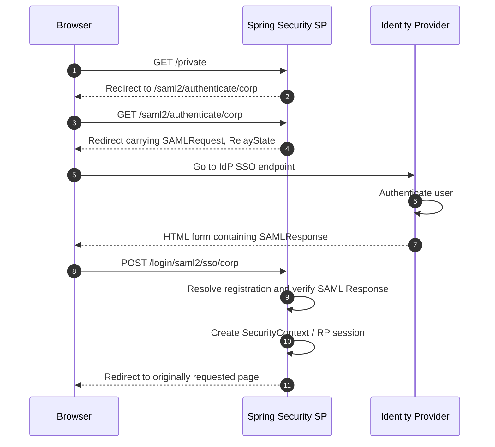

# Configuring Assertion Consumer Service and the SAMLResponse Receiving Endpoint

## 1. Lesson Objectives

The **Assertion Consumer Service (ACS)** is the endpoint on the **Service Provider (SP)** side that receives SAML 2.0 authentication results. With Spring Security SAML2 Login, the Spring Boot application is the SP/Relying Party; the corporate login system is the **Identity Provider (IdP)**. After the IdP authenticates the user, the browser forwards the SAML message to the ACS, typically as an HTTP POST containing the `SAMLResponse` form field. Only after Spring Security validates the response does the application establish an `Authentication` and login session.

This lesson guides you through configuring the ACS and `SAMLResponse` receiving URL consistently across the Spring Security filter, `RelyingPartyRegistration`, SP metadata, and IdP configuration. Topics include default and custom endpoints, HTTP-POST binding, Spring Boot/Java, reverse proxies, CSRF/cookies, multiple IdPs, response validation, and troubleshooting.

**Practical target:** learners must be able to distinguish an *advertised* ACS URL from an ACS endpoint actually *listened to* by Spring Security, verify metadata/responses for a registration, and detect mismatches without disabling security checks.

## 2. Four Roles/Addresses to Distinguish

| Component | Function | Hypothetical Example |
| --- | --- | --- |
| **SP Entity ID** | Logical identifier of the application in SAML federation; typically the assertion's `AudienceRestriction` value | `https://app.example.com/saml2/service-provider-metadata/corp` |
| **ACS URL** | Public SP endpoint receiving the SAML Response | `https://app.example.com/login/saml2/sso/corp` |
| **IdP Single Sign-On Service URL** | IdP endpoint receiving AuthnRequests or initiating SSO | `https://idp.example.com/sso` |
| **Spring registrationId** | Internal key to look up a `RelyingPartyRegistration` | `corp` |

**Never swap** SP Entity ID, ACS URL, and IdP SSO URL even though they all resemble HTTPS addresses. `registrationId` is not synonymous with `entityId` either: a short name like `corp` lets Spring Security distinguish configurations, whereas the IdP often requires an SP Entity ID according to its own policy.

Two other endpoints on the Spring Security side:

- `/saml2/authenticate/{registrationId}`: initiates SAML authentication and generates `AuthnRequest`.
- `/saml2/metadata/{registrationId}`: returns SP metadata when `saml2Metadata` is enabled; metadata states the SP Entity ID, ACS/binding, and relevant public certificates.

The metadata URL and ACS URL themselves may share part of a prefix while serving completely different functions. ACS usually accepts **POST**, whereas metadata is usually accessed via **GET**. Do not create arbitrary `@PostMapping` handlers to replace the framework endpoint.

## 3. ACS in Web Browser SSO



During initiation, Spring Security can store the **AuthnRequest ID and correlation state** to verify the result once the IdP returns. If the browser retains the session cookie and full request state, the response from the IdP is bound to that initial login attempt. For IdP-initiated systems without a prior AuthnRequest, a dedicated policy is required; never treat missing correlation state as normal by default.

**HTTP-Redirect binding when sending AuthnRequest** and **HTTP-POST binding when returning Response** are a common combination, not two names for the same operation. SAML can support other bindings such as Artifact in specialized deployments; enabling a binding must be agreed upon by both SP/IdP and supported by the framework.

## 4. Default Endpoint Receiving SAMLResponse in Spring Security Servlet

When configuring `http.saml2Login(...)`, Spring Security registers **`Saml2WebSsoAuthenticationFilter`** to process logins. With the default path, a browser may send:

```http
POST /login/saml2/sso/corp HTTP/1.1
Host: app.example.com
Content-Type: application/x-www-form-urlencoded

SAMLResponse=BASE64_ENCODED_XML&RelayState=OPAQUE_STATE
```

This is an **illustration**, not a payload usable for logging in. `SAMLResponse` is a form value containing Base64-encoded SAML XML per HTTP-POST binding. It can contain sensitive data; never log the raw form body.

Spring Security processes the request along this chain:

1. `Saml2WebSsoAuthenticationFilter` matches the processing URL, accepts the request, and delegates to the authentication converter.
2. The converter extracts `SAMLResponse` from the request, locates the matching `RelyingPartyRegistration`, and builds a `Saml2AuthenticationToken`.
3. The SAML/OpenSAML authentication manager/provider parses the response, verifies the signature, issuer, destination, and assertion conditions, and decrypts encrypted parts when needed.
4. When valid, Spring Security creates `Saml2Authentication` and `Saml2AuthenticatedPrincipal`, stores the state in `SecurityContext`, and runs success handling.
5. When invalid, authentication must be rejected; never issue a session merely because a POST arrived or Base64 decoded cleanly.

Internal OpenSAML provider names change across Spring Security versions (e.g., OpenSAML 4/5). This lesson prefers public APIs `saml2Login`/`RelyingPartyRegistration` so examples depend less on internal implementations.

### Default URLs to Remember

| Spring Security URI | Purpose |
| --- | --- |
| `/saml2/authenticate/{registrationId}` | Generates AuthnRequest and sends the browser to the IdP |
| `/login/saml2/sso/{registrationId}` | ACS validating SAMLResponse |
| `/login/saml2/sso` | URL variant that may be supported when the framework resolves registration via state/issuer |
| `/saml2/metadata/{registrationId}` | Publishes SP metadata when enabled |
| `/login` | Login page or IdP selection depending on configuration |
| `/logout/saml2/slo` | Single Logout; not the login ACS |

Actual HTTP paths can be affected by `server.servlet.context-path` and proxy rewrites. Always verify the actual public URL and the filter path handled by Spring Security, especially if changing default paths.

## 5. Three ACS Configurations That Must Stay Synchronized

There are **three places** where ACS information must align:

1. **In `RelyingPartyRegistration`:** `assertionConsumerServiceLocation` states where the SP expects to receive Responses, e.g., `{baseUrl}/login/saml2/sso/{registrationId}`.
2. **In the Spring Security filter:** `saml2Login.loginProcessingUrl` specifies the path processed by `Saml2WebSsoAuthenticationFilter`; defaults to Spring's SAML WebSSO path.
3. **In IdP/SP metadata:** the IdP only sends Responses to registered/accepted addresses; metadata holds `AssertionConsumerService@Location` and Binding.

Configuring only one place creates a mismatch. For instance, if the IdP stores ACS `https://app.example.com/login/saml2/sso/corp` while a developer changes the Spring filter to `/saml/acs/corp`, the IdP's POST will hit a route unhandled by the filter. If updated metadata has not been reloaded by the IdP, the IdP can keep using the old ACS.

### XML Metadata Fragment Example

Inside `SPSSODescriptor`, SP metadata can contain an element like:

```xml
<md:AssertionConsumerService
    xmlns:md="urn:oasis:names:tc:SAML:2.0:metadata"
    Binding="urn:oasis:names:tc:SAML:2.0:bindings:HTTP-POST"
    Location="https://app.example.com/login/saml2/sso/corp"
    index="0"
    isDefault="true"/>
```

This is only an **XML excerpt**, not complete metadata. `Binding` specifies how the IdP sends SAML Responses back to the SP; `Location` must be the exact public ACS. `index`/`isDefault` help the IdP choose an ACS from metadata when multiple options exist. Do not assume every IdP refreshes metadata automatically in real time; some partners require manual URL entry.

When changing the ACS, verify updated metadata, IdP configuration, and live routing. An ACS URL does not need to become a Spring MVC controller; the Spring Security filter handles it directly.

## 6. Spring Boot Example Configuring the Default ACS

This example runs on **Java 17+, Spring Boot 3.x, and Spring Security 6.x** when paired with a real SAML IdP, readable metadata, and an accurate SP registration. The domains/registrations below are hypothetical for learning, not live accounts.

### 6.1. Dependencies

A Spring Boot project already configured with the Gradle plugin/BOM can declare this `build.gradle` snippet:

```groovy
repositories {
    mavenCentral()
    // Some OpenSAML versions require the Shibboleth release repository.
    maven { url "https://build.shibboleth.net/maven/releases/" }
}

dependencies {
    implementation "org.springframework.boot:spring-boot-starter-web"
    implementation "org.springframework.boot:spring-boot-starter-security"
    implementation "org.springframework.security:spring-security-saml2-service-provider"
}
```

This is a **build.gradle addition**, not a full build file. Use compatible versions managed by the Spring Boot plugin; avoid forcing incompatible OpenSAML versions.

### 6.2. application.yml

```yaml
app:
  saml:
    idp-metadata: "${IDP_METADATA_LOCATION}"
```

The `IDP_METADATA_LOCATION` environment variable holds the trusted IdP metadata location, e.g., `https://idp.example.com/metadata`. In production, never let end users pass a metadata URL in a request to alter trust anchors.

### 6.3. Complete Java Class

Save at `src/main/java/demo/saml/SamlAcsApplication.java`:

```java
package demo.saml;

import java.util.Map;

import org.springframework.beans.factory.annotation.Value;
import org.springframework.boot.SpringApplication;
import org.springframework.boot.autoconfigure.SpringBootApplication;
import org.springframework.context.annotation.Bean;
import org.springframework.security.config.Customizer;
import org.springframework.security.config.annotation.web.builders.HttpSecurity;
import org.springframework.security.core.annotation.AuthenticationPrincipal;
import org.springframework.security.saml2.provider.service.authentication.Saml2AuthenticatedPrincipal;
import org.springframework.security.saml2.provider.service.registration.InMemoryRelyingPartyRegistrationRepository;
import org.springframework.security.saml2.provider.service.registration.RelyingPartyRegistration;
import org.springframework.security.saml2.provider.service.registration.RelyingPartyRegistrationRepository;
import org.springframework.security.saml2.provider.service.registration.RelyingPartyRegistrations;
import org.springframework.security.web.SecurityFilterChain;
import org.springframework.web.bind.annotation.GetMapping;
import org.springframework.web.bind.annotation.RestController;

@SpringBootApplication
@RestController
public class SamlAcsApplication {

    public static void main(String[] args) {
        SpringApplication.run(SamlAcsApplication.class, args);
    }

    @Bean
    RelyingPartyRegistrationRepository registrations(
            @Value("${app.saml.idp-metadata}") String metadataLocation) {

        RelyingPartyRegistration registration = RelyingPartyRegistrations
                .fromMetadataLocation(metadataLocation)
                .registrationId("corp")
                .entityId("{baseUrl}/saml2/service-provider-metadata/{registrationId}")
                .assertionConsumerServiceLocation(
                        "{baseUrl}/login/saml2/sso/{registrationId}")
                .build();

        return new InMemoryRelyingPartyRegistrationRepository(registration);
    }

    @Bean
    SecurityFilterChain securityFilterChain(HttpSecurity http) throws Exception {
        return http
                .authorizeHttpRequests(auth -> auth
                        .requestMatchers("/").permitAll()
                        .anyRequest().authenticated())
                .saml2Login(Customizer.withDefaults())
                .saml2Metadata(Customizer.withDefaults())
                .build();
    }

    @GetMapping("/")
    public String home() {
        return "Public page";
    }

    @GetMapping("/private")
    public Map<String, String> privatePage(
            @AuthenticationPrincipal Saml2AuthenticatedPrincipal principal) {
        return Map.of(
                "subject", principal.getName(),
                "registration", principal.getRelyingPartyRegistrationId());
    }
}
```

**Explanation:** `registrations` creates a single internal registration named `corp` from IdP metadata, explicitly setting SP Entity ID and ACS. `securityFilterChain` enables `saml2Login` and `saml2Metadata` to handle login and export SP metadata. `/private` requires login, while `/` is public. The HTTP POST ACS is processed by the SAML filter **before** any MVC controller.

**Test run:** in a complete Spring Boot/Gradle project with a real IdP that registered the ACS/SP Entity ID, run (POSIX shell):

```bash
IDP_METADATA_LOCATION=https://idp.example.com/metadata ./gradlew bootRun
```

`idp.example.com` is a placeholder to replace. The SP registration on the IdP must permit ACS `http://localhost:8080/login/saml2/sso/corp` for local runs and use dedicated hosts/certificates in production. Open `http://localhost:8080/private` to start login.

No fixed stdout can be promised because startup, metadata, and IdP behavior depend on the environment. With a valid Response and successful authentication, `/private` returns JSON containing the real NameID (e.g., `subject`) and registration ID; do not predict a specific user's NameID. Without a real IdP, the example cannot authenticate SAML via fake payloads.

## 7. Customizing the ACS URL When Integration Requires It

Suppose the IdP requires a new endpoint `https://app.example.com/saml/acs/corp`. **Both** the location setting and filter path must be updated.

In the `RelyingPartyRegistration` builder bean above, change:

```java
.assertionConsumerServiceLocation("{baseUrl}/saml/acs/{registrationId}")
```

In the `SecurityFilterChain` bean, replace the default login configuration with:

```java
.saml2Login(saml -> saml
        .loginProcessingUrl("/saml/acs/{registrationId}"))
```

These two Java snippets **are edits to the example class**, not standalone programs. Rebuild, inspect updated metadata, and update the ACS at the IdP before deploying to production. If the app sits under `/portal`, the public ACS may need `https://app.example.com/portal/saml/acs/corp` while the internal filter matcher remains the path after the servlet context path; verify live.

**Why not use `@PostMapping` for `/saml/acs/corp`?** Because a controller receives data outside/ahead of the framework's built-in SAML verification mechanism, unless a very specialized architecture is intended. Changing `loginProcessingUrl` keeps processing inside the battle-tested `Saml2WebSsoAuthenticationFilter` and authentication provider.

### When a Shared ACS Without registrationId Is Desired

URLs like `/saml/acs` are sometimes requested by partners. Without `{registrationId}`, Spring Security must resolve the registration from AuthnRequest state and/or issuer per version capabilities. Customizing `AuthenticationConverter` or `RelyingPartyRegistrationResolver` may be necessary to pick the right partner accurately, especially with multiple IdPs and unsolicited responses.

Never simply remove `{registrationId}` and blindly accept every Response: test cases where IdP A sends a response to registration B, cases lacking session/correlation, and cases signed with the wrong IdP key.

## 8. Configuration Option via Spring Boot Properties

Besides the Java builder, Spring Boot 3.x offers configuration under the `spring.security.saml2.relyingparty.registration` namespace. As an **alternative approach**—never define a programmatic repository bean while letting auto-configuration build a conflicting source of truth:

```yaml
spring:
  security:
    saml2:
      relyingparty:
        registration:
          corp:
            entity-id: "https://app.example.com/saml2/service-provider-metadata/corp"
            acs:
              location: "https://app.example.com/login/saml2/sso/corp"
            assertingparty:
              entity-id: "https://idp.example.com/issuer"
              sso-url: "https://idp.example.com/sso"
              verification:
                credentials:
                  - certificate-location: "file:/etc/app/saml/idp-signing.crt"
```

`idp-signing.crt` is the **signature verification certificate provided by the IdP over a trusted channel**, not the SP's private key. Replace the YAML values with real ones matching your Spring Boot version; check the corresponding `Saml2RelyingPartyProperties`. `acs.location` and `entity-id` are **SP-side** info, while `assertingparty` is **IdP-side** info. With a custom ACS, ensure `saml2Login.loginProcessingUrl` listens at the new path.

The `{baseUrl}` and `{registrationId}` placeholders can be used in several `RelyingPartyRegistration` APIs; they differ from Spring property placeholders like `${ENV_VAR}`. `{baseUrl}` depends on the scheme/host/port seen by the application on the request, so verify it when running behind a proxy.

## 9. ACS Behind a Reverse Proxy, Ingress, or Context Path

Common architecture:

```text
Browser --HTTPS--> https://app.example.com
                           |
                           v
                     Reverse proxy
                     TLS termination
                           |
                           v
                     Spring Boot :8080

Public ACS:
https://app.example.com/login/saml2/sso/corp

Local filter path:
/login/saml2/sso/corp
```

If the framework sees the internal host `http://service:8080` instead of the public URL, `{baseUrl}` can resolve incorrectly. The IdP will use an ACS different from what the SP generates/validates, causing `Destination`/`Recipient` or redirect failures.

With Spring Boot Servlet, you can configure:

```yaml
server:
  forward-headers-strategy: framework
  servlet:
    session:
      cookie:
        secure: true
        http-only: true
```

`forward-headers-strategy: framework` lets Spring interpret forwarded headers when provided by the proxy infrastructure. **Enable trust only for controlled proxies**: the ingress must strip/overwrite `Forwarded`, `X-Forwarded-Host`, and `X-Forwarded-Proto` coming from the Internet. Otherwise, clients can spoof the host/scheme trusted by the application.

Additional checks:

- Public `https://` URL and port 443 are registered accurately at the IdP.
- Ingress allows POST to the ACS without changing the HTTP method or mis-rewriting the path.
- No HTTP↔HTTPS redirect loop drops the form POST.
- `server.servlet.context-path` or path prefix `/portal` is accounted for accurately.
- All replicas share the same SP Entity ID, ACS URL, certificates, and registrations.
- Metadata advertises the public URL, never leaking internal Kubernetes/pod hostnames.

When a dynamic base URL is unnecessary, using a fixed per-environment absolute public HTTPS ACS can be easier to audit, provided it is deployed/registered consistently everywhere.

## 10. HTTP-POST Binding and SAMLResponse Contents

The IdP can generate an auto-submitted HTML form in the browser:

```html
<form method="post"
      action="https://app.example.com/login/saml2/sso/corp">
  <input type="hidden" name="SAMLResponse"
         value="BASE64_ENCODED_RESPONSE"/>
  <input type="hidden" name="RelayState"
         value="OPAQUE_STATE"/>
</form>
<script>document.forms[0].submit();</script>
```

This illustrates the HTML of HTTP-POST binding; placeholder strings are invalid for authentication. The `action` path must match the registered ACS. The browser does not need a separate SP API to decode the response.

A real SAML Response can contain `Response@ID`, `Issuer`, `Status`, `Destination`, `InResponseTo`, `Assertion`, or `EncryptedAssertion`. The Assertion can contain `NameID`, `AudienceRestriction`, `SubjectConfirmationData@Recipient`, `NotBefore`/`NotOnOrAfter`, and attributes.

**Base64 is not encryption:** the browser can inspect unencrypted assertion data. XML signatures prove integrity/origin of signed elements, not payload confidentiality. For attributes requiring secrecy from browsers/proxies, the IdP can encrypt the assertion for the SP; the SP manages the corresponding decryption private key.

## 11. Security Checks at the ACS

A POST reaching the right URL is not enough to allow login. The SP must validate per profile and policy, including:

1. **Correct IdP/registration:** the issuer and signature verification certificate must belong to a trusted `RelyingPartyRegistration`.
2. **XML signature:** verify the signature on the Response/Assertion used to build the principal, defending against XML Signature Wrapping.
3. **`Destination`:** the Response was addressed to an allowed ACS.
4. **`Recipient`:** `SubjectConfirmationData` binds the assertion to the matching ACS/recipient.
5. **`AudienceRestriction`:** audience must match the **SP Entity ID**, never inferred arbitrarily from the registration ID.
6. **`InResponseTo`:** for SP-initiated flows, the response matches a stored AuthnRequest, not a different request.
7. **`RelayState`:** used strictly as correlation/return-state per policy; never as authentication proof and never enabling open redirects.
8. **Validity window:** `NotBefore`, `NotOnOrAfter`, session timing, and reasonable clock skew.
9. **Replay:** Response/Assertion cannot be reused after processing under anti-replay policy.
10. **Authorization:** map only verified assertion attributes to principals/authorities per app rules; an external string from the IdP does not automatically grant admin privileges.

Rely on the default SAML/OpenSAML framework for validation. If IdP-specific policies are required, add targeted validation and tests; never write a stripped-down XML parser or turn off signature/destination/audience validation when encountering errors.

## 12. Cookies, CSRF, and Retrieving AuthnRequest

An HTTP POST from the IdP is a cross-site request. The IdP lacks a traditional SP CSRF token, so `saml2Login` and SAML WebSSO processing apply dedicated CSRF handling for the protocol endpoint. If you customize `loginProcessingUrl`, verify that your Spring Security version's CSRF exemption and current filter chain cover the new path.

**Never disable CSRF application-wide with `csrf(csrf -> csrf.disable())`** to fix a 403 at the ACS. Target the exact SAML endpoint via framework mechanisms, keeping CSRF active for other form/session endpoints. Traditional CSRF exemption does not leave the ACS unprotected: signatures, request correlation, destination, audience, and replay checks still guard it.

In SP-initiated flows, `AuthnRequest` is typically stored in a session-backed repository. The browser returning from the IdP must send the SP session cookie to locate that state. `SameSite=Lax` can prevent cookies from being sent on cross-site POSTs; `SameSite=None` usually requires `Secure` and CSRF impact review because it broadens cookie transmission context.

Multi-replica scenario: a request starts on instance A while the ACS POST lands on B; without shared session/request repositories, `InResponseTo` can be missing. Solutions include session sharing, purposefully designed sticky sessions, or an appropriate repository. Never drop correlation validation to hide infrastructure issues.

## 13. Multiple IdPs and IdP-Initiated Policy

If an SP configures two registrations `corp` and `partner`, default URLs may be:

```text
/saml2/authenticate/corp
/login/saml2/sso/corp

/saml2/authenticate/partner
/login/saml2/sso/partner
```

Each registration needs accurate issuer, verification certificate, SP entity ID/ACS, and IdP SSO endpoint. When a payload arrives at the ACS, never let users arbitrarily pick a registration via a parameter while skipping issuer, key, or audience verification.

With **IdP-initiated SSO**, there may be no prior AuthnRequest and the response carries no `InResponseTo`. Decide explicitly whether unsolicited login is permitted, guard against replay/login CSRF/session confusion, verify trusted IdPs, and constrain redirect destinations. With **SP-initiated**, enforce correlation with the issued request. The two flows have different transaction guarantees even if sharing an ACS path.

## 14. Testing the ACS in an Integration Environment

### 14.1. Verifying Metadata

After enabling `saml2Metadata`, fetch SP metadata and check:

- `EntityDescriptor@entityID` matches the SP Entity ID registered at the IdP.
- `AssertionConsumerService@Location` is the exact public HTTPS ACS.
- Binding is HTTP-POST if the IdP sends Responses via POST.
- Signing/encryption certificates (if published) match the environment.
- No `localhost` URLs, HTTP schemes, or internal pod hosts appear in production metadata.

Metadata proves which URL the SP **advertises**; live HTTP POST testing is required to confirm the filter processes that URL.

### 14.2. End-to-End Browser Test

1. Open `/private` or `/saml2/authenticate/corp`.
2. In the browser Network tab, confirm redirect/`SAMLRequest` targets the right IdP SSO URL.
3. After login, verify the browser POSTs to the exact public ACS URL with the `SAMLResponse` form field.
4. On failure, inspect 404/405/403 status or redirect errors alongside redacted application logs.
5. On success, revisit `/private` and confirm the expected principal/registration.
6. Also test session cookies, page refreshes, multi-tab logins, and multi-replica behavior.

Never share raw `SAMLResponse`, cookies, private keys, or real user PII in issue trackers. An HTTP 302/200 at the ACS alone does not prove successful authentication; confirm `SecurityContext` and protected resource access after redirect.

### 14.3. Negative Tests

| Test Input | Expected Outcome |
| --- | --- |
| Unparseable Response | No authentication created |
| Wrong signature or untrusted certificate | Rejected |
| `Destination` or `Recipient` pointing to another ACS | Rejected per policy |
| `AudienceRestriction` pointing to another SP | Rejected |
| Expired or not-yet-valid assertion | Rejected |
| Replayed Response/Assertion | Rejected per replay policy |
| Mismatched `InResponseTo` in SP-initiated flow | Rejected |
| IdP A Response sent to registration B | Rejected due to issuer/key/audience |
| Updated metadata while IdP uses old ACS | Mismatch caught before production |
| Misconfigured proxy headers turning ACS into HTTP | Caught in metadata/tracing |

Run tests against a sandbox IdP using test data/certificates. Never override security policies or use production tokens for testing.

## 15. Common ACS Error Matrix

| Symptom | Investigation Area |
| --- | --- |
| **404** on IdP POST | IdP-configured URL, ingress rewrite, context path, filter matcher |
| **405** | Target endpoint accepts only GET; request misses SAML filter |
| **403** before authentication | CSRF matcher, WAF, SecurityFilterChain rules, HTTP method |
| `Invalid Destination` | ACS Location, public scheme/host/port, forwarded headers |
| `Invalid Recipient` | `SubjectConfirmationData@Recipient`, ACS URL, IdP registration |
| `Audience invalid` | Wrong SP Entity ID; IdP issued assertion for another SP |
| `Signature invalid` | IdP verification certificate/metadata, key rotation, signed node |
| `InResponseTo missing` | HTTP session/cookie/SameSite, request repository, replicas |
| `No RelyingPartyRegistration` | Wrong `registrationId`, repository, or resolver |
| RelayState redirects to unexpected URL | Return-state handling/open redirect policy |
| Login succeeds with wrong roles | Mapping verified attributes to `GrantedAuthority` |

**An effective debugging sequence:** verify where the browser sends the POST → confirm the request reaches the right filter → see which registration was selected → identify which specific validation failed → verify session/cookie persistence after success. Avoid weakening SAML validation when the root cause is simply HTTP routing or session handling.

## 16. Release Checklist

- [ ] Public ACS URL, port, scheme, and context path match metadata and the IdP.
- [ ] `assertionConsumerServiceLocation` and `loginProcessingUrl` are aligned.
- [ ] SP Entity ID is properly distinct from ACS per design and matches audience.
- [ ] Response binding is supported by both SP and IdP.
- [ ] HTTPS/TLS and forwarded headers from trusted proxies are properly configured.
- [ ] Session cookies and AuthnRequest repository work when the browser sends cross-site POSTs.
- [ ] Multi-replica setups use shared session/correlation or stable sticky routing.
- [ ] IdP verification certificate, signature, issuer, destination, recipient, audience, and validity window are enforced.
- [ ] Replay protection and unsolicited IdP-initiated login policies are explicitly decided.
- [ ] CSRF exemptions apply solely to SAML protocol paths; never disable CSRF application-wide.
- [ ] IdP metadata updated after ACS changes and end-to-end tests passed.
- [ ] Logs never expose SAMLResponse, RelayState, assertions, cookies, or private keys.
- [ ] Negative tests and proxy/cert/session failure scenarios executed.

## 17. Self-Assessment Questions

**1. Must the ACS in Spring Security be a `@PostMapping` Controller?** No. `Saml2WebSsoAuthenticationFilter` handles SAML POSTs in the filter chain when `saml2Login` is configured.

**2. Does changing only `RelyingPartyRegistration.assertionConsumerServiceLocation` make the filter listen at the new endpoint?** Not automatically. Check/configure `loginProcessingUrl`, metadata, and the IdP accordingly.

**3. Is SP Entity ID the same as the ACS URL?** No. Entity ID is the identifier referenced by the assertion's audience, while ACS is the endpoint receiving SAMLResponse.

**4. Why might `{baseUrl}` become `http://service:8080` behind a proxy?** Because the app sees the internal host/scheme when forwarded headers are not configured properly.

**5. Is Base64-encoded SAMLResponse encrypted?** No. Base64 is encoding, not hiding payload contents from the browser.

**6. How should `InResponseTo` errors be handled?** Inspect AuthnRequest state, cookies/SameSite, session store, and multi-replica routing; never drop correlation checks.

**7. Is a valid signature sufficient to accept an assertion?** No. Correct issuer, audience, destination/recipient, time window, subject confirmation, request correlation, and anti-replay are also required.

**8. Are IdP-initiated and SP-initiated flows inherently equally secure?** No. IdP-initiated flows lack request correlation and require dedicated policy controls.

## 18. References

- [Spring Security 6.5 – SAML 2.0 Login Overview](https://docs.spring.io/spring-security/reference/6.5/servlet/saml2/login/overview.html): Web Browser SSO, `RelyingPartyRegistration`, default routes.
- [Spring Security 6.5 – Authenticating SAML Responses](https://docs.spring.io/spring-security/reference/6.5/servlet/saml2/login/authentication.html): processing endpoint, filter/provider, custom URL.
- [Spring Security 6.5 – Producing AuthnRequests](https://docs.spring.io/spring-security/reference/6.5/servlet/saml2/login/authentication-requests.html): request initiation, state, and binding.
- [Spring Security 6.5 – SAML Metadata](https://docs.spring.io/spring-security/reference/6.5/servlet/saml2/metadata.html): exporting SP metadata.
- [Spring Boot 3.5 – SAML2 Relying Party Properties](https://docs.spring.io/spring-boot/3.5/reference/web/spring-security.html): dependencies and configuration.
- [Spring Boot 3.5 – Embedded Web Server/Forwarded Headers](https://docs.spring.io/spring-boot/3.5/how-to/webserver.html): reverse proxies.
- [OASIS – SAML 2.0 Profiles](https://docs.oasis-open.org/security/saml/v2.0/saml-profiles-2.0-os.pdf) and [Bindings](https://docs.oasis-open.org/security/saml/v2.0/saml-bindings-2.0-os.pdf): protocol standards.
- [OWASP SAML Security Cheat Sheet](https://cheatsheetseries.owasp.org/cheatsheets/SAML_Security_Cheat_Sheet.html): preventing signature wrapping, replay, and trust misconfiguration.
