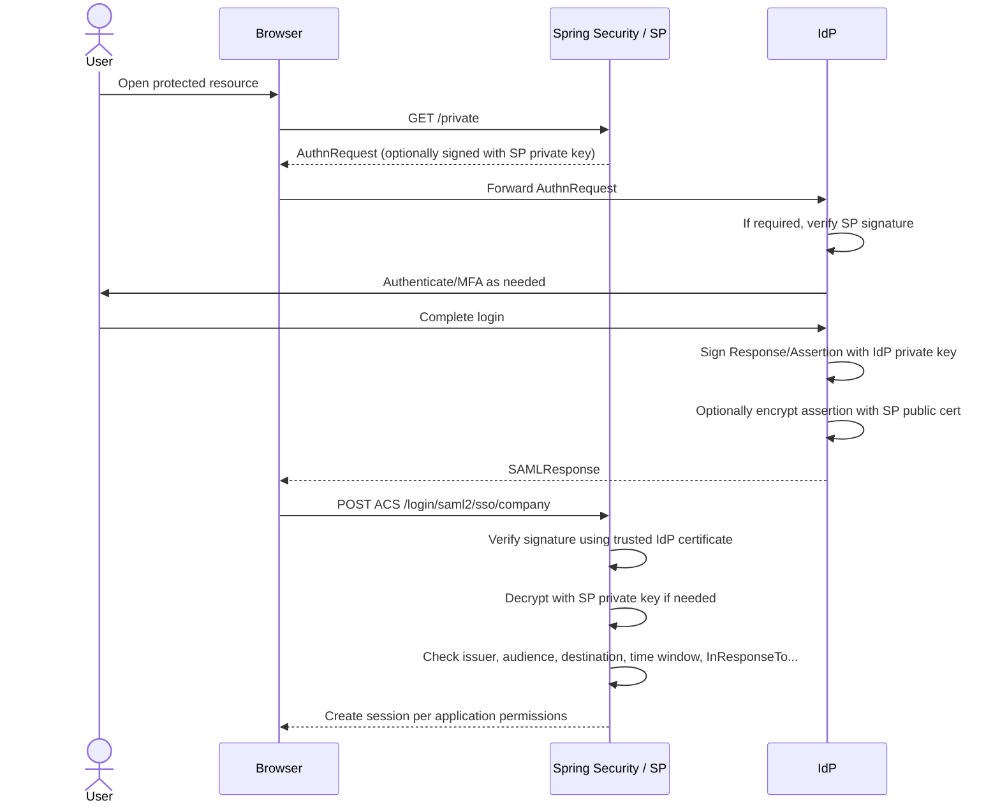

# Configuring Signing Keys, Decryption Keys, and Verification Certificates in Spring Security SAML2

## Learning Objectives

After completing this lesson, you will be able to:

1. Distinguish the **Service Provider (SP) private signing key**, the **SP private decryption key**, and the **Identity Provider (IdP) public certificate used for signature verification**.
2. Explain the flow of keys/certificates in SAML 2.0 Web Browser SSO: who signs `AuthnRequest`, who signs `Response`/`Assertion`, who encrypts, and who decrypts `EncryptedAssertion`.
3. Configure the three credential groups of `RelyingPartyRegistration` accurately: `signingX509Credentials`, `decryptionX509Credentials`, and `assertingPartyDetails.verificationX509Credentials` (API names may vary across Spring Security branches).
4. Write Spring Boot 3 + Spring Security 6 configuration using `spring-security-saml2-service-provider`, X.509 certificates, and PKCS#8 private keys, while publishing **SP metadata** for the IdP.
5. Verify key-pair/certificate alignment, handle key replacement/rotation, and distinguish signature errors, decryption errors, wrong issuer/audience, and wrong URLs.
6. Protect private keys in production environments, avoiding accepting self-declared certificates inside SAML Responses or disabling signature verification.

## 1. Context: A Two-Sided SAML2 Relationship

Spring Security SAML2 Login in Servlet web applications typically operates the app as a **Relying Party (RP)**, synonymous with **Service Provider (SP)**. The party authenticating users and issuing SAML assertions is the **Asserting Party (AP)**, synonymous with **Identity Provider (IdP)**.

- **SP:** the Spring Boot application receiving SAML Responses at the **Assertion Consumer Service (ACS)**, verifying issuer and signature, decrypting encrypted assertions when applicable, validating SAML conditions, and creating an application session.
- **IdP:** the system authenticating users, signing SAML Responses/Assertions with the IdP's private key, and optionally encrypting assertions with the SP's public key per agreement.
- **User/browser:** redirects between SP and IdP and carries messages via Redirect/POST bindings. The browser **is not where the application trusts signatures** and must never hold SP-side private keys.

A typical SP-initiated login flow:



**Three distinct operations**:

- **Sign:** create a signature using the sender's **private key** so the receiver can verify integrity and issuer authenticity using a trusted **public certificate**.
- **Verify:** use the issuer's **public certificate** to verify a signature; the verifier does not need and must never possess the issuer's private key.
- **Encrypt/Decrypt:** the IdP encrypts content destined for the SP using the **SP's public key/certificate**; only the SP holding the matching private key can decrypt it.

**Signing does not replace encryption**: a signed message remains readable unless encrypted. **Encryption does not replace signature verification**: successful decryption alone is insufficient to trust issuer, integrity, audience, or authentication conditions.

## 2. Key Ownership Diagram: Who Holds What?

| Task | Who Holds the Private Key? | Who Receives the Public Certificate? | Where Is It Configured in Spring Security? |
| --- | --- | --- | --- |
| **SP signs AuthnRequest**; may sign LogoutRequest if SLO is supported | **SP** holds signing private key | **IdP** registers SP's public signing certificate | `RelyingPartyRegistration.signingX509Credentials(...)`; Boot `registration.<id>.signing.credentials` |
| **SP decrypts EncryptedAssertion/EncryptedAttribute/EncryptedID** | **SP** holds decryption private key | **IdP** knows SP's public encryption certificate to encrypt | `RelyingPartyRegistration.decryptionX509Credentials(...)`; Boot `registration.<id>.decryption.credentials` |
| **SP verifies Response/Assertion signature from IdP** | **IdP** holds IdP's signing private key | **SP** receives/trusts **IdP signing certificate** | `assertingPartyDetails.verificationX509Credentials(...)`; Boot `registration.<id>.assertingparty.verification.credentials` |
| **IdP verifies signed AuthnRequest** | **SP** signed earlier | IdP must trust **SP signing certificate** | Registered at IdP, usually via **SP metadata** |
| **IdP signs Response/Assertion** | **IdP** holds signing private key | SP must trust **IdP signing certificate** | Configured manually from trusted source or imported from verified IdP metadata |

Example with three distinct key/credential pairs:

```text
SP:
  sp-signing.key       (PRIVATE, held by SP)
  sp-signing.crt       (PUBLIC, given to IdP to verify AuthnRequest)
  sp-decryption.key    (PRIVATE, held by SP)
  sp-decryption.crt    (PUBLIC, given to IdP to encrypt assertion)

IdP:
  idp-signing.key      (PRIVATE, held ONLY by IdP; NEVER give to SP)
  idp-signing.crt      (PUBLIC, given to SP to verify Response/Assertion)
```

One SP key pair can be shared for signing and decryption if agreements permit, though **separating keys** is cleaner for usage policies, auditing, and independent rotation. SP signing/decryption keys are **not** the web server's TLS/HTTPS keys; they can be dedicated SAML X.509 certificates, not necessarily issued by a public CA when partners establish trust via securely exchanged metadata/certificates.

### 2.1. Three Credential Types in Spring Security

Spring Security provides `org.springframework.security.saml2.core.Saml2X509Credential` with corresponding factory methods:

```java
Saml2X509Credential.signing(spPrivateKey, spSigningCertificate);
Saml2X509Credential.decryption(spPrivateKey, spDecryptionCertificate);
Saml2X509Credential.verification(idpSigningCertificate);
```

The snippet above illustrates API calls once `PrivateKey`/`X509Certificate` variables and imports are available; **it is not a standalone Java program**. The static signatures make it clear:

- `signing(PrivateKey, X509Certificate)` requires a private key and certificate **owned by the SP**.
- `decryption(PrivateKey, X509Certificate)` requires a private key and certificate **owned by the SP**.
- `verification(X509Certificate)` requires only the public certificate **owned by the IdP**.

Spring Security also offers `encryption(X509Certificate)` when a party acts as the **sender encrypting content**; in standard SAML2 Login SP setups, the IdP uses the SP's certificate to encrypt for the SP, and the SP uses `decryption`.

**Never put the IdP's private key into SP configuration.** If any guide asks the SP to hold the IdP private key to "verify", that guide is confusing signing and verification.

## 3. Documents and Identifiers to Exchange Before Configuring

A successful integration requires complete **identifiers, endpoints, and trust material**, not just `.crt`/`.key` files.

| Parameter | Defined / Provided By | Illustrative Example |
| --- | --- | --- |
| Spring `registrationId` | SP (local name) | `company` |
| SP `entityId` | SP agreed with IdP | `https://app.example.org/saml2/service-provider-metadata/company` |
| SP ACS endpoint | Agreed by SP and IdP | `https://app.example.org/login/saml2/sso/company` |
| IdP `entityId`/Issuer | IdP | `https://idp.example.org/saml` |
| IdP Single Sign-On URL + binding | IdP | `https://idp.example.org/sso`, Redirect or POST per config |
| IdP signing certificate(s) | IdP, obtained via trusted channel | `idp-signing-2026.crt` |
| SP signing certificate | SP provided to IdP | `sp-signing.crt` |
| SP encryption certificate | SP provided to IdP | `sp-decryption.crt` |
| AuthnRequest signing requirement | IdP and mutual policy | `true` if IdP requires signed requests |
| Assertion encryption requirement | Agreement/SP policy and IdP | Can be enabled after IdP has SP's public encryption cert |
| Validity, algorithm, rollover | Coordinated by both sides | SHA-256/compatible algorithms; cert rotation schedule |

**Never confuse `registrationId` with `entityId`:** `company` is only the local registration name. `entityId` is the SAML identifier recorded on the IdP; it does not have to be a reachable URL, yet must **match identically** across agreements and metadata.

### 3.1. Exchanging SP and IdP Metadata

**IdP metadata** typically contains `<EntityDescriptor entityID="...">`, `<IDPSSODescriptor>`, SSO endpoints, and one or more `<KeyDescriptor use="signing">`. The SP uses that info to register the trusted IdP.

**SP metadata** typically contains `<SPSSODescriptor>`, ACS, SP entity ID, and `<KeyDescriptor use="signing">`/`<KeyDescriptor use="encryption">`. The IdP uses it to verify AuthnRequests or encrypt assertions for the SP.

In Spring Security, SP metadata can be published with `http.saml2Metadata(...)`. Default endpoints are typically:

```text
/saml2/metadata
/saml2/metadata/{registrationId}
/saml2/service-provider-metadata/{registrationId}
```

Example: `https://app.example.org/saml2/metadata/company`.

**Metadata never contains private keys.** Publish only public certificates to the partner. Inspect the live hostname/entity ID/ACS inside metadata, especially behind an ingress or reverse proxy.

**Metadata sources must be trusted:** fetching metadata from an arbitrary URL and blindly accepting every declared signing cert can turn an untrusted source into a trusted IdP. HTTPS protects the transport channel but does not replace source vetting or metadata signature verification. For Spring Security versions/resolvers supporting metadata signature verification, configure a separate metadata-verification key; for static files, verify source/fingerprints out-of-band before distributing.

## 4. Preparing X.509 Keys and Certificates

The examples below use **OpenSSL** to illustrate creating fresh SP key pairs in a learning/lab environment. Production should use a secret manager/HSM/key management solution with controlled key rotation, never copying private keys into Git or public artifacts.

### 4.1. Creating Two RSA Key Pairs for the SP (Lab)

```bash
# Key pair for SP to sign AuthnRequest
openssl genpkey -algorithm RSA -pkeyopt rsa_keygen_bits:3072 -out sp-signing.key
openssl req -new -x509 -sha256 -days 365 -key sp-signing.key \
  -out sp-signing.crt -subj "/CN=saml-sp-signing.example.org"

# Separate key pair for IdP to encrypt Assertions sent to SP
openssl genpkey -algorithm RSA -pkeyopt rsa_keygen_bits:3072 -out sp-decryption.key
openssl req -new -x509 -sha256 -days 365 -key sp-decryption.key \
  -out sp-decryption.crt -subj "/CN=saml-sp-encryption.example.org"
```

These are **lab illustration commands**, not meant for Google Sheets. `openssl genpkey` generates **PKCS#8** in PEM format, typically with a `BEGIN PRIVATE KEY` header. Many Spring Boot SAML setups read private keys from unencrypted PKCS#8 PEM files. When an environment uses encrypted PEM/PKCS#12/HSM, an appropriate key/secret integration layer is needed; do not assume Boot properties decrypt every keystore format automatically.

Self-signed X.509 certificates for **metadata-based SAML trust** can be used in labs or with partners relying on certificate pinning; this differs from web server TLS requiring domain-valid HTTPS trust chains. Certificate validity, algorithms, and key strength must still satisfy both parties' policies.

### 4.2. Verifying That Certificate and Private Key Share the Same Public Key

```bash
# Print certificate fingerprint for out-of-band comparison
openssl x509 -in sp-signing.crt -noout -fingerprint -sha256

# Read public details: issuer, subject, serial, and validity dates
openssl x509 -in sp-signing.crt -noout -subject -issuer -serial -dates

# Extract matching public key from certificate
openssl x509 -in sp-signing.crt -pubkey -noout > public-from-cert.pem

# Extract public key from private key (WITHOUT printing private key)
openssl pkey -in sp-signing.key -pubout > public-from-private.pem
```

Both `public-from-cert.pem` and `public-from-private.pem` must contain the exact same public key. Compare them after normalization/byte comparison (e.g., `cmp` on Unix); never hand the private key to the IdP to run this check. Repeat for the decryption pair.

**When using PowerShell/Windows:** the `\` line continuations, `>` redirects, and `cmp` syntax belong to Bash examples. Write each command on a single line or use PowerShell equivalents; do not copy `\` line continuations literally into PowerShell.

### 4.3. Distributing Files in Production

Example container-mounted paths:

```text
/run/secrets/saml/sp-signing.key          <- private, read by SP service account
/run/certs/saml/sp-signing.crt            <- public
/run/secrets/saml/sp-decryption.key       <- private, read by SP service account
/run/certs/saml/sp-decryption.crt         <- public
/run/certs/saml/idp-signing-2026.crt      <- public, vetted IdP source
```

Rules:

1. Store private keys with least-privilege file permissions so only the service process signing/decrypting can read them. Never commit, log, or embed them in SP metadata.
2. Give the IdP **only SP public certificates**; give the SP **only the IdP's public signing certificate**.
3. An old decryption key may still be needed during transition windows while the IdP sends assertions encrypted with the old cert.
4. Signing/decryption keys may reside in separate keystores/KMS; if a key cannot be exported from an HSM, choose an integration supporting HSM/PKCS#11 or signing/decryption callbacks rather than forcing plaintext key files.

## 5. Spring Boot Configuration via `application.yml`

This is a readable way to place all three credential types into one **SAML2 relying party registration**. The example fits the **Spring Boot 3.x, Spring Security 6.x, Servlet stack** model and `Saml2RelyingPartyProperties` syntax in Spring Boot 3. Hostnames, issuers, and file paths are **hypothetical** and must be replaced for real environments.

### 5.1. Gradle Dependencies

In a project `build.gradle` already using the Spring Boot plugin/BOM:

```groovy
dependencies {
    implementation 'org.springframework.boot:spring-boot-starter-web'
    implementation 'org.springframework.boot:spring-boot-starter-security'
    implementation 'org.springframework.security:spring-security-saml2-service-provider'
}
```

**Note:** Spring Security SAML2 uses OpenSAML underneath; the build system needs a repository hosting the selected version's OpenSAML artifacts. Never pick conflicting OpenSAML dependency versions or force modules outside the BOM. For Spring Boot 3.3/Spring Security 6.3, check the documentation/dependency graph of your exact branch.

### 5.2. YAML for Signing, Decryption, and Verification

```yaml
spring:
  security:
    saml2:
      relyingparty:
        registration:
          company:
            entity-id: "https://app.example.org/saml2/service-provider-metadata/company"

            # SP signs AuthnRequest/Logout messages when flow requires
            signing:
              credentials:
                - private-key-location: "file:/run/secrets/saml/sp-signing.key"
                  certificate-location: "file:/run/certs/saml/sp-signing.crt"

            # SP decrypts assertions/attributes encrypted by IdP for SP
            decryption:
              credentials:
                - private-key-location: "file:/run/secrets/saml/sp-decryption.key"
                  certificate-location: "file:/run/certs/saml/sp-decryption.crt"

            # IdP trusted by SP: verifies Response/Assertion
            assertingparty:
              entity-id: "https://idp.example.org/saml"
              verification:
                credentials:
                  - certificate-location: "file:/run/certs/saml/idp-signing-2026.crt"
              singlesignon:
                url: "https://idp.example.org/sso"
                sign-request: true
```

**Exact part-by-part explanation:**

- `registration.company` configures one SP–IdP pair. An app can hold multiple registrations, each with its own IdP/certs.
- `entity-id` at the `company` level is the **SP entityId**. The IdP must recognize this exact value in AuthnRequest/metadata.
- `signing.credentials` holds the **SP private key + SP certificate**. Spring Security uses them to sign outbound messages like AuthnRequest when required by the IdP or flow.
- `decryption.credentials` holds the **SP private key + SP certificate** for content encrypted by the IdP with the matching public certificate.
- `assertingparty.entity-id` is the **IdP issuer/entityId**, distinct from SP entityId.
- `assertingparty.verification.credentials` holds only the **IdP's public signing certificate**. Never configure a private key there.
- `singlesignon.url` is the IdP address receiving SSO requests over the agreed binding.
- `singlesignon.sign-request: true` expresses that the IdP requires signed AuthnRequests; when the IdP **does not require it**, you can set `false` and signing credentials for login alone may be unnecessary. SAML agreements must dictate signing mode; never drop signatures to "fix" an error when the IdP requires them.
- The default **ACS callback** for registration `company` is `/login/saml2/sso/company`. The IdP needs the matching public URL, e.g., `https://app.example.org/login/saml2/sso/company`. Some versions support a shared response processing path resolving registration via transaction state.
- `file:/run/...` can be replaced with any environment location readable by Spring `Resource`. If using `classpath:` for demos, never bundle **production private keys** inside a JAR.

**A verification certificate conveys zero trust if its source is insecure**: `idp-signing-2026.crt` must be obtained/verified from the registered IdP itself, never extracted from a SAMLResponse submitted by an arbitrary browser.

### 5.3. Java 17+ SecurityFilterChain

Example in `src/main/java/com/example/saml/SamlSecurityConfiguration.java`:

```java
package com.example.saml;

import org.springframework.context.annotation.Bean;
import org.springframework.context.annotation.Configuration;
import org.springframework.security.config.Customizer;
import org.springframework.security.config.annotation.web.builders.HttpSecurity;
import org.springframework.security.web.SecurityFilterChain;

@Configuration
public class SamlSecurityConfiguration {

    @Bean
    SecurityFilterChain securityFilterChain(HttpSecurity http) throws Exception {
        return http
            .authorizeHttpRequests(auth -> auth
                .requestMatchers("/", "/error").permitAll()
                .anyRequest().authenticated()
            )
            .saml2Login(Customizer.withDefaults())
            .saml2Metadata(Customizer.withDefaults())
            .build();
    }
}
```

This assumes `spring-security-saml2-service-provider` is on the classpath and Spring Boot can auto-create `RelyingPartyRegistrationRepository` from YAML. `saml2Login()` installs the web SSO filter/entrypoint; `saml2Metadata()` exposes the endpoint serving **SP metadata**. `/private` protection is `authenticated()`, while business authorization rules must be configured separately.

Authenticated users can be checked via a minimal controller:

```java
package com.example.saml;

import org.springframework.security.core.Authentication;
import org.springframework.web.bind.annotation.GetMapping;
import org.springframework.web.bind.annotation.RestController;

@RestController
public class SamlDemoController {
    @GetMapping("/")
    String home() {
        return "SAML SP demo";
    }

    @GetMapping("/private")
    String privateResource(Authentication authentication) {
        return "Authenticated as " + authentication.getName();
    }
}
```

The controller class belongs to a **Spring Boot application**, not a standalone Java file compiled with `javac` without dependencies. Usernames/HTTP output cannot be predicted without a real IdP and valid assertion.

**Expected test flow:**

1. `GET /private` without a session triggers login.
2. `GET /saml2/authenticate/company` initiates `AuthnRequest` to the IdP.
3. After IdP authentication, the browser **POSTs `SAMLResponse`** to `/login/saml2/sso/company`.
4. Spring Security selects `RelyingPartyRegistration`, decrypts when needed, verifies signature/issuer/audience/destination/time and related conditions; on success, it builds `Authentication`.
5. `GET /private` returns a string containing the verified assertion's principal.

Without a real IdP, certificates, key files, and a valid service registration, this code is only an **integration template**; never claim end-to-end SSO was executed.

### 5.4. Distinguishing Manual YAML and IdP Metadata

There are two ways to configure IdP details:

**Option A: manual**, as in the YAML above: set `assertingparty.entity-id`, `singlesignon.url`, and `verification.credentials` with cert files supplied by the IdP.

**Option B: based on vetted IdP metadata:** use `assertingparty.metadata-uri` in Boot or `RelyingPartyRegistrations.fromMetadataLocation(...)` in Java to derive issuer, SSO endpoint, and public verification certificates from metadata.

Pick **one canonical management source** or establish clear override rules. Automated metadata does not replace trusting the right IdP; key rollover still requires a metadata refresh/reload strategy. If the IdP rotates its signing cert while the app retains the old cert file, valid signatures from the new IdP key will still be rejected.

## 6. Java API: `Saml2X509Credential` and `RelyingPartyRegistration`

Spring Boot maps YAML into `RelyingPartyRegistration`. When needing multi-tenancy, KMS key loading, or dynamic configuration, create the repository in Java instead of Boot auto-config.

### 6.1. Mapping Between YAML and Java

| Intent | Spring Boot Property | Java API |
| --- | --- | --- |
| SP signs requests | `signing.credentials` | `registration.signingX509Credentials(...)` with `Saml2X509Credential.signing(privateKey, cert)` |
| SP decrypts assertions | `decryption.credentials` | `registration.decryptionX509Credentials(...)` with `Saml2X509Credential.decryption(privateKey, cert)` |
| SP verifies IdP signatures | `assertingparty.verification.credentials` | `assertingPartyDetails.verificationX509Credentials(...)` or version's metadata API; use `Saml2X509Credential.verification(idpCert)` |
| Derive issuer/SSO URL from IdP metadata | `assertingparty.metadata-uri` | `RelyingPartyRegistrations.fromMetadataLocation(...)` |
| Export SP metadata | `saml2Metadata()` | Metadata resolver backed by `RelyingPartyRegistrationRepository` |
| Match IdP/SP | `assertingparty.entity-id` and `registration.entity-id` | `assertingPartyDetails.entityId(...)` and `registration.entityId(...)` |

### 6.2. Creating Credentials in Java

This is a **configuration snippet to place inside `@Configuration`**, assuming `spSigningKey`, `spSigningCert`, `spDecryptionKey`, `spDecryptionCert`, and `idpSigningCert` have already been loaded from trusted secrets/certificates. It is not a standalone Java program; never assume private keys are plaintext strings.

```java
import java.security.PrivateKey;
import java.security.cert.X509Certificate;
import org.springframework.security.saml2.core.Saml2X509Credential;

// spSigningKey, spDecryptionKey: SP private keys
// spSigningCert, spDecryptionCert: SP public X.509 certificates
// idpSigningCert: IdP public X.509 certificate

Saml2X509Credential signing =
        Saml2X509Credential.signing(spSigningKey, spSigningCert);

Saml2X509Credential decryption =
        Saml2X509Credential.decryption(spDecryptionKey, spDecryptionCert);

Saml2X509Credential verification =
        Saml2X509Credential.verification(idpSigningCert);
```

The variables above are **undeclared inputs** to clarify API usage, not Java code you can paste into a standalone file and compile. In multi-tenant setups, each `registrationId` must bind to its corresponding IdP's certificate set. Never share a single verification certificate list across all IdPs without an explicit trust policy.

### 6.3. Why Must Private Key and Certificate Match?

A `PrivateKey`/`X509Certificate` pair sharing the same public key forms a **credential**; a signing private key mismatching the public certificate prevents the IdP from verifying signatures. Likewise, if the IdP encrypts for SP public encryption cert A, SP private key B **cannot** decrypt that data.

A certificate still within its validity dates does not guarantee the key pair matches. Verify separately:

- Key algorithm (RSA/EC) and signing/encryption algorithms are supported by the partner.
- The certificate's public key matches the private key.
- The certificate is actually registered at the IdP/SP for the **right role** (signing/encryption/verification).
- When rotating multiple certificates, the new key is published before the other side starts using it.

## 7. What Spring Security Must Verify Beyond Signatures

A valid signature is a **necessary condition**, not sufficient on its own to complete login. After verifying the signature against a trusted IdP cert, the SP must still check:

| Condition | Why Is It Necessary? |
| --- | --- |
| **Issuer** | Response/Assertion must be issued by the **registered IdP** for this registration |
| **AudienceRestriction** | Assertion must be intended for the expected **SP entityId**, not another application |
| **Destination/Recipient** | SAML Response/SubjectConfirmation must target a valid **ACS** |
| **NotBefore / NotOnOrAfter** | Blocks expired or not-yet-valid assertions; clock skew needs bounded policy |
| **InResponseTo** | Binds the Response to a pending AuthnRequest in SP-initiated flows |
| **SubjectConfirmation** | Ensures subject confirmation conditions, recipient, and validity match |
| **Signature placement & XML integrity** | Never trust an unsigned assertion injected into signed XML; library must check the exact signed target |
| **Replay controls** | Prevent reusing assertions/responses/tickets as uncontrolled fresh logins |
| **User mapping/authorization** | Post-authentication, the app still determines local account and access rights |

Therefore, **never write a simplified XML parser** extracting `NameID`/email from HTTP POST while bypassing OpenSAML/Spring Security validation. Never alter logic to "if Base64 decodes and user is alice, log them in".

### 7.1. Is the Response Signed or the Assertion Signed?

SAML allows different messages/elements to be signed: `Response`, `Assertion`, or both, depending on profile and agreement. Both systems must agree on the **signing policy** so the library validates the exact protected content.

Check:

- Which element does the IdP sign, with what algorithm, and with which certificate?
- Does the SP validator enforce that signature type per policy rather than silently ignoring an "unsigned assertion"?
- With `EncryptedAssertion`, decryption must pair with proper signature and SAML condition verification.
- A certificate inside a message's `KeyInfo` does not automatically become a trust anchor; it must match the trusted registration/metadata.

**Metadata signature differs from SAML Response signature:** a signature on a metadata file, if present, protects **metadata source and contents**; whereas RP `verification.credentials` verifies the **SAML Response/Assertion during login**. Never treat these as the same verification step.

## 8. Scenario A: IdP Requires AuthnRequest to Be Signed

Suppose the IdP sets `WantAuthnRequestsSigned=true` in metadata or corporate agreements.

1. The SP generates an **SP signing key + cert** pair.
2. The SP configures `signing.credentials` in the registration and enables the signing requirement (e.g., `singlesignon.sign-request: true`).
3. The SP publishes the **signing certificate** in metadata or registers it directly at the IdP.
4. When building `AuthnRequest`, Spring Security uses the signing credential per binding/algorithm.
5. The IdP uses the registered **SP signing certificate** to verify the signature before processing the request.
6. If the IdP changes its signing policy or rotates certificates, coordinate updates and re-test.

**Signing requests does not mean** every SAML Response from the IdP will be accepted by the app. The SP still needs the **IdP verification certificate** and full response validation.

If the IdP genuinely does not require signed AuthnRequests, `sign-request: false` can be appropriate; the decision must follow agreement/profile, never setting `false` to evade errors when the IdP requires signature guarantees.

## 9. Scenario B: IdP Encrypts the Assertion for the SP

Suppose the SP requires assertions not to appear in plaintext XML inside the browser.

1. The SP generates an **SP encryption key + cert** pair.
2. The SP keeps `sp-decryption.key` and publishes `sp-decryption.crt` to the IdP via metadata.
3. The IdP uses the **SP public encryption cert** to encrypt the assertion or elements per agreement.
4. The browser delivers the `SAMLResponse` containing `EncryptedAssertion` to the SP ACS.
5. Spring Security/OpenSAML uses the private key in `decryption.credentials` to decrypt, then runs required SAML verification steps and creates authentication if valid.

**Key direction:** the IdP uses the *SP's public key to encrypt*; the SP uses the *SP's private key to decrypt*. The IdP **must never** possess the SP's private decryption key. Encryption does not waive issuer/signature/audience verification obligations.

Common causes of decryption failure:

- The IdP is still encrypting with the **old SP cert**, while the SP holds only the new private key.
- The private key mismatches the published certificate.
- Encryption/key-transport algorithms are unsupported by one side or disallowed by policy.
- Private key file has wrong format, passphrase, or permissions.
- The SP has not configured `decryption.credentials` even though the IdP switched to sending `EncryptedAssertion`.

During key transitions, keep both old and new decryption credentials per policy if supported by your version/library; the IdP should actively switch to the new public certificate. Remove the old private key only when certain no assertions encrypted for that key remain in flight or needed operationally.

## 10. Scenario C: SP Verifies Response/Assertion Signed by IdP

This is the SP's paramount responsibility. When the IdP signs Responses/Assertions with its key pair:

1. The SP obtains the **IdP public signing certificate** via a trusted channel.
2. The SP declares that cert in `assertingparty.verification.credentials` or loads it from vetted IdP metadata.
3. When `SAMLResponse` arrives at the ACS, Spring Security/OpenSAML verifies the signature using the **configured IdP certificate** alongside SAML conditions.
4. If valid, the SP maps principal/attributes into an `Authentication` object. Authorization remains the application's decision.

If the IdP rotates its signing key from `idp-signing-old.crt` to `idp-signing-new.crt` during a rollover window, the SP can configure **two trusted verification credentials** during the overlap period:

```yaml
spring:
  security:
    saml2:
      relyingparty:
        registration:
          company:
            assertingparty:
              verification:
                credentials:
                  - certificate-location: "file:/run/certs/saml/idp-signing-old.crt"
                  - certificate-location: "file:/run/certs/saml/idp-signing-new.crt"
```

This is an **illustrative YAML fragment for the verification portion**; to run login you still need full issuer/SSO endpoint and SP registration config as in section 5. After the IdP stops signing with the old key and all nodes pass testing, remove the old cert per coordinated schedule.

**Never treat a certificate embedded inside the HTTP Response as an automatic verification source.** An attacker can send a self-signed response with their own certificate attached; if the SP trusts that cert merely because it appears in the XML, verification becomes meaningless.

## 11. Safe Key/Certificate Rotation Procedures

Rotation is a **coordinated two-party activity**, especially with static SAML metadata. There are three independent flows:

### 11.1. IdP Signing Certificate Rollover (SP Verification)

1. The IdP provides the new public signing cert via vetted metadata/contact.
2. The SP adds **old + new verification certificates** to the exact registration.
3. Verify the SP has loaded the new certificate (reload/restart if static config) across **all instances**.
4. The IdP activates the new private signing key; verify SSO with the new key.
5. After the overlap period, the IdP retires the old key; the SP removes the old cert once no valid responses need verification against it.

### 11.2. SP Signing Key Rollover (IdP Verification)

1. The SP generates a new signing key pair; the private key stays on the SP.
2. The SP notifies/publishes the new SP certificate to the IdP over a trusted channel or updated metadata.
3. The IdP loads/authorizes verification with the new cert, ideally supporting old + new simultaneously if the IdP permits.
4. The SP switches its **active signing private key** to the new key and tests signed AuthnRequests.
5. Only after stabilization, revoke the old public signing cert at the IdP.

**Never** switch to signing with the new private key before the IdP recognizes the new public cert; otherwise the IdP will reject AuthnRequests.

### 11.3. SP Decryption Key Rollover (IdP Encryption)

1. The SP generates a new decryption pair and shares the new public encryption cert with the IdP.
2. The SP keeps **both old and new** private decryption credentials during the transition window as supported by API/library.
3. The IdP starts encrypting assertions with the **new public cert**.
4. Test login decryption both when the IdP uses the new cert and while messages encrypted with the old cert may still arrive.
5. Remove the old private key from the SP after an appropriate period.

**Never** delete the old SP private decryption key before the IdP stops using the old public cert. With metadata caches or multiple nodes, monitor config/cert synchronization and validity windows.

### 11.4. Rotation Checklist

| Factor | What to Confirm |
| --- | --- |
| New key pair | Public certificate matches private key; valid dates, supported algorithm |
| Role | New cert used for the right role: signing/verification/encryption |
| Trust | Receiving party has **vetted** and loaded the new cert |
| Metadata | Published/updated; cache/reload follows actual mechanism |
| Ordering | Verifying/decrypting party is ready **before** the other side activates the new key |
| Rollback | Retain old material during controlled transition window |
| Observability | Audit/login success, signature/decryption errors, never log private keys |
| Cleanup | Revoke old certs/keys at the right time and via proper procedure |

## 12. Testing Configuration in a Real Environment

### 12.1. Checking Dependencies and Certificates

Check the Java/Gradle build:

```bash
./gradlew dependencies --configuration runtimeClasspath
./gradlew compileJava
./gradlew test
```

When running Gradle Wrapper on Windows, use `.\gradlew.bat`. These commands work only when the project exists and dependencies are installed; documentation cannot provide fixed runtime stdout without running on a specific project.

Check public metadata:

```bash
curl -fsS https://app.example.org/saml2/metadata/company
```

Expected output is SP metadata XML containing the right SP entity ID, ACS, and matching public certificates; no private key must ever be emitted. The URL is illustrative and requires a live running service.

Check public certificates:

```bash
openssl x509 -in sp-signing.crt -noout -fingerprint -sha256
openssl x509 -in sp-decryption.crt -noout -fingerprint -sha256
openssl x509 -in idp-signing-2026.crt -noout -fingerprint -sha256
```

Actual fingerprints depend on certificate files, so there is no fixed output. Cross-check certificate fingerprints with IdP/SP confirmations over an independent channel.

### 12.2. Positive Flow Testing

- Visit `/saml2/authenticate/company` and observe the IdP receiving AuthnRequest.
- If `sign-request=true`, the IdP must verify AuthnRequest's signature per binding; on failure, verify the registered SP signing cert.
- The IdP signs Response/Assertion; if encryption is enabled, it encrypts for the right SP public encryption cert.
- The browser sends SAMLResponse to ACS `/login/saml2/sso/company`.
- The SP verifies the IdP signature using verification credentials, decrypts if needed, and validates SAML conditions.
- The application grants a session/authorities per policy; reloading resources does not require re-submitting the same SAML Response.

### 12.3. Negative Flow Testing

| Test Case | Expected Result |
| --- | --- |
| Tamper with assertion contents after IdP signing | SP **rejects** due to invalid signature or integrity check |
| Response signed with another untrusted IdP's key | SP **rejects**; never trusts self-declared certificate |
| EncryptedAssertion using public cert whose private key SP lacks | SP **cannot decrypt**; no session created |
| Validly signed Response with another SP's audience | SP **rejects** |
| Expired or not-yet-valid assertion | SP **rejects** |
| Response targeting another ACS or wrong InResponseTo | SP **rejects** per protocol/flow rules |
| Authenticated user lacking business role | SP login may succeed, but resource returns **403** |
| IdP certificate rollover without SP loading new cert | SSO fails signature check; update trust source, never skip verify |

**Never write raw SAMLResponses, private keys, or assertions containing PII to public logs**. For debugging, log only request ID, registration ID, error type, redacted issuer, and certificate fingerprints when needed.

## 13. Common Errors and Diagnostic Guidance

| Symptom | Possible Cause | Resolution |
| --- | --- | --- |
| `No signing credentials configured` or IdP rejects AuthnRequest | IdP requires signed requests while SP lacks signing credential or cert is unregistered | Provide SP signing key+cert, register public cert at IdP, check `sign-request` and algorithm |
| `InvalidSignature`, `SignatureException` | SP verification cert wrong/stale or IdP signed with another key; tampered data | Check IdP cert fingerprint, metadata, signature placement; never disable verify |
| `Unable to decrypt EncryptedAssertion` | SP decryption private key mismatches public cert used by IdP; unsupported algorithm | Check decryption credential, public key match, algorithm, and rollover |
| `Cannot read private key` | Wrong PEM format (PKCS#1/PKCS#8), file path/permission/passphrase | Check PEM headers, convert to supported format, verify secret mount |
| `Certificate expired` or not yet valid | Cert expired or clock invalid | Rotate cert via coordinated procedure; check NTP |
| `Audience restriction failed` | SP entityId differs from Assertion audience | Cross-check metadata/registration and IdP configuration |
| `Destination/Recipient mismatch` | ACS URL differs from IdP config; proxy alters scheme/host | Check public URL, forwarded headers from trusted proxy, ACS config |
| `InResponseTo mismatch` / login loop | Stored AuthnRequest missing from session or flows mixed | Check cookies, session affinity/SameSite, request repository; never drop check |
| SSO works on node A but fails on node B | Unsynced config/certs or unshared sessions | Synchronize secrets/certificates and session store; test per node |
| Browser logs in yet app returns 403 | Wrong authorities/role mapping | Separate authentication from authorization; check app rules |
| XML metadata shows wrong cert | SP metadata unrefreshed or wrong registration loaded | Check id, restart/reload, inspect exported metadata and fingerprint |
| IdP signs properly yet signature verify still fails | New key not loaded, disallowed algorithm, or wrong sign scope | Check cert/algorithm/profile, align with IdP, never disable validation |

**Special note on algorithms:** never enable obsolete signature/hash algorithms just to stay compatible with a legacy IdP. Agree on secure algorithms supported by both Spring Security/OpenSAML and the IdP, and test in a real environment. XML signature algorithms, canonicalization, and encryption/key-transport algorithms are explicit protocol parameters that cannot be fixed by "renaming a cert file extension".

## 14. Security and Operational Notes

1. **SP private keys stay solely at the SP** or in a key management system handling signing/decryption. Never copy them to the IdP; exchange only public certificates.
2. **IdP verification certificates must come from a trusted source**. An XML signature proves nothing if the public verification key is taken from untrusted data supplied by the sender itself.
3. **The IdP's private key is never given to the SP**. If an integration asks for that, fix the design.
4. **Signing and encryption are two independent functions**. Enabling encryption does not replace signature verification; signing a Response does not stop the browser from reading plaintext XML.
5. **SAML signatures are not HTTPS/TLS certificate validation**. Protect both the TLS transport channel and SAML message trust; never mix the two certificate stores casually.
6. **Manage certificate rotation ahead of expiry**; set expiry alerts, test metadata cache/reload, and test both old/new during transitions.
7. **Bind registrations/tenants accurately**: IdP A must never be verified with IdP B's certificate simply because the system shares a certificate store.
8. **Protect login state** and enforce `Issuer`, `Destination`, `Audience`, `InResponseTo`, `SubjectConfirmation`, and bounded clock skew.
9. **Emit minimal audit logs** for verification/decryption/rotation failures without logging raw private keys, assertions, or responses.
10. **The application still enforces its own authorization** after login. A valid assertion from an IdP does not implicitly authorize access to data disallowed by role/tenant.

## 15. Self-Check Questions

**1. An SP receives a signed SAMLResponse from the IdP. Does it need a private key or which certificate to verify it?**

It needs only the **IdP's trusted public signing certificate** configured in the registration; it does not need the IdP's private key. Beyond signature, the SP still verifies issuer, audience, destination, time window, and SAML conditions.

**2. The IdP wants to encrypt Assertions for the SP. Who creates the key pair and who keeps the private key?**

The SP creates/controls the **decryption key+certificate** pair; the IdP receives the **SP's public encryption certificate** to encrypt; the SP retains the private key to decrypt.

**3. The IdP requires signed AuthnRequests. Which key signs? Who verifies?**

The SP signs with the **SP signing private key**, and the IdP verifies with the registered **SP signing public certificate**. Never use the IdP signing private key to sign on the SP's behalf.

**4. In YAML, can `signing.credentials` and `assertingparty.verification.credentials` use the same `idp.crt` file?**

No, that makes no sense conceptually. `signing.credentials` needs the **SP's private key + certificate**; `assertingparty.verification.credentials` holds the **IdP's public certificate**. Reusing the same file mechanically will break signatures or scramble trust relationships.

**5. When the IdP rotates its signing key, should the SP immediately delete the old certificate?**

No. Typically add the **new cert alongside the old cert** before the IdP switches active keys; only after confirming all traffic uses the new cert should the old cert be retired on schedule. Depending on metadata/cache mechanisms, reload/restart configuration.

**6. Once the SP decrypts an assertion successfully, can the user be logged in immediately?**

Not yet. You must still verify signatures and SAML conditions, map the principal, and enforce application authentication/authorization policies.

**7. Why not grab `<X509Certificate>` from the Response's `KeyInfo` and verify with it without trust matching?**

Because a sender can generate a key pair, self-sign, and attach their own cert. Verifying with that key only proves the signature matches the sender-chosen key, **not that the sender is the IdP trusted by the SP**.

**8. An application has two IdPs. Can they share a single verification cert list?**

Not recommended without an explicit trust model. Each `RelyingPartyRegistration` needs the exact issuer and verification certificates of its corresponding IdP, preventing one IdP from asserting identities on behalf of another.

## Summary

In Spring Security **SAML2 Relying Party Registration**, remember the direction of key usage:

- **SP signing:** **SP private key** signs requests → **IdP** verifies with **SP public certificate**.
- **SP decryption:** **IdP** encrypts with **SP public certificate** → **SP private key** decrypts.
- **IdP verification:** **IdP private key** signs Response/Assertion → **SP** verifies with **trusted IdP public certificate**.

Everything binds to the exact `RelyingPartyRegistration`, `entityId`, and ACS; certificates/signatures are just one part of complete SAML validation. When configuring, verify metadata, trust sources, key files, request signing, assertion encryption, and rotation plans before going to production.

### Official Documentation

- [Spring Security – SAML2 Login Overview](https://docs.spring.io/spring-security/reference/servlet/saml2/login/overview.html)
- [Spring Security – Producing AuthnRequests](https://docs.spring.io/spring-security/reference/servlet/saml2/login/authentication-requests.html)
- [Spring Security – Authenticating Responses](https://docs.spring.io/spring-security/reference/servlet/saml2/login/authentication.html)
- [Spring Security – SAML2 Metadata](https://docs.spring.io/spring-security/reference/servlet/saml2/metadata.html)
- [Spring Security – Saml2X509Credential API](https://docs.spring.io/spring-security/site/docs/6.5.x/api/org/springframework/security/saml2/core/Saml2X509Credential.html)
- [Spring Boot 3.3 Reference – SAML 2.0 Relying Party](https://docs.spring.io/spring-boot/docs/3.3.0/reference/htmlsingle/#web.security.saml2)
