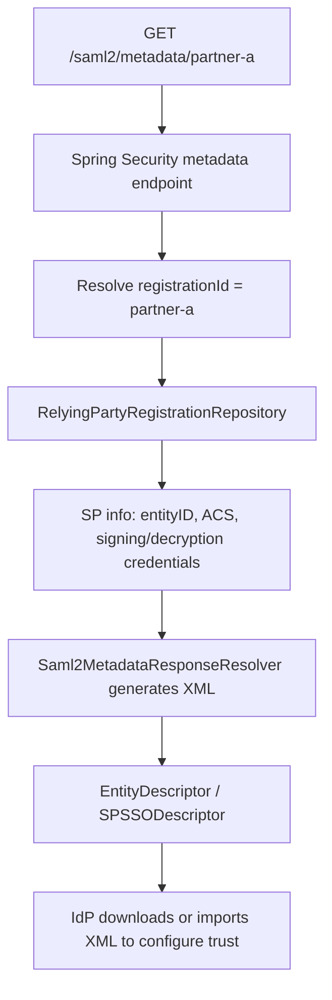

# Publishing Service Provider Metadata with `saml2Metadata` in Spring Security

**Topic:** Spring Security – federation → SAML2 Metadata.

When a Spring Boot application acts as a **SAML 2.0 Service Provider (SP, also called Relying Party)**, the Identity Provider (IdP, also called Asserting Party) needs to know who that application is, which address receives `SAMLResponse`, how authentication requests are signed, and which public certificate the SP uses. Instead of manually entering dozens of fields, the SP can **publish an XML metadata document**; the IdP imports the URL or metadata file to establish the federation connection.

Spring Security provides the **`HttpSecurity.saml2Metadata(...)`** DSL to serve metadata from configured `RelyingPartyRegistration` objects. This lesson explains the mechanism, Java 17+ and Spring Boot examples, default/custom paths, how to verify the XML, deploying behind a reverse proxy, handling multiple IdPs, and coordinating certificate provisioning. The configuration shown targets **Servlet/MVC**, not directly WebFlux.

## 1. What Is SP Metadata Used For?

A SAML Web SSO connection typically involves two sets of metadata:

| Document | Who publishes it? | Who consumes it? | Typical contents |
| --- | --- | --- | --- |
| **SP/Relying Party metadata** | Spring Security application | IdP/partner | SP `entityID`, `SPSSODescriptor`, ACS URL, bindings, SP public certificates if configured, signing flags |
| **IdP/Asserting Party metadata** | IdP | SP/Spring Security | IdP `entityID`, `IDPSSODescriptor`, SSO/SLO service URLs, X.509 certificates for SP to verify IdP signatures, supported bindings |

**`saml2Metadata` publishes SP metadata.** It does not turn the application into an IdP; nor does it generate an identity provider, user accounts, or business authorization rules. To handle real logins, the application also needs `saml2Login`, a trusted IdP, assertion verification config, and authorization policies.

Real-world example: portal `https://portal.example.com` needs login through a corporate IdP. Portal operations gives the partner the URL:

```text
https://portal.example.com/saml2/metadata/partner-a
```

The IdP downloads the XML, learns the portal's `entityID` and `AssertionConsumerService Location`, and configures sending SAML Responses to the ACS. If the IdP requires the SP to sign `AuthnRequest`, the partner also needs the SP's corresponding **public** certificate to verify signatures. The SP simultaneously needs the IdP's metadata/public certificate to verify responses.

**Distinguish three easily confused URLs:**

- **Metadata URL**: HTTP endpoint to *retrieve the XML configuration file*. For example `/saml2/metadata/partner-a`.
- **SP entity ID**: logical, unique, stable identifier of the SP in the federation; usually a URI, though not necessarily a reachable HTTP endpoint.
- **ACS URL**: HTTP endpoint where the browser **POSTs `SAMLResponse`**; defaults to `/login/saml2/sso/{registrationId}`.

Changing `metadataUrl` **does not automatically change the SP entity ID or ACS URL**. Each value must be managed separately, ensuring the IdP trusts the exact published values.

## 2. How Does Spring Security Generate Metadata?

`saml2Metadata` attaches a **metadata filter/response resolver** to the Servlet filter chain. When a request arrives at the metadata URL, Spring Security resolves the associated `RelyingPartyRegistration`, extracts the SP attributes from the registration, and generates XML according to the SAML 2.0 Metadata specification.



**Primary input:** a `RelyingPartyRegistration`, holding both SP info (entity ID, ACS, signing/decryption credentials) and trusted IdP info (entity ID, SSO location, verification certificates). When exporting SP metadata, the focus is the **SP description portion**.

**Output:** XML with `<md:EntityDescriptor>`, or an `<md:EntitiesDescriptor>` bundle when the endpoint aggregates multiple registrations and the repository supports iteration. The IdP may import XML or fetch from the URL; whether the IdP refreshes periodically or imports once **is decided by the IdP**, not guaranteed by `saml2Metadata`.

**When registrations or certificates change:** published metadata must remain consistent with the running application's configuration. If the IdP relies on stale imported metadata, changing the SP's URL/certificates can abruptly break login. Metadata is therefore an **identity federation contract**, requiring coordinated deployment procedures.

## 3. Important Fields in SP Metadata

An XML document might look like this (abridged educational sample; **not necessarily the exact XML Spring Security always emits**, containing no certificates):

```xml
<?xml version="1.0" encoding="UTF-8"?>
<md:EntityDescriptor
    xmlns:md="urn:oasis:names:tc:SAML:2.0:metadata"
    entityID="https://portal.example.com/saml2/service-provider-metadata/partner-a">
    <md:SPSSODescriptor
        protocolSupportEnumeration="urn:oasis:names:tc:SAML:2.0:protocol"
        AuthnRequestsSigned="false"
        WantAssertionsSigned="true">
        <md:AssertionConsumerService
            Binding="urn:oasis:names:tc:SAML:2.0:bindings:HTTP-POST"
            Location="https://portal.example.com/login/saml2/sso/partner-a"
            index="0"
            isDefault="true"/>
    </md:SPSSODescriptor>
</md:EntityDescriptor>
```

| XML Component | Meaning in deployment |
| --- | --- |
| `EntityDescriptor@entityID` | SP ID used by the IdP to bind audience/trust; must match the `entityID` the IdP configured for the portal |
| `SPSSODescriptor` | Declares that the application acts as a SAML Service Provider for Web Browser SSO |
| `protocolSupportEnumeration` | Indicates supported protocol; SAML 2.0 uses the standard protocol URI |
| `AuthnRequestsSigned` | Declares expectation regarding SP signing `AuthnRequest`; must align with signing credentials and IdP requirements |
| `WantAssertionsSigned` | Indicates the SP expects signed assertions; still enforce Response/Assertion verification per profile and Spring Security |
| `AssertionConsumerService@Binding` | How responses are received, very often HTTP-POST, not synonymous with Redirect binding for `AuthnRequest` |
| `AssertionConsumerService@Location` | Public URL where the browser POSTs `SAMLResponse` to the SP, **different from the metadata URL** |
| `KeyDescriptor use="signing"` | Can publish the SP certificate so the IdP verifies signatures on `AuthnRequest` or related messages when the SP has a signing credential |
| `KeyDescriptor use="encryption"` | Can publish a public certificate for the IdP to encrypt assertions for the SP holding the decryption private key |
| `SingleLogoutService` | Appears only when corresponding SAML Single Logout is configured/supported; successful login does not prove SLO is enabled |

Inside `KeyDescriptor`, `ds:X509Certificate` holds a **Base64-encoded public certificate**; **private keys must never appear in metadata**. Do not confuse the IdP certificate used to sign assertions with the SP certificate used to sign AuthnRequests or decrypt assertions. Do not assume every SP metadata includes KeyDescriptors: it depends on credential configuration.

**Metadata XML signatures** differ from **SAML Assertion signatures**, **AuthnRequest signatures**, and **HTTPS/TLS certificates**. Serving metadata over HTTPS protects transport, yet does not by itself prove the metadata XML carries an XML signature. If a partner mandates signed metadata, check capabilities and implement a trusted signing/distribution workflow per IdP requirements; never claim `saml2Metadata` generates `ds:Signature` by default without inspecting actual output.

## 4. Enabling the Endpoint with `saml2Metadata`

In a Servlet `SecurityFilterChain` that already has SAML2 Login, simply add the DSL:

```java
http
    .saml2Login(Customizer.withDefaults())
    .saml2Metadata(Customizer.withDefaults());
```

This is a **configuration fragment** inside an `HttpSecurity` configuration method, not a standalone Java program. `saml2Login` handles the SAML authentication flow; `saml2Metadata` publishes metadata. `saml2Metadata` can emit documents for registrations even if other pieces vary, though in standard Web SSO both DSLs work together.

### 4.1. Default URLs

Per the Spring Security Servlet metadata reference:

| Path | Effect |
| --- | --- |
| `GET /saml2/metadata` | Metadata for enumerable registrations; when the repository supports `Iterable`, this can be an aggregated `EntitiesDescriptor` |
| `GET /saml2/metadata/{registrationId}` | SP metadata corresponding to a single `RelyingPartyRegistration` |
| `GET /saml2/service-provider-metadata/{registrationId}` | Legacy compatibility URL supported by Spring Security, also returning per-registration metadata |
| `GET /saml2/authenticate/{registrationId}` | **Not metadata**: initiates `AuthnRequest` for SP-initiated login |
| `POST /login/saml2/sso/{registrationId}` | **Not metadata**: ACS receiving and verifying `SAMLResponse` |

For example, registration ID `partner-a` should expose the explicit ID link `https://portal.example.com/saml2/metadata/partner-a`. If there are multiple partners, the aggregate endpoint `/saml2/metadata` can emit multiple entities; some IdPs accept only one `EntityDescriptor`, so use the **per-registration URL** for clean imports.

Metadata paths work only when **the `SecurityFilterChain` includes `saml2Metadata` and the request reaches that filter chain**. If multiple filter chains exist (`@Order`, `securityMatcher`), verify which chain handles metadata URLs; an API-dedicated filter chain might block them or lack the metadata filter.

### 4.2. Changing the Metadata URL

If required to serve the endpoint under `/federation`, configure:

```java
http.saml2Metadata(metadata ->
    metadata.metadataUrl("/federation/sp-metadata/{registrationId}"));
```

`metadataUrl` changes **the access path for the metadata document**. Without `{registrationId}`, returning one or multiple entities depends on the repository/resolver. When using a custom path, give the new URL to partners and test directly; do not assume all old aliases stay active after customizing the DSL.

**Do not confuse:** changing `/saml2/metadata/partner-a` to `/federation/sp-metadata/partner-a` **does not mean** the IdP will automatically change `entityID` or ACS. If you need to change entity ID/ACS due to domain or architecture changes, edit the `RelyingPartyRegistration` properties and coordinate with the IdP.

## 5. Spring Boot 4.1.x + Java 17+ Example: Publishing SP Metadata

The example below is a **Maven Spring Boot Servlet project** with Java 17+ classes. It requires internet/Maven repository access to resolve dependencies and a **real** IdP metadata URI to start up and verify SSO. The domain `example.com` is illustrative and will not operate until replaced. The Java files must be built with **Maven**, not standalone `javac SecurityConfig.java`.

Structure:

```text
saml-sp/
├── pom.xml
└── src/main/
    ├── java/com/example/saml/
    │   ├── SamlSpApplication.java
    │   └── SecurityConfig.java
    └── resources/application.yml
```

### 5.1. `pom.xml`

The example uses Spring Boot `4.1.2` and the Boot 4 line's SAML2 starter. Spring Boot 3.5.x uses `spring-security-saml2-service-provider` directly alongside the older MVC starter `spring-boot-starter-web`. Do not arbitrarily mix Boot 4 starters into Boot 3.

```xml
<?xml version="1.0" encoding="UTF-8"?>
<project xmlns="http://maven.apache.org/POM/4.0.0"
         xmlns:xsi="http://www.w3.org/2001/XMLSchema-instance"
         xsi:schemaLocation="http://maven.apache.org/POM/4.0.0
           https://maven.apache.org/xsd/maven-4.0.0.xsd">
    <modelVersion>4.0.0</modelVersion>
    <parent>
        <groupId>org.springframework.boot</groupId>
        <artifactId>spring-boot-starter-parent</artifactId>
        <version>4.1.2</version>
        <relativePath/>
    </parent>
    <groupId>com.example</groupId>
    <artifactId>saml-sp</artifactId>
    <version>1.0.0</version>
    <properties>
        <java.version>17</java.version>
    </properties>

    <repositories>
        <repository>
            <id>shibboleth-releases</id>
            <url>https://build.shibboleth.net/maven/releases/</url>
            <snapshots><enabled>false</enabled></snapshots>
        </repository>
    </repositories>

    <dependencies>
        <dependency>
            <groupId>org.springframework.boot</groupId>
            <artifactId>spring-boot-starter-webmvc</artifactId>
        </dependency>
        <dependency>
            <groupId>org.springframework.boot</groupId>
            <artifactId>spring-boot-starter-security</artifactId>
        </dependency>
        <dependency>
            <groupId>org.springframework.boot</groupId>
            <artifactId>spring-boot-starter-security-saml2</artifactId>
        </dependency>
    </dependencies>

    <build>
        <plugins>
            <plugin>
                <groupId>org.springframework.boot</groupId>
                <artifactId>spring-boot-maven-plugin</artifactId>
            </plugin>
        </plugins>
    </build>
</project>
```

SAML2 Service Provider relies on **OpenSAML**; Spring Security documentation requires the **Shibboleth Releases** repository. If a corporate environment uses Nexus/Artifactory, mirror/proxy the repository legitimately. Do not fix download errors by forcing an OpenSAML version incompatible with Spring Security.

### 5.2. `SamlSpApplication.java`

```java
package com.example.saml;

import org.springframework.boot.SpringApplication;
import org.springframework.boot.autoconfigure.SpringBootApplication;
import org.springframework.security.core.Authentication;
import org.springframework.web.bind.annotation.GetMapping;
import org.springframework.web.bind.annotation.RestController;

@SpringBootApplication
@RestController
public class SamlSpApplication {
    public static void main(String[] args) {
        SpringApplication.run(SamlSpApplication.class, args);
    }

    @GetMapping("/")
    String home() {
        return "SAML SP online";
    }

    @GetMapping("/private")
    String privatePage(Authentication authentication) {
        return "Authenticated as: " + authentication.getName();
    }
}
```

`/` is a public page to confirm the application starts; `/private` requires a logged-in session. The output of `/private` depends on the actual `NameID`/principal received from the IdP, so there is **no fixed login stdout**.

### 5.3. `SecurityConfig.java`

```java
package com.example.saml;

import org.springframework.context.annotation.Bean;
import org.springframework.context.annotation.Configuration;
import org.springframework.security.config.Customizer;
import org.springframework.security.config.annotation.web.builders.HttpSecurity;
import org.springframework.security.web.SecurityFilterChain;

@Configuration
public class SecurityConfig {
    @Bean
    SecurityFilterChain securityFilterChain(HttpSecurity http) throws Exception {
        http
            .authorizeHttpRequests(authorize -> authorize
                .requestMatchers(
                    "/",
                    "/error",
                    "/saml2/metadata",
                    "/saml2/metadata/**",
                    "/saml2/service-provider-metadata/**"
                ).permitAll()
                .anyRequest().authenticated()
            )
            .saml2Login(Customizer.withDefaults())
            .saml2Metadata(Customizer.withDefaults());

        return http.build();
    }
}
```

**The key line is `.saml2Metadata(Customizer.withDefaults())`.** It registers the SP metadata publishing endpoint and uses the repository built by Boot from configuration. `permitAll` on metadata GET routes lets partners download XML **without logging into the SP first**. Avoid blocking it behind a login redirect, otherwise the IdP importer receives an HTML login page instead of XML. For internal security requirements, restrict access via network/gateway/IP allowlist rather than opening to the entire Internet, while ensuring the IdP can reach it.

Do not add `.csrf(csrf -> csrf.disable())` globally just to make metadata work. The metadata endpoint is read-only; other POSTs still need proper CSRF protection. Spring Security SAML2 Login handles ACS POSTs via its own mechanism; never disable unrelated protections.

### 5.4. `application.yml` and Where SP Metadata Is Determined

```yaml
server:
  forward-headers-strategy: framework

spring:
  security:
    saml2:
      relyingparty:
        registration:
          partner-a:
            entity-id: https://portal.example.com/saml2/service-provider-metadata/partner-a
            assertingparty:
              metadata-uri: https://login.partner.example/metadata.xml
```

- `partner-a` is the **registrationId** of an SP–IdP link.
- `entity-id` is the **logical identifier of the SP**, explicitly set so it does not depend on internal hostnames; must match the entity ID at the IdP.
- `assertingparty.metadata-uri` is the **IdP's metadata URL**, used by Spring Security to build the registration containing the IdP's issuer, SSO URL, and trusted certificates. **This is not the SP metadata export URL.**
- Spring Security's ACS defaults to `{baseUrl}/login/saml2/sso/{registrationId}`; under the example's public host, the desired endpoint is `https://portal.example.com/login/saml2/sso/partner-a`. Verify the **actual** value in the generated XML and register it accurately at the IdP.
- `forward-headers-strategy: framework` is useful **when the app sits behind a trusted reverse proxy** passing sanitized `Forwarded`/`X-Forwarded-*` headers. Never trust forwarded headers directly from the Internet or untrusted clients. If no proxy is used, this setting can be omitted.

**Important:** without real IdP metadata, the sample `https://login.partner.example/metadata.xml` will not give you a working login environment. Obtain real IdP metadata and matching certificates, and align entity ID/ACS before attempting integration. Boot property names can change across major versions: always consult the reference for your exact Boot version.

### 5.5. Running, Fetching Metadata, and Comparing with the IdP Contract

In the project directory:

```bash
mvn -DskipTests compile
mvn spring-boot:run
```

When running with valid IdP metadata, local access might use `http://localhost:8080/saml2/metadata/partner-a`, yet **that is only for development**. If the generated metadata still contains `localhost` in the ACS or a wrong host, **never import that file into production**. Production partners must download via the official HTTPS domain so public URLs appear accurately.

From a host able to reach the public domain:

```bash
curl -fSL -D metadata-headers.txt \
  https://portal.example.com/saml2/metadata/partner-a \
  -o sp-metadata.xml
```

Verify the file contains XML metadata starting with `EntityDescriptor`/`EntitiesDescriptor`; not redirected to a login form, not returning `404`/`500`. Then inspect visually or with XML tools:

```bash
xmllint --noout sp-metadata.xml
grep -E 'entityID=|AssertionConsumerService|KeyDescriptor' sp-metadata.xml
```

`xmllint`/`grep` are external tools outside the JDK and must be installed if used. Checking well-formed XML is only the basic step: **you must match entity ID, ACS, bindings, certs, and IdP policies**, and test real SAML login.

## 6. Java 17 Hands-On Exercise: Inspecting XML Metadata Content

To understand what SP metadata must contain, create `sp-example.xml` with **the XML sample from Section 3**, then use a simple JDK program to read `EntityDescriptor` and `AssertionConsumerService`. This sample runs standalone without Spring; it only checks structure/values and **does not perform XML signature validation or trust evaluation**.

File `MetadataInspector.java`:

```java
import java.nio.file.Path;
import javax.xml.XMLConstants;
import javax.xml.parsers.DocumentBuilderFactory;
import org.w3c.dom.Document;
import org.w3c.dom.Element;
import org.w3c.dom.NodeList;

public class MetadataInspector {
    private static final String NS =
            "urn:oasis:names:tc:SAML:2.0:metadata";

    public static void main(String[] args) throws Exception {
        if (args.length != 1) {
            throw new IllegalArgumentException(
                    "Usage: java MetadataInspector metadata.xml");
        }

        DocumentBuilderFactory factory =
                DocumentBuilderFactory.newInstance();
        factory.setNamespaceAware(true);
        factory.setFeature(
                XMLConstants.FEATURE_SECURE_PROCESSING, true);
        factory.setFeature(
                "http://apache.org/xml/features/disallow-doctype-decl",
                true);
        factory.setXIncludeAware(false);
        factory.setExpandEntityReferences(false);

        Document doc = factory.newDocumentBuilder()
                .parse(Path.of(args[0]).toFile());

        NodeList entities = doc.getElementsByTagNameNS(
                NS, "EntityDescriptor");
        if (entities.getLength() != 1) {
            throw new IllegalArgumentException(
                    "Expected exactly one EntityDescriptor");
        }
        Element entity = (Element) entities.item(0);

        NodeList descriptors = entity.getElementsByTagNameNS(
                NS, "SPSSODescriptor");
        if (descriptors.getLength() != 1) {
            throw new IllegalArgumentException(
                    "Expected exactly one SPSSODescriptor");
        }

        NodeList endpoints = entity.getElementsByTagNameNS(
                NS, "AssertionConsumerService");
        if (endpoints.getLength() == 0) {
            throw new IllegalArgumentException(
                    "No AssertionConsumerService declared");
        }

        Element firstAcs = (Element) endpoints.item(0);
        System.out.println("Entity ID: "
                + entity.getAttribute("entityID"));
        System.out.println("SP descriptors: "
                + descriptors.getLength());
        System.out.println("ACS location: "
                + firstAcs.getAttribute("Location"));
    }
}
```

Assuming `sp-example.xml` holds the exact XML sample from Section 3, run with JDK 17+:

```bash
javac MetadataInspector.java
java MetadataInspector sp-example.xml
```

**Exact stdout with the sample XML:**

```text
Entity ID: https://portal.example.com/saml2/service-provider-metadata/partner-a
SP descriptors: 1
ACS location: https://portal.example.com/login/saml2/sso/partner-a
```

The program rejects DTDs to mitigate XML External Entity/XXE on input files and merely reads attributes; it **does not verify SAML protocol compliance, metadata signatures, or federation policy**, so never use it instead of OpenSAML/Spring Security to trust metadata or authenticate logins. If fetching an aggregated `/saml2/metadata` with multiple `EntityDescriptor` elements, the program intentionally rejects it; to inspect one registration, fetch the URL with `/{registrationId}`.

## 7. Customizing Endpoints and Resolving Registrations

### 7.1. Customizing a per-registration path

In `SecurityConfig`, replace the default DSL with:

```java
.saml2Login(Customizer.withDefaults())
.saml2Metadata(metadata ->
    metadata.metadataUrl("/federation/metadata/{registrationId}"));
```

Then, for registration `partner-a`, the expected path is `GET /federation/metadata/partner-a`. If using a URL allowlist, update `requestMatchers` to permit the new path. Check the live route after deployment; the old URL may no longer be served.

### 7.2. With multiple IdPs/partners

One `RelyingPartyRegistration` represents one SP–IdP link. The repository can hold:

```text
partner-a → SP entityID A + ACS A + IdP A
partner-b → SP entityID B + ACS B + IdP B
internal  → internal SP entityID + internal ACS + internal IdP
```

Give `/saml2/metadata/partner-a` specifically to IdP A and `/saml2/metadata/partner-b` to IdP B. In some architectures, multiple registrations may share an SP entity ID/ACS, yet **do not assume they are all identical**: follow IdP capabilities, stable entity IDs, issuers, and tenant rules.

At `/saml2/metadata`, if the repository is `Iterable`, Spring Security may emit metadata lists as `EntitiesDescriptor`. Many IdPs only support importing one entity at a time, so the **per-registration URL** is a less ambiguous starting point. Do not publish internal multi-tenant aggregates if doing so unnecessarily exposes the partner list.

### 7.3. When the default lookup mechanism is not enough

Spring Security supports `Saml2MetadataResponseResolver`, such as `RequestMatcherMetadataResponseResolver`, to customize how registrations and metadata filenames are resolved. Useful when paths omit `registrationId` or when tenants resolve from a trusted host. However:

- The resolver must **look up only from a preconfigured registration allowlist**, never accepting arbitrary issuers/certificates from query strings.
- If accessed across multi-tenant domains/hosts, trust only hosts validated by the proxy; never turn an arbitrary `Host` header into a valid entity ID.
- Generate metadata with the exact SP entityID/ACS/credentials of that tenant, avoiding swapped issuers or wrong tenant certificates.
- After modifying the resolver, test each tenant in a real environment, including non-existent IDs (which must fail safely).

Customizing the response resolver is an advanced approach. For one or a few static registrations, the default DSL is easier to maintain and align with documentation.

## 8. Generating Correct Entity ID and ACS Behind a Reverse Proxy

**This is the most common reason SP metadata looks like valid XML yet the IdP cannot complete login.**

Infrastructure example:

```text
Browser / IdP
  → https://portal.example.com  (Ingress / Load Balancer)
  → http://saml-sp:8080          (internal Spring Boot)
```

If Spring constructs `{baseUrl}` from the internal request without receiving trusted proxy headers, metadata may publish:

```text
entityID = http://saml-sp:8080/saml2/service-provider-metadata/partner-a
ACS      = http://saml-sp:8080/login/saml2/sso/partner-a
```

The IdP requires **public** values:

```text
entityID = https://portal.example.com/saml2/service-provider-metadata/partner-a
ACS      = https://portal.example.com/login/saml2/sso/partner-a
```

To handle this:

1. Configure accurate public DNS, HTTPS, and base path/context path; configure ingress/gateway to forward `Host`/`X-Forwarded-Proto`/`X-Forwarded-Host` or `Forwarded` **from trusted proxies**.
2. In Boot, configure the appropriate forwarded-header strategy for your infrastructure; never let untrusted clients spoof headers to make the SP publish rogue hosts in metadata.
3. Pin the SP `entity-id` in configuration if the IdP contract requires a stable identifier. By default Spring Security uses `{baseUrl}/saml2/service-provider-metadata/{registrationId}`; changing host/port affects it if relying on defaults.
4. Inspect metadata at the **public domain** instead of checking only `localhost`. Compare exact scheme/host/port/path/URI encoding of `entityID` and ACS.
5. If the app has a prefix such as `/portal`, ensure ingress neither strips nor duplicates the prefix causing the IdP to POST to a different URL.
6. Never change the ACS at the IdP before the application actually handles POSTs at the new endpoint; endpoint changes require planned rollout and end-to-end testing.

**Entity ID does not have to be a metadata endpoint:** even though the default resembles a compatibility metadata URL, the entity ID is simply an agreed identifier. When changing `metadataUrl`, do not infer that the entity ID changes with it. If an IdP already depends on the old entity ID, changing it may be treated as registering a brand-new SP and break federation.

## 9. SP Certificates, Signing AuthnRequests, and Metadata Rotation

An SP may possess private keys used to:

- **Sign AuthnRequests** so the IdP verifies the application sent the authentication request. The corresponding public certificate can be included in SP metadata when a signing credential is present.
- **Decrypt EncryptedAssertion/EncryptedID** encrypted by the IdP for the SP. Metadata can publish the public certificate for the IdP to encrypt with.
- **Sign logout requests/responses** in SAML Single Logout when supported and configured by both parties.

**Spring `saml2Metadata` does not create private keys for your system if you haven't configured them.** Adding the SAML2 starter and enabling the endpoint does not make the SP sign requests automatically. If the IdP requires `AuthnRequestsSigned="true"`, configure appropriate `signing.credentials` and test that AuthnRequests are actually signed with the right binding and certificate. Simply flipping a flag in metadata XML without a real private key will not make login work.

Illustrative **Boot property configuration** (applies only when real certificate and private key exist; `classpath` paths in production must follow secret management policy):

```yaml
spring:
  security:
    saml2:
      relyingparty:
        registration:
          partner-a:
            signing:
              credentials:
                - private-key-location: file:/run/secrets/sp-signing.key
                  certificate-location: file:/run/secrets/sp-signing.crt
            assertingparty:
              metadata-uri: https://login.partner.example/metadata.xml
```

The key/certificate pair must match, and the key must be protected via file permissions/secret manager; **only the public certificate appears in metadata**. If the IdP uses response/assertion encryption, configure **separate decryption credentials** as needed. Reusing one keypair for multiple purposes requires approval and clear protection/rotation procedures.

**Zero-downtime certificate rotation workflow:**

1. Generate a new keypair and prepare the public certificate per policy.
2. Agree with the IdP on adding the new certificate to its trust store; if the IdP supports multiple certificates, publish **old + new** during transition to avoid downtime.
3. Publish updated metadata on a coordinated schedule; ensure the IdP has fetched/imported and trusted the new certificate before the SP signs with the new private key.
4. Switch to the new key, test real AuthnRequests/responses, and monitor signature, encryption, and SSO errors.
5. Remove the old key/certificate only after confirming the IdP no longer uses it and rollback/active sessions have been accounted for.

Some IdPs **do not auto-sync metadata**, so Spring emitting new XML does not mean the IdP updated. Send formal notice and record fingerprints, validity dates, and rotation owners.

## 10. Metadata Handover Workflow to the IdP

Once both SP and IdP have minimum identifying info:

1. **Confirm registration:** `partner-a` links to the right IdP A; IdP metadata, verification certificate, and SSO endpoint are accurate.
2. **Deploy public domain:** DNS, HTTPS, proxy, session/ACS, and SecurityFilterChain are working.
3. **Enable `saml2Metadata`**, ensuring metadata GET requests do not require login or hit gateway redirects.
4. **Retrieve SP metadata** from `/saml2/metadata/partner-a` on the public domain; archive the XML as a release verification artifact.
5. **Inspect XML and contract fields:** entity ID, ACS binding/location, NameIDFormat if present, AuthnRequestsSigned/WantAssertionsSigned, signing/encryption KeyDescriptors.
6. **Provide the URL or XML file to the IdP**, confirming the IdP imported the right entity; never send private keys/secrets.
7. **Verify the reverse configuration:** SP trusts IdP issuer/certificate; IdP trusts SP entity ID/certificate per contract.
8. **Test SP-initiated login** from `/saml2/authenticate/partner-a` and callback to ACS; verify issuer, destination, audience, response signature, expiration, and session.
9. **Test error and edge cases:** wrong certificate, wrong ACS, wrong entity ID, expired metadata, login from another tenant, IdP outage, logout, and certificate rotation.
10. **Finalize operations:** record metadata version/fingerprint, responsible owners, IdP update schedule, and rollback plan.

Example partner sign-off checklist:

| Field to confirm | Example value | Role |
| --- | --- | --- |
| SP entity ID | `https://portal.example.com/saml2/service-provider-metadata/partner-a` | IdP identifies SP and checks audience |
| SP metadata URL | `https://portal.example.com/saml2/metadata/partner-a` | IdP downloads XML |
| ACS URL | `https://portal.example.com/login/saml2/sso/partner-a` | Browser POSTs SAMLResponse |
| ACS Binding | HTTP-POST | Matches IdP SAML configuration |
| IdP entity ID | Per official IdP metadata | SP verifies issuer |
| IdP signing certificate | Per IdP metadata/trust anchor | SP verifies response/assertion |
| SP signing certificate | Present if SP is configured to sign AuthnRequest | IdP verifies requests from SP |
| Contact/rotation policy | Owners on both sides | Replace certificates/URLs without downtime |

## 11. Security When Publishing SP Metadata

SP metadata is typically **public configuration data for the IdP to establish trust**, yet publication still requires protection:

- **HTTPS and trusted host:** prevent tampering in transit; prevent Host Header/Forwarded Header injection so XML does not emit endpoints controlled by an attacker.
- **No private keys:** publish only public certificates. Seeing a private key, token, or secret in metadata/logs is a configuration incident requiring investigation.
- **Do not treat a metadata URL as self-authenticating:** the IdP must receive the URL via an authenticated channel and verify entity ID, certificates, and fingerprint/signing policy. Syntactically valid XML metadata can still be issued by an untrusted source.
- **Limit multi-tenant exposure:** aggregate metadata can reveal registration names or federation structure. If partner lists are confidential, prefer per-registration URLs and network access policies.
- **Never disable SAML validation:** importing SP metadata at the IdP only establishes trust/config; the SP must still verify IdP signature, issuer, conditions, recipient/audience, replay, and tenant when processing `SAMLResponse`.
- **Avoid unexpected path changes:** metadata URL, entity ID, ACS, and signing credentials are four separate axes; changing each can impact the IdP independently.
- **Cache and CDN:** if proxies/CDNs cache XML, verify TTL/ETag and invalidation before rotation; prevent the IdP from pulling stale metadata or cached error HTML.
- **Monitor metadata HTTP:** alert on `404`, `302` to login, `500`, empty XML, wrong entity ID/ACS, and certificates nearing replacement. Never log private key material or session cookies.
- **Do not load arbitrary external XML into the SP:** when fetching IdP metadata by URL, enforce trusted sources, SSRF protections, XML signature verification when required, and proper refresh/cache policies. Supporting IdP metadata loading does not mean trusting arbitrary user-supplied URLs.

## 12. Common Troubleshooting

| Symptom | Possible Cause | How to Check / Fix |
| --- | --- | --- |
| `GET /saml2/metadata/partner-a` returns **404** | `saml2Metadata` not enabled, wrong registration ID, request hits another SecurityFilterChain, wrong context path or gateway rewrite | Check DSL config, valid registrations, actual path, and proxy routing |
| GET metadata returns **302 login** or HTML | Metadata URL protected/redirected, blocked by gateway, filter chain lacks permit | Permit GET metadata on exact path or grant dedicated IdP access; verify Content-Type and XML body |
| **500** response when serving metadata | Missing/invalid `RelyingPartyRegistration`, IdP metadata unreachable, unreadable credential, XML/auth config error | Read sanitized server logs; check IdP metadata URL, repository, cert/key, and startup |
| XML shows `http://localhost` or container name in ACS | Public host/forwarded headers misconfigured | Check reverse proxy, public URL, trusted headers, and base URL; pin entity ID if needed |
| IdP reports `Invalid Entity ID` / `AudienceMismatch` | IdP registered a different entity ID than the SP uses | Match exact `EntityDescriptor@entityID`, AudienceRestriction, and IdP settings |
| IdP POSTs to wrong ACS or gets 404 | Metadata/IdP uses old ACS host/path, binding mismatch, ingress rewrite | Match `AssertionConsumerService@Location` with actual callback handler URL |
| Missing `KeyDescriptor` | Signing/decryption credentials not configured or placed on a different registration | Check IdP requirements and registration's `signing.credentials`/`decryption.credentials` |
| IdP rejects unsigned `AuthnRequest` | IdP requires signatures while SP lacks credentials or didn't sign | Configure signing credentials and share public certificate via metadata |
| Login fails after rotating cert | IdP hasn't refreshed/imported, trusts only old cert, stale metadata cache | Coordinate rotation, verify trust store/fingerprint, and maintain old+new window |
| `/saml2/metadata` has multiple entities, IdP fails import | Repository is Iterable and endpoint aggregates | Use `/saml2/metadata/{registrationId}` for a single entity |
| SP-initiated login fails despite valid metadata | Wrong issuer/signature, session/cookie loses AuthnRequest, `InResponseTo` mismatch, replay, clock skew | Check SAML trace, request repository, SameSite cookie, clock skew; never disable validation |
| Dev works yet production fails | Different DNS/TLS/proxy, metadata URL, hostname, certificates, and IdP registration | Inspect public metadata from production itself and test end-to-end against prod/sandbox IdP |

**Helpful debug order:** GET metadata and verify valid XML → inspect SP entity ID/ACS → confirm IdP import/trust → test AuthnRequest/Response → investigate SAML validation/session. Never confuse the metadata endpoint with the ACS or treat `curl 200` as proof of successful login.

## 13. Acceptance Checklist Before Handing Off to the IdP

**Metadata endpoint**
- [ ] `GET /saml2/metadata/partner-a` returns metadata XML for the right registration without redirecting to HTML login.
- [ ] XML parses cleanly and contains expected `SPSSODescriptor`, `entityID`, and ACS URL/binding.
- [ ] Metadata URL over the public HTTPS domain shows exact scheme/host/port/context path; no internal hostname leaks.
- [ ] Metadata for registration A differs from/matches registration B logic properly; no accidental cross-tenant leak.
- [ ] Custom `metadataUrl` verified explicitly; old routes, new routes, and security matchers align with design.
- [ ] If certificates exist, XML contains only public certificates and the IdP trusts the exact key.

**Federation integration**
- [ ] IdP imports SP metadata accurately without confusing entity ID with metadata URL or ACS.
- [ ] SP-initiated login sends AuthnRequest to the right IdP and receives the response at the published ACS.
- [ ] IdP signs response/assertion and SP validates issuer/audience/recipient/time/signature/replay per policy.
- [ ] If IdP requires signed AuthnRequest, requests carry a valid signature per binding, with certificate trusted by the IdP.
- [ ] Tested cert rotation/failure cases: fails safely without disabling verification to force a PASS.
- [ ] Cookies/session/reverse proxy preserve request correlation; user/tenant authorization evaluated independently.
- [ ] Archived approved metadata, effective dates, contact owners, and rollback plan.

## 14. Official References

1. [Spring Security – SAML 2.0 Metadata](https://docs.spring.io/spring-security/reference/servlet/saml2/metadata.html): `saml2Metadata`, default endpoints, `metadataUrl`, and `Saml2MetadataResponseResolver`.
2. [Spring Security – SAML 2.0 Login Overview](https://docs.spring.io/spring-security/reference/servlet/saml2/login/overview.html): `RelyingPartyRegistration`, `entityID`, ACS, login sessions, and IdP trust verification.
3. [Spring Security – SAML 2.0 Logout](https://docs.spring.io/spring-security/reference/servlet/saml2/logout.html): metadata/credentials for Single Logout when needed.
4. [Spring Security – `HttpSecurity.saml2Metadata` JavaDoc](https://docs.spring.io/spring-security/reference/api/java/org/springframework/security/config/annotation/web/builders/HttpSecurity.html): API and actual metadata routes.
5. [Spring Security – `Saml2MetadataConfigurer` JavaDoc](https://docs.spring.io/spring-security/reference/api/java/org/springframework/security/config/annotation/web/configurers/saml2/Saml2MetadataConfigurer.html): customizing URL and resolver.
6. [OASIS – SAML 2.0 Metadata Specification](https://docs.oasis-open.org/security/saml/v2.0/saml-metadata-2.0-os.pdf): XML definitions of `EntityDescriptor`/`SPSSODescriptor`, service endpoints, and `KeyDescriptor`.
7. [Spring Boot – Reference Documentation](https://docs.spring.io/spring-boot/reference/): starters, server/proxy/forwarded headers, and version-specific app configuration.

**Key takeaway:** `saml2Metadata` **publishes the SP's XML metadata contract**; `RelyingPartyRegistration` determines the entity ID, ACS, and credentials inside it. Inspect the emitted document under the **real HTTPS domain**, reconcile it with IdP configuration, and test SAML login end-to-end. Syntactically valid metadata is the starting point, while secure login depends on trust, signatures, audience, timestamps, sessions, and authorization.