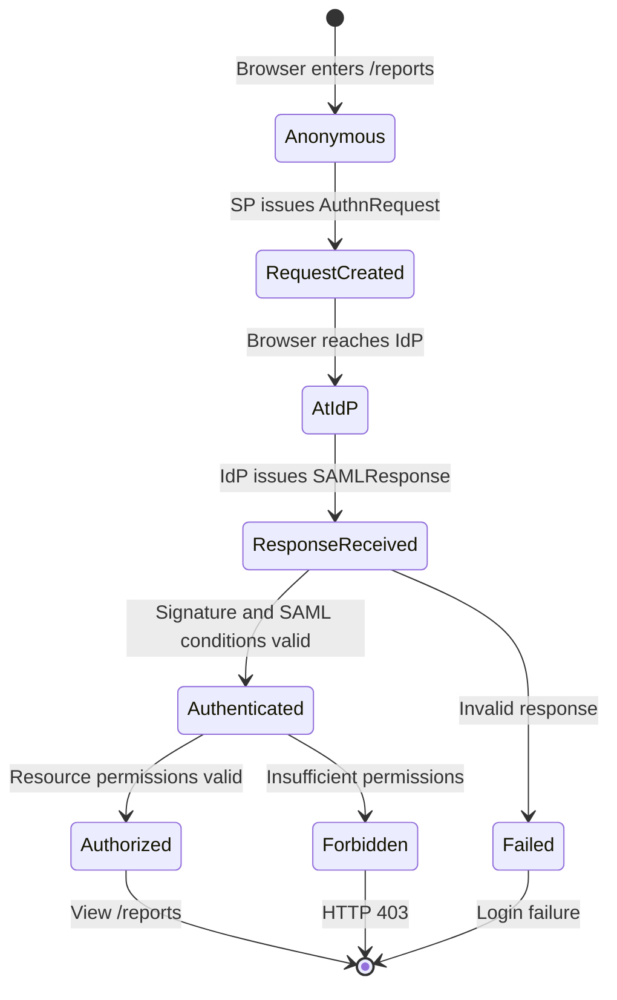

# Path from a Protected Resource to the IdP and Back to the Application

## Learning Objectives

After this lesson, you will be able to:

1. Recount the exact sequence of a **Service Provider-initiated (SP-initiated) SAML 2.0 Web Browser SSO** flow, from an unauthenticated `GET /private` request until the application issues a session and renders the resource again.
2. Identify the roles of the **browser**, **Relying Party / Service Provider (RP/SP)**, **Asserting Party / Identity Provider (AP/IdP)**, and the corresponding Spring Security components.
3. Distinguish the **AuthnRequest initiation endpoint** (`/saml2/authenticate/{registrationId}`) from the **Assertion Consumer Service – ACS** (`/login/saml2/sso/{registrationId}`); understand `SAMLRequest`, `SAMLResponse`, `RelayState`, `InResponseTo`, and `RelyingPartyRegistration`.
4. Explain how Spring Security intercepts the resource, creates/forwards the `AuthnRequest`, receives the SAML Response, verifies the signature and validation conditions, and stores `Authentication` in `SecurityContext`/the application session.
5. Configure an illustrative Spring Boot 3/Spring Security 6 application and trace each HTTP request, while diagnosing redirect loops, session loss, wrong ACS, invalid signatures, and post-login 403 errors.
6. Distinguish **authentication** success from the final **authorization** decision for each resource.

## 1. Context and Scope

**SAML 2.0 Web Browser SSO** allows an application to delegate identity authentication to an IdP with an established trust relationship. In the **SP-initiated** model, the user **visits a protected resource on the application first**, and the application initiates the login procedure. After the IdP authenticates the user, the browser carries the SAML Response back to the application at the ACS.

In this lesson:

| Component | Role | Example |
| --- | --- | --- |
| **User** | Person who wants to open a feature requiring login | Employee opening `/reports` |
| **Browser** | Follows redirects, submits form POSTs, carries cookies; does not verify identity itself | Browser on the user's machine |
| **SP/RP** | Application that receives assertions, validates messages, and creates a local session | Spring Boot at `https://portal.example.org` |
| **IdP/AP** | System that authenticates users, signs SAML Responses/Assertions, and may encrypt assertions | `https://idp.example.org` |
| **Relying Party Registration** | Configuration binding an exact SP–IdP relationship | Registration ID `company` |

**Authentication** answers "has this user been authenticated under a trusted SAML relationship?". **Authorization** answers "is the authenticated user allowed to view reports, edit data, or approve?". Completing the SSO flow **does not automatically grant access** to every resource.

**Terminology note:** in Spring Security documentation, **Relying Party** is generally synonymous with **Service Provider**, and **Asserting Party** is synonymous with **Identity Provider**. Spring Security SAML2 Login is the mechanism for a **Servlet application to act as an RP/SP**; it does not turn the application into an IdP.

## 2. Overview Diagram of SP-initiated Login

Assume the user is **not logged in to the application** and requests the `/reports` path.

```mermaid
sequenceDiagram
    actor U as User
    participant B as Browser
    participant SP as Spring Security (SP)
    participant IDP as IdP (AP)
    U->>B: Access /reports
    B->>SP: GET /reports + cookie if present
    SP->>SP: AuthorizationFilter -> not authenticated
    SP-->>B: 302 to SAML authentication request endpoint
    B->>SP: GET /saml2/authenticate/company
    SP->>SP: Create and save AuthnRequest, RelayState
    SP-->>B: 302 to IdP SSO with SAMLRequest
    B->>IDP: GET SSO?SAMLRequest=...&RelayState=...
    IDP->>U: Show login/MFA if needed
    U->>IDP: Complete authentication
    IDP->>IDP: Create, sign Response/Assertion
    IDP-->>B: HTML form containing SAMLResponse
    B->>SP: POST /login/saml2/sso/company
    SP->>SP: Resolve registration; verify/decrypt/validate
    SP->>SP: Create Authentication, save SecurityContext/session
    SP-->>B: 302 back to /reports (depends on success handler)
    B->>SP: GET /reports + application session cookie
    SP-->>B: 200 if authorized; 403 if lacking permission
    B-->>U: Display result
```

The path includes **two browser trips back to the SP with different purposes**: the first is to the protected resource, and the second is to the **ACS receiving `SAMLResponse`**. After authentication, the browser is typically redirected to the original resource via a **saved request**; the success navigation mechanism can be customized, so not every application returns the exact same 302 sequence as the diagram.

### 2.1. Sample URLs

| Component | Example URL | Purpose |
| --- | --- | --- |
| Protected resource | `https://portal.example.org/reports` | Where the user originally intends to access |
| Request creation endpoint | `https://portal.example.org/saml2/authenticate/company` | Spring Security creates `AuthnRequest` and starts the SP-initiated flow |
| IdP SSO endpoint | `https://idp.example.org/sso` | IdP receives login requests over the agreed binding |
| ACS / callback | `https://portal.example.org/login/saml2/sso/company` | SP receives HTTP POST with `SAMLResponse` |
| SP entity ID | `https://portal.example.org/saml2/service-provider-metadata/company` | SAML identifier used as the request issuer and assertion audience as agreed |
| IdP entity ID | `https://idp.example.org/saml` | Issuer that the RP/SP is allowed to trust |

`company` is an internal Spring Security `registrationId`; it is **not** a user identifier or the IdP's entity ID. When there are multiple IdPs, the registration ID helps select the exact keys, issuer, SSO URL, ACS, and policies.

## 3. Step 1 – Protected Resource Triggers Spring Security

The browser sends an HTTP request such as:

```http
GET /reports HTTP/1.1
Host: portal.example.org
Accept: text/html
```

Assume there is no valid login session yet. In `SecurityFilterChain`, Spring Security processes the request and checks the `authorizeHttpRequests` policy:

- `AuthorizationFilter` evaluates the rule requiring `authenticated()` or a specific authority.
- If unauthenticated, the request is not allowed straight through to the controller returning data.
- `ExceptionTranslationFilter` initiates the appropriate authentication mechanism, typically via `AuthenticationEntryPoint` directing the user to the SAML AuthnRequest creation endpoint. If there are multiple IdPs/registrations and the application uses a login method selection page, there may be an IdP selection step before creating the request.
- `RequestCache` can typically save the original resource URL (saved request) to return to after login. Remembering this URL is **different** from the mechanism that stores the SAML AuthnRequest.

**Distinguishing 401, 302, and 403:** in a web app with SAML login, an unauthenticated browser is usually **302-redirected to login**; do not assume you will always receive 401. After successful login, if business permissions are missing, the application usually returns **403 Forbidden**. If building a pure JSON API, design appropriate authentication/authorization responses instead of redirecting every API call to the IdP's HTML page.

## 4. Step 2 – Creating `AuthnRequest` at the SP Endpoint

For a registration named `company`, Spring Security's default initiation endpoint is typically:

```text
GET /saml2/authenticate/company
```

Some versions also support `/saml2/authenticate?registrationId=company`. This is an **SP application endpoint**, not the ACS and not for receiving `SAMLResponse`.

The key Spring Security component is `Saml2WebSsoAuthenticationRequestFilter`. It:

1. Looks up the `RelyingPartyRegistration` for `company`.
2. Retrieves the SP entity ID, IdP entity ID, IdP SSO endpoint, ACS URL, binding, and AuthnRequest signing requirement.
3. Creates `<saml2:AuthnRequest>` with appropriate attributes; typically includes a unique `ID` and an `IssueInstant` timestamp.
4. Signs the request **if configuration and the IdP/profile require it**, using the SP's private signing key. Do not assert that every AuthnRequest is signed.
5. Follows the configured binding to send `SAMLRequest` via the browser to the IdP, usually using HTTP-Redirect.
6. Saves the issued transaction/request for correlation when the response returns.

### 4.1. What Does an AuthnRequest Look Like?

A simplified XML example **for learning the structure**, not a complete signed message or one that can be sent directly:

```xml
<samlp:AuthnRequest
    xmlns:samlp="urn:oasis:names:tc:SAML:2.0:protocol"
    xmlns:saml="urn:oasis:names:tc:SAML:2.0:assertion"
    ID="_req-a1b2c3"
    Version="2.0"
    IssueInstant="2026-11-07T03:00:00Z"
    Destination="https://idp.example.org/sso"
    AssertionConsumerServiceURL="https://portal.example.org/login/saml2/sso/company">
    <saml:Issuer>https://portal.example.org/saml2/service-provider-metadata/company</saml:Issuer>
</samlp:AuthnRequest>
```

- `ID`: used to correlate a response to the issued request, while distinguishing transactions and preventing mismatched responses.
- `Issuer`: the **SP entity ID** in the request, not a personal name.
- `Destination`: the IdP endpoint receiving the request, which must match configuration.
- `AssertionConsumerServiceURL`: where the IdP sends the response, which must be allowed/registered by the IdP.
- `IssueInstant`: illustrative UTC timestamp; real systems generate the timestamp when issuing the request.

**Do not use this sample XML to hand-craft requests in production**. The Spring Security/OpenSAML libraries perform serialization, binding, signing, and condition checks per specification.

### 4.2. Browser Carries `SAMLRequest` via HTTP-Redirect

With the common HTTP-Redirect binding, the SP returns a redirect like this (values shortened):

```http
HTTP/1.1 302 Found
Location: https://idp.example.org/sso?SAMLRequest=ENCODED_VALUE&RelayState=OPAQUE_VALUE
```

`SAMLRequest` is the AuthnRequest payload encoded according to the binding (with Redirect binding, typically DEFLATE, Base64, and URL encoding). If Redirect binding signing is configured, the signature resides in binding query parameters such as `SigAlg` and `Signature`; **do not infer that Redirect signing requires an XML Signature element inside the inflated XML**.

`RelayState` carries a flow state value provided by the SP, which can help with correlation and returning to the right context. It is **not** proof that the user has logged in, and sensitive data should not be placed in it. Do not trust a browser-supplied URL in `RelayState` for arbitrary redirects.

### 4.3. Where Does Spring Store `AuthnRequest`?

In a standard Spring Security configuration, `Saml2AuthenticationRequestRepository` stores the issued request information, typically `HttpSessionSaml2AuthenticationRequestRepository` bound to the browser session. As a result, when the SAML Response returns:

- The SP knows it **actually issued a request** for that browser/session.
- The SP can match `InResponseTo` in the response against the `ID` of the corresponding request.
- The SP reduces the risk of login CSRF, responses being attached to the wrong browser, and flow mix-ups across multiple IdPs.

If the system uses a distributed cache or custom repository, it must maintain the ability to bind the response to the **right browser and the right request**; simply using a user-supplied `RelayState` as a lookup key without another secure binding can be weaker than a session-bound flow.

**Note on relationship with saved request:** `HttpSessionRequestCache` may store the `/reports` URL for the success handler, whereas `Saml2AuthenticationRequestRepository` stores the AuthnRequest. These are **two different types of state**.

## 5. Step 3 – IdP Receives the Request and Authenticates the User

When the browser reaches the IdP SSO endpoint:

1. The IdP receives `SAMLRequest` over the agreed binding and identifies the SP from the issuer/metadata.
2. The IdP checks `Destination`, ACS URL, version, transaction state, and **the AuthnRequest signature if required**. The IdP must have the SP's public signing certificate to verify signed requests.
3. The IdP checks the browser's current SSO login session. If a session satisfying the policy already exists, the IdP **may** skip prompting for a password again; if not, or if MFA/step-up is needed, the IdP presents the authentication step.
4. If the user authenticates successfully and is permitted to access the SP, the IdP creates the `Response`/`Assertion`, populates `Subject` and conditions targeted at the **exact SP**, signs with the IdP's private signing key, and if required may encrypt the assertion with the SP's public encryption certificate.
5. The IdP sends the result to the browser using the response-side binding, typically **HTTP-POST** so the browser delivers it to the ACS.

**Two-way trust relationship:** the IdP needs to trust the SP entity ID, ACS URL, and SP signing certificate when request signing is required; the SP must trust the IdP issuer and IdP verification certificate. If the IdP attempts to send a response to an unregistered ACS, the SP must check and can reject it.

### 5.1. What Are Response and Assertion?

- `<samlp:Response>` is the **protocol envelope** replying to the request. It can carry status, issuer, `InResponseTo`, `Destination`, and one or more assertions.
- `<saml:Assertion>` is the **statement about the subject**: `NameID`, authentication statement (`AuthnStatement`), validity conditions (`Conditions`), `AudienceRestriction`, and attributes (`AttributeStatement`) if present.
- `<saml:EncryptedAssertion>` is an assertion encrypted so only the SP with the private decryption key can read it; encryption does not remove the obligation to verify signatures and conditions.
- Signatures may appear on the Response, the Assertion, or both according to policy/profile. The SP must verify the protected elements properly; the library must not accept messages lacking a trusted signature per required policy.

A simplified XML snippet illustrating the structure:

```xml
<samlp:Response
    xmlns:samlp="urn:oasis:names:tc:SAML:2.0:protocol"
    xmlns:saml="urn:oasis:names:tc:SAML:2.0:assertion"
    ID="_resp-42"
    InResponseTo="_req-a1b2c3"
    Destination="https://portal.example.org/login/saml2/sso/company"
    Version="2.0">
    <saml:Issuer>https://idp.example.org/saml</saml:Issuer>
    <saml:Assertion ID="_assert-42">
        <saml:Issuer>https://idp.example.org/saml</saml:Issuer>
        <saml:Subject>
            <saml:NameID>user-2048</saml:NameID>
        </saml:Subject>
        <!-- Signature, Conditions, SubjectConfirmation, and
             AuthnStatement are omitted in this illustrative example. -->
    </saml:Assertion>
</samlp:Response>
```

This XML **intentionally omits signatures and profile-required elements**, serving only to explain data fields; it **must not** be considered a valid response or used as a "login success" fixture. Do not override validators just to make a fake response pass.

## 6. Step 4 – Browser POSTs `SAMLResponse` to the ACS

For the HTTP-POST binding, the IdP typically returns an HTML page with a hidden form containing `SAMLResponse` and `RelayState`, and the browser submits it to the ACS:

```html
<!-- Illustration: values are shortened and not used for real login -->
<form method="post"
      action="https://portal.example.org/login/saml2/sso/company">
  <input type="hidden" name="SAMLResponse" value="BASE64_XML_RESPONSE" />
  <input type="hidden" name="RelayState" value="OPAQUE_VALUE" />
  <button type="submit">Continue</button>
</form>
```

The browser then sends:

```http
POST /login/saml2/sso/company HTTP/1.1
Host: portal.example.org
Content-Type: application/x-www-form-urlencoded

SAMLResponse=BASE64_XML_RESPONSE&RelayState=OPAQUE_VALUE
```

This is the **Assertion Consumer Service (ACS)**, an endpoint **on the SP**. It is distinct from `/saml2/authenticate/company`, which is used to **create the request**. Many configuration errors stem from confusing these two endpoints or registering the ACS at the IdP with an internal container URL.

### 6.1. Entry Path into Spring Security

Spring Security SAML2 provides `Saml2WebSsoAuthenticationFilter` to handle `SAMLResponse` at the ACS. The filter:

1. Receives the `POST` callback request containing `SAMLResponse`.
2. Uses an authentication converter (typically `Saml2AuthenticationTokenConverter`) to locate the matching `RelyingPartyRegistration`, extract the response, and retrieve the prior request information.
3. Builds a `Saml2AuthenticationToken` carrying the SAML Response along with IdP/SP configuration.
4. Hands the token to `AuthenticationManager` and an OpenSAML-based provider for verification. **The OpenSAML 4/5 provider class name differs by Spring Security version and chosen dependency**; do not tie your understanding to a single version's class name.
5. If valid, creates `Saml2Authentication` containing principal/attributes/authorities and places it in `SecurityContext` per Spring Security's mechanism.
6. If invalid, handles authentication failure and **does not** create an authenticated session.

The `/login/saml2/sso/{registrationId}` callback path is the common default; Spring Security may support the `/login/saml2/sso` variant or a custom endpoint. If you change `saml2Login().loginProcessingUrl(...)`, you must also update the **ACS in `RelyingPartyRegistration` and metadata/IdP** to match—never change only one side.

## 7. Step 5 – What Does the SP Verify Before Accepting the Response?

**Do not accept** merely because a form POST has `SAMLResponse` or contains a `NameID`. The SP must execute security checks using a standard library, following configured trust and policies.

| Verification Item | Meaning / Consequence if Wrong |
| --- | --- |
| **XML Signature** | The Response/Assertion signature must be verified with a **trusted IdP signing certificate**; an invalid or missing signature per policy must fail |
| **Issuer** | The issuing IdP must match the configured IdP for the registration; never use an arbitrary certificate embedded in the XML as a trust anchor |
| **AudienceRestriction** | The Assertion must be issued for the exact **SP entity ID**, not another SP |
| **Destination** | The Response must be addressed to the exact ACS URL expected by the SP |
| **SubjectConfirmation Recipient** | The Subject/Assertion must be received at a valid endpoint, with matching Bearer conditions |
| **InResponseTo** | In SP-initiated login, correlates the response/assertion to the issued AuthnRequest; prevents accepting responses not tied to a valid request when policy requires it |
| **Conditions (NotBefore/NotOnOrAfter)** | Reject assertions not yet valid or already expired; requires clock synchronization and bounded clock skew |
| **Response Status** | Check `StatusCode` indicating success or denial; errors from the IdP must not turn into a successful login |
| **Decryption** | If `EncryptedAssertion`/encrypted attributes are present, use the matching **SP private decryption key** and then validate the decrypted content |
| **Replay / state correlation** | Do not reuse a response/assertion to create another session; protect the request repository, browser session, and ID/state |
| **User / authorities mapping** | Only after verification should `NameID`/claims be used to map accounts, groups, and permissions |

**Key placement:**

- **IdP private signing key** signs assertions/responses; the SP only needs the vetted **IdP public verification certificate**.
- **SP private decryption key** decrypts assertions encrypted with the **SP public encryption certificate**.
- **SP private signing key** signs AuthnRequests if required by the IdP/profile, so the IdP verifies with the **SP public signing certificate**.

A signature proves the message came from a trusted key; it **does not mean** the content is hidden from the browser. Encryption protects the confidentiality of certain content, but **does not replace** signature/issuer/audience validation.

### 7.1. `NameID`, Attributes, and Local Permissions

After verification, Spring Security can create a `Saml2AuthenticatedPrincipal`. `authentication.getName()` typically reflects `NameID` by default, and the principal can access the relevant SAML attributes:

- `NameID` is not necessarily an email; it can be a persistent, transient, or qualified identifier.
- `email` or `groups` are attributes issued by the IdP **after verification**, which does not mean those attributes are automatically allowed to dictate all business permissions directly.
- With multiple IdPs, namespace identities by issuer/registration and stable identifier, avoiding blindly merging two accounts just because they share an email.
- The application is responsible for mapping the principal to an internal user, tenant, and `GrantedAuthority` per its own policy.

**A response with a valid signature whose claims do not satisfy the application's policy can still be rejected** during mapping/authorization. For example, "logged in" suffices to open `/profile`, whereas `/admin` may require `ROLE_ADMIN` and return 403.

## 8. Step 6 – Saving Authentication, Creating a Session, and Returning to the Original Resource

After the provider authenticates successfully:

1. Spring Security places `Saml2Authentication` into the security context via the authentication filter mechanism.
2. For stateful web apps, authentication is typically persisted using `HttpSession`/`SecurityContextRepository` and the **SP** session cookie. Session fixation protection, timeouts, and cookie settings must be configured appropriately.
3. The success handler (commonly a mechanism checking `SavedRequest`) can redirect the user back to the `/reports` path saved before login.
4. The browser sends a new request to `/reports` with the application cookie. This time `AuthorizationFilter` sees a valid authentication and evaluates permissions.
5. If authorized, the controller handles the request and returns the content. If lacking permissions, the application may return 403 even though the user authenticated properly with the IdP.

State diagram:



**Distinguishing three types of state:**

| State | Who holds it? | Purpose |
| --- | --- | --- |
| **IdP SSO session** | IdP and cookie on the IdP domain | Allows reusing the login across multiple SPs if policy permits |
| **AuthnRequest/correlation state** | SP, usually in HTTP session or a bound repository | Correlates `SAMLResponse` with the issued request to prevent flow mix-ups |
| **SP application session** | SP and cookie on the application domain | Remembers `Authentication` across page loads, manages local permissions and expiration |

Having an IdP session **does not replace** the SP session. Logging out of the SP does not guarantee logging out of the IdP or other applications. SAML Single Logout is a separate mechanism requiring independent configuration and testing.

### 8.1. Cookie Issues When ACS Is a Cross-Site POST

An IdP typically resides on a **different site** from the SP application. The HTTP-POST from the IdP to the ACS is a **cross-site POST**; if the session cookie uses `SameSite=Lax` or `Strict`, depending on the browser it may **not be sent with the POST**. In that case the SP cannot find the saved AuthnRequest in the session and may report an `InResponseTo` mismatch, a login loop, or "request not found".

How to handle this depends on the deployment architecture:

- Check **SameSite/Secure**, HTTPS, and cookie domain/path. In some architectures `SameSite=None; Secure` is needed so the browser sends the cookie on the cross-site ACS POST. A `SameSite=None` policy does not replace CSRF protections, making request correlation and replay protection even more critical.
- An alternative repository/state mechanism with secure binding can be used when the default session cannot; never strip the `InResponseTo` check or trust a browser-supplied `RelayState` without verification.
- With multiple replicas, synchronize sessions (or use a shared session store) so callbacks do not fail when hitting a different node; configure sticky sessions only when appropriate.
- If the IdP and SP are same-site by browser definitions, cookie behavior may differ; test in real browsers rather than guessing.

## 9. Spring Boot 3 / Spring Security 6 Example for a Single IdP

This is a **Servlet app integration example** using Java 17+ and Spring Boot 3.x/Spring Security 6.x. It is not a standalone Java program runnable with just `javac` because it requires the Spring framework, SAML libraries, and a running IdP.

### 9.1. Project Structure

```text
src/main/java/com/example/saml/
  SamlDemoApplication.java
  SecurityConfiguration.java
  ReportController.java
src/main/resources/
  application.yml
  idp-signing.crt
build.gradle
```

**Security note:** `idp-signing.crt` is the vetted IdP **public certificate**, which can sit on the demo classpath. Do not commit production private keys to Git/JARs. If the IdP requires signed AuthnRequests or encrypted Assertions, add **SP** signing/decryption credentials and store private keys in a secret mount/KMS per policy.

### 9.2. Gradle Dependencies (Groovy DSL)

In a project already managed by the Spring Boot BOM:

```groovy
dependencies {
    implementation 'org.springframework.boot:spring-boot-starter-web'
    implementation 'org.springframework.boot:spring-boot-starter-security'
    implementation 'org.springframework.security:spring-security-saml2-service-provider'

    testImplementation 'org.springframework.boot:spring-boot-starter-test'
    testImplementation 'org.springframework.security:spring-security-test'
}
```

Spring Security modules must stay version-aligned via the BOM. Spring SAML2 uses OpenSAML underneath; repositories and dependency management must provide the OpenSAML artifacts matching the Boot/Security branch in use—do not force a different OpenSAML version merely to work around build errors.

### 9.3. `application.yml`

An example configuring IdP details **manually** instead of a metadata URI. Illustrative URLs must be replaced with the actual issuer, SSO URL, and certificate from your real IdP:

```yaml
spring:
  security:
    saml2:
      relyingparty:
        registration:
          company:
            entity-id: "https://portal.example.org/saml2/service-provider-metadata/company"
            acs:
              location: "https://portal.example.org/login/saml2/sso/company"
            assertingparty:
              entity-id: "https://idp.example.org/saml"
              verification:
                credentials:
                  - certificate-location: "classpath:idp-signing.crt"
              singlesignon:
                url: "https://idp.example.org/sso"
                sign-request: false
```

**Explanation:**

- `company` is the registration ID for the relationship with the IdP.
- `entity-id` at the registration level is the **SP entity ID**, which must be registered at the IdP as the assertion recipient.
- `acs.location` explicitly specifies the public ACS URL where the IdP must POST responses; this must match metadata and the real application URL.
- `assertingparty.entity-id` is the **IdP issuer**, distinct from the SP's entity ID.
- `assertingparty.verification.credentials` holds the **IdP's public certificate** used to verify XML signatures; obtained from IdP metadata or a trusted channel.
- `singlesignon.url` is the IdP endpoint receiving AuthnRequests.
- `sign-request: false` is appropriate **only when the IdP does not require the SP to sign AuthnRequests**. If the IdP requires it, configure the SP private signing key + public cert on the registration, provide the public cert to the IdP, and set `sign-request: true`.

**Without a real IdP**, a valid `idp-signing.crt` file, or actual service registration, this example only demonstrates structure and will not produce a working SSO login on its own.

### 9.4. Startup Class

File `SamlDemoApplication.java`:

```java
package com.example.saml;

import org.springframework.boot.SpringApplication;
import org.springframework.boot.autoconfigure.SpringBootApplication;

@SpringBootApplication
public class SamlDemoApplication {
    public static void main(String[] args) {
        SpringApplication.run(SamlDemoApplication.class, args);
    }
}
```

### 9.5. Spring Security Configuration

File `SecurityConfiguration.java`:

```java
package com.example.saml;

import org.springframework.context.annotation.Bean;
import org.springframework.context.annotation.Configuration;
import org.springframework.security.config.Customizer;
import org.springframework.security.config.annotation.web.builders.HttpSecurity;
import org.springframework.security.web.SecurityFilterChain;

@Configuration
public class SecurityConfiguration {

    @Bean
    SecurityFilterChain securityFilterChain(HttpSecurity http) throws Exception {
        return http
            .authorizeHttpRequests(auth -> auth
                .requestMatchers("/").permitAll()
                .requestMatchers("/reports").authenticated()
                .anyRequest().authenticated()
            )
            .saml2Login(Customizer.withDefaults())
            .build();
    }
}
```

The configuration uses `SecurityFilterChain` per Spring Security 6. `saml2Login()` installs the SAML2 login request/response mechanism into the filter chain. You do not need to write controllers for `/saml2/authenticate/company` or `/login/saml2/sso/company`; Spring Security handles them via the default registration/configuration.

**Do not disable CSRF globally to make the ACS work.** Spring Security SAML2 login automatically integrates callback handling per the framework's design. State-changing endpoints outside SAML still require CSRF protection when using cookies/sessions.

### 9.6. Resource Controller

File `ReportController.java`:

```java
package com.example.saml;

import org.springframework.security.core.Authentication;
import org.springframework.web.bind.annotation.GetMapping;
import org.springframework.web.bind.annotation.RestController;

@RestController
public class ReportController {

    @GetMapping("/")
    String home() {
        return "Public";
    }

    @GetMapping("/reports")
    String reports(Authentication authentication) {
        return "Reports for " + authentication.getName();
    }
}
```

After a real login, `GET /reports` returns a response similar to:

```text
Reports for user-2048
```

The value `user-2048` is only an **illustrative identifier** taken from NameID/principal mapping; there is no fixed stdout or HTTP response without a real IdP and user. The controller assumes authentication has already been granted by the framework after successful SAML validation.

### 9.7. Interpreting the Expected HTTP Trace

A successful flow conceptually:

```text
(1) GET  https://portal.example.org/reports
    -> 302 /saml2/authenticate/company

(2) GET  https://portal.example.org/saml2/authenticate/company
    -> 302 https://idp.example.org/sso?SAMLRequest=...&RelayState=...

(3) Browser goes through IdP/login/MFA pages per policy
    -> IdP returns HTML form POSTing to ACS

(4) POST https://portal.example.org/login/saml2/sso/company
    Body: SAMLResponse=...&RelayState=...
    -> SP verifies, creates session; may 302 back to /reports

(5) GET  https://portal.example.org/reports
    Cookie: application session
    -> 200 if authenticated and authorized
```

This trace is a **path illustration**, not an observed HTTP capture. Intermediate statuses/redirects, login page URLs, cookies, and post-callback statuses may vary depending on configuration, request cache, IdP binding, and success handler. When multiple IdPs are configured, a login selection page may appear before step (2).

## 10. Spring Security Sequence Layer by Layer

To read stack traces and debug, map each **component** to its **timing**:

| Moment | Spring Component | Function |
| --- | --- | --- |
| Unauthenticated browser hits `/reports` | `SecurityFilterChain`, `AuthorizationFilter` | Checks access policy, blocks anonymous access to protected resources |
| Login needs to start | `ExceptionTranslationFilter` and `AuthenticationEntryPoint` | Triggers authentication redirect, may save the original request |
| Hits `/saml2/authenticate/company` | `Saml2WebSsoAuthenticationRequestFilter` | Builds `AuthnRequest`, selects registration, signs if configured, sends browser to IdP |
| Waiting for response | `Saml2AuthenticationRequestRepository` | Saves request to correlate request/response |
| Browser POSTs to ACS | `Saml2WebSsoAuthenticationFilter` | Converts HTTP `SAMLResponse` into an authentication request |
| Selecting right IdP config | `Saml2AuthenticationTokenConverter`/`RelyingPartyRegistrationRepository` | Links response to issuer, registration, and state to verify |
| Verifying SAML | `AuthenticationManager` + OpenSAML provider | Signatures, decryption, issuer, audience, recipient, validity period, and protocol conditions |
| Completing authentication | `Saml2Authentication` and `SecurityContext` | Records principal/authorities and login session |
| Returning to `/reports` | Success handler / request cache / `AuthorizationFilter` | Redirects back to resource, then checks permissions and grants access or returns 403 |

**OpenSAML provider names depend on version:** Spring Security 6.x has `OpenSaml4AuthenticationProvider`/`OpenSaml5AuthenticationProvider` implementations matching the OpenSAML on the classpath; newer documentation may describe a different default provider. When learning the **flow**, understand the provider's role rather than relying on a single fixed class name across versions.

## 11. How Do AuthnRequest, RelayState, Cookies, and `InResponseTo` Differ?

| Value | Where Created/Attached | Purpose | What Not to Do |
| --- | --- | --- | --- |
| **`AuthnRequest.ID`** | Created by SP before sending to IdP | Identifies a specific login request | Arbitrarily reuse old IDs or skip correlation with response |
| **`RelayState`** | Usually issued by SP/echoed by IdP per binding | Carries opaque state/helps correlate flow via library mechanism | Trust as an arbitrary redirect URL or treat as proof of authentication |
| **`Response.InResponseTo`** | Set by IdP from received request | Links response to the SP's AuthnRequest | Skip verification when SP-initiated security is required |
| **`JSESSIONID`/SP cookie** | Created by SP for browser | Binds browser to session/saved request and stores post-login authentication | Assume cross-site POST always sends cookies regardless of SameSite |
| **IdP SSO cookie** | Created by IdP | Maintains IdP-side SSO session | Conflate with SP cookie or let SP read IdP cookies |
| **`SAMLResponse`** | Issued by IdP, sent by browser via POST | Proof/identity assertion that SP must verify | Trust just because Base64-decoded XML is readable |
| **SavedRequest** | SP request cache before login | Knows which resource to return to after success | Confuse with SAML AuthnRequest/replay cache |

**Specifically:** `RelayState` does not by itself protect against login CSRF. Protection requires tying the issued request/session, verifying signature/issuer/audience/conditions, and never using `RelayState` as a standalone "pass".

## 12. Common Errors Mapped to Exact Flow Positions

| Position | Symptom | Possible Cause | What to Check |
| --- | --- | --- | --- |
| `/reports` | HTTP 200 for anonymous despite protection | Wrong security matcher/rule | Check `SecurityFilterChain` and `authenticated()` rule |
| Before `AuthnRequest` | No redirect, 404 at `/saml2/authenticate/company` | Wrong `registrationId`, missing `saml2Login()`, or request hit another chain | Check registration repository, URL, filter chain |
| Redirect to IdP | IdP returns invalid request/destination | Wrong SP entity ID, IdP SSO URL, binding, or AuthnRequest signature | Compare metadata, IdP logs, signing certificate |
| IdP login | IdP repeatedly prompts for login | Expired IdP session/MFA policy or blocked IdP cookie | Check SSO policy at IdP |
| Form POST to SP | ACS returns 404/405 | ACS URL/HTTP method/path rewritten or misconfigured | Check IdP ACS, ingress, `loginProcessingUrl`, and repository |
| ACS | HTTP 403 due to CSRF | Incompatible custom CSRF/security chain or callback not reaching SAML filter | Check callback filter and CSRF config; do not disable protection globally |
| ACS | `InResponseTo` mismatch / "request not found" | Lost `HttpSession`/cookie on cross-site POST or multiple nodes not sharing session | Check SameSite, Secure, domain, request repository, session replication |
| ACS | Signature invalid | Wrong/stale IdP signing certificate, tampered response, or wrong signature scope | Check trust, metadata, cert rollover; never skip verify |
| ACS | Audience/Recipient/Destination mismatch | SP entity ID or public ACS mismatches IdP, reverse proxy rewrote URL | Compare metadata/registration and proxy headers |
| ACS | Assertion expired | Clock skew or expired response | Check NTP/bounded clock skew; do not increase indefinitely |
| ACS | Decryption failed | IdP encrypted for a different cert; SP lacks matching private decryption key | Check encryption cert, private key, rollover |
| After login | Redirect loop back to IdP | Security context not saved, lost cookie, wrong success URL, wrong request cache | Check session repository, headers, and chain |
| After login | 403 | User authenticated but lacks authorities/tenant | Check application policy, user/role mapping |
| Logout | Re-entering requires no password | IdP still has SSO session | Distinguish local logout from SAML Single Logout |
| Multiple IdPs | User from IdP A mapped to B | Wrong registration chosen or mixed-up issuer/cert | Isolate registrations, session state, and identity mapping |

### 12.1. Debugging Step by Step Without Going Astray

1. **Inspect the network trace (redacting sensitive data):** did requests flow `GET /reports` → `/saml2/authenticate/company` → IdP → `POST ACS`?
2. **Pinpoint the break point:** did it fail before IdP, at IdP, during POST ACS, or after the SP created a session?
3. **Cross-check metadata:** entity ID, IdP SSO endpoint, public ACS URL, cert trust, and request signing mode; do not tweak parameters randomly.
4. **Check cookies/sessions:** `SameSite`, `Secure`, domain/path, reverse proxy, and session store, especially when ACS is a cross-site POST.
5. **Separate identity from permissions:** successful login followed by HTTP 403 is an authorization/mapping issue, not necessarily a bad IdP signature.
6. **Never log raw tokens:** log request ID, registration ID, validator errors, and appropriate certificate fingerprints; never write full `SAMLResponse`, session cookies, private keys, or sensitive NameIDs/attributes to public logs.

Controlled logging can be enabled for `org.springframework.security` packages and SAML/OpenSAML components while investigating, provided identifying data is filtered and debug duration is limited.

## 13. Variants Worth Knowing Without Sidetracking the Main Flow

### 13.1. Single IdP vs. Multiple IdPs

With a **single registration**, the entry point can go directly to the AuthnRequest creation endpoint. With **multiple registrations**, the application can let the user pick an IdP on a login page or determine it automatically from a tenant bound to the session/route. Selection must prevent users from forcing an arbitrary issuer or mixing responses across registrations.

### 13.2. HTTP-Redirect and HTTP-POST Bindings

**AuthnRequest** commonly travels from SP to IdP via HTTP-Redirect encoded in the `SAMLRequest` URL parameter; however, the profile also supports HTTP-POST. **SAMLResponse** commonly travels from IdP to ACS via HTTP-POST. One cannot assume every binding is always Redirect or always POST; check actual metadata and agreements. XML Signatures and URL-level signatures are represented differently depending on the binding.

### 13.3. IdP-initiated SSO

In an **IdP-initiated** flow, the user may start from the IdP without a preceding `AuthnRequest` issued by the SP. In that case `InResponseTo`/request correlation differs from SP-initiated; separate policies are required because this flow carries higher risks of login CSRF/mix-up without correlation to a browser request. This lesson focuses on **SP-initiated** from a protected resource; do not mechanically apply every session/state assumption to IdP-initiated.

### 13.4. Logout and Session Termination

SAML 2.0 **Single Logout (SLO)** is a separate flow from login, using `LogoutRequest`/`LogoutResponse` and requiring separate signing/verification/session mapping configuration. Clearing the local session at an RP does not automatically invalidate the IdP SSO session or sessions at other RPs. If the product requires system-wide logout, SLO/revocation mechanisms and cross-app testing must be designed.

### 13.5. APIs and Browser Applications

SAML2 Web Browser SSO uses redirects and browser POSTs, suited for web-session applications. A backend API receiving JWT bearer tokens is normally configured as an **OAuth2 Resource Server**, rather than using `saml2Login()` to bounce every API request through a browser. If API calls are needed after SAML login, the application must design appropriate session and API authorization mechanisms, rather than treating a SAMLResponse itself as an API access token.

## 14. Scenario-Based Flow Testing

### Positive flow

- A fresh browser opens `/reports` with no app session → application redirects instead of returning data.
- SP issues `AuthnRequest` with accurate issuer, destination, ACS, attaches a request ID, and saves state.
- IdP receives and authenticates user or reuses an appropriate SSO session; signs response/assertion with a key trusted by the SP.
- Browser POSTs to the exact ACS; SP finds the registration and issued request, checks signature/issuer/audience/conditions, decrypts if needed.
- Spring Security creates `Saml2Authentication`, saves session, redirects to `/reports`.
- `/reports` returns 200 if authorized; verify with a refresh to ensure re-POSTing the same response is not needed.

### Negative flow

- Send a forged self-signed `SAMLResponse` → SP must reject it.
- Response has a valid signature but targets a different SP's audience → SP must reject it.
- Expired response, wrong recipient/destination, wrong InResponseTo → SP must reject according to applicable conditions/profile.
- Browser lacks session cookie due to cross-site POST → observe correlation error and fix cookie/state per policy; **do not** disable signature/state validation.
- Login succeeds but user lacks permission to view reports → application returns 403, do not misdiagnose as "SAML failed".
- After local logout, user returns while IdP still holds an SSO session → may log back in quickly; this is session behavior, not SAML login bypassing verification.

### 14.1. Helper Commands for Verification

```bash
./gradlew dependencyInsight --configuration runtimeClasspath --dependency spring-security-saml2-service-provider
./gradlew compileJava
./gradlew test
curl -I https://portal.example.org/reports
```

These commands can only run if an actual application/build and domain exist. `curl -I` sends HEAD, which may behave differently from a browser GET request; use a browser/network panel to accurately verify the Redirect → IdP → form POST → ACS sequence. There is no fixed stdout for SAML2 login since it depends on the IdP and environment.

## 15. Self-Check Questions

**1. Why doesn't an unauthenticated `GET /reports` request go straight to the controller?**

Because `AuthorizationFilter` enforces the authenticated rule; `ExceptionTranslationFilter` triggers the authentication redirect via the entry point rather than letting an anonymous user view data.

**2. How do `/saml2/authenticate/company` and `/login/saml2/sso/company` differ?**

The first endpoint belongs to the SP and **creates an AuthnRequest** sent to the IdP. The second is the **ACS**, receiving `SAMLResponse` from the IdP and initiating verification/login. They are not interchangeable.

**3. What is the role of `RelayState`? Does it prove identity by itself?**

`RelayState` is state/correlation data under the SAML binding, typically helping tie the flow together; it is **not** an authentication credential. You must rely on request binding, signatures, and SP protocol validation, never trusting `RelayState` alone.

**4. Why is `InResponseTo` important in SP-initiated login?**

It links the response to the ID of the issued AuthnRequest to help the SP accept only the result of its own login transaction and guard against mismatched/replayed responses or login CSRF.

**5. The browser has POSTed a `SAMLResponse` with `NameID=user-2048`. Can the user be considered logged in immediately?**

Not yet. The SP still must verify the signature from a trusted IdP, issuer, destination, audience, recipient, validity period, correlation, and SAML conditions. Only then does it create `Authentication`.

**6. Why does login fail if IdP → ACS is a cross-site POST without a session cookie?**

Spring may fail to find the `AuthnRequest` saved in the browser session, causing `InResponseTo`/state correlation to fail. Check SameSite/Secure, session repository, and CSRF binding; do not disable checks.

**7. After SSO, `/reports` returns 403. Does this contradict the IdP login succeeding?**

No. Login proves identity, while the application checks resource permissions. 403 can be the correct response when roles/permissions are missing.

**8. Why are both an IdP session and an application session needed?**

The IdP session enables SSO across multiple services; the application session maintains each SP's own `Authentication`, expiration, and authorization. Logging out of one does not log out of all by default.

**9. Do `Saml2WebSsoAuthenticationRequestFilter` and `Saml2WebSsoAuthenticationFilter` have the same responsibility?**

No. The first filter creates/sends **AuthnRequest**; the second receives **SAMLResponse** at the ACS and passes it to the authentication provider to verify and log in.

**10. A user starts at the IdP instead of opening `/reports`. Is that still the exact flow of this lesson?**

Not quite. That is the **IdP-initiated** variant, which differs in AuthnRequest and correlation; it requires its own policies/defenses. This lesson describes **SP-initiated** from a protected resource.

## Key Takeaways

An **SP-initiated SAML2 login** flow can be remembered by the sequence:

**`GET protected resource` → Spring Security intercepts → `AuthnRequest` from SP → IdP authenticates → `SAMLResponse` via browser POST → SP ACS → verify/decrypt/validate → save `Authentication` and session → return to resource → check authorization.**

Two essential points:

- **The IdP authenticates and issues proof; the SP verifies the proof, session, mapping, and permissions itself.** The browser merely shuttles messages and is not a trusted party.
- **`/saml2/authenticate/{registrationId}` creates the request; `/login/saml2/sso/{registrationId}` receives the response.** Session/request binding, issuer, ACS, certificates, and policies must align. If any security step fails, the application must not create a login session.

### References

- [Spring Security – SAML 2.0 Login Overview](https://docs.spring.io/spring-security/reference/servlet/saml2/login/overview.html)
- [Spring Security – Producing AuthnRequests](https://docs.spring.io/spring-security/reference/servlet/saml2/login/authentication-requests.html)
- [Spring Security – Authenticating SAML Responses](https://docs.spring.io/spring-security/reference/servlet/saml2/login/authentication.html)
- [Spring Security – SAML 2.0 Login](https://docs.spring.io/spring-security/reference/servlet/saml2/login/)
- [Spring Security – SAML2 Metadata](https://docs.spring.io/spring-security/reference/servlet/saml2/metadata.html)
