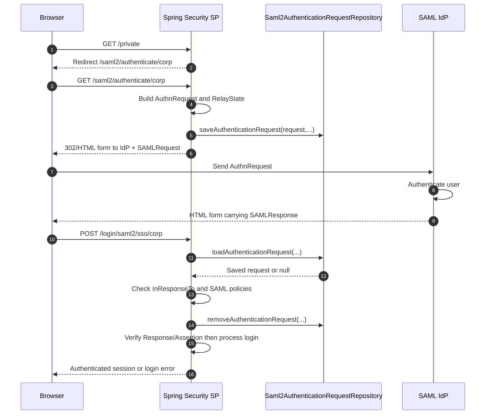

# Storing Requests with Saml2AuthenticationRequestRepository in Spring Security

## 1. Why Must a SAML AuthnRequest Be Stored?

In **SAML 2.0 Web Browser SSO**, a **Service Provider (SP)** application redirects the user to an **Identity Provider (IdP)** for authentication. When the SP proactively initiates login, it sends a `<saml2:AuthnRequest>`. After the user logs in, the IdP sends a `<saml2:Response>` back to the SP's **Assertion Consumer Service (ACS)** via the browser.

The browser acts as the transport across two domains: the SP cannot rely solely on receiving an HTTP POST with a `SAMLResponse` field to know that the response belongs to the **right request, right session, and right IdP**. The SP must retain the issued request context before redirecting so it can correlate when the browser returns.

In Spring Security Servlet, **`Saml2AuthenticationRequestRepository<T extends AbstractSaml2AuthenticationRequest>`** is the abstraction that saves, loads, and removes **SP-generated AuthnRequest** data during the login flow. It answers the question: "Which SAML request is awaiting a result, and how do we retrieve it when the response arrives?"

### Learning Objectives

After this lesson, the learner can:

1. Explain the repository's place in SP-initiated SSO and how it differs from `RelyingPartyRegistrationRepository`.
2. Understand the exact roles of `saveAuthenticationRequest`, `loadAuthenticationRequest`, `removeAuthenticationRequest`, and the `AbstractSaml2AuthenticationRequest` payload.
3. Configure the default `HttpSession`-based repository using Java 17+/Spring Boot 3.x.
4. Recognize when a cache-backed repository, shared session, TTL/replay management, and their security trade-offs are needed.
5. Diagnose lost-request issues caused by `SameSite` cookies, session timeouts, multi-replica deployments, multiple tabs, wrong registrations, or mismatched callbacks.
6. Distinguish finding a stored request from **full SAML Response validation**: the repository does not replace signature, issuer, recipient, audience, or time checks.

The primary scope is **SP-initiated SAML2 Login on Spring Security Servlet**. The Spring Boot examples can only run end-to-end when the application has a valid IdP, metadata, certificates, and matching SP/ACS registration.

## 2. Login Flow and Where Requests Are Saved/Loaded



The diagram describes **logical responsibilities**, not an absolute guarantee of internal call ordering across every implementation: when the framework invokes `load` and `remove` depends on the converter/filter and Spring Security version. The invariant is that a request must be saved **before** sending the browser to the IdP, used only under appropriate policy, and removed/no longer reusable once the transaction finishes.

Related Spring Security components:

- **`Saml2WebSsoAuthenticationRequestFilter`:** handles the initiation endpoint (typically `/saml2/authenticate/{registrationId}`), uses the resolver to build the request, and writes it to the repository before redirecting the browser to the IdP.
- **`Saml2AuthenticationRequestResolver`:** selects the registration and creates the AuthnRequest with the appropriate binding/endpoint.
- **`Saml2AuthenticationRequestRepository`:** holds data needed for the callback step; does not authenticate identity itself.
- **`Saml2WebSsoAuthenticationFilter`:** handles the callback at the ACS (default `/login/saml2/sso/{registrationId}`) and forwards data to the authentication converter/provider.
- **`Saml2AuthenticationTokenConverter`:** converts the HTTP request into an authentication token, optionally looking up the saved request to resolve the transaction/registration.
- **OpenSAML authentication provider:** verifies the SAML Response and Assertion against trust configuration, and only then produces the login result.

**Key distinction:** "AuthnRequest was saved" pertains to the **request issued by the SP**; a "valid SAMLResponse" additionally requires checking signature, issuer, audience, recipient, validity period, correlation, and replay protection.

## 3. Contract of Saml2AuthenticationRequestRepository

In the Spring Security Servlet 6.x API, the interface has the following conceptual signature (method names and signatures follow the API; `T` denotes a subtype of `AbstractSaml2AuthenticationRequest`):

```java
public interface Saml2AuthenticationRequestRepository<
        T extends AbstractSaml2AuthenticationRequest> {

    T loadAuthenticationRequest(HttpServletRequest request);

    void saveAuthenticationRequest(
            T authenticationRequest,
            HttpServletRequest request,
            HttpServletResponse response);

    T removeAuthenticationRequest(
            HttpServletRequest request,
            HttpServletResponse response);
}
```

This is a **signature snippet for study**, not a standalone Java file: `HttpServletRequest`/`HttpServletResponse` belong to `jakarta.servlet.http`; `AbstractSaml2AuthenticationRequest` belongs to `org.springframework.security.saml2.provider.service.authentication`. Java 17+ and Spring Security Servlet 6.x use the Jakarta Servlet API, not the legacy `javax.servlet` namespace.

| Method | When Is It Meaningful? | Returns | Constraints for Custom Implementations |
| --- | --- | --- | --- |
| `saveAuthenticationRequest(T, request, response)` | After building AuthnRequest, before redirecting/posting to IdP | `void` | Bind to the right transaction/browser, expiration, registration, and data needed to retrieve it |
| `loadAuthenticationRequest(request)` | When the browser calls ACS with SAMLResponse | `T` or `null` | Retrieve only the request matching the current transaction; avoid mixing tenants/sessions |
| `removeAuthenticationRequest(request, response)` | When the framework finishes using the pending request | Removed request or `null` | Delete or consume effectively; prevent reuse and handle concurrency |

**`load` does not mean "authentication succeeded"**. It only reads the saved request. **`remove` does not mean "Response was verified"**. Removing state is part of transaction lifecycle management, whereas the authentication provider decides whether to accept or reject assertions.

### What Data Is Stored?

Spring Security uses `AbstractSaml2AuthenticationRequest` with subtypes such as `Saml2RedirectAuthenticationRequest` or `Saml2PostAuthenticationRequest`. The object exposes data supporting the SAML request, such as:

- `getId()`: AuthnRequest identifier (used in `InResponseTo` correlation if supplied).
- `getRelayState()`: RelayState value if present.
- `getRelyingPartyRegistrationId()`: SP-side registration that created the request.
- `getAuthenticationRequestUri()`: IdP endpoint URI receiving the AuthnRequest.
- `getSamlRequest()`: encoded `SAMLRequest` data per the corresponding binding.
- `getBinding()`: POST or REDIRECT.

`AbstractSaml2AuthenticationRequest` stores more than just a URL string. The repository must preserve whatever data the framework needs across the authentication lifecycle, but **need not copy the entire SAMLResponse** into the request store. Storing raw SAML assertions/PII goes beyond the abstraction's purpose and increases data-exposure risk.

## 4. Default: HttpSessionSaml2AuthenticationRequestRepository

Spring Security uses **`HttpSessionSaml2AuthenticationRequestRepository`** as the default AuthnRequest store in Servlet SAML2 Login. It stores `AbstractSaml2AuthenticationRequest` in the SP's **`HttpSession`**.

Scope diagram:

```text
Browser                           Spring Boot SP
  |                                   |
  | GET /saml2/authenticate/corp      |
  |---------------------------------->|
  |                                   | session S123
  |                                   |   -> pending AuthnRequest
  |<----------------------------------|
  | 302 to IdP + SP session cookie    |
  |                                   |
  | ... browser logs in at IdP ...    |
  |                                   |
  | POST ACS + SP session cookie      |
  |---------------------------------->|
  |                                   | uses S123 to find request
  |                                   | correlates and verifies response
```

A normal `JSESSIONID`/`SESSION` cookie carries only a **session identifier**, not the AuthnRequest XML itself. Pending request data lives in **server-side session storage**. Therefore:

- The client cannot directly alter the saved request simply by changing the `RelayState` field.
- The SP can bind the AuthnRequest to the initiating browser session, helping prevent **login fixation/login CSRF**.
- Sessions can expire, be invalidated, or be lost when the browser withholds the cookie; the callback then cannot find the pending request.
- If the app runs multiple replicas using only local in-memory sessions, callbacks hitting another replica may lose the request.

**Use the default before customizing.** It suffices for many single-instance apps or apps with proper session persistence. Do not write a custom repository merely to "see requests in a database"; first determine whether the issue is session, cookie, network, or SAML logic.

### Comparison with Similarly Named Repositories

- **`RelyingPartyRegistrationRepository`:** stores **long-lived SP–IdP configuration** (entity ID, ACS, verification keys, endpoints); does not store pending AuthnRequests.
- **`Saml2AuthenticationRequestRepository`:** stores **temporary authentication transactions** prior to callback; does not hold long-lived login sessions.
- **`HttpSessionSecurityContextRepository` / `SecurityContextRepository`:** handles storing **authenticated `Authentication`** across HTTP requests.
- **`RequestCache` / `HttpSessionRequestCache`:** holds the **URL/resource the user wants to return to** after login, not the SAML AuthnRequest.
- **`Saml2AuthenticationRequestResolver`:** builds requests, not a storage repository.

Confusing these abstractions leads to mistakes such as trying to fix "login succeeded but did not return to the original URL" (RequestCache) inside the SAML request repository, or trying to "fix" `InResponseTo` errors by changing registration config.

## 5. Java 17+/Spring Boot 3.x Example: Explicit Repository Configuration

The example uses Spring Security 6.x, the Servlet stack, and a real IdP. It is a complete demo application as a **Java class**; to perform real SAML logins, IdP metadata must be available, and the IdP must be registered with the right SP Entity ID, ACS, and certificate.

### 5.1. Gradle Dependencies

In a Spring Boot project with compatible Gradle plugin/BOM:

```groovy
repositories {
    mavenCentral()
    // Some OpenSAML versions require the Shibboleth repository.
    maven { url "https://build.shibboleth.net/maven/releases/" }
}

dependencies {
    implementation "org.springframework.boot:spring-boot-starter-web"
    implementation "org.springframework.boot:spring-boot-starter-security"
    implementation "org.springframework.security:spring-security-saml2-service-provider"
}
```

This is an excerpt of `build.gradle`, not a standalone build file. With Spring Boot 3.x/Spring Security 6.x, use unified dependency management; avoid forcing OpenSAML versions arbitrarily.

### 5.2. application.yml

```yaml
app:
  saml:
    idp-metadata-location: "${SAML_IDP_METADATA_LOCATION}"

server:
  servlet:
    session:
      timeout: 15m
      cookie:
        http-only: true
        secure: true
```

`SAML_IDP_METADATA_LOCATION` must be supplied via runtime environment, e.g., `https://idp.example.test/metadata` in a test environment with a real IdP. This file illustrates **HTTPS environment** choices; when running local HTTP, adjust the `Secure` cookie setting per environment and test properly—never use plain HTTP in production.

The example session lifetime is 15 minutes; actual timeouts must account for user authentication time at the IdP, multi-factor authentication, and system session policies. Never use a very long timeout as a "fix" for logins that frequently lose state.

### 5.3. Complete Single-File Java Class

Save at `src/main/java/demo/samlrequest/SamlRequestApplication.java`:

```java
package demo.samlrequest;

import java.util.Map;

import org.springframework.beans.factory.annotation.Value;
import org.springframework.boot.SpringApplication;
import org.springframework.boot.autoconfigure.SpringBootApplication;
import org.springframework.context.annotation.Bean;
import org.springframework.security.config.Customizer;
import org.springframework.security.config.annotation.web.builders.HttpSecurity;
import org.springframework.security.core.annotation.AuthenticationPrincipal;
import org.springframework.security.saml2.provider.service.authentication.AbstractSaml2AuthenticationRequest;
import org.springframework.security.saml2.provider.service.authentication.Saml2AuthenticatedPrincipal;
import org.springframework.security.saml2.provider.service.registration.InMemoryRelyingPartyRegistrationRepository;
import org.springframework.security.saml2.provider.service.registration.RelyingPartyRegistration;
import org.springframework.security.saml2.provider.service.registration.RelyingPartyRegistrationRepository;
import org.springframework.security.saml2.provider.service.registration.RelyingPartyRegistrations;
import org.springframework.security.saml2.provider.service.web.HttpSessionSaml2AuthenticationRequestRepository;
import org.springframework.security.saml2.provider.service.web.Saml2AuthenticationRequestRepository;
import org.springframework.security.web.SecurityFilterChain;
import org.springframework.web.bind.annotation.GetMapping;
import org.springframework.web.bind.annotation.RestController;

@SpringBootApplication
@RestController
public class SamlRequestApplication {

    public static void main(String[] args) {
        SpringApplication.run(SamlRequestApplication.class, args);
    }

    @Bean
    RelyingPartyRegistrationRepository relyingParties(
            @Value("${app.saml.idp-metadata-location}") String metadata) {

        RelyingPartyRegistration registration = RelyingPartyRegistrations
                .fromMetadataLocation(metadata)
                .registrationId("corp")
                .entityId("{baseUrl}/saml2/service-provider-metadata/{registrationId}")
                .assertionConsumerServiceLocation(
                        "{baseUrl}/login/saml2/sso/{registrationId}")
                .build();

        return new InMemoryRelyingPartyRegistrationRepository(registration);
    }

    @Bean
    Saml2AuthenticationRequestRepository<AbstractSaml2AuthenticationRequest>
            saml2AuthenticationRequestRepository() {
        // Explicitly declare Spring Security Servlet's default mechanism.
        return new HttpSessionSaml2AuthenticationRequestRepository();
    }

    @Bean
    SecurityFilterChain security(HttpSecurity http) throws Exception {
        return http
                .authorizeHttpRequests(auth -> auth
                        .requestMatchers("/").permitAll()
                        .anyRequest().authenticated())
                .saml2Login(Customizer.withDefaults())
                .build();
    }

    @GetMapping("/")
    public String index() {
        return "Public. Open /private to start SAML2 login.";
    }

    @GetMapping("/private")
    public Map<String, String> privateResource(
            @AuthenticationPrincipal Saml2AuthenticatedPrincipal user) {
        return Map.of(
                "subject", user.getName(),
                "registration", user.getRelyingPartyRegistrationId());
    }
}
```

**Why does this example fit the topic?** `saml2AuthenticationRequestRepository()` declares a Bean matching the interface/generic type Spring Security uses to save AuthnRequests. Per the Spring Security 6.5 guide, you can customize by **exposing a `Saml2AuthenticationRequestRepository` bean**; in the example, the bean returns the default implementation so you can see where to swap it. You do not need to call `saveAuthenticationRequest` manually in a controller: SAML2 filters use the repository during login.

`relyingParties` is a **separate-responsibility** bean: fetching IdP metadata and creating the `corp` registration. `/private` is protected; once the SAML Response is verified, the principal represents the authenticated user. Nothing allows the app to pull a `SAMLResponse` from query params and mint a session directly.

### 5.4. How to Run and Observed Results

In a Gradle/Spring Boot project with a wrapper and a properly registered real SAML IdP:

```bash
SAML_IDP_METADATA_LOCATION=https://idp.example.test/metadata ./gradlew bootRun
```

The `example.test` domain is just a placeholder; replace it with your real IdP metadata. If `secure: true` is configured, run the app over HTTPS or behind a trusted HTTPS proxy; running plain local HTTP will prevent the Secure cookie from being sent, losing the session and AuthnRequest.

Open `/private`, follow the redirect through `/saml2/authenticate/corp`, and sign in at the IdP. After a successful `/login/saml2/sso/corp` callback, `GET /private` returns JSON with `subject` (actual value depends on IdP NameID) and `registration` equal to `corp`. **There is no fixed stdout** because connecting to an IdP depends on metadata, certificates, URLs, and users. Without a registered IdP/SP, mock URLs cannot perform authentication.

**Note on SAML request signing:** some IdPs require AuthnRequests to be signed. In that case the SP needs separately configured signing credentials; the repository bean does not generate or sign with private keys. If IdP metadata requires signing while the SP lacks credentials, login can fail before save/redirect. Do not turn off request signing at the IdP just because the example omits keys.

## 6. Where Does the Repository Fit When Customizing Configuration?

Spring Security 6.5 practice lets you plug your own implementation into the flow using a bean:

```java
@Bean
Saml2AuthenticationRequestRepository<AbstractSaml2AuthenticationRequest>
        authenticationRequestRepository() {
    return new HttpSessionSaml2AuthenticationRequestRepository();
}
```

This is a **bean snippet to add to a `@Configuration` class**, not a standalone Java program. When using the full code from section 5, this bean is already present—do not declare it twice. If you need a custom implementation, replace the returned instance with a custom class implementing the same interface.

**Do not confuse with `.saml2Login(...).authenticationRequestResolver(...)`.** The resolver **builds AuthnRequests**, whereas the repository **stores them**. `Saml2LoginConfigurer` has methods to choose resolvers and endpoints, but in the API covered here, exposing a repository bean is the direct approach described in official docs. Do not assume an `authenticationRequestRepository` setter exists on the `saml2Login` DSL if your version lacks it.

If the framework/version in use does not auto-pick up the bean due to special wiring or custom filters, inspect the wiring of both the **request-generating filter** and **response-processing filter**; both must share the **exact same logical store**. Two instances backed by two unshared caches will cause callbacks to miss requests, even if both implement the interface.

## 7. Implementing a Custom Repository: Requirements for a Correct Solution

A custom `Saml2AuthenticationRequestRepository<AbstractSaml2AuthenticationRequest>` may use sessions, Redis, a distributed cache, or other storage. However, the three interface methods **do not by themselves enforce** security and concurrency; the design also requires:

1. **Unpredictable lookup keys and correlation:** never use a single user ID or registration ID to look up everyone's pending requests. If keyed by `RelayState`, the state must be generated with high entropy and never attacker-controlled.
2. **Browser or transaction binding:** if the threat model demands only the initiating browser be accepted, an independent browser-bound proof is needed; looking up requests solely by a public `RelayState` can lose the session's login fixation defense.
3. **Finite TTL:** requests must not live forever in cache; TTL must cover realistic login/MFA durations yet remain short enough to limit replay/misuse.
4. **Read and delete strictly once:** once a valid callback consumes a pending request, no other response may reuse it; consider atomic `GETDEL`/compare-and-delete on appropriate backends.
5. **Concurrent tabs and callbacks:** multiple simultaneous logins in the same browser can occur; do not let one flow overwrite another unless UX and policy explicitly accept that.
6. **Multi-tenant/multi-IdP:** registration, issuer, request ID, ACS, and SP Entity ID must be verified consistently.
7. **Stored data security:** encrypt if needed, apply RBAC, TTL, log redaction, network authentication between app and cache, and purge on expiration.
8. **Failure behavior:** if cache/session expires or the backend store is unavailable, reject the transaction or safely restart login—never fall back to accepting unsolicited responses.

### Decorator Pattern to Observe Lifecycle Without Logging Secrets

When you need `save/load/remove` metrics, you can wrap the default repository in a *decorator* class. The example below is a **complete Java class**, though only a library component; add it to a Spring Security 6.x project and register it as a bean as shown below.

```java
package demo.samlrequest;

import jakarta.servlet.http.HttpServletRequest;
import jakarta.servlet.http.HttpServletResponse;
import org.springframework.security.saml2.provider.service.authentication.AbstractSaml2AuthenticationRequest;
import org.springframework.security.saml2.provider.service.web.Saml2AuthenticationRequestRepository;

public final class ObservedSamlRequestRepository
        implements Saml2AuthenticationRequestRepository<AbstractSaml2AuthenticationRequest> {

    private final Saml2AuthenticationRequestRepository<AbstractSaml2AuthenticationRequest>
            delegate;

    public ObservedSamlRequestRepository(
            Saml2AuthenticationRequestRepository<AbstractSaml2AuthenticationRequest>
                    delegate) {
        this.delegate = delegate;
    }

    @Override
    public void saveAuthenticationRequest(
            AbstractSaml2AuthenticationRequest requestToSave,
            HttpServletRequest request,
            HttpServletResponse response) {
        delegate.saveAuthenticationRequest(requestToSave, request, response);
        // Record internal count metric, do not log SAMLRequest/RelayState.
    }

    @Override
    public AbstractSaml2AuthenticationRequest loadAuthenticationRequest(
            HttpServletRequest request) {
        return delegate.loadAuthenticationRequest(request);
    }

    @Override
    public AbstractSaml2AuthenticationRequest removeAuthenticationRequest(
            HttpServletRequest request,
            HttpServletResponse response) {
        return delegate.removeAuthenticationRequest(request, response);
    }
}
```

To use the decorator in place of the bean in section 5:

```java
@Bean
Saml2AuthenticationRequestRepository<AbstractSaml2AuthenticationRequest>
        saml2AuthenticationRequestRepository() {
    return new ObservedSamlRequestRepository(
            new HttpSessionSaml2AuthenticationRequestRepository());
}
```

This is a **replacement body for the existing bean method**, not a second bean. The class logs nothing itself; the comment simply marks where to instrument. When emitting metrics, export total `save` counts, `load` success/failure counts, repository latency, or reason codes—avoid recording `getSamlRequest()`, `getRelayState()`, raw cookies, private keys, or SAMLResponse payloads.

### Why Not Roll Your Own Store with a Simple Map?

If custom code uses a JVM `Map<String, AbstractSaml2AuthenticationRequest>`:

- The cache disappears on restart.
- Replicas A and B do not share state.
- There is no safe TTL/eviction by default.
- It is easy to forget atomic consumption, enabling reuse.
- If keyed only by registration ID like `corp`, users will **mix up login transactions**.

A production repository requires a clear lifecycle and storage/consumption guarantees; never switch from session to a static Map just to dodge cookie issues.

## 8. CacheSaml2AuthenticationRequestRepository: When Avoiding HttpSession

Starting in **Spring Security 6.5**, the framework provides `CacheSaml2AuthenticationRequestRepository`. It uses Spring Cache to store AuthnRequests, which can help when a session-bound repository loses state due to `SameSite`/browser cookies or when an independent cache is required.

Illustrative bean for Spring Security 6.5+:

```java
@Bean
Saml2AuthenticationRequestRepository<AbstractSaml2AuthenticationRequest>
        saml2AuthenticationRequestRepository() {
    return new CacheSaml2AuthenticationRequestRepository();
}
```

This snippet requires importing `org.springframework.security.saml2.provider.service.web.CacheSaml2AuthenticationRequestRepository` and replacing the existing session bean. **The cache repository defaults to an in-memory cache**, so it does not automatically support multi-instance deployments. For clustering, provide a distributed `org.springframework.cache.Cache` via `setCache(...)` and design TTL, atomic consume, and cache authentication.

Example **illustrative bean snippet depending on a configured Spring `CacheManager`**:

```java
@Bean
Saml2AuthenticationRequestRepository<AbstractSaml2AuthenticationRequest>
        saml2AuthenticationRequestRepository(CacheManager cacheManager) {
    Cache cache = java.util.Objects.requireNonNull(
            cacheManager.getCache("saml-authn"),
            "Required cache 'saml-authn' is missing");

    CacheSaml2AuthenticationRequestRepository repository =
            new CacheSaml2AuthenticationRequestRepository();
    repository.setCache(cache);
    return repository;
}
```

Requires importing `org.springframework.cache.Cache`, `org.springframework.cache.CacheManager`, and the cache repository; this snippet **does not configure Redis or a cache manager**. Redis or another backend must be operated, access-restricted, TLS-protected, and configured with proper expiration before running.

### Critical Security Trade-Off: Session-Bound vs. State-Based

Spring Security documentation highlights a benefit of the session-backed repository: an attacker-initiated Response, even with a valid signature from the IdP, cannot easily be bound to a **victim's session**, because the SP requires an initiated request inside that same session. This helps prevent **login fixation**.

If requests are looked up by `RelayState` or `InResponseTo` in a cache without extra browser/session binding, the SP may only know **"this app once generated an AuthnRequest with that key"**, without proving **"the browser receiving this Response is the browser that started login"**. An attacker can exploit that gap in certain login CSRF/session confusion scenarios.

**Therefore, do not treat the cache repository as having equivalent security to the HttpSession repository.** Before switching:
- Assess the login fixation threat model and ability to bind requests to browsers.
- Verify RelayState entropy, `InResponseTo` correlation, TTL, one-time consumption, and anti-replay.
- Evaluate `SameSite`/cookies/HTTPS in your real environment; sometimes fixing the session cookie is the better solution.
- Test unsolicited IdP-initiated SSO under explicit policy.
- Never trade away signature/issuer/audience/recipient checks to "support caching".

The cache repository also does not create authenticated sessions itself; after the provider validates SAML Response, persisting `SecurityContext`/session remains a separate mechanism.

## 9. Spring Session and Multiple Replicas: An Alternative to Standalone Cache

An application running across multiple pods:

```text
                  Load Balancer
                 /             \
             RP pod A        RP pod B
                 \             /
             Shared Session Store

Browser initiates login on pod A.
IdP POST callback may land on pod B.
```

If each pod keeps `HttpSession` solely in its own RAM, pod B will typically not see pending requests created on pod A. There are three design options:

1. **Shared session storage:** use **Spring Session** with a suitable backend (e.g., Redis/JDBC). You keep `HttpSessionSaml2AuthenticationRequestRepository`, while sessions are readable across replicas; object versions and serialization must be tested.
2. **Sticky sessions:** the load balancer tries to route callbacks back to the originating pod; simpler, yet fragile under pod death, failover, rolling deployments, or routing changes.
3. **Distributed cache repository:** stores pending requests outside sessions with proper validation/limits; must address the login fixation trade-off noted above.

**Spring Session typically preserves the browser-session binding benefit** of the session repository while sharing state across pods, provided the session cookie returns properly and the session store is properly configured. A standalone cache repository does not automatically guarantee this property just because it also uses Redis.

### Notes on User State

Do not conflate:
- `AuthnRequest repository`: pending **uncompleted** login transaction.
- `HTTP session store`: can hold pre-login requests and post-login `SecurityContext`.
- `RequestCache`: saved URL to redirect back to after login.
- `SAML Response/Assertion replay cache`: anti-replay state for SAML messages, if used by library/policy.
  
If login succeeds yet the browser forgets logged-in status, investigate session persistence/`SecurityContext`. If the callback reports `InResponseTo` mismatch, investigate the pending request repository and session cookies. Both failures may stem from session infrastructure yet be fixed in different places.

## 10. SameSite Cookies and HTTP-POST Callbacks

In the common binding, the IdP triggers a **cross-site POST** to the ACS:

```text
Browser --- GET/redirect ---> IdP (IdP domain)
Browser <--- SAMLResponse form --- IdP
Browser --- POST -----------> SP ACS (SP domain)
                               |
                               +--> looks up request in SP session
```

The browser sends the SP session cookie on this POST only if cookie policy permits. With `SameSite=Lax`, cookies are typically withheld on **cross-site top-level POSTs**; `SameSite=Strict` is even more restrictive. `SameSite=None` usually requires `Secure` and is used when cookies must travel cross-site, though CSRF and browser policies must be evaluated.

Symptoms when the cookie does not return:

- The browser completed IdP login successfully.
- `SAMLResponse` POSTs to the right ACS.
- The SP cannot find the `HttpSession` holding the AuthnRequest.
- The system reports missing `InResponseTo` correlation or restarts login, even though the IdP signature may be valid.

**Troubleshoot in order:**

1. Check whether the SP session cookie was set when creating AuthnRequest, with proper `Path`, `Domain`, `Secure`, and `SameSite`.
2. Check the Network tab to confirm the browser sends the **exact SP cookie** on the ACS POST; never capture/paste real cookie values into public logs or docs.
3. Check whether a reverse proxy generates wrong `http`/`https`, rewrites host, or strips cookies.
4. Check whether the session was invalidated or timed out while IdP/MFA ran.
5. Check multi-replica routing and shared session stores.
6. Only then consider a cache repository or changing cookie policy, evaluating security trade-offs.

Never turn "pending AuthnRequest not found" into "accept any SAML Response". If the organization intentionally supports IdP-initiated/unsolicited SSO, design dedicated safeguards instead of silently falling back when sessions are lost.

## 11. RelayState, InResponseTo, and Verification Layers

These three concepts are frequently confused:

- **`AuthnRequest@ID`:** identifier of the request the SP generated. Response/SubjectConfirmation can carry `InResponseTo` referencing that request.
- **`RelayState`:** opaque data passing through the browser alongside requests/responses, helping the app locate state or preserve navigation context. It is **not a digital signature**, not proof of authentication, and must never be used as an arbitrary redirect URL.
- **Repository storage key:** an implementation detail; may rely on session or a cache key derived from RelayState, but must prevent guessing, collisions, and transaction mix-ups.

Finding a request in the repository **does not** prove the Response was signed by the IdP. A validly signed SAML Response **does not** prove the current browser initiated that transaction. A Response whose `InResponseTo` matches an ID **does not** prove the assertion is meant for this SP; the SP must still check audience, destination/recipient, issuer, and timestamps.

### ACS Verification Checklist

After locating the pending request (for SP-initiated):

1. Select the matching `RelyingPartyRegistration` and IdP verification certificate.
2. Verify a valid signature over the **exact content actually consumed**, preventing XML Signature Wrapping.
3. Verify `Issuer` matches the trusted IdP.
4. Verify `Destination` and `SubjectConfirmationData@Recipient` point to a valid ACS.
5. Verify `AudienceRestriction` matches the SP Entity ID.
6. Verify `InResponseTo` when required by protocol/profile.
7. Verify `NotBefore`, `NotOnOrAfter`, and reasonable clock skew.
8. Enforce anti-replay per policy, rejecting already-used assertions.
9. Map NameID/attributes to principal/authorities after verification.

This is the responsibility of the **SAML authentication provider and validation policy** layer, not the `Saml2AuthenticationRequestRepository` interface. Never write a repository that "assumes validity" just because an object was loaded.

## 12. Multiple Tabs, Concurrent Logins, Timeouts, and Race Conditions

A user might open two login tabs simultaneously, restart login before a response returns, or take several minutes for MFA at the IdP. For custom repositories, inspect carefully:

- Each initiation has a distinct request ID/RelayState and does not unintentionally overwrite another transaction's state.
- If an implementation holds **one pending slot per session** or overwrites the same key, two tabs may cause one callback to miss its request.
- TTL and session timeout fit policy; excessively long timeouts widen the replay window and hold stale resources.
- When two callbacks arrive for one transaction, consumption must be safe: at most one succeeds per validation/replay policy.
- If load and remove are non-atomic, design so concurrent callbacks cannot both accept one pending request under the threat model.
- Upon logout, session invalidation, session ID rotation, switching browser profiles, or cookie blocking, state may be lost: that is expected behavior or an infrastructure issue, not a reason to skip response checks.

Do not assume every version of `HttpSessionSaml2AuthenticationRequestRepository` supports or forbids multiple pending requests identically without testing the deployed version. Use integration tests reproducing "two tabs – two requests – out-of-order callbacks" to verify actual behavior.

## 13. IdP-initiated SSO Without a Saved Request

**SP-initiated:** SP creates AuthnRequest, repository saves it, and later the callback has context to compare against.

**IdP-initiated / unsolicited:** IdP sends `SAMLResponse` without a prior SP AuthnRequest, so returning `null` from the repository is **expected for this flow**. However, whether unsolicited Responses are permitted is an **explicit policy decision**, not something inferred from a `null` repository lookup.

If IdP-initiated is allowed:

- Accept only preconfigured trusted IdPs/registrations.
- Strictly verify signature, issuer, audience, destination/recipient, validity period, and anti-replay.
- Guard against login CSRF/session confusion when the browser already holds another session.
- Restrict open redirects from RelayState and prevent silent account switching in sessions.
- Distinguish "unsolicited permitted" from "SP-initiated lost request" in logs so cookie failures are not masked.

If policy allows SP-initiated only, handle responses without a stored request by failing closed and prompting the browser to restart login through the SP.

## 14. Appropriate Tests for the Repository

Focus on testing behavior (do not write tests that merely mirror implementation details):

| Test | Setup | Expectation |
| --- | --- | --- |
| **Save → load** | Start login then return with the same session in a simulated callback | Repository retrieves matching request/registration |
| **Load when missing** | Fresh browser, different session, or nonexistent cache key | Returns `null`/rejects correlation per policy |
| **Remove/consume** | Finish callback processing, read transaction again | Request cannot be reused |
| **Wrong request ID** | Response carries `InResponseTo` from another transaction | Authentication rejected |
| **Wrong IdP** | Response signed by IdP B sent to IdP A registration | Rejected despite pending request |
| **SameSite cookie** | Real SSO with cross-site HTTP-POST | Cookie/session returns under accepted config |
| **Multi-replica** | Initiated on A, callback on B | Still finds request if using shared session/cache |
| **Two tabs** | Two requests and two out-of-order callbacks | Follows concurrent login policy, no user mix-up |
| **TTL expired** | Wait for request expiration before callback | Rejected, no unprotected fallback |
| **Replay** | Resubmit identical SAMLResponse | Rejected on second attempt per security policy |
| **Restart** | Restart instance between redirect and callback | Result matches chosen session/cache persistence |

Use a sandbox IdP and test certificates/fixtures—never save production Responses for replay. Verify both **authentication outcome** and **lifecycle state**, not just HTTP 302, because a 302 could be redirecting to a login error page.

### Safe Observability

Safe metrics to emit: count of saved requests; count of callback load hits/misses; timeouts; correlation failure rate; duration from creation to callback; cache hits/misses by allowed registration. Never log `getSamlRequest()`, raw `RelayState`, `SAMLResponse`, session IDs, cookies, NameIDs, assertions, or tokens.

If correlation IDs are needed in logs, use safe/hashed internal IDs per policy, avoiding identifiers that could locate pending requests in cache. Especially avoid turning public logs into a list of usable RelayStates.

## 15. Diagnosing Common Errors

| Symptom | Where to Check First | Remediation |
| --- | --- | --- |
| `InResponseTo` mismatch | Request state, callback correlation | Match request ID and session; never disable validation |
| AuthnRequest not found after IdP login | Cookie/SameSite, session TTL, repository | Inspect ACS POST cookies and repository hit/miss |
| Valid callback yet request lookup returns `null` | Different session, wrong cache key, request overwritten | Compare browser/replica/registration |
| Login fails only on multiple pods | Local session on another pod or local cache | Spring Session/shared backend, sticky routing, or vetted distributed cache |
| Session confusion appears after switching to cache | Lost browser-session binding | Assess login fixation, add safeguards, or revert to session-bound |
| Two login tabs cause one tab to fail | Multiple pending requests sharing key/slot | Test concurrency; use repository/design supporting multiple flows |
| IdP-initiated accepted unintentionally | Unclear unsolicited policy | Block or design dedicated validation |
| SAML Response signature invalid | IdP certificate, metadata, signed node | Update trust via trusted channel; do not edit repository |
| ACS returns 404/405 | IdP ACS URL, ingress, filter matcher | Align endpoints and metadata |
| Does not return to original URL after login | RequestCache/success handler, session persistence | Check saved request; do not edit SAML repository if correlation worked |

**Diagnostic example:** a user reports "finished IdP login, returned to the app, and got prompted to log in again". If the Network tab shows the `SAMLResponse` POST reached the ACS without the SP cookie, inspect SameSite/Secure/proxy, then check whether the `HttpSession` holding the pending request was retrieved. If load returned the request and signature was valid yet issuer/audience failed, the bug is in validation, not the repository.

## 16. Anti-Patterns to Avoid

1. **Keying pending requests solely by username or registration ID:** causes collisions across users/transactions.
2. **Trusting browser-supplied RelayState blindly:** RelayState does not prove who initiated login.
3. **Using a static Map in a multi-replica SP:** no shared state, no TTL, no atomic consume.
4. **Removing correlation to fix session errors:** weakens defenses against login fixation/CSRF.
5. **Accepting any unsolicited Response when repository load returns null:** widens login policy unintentionally.
6. **Storing requests indefinitely:** widens replay window and wastes storage.
7. **Logging raw XML, RelayState, or session IDs:** leaks sensitive data and correlation tokens.
8. **Changing the request repository to fix every SAML issue:** signatures, metadata, ACS, clock skew, audience, and authorization belong elsewhere.
9. **Using local cache in a cluster assuming it is shared:** prove the state backend is genuinely distributed.
10. **Comparing IDs manually while bypassing OpenSAML validators:** request correlation is only one part of federation verification.

## 17. Design/Deployment Checklist

- [ ] Protocol is SP-initiated and the `AuthnRequest` issuer endpoint is identified.
- [ ] Active repository is clear: `HttpSession`, shared session, or cache.
- [ ] `save/load/remove` APIs match the Spring Security version and request types.
- [ ] Requests are saved before redirect and not overwritten unintentionally.
- [ ] ACS callbacks can access the right state and registration.
- [ ] `Secure`/`HttpOnly`/`SameSite` cookies, proxies, and domain/path match HTTP-POST binding.
- [ ] Multi-replica and multi-tab logins tested against actual topology.
- [ ] TTL, consume-once, concurrency, and cleanup/replay are designed.
- [ ] Every Response verifies signature, issuer, destination, recipient, audience, validity window, and correlation.
- [ ] Explicit decision made on whether IdP-initiated/unsolicited flows are allowed.
- [ ] No raw requests/responses, cookies, session IDs, or private keys logged.
- [ ] Negative tests confirm fail-closed behavior when pending requests are missing or mismatched.
- [ ] Operators understand cache repositories may weaken session binding and require login fixation review.

## 18. Self-Assessment Questions

**Q1. Is `Saml2AuthenticationRequestRepository` used to store verified SAMLResponses?**  
No. It stores **SP-issued AuthnRequests** to retrieve during response processing and transaction correlation.

**Q2. What is Spring Security Servlet's default implementation?**  
`HttpSessionSaml2AuthenticationRequestRepository`, backed by `HttpSession`.

**Q3. What are the three methods on the interface?**  
`saveAuthenticationRequest`, `loadAuthenticationRequest`, and `removeAuthenticationRequest`.

**Q4. Why can looking up pending requests solely by RelayState in a cache be weaker than using a session?**  
Because looking up by state does not prove the browser receiving the response is the browser that started login; session-bound lookup helps prevent login fixation.

**Q5. Is putting sessions in Redis via Spring Session the same as using a standalone cache repository?**  
No. Spring Session shares sessions across pods while preserving browser-session binding; a state-keyed cache repository has a different threat model.

**Q6. Browser POSTs a validly signed SAMLResponse yet repository load returns null; should login be accepted?**  
Only when an explicit **IdP-initiated/unsolicited** policy is enabled with dedicated verification and safeguards. For SP-initiated flows, missing requests must fail safely—never silently drop correlation.

**Q7. Is returning the right request from the repository enough to create an Authentication?**  
No. The SAML provider must still verify signature, issuer, audience, recipient/destination, time, replay, and authorization policies.

**Q8. When callbacks only fail across multiple Kubernetes replicas, what should you check?**  
Which node stores the session/cache, whether cookies return, whether Spring Session/distributed storage is configured, and whether ingress routing is consistent.

## 19. Authoritative Sources and Reference Docs

- [Spring Security 6.5 – Producing AuthnRequests](https://docs.spring.io/spring-security/reference/6.5/servlet/saml2/login/authentication-requests.html): request-creating filter, default repository, custom beans, and cache repository.
- [Spring Security – Saml2AuthenticationRequestRepository API](https://docs.spring.io/spring-security/reference/api/java/org/springframework/security/saml2/provider/service/web/Saml2AuthenticationRequestRepository.html): interface and three methods.
- [Spring Security – HttpSessionSaml2AuthenticationRequestRepository API](https://docs.spring.io/spring-security/reference/api/java/org/springframework/security/saml2/provider/service/web/HttpSessionSaml2AuthenticationRequestRepository.html): session implementation.
- [Spring Security – CacheSaml2AuthenticationRequestRepository API](https://docs.spring.io/spring-security/reference/api/java/org/springframework/security/saml2/provider/service/web/CacheSaml2AuthenticationRequestRepository.html): introduced in Spring Security 6.5, `setCache`, and session-binding trade-offs.
- [Spring Security – AbstractSaml2AuthenticationRequest API](https://docs.spring.io/spring-security/reference/api/java/org/springframework/security/saml2/provider/service/authentication/AbstractSaml2AuthenticationRequest.html): ID, RelayState, binding, and registration.
- [Spring Security – Authenticating SAML Responses](https://docs.spring.io/spring-security/reference/servlet/saml2/login/authentication.html): ACS filter/converter/provider verifying responses.
- [Spring Session – Reference](https://docs.spring.io/spring-session/reference/): sharing sessions across applications/instances.
- [OWASP SAML Security Cheat Sheet](https://cheatsheetseries.owasp.org/cheatsheets/SAML_Security_Cheat_Sheet.html): correlation, replay, signature validation, and XML security.
