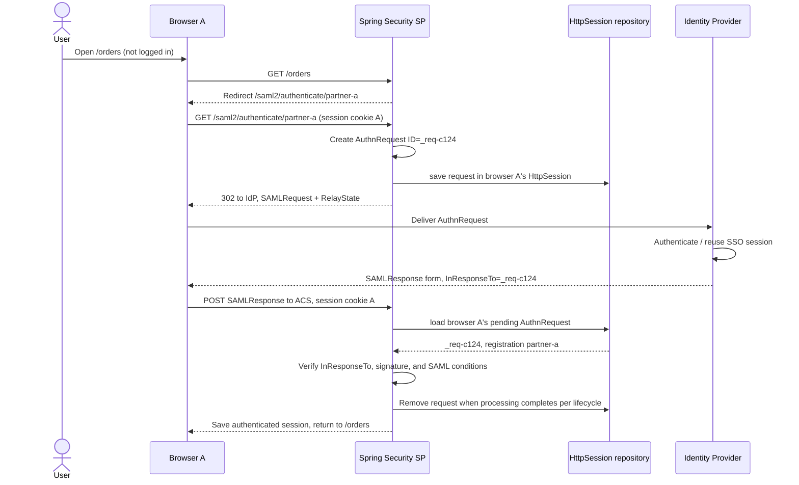

# HttpSessionSaml2AuthenticationRequestRepository and Binding to the Initial Session

**Scope:** Spring Security – federation → SAML2 login flow. This lesson presents the role of `HttpSessionSaml2AuthenticationRequestRepository` in **SP-initiated SAML 2.0 Web Browser SSO**: storing authentication requests issued by the Service Provider (SP), binding them to the browser session that initiated login, retrieving them when the Identity Provider (IdP) sends `SAMLResponse`, and understanding why that mechanism helps prevent login swapping/login fixation.

**Key message:** Having `InResponseTo` match an `AuthnRequest` `ID` is not enough to trust that **the browser POSTing the response is the same browser that started the login attempt**. With a repository backed by `HttpSession`, the application also has grounds to link the response to the **initial browser's server-side state**. When switching to a cache or looking up solely by `RelayState`, this security property must be preserved through deliberate design.

Exercises and Spring examples focus on **Servlet/MVC**, Java 17+, and Spring Security 7.x. Some APIs/modules change across major versions; when applying to Boot 3.x/Security 6.x, check the JavaDoc and dependencies of the exact version in use. This topic covers **storing SAML requests in a session**, not building an Identity Provider or implementing OAuth2/OIDC.

## 1. Context: Why Must `AuthnRequest` Be Stored?

An application requires logged-in users to open `/orders`. If unauthenticated, the Spring Security SP redirects the browser to the IdP:

1. The SP creates an `AuthnRequest` with a **unique ID** (e.g., `_req-c124`), SP issuer, IdP address, Assertion Consumer Service (ACS), and optional authentication requirements.
2. The SP must remember the **exact request issued**: ID, IdP registration/`registrationId`, `RelayState`, and data needed to process the response (via `AbstractSaml2AuthenticationRequest`).
3. The browser delivers the `SAMLRequest` message to the IdP via HTTP Redirect or POST binding. The IdP authenticates the user and sends `SAMLResponse` to the SP's ACS, typically via HTTP POST.
4. The SP retrieves the saved request for the **same browser session**, matches `InResponseTo` against the request ID, and verifies signature, issuer, audience, recipient/destination, validity window, subject confirmation, replay, tenant, and policy before creating a login session.

If the SP does not store the request, an incoming response from the IdP may have a valid signature yet **lack any tie to a login intent created by the current browser**. This is a critical point for login CSRF and login/session swapping.

### 1.1. Two Different Kinds of State

| State | When It Exists | Who Manages It | Purpose |
| --- | --- | --- | --- |
| **Pending SAML AuthnRequest** | **Before** IdP finishes authenticating | `Saml2AuthenticationRequestRepository`, defaulting to the session repository | Proves an SP-initiated SAML transaction started and provides a request to correlate |
| **SecurityContext/Authentication** | **After** `SAMLResponse` is verified successfully | Spring Security and the application's persistence mechanism | Identifies the user as currently logged in to the SP |
| **SavedRequest** / original URL | When the user was redirected away from a protected page | `RequestCache`/session or success handler | Safely returns the user to `/orders` after login |

**Do not confuse:** storing `AuthnRequest` in `HttpSession` **does not authenticate the user**. A session may already exist while the browser is unauthenticated simply to hold transaction state. Only after `SAMLResponse` is verified does Spring create a successful `Authentication` and persist the authenticated state per configuration.

**Do not confuse** `HttpSessionSaml2AuthenticationRequestRepository` with `HttpSessionRequestCache`: the first remembers the **SAML protocol request**, whereas the second typically remembers the **web resource the user wanted to access**. A successful login coordinates both, yet they have distinct responsibilities.

## 2. SP-initiated Flow and Binding to the Initial Session

Assume the SP domain is `https://portal.example.com`, the IdP is `https://login.partner.example`, and the registration ID is `partner-a`. The browser holds a session cookie such as `JSESSIONID=s-abc` (cookie name may differ when using Spring Session).



**Most important takeaway from the diagram:** when the callback arrives, the SP **does not simply read `InResponseTo` and query any request in the system**. It looks up the pending request bound to the `HttpSession` the browser is using. If browser B receives a response initiated by browser A, B has no matching pending request, so it cannot use A's request to legitimize B's handshake under the session-bound design.

### 2.1. Participating Spring Security Components

| Component | Actual Responsibility |
| --- | --- |
| `Saml2WebSsoAuthenticationRequestFilter` | Handles initiation URLs like `/saml2/authenticate/{registrationId}`; uses request resolver to build and send `AuthnRequest` |
| `AbstractSaml2AuthenticationRequest` | Abstract type storing request info; subtypes reflect bindings, including encoded message and associated `RelayState` |
| `Saml2AuthenticationRequestRepository<AbstractSaml2AuthenticationRequest>` | **`save`, `load`, `remove`** contract for pending requests |
| `HttpSessionSaml2AuthenticationRequestRepository` | Default repository implementation storing/loading pending requests in Servlet `HttpSession` |
| `Saml2WebSsoAuthenticationFilter` | Receives `SAMLResponse` at the ACS, e.g., `POST /login/saml2/sso/partner-a` |
| `Saml2AuthenticationTokenConverter` | Converts the HTTP request carrying `SAMLResponse` into `Saml2AuthenticationToken` and uses the repository to fetch the correlated request |
| `OpenSaml5AuthenticationProvider` | In Spring Security 7.1, verifies response/assertion and builds the authentication result when conditions pass |
| `RelyingPartyRegistrationRepository` | Trusted SP and IdP configuration (registration, issuer, SSO URL, ACS, certificates) |

By default, `Saml2WebSsoAuthenticationRequestFilter` uses the repository to **save the request before redirecting the browser to the IdP**. The response-handling side uses the same repository type to retrieve the request. In Spring Security, official documentation confirms `HttpSessionSaml2AuthenticationRequestRepository` is the default repository.

### 2.2. Condensed Data Flow

```text
Browser A (unauthenticated)
  ├─ GET /saml2/authenticate/partner-a
  ├─ SP creates AuthnRequest(ID = _r123)
  ├─ HttpSession(A) saves AbstractSaml2AuthenticationRequest(_r123)
  └─ Redirect to IdP

Browser A receives response
  ├─ POST /login/saml2/sso/partner-a + SAMLResponse
  ├─ Carries cookie so SP locates HttpSession(A)
  ├─ Repository loads saved request (_r123)
  ├─ Spring checks response InResponseTo=_r123 and SAML conditions
  ├─ On success -> updates SecurityContext/session
  └─ Removes pending request per lifecycle, not retained for reuse

Browser B receives A's response
  ├─ POST SAMLResponse with InResponseTo=_r123
  ├─ HttpSession(B) has no pending request _r123
  └─ No handshake binding for B -> must fail safely
```

The snippet above illustrates the **security goal and lifecycle**, not every branch inside a given Spring release's source code. Whether an app accepts or rejects an unsolicited `SAMLResponse` with no correlated request also depends on **IdP-initiated policy**, validators, and version configuration; configure and test this explicitly rather than assuming the repository automatically blocks every uncorrelated response.

## 3. API of `HttpSessionSaml2AuthenticationRequestRepository`

The class belongs to package:

```text
org.springframework.security.saml2.provider.service.web
    .HttpSessionSaml2AuthenticationRequestRepository
```

It implements `Saml2AuthenticationRequestRepository<AbstractSaml2AuthenticationRequest>` and uses `jakarta.servlet.http.HttpServletRequest`/`HttpServletResponse`. Spring Security 7.1 JavaDoc describes three operations:

| Method | When Used | Return / Meaning |
| --- | --- | --- |
| `saveAuthenticationRequest(AbstractSaml2AuthenticationRequest, HttpServletRequest, HttpServletResponse)` | When SP prepares to send `AuthnRequest` to IdP | Saves the request associated with the current Servlet request/response in the session |
| `loadAuthenticationRequest(HttpServletRequest)` | When SP needs to look up the request while processing response | Returns the saved request object or `null` if absent |
| `removeAuthenticationRequest(HttpServletRequest, HttpServletResponse)` | When the framework wants to retrieve and remove the stored request | Returns the removed request or `null` |

**Note:** `load` and `remove` can return `null` — that is a condition the authentication flow must handle, never coerce `null` into a fabricated request. You do not need to call the repository manually in controllers for standard SAML login; the filters and converter already manage it.

Do not rely on a **specific attribute name inside HttpSession** or assume a fixed concurrency limit; those are implementation details that can vary across versions. If the application supports multiple tabs/sequential login starts, **empirically test** how the exact repository version retains uncompleted requests, including whether earlier requests are overwritten or out-of-order callbacks work.

### 3.1. Lifecycle to Remember

- **Create:** create a request with a fresh ID, suitable relay state, and the right registration.
- **Save:** store the pending request in the HttpSession **of the browser that started login**.
- **Navigate:** send the browser to the IdP; the browser must still carry the session cookie when returning.
- **Load:** when the ACS receives the response, retrieve the saved request from the current session/handler.
- **Validate:** verify `InResponseTo`/`SubjectConfirmationData`, signature, issuer, audience, recipient, time, assertion status, and replay per framework/policy.
- **Consume/remove:** release the pending request per the framework flow, preventing reuse of an old request. Also maintain **replay detection** for assertions/responses; removing the request does not replace replay checks.
- **Establish authenticated state:** after valid authentication, the SP saves login state and enforces authorization per resource/tenant.

### 3.2. An Initial Session Is Not an "Authenticated Session"

The same `HttpSession` can hold multiple kinds of data: pending SAML requests, SavedRequest, CSRF tokens for application endpoints, unauthenticated app attributes, etc. After login, Spring Security may **rotate the session ID to defend against classic session fixation**. This does not contradict binding the pending request to the initial session: the key is that **the request is looked up using the browser's pre-authentication state**, while the session is refreshed/ID-rotated upon authentication by session management.

Distinguish two concepts often both called "fixation":

1. **Login fixation/login swapping:** an attacker sends a SAML response for the **attacker's account** to the victim's browser to log the victim in under an unwanted identity. A session-bound request repository helps prevent this because the victim's browser has no correlated handshake.
2. **HTTP session fixation:** an attacker tricks a victim into using a known session ID and exploits it post-login. Spring Security provides `SessionAuthenticationStrategy`, typically `changeSessionId` by default on modern Servlet containers, to rotate the ID after authentication.

These two defenses **complement each other**. Rotating the session ID after login does not replace verifying `InResponseTo` bound to the pre-login session; conversely, SAML correlation does not replace session cookie/ID protections.

## 4. Why Are `InResponseTo` or `RelayState` Alone Insufficient?

Suppose an attacker opens the SP in browser A, generates `AuthnRequest ID="_attacker-1"`, logs in at the IdP as `attacker@example.com`, and obtains a valid IdP-signed SAMLResponse.

If a server simply does:

```text
POST SAMLResponse -> read InResponseTo=_attacker-1
-> look up request _attacker-1 in a global cache
-> valid signature -> create session for the POSTing browser
```

then victim browser B, if coerced into POSTing that response under certain conditions, could get logged in to the SP under the attacker's account. **The IdP signature is completely valid**, yet browser B's session never initiated this login.

Conversely, if the pending request is kept in `HttpSession(A)`, browser B checking `HttpSession(B)` will not find `_attacker-1`. This is the protection Spring Security documentation highlights when recommending session storage; Spring calls it the **natural login fixation defense** of the session-based repository.

**`RelayState` is not proof of identity.** It is state passed over the binding to restore context or a destination; receiving a `RelayState` from the browser does not prove that browser started the request. `InResponseTo` likewise arrives inside the SAML message and must be compared against a trusted origin request, not a second value supplied by the browser itself.

### 4.1. Security Decision Matrix

| Condition | Correct Conclusion |
| --- | --- |
| `InResponseTo` matches request ID stored by SP **in the same browser session** | Correlation evidence exists, **not yet authentication PASS**; still verify signature, issuer, conditions, replay, tenant, etc. |
| `InResponseTo` has a valid ID, yet the request exists only in **another browser's session** | Reject as an SP-initiated transaction for the current browser |
| Validly signed response with no pending request in session | Do not treat as SP-initiated; process as **unsolicited/IdP-initiated** only if policy allows and compensating controls are in place |
| Browser returns with a new cookie, expired cookie, or withheld cookie | Cannot retrieve pending request from old session; fail safely or restart login per policy |
| Request already consumed or expired | Do not reuse just because `InResponseTo` matches; enforce timeout and replay checks |
| `RelayState` contains a URL outside the allowlist | Never redirect there even if SAML authentication succeeds |

### 4.2. IdP-initiated Is Not a Protocol Bug by Default

When an IdP portal sends an unsolicited `SAMLResponse`, the SP has no `AuthnRequest` from that transaction, so `HttpSessionSaml2AuthenticationRequestRepository` cannot find a pending request. This **does not mean every configuration automatically rejects all IdP-initiated flows**. If the product intends to support SP-initiated only, you must **design verification and write tests rejecting unsolicited responses** on the exact Spring Security version running. If forced to allow IdP-initiated, implement compensating controls for login CSRF, replay, RelayState, and tenant isolation — never "fabricate" a pending request just to make `InResponseTo` appear valid.

## 5. Default Configuration in Spring Security Servlet

In standard configuration, **you do not need to declare a repository yourself**: when enabling `saml2Login`, Spring Security uses `HttpSessionSaml2AuthenticationRequestRepository` by default. Keeping the default is recommended for session-based Web SSO applications because it preserves request-to-browser-session binding.

Example project with Spring Boot 4.1.x + Spring Security 7.1.x + Java 17. IdP values are mock domains for illustration; real logins require **valid IdP metadata and trusted certificates**. In a Maven project, use dependencies matching the Boot branch (SAML depends on OpenSAML and may require the Shibboleth repository per Spring docs).

### 5.1. Maven (Using Spring Boot Dependency Management)

`pom.xml`:

```xml
<?xml version="1.0" encoding="UTF-8"?>
<project xmlns="http://maven.apache.org/POM/4.0.0"
         xmlns:xsi="http://www.w3.org/2001/XMLSchema-instance"
         xsi:schemaLocation="http://maven.apache.org/POM/4.0.0
           https://maven.apache.org/xsd/maven-4.0.0.xsd">
    <modelVersion>4.0.0</modelVersion>
    <parent>
        <groupId>org.springframework.boot</groupId>
        <artifactId>spring-boot-starter-parent</artifactId>
        <version>4.1.2</version>
        <relativePath/>
    </parent>
    <groupId>com.example</groupId>
    <artifactId>saml-session-link</artifactId>
    <version>1.0.0</version>
    <properties>
        <java.version>17</java.version>
    </properties>
    <repositories>
        <repository>
            <id>shibboleth-releases</id>
            <url>https://build.shibboleth.net/maven/releases/</url>
            <snapshots><enabled>false</enabled></snapshots>
        </repository>
    </repositories>
    <dependencies>
        <dependency>
            <groupId>org.springframework.boot</groupId>
            <artifactId>spring-boot-starter-webmvc</artifactId>
        </dependency>
        <dependency>
            <groupId>org.springframework.boot</groupId>
            <artifactId>spring-boot-starter-security</artifactId>
        </dependency>
        <dependency>
            <groupId>org.springframework.boot</groupId>
            <artifactId>spring-boot-starter-security-saml2</artifactId>
        </dependency>
        <dependency>
            <groupId>org.springframework.boot</groupId>
            <artifactId>spring-boot-starter-test</artifactId>
            <scope>test</scope>
        </dependency>
    </dependencies>
    <build>
        <plugins>
            <plugin>
                <groupId>org.springframework.boot</groupId>
                <artifactId>spring-boot-maven-plugin</artifactId>
            </plugin>
        </plugins>
    </build>
</project>
```

Spring Boot 3.x uses different SAML/web starter names; do not copy a Boot 4 POM verbatim into a Boot 3 app and force `spring-security-*` versions to 7.x. Keep Security modules managed by the Boot BOM.

### 5.2. Java Configuration in the Application

`src/main/java/com/example/saml/SamlSessionApplication.java`:

```java
package com.example.saml;

import org.springframework.boot.SpringApplication;
import org.springframework.boot.autoconfigure.SpringBootApplication;
import org.springframework.security.core.Authentication;
import org.springframework.web.bind.annotation.GetMapping;
import org.springframework.web.bind.annotation.RestController;

@SpringBootApplication
@RestController
public class SamlSessionApplication {
    public static void main(String[] args) {
        SpringApplication.run(SamlSessionApplication.class, args);
    }

    @GetMapping("/")
    String publicPage() {
        return "SAML example online";
    }

    @GetMapping("/private")
    String privatePage(Authentication authentication) {
        return "Welcome " + authentication.getName();
    }
}
```

`src/main/java/com/example/saml/SecurityConfig.java`:

```java
package com.example.saml;

import org.springframework.context.annotation.Bean;
import org.springframework.context.annotation.Configuration;
import org.springframework.security.config.Customizer;
import org.springframework.security.config.annotation.web.builders.HttpSecurity;
import org.springframework.security.web.SecurityFilterChain;

@Configuration
public class SecurityConfig {

    @Bean
    SecurityFilterChain securityFilterChain(HttpSecurity http) throws Exception {
        http
            .authorizeHttpRequests(auth -> auth
                .requestMatchers("/", "/error").permitAll()
                .anyRequest().authenticated()
            )
            .saml2Login(Customizer.withDefaults());
        return http.build();
    }
}
```

The `saml2Login` config registers both the `AuthnRequest`-building filter and the `SAMLResponse`-handling filter; the default request repository remains `HttpSessionSaml2AuthenticationRequestRepository`. You do not call `saveAuthenticationRequest`/`loadAuthenticationRequest` manually.

`src/main/resources/application.yml`:

```yaml
spring:
  security:
    saml2:
      relyingparty:
        registration:
          partner-a:
            assertingparty:
              metadata-uri: https://login.partner.example/saml/metadata
```

With a real IdP, substitute the metadata URI, align SP `entityID`, ACS, and certificates to match metadata, configure HTTPS/public host, and run `mvn spring-boot:run`. SAML login cannot be verified with a single standalone Java command because it depends on the IdP, TLS, browser, and session.

### 5.3. Explicitly Declaring the Repository for Configuration Clarity

Although optional, a project can expose the bean for explicit configuration or future swapping:

```java
package com.example.saml;

import org.springframework.context.annotation.Bean;
import org.springframework.context.annotation.Configuration;
import org.springframework.security.saml2.provider.service.web
        .HttpSessionSaml2AuthenticationRequestRepository;
import org.springframework.security.saml2.provider.service.web
        .Saml2AuthenticationRequestRepository;
import org.springframework.security.saml2.provider.service.web.authentication
        .AbstractSaml2AuthenticationRequest;

@Configuration
public class SamlRequestRepositoryConfig {

    @Bean
    Saml2AuthenticationRequestRepository<AbstractSaml2AuthenticationRequest>
            authenticationRequestRepository() {
        return new HttpSessionSaml2AuthenticationRequestRepository();
    }
}
```

Spring Security automatically picks up a `Saml2AuthenticationRequestRepository` bean in the filter chain configuration per docs. This is added as **a separate class**, without needing another `SecurityFilterChain`. If you already have a custom repository bean, keep **only one intentional repository configuration** for the target filter chain; never declare two beans with the same role and rely on injection ordering.

**Do not swap to a cache repository merely "thinking Redis is safer".** A cache is just storage; safety depends on binding requests to sessions/browsers, bounded lifetimes, one-time consumption, and full SAML verification.

## 6. Standalone Java 17 Exercise: Same Request, Different Browser Sessions

The following Java snippet simulates the **session-bound lookup** defense using a map structure. It does not use Spring, does not sign/parse SAML XML, and cannot replace a real validator, yet it demonstrates why a valid `InResponseTo` **does not let another browser use the request**.

File `SessionBoundSamlDemo.java`:

```java
import java.util.HashMap;
import java.util.Map;

public class SessionBoundSamlDemo {
    record Pending(String requestId, String registrationId) {}

    private static final Map<String, Pending> SESSIONS = new HashMap<>();

    static void begin(String browserSession, String requestId,
                      String registrationId) {
        SESSIONS.put(browserSession, new Pending(requestId, registrationId));
    }

    static boolean accept(String browserSession, String inResponseTo,
                          String registrationId) {
        Pending pending = SESSIONS.get(browserSession);
        if (pending == null
                || !pending.requestId().equals(inResponseTo)
                || !pending.registrationId().equals(registrationId)) {
            return false;
        }

        // Consume only after the simulated correlation succeeds.
        SESSIONS.remove(browserSession);
        return true;
    }

    public static void main(String[] args) {
        begin("browser-A", "_req-42", "partner-a");

        boolean otherBrowser = accept(
                "browser-B", "_req-42", "partner-a");
        boolean originalBrowser = accept(
                "browser-A", "_req-42", "partner-a");
        boolean replay = accept(
                "browser-A", "_req-42", "partner-a");

        System.out.println("Other browser: " + otherBrowser);
        System.out.println("Original browser: " + originalBrowser);
        System.out.println("Replay attempt: " + replay);
    }
}
```

Compile/run with JDK 17+ in the directory containing the file:

```bash
javac SessionBoundSamlDemo.java
java SessionBoundSamlDemo
```

**Exact stdout:**

```text
Other browser: false
Original browser: true
Replay attempt: false
```

**Important limitation:** the `Map` and `record` above only model the session → request relationship. The `accept` method in the example does not verify IdP signatures, XML signature wrapping, issuer, ACS recipient, SAML conditions, AuthnContext, audience, subject confirmation, or a system-wide anti-replay cache. In production, **never build a SAML validator out of string comparisons and this map**; use Spring Security/OpenSAML and standard tests. `SESSIONS.remove` here illustrates one-time consumption, not a claim about exact call order in every library version.

## 7. When the IdP POSTs to ACS Yet the Repository Finds No Request

This is a classic operational failure group: the IdP may have authenticated successfully and sent a valid response, yet `loadAuthenticationRequest` returns `null` because the server **cannot locate the original HttpSession**.

### 7.1. `SameSite` Cookies and Cross-Site HTTP POST

A common setup places the SP at `portal.example.com` and the IdP at `login.partner.example`, with the IdP returning responses via **HTTP POST** to the ACS. Under browser cookie policies:

- `SameSite=Strict`: cookies are generally withheld on cross-site navigations from IdP to SP.
- `SameSite=Lax`: cookies are generally withheld on **cross-site top-level POSTs** (unlike certain allowed top-level GET navigations). Transient browser implementation quirks may exist; never rely on them.
- `SameSite=None; Secure`: designed for cookies that must be sent cross-site and requires HTTPS; still requires testing browser/enterprise policies, cookie partitioning, and real environments.
- Blocked cookies, expired cookies, wrong `Domain`/`Path`, host mismatches behind reverse proxies, or user cookie clearing can also lose the session.

Boot config example **solely for environments requiring cross-site HTTP POST callbacks** (values must be reviewed by the security team alongside CSRF/session):

```yaml
server:
  servlet:
    session:
      cookie:
        secure: true
        http-only: true
        same-site: none
```

Do not switch to `SameSite=None` as a blanket fix for every system. It affects all cookie-based requests and must be paired with **appropriate CSRF protection on business POSTs**, HTTPS, tight cookie scoping, and risk assessment. If the IdP and SP are same-site under browser classification rules, behavior may differ: inspect `Set-Cookie` headers and cookies sent in **real callbacks**.

**Remember:** `SameSite` cookies belong to the SP session, unlike `RelayState` carried by the SAML binding. Having a valid `RelayState` in the URL does not guarantee `HttpSession` is still accessible.

### 7.2. Session Timeout or Recreated Session

A user leaves the IdP tab open too long, the pre-login SP session expires, the browser clears cookies, or an app restart wipes in-memory sessions. On callback, the old request is gone.

The application should:
1. Reject authentication when correlation is missing in **SP-initiated-required** flows; never silently log in an arbitrary user.
2. Show a safe "login session expired" message and provide a link to **start a fresh login**, avoiding infinite loops.
3. Configure timeouts generous enough for reasonable MFA/SSO redirects without keeping pending requests around too long.
4. Never raise timeouts indefinitely just for slow logins; account for MFA workflows and multi-tab usage.

Session timeout and the **SAML Assertion validity window** are separate policies: extending session lifetime will not make an expired assertion valid.

### 7.3. Multi-Instance Clusters and Sticky Sessions

Suppose `AuthnRequest` creation hits pod A while the POST callback hits pod B. If each pod uses **local in-memory HttpSession**, pod B lacks the pending request.

Approaches:

| Approach | Points to Watch |
| --- | --- |
| Sticky sessions at load balancer | Simple in some setups, yet fragile under pod loss, rolling deploys, and cookie routing; still loses data if pod A dies |
| **Spring Session** with Redis or shared storage | Instances share sessions by session ID; suited for HA, requires securing Redis, TTL, serialization/deserialization, and version compatibility |
| Custom distributed request repository | Can use a cache, yet requires session/browser binding and anti-replay; higher risk if indexed solely by RelayState/InResponseTo |

To illustrate **Spring Session Redis** on Boot 4, add the matching Boot dependency:

```xml
<dependency>
    <groupId>org.springframework.boot</groupId>
    <artifactId>spring-boot-starter-session-data-redis</artifactId>
</dependency>
```

Configure Redis connectivity, session TTL, credentials/network ACLs, namespaces, and storage durability appropriately. Spring Session swaps out how `HttpSession` is backed while the default SAML repository continues working with `HttpSession` as before. **You do not have to replace `HttpSessionSaml2AuthenticationRequestRepository` with `CacheSaml2AuthenticationRequestRepository` merely to share sessions**.

Technical note: the pending request is an object serialized into the session. When sharing sessions across app versions or rolling upgrades, test serialization/deserialization, classpath compatibility, Spring Security version parity, and key/session namespaces. Never assume a mixed cluster of two Spring Security major versions can read each other's session objects.

### 7.4. Reverse Proxies, Hostnames, and Redirect URIs

When the SP runs behind an ingress:

```text
Browser -> https://portal.example.com
          ↓
Ingress -> http://sp-internal:8080
```

If the gateway alters host/scheme or path, cookies and ACS URLs may be emitted inaccurately; the IdP then POSTs to a different host/endpoint than where the request originated. Check:

- Public scheme/host/path and ACS in SP metadata match what the IdP registered.
- `Forwarded`/`X-Forwarded-*` are trusted **only from trusted proxies** that strip forged client headers.
- `Set-Cookie` has `Secure`, `Domain`, `Path`, and `SameSite` matching the public URL.
- If a context path or reverse proxy rewrites `/login/saml2/sso/partner-a`, the effective URL reaches the right SAML filter.
- Session storage on the callback-receiving instance holds the request-initiation data.
- HTTPS termination and the browser use cookies for the same host.

Never fix mismatches by turning off `issuer`/`recipient`/`audience` validation or allowing redirects to arbitrary hosts.

### 7.5. Multiple Tabs, Multiple IdPs, and Overlapping Requests

A browser can click two login links nearly simultaneously; each creates an `AuthnRequest` or targets a different IdP. With the default repository, **do not assume** unlimited pending requests are stored/matched by ID: verify the deployed version's behavior (overwrites, which request loads, out-of-order callbacks, failure cleanup).

If complex concurrency is needed:

- Allow at most one pending login transaction per session, or build a repository structuring multiple pending requests **bound to the same browser session**.
- Enforce short TTLs, maximum request counts, single-use semantics, and mandatory IdP/tenant binding.
- Never use browser-supplied `InResponseTo` or `RelayState` as the sole key for a global lookup.
- Test popup/tab B logging in first, tab A second; out-of-order callbacks; canceled requests; login started on session A while IdP B replies.
- Truly isolate tenants, preventing IdP issuer B from matching request/registration A merely over a shared email.

## 8. Should You Switch to `CacheSaml2AuthenticationRequestRepository`?

Spring Security provides `CacheSaml2AuthenticationRequestRepository` and documents it for cases where storing pending requests in the session is undesirable — e.g., **`SameSite=Strict` prevents the browser from carrying the session cookie across the IdP round-trip**. However, **never equate "shared cache" with "more secure"**.

Official bean pattern (when the project accepts the trade-offs and designs full controls):

```java
import org.springframework.context.annotation.Bean;
import org.springframework.context.annotation.Configuration;
import org.springframework.security.saml2.provider.service.web
        .CacheSaml2AuthenticationRequestRepository;
import org.springframework.security.saml2.provider.service.web
        .Saml2AuthenticationRequestRepository;

@Configuration
public class CacheRepositoryConfig {
    @Bean
    Saml2AuthenticationRequestRepository<?> authenticationRequestRepository() {
        return new CacheSaml2AuthenticationRequestRepository();
    }
}
```

This is a **replacement** for the session repository bean in section 5.3; never declare both simultaneously. When choosing this cache, inspect the **exact version's** docs/JavaDoc, default backing store, cross-instance sharing, and lifecycle (never assume the no-arg constructor auto-connects to your organization's Redis).

### 8.1. Additional Requirements When Using a Non-Session-Bound Cache

1. **Browser/transaction binding:** there must be a strategy verifying the current browser actually initiated the transaction (session-bound nonce, appropriate cookie, another login-intent control); never rely solely on request IDs inside `InResponseTo`/`RelayState`.
2. **TTL/stale data prevention:** pending requests must expire per policy and be deleted/marked consumed after use; bound requests per tenant.
3. **Replay protection:** assertion/response IDs must not be reused; never treat an existing cache entry as permission to authenticate repeatedly.
4. **Registration consistency:** lookup keys and returned objects must bind issuer, ACS, entity ID, and tenant/registration; prevent multi-IdP mix-ups.
5. **Secret/token hygiene:** never expose raw session IDs or sensitive data in queries/RelayState; sanitize logs and restrict cache access.
6. **Distributed infrastructure:** ensure the cache is genuinely shared, TTLs are consistent, consumption is atomic, cache errors fail closed, and multi-instance deployments behave properly.
7. **Pre-production threat modeling:** explicitly test login CSRF/login swapping using a validly signed response for an attacker's account delivered to a victim's browser.

**Comparison:**

| Criterion | HttpSession repository (default) | State-keyed cache repository |
| --- | --- | --- |
| Source of browser binding | **HttpSession of the arriving browser** | Depends on state/cookie/nonce design and lookup |
| Natural defense against login swapping | Stronger thanks to session-bound requests | Can be lost if relying only on `RelayState`/`InResponseTo` |
| Callback cookie dependency | Needs prior cookie/session to load request | Can reduce cookie reliance, at the cost of needing another browser-proof mechanism |
| HA / multi-instance | Uses Spring Session Redis or sticky sessions by design | Requires shared cache backend and atomic operations |
| Complexity | Default, minimal config | Higher, more security and operational controls |

For most session-based web SPs, **keeping the HttpSession repository + fixing cookies/HA** is easier to reason about. Switch only for concrete constraints (SameSite, cross-domain SSO, stateless architecture), backed by security review and protocol tests.

## 9. Debugging a SAML Transaction in the Right Order

When "SAML response failed" or an SP login loop occurs, follow this investigation sequence **without logging raw responses/credentials**:

1. **Confirm initiation:** did the browser actually call `/saml2/authenticate/partner-a` and did the SP emit `SAMLRequest`? If the IdP sent a response via an app tile, it may be IdP-initiated with no request to find.
2. **Confirm public URLs:** do IdP SSO URL, SP ACS, and `registrationId` match metadata/contracts? Did a proxy rewrite host/scheme/path?
3. **Inspect session cookies:** confirm `Set-Cookie` on start and verify the browser sends the **same cookie** on `POST /login/saml2/sso/partner-a`. Check `Domain`, `Path`, `Secure`, `SameSite`; never paste session IDs into tickets.
4. **Inspect session backend:** which pod created the request, which pod received the callback, and do both share the same session store? Did the session time out, restart, or fail serialization?
5. **Inspect request correlation:** does `InResponseTo` in the response/subject confirmation match the pending request ID in that session? Separate missing-request errors from signature failures.
6. **Inspect SAML validation:** issuer, certificate, signature, audience/ACS, recipient/destination, time skew, `SubjectConfirmationData`, replay, tenant. Identity mapping failures differ from missing requests.
7. **Inspect post-login:** did Spring rotate the session ID for session fixation protection? Was the new cookie saved? Is `SecurityContext` persisted properly? Did `SavedRequest` redirect to the right URL?
8. **Reproduce deterministically:** re-test with one tab, one browser, one sandbox IdP, then expand to multi-tab/cross-tenant/multi-instance.

Diagnostic table:

| Symptom | Possible Cause | Verification Action |
| --- | --- | --- |
| `SAMLResponse` hits ACS, `loadAuthenticationRequest` returns `null` | Cookie dropped due to SameSite/cross-site POST; session timeout or wrong domain | Inspect browser Network/Set-Cookie and cookies on ACS POST |
| Request missing only when crossing pods | Local sessions, broken sticky routing, Redis/session serialization errors | Check origin/callback pods, Spring Session store, and TTL |
| `InResponseTo` mismatch | IdP answered a different request, multi-tab overwrite, stale request, ACS/registration mix-up | Compare saved request ID and metadata in the right session; test single tab |
| Still logs in despite no saved request | Unsolicited mode allowed or custom validator bypassed correlation | Audit IdP-initiated policy and add tests rejecting it when SP-initiated-only |
| Browser loses authenticated state after redirect | Post-login session fixation/cookie, proxy, or broken `SecurityContext` persistence | Check post-auth cookies and filter chain/session policy |
| Request lost during very slow MFA | Session timeout too short, expired request/cookie | Check timing, session TTL, IdP MFA duration |
| Every SAML login fails with `401`/`403` | IdP certificate, issuer/audience/ACS, access rules, callback CSRF | Isolate which step failed first; read sanitized logs/traces |
| IdP app tile produces response without `SAMLRequest` | IdP-initiated is a different transaction type | Confirm business requirements and unsolicited acceptance policy |
| Cookie present, yet request still unreadable | Custom `SecurityFilterChain` uses a different repository, session renewed too early, data stripped | Check repository bean/filter order, request lifecycle, and session backend |

**Responsible logging:** record internal correlation IDs, hashed/masked session identifiers, registration ID, error category, timestamp, and server instance. Avoid logging raw `SAMLRequest`, `SAMLResponse`, assertions, cookies, private keys, or passwords. If using HAR files to debug, delete or redact SAML payloads/session cookies before sharing.

## 10. Essential Security Tests

The tests below verify **binding the request to the initial browser**, going beyond "login succeeds":

| Test | Test Steps | Expected Outcome |
| --- | --- | --- |
| SP-initiated happy path | Browser A creates request and completes callback in the **same** session; valid SAMLResponse | Login succeeds; session holds appropriate `Authentication` |
| Same response, browser B | A initiates; browser B has **no** pending request yet receives A's response | Must not establish a valid SP-initiated session for B |
| Wrong `InResponseTo` | Validly signed SAMLResponse referencing a request ID absent from session | Rejected under SP-initiated policy |
| Response without `InResponseTo` | No pending AuthnRequest; attempt unsolicited | If SP-initiated only: rejected; if IdP-initiated allowed: must test compensating controls |
| Replay response | Re-POST the same assertion/response or repeat callback | Must not authenticate a second time against policy; requires real replay protection |
| Cookie lost at ACS | Block cookie via SameSite/Domain/Path or clear browser cookies | Fails safely without blindly bypassing correlation |
| Expired request | Wait until session/request times out, then POST callback | Rejected or restarts login with clear notice |
| Two tabs in same session | Create two requests, deliver callbacks out of order | Behavior verified for current repository version; no request/tenant mix-up |
| Two IdPs/tenants | Start login with IdP A, submit response from IdP B | Rejected for issuer/registration/tenant mismatch |
| Multi-instance | Start on pod A, callback on pod B | Succeeds when session store is truly shared; fails closed if session absent |
| Wrong ACS host/path | IdP POSTs to domain/path outside registration | Rejected or 404; never build trust from Host header |
| Session fixation post-login | Track session ID before and after authentication | Session fixation protection works per Servlet policy; authenticated state valid |
| Signed AuthnRequest / IdP key rotation | Test signing/verification and key rollover | Signature, issuer, and trust hold; repository never bypasses verification |
| Logout then fresh login | Invalidate session, start new request | Old pending requests/responses cannot be reused |

**Testing with MockMvc:** you can carry a `MockHttpSession` between the AuthnRequest initiation request and the ACS POST to verify correlation, then use a separate session to simulate browser B. You must use a **SAMLResponse generated/signed with a valid test IdP key** or a controlled test fixture; never disable validators just to pass a fake response easily. After unit tests, run a real browser test because SameSite/cookie behavior and cross-domain redirects **cannot be proven with MockMvc alone**.

## 11. Common Misconceptions

1. **"The SAMLResponse is signed by the IdP, so storing AuthnRequest isn't needed."** A signature proves the message came from a trusted IdP, **not that the current browser started the handshake**. Correlation, issuer/audience/recipient/time/replay checks are still required.
2. **"Matching `InResponseTo` against a global request store is enough."** Insufficient when an attacker can create a request in their own session and pass the response to someone else.
3. **"`RelayState` is a verified session ID or CSRF token."** Not by default. RelayState is merely a protocol parameter; integrity protection and proper binding are still needed.
4. **"A pending AuthnRequest in HttpSession means the user is authenticated."** False. That is pre-login data; `Authentication` exists only after SAML validation.
5. **"Rotating session ID after login solves login swapping."** It does not replace request/browser correlation; those are two separate defenses.
6. **"If the pending request is lost, we can just treat it as IdP-initiated."** Very dangerous unless unsolicited SSO is intentionally enabled; SP-initiated transactions must fail closed.
7. **"Any Redis cache improves security."** A distributed cache does not automatically know which browser initiated a request. Spring Session Redis and a RelayState-keyed cache are **two different storage designs**.
8. **"Every browser sends Lax cookies on IdP POSTs."** Never assume; test real browsers and bindings. `SameSite=None; Secure` also requires CSRF/scope evaluation.
9. **"Sticky sessions eliminate HA concerns."** Pod crashes, rolling deployments, or session timeouts still lose pending requests; a clear state strategy is needed.
10. **"Increasing session timeout makes an expired SAMLResponse valid again."** False. Session TTL does not override `NotOnOrAfter`/clock skew or replay validation.
11. **"Account email alone suffices to pick an IdP registration."** Wrong for multi-tenant; verify issuer and map stable tenant/identity keys.
12. **"Disabling CSRF across the whole app helps SAML callbacks."** Avoid this; handle ACS specifically per DSL/binding while still protecting cookie-based business endpoints.

## 12. Production Rollout Workflow

1. **Choose the flow:** SP-initiated is the default when the app controls login; decide explicitly whether IdP-initiated/unsolicited is allowed.
2. **Keep the HttpSession repository** if browsers can retain sessions across callbacks; do not build a custom repository without a concrete need.
3. **Configure IdP and endpoints accurately:** issuer, metadata, X.509 certs, SP entity ID/ACS, HTTP bindings, public HTTPS host, exact `registrationId`.
4. **Configure sessions:** secure/HttpOnly/SameSite cookies compatible with HTTP-POST ACS; reasonable timeout; `changeSessionId` on authentication; protected session store.
5. **Plan for HA:** with multiple instances, use a shared Spring Session store or sticky sessions with fallback; avoid losing pending requests on cross-instance callbacks.
6. **Run browser-level tests:** verify cookies before/at/after callback, request ID, `InResponseTo`, success and failure cases, multiple tabs, and multiple tenants.
7. **Threat-model caches:** if switching repositories, evaluate login CSRF/login swapping and browser binding before release; ensure TTL/atomic consume/anti-replay.
8. **Operations:** monitor missing-request correlation errors separately from signature/issuer failures, never log tokens or assertions, and record an ADR covering session architecture and missing-cookie behavior.

## 13. Authoritative Docs and APIs to Read

1. [Spring Security – Producing `AuthnRequest`s](https://docs.spring.io/spring-security/reference/servlet/saml2/login/authentication-requests.html): confirms the default repository, bean declaration, notes on login fixation, and `CacheSaml2AuthenticationRequestRepository`.
2. [JavaDoc – `HttpSessionSaml2AuthenticationRequestRepository`](https://docs.spring.io/spring-security/reference/api/java/org/springframework/security/saml2/provider/service/web/HttpSessionSaml2AuthenticationRequestRepository.html): constructor, `saveAuthenticationRequest`, `loadAuthenticationRequest`, `removeAuthenticationRequest`.
3. [JavaDoc – `Saml2AuthenticationRequestRepository`](https://docs.spring.io/spring-security/reference/api/java/org/springframework/security/saml2/provider/service/web/Saml2AuthenticationRequestRepository.html): repository contract.
4. [Spring Security – Authenticating `SAMLResponse`s](https://docs.spring.io/spring-security/reference/servlet/saml2/login/authentication.html): `Saml2AuthenticationTokenConverter`, ACS, and verification provider.
5. [Spring Security – SAML2 Login Overview](https://docs.spring.io/spring-security/reference/servlet/saml2/login/overview.html): filter chain, RP/AP roles, definitions of SP-initiated and IdP-initiated.
6. [Spring Security – Authentication Persistence and Session Management](https://docs.spring.io/spring-security/reference/servlet/authentication/session-management.html): session fixation protection and how Spring persists authenticated state.
7. [Spring Session – Spring Boot + Redis](https://docs.spring.io/spring-session/reference/guides/boot-redis.html): using shared `HttpSession` in multi-instance deployments.
8. [OWASP – SAML Security Cheat Sheet](https://cheatsheetseries.owasp.org/cheatsheets/SAML_Security_Cheat_Sheet): replay, login CSRF, trust checks, and `RelayState` handling.

**Key takeaway:** `HttpSessionSaml2AuthenticationRequestRepository` does not authenticate users and does not replace SAML signature validators. Its distinct security value is **storing the pending AuthnRequest alongside the browser session that initiated login**, so responses arriving at the ACS can be tied back to the initial handshake. Preserve that binding when handling cookies, HA, caching, or custom login flows—while still enforcing all SAML validations and business authorization.