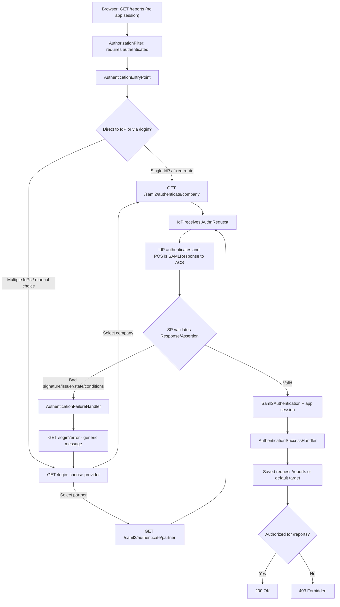

# Handling Success, Failure, and the Login Method Selection Page in Spring Security SAML2

## Learning Objectives

After this lesson, you will be able to:

1. Explain the **successful SAML2 login** and **failed login** branches when a Spring Security application acts as a **Relying Party (RP) / Service Provider (SP)**.
2. Distinguish **AuthenticationSuccessHandler**, **AuthenticationFailureHandler**, **AuthenticationEntryPoint**, **RequestCache**, and **AccessDeniedHandler**; understand why a post-login 403 does not mean SAML authentication failed.
3. Know when Spring Security redirects straight to the IdP, when a **login method/provider selection page** is needed, and how to build a custom page linking to the right `registrationId`.
4. Write a Spring Boot 3 + Spring Security 6, Java 17+ configuration for **two SAML2 IdPs** and a `GET /login` page; configure a **success handler** returning users to their saved request and a **failure handler** routing to a safe error page.
5. Trace the flow from protected resource → IdP selection page → AuthnRequest → SAMLResponse → ACS → success/failure outcome; identify where sessions are stored and the authentication/authorization boundary.
6. Test and diagnose common issues: redirect loops, bad callbacks, missing cookies on cross-site POSTs, issuer/certificate mismatches, wrong registration selection, leaking error details, or open redirects.

## 1. Three Outcomes Users Commonly See

SAML 2.0 Web Browser SSO allows a Spring Security application to delegate identity authentication to a trusted **IdP/Asserting Party**. Users may start from a protected page in the app, from an IdP selection page, or from the IdP side depending on architecture.

In the **SP-initiated** flow, the browser opens `/reports` without an app session; Spring Security initiates login. Three distinct outcomes follow:

| Outcome | What Happened? | Typical App Response |
| --- | --- | --- |
| **Authentication succeeded and authorized** | IdP authenticated user, SP verified `SAMLResponse` and created `Authentication`; resource permissions satisfied | Creates/maintains SP session, redirects to saved URL or target page, resource returns 200 |
| **Authentication failed** | Invalid `SAMLResponse`, wrong signature/issuer/audience/timestamp, account not found per policy, or login error | No authenticated session created; handled by `AuthenticationFailureHandler`, shows generic message and allows safe retry |
| **Authentication succeeded but unauthorized** | Identity verified, yet user lacks role/permission/tenant to access resource | `AccessDeniedHandler` or authorization logic returns 403; should not say "wrong IdP password" |

Do not lump **failed login** and **access denied** into one error. The same "Cannot access" screen can mask two completely different root causes, hurting debugging and user experience.

### 1.1. Who Handles Which Part?

| Component | Role in Flow |
| --- | --- |
| `AuthenticationEntryPoint` | Triggers login when a request is unauthenticated. May redirect to an IdP or a login method selection page |
| `Saml2WebSsoAuthenticationRequestFilter` | Builds/sends `AuthnRequest` for the right `RelyingPartyRegistration` |
| `Saml2WebSsoAuthenticationFilter` | Receives `SAMLResponse` at the ACS and passes authentication to manager/provider |
| OpenSAML authentication provider | Verifies signatures, decrypts when needed, checks issuer, audience, expiration, response/subject conditions, and trust rules |
| `AuthenticationSuccessHandler` | Handles post-authentication actions, typically redirecting to the original resource or target page |
| `AuthenticationFailureHandler` | Handles failures during authentication and controls error navigation/display |
| `RequestCache` | May save the original protected request so the success handler returns there after login |
| `SecurityContextRepository` and session | Persists the application's `Authentication` across HTTP requests |
| `AccessDeniedHandler` | Responds when an **authenticated** user lacks permission to access a resource |

Class names follow the Spring Security Servlet Java DSL. Detailed APIs may vary slightly across Spring Security versions; this lesson uses Spring Security 6.x examples suited for Spring Boot 3.x projects.

## 2. Overview Diagram: Success and Failure Branches



This is a **conceptual** diagram. Real browsers may traverse multiple redirects at the IdP, SAML POST bindings, or MFA prompts. With one IdP and default configuration, Spring Security can typically redirect straight to the IdP; with multiple `RelyingPartyRegistration`s, the framework can render a selection page. When the app **specifies a custom login page**, the application itself must serve that route.

## 3. Entry Point: When Should Users Be Sent to Login?

An example HTTP sequence:

```http
GET /reports HTTP/1.1
Host: portal.example.org
Accept: text/html
```

If `/reports` requires `authenticated()` without a valid authentication:

1. `SecurityFilterChain` intercepts the request.
2. `AuthorizationFilter` blocks anonymous access to the controller.
3. `ExceptionTranslationFilter` may save the original request via `RequestCache` and invoke `AuthenticationEntryPoint`.
4. The entry point redirects the browser to a SAML2 initiation URL or a login selection page such as `/login`.
5. Once the user picks an IdP, the browser requests `/saml2/authenticate/{registrationId}`.

**`AuthenticationEntryPoint` is not `AuthenticationFailureHandler`.** The entry point is the doorway when unauthenticated; the failure handler handles **an authentication transaction that started and errored**.

### 3.1. Single IdP Case

Suppose only registration `company` exists and no custom login page is set. Spring Security can redirect directly to the request-generation URL:

```text
GET /reports
  -> 302 /saml2/authenticate/company
  -> 302 https://idp-company.example.org/sso?SAMLRequest=...
```

Exact redirect mechanics depend on version and entry point config; do not hard-code this assumption in the frontend if the app may later add another IdP.

### 3.2. Multiple IdPs Case

If two registrations `company` and `partner` exist, a user not yet routed by tenant may need a selection screen. Links point **to the SP's login initiation endpoints**, never crafting `SAMLRequest` via browser JavaScript:

```text
GET /login
  - "Sign in with corporate account"
       /saml2/authenticate/company
  - "Sign in with partner account"
       /saml2/authenticate/partner
```

When the user picks `company`, Spring Security uses that registration to issue `AuthnRequest` to the **corporate IdP**. When picking `partner`, it uses the **partner IdP**'s config and certificates. Browsers must never supply arbitrary issuers, certificates, or SSO URLs for the app to trust on the fly.

## 4. Spring Security's Generated Login Page vs. a Custom Page

Spring Security can use `DefaultLoginPageGeneratingFilter` to render a **default login page**, including SAML2 options when multiple providers exist and supporting conditions hold. This is a quick starting point when branded UI or complex tenant selection rules are not needed.

**Auto-generated pages** and **custom pages** differ in responsibility:

| Aspect | Framework Default Page | Custom-Built Page |
| --- | --- | --- |
| Source of IdP choices | Framework generates from known registrations, per version/config | Application decides which IdPs appear for each user/tenant |
| Login URL | Typically set by framework, e.g., `/login` | e.g., `GET /login` served by an application controller/view |
| UI, branding, localization | Limited customization | Full control over layout, accessibility, guidance, error messages |
| SAML links | Links to `/saml2/authenticate/{registrationId}` endpoints | Must build links with right registration and context path |
| Error handling | Uses default handler configuration | Can display sanitized `?error`/internal error codes |
| Security | Relies on Spring Security defaults | Must guard against open redirects, XSS, tenant mix-ups, error leaks |
| Adding/removing IdPs | Can reflect the framework's registration list | Must update allowed list, branding, and routing policy |

When calling:

```java
.saml2Login(saml -> saml.loginPage("/login"))
```

Spring Security **does not auto-generate an HTML controller at `/login`**. The app must provide a GET route accessible while unauthenticated, with valid links to AuthnRequest initiation endpoints. Forgetting `permitAll` on `/login` easily causes a loop: `/login` gets blocked → redirects back to `/login`.

### 4.1. Selecting an IdP in Multi-Tenant Products

Selection can work via:

1. **User choice:** "Company A", "Company B" on `/login`.
2. **Verified/configured domain hint:** routing by email domain/tenant ID after checking mapping and policy; a user typing a domain-looking string does not by itself prove tenant membership.
3. **Tenant-scoped app path:** `/t/acme/login` with a fixed server-side mapping to registration `acme`.
4. **Partner entry flow:** the IdP may initiate login if the SP allows and configures it; this differs from SP-initiated and requires separate controls.

Never accept arbitrary `?issuer=...`, `?metadataUri=...`, or `?redirect=https://...` parameters to establish trust or redirects from browser-supplied values. **A Registration ID is a choice from an allowlist**, not a license to trust a new IdP dynamically.

## 5. Success Flow: What Happens at the ACS?

Suppose the browser selected `company`:

1. `GET /saml2/authenticate/company` triggers `Saml2WebSsoAuthenticationRequestFilter` and sends `AuthnRequest` to the IdP.
2. The IdP authenticates the user or reuses an eligible SSO session; signs `SAMLResponse`/`Assertion` and may encrypt the assertion for the SP.
3. The browser submits `POST /login/saml2/sso/company` with `SAMLResponse` (and `RelayState` per binding).
4. `Saml2WebSsoAuthenticationFilter` receives the response and, via converter/provider, verifies signature, issuer, audience, destination, timestamps, `SubjectConfirmation`, `InResponseTo`/request correlation in SP-initiated flow, and decrypts when needed.
5. When valid, the framework builds `Saml2Authentication`/`Saml2AuthenticatedPrincipal` and stores it in `SecurityContext` per filter/session mechanics.
6. The **success handler** determines the next HTTP response: redirect to saved request, default target, or configured continuation.
7. The browser uses the **SP session cookie** on subsequent requests; the application enforces per-resource authorization.

### 5.1. What Is `AuthenticationSuccessHandler`?

It is the strategy run **after authentication succeeds**. It does not replace the SAML verification engine; never manually parse Base64/XML or check signatures inside the handler.

Appropriate tasks:

- Redirect back to the URL the user tried to view before login.
- If no request was saved, navigate to `/dashboard` or default target page.
- Record a sanitized login event via an audit service.
- Run onboarding/mapping steps per policy if needed, without escalating privileges based on unverified email alone.
- Handle multi-tenant login transitions after verifying registration and principal alignment.

**Never use the success handler to bypass business permissions.** A user can complete a valid SAML login and still get 403 when opening `/admin`.

### 5.2. Saved Request and Default Target

`SavedRequestAwareAuthenticationSuccessHandler` is commonly used for session-based web apps. When a valid request was stored by `RequestCache`, it prioritizes returning the browser to the pre-login URL. Without a saved request, it falls back to `defaultTargetUrl`.

Example:

```java
SavedRequestAwareAuthenticationSuccessHandler success =
        new SavedRequestAwareAuthenticationSuccessHandler();
success.setDefaultTargetUrl("/dashboard");
```

If the user navigated `/reports` → login, after authentication the handler typically redirects back to `/reports`. If the user opened `/login` directly and chose an IdP, with no prior resource it goes to `/dashboard`.

Do not set `setAlwaysUseDefaultTargetUrl(true)` if you want to preserve the original resource; that forces the default target over the saved request. For APIs/SPAs, a different strategy (status codes, JSON, or controlled frontend routes) may fit better than redirecting every request.

### 5.3. Redirect URLs Must Be Restricted

An app might accept a parameter like `next`/`returnTo` to choose the post-login page. Doing:

```text
/login?next=https://phishing.example.org
```

and redirecting there immediately post-authentication creates an **open redirect**, making users trust a phishing link as part of login. Prefer Spring Security's saved request or an allowlist of safe **internal paths**, never redirecting arbitrarily to external hosts. Never echo `RelayState` verbatim as a URL without state binding and validation.

## 6. Failure Flow: Where Errors Happen and How to Handle Them

A SAML login can fail **before, during, or after** the IdP returns a response:

| Stage | Example Failure | Handling Responsibility |
| --- | --- | --- |
| Before issuing request | `registrationId` not found, missing IdP metadata/SSO URL, wrong filter chain | Config/routing fix; likely a system error before SAML validation runs |
| At the IdP | User cancels login, fails MFA, IdP account locked, IdP returns non-success SAML Status | IdP reports status; SP displays an appropriate error after validating response per rules |
| When browser POSTs ACS | Missing `SAMLResponse`, wrong endpoint, wrong HTTP method, lost session/correlation | Filter/converter cannot build a valid authentication request |
| During SAML validation | Untrusted signature, wrong issuer/audience/recipient, expired, replay, decryption failure | Provider rejects; **no** valid `Saml2Authentication` created |
| Post-authentication | User mapping fails or app policy denies access | If mapping runs during authentication, triggers auth failure; if merely lacking resource permissions, returns 403 |

`AuthenticationFailureHandler` runs when **filter authentication reports a failure**. Configured as:

```java
SimpleUrlAuthenticationFailureHandler failure =
        new SimpleUrlAuthenticationFailureHandler("/login?error");
```

the browser is typically redirected to `/login?error`. The login page controller can render a generic message like "Unable to complete sign-in. Please choose your account again or contact support", without exposing raw `SAMLResponse` or exception stack traces.

### 6.1. Never Expose Sensitive Technical Errors to the Browser

**Never** return responses like:

```text
InvalidSignature: expected certificate fingerprint=...
Received SAMLResponse: PHNhbWxwOlJlc3BvbnNlLi4u
SessionId=...
```

This leaks operational certificates, assertions containing user data, and session identifiers. Show only an **incident code/generic message** in the UI, while server logs record sanitized metadata: request ID, timestamp, error category, controlled registration ID, and trust-check outcome.

### 6.2. Failure Does Not Equal 403

Classify clearly for users and logs:

- **Unauthenticated / no session:** redirect to login per config; typically HTTP 302, not "unauthorized".
- **Invalid authentication:** `failureHandler`, e.g., to `/login?error`; never mint an authenticated session from a bad `SAMLResponse`.
- **Valid authentication yet missing role:** `AccessDeniedHandler` or authorization layer, typically 403.
- **App/IdP temporarily unavailable:** return 503 or a controlled outage page depending on design; do not label everything "bad credentials".

### 6.3. Retrying Properly

When the user clicks "Try again":

1. Return to the `/login` IdP picker or a trusted `/saml2/authenticate/{registrationId}` initiation endpoint.
2. **Generate a fresh AuthnRequest** with a new ID/state; never re-submit an old `SAMLResponse`/Assertion.
3. Keep signature, issuer, audience, timestamp, and request correlation validation intact.
4. Prevent infinite auto-retry loops when the IdP is down or certs mismatch; let the user switch IdPs, go back, or contact support.

Never automatically bounce right back to the IdP on every failure of the same request if that traps the browser in an inescapable redirect loop.

## 7. Complete Example: Spring Boot with Two IdPs and a `/login` Page

Demo goal: a Java 17+ **SAML2 Relying Party** app with two registrations (`company` and `partner`), a custom login selection page, a success handler prioritizing saved requests with `/dashboard` fallback, and a failure handler returning to `/login?error`.

**Prerequisites before running end-to-end:** real IdPs for both registrations, SP entity ID/ACS allowed by the IdPs, and vetted public X.509 certificates for the IdPs. `example.org` hostnames and `idp-*.crt` files are illustrative placeholders. This code belongs **inside a Spring Boot Servlet project** and cannot run standalone with just `javac` and the standard JDK.

### 7.1. File Structure

```text
src/main/java/com/example/saml/
  SamlDemoApplication.java
  SecurityConfiguration.java
  LoginPageController.java
  PagesController.java
src/main/resources/
  application.yml
  idp-company.crt
  idp-partner.crt
build.gradle
```

Both `.crt` files are **public IdP signing certificates** obtained via trusted metadata/channels. Never commit production private signing/decryption keys to the repository.

### 7.2. Gradle Groovy DSL

Example `dependencies` in `build.gradle`, assuming a project already configured with the Spring Boot 3.x plugin and dependency management:

```groovy
dependencies {
    implementation 'org.springframework.boot:spring-boot-starter-web'
    implementation 'org.springframework.boot:spring-boot-starter-security'
    implementation 'org.springframework.security:spring-security-saml2-service-provider'

    testImplementation 'org.springframework.boot:spring-boot-starter-test'
    testImplementation 'org.springframework.security:spring-security-test'
}
```

The app needs a Servlet runtime; `spring-security-saml2-service-provider` uses OpenSAML. Align Spring Security/OpenSAML versions with your project BOM and repositories; never force incompatible module versions. The minimum Java version for Spring Boot 3 is Java 17.

### 7.3. Configuring Two `RelyingPartyRegistration`s in YAML

File `src/main/resources/application.yml`:

```yaml
spring:
  security:
    saml2:
      relyingparty:
        registration:
          company:
            entity-id: "https://portal.example.org/saml2/service-provider-metadata/company"
            acs:
              location: "https://portal.example.org/login/saml2/sso/company"
            assertingparty:
              entity-id: "https://idp-company.example.org/saml"
              verification:
                credentials:
                  - certificate-location: "classpath:idp-company.crt"
              singlesignon:
                url: "https://idp-company.example.org/sso"
                sign-request: false

          partner:
            entity-id: "https://portal.example.org/saml2/service-provider-metadata/partner"
            acs:
              location: "https://portal.example.org/login/saml2/sso/partner"
            assertingparty:
              entity-id: "https://idp-partner.example.org/saml"
              verification:
                credentials:
                  - certificate-location: "classpath:idp-partner.crt"
              singlesignon:
                url: "https://idp-partner.example.org/sso"
                sign-request: false
```

**Explanation:**

- `company`/`partner` are the two `registrationId`s; each is used in `/saml2/authenticate/{registrationId}` and the default ACS path.
- `entity-id` at the registration level is the **SP** identifier for each IdP and must match metadata and IdP configuration.
- `acs.location` sets the public URL where the IdP POSTs `SAMLResponse`; ensure hostname, HTTPS, and path match at ingress/proxy.
- `assertingparty.entity-id` and `singlesignon.url` belong to each **IdP**. Do not swap them between `company` and `partner`.
- `verification.credentials` holds only the **corresponding IdP's public signing certificate**; multiple certs may exist during rollover. Never accept a certificate from an unvetted `SAMLResponse`.
- `sign-request: false` assumes the **IdP permits unsigned AuthnRequests**. If the IdP requires signed requests, configure SP signing credentials/private key and set `sign-request: true`.
- Both certificate files must have real, valid contents; copying the YAML without those files may cause the app to **fail startup** or fail logins.

If your organization provides an IdP metadata URI and prefers metadata-driven endpoint/cert management, configure `assertingparty.metadata-uri` instead of manual fields, verifying metadata source and rotation strategy.

### 7.4. Startup Class

File `src/main/java/com/example/saml/SamlDemoApplication.java`:

```java
package com.example.saml;

import org.springframework.boot.SpringApplication;
import org.springframework.boot.autoconfigure.SpringBootApplication;

@SpringBootApplication
public class SamlDemoApplication {
    public static void main(String[] args) {
        SpringApplication.run(SamlDemoApplication.class, args);
    }
}
```

This is the Spring Boot entry point; there is no fixed stdout because startup logs depend on profiles, dependencies, and environment.

### 7.5. Configuring Success/Failure Handlers and the Login Selection Page

File `src/main/java/com/example/saml/SecurityConfiguration.java`:

```java
package com.example.saml;

import org.springframework.context.annotation.Bean;
import org.springframework.context.annotation.Configuration;
import org.springframework.security.config.annotation.web.builders.HttpSecurity;
import org.springframework.security.web.SecurityFilterChain;
import org.springframework.security.web.authentication.SavedRequestAwareAuthenticationSuccessHandler;
import org.springframework.security.web.authentication.SimpleUrlAuthenticationFailureHandler;

@Configuration
public class SecurityConfiguration {

    @Bean
    SecurityFilterChain securityFilterChain(HttpSecurity http) throws Exception {
        SavedRequestAwareAuthenticationSuccessHandler success =
                new SavedRequestAwareAuthenticationSuccessHandler();
        // If login is opened directly, there is no protected saved request.
        success.setDefaultTargetUrl("/dashboard");

        SimpleUrlAuthenticationFailureHandler failure =
                new SimpleUrlAuthenticationFailureHandler("/login?error");

        return http
                .authorizeHttpRequests(auth -> auth
                        .requestMatchers("/", "/login", "/error").permitAll()
                        .requestMatchers("/reports/**").authenticated()
                        .anyRequest().authenticated()
                )
                .saml2Login(saml -> saml
                        .loginPage("/login")
                        .successHandler(success)
                        .failureHandler(failure)
                )
                .build();
    }
}
```

Explanation:

1. `saml2Login()` installs SAML authentication request/response filters and registers login processing at the default ACS endpoints.
2. `.loginPage("/login")` requires the **app itself to serve `GET /login`**. Hence `requestMatchers("/login").permitAll()` is mandatory so anonymous browsers can open it.
3. `.successHandler(success)` handles post-authentication navigation. `SavedRequestAwareAuthenticationSuccessHandler` prioritizes any saved URL from a protected page; `/dashboard` is the fallback.
4. `.failureHandler(failure)` redirects to `/login?error` so the selection page shows a generic notice. Never use a browser-supplied error URL.
5. `/saml2/authenticate/{registrationId}` and `/login/saml2/sso/{registrationId}` are handled by SAML filters per configuration. Do not write a manual controller for `SAMLResponse`.
6. `/reports/**` requires authentication; real apps can add `hasAuthority`, `hasRole`, specific permissions here, or method security. `.anyRequest().authenticated()` prevents accidentally leaving new routes public.
7. Default CSRF remains active for other actions; Spring Security configures appropriate handling for SAML ACS POSTs. Never disable CSRF globally just to fix a callback.

**Multi-chain note:** if a project defines multiple `SecurityFilterChain`s with distinct `securityMatcher`s, ensure `/login`, AuthnRequest creation endpoints, ACS, and protected resources route to the right chain. If an API-only chain intercepts the ACS before the SAML chain, callbacks can 404/403 even when the IdP returns a valid response.

### 7.6. Building the Selection Page with a Java 17+ Controller

File `src/main/java/com/example/saml/LoginPageController.java`:

```java
package com.example.saml;

import org.springframework.http.MediaType;
import org.springframework.web.bind.annotation.GetMapping;
import org.springframework.web.bind.annotation.RequestParam;
import org.springframework.web.bind.annotation.RestController;

@RestController
public class LoginPageController {

    @GetMapping(value = "/login", produces = MediaType.TEXT_HTML_VALUE)
    public String login(
            @RequestParam(value = "error", required = false) String error) {

        // Use only the parameter's presence; never echo user-submitted data.
        String errorNotice = (error == null)
                ? ""
                : "<p role=\"alert\">Unable to complete sign-in. "
                + "Please try again or contact support.</p>";

        return """
                <!doctype html>
                <html lang="en">
                  <head>
                    <meta charset="UTF-8">
                    <title>Select sign-in method</title>
                  </head>
                  <body>
                    <main>
                      <h1>Select sign-in method</h1>
                      <p>Choose your identity provider:</p>
                      <ul>
                        <li><a href="/saml2/authenticate/company">Corporate account</a></li>
                        <li><a href="/saml2/authenticate/partner">Partner account</a></li>
                      </ul>
                      %s
                    </main>
                  </body>
                </html>
                """.formatted(errorNotice);
    }
}
```

This is a minimal HTML page **requiring no Thymeleaf**. Because `@RestController` returns a string with `produces = MediaType.TEXT_HTML_VALUE`, Spring MVC serves HTML content. The page provides GET links to **the SP's SAML initiation endpoints**, with no password form or fake `SAMLResponse`.

**Why check only the presence of `?error`?** Parameters can be modified by the browser. The code never embeds arbitrary error strings into HTML, preventing reflected XSS from untrusted input. In production, use a template engine, output escaping, CSP, consistent UI, internal support codes, and standard accessibility. Avoid a hardcoded list if IdPs change frequently; build it from a server-side allowed list instead.

If the app runs under a **context path** (e.g., `/portal`), `href="/saml2/authenticate/..."` resolves from the domain root and must be built context-aware via template/MVC helpers rather than hardcoding root paths.

### 7.7. Public Page, Dashboard, and Protected Resources

File `src/main/java/com/example/saml/PagesController.java`:

```java
package com.example.saml;

import org.springframework.security.core.Authentication;
import org.springframework.web.bind.annotation.GetMapping;
import org.springframework.web.bind.annotation.RestController;

@RestController
public class PagesController {

    @GetMapping("/")
    String publicPage() {
        return "Public home";
    }

    @GetMapping("/dashboard")
    String dashboard(Authentication authentication) {
        return "Dashboard for " + authentication.getName();
    }

    @GetMapping("/reports/overview")
    String reports(Authentication authentication) {
        return "Reports for " + authentication.getName();
    }
}
```

Suppose a valid `SAMLResponse` from the IdP contains NameID `employee-123`; when authorized, `GET /reports/overview` can respond with:

```text
Reports for employee-123
```

This is an **assumed HTTP response after real IdP integration**, not stdout from running `javac`. If the IdP returns another NameID or the app uses a custom user mapper, the value will differ. Section 7's Java code needs the full Spring Boot runtime, valid certificates, and IdP config; SSO cannot run from the source classes alone.

## 8. HTTP Trace: Success Branch

Scenario: an unauthenticated user opens a report and chooses the `company` IdP. This is an abbreviated trace omitting real tokens/PII.

```text
(1) GET /reports/overview
    SP: no authenticated session
    -> 302 /login
       RequestCache may save /reports/overview

(2) GET /login
    -> 200 HTML with 2 links:
       /saml2/authenticate/company
       /saml2/authenticate/partner

(3) User picks company:
    GET /saml2/authenticate/company
    -> 302 https://idp-company.example.org/sso?SAMLRequest=...&RelayState=...

(4) IdP runs login/MFA if needed.
    Browser POSTs /login/saml2/sso/company
    Content-Type: application/x-www-form-urlencoded
    SAMLResponse=...&RelayState=...

(5) Spring Security verifies signature, issuer, audience, recipient,
    time conditions, and request correlation.
    -> Saml2Authentication succeeds, session saved
    -> Success handler 302 to /reports/overview (saved request)

(6) GET /reports/overview + app session cookie
    -> 200 "Reports for employee-123" if authorization permits
```

**Two key points:**

- `/login` is an **IdP selection/routing step**; it does not authenticate identity itself. Proof of authentication arrives in `SAMLResponse` and is verified by the SP at the ACS.
- `SavedRequestAwareAuthenticationSuccessHandler` uses the request cache, rather than "reading" an unverified `RelayState` and redirecting the browser to arbitrary URLs.

## 9. HTTP Trace: Failure Branch

Scenario: the user chooses `partner`, yet the IdP uses a newly rotated signing certificate the SP has not yet updated.

```text
(1) GET /login
    -> 200 HTML list of IdPs

(2) GET /saml2/authenticate/partner
    -> SP issues AuthnRequest for partner IdP

(3) Browser POSTs /login/saml2/sso/partner with SAMLResponse
    -> OpenSAML validator rejects IdP signature outside trusted cert set

(4) AuthenticationFailureHandler
    -> 302 /login?error

(5) GET /login?error
    -> 200 HTML notice:
       "Unable to complete sign-in. Please try again or contact support."
    -> Browser can still pick another IdP or contact support
```

What must never happen: disabling signature verification to "make it work", turning failed responses into login success, putting full `SAMLResponse` into the error URL, or looping endlessly with nowhere for the user to stop.

### 9.1. Post-Success 403 Is a Different Branch

Suppose the IdP properly authenticates `employee-123`, yet `/admin/reports` requires `ROLE_ADMIN` which the app does not grant. The SP should return 403/Access Denied per policy. **The SAML failure handler is not necessarily called**, because authentication succeeded. Inspect `GrantedAuthority`/authorization mapping rather than asking the IdP to swap certificates.

## 10. Single IdP vs. Multiple IdPs

| Situation | Appropriate Design |
| --- | --- |
| One IdP only, no selection needed | Use `saml2Login()` with default entry point or direct page to cut steps |
| Two fixed IdPs, user may choose | `/login` page with explicit links as in the demo |
| Many IdPs per tenant | Generate list from server-side allowlist/registration repository, filtered by trusted tenant |
| New IdPs added frequently | Build controlled admin UI, metadata validation, and safe refresh/sync |
| User arrives from IdP-initiated flow | Design matching response handling; no prior AuthnRequest, so review correlation and CSRF policy separately |
| Both OIDC and SAML in one web app | Login page can present different methods with distinct links; configure compatible auth chains/entry points and consistent security policy |

**"Login method"** does not have to mean only SAML IdPs; a product can offer OIDC, local passwords, passkeys, or other valid options. This exercise illustrates **two SAML2 registrations**, so do not add unnecessary OAuth2/username-password flows.

### 10.1. Never Pick an IdP from Unverified Info to Grant Privileges

If an app asks for an email and routes to an IdP by domain, that is only **home realm discovery**, not proof the user owns that email/tenant. After the SAML response, the app must use issuer, registration, subject/NameID, and mapping policy to determine final tenant/privileges.

Two IdPs can send the exact same email for **two different accounts**. Never auto-merge sensitive accounts or grant internal roles solely on matching emails.

## 11. Differences Among Handlers in Spring Security

### 11.1. `AuthenticationEntryPoint`

Triggered when authentication must start for an unauthenticated request—for example, redirecting `GET /reports` to `GET /login`. With a single IdP, the entry point can redirect straight to `/saml2/authenticate/company`.

### 11.2. `AuthenticationSuccessHandler`

Invoked after the authentication filter confirms login. The handler can redirect to the saved request/target. To perform auditing, use a proper audit service and avoid throwing arbitrary exceptions after the framework prepares the session.

### 11.3. `AuthenticationFailureHandler`

Handles failures **during authentication**. Can use `SimpleUrlAuthenticationFailureHandler`, or a custom handler for generic error categorization, correlation IDs, and retry pages. Never let the browser choose an error target via an un-allowlisted external URL.

### 11.4. `AccessDeniedHandler`

Handles authenticated users who fail an access rule—for example, lacking `hasRole("ADMIN")`. This is an **authorization failure**, not the IdP reporting a wrong password.

### 11.5. `RequestCache`

Stores the original request so the browser can return after login. `HttpSessionRequestCache` is common in session-based web apps; configure per security chain. Distinguish it from `Saml2AuthenticationRequestRepository`, which stores **`AuthnRequest`** and `InResponseTo` correlation data.

**Meaning summary:**

| Question | Component Answering It |
| --- | --- |
| Where does an unauthenticated user start? | Entry point |
| Where does a successfully logged-in user go? | Success handler + request cache |
| What is shown on a bad `SAMLResponse`? | Failure handler |
| What if the user is logged in yet lacks permissions? | Authorization + Access Denied handler |
| Is the browser on the right SAML transaction? | AuthnRequest repository / validator |
| Does the user keep a session after redirect? | SecurityContext/session/cookie strategy |

## 12. Security in Success/Failure and Picker Flows

Controls to enforce:

1. **IdP trust:** each registration binds its own issuer, metadata/verification certificate, and ACS/SSO URLs. Never accept a self-signed `SAMLResponse` using a certificate embedded solely in the message.
2. **Request correlation:** `InResponseTo`/`RelayState` and the request repository must link the right browser, registration, and login transaction; never skip checks to mask cookie/session bugs.
3. **Time and audience:** responses/assertions must have valid timestamps, matching SP entity ID, recipient, destination, and status; reject responses meant for other apps.
4. **Cross-site POST cookies:** the ACS normally receives browser POSTs from a separate IdP site. `SameSite=Lax` cookies may be omitted depending on context; check `SameSite=None; Secure` if your design needs session cookies on cross-site POSTs and evaluate CSRF/state protection accordingly.
5. **Public login page:** `GET /login` permits anonymous users; links point only to registered, display-permitted registrations. Never pull IdP URLs from uncontrolled query strings.
6. **Error content:** never reflect exceptions/raw `SAMLResponse`, NameID, groups, cookies, private keys, or arbitrary access URLs in HTML. Never let the `error` query parameter become an HTML/JS injection vector.
7. **Open redirects:** avoid browser-supplied `returnTo` parameters; use request cache or allowlisted internal paths.
8. **No infinite retries:** on IdP/cert errors, give the user a landing page to stop and contact support; avoid endless request/redirect loops.
9. **Session fixation:** the framework provides session protections; do not alter session strategies carelessly. Set proper timeouts, `HttpOnly`, `Secure`, and `SameSite` policies.
10. **Authorization still applies:** never grant `ROLE_ADMIN` by default merely because someone arrived from an IdP or `SAMLResponse` carries a matching email.
11. **Confidential logging:** log `registrationId`, error type, timestamp, and request/correlation ID appropriately; never log full `SAMLResponse` or session cookies in accessible environments.
12. **Logout differs from login:** local logout does not automatically log out of the IdP. If SAML Single Logout is needed, configure `saml2Logout()` and coordinate separately with the IdP.

### 12.1. Behind a Reverse Proxy or Context Path

Real environments may use an internal URL `http://app:8080` behind public URL `https://portal.example.org`. Verify:

- `RelyingPartyRegistration.entityId` and ACS URL match the public host/scheme/path agreed with the IdP.
- `Forwarded`/`X-Forwarded-*` are trusted only from controlled ingress/proxies.
- When deployed under a context path, links to `/saml2/authenticate/{id}` include the context path rather than assuming domain root.
- `SavedRequestAwareAuthenticationSuccessHandler` must never redirect to a malformed URL crafted from untrusted proxy/host headers.

### 12.2. When the App Has Multiple `SecurityFilterChain`s

Separating chains for REST APIs and browser UI can cause:

- The API chain intercepts `/login/saml2/sso/company` and returns 401 before the SAML filter.
- `/login` is blocked by another chain, causing a redirect loop.
- `/saml2/authenticate/company` routes to a nonexistent controller endpoint.
- Request cache runs in one chain while the success handler in another chain cannot access the right state/session.

Fix by defining explicit **chain matchers and order** for login/ACS endpoints and resources, ensuring SAML filters process requests with the right registration repository.

## 13. Repeatable Scenario-Based Testing

### 13.1. Positive cases

| Scenario | Expected Result |
| --- | --- |
| Anonymous opens `/reports/overview` | Redirects to `/login`, returns no report content |
| Anonymous opens `/login` | HTML picker page with two valid links |
| Click company | Goes to `/saml2/authenticate/company` and company IdP |
| Click partner | Goes to `/saml2/authenticate/partner` and partner IdP |
| Valid `SAMLResponse` from company | Authentication succeeds, app session created, saved request restored |
| User visits `/login` directly with no saved request | Lands on `/dashboard` after successful login |
| User reloads `/reports/overview` post-login | Uses app session without re-sending old `SAMLResponse` |

### 13.2. Negative cases

| Scenario | Expected Result |
| --- | --- |
| IdP signs response with untrusted cert | Authentication fails, no authenticated session created; `/login?error` |
| Valid signature yet issuer/audience belongs to another app | Rejected |
| Expired assertion or wrong `InResponseTo` | Rejected; never disable validation |
| User follows link with nonexistent `registrationId` | Does not accept unconfigured IdP; shows proper error |
| Browser opens `/login?error=<script>...` | HTML contains no input script; generic notice only |
| Post-login, lacks `/admin` permission | Returns 403 per authorization; does not become SAML login failure |
| Saved URL crafted to point to malicious hostname | No open redirect from untrusted data |
| Session cookie blocked on ACS cross-site POST | Correlation/session error caught and fixed via config, never disabling state validation |
| IdP down, user retries repeatedly | Controlled error/retry notice; no infinite redirects |

### 13.3. Observing in the Browser

Because `SAMLResponse` is normally browser-POSTed to the ACS, **browser/network panels** diagnose step failures much better than `curl -I`. Trace:

```text
GET /reports/overview
GET /login
GET /saml2/authenticate/company
IdP login / SSO
POST /login/saml2/sso/company
GET /reports/overview  (success)
or GET /login?error   (failure)
```

The path may include extra intermediate 302s/form submits depending on IdP, binding, MFA, and success handler. Never include full `SAMLResponse` forms or cookies in public debug screenshots.

### 13.4. Checking Code and Dependencies

In a project with the Gradle Wrapper:

```bash
./gradlew dependencyInsight --configuration runtimeClasspath --dependency spring-security-saml2-service-provider
./gradlew compileJava
./gradlew test
```

On Windows PowerShell, use `.\gradlew.bat`. Classpath/build checks do not prove end-to-end SSO without a real IdP and certificates. There is no fixed stdout for login because it depends on the IdP, user, and environment.

## 14. Common Errors and Remedies

| Symptom | Common Cause | What to Check |
| --- | --- | --- |
| `GET /login` redirects to itself | Login page missing `permitAll()` or wrong chain matcher | `requestMatchers("/login").permitAll()` rule |
| `GET /login` returns 404 | `loginPage("/login")` declared without a controller/view | Check `@GetMapping("/login")` and component scan |
| Picker shows link yet clicking returns 404 | Bad `/saml2/authenticate/{id}` link or unregistered ID | Check `registrationId`, context path, and SAML request filter |
| User picks company yet partner IdP gets request | Wrong link/mapping or registration repository | Compare route/ID/issuer per tenant |
| ACS returns 404/405 | Mismatched callback URL, HTTP method, or filter chain | Check ACS metadata, `/login/saml2/sso/{id}`, and proxy |
| ACS fails on signature | Wrong/old IdP verification cert or different issuer | Check metadata/rotated certs; never disable signatures |
| ACS fails on `InResponseTo` | Lost browser session, `SameSite` cookie, unshared request repository across nodes | Check session/cookies/context/routing |
| Login succeeds yet returns to picker | `SecurityContext` not saved, session cookie withheld, or redirect target blocked | Check session, success handler, request cache |
| Login succeeds yet always goes to dashboard | No saved request, or `alwaysUseDefaultTargetUrl`/another handler overrides | Check `RequestCache` and success handler |
| Login failure triggers infinite 302s | Failure handler routes right back to protected URL/IdP | Route to public error page, stop auto-retry |
| User logs in yet gets 403 | Application authorization denies role | Check `GrantedAuthority`, tenant, permissions |
| Error page leaks stack trace/response | Controller renders raw exception/request parameter | Use generic message; keep protected logs server-side |
| Browser redirected to external URL | `returnTo` not allowlisted | Prefer saved request/relative URLs; block open redirects |
| Single IdP yet login page never appears | Framework may auto-redirect with one registration | Configure `loginPage("/login")` if intentional picker is needed |

## 15. Self-Check Questions

**1. An unauthenticated user hits `/reports`. Which component starts SAML login?**

`AuthenticationEntryPoint` is invoked after access is denied for missing authentication; it can redirect to `/login` or the `AuthnRequest` initiation endpoint.

**2. When two IdPs exist, where does the selection page normally link?**

To `/saml2/authenticate/{registrationId}` on the SP app—e.g., `/saml2/authenticate/company` and `/saml2/authenticate/partner`. That is where Spring Security builds requests for each IdP.

**3. Why not call the SAML ACS directly when the user clicks "Sign in"?**

The ACS `/login/saml2/sso/{registrationId}` is where **IdP-issued `SAMLResponse`s are received**. Clicking sign-in must initiate an `AuthnRequest`; there is no valid response for the ACS to verify yet.

**4. What is the role of `SavedRequestAwareAuthenticationSuccessHandler`?**

After SAML authentication succeeds, it prioritizes redirecting the browser to the resource saved before login; if none exists, it uses the configured fallback URL.

**5. When is `AuthenticationFailureHandler` called instead of `AccessDeniedHandler`?**

Failure handler runs when authentication fails (bad response/issuer/signature/conditions, etc.). Access Denied handler runs when an already authenticated user lacks permission for a resource.

**6. Why must a custom `/login` page permit anonymous access?**

If blocked by `authenticated()`, unauthenticated browsers get redirected right back to the login page, causing a redirect loop.

**7. Why should error messages stay generic like "Unable to sign in"?**

Detailed messages can leak `SAMLResponse`, NameID, cert info, sessions, or implementation details. The UI should show an error code/support note while server logs hold controlled diagnostics.

**8. If the IdP responds cleanly yet the user lacks admin rights, should they be sent to `/login?error`?**

No. Authentication succeeded; return 403 or an insufficient-permissions page per authorization policy to avoid pointless login loops.

**9. Why can SAML ACS POSTs lose sessions even though the browser visited the SP beforehand?**

This is usually a cross-site POST from the IdP; cookie `SameSite`/`Secure` policies and session stores/proxies can prevent the browser from sending the right cookie. Fix session/correlation properly—never drop `InResponseTo` checks.

**10. Does adding a new IdP in YAML automatically update the static HTML page in the demo?**

No. With a hardcoded custom page, you must update the links or build an allowed list dynamically from server-side configuration. Never let the browser register IdPs via untrusted issuer/metadata URLs.

## Key Takeaways

**Success flow:** user visits protected resource → app requires login → pick IdP → issue `AuthnRequest` → IdP authenticates → browser submits `SAMLResponse` → SP validates → create `Authentication`/session → **success handler** returns to saved request or target → check authorization.

**Failure flow:** request/response fails authentication checks → **failure handler** shows a safe error and allows issuing a **fresh `AuthnRequest`** on retry → never creates an authenticated session from a bad response. If already authenticated yet lacking permissions, **Access Denied** is the proper branch.

**The login method selection page** merely routes to trusted `registrationId`s; it does not verify passwords or `SAMLResponse`s itself. In Spring Security, configuring `loginPage("/login")` means the app must expose that public route and manage its UI/UX, while SAML checks remain in the framework's filters/providers.

### References

- [Spring Security – SAML2 Login Overview](https://docs.spring.io/spring-security/reference/servlet/saml2/login/overview.html)
- [Spring Security – Authenticating SAML Responses](https://docs.spring.io/spring-security/reference/servlet/saml2/login/authentication.html)
- [Spring Security – Producing AuthnRequests](https://docs.spring.io/spring-security/reference/servlet/saml2/login/authentication-requests.html)
- [Spring Security – SAML2 Login API Configuration](https://docs.spring.io/spring-security/site/docs/current/api/org/springframework/security/config/annotation/web/configurers/saml2/Saml2LoginConfigurer.html)
- [Spring Security – Default Authentication Success Handler](https://docs.spring.io/spring-security/site/docs/current/api/org/springframework/security/web/authentication/SavedRequestAwareAuthenticationSuccessHandler.html)
