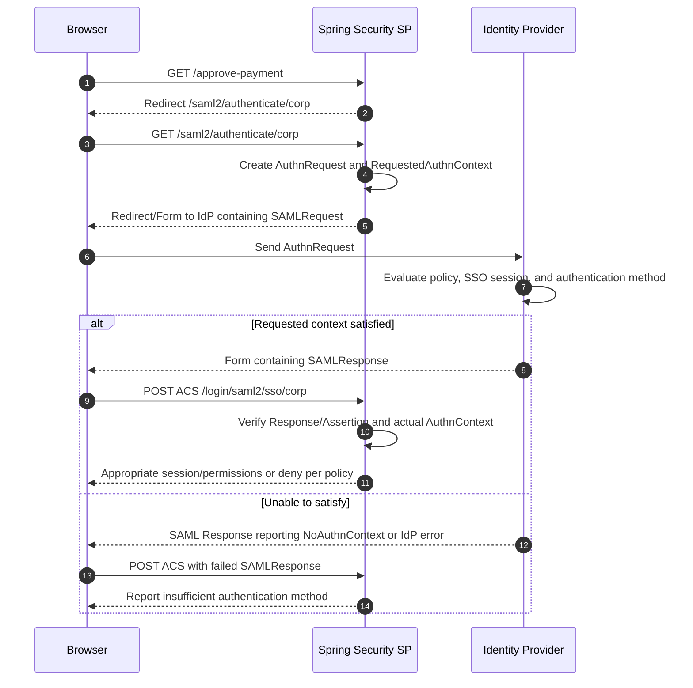

# RequestedAuthnContext and Authentication Strength Requirements in Spring Security SAML 2.0

## 1. The Problem to Solve

When a **Service Provider (SP)** application uses SAML 2.0 Single Sign-On (SSO), receiving a valid assertion is not always sufficient for every business operation. A profile-viewing page may allow login through a standard mechanism, while a transaction-approval feature may require a **stronger authentication method**, such as one recognized by the Identity Provider (IdP) as multifactor or phishing-resistant.

In the SP-initiated SSO flow, the SP creates a `<samlp:AuthnRequest>` and can attach a **`<samlp:RequestedAuthnContext>`** element to state acceptable authentication context types. The IdP processes the request according to its configuration and policy, and upon successful authentication may report the actual context in **`<saml:AuthnStatement>/<saml:AuthnContext>`** of the assertion.

**RequestedAuthnContext is a protocol request, not proof that the user achieved the desired assurance level.** Proof must be verified by the SP in the verified SAML Response, combined with local authentication/authorization policies.

This lesson falls within the scope of **AuthnRequest customization in Spring Security SAML2 Servlet**, focusing on XML semantics, `Comparison` values, `AuthnContextClassRef` URIs, using the OpenSAML customizer, IdP responses, step-up authentication, testing, and common errors.

### Learning Objectives

1. Explain how `RequestedAuthnContext` differs from `AuthnContext` in the assertion.
2. Read and write `AuthnContextClassRef`, `AuthnContextDeclRef`, and the four `Comparison` modes per SAML 2.0 Core.
3. Understand why **PasswordProtectedTransport does not mean MFA**, and why “stronger” has no universal ordering across URIs.
4. Generate an AuthnRequest with RequestedAuthnContext using Spring Security 6.x/OpenSAML 4.
5. Design mandatory SP-side checks when a resource requires a high authentication level, without confusing a request hint with access control.
6. Analyze `NoAuthnContext`, IdP sessions, `ForceAuthn`, `IsPassive`, callback/ACS, session caching, and security scenarios.

## 2. Position of RequestedAuthnContext in the SSO Flow



Differences across timeline stages:

- **Before redirecting the browser to the IdP:** the SP issues a **request** for the desired authentication method.
- **At the IdP:** the IdP decides the actual mechanism; it may prompt for additional interaction, reuse an existing session, or return an error if unable to comply.
- **After the browser returns to the SP:** the SP must verify the message and check the **actual asserted context**, especially for resources requiring high assurance.

Spring Security includes related components: `Saml2WebSsoAuthenticationRequestFilter` initiates login, `Saml2AuthenticationRequestResolver` builds the request, `Saml2AuthenticationRequestRepository` stores the transaction, `Saml2WebSsoAuthenticationFilter` processes SAMLResponse, and the OpenSAML authentication provider verifies the assertion.

`RequestedAuthnContext` is only one part of an AuthnRequest. It does not replace `Issuer`, `Destination`, `AssertionConsumerServiceURL`, `NameIDPolicy`, signing keys, or `InResponseTo` correlation.

## 3. RequestedAuthnContext XML Structure

An illustrative request, abbreviated to focus on the element being studied:

```xml
<samlp:AuthnRequest
    xmlns:samlp="urn:oasis:names:tc:SAML:2.0:protocol"
    xmlns:saml="urn:oasis:names:tc:SAML:2.0:assertion"
    ID="_req-123"
    Version="2.0"
    IssueInstant="2026-11-07T03:00:00Z"
    Destination="https://idp.example.test/sso"
    AssertionConsumerServiceURL="https://sp.example.test/login/saml2/sso/corp">
  <saml:Issuer>https://sp.example.test/saml/metadata/corp</saml:Issuer>
  <samlp:RequestedAuthnContext Comparison="exact">
    <saml:AuthnContextClassRef>
      urn:oasis:names:tc:SAML:2.0:ac:classes:PasswordProtectedTransport
    </saml:AuthnContextClassRef>
  </samlp:RequestedAuthnContext>
</samlp:AuthnRequest>
```

The XML above is solely to illustrate structure; ID, timestamps, hosts, and registration details are hypothetical data. A real message must be built and signed by the framework per the agreement with the IdP. Do not copy sample XML and submit it manually to log in.

Key parts:

- **`RequestedAuthnContext`** is a child of `AuthnRequest`, requesting the kinds of context the IdP may use to authenticate the user.
- **`Comparison`** is an optional attribute: `exact`, `minimum`, `maximum`, or `better`. If omitted, SAML Core defaults to `exact`.
- **`AuthnContextClassRef`** contains a URI identifying an *authentication context class*. This is a semantic identifier, not a URL that must be dereferenceable.
- **`AuthnContextDeclRef`** (alternative option) is a URI referencing an *authentication context declaration* mutually understood by IdP/SP, which can describe detailed authentication policies.
- Within one `RequestedAuthnContext`, the list must contain **one or more ClassRefs or one or more DeclRefs** per schema choice; do not mix both types arbitrarily.
- **Element order is significant:** URIs are evaluated in preference order, with the first element being the SP's most preferred choice.

If the IdP cannot satisfy any context under the comparison rule, SAML 2.0 Core directs the IdP to return a Response with **second-level StatusCode `urn:oasis:names:tc:SAML:2.0:status:NoAuthnContext`**. Actual UI and error timing still depend on the IdP product.

## 4. ClassRef Describes an Authentication Method, Not a Role or Permission

Several standard URIs from the SAML 2.0 Authentication Context Classes set:

| ClassRef / URI Suffix | General Meaning | What Must Not Be Inferred |
| --- | --- | --- |
| `Password` | Password-based authentication | Does not prove password was sent over TLS |
| `PasswordProtectedTransport` | Password used over a protected transport channel | **Does not prove MFA** |
| `Kerberos` | Authentication using Kerberos within that class | Does not prove the user just typed a password |
| `X509` | Authentication bound to an X.509 certificate | Does not guarantee MFA or phishing resistance |
| `SmartcardPKI` | Smartcard and PKI mechanism per SAML class | Not automatically ranked in a universal hierarchy |
| `TimeSyncToken` | Authentication involving a time-synchronized token | Does not by itself prove a composite multi-factor policy |
| `PreviousSession` | Authentication context based on an existing session | Does not substitute for a fresh login time requirement |
| `unspecified` | Does not specify a concrete method | Insufficient evidence of meeting MFA thresholds when SP explicitly requires it |

Full URI examples:

```text
urn:oasis:names:tc:SAML:2.0:ac:classes:PasswordProtectedTransport
urn:oasis:names:tc:SAML:2.0:ac:classes:SmartcardPKI
urn:oasis:names:tc:SAML:2.0:ac:classes:unspecified
```

**There is no single universal standard MFA URI understood and evaluated identically by every IdP.** An organization may sign an integration contract using a private URI, such as `urn:example:company:authn:mfa`, yet that is only an **example of a private URI**. It must be agreed upon between IdP and SP in a defining document: which factors are required, phishing resistance, maximum time since last authentication, and how old sessions are handled.

A ClassRef is not a role name like `ADMIN` or `FINANCE_APPROVER`. Authentication (authentication context) and authorization are two separate decisions. Even a user who used a smartcard is not automatically permitted to approve transactions without business authorization.

## 5. Four Comparison Values Under SAML 2.0 Core

`Comparison` determines how the IdP evaluates the references supplied by the SP. If unspecified, the default value is **`exact`**.

| Comparison | Meaning Under SAML Core | Usage Guidance |
| --- | --- | --- |
| `exact` | Actual context **must match at least one** requested URI exactly | Suitable when SP/IdP agree on a concrete URI list |
| `minimum` | Actual context is **at least as strong as one** specified context, per IdP's strength evaluation | Use only when both sides agree on strength ordering |
| `maximum` | IdP selects the strongest context possible **without exceeding** the strength of at least one requested context, per IdP evaluation | Uncommon; use caution since it sets an upper bound |
| `better` | Actual context must be **stronger than** the referenced context per SAML rules and IdP evaluation | Use only if the IdP strictly defines strength comparison |

A few common misconceptions:

- **`minimum` does not mean “accept any URI with a higher number.”** SAML Core URIs are semantic classes, not globally ordered AAL numbers. Evaluating “stronger” is the IdP's responsibility under its supported profile/policy.
- **`better` is not just `minimum` spelled differently.** “Stronger than” is a stricter threshold than “at least as strong as.”
- **`maximum` does not mean “enforce highest security.”** It is an upper ceiling on acceptable contexts, usually unsuitable for a step-up request.
- With multiple references, the IdP must evaluate an **ordered preference set of URIs** per the specification; order must not be treated as arbitrary.

### 5.1. Using exact with Multiple Options

```xml
<samlp:RequestedAuthnContext
    xmlns:samlp="urn:oasis:names:tc:SAML:2.0:protocol"
    xmlns:saml="urn:oasis:names:tc:SAML:2.0:assertion"
    Comparison="exact">
  <saml:AuthnContextClassRef>
    urn:oasis:names:tc:SAML:2.0:ac:classes:SmartcardPKI
  </saml:AuthnContextClassRef>
  <saml:AuthnContextClassRef>
    urn:oasis:names:tc:SAML:2.0:ac:classes:PasswordProtectedTransport
  </saml:AuthnContextClassRef>
</samlp:RequestedAuthnContext>
```

The order above says the SP prefers SmartcardPKI first, yet under **`exact`** an assertion reporting PasswordProtectedTransport can still satisfy the request because it is in the accepted set. Therefore, this XML snippet **is not a “smartcard mandatory” policy**. If the resource accepts only SmartcardPKI, the request should contain only that URI or a set of ClassRefs at the agreed assurance level.

### 5.2. Using minimum

```xml
<samlp:RequestedAuthnContext
    xmlns:samlp="urn:oasis:names:tc:SAML:2.0:protocol"
    xmlns:saml="urn:oasis:names:tc:SAML:2.0:assertion"
    Comparison="minimum">
  <saml:AuthnContextClassRef>
    urn:example:company:authn:level-2
  </saml:AuthnContextClassRef>
</samlp:RequestedAuthnContext>
```

`urn:example:company:authn:level-2` is an **illustrative URI**, meaningful only when IdP and SP have explicitly defined level 2, “stronger” levels, and mapping rules. If the IdP does not recognize the URI or does not support `minimum`, the request may fail; do not infer semantics from the `level-2` string.

### 5.3. Why Is exact Usually Easier to Test?

With `exact`, the SP can check whether the actual `AuthnContextClassRef` value lies in an **approved URI allowlist** after the assertion is verified. With `minimum`/`better`/`maximum`, the SP needs an additional **comparison policy** because SAML Core provides no global ranking across classes. If the IdP and SP interpret ordering differently, the same transaction can be misclassified as meeting assurance.

## 6. RequestedAuthnContext and Actual AuthnContext Are Not in the Same XML Location

The SP sends the **request** in `AuthnRequest`:

```xml
<samlp:RequestedAuthnContext Comparison="exact"
    xmlns:samlp="urn:oasis:names:tc:SAML:2.0:protocol"
    xmlns:saml="urn:oasis:names:tc:SAML:2.0:assertion">
  <saml:AuthnContextClassRef>
    urn:oasis:names:tc:SAML:2.0:ac:classes:SmartcardPKI
  </saml:AuthnContextClassRef>
</samlp:RequestedAuthnContext>
```

The IdP sends the **actual result** inside an assertion of `SAMLResponse`:

```xml
<saml:AuthnStatement xmlns:saml="urn:oasis:names:tc:SAML:2.0:assertion"
    AuthnInstant="2026-11-07T03:05:00Z"
    SessionIndex="_session-example">
  <saml:AuthnContext>
    <saml:AuthnContextClassRef>
      urn:oasis:names:tc:SAML:2.0:ac:classes:SmartcardPKI
    </saml:AuthnContextClassRef>
  </saml:AuthnContext>
</saml:AuthnStatement>
```

The second XML snippet **is not a complete assertion**, only an excerpted AuthnStatement. The SP must process it inside an assertion whose signature/issuer/audience/recipient, validity window, and transaction context have been verified. Never allow an attacker to POST a standalone AuthnStatement snippet to claim an authentication level.

Important security point: an `AuthnContextClassRef` in the response indicates **the IdP asserts** it used that class; the SP still needs to trust the right IdP and an approved mapping policy. An IdP could be configured to report “SmartcardPKI” while its actual workflow fails organizational criteria; mapping errors reside in the trust/policy relationship between both sides.

## 7. NoAuthnContext and Handling When the IdP Cannot Comply

When the IdP cannot satisfy `RequestedAuthnContext`, the protocol specifies the `NoAuthnContext` error in the **second-level StatusCode**. For example:

```xml
<samlp:Status xmlns:samlp="urn:oasis:names:tc:SAML:2.0:protocol">
  <samlp:StatusCode Value="urn:oasis:names:tc:SAML:2.0:status:Responder">
    <samlp:StatusCode
        Value="urn:oasis:names:tc:SAML:2.0:status:NoAuthnContext"/>
  </samlp:StatusCode>
</samlp:Status>
```

Primary code `Responder` is a common example for an IdP-side failure; business meaning lies in the **second-level `NoAuthnContext`**. Some IdPs may use another error, reject directly on the UI, or lack full comparison support; test against the exact IdP and version.

Do not “fix” `NoAuthnContext` by automatically dropping `RequestedAuthnContext` and logging in at a lower level **if the page has a mandatory assurance requirement**. Display helpful guidance instead: the account has not enabled the required method, the IdP does not support the class, or contact an administrator to configure it.

Fallback to another authentication class is permissible only when **resource policy allows it** and the SP has a mechanism to inspect the actual result. An error response must not establish a new session at the requested assurance level.

## 8. Authentication Context, MFA, and Step-Up Authentication

**MFA** describes using multiple authentication factors. **Authentication assurance** refers to confidence in an authentication process, which may consider phishing resistance, device, credential lifecycle, and other policies. **AuthnContextClassRef** is SAML's way of expressing an agreed *class/context*.

Therefore:

- `PasswordProtectedTransport` usually describes a password over protected transport; it **does not equate to 2FA/MFA**.
- `TimeSyncToken` or `SmartcardPKI` should not be arbitrarily mapped to “AAL1/AAL2/AAL3” without an evaluated profile and approved policy mapping.
- A custom URI `urn:example:company:authn:mfa` should be used only when the IdP commits to **what MFA means**, which methods qualify, how long it remains valid, and whether old sessions are reused.
- An account with role `ADMIN` does not prove MFA was performed; likewise, MFA does not grant role `ADMIN`.
- A strong login in the past does not automatically suffice for an action requiring **fresh authentication** right now.

### Typical Step-Up Requirement

Suppose `/payments/approve` requires a context recognized as phishing-resistant, and the user must also hold payment approval permission. Appropriate workflow:

1. Verify the user already holds the `PAYMENT_APPROVER` permission.
2. Check whether the current principal/session holds **trusted and sufficiently fresh assurance evidence**.
3. If lacking, initiate a **new SSO transaction** via the SP with a `RequestedAuthnContext` supported by the IdP; when fresh authentication is needed, consider `ForceAuthn`.
4. Receive SAMLResponse at the ACS, verify signature, issuer, recipient, audience, timestamps, transaction correlation, and actual AuthnContext.
5. Upgrade session assurance only when the verified result meets the threshold and matches the right user/session; then check authorization again.
6. If the IdP reports `NoAuthnContext` or a lower context, deny the privileged action; keep the regular session at its appropriate privilege level instead of elevating implicitly.

**Spring Security note:** `saml2Login` is a login mechanism, yet “querying the user's current assurance from a controller” is not automatically provided via `Saml2AuthenticatedPrincipal.getName()` alone. To get a principal carrying trusted assurance data, you need a server-side **validation and conversion** mechanism after verifying the assertion; never read a raw parameter from the browser and grant an authority.

## 9. ForceAuthn and IsPassive Are Not RequestedAuthnContext

`AuthnRequest` also has attributes related to login interaction:

| Attribute | Meaning | Notes |
| --- | --- | --- |
| `ForceAuthn="true"` | Asks the IdP to authenticate the user directly instead of relying solely on a prior security context | **Does not itself require MFA**, only fresh authentication |
| `IsPassive="true"` | Asks the IdP not to noticeably interact with the user to authenticate | May conflict with MFA steps requiring user interaction |
| `RequestedAuthnContext` | Requested classes/declarations | Does not force re-authentication if the current IdP session already satisfies policy and `ForceAuthn` is not set |

**Example:** if the IdP already has a strong session, a valid `RequestedAuthnContext` may be satisfied without showing another login prompt. Conversely, `ForceAuthn=true` forces a fresh authentication per IdP policy; if a strong context is not requested, the IdP might still pick plain password.

`IsPassive=true` and `ForceAuthn=true` can lead to errors if the IdP cannot authenticate non-interactively. Do not enable both out of habit. Use them only when the business requirement is clear and the IdP supports them.

## 10. Customizing AuthnRequest with Spring Security 6.x and OpenSAML 4

Spring Security 6.x (e.g., 6.5) supports **`OpenSaml4AuthenticationRequestResolver`** and `setAuthnRequestCustomizer`. This resolver builds the OpenSAML `AuthnRequest` object; the callback lets you modify the object before the framework pipeline serializes/encodes/signs it.

Steps to set RequestedAuthnContext:

1. Create an OpenSAML `RequestedAuthnContext` via `XMLObjectSupport`.
2. Set `Comparison`, e.g., `EXACT`.
3. Create at least one `AuthnContextClassRef` and set the IdP-approved URI.
4. Add the class ref to the list in preference order.
5. Attach it via `context.getAuthnRequest().setRequestedAuthnContext(...)`.
6. Wire the resolver into `saml2Login` using the Spring Security DSL or supported Bean wiring.
7. Ensure IdP metadata, SP registration, and signing credentials (if required by the IdP) continue working normally.

Key OpenSAML classes:

- `org.opensaml.saml.saml2.core.RequestedAuthnContext`.
- `org.opensaml.saml.saml2.core.AuthnContextClassRef`.
- `org.opensaml.saml.saml2.core.AuthnContextComparisonTypeEnumeration`.
- `org.opensaml.core.xml.util.XMLObjectSupport`.

**Do not write XML strings directly to the HTTP response in place of the resolver.** AuthnRequest signing, RelayState, Redirect/POST binding, the request repository, and registration resolution must continue to be handled by the framework.

## 11. Complete Spring Boot 3.x / Java 17+ Configuration Example

The following example builds a Servlet SP, registers an IdP via metadata, and requests **exact `SmartcardPKI`** on every SAML login. This setup suits a **lab** for observing requests; a real application with multiple resource tiers needs controlled dynamic policy selection rather than forcing all resources onto one class.

### 11.1. Gradle Dependencies

In `build.gradle` of a Spring Boot 3.x project that already has Java/Spring Boot plugins and appropriate dependency management:

```groovy
repositories {
    mavenCentral()
    // Add the OpenSAML/Shibboleth repository if the project's
    // Spring Security/SAML dependency set requires it.
    maven { url "https://build.shibboleth.net/maven/releases/" }
}

dependencies {
    implementation "org.springframework.boot:spring-boot-starter-web"
    implementation "org.springframework.boot:spring-boot-starter-security"
    implementation "org.springframework.security:spring-security-saml2-service-provider"
}
```

This is a **partial build file**, not a standalone `build.gradle`: Spring Boot version management, Java 17, and the Gradle wrapper must already be present. Do not mix OpenSAML 4 and OpenSAML 5 or force incompatible versions.

### 11.2. Registering the IdP in application.yml

```yaml
spring:
  security:
    saml2:
      relyingparty:
        registration:
          corp:
            assertingparty:
              metadata-uri: "${SAML_IDP_METADATA_URI}"

server:
  forward-headers-strategy: framework
```

`SAML_IDP_METADATA_URI` must be the metadata URI of a **genuinely trusted IdP**, supplied by the deployment environment. Locally without a reverse proxy, `forward-headers-strategy` can be omitted. Behind a reverse proxy, trust `Forwarded`/`X-Forwarded-*` only when ingress strips/overwrites headers sent by external clients.

SP metadata, Entity ID, and ACS URL must be pre-registered with the IdP. Spring Security documentation describes default ACS `/login/saml2/sso/{registrationId}` and login initiation endpoint `/saml2/authenticate/{registrationId}`.

### 11.3. Complete Java Class

Save at `src/main/java/demo/samlcontext/SamlContextApplication.java`:

```java
package demo.samlcontext;

import java.util.Map;

import org.opensaml.core.xml.util.XMLObjectSupport;
import org.opensaml.saml.saml2.core.AuthnContext;
import org.opensaml.saml.saml2.core.AuthnContextClassRef;
import org.opensaml.saml.saml2.core.AuthnContextComparisonTypeEnumeration;
import org.opensaml.saml.saml2.core.RequestedAuthnContext;

import org.springframework.boot.SpringApplication;
import org.springframework.boot.autoconfigure.SpringBootApplication;
import org.springframework.context.annotation.Bean;
import org.springframework.security.config.annotation.web.builders.HttpSecurity;
import org.springframework.security.core.annotation.AuthenticationPrincipal;
import org.springframework.security.saml2.provider.service.authentication.Saml2AuthenticatedPrincipal;
import org.springframework.security.saml2.provider.service.registration.RelyingPartyRegistrationRepository;
import org.springframework.security.saml2.provider.service.web.DefaultRelyingPartyRegistrationResolver;
import org.springframework.security.saml2.provider.service.web.RelyingPartyRegistrationResolver;
import org.springframework.security.saml2.provider.service.web.authentication.OpenSaml4AuthenticationRequestResolver;
import org.springframework.security.saml2.provider.service.web.authentication.Saml2AuthenticationRequestResolver;
import org.springframework.security.web.SecurityFilterChain;
import org.springframework.web.bind.annotation.GetMapping;
import org.springframework.web.bind.annotation.RestController;

@SpringBootApplication
@RestController
public class SamlContextApplication {

    public static void main(String[] args) {
        SpringApplication.run(SamlContextApplication.class, args);
    }

    @Bean
    Saml2AuthenticationRequestResolver authenticationRequestResolver(
            RelyingPartyRegistrationRepository registrations) {

        RelyingPartyRegistrationResolver registrationResolver =
                new DefaultRelyingPartyRegistrationResolver(registrations);

        OpenSaml4AuthenticationRequestResolver resolver =
                new OpenSaml4AuthenticationRequestResolver(registrationResolver);

        resolver.setAuthnRequestCustomizer(context -> {
            RequestedAuthnContext requested = (RequestedAuthnContext)
                    XMLObjectSupport.buildXMLObject(
                            RequestedAuthnContext.DEFAULT_ELEMENT_NAME);
            requested.setComparison(
                    AuthnContextComparisonTypeEnumeration.EXACT);

            AuthnContextClassRef classRef = (AuthnContextClassRef)
                    XMLObjectSupport.buildXMLObject(
                            AuthnContextClassRef.DEFAULT_ELEMENT_NAME);
            classRef.setURI(AuthnContext.SMARTCARD_PKI_AUTHN_CTX);

            requested.getAuthnContextClassRefs().add(classRef);
            context.getAuthnRequest().setRequestedAuthnContext(requested);
        });
        return resolver;
    }

    @Bean
    SecurityFilterChain securityFilterChain(
            HttpSecurity http,
            Saml2AuthenticationRequestResolver resolver) throws Exception {
        return http
                .authorizeHttpRequests(auth -> auth
                        .requestMatchers("/").permitAll()
                        .anyRequest().authenticated())
                .saml2Login(saml -> saml
                        .authenticationRequestResolver(resolver))
                .build();
    }

    @GetMapping("/")
    public String home() {
        return "Public page";
    }

    @GetMapping("/private")
    public Map<String, String> privatePage(
            @AuthenticationPrincipal Saml2AuthenticatedPrincipal principal) {
        return Map.of(
                "subject", principal.getName(),
                "registration", principal.getRelyingPartyRegistrationId());
    }
}
```

**Reading the code:**

- `DefaultRelyingPartyRegistrationResolver` helps select the SP/IdP registration.
- `OpenSaml4AuthenticationRequestResolver` creates the OpenSAML AuthnRequest and then calls the customizer.
- `XMLObjectSupport.buildXMLObject(...)` builds objects by QName registered by OpenSAML; the builder works only after OpenSAML has been initialized by Spring Security.
- `AuthnContext.SMARTCARD_PKI_AUTHN_CTX` is a standard URI provided by OpenSAML; **use only if the IdP agreed upon/supports this class**.
- `getAuthnContextClassRefs().add` adds the requirement into the XML structure.
- `setRequestedAuthnContext` attaches the element to the AuthnRequest.
- `saml2Login(...authenticationRequestResolver(resolver))` ensures the custom resolver is used for the SAML flow.
- `/private` returns NameID/registration after the SAML Response is verified by the framework. This snippet **does not expose assurance status on the principal and does not enforce step-up authorization by itself**.

Spring Security 7.x uses `OpenSaml5AuthenticationRequestResolver` in current docs when using OpenSAML 5; both the resolver class and corresponding OpenSAML version must be switched together. This is a **Spring Security 6.x/OpenSAML 4** example; do not mix class names across the two branches.

### 11.4. Running and Observing Output

In a project configured with real IdP metadata:

```bash
SAML_IDP_METADATA_URI=https://idp.example.test/metadata ./gradlew bootRun
```

`idp.example.test` is an illustrative URL, not a live IdP. Substitute a sandbox IdP with valid metadata, registered SP Entity ID/ACS, and signing credentials if required by the IdP. Open `/private` or `/saml2/authenticate/corp` to observe SSO.

**There is no fixed stdout:** startup, redirect, SAMLResponse, and `/private` JSON depend on the IdP and user. If the IdP does not support SmartcardPKI, it may return `NoAuthnContext` or a policy error message; that is not a Java syntax bug. If the IdP supports only a custom MFA URI, change to the exact URI agreed upon with the partner.

**Important limitation:** the example **sends a request** for SmartcardPKI; if a real application must guarantee “SmartcardPKI required,” add verification of the actual class on the verified assertion, as in section 13.

## 12. Adding Multiple ClassRefs and Per-IdP Policies

When the IdP confirms multiple accepted URIs, you can add a second reference. This is a **change inside the customizer lambda** of the prior example, not a standalone class:

```java
AuthnContextClassRef alternate = (AuthnContextClassRef)
        XMLObjectSupport.buildXMLObject(
                AuthnContextClassRef.DEFAULT_ELEMENT_NAME);
alternate.setURI(AuthnContext.PPT_AUTHN_CTX);
requested.getAuthnContextClassRefs().add(alternate);
```

With `EXACT`, either **SmartcardPKI or PasswordProtectedTransport** satisfies the URI set in the request. If the goal is requiring a high level, do not include a password-only context in the allowed set just for an “easy-to-use fallback.”

### Multi-IdP Configuration

An SP may have `corp` and `partner`, with each IdP understanding different contexts. Some IdPs support standard URIs; some accept only product-specific profile URIs. Proper integration approach:

1. Select the registration/tenant from a **trusted** source.
2. Look up the context policy configured for that registration.
3. The resolver generates `RequestedAuthnContext` with URIs supported by that IdP.
4. The IdP returns a response; the SP verifies issuer/registration matches the partner.
5. The SP checks the actual context against the same resource/registration policy.

Do not let a client-supplied request parameter like `?authnContext=unspecified` directly dictate security policy. If users must choose “stronger sign-in,” the UI should only trigger a **fixed server-side policy**. Any “context URI” received from the browser must be allowlisted and bound to the right transaction/registration.

### Customizing for a Privileged Endpoint

A simple implementation can configure **a dedicated SAML flow** with a stronger context policy. For applications with multiple login paths, you can use a wrapper resolver and a trusted request matcher, or add a separate `RelyingPartyRegistration`/entry point per policy. However, you must guard against a lower-flow callback being used to elevate assurance for a higher flow.

Do not rely **solely** on the initial request path or browser HTTP query string to elevate assurance; store the expected policy in a server-side transaction (session or protected storage) and verify it when receiving the response.

## 13. Guaranteeing the Required Level by Verifying Results on the SP Side

### 13.1. Sending RequestedAuthnContext Alone Is Not Enough

An IdP might:

- Not support a requested URI.
- Be configured to ignore or interpret `Comparison` differently than expected.
- Reuse an old session and report a lower/different context than requested.
- Map an actual authentication method to a URI inconsistent with the agreement.
- Return a `NoAuthnContext` error.

Therefore, an application handling high-value transactions must **fail-closed** when the context does not satisfy policy, rather than granting special privileges because “the outgoing request asked for MFA.”

### 13.2. Security Verification Chain at the ACS

1. **SAML Response/Assertion:** verify signature and trusted IdP certificate, `Issuer`, `Destination`, `Recipient`, `AudienceRestriction`, `SubjectConfirmation`, timestamps, and replay/correlation protection.
2. **Matching transaction:** verify the response belongs to the AuthnRequest of the same session/transaction and registration, `InResponseTo` if SP-initiated.
3. **Authenticated context:** locate the appropriate `AuthnStatement` in the verified assertion; extract `AuthnContextClassRef` or `AuthnContextDeclRef`.
4. **Application policy:** compare the extracted value against an approved assurance list or mapping and the resource's requirements. If using `minimum`, you need an agreed comparator rather than comparing “level” strings.
5. **Freshness:** if the operation requires recent authentication, check `AuthnInstant` against a time threshold and `ForceAuthn` policy when needed.
6. **Authorization:** verify the user still holds the role/permission to access the feature. Authentication assurance does not replace authorization.
7. **Session assurance:** store the assurance result into the server-side session/principal only after verification; design expiration or downgrade after timeout.

Never use raw XML query parameters or unverified form fields as input to `SecurityContext`. If the framework provider does not expose AuthnContext on the default principal, implement a custom assertion validator/converter or equivalent server-side mechanism to verify before granting assurance.

### 13.3. Assertion Verification Hook in Spring Security

Spring Security 6.x/OpenSAML 4 offers `OpenSaml4AuthenticationProvider.setAssertionValidator(...)`. A sound strategy is **preserving the default validator** (checking audience, subject confirmation, and timestamps per framework rules), then composing additional AuthnContext validation on the assertion already inside the trusted pipeline.

Conceptual approach:

```text
validatedCandidate = OpenSAML / Spring SAML assertion object
defaultResult     = built-in assertion validator(candidate)
policyResult      = verifyAuthnContext(candidate, expectedPolicy)
finalResult       = defaultResult.concat(policyResult)
if finalResult invalid -> reject authentication
```

This is **architectural pseudocode**, not ready-to-compile Java. `Saml2ResponseValidatorResult` APIs and token types in Spring Security 6.x differ from some `AssertionValidator` APIs in Spring Security 7.x, so consult the Javadoc for your project's version. Never replace the default validator with a lambda that always returns success just to read the context.

Specifically, there is no default guarantee that Spring Security always checks the returned class against the requested class as an application-level MFA policy; if strict assurance is required, verify your version's provider behavior and add custom logic as needed.

### 13.4. Standalone Java 17 Example: Exact Allowlist After Verification

The snippet below simulates only the **policy decision step** after a trusted SAML library has already verified the assertion and extracted the context string. It does not parse XML, verify signatures, and is insufficient to implement authentication:

Save in `ExactContextPolicyDemo.java`:

```java
import java.util.Set;

public final class ExactContextPolicyDemo {

    private static final String SMARTCARD =
            "urn:oasis:names:tc:SAML:2.0:ac:classes:SmartcardPKI";
    private static final String PASSWORD =
            "urn:oasis:names:tc:SAML:2.0:ac:classes:PasswordProtectedTransport";
    private static final String UNSPECIFIED =
            "urn:oasis:names:tc:SAML:2.0:ac:classes:unspecified";

    private static final Set<String> ALLOWED = Set.of(SMARTCARD);

    static boolean allowed(String verifiedContext) {
        return verifiedContext != null && ALLOWED.contains(verifiedContext);
    }

    public static void main(String[] args) {
        System.out.println("smartcard=" + allowed(SMARTCARD));
        System.out.println("password=" + allowed(PASSWORD));
        System.out.println("unspecified=" + allowed(UNSPECIFIED));
        System.out.println("missing=" + allowed(null));
    }
}
```

Compile and run with Java 17+:

```bash
javac ExactContextPolicyDemo.java
java ExactContextPolicyDemo
```

Exact output:

```text
smartcard=true
password=false
unspecified=false
missing=false
```

Here `ALLOWED` contains only SmartcardPKI, yielding the exact output above. **Never call `allowed(...)` with a browser-supplied string**: in a real application, obtain the context from a verified assertion bound to the right user/session. The program illustrates only `exact`; it does not implement `minimum/better/maximum` comparisons because those levels require IdP/SP comparison policies.

## 14. Freshness: AuthnInstant and Existing SSO Sessions

An IdP may authenticate a user at time T0, maintain an SSO session, and at time T1 satisfy an SP request with a context from the existing session. The context may meet the required level while the authentication event is too old for transaction approval policy.

To achieve “strong and recent authentication,” evaluate **two independent axes**:

| Axis | Question | Data / Condition |
| --- | --- | --- |
| Method / context | Which type of method authenticated the user? | `AuthnContextClassRef` or assurance mapping |
| Timestamp | How recently did authentication occur? | `AuthnStatement@AuthnInstant`, clock, and policy threshold |

`SessionIndex` in AuthnStatement typically serves session correlation between IdP and SP, usable for logout; it does not prove authentication happened recently. `SessionNotOnOrAfter` is a profile-specific IdP session expiration timestamp, not a substitute for application-defined freshness checks.

If policy requires fresh authentication, the SP can set `ForceAuthn=true` in the AuthnRequest. Yet the SP must still **check `AuthnInstant`** and agreed IdP behavior. A response reporting the right context with an overly stale timestamp need not be accepted for a step-up transaction.

## 15. How to Inspect a Customized AuthnRequest

### 15.1. Observing Browser and Requests

1. Point the SP to a **sandbox IdP** supporting the selected context URIs.
2. Open `/saml2/authenticate/corp` or a protected resource.
3. In browser Developer Tools, locate the request to the IdP SSO endpoint.
4. For HTTP-Redirect binding, `SAMLRequest` is typically DEFLATEd, Base64-encoded, and URL-encoded; use a trusted SAML test tool in a safe environment to inspect XML.
5. For HTTP-POST binding, SAMLRequest sits in the form POST, usually Base64-encoded; never share real payloads on external services.
6. Verify `RequestedAuthnContext` has the right `Comparison` and right URI/order; confirm the rest of the AuthnRequest (ID, Issuer, Destination, ACS, signature) remains valid.
7. Log in with a compliant method and a non-compliant method to observe responses.
8. Verify `AuthnStatement/AuthnContext` in the verified assertion and SP-side policy decisions.

**Do not use “the browser showed an MFA login form” as sole proof.** The IdP might reuse an MFA session or UIs might vary by tenant. Measure from the actual SAML Response and verified policy.

### 15.2. Inspecting the Response

For a valid SP-initiated flow:

- `Response@InResponseTo`/SubjectConfirmation matches the request ID if required by profile.
- IdP `Issuer` and signing certificate match the registration.
- `AudienceRestriction` targets the SP Entity ID.
- `Recipient` and `Destination` point to a valid ACS.
- `AuthnInstant` falls within the policy-accepted window.
- `AuthnContextClassRef` from the verified assertion is a context accepted by the SP.
- Any `NoAuthnContext` error or mismatch fails closed for high-assurance resources.

Do not log raw `SAMLResponse`, assertions, NameID, cookies, or private certificates. Internal diagnostic logs can record registration, error category, and allowed context URI information per policy, with redaction wherever identifiers or state could leak.

## 16. Handling Cases Where the IdP Does Not Understand RequestedAuthnContext

Some IdPs exhibit behaviors such as:

- Ignoring RequestedAuthnContext if the feature or mapping is not enabled.
- Accepting only certain standard URIs.
- Accepting only product-specific or sector-specific URIs.
- Accepting `exact` without implementing `minimum/maximum/better` as expected.
- Always reporting `unspecified` after certain flows.
- Applying tenant/application MFA policy instead of relying on RequestedAuthnContext.
- Supporting only specific combinations with `ForceAuthn`, `IsPassive`, or IdP-initiated flows.

Integration workflow:

1. Obtain IdP documentation on **SAML AuthnContextClassRef mapping** and method policies.
2. Agree on concrete URIs and the meaning of each context.
3. Test `exact` with **one** ClassRef first to confirm product support.
4. Test stale sessions, recent MFA logins, password-only logins, and users without MFA enrolled.
5. Inspect actual XML Responses and handle `NoAuthnContext`.
6. Enable `minimum/better/maximum` support only after IdP and SP have a verified comparison mapping.
7. Resources requiring assurance must still **independently verify** the accepted result.

When the IdP does not support the ClassRefs needed by the application, do not invent a new URI at the SP and expect the IdP to understand it; configure the IdP, switch to a suitable protocol/profile, or revise integration requirements.

## 17. Relation to OIDC ACR and AuthnContext

OpenID Connect (OIDC) has the **`acr`** claim in the ID Token to express an authentication context class reference, and requests may carry **`acr_values`**. The concept parallels SAML `AuthnContextClassRef` but **does not use the same URIs or semantics by default**.

If a gateway bridges SAML ↔ OIDC:

- You need a bidirectional mapping between SAML AuthnContext and OIDC ACR per contract and policy.
- Map only verified contexts from the IdP, never raw browser parameters.
- An OIDC `acr` does not automatically become a universally valid `AuthnContextClassRef` across all SAML IdPs.
- Do not take `amr` (authentication methods) and naively infer ACR/assurance without a mapping policy.
- Enforce audience, issuer, freshness, replay, key trust, and correlation across **both protocols**.

For example, an internal system may define `urn:example:company:authn:level-2` for SAML and a matching ACR in OIDC, yet it is valid only once that profile clearly defines factors, proofing, and testing.

## 18. Common Mistakes When Customizing

| Symptom | Common Cause | Resolution |
| --- | --- | --- |
| IdP reports `NoAuthnContext` | Unsupported URI or policy not met | Check IdP mapping, request XML, user's enrolled methods |
| IdP still uses password-only | `RequestedAuthnContext` ignored or mis-mapped | Inspect request/response and policy, not just UI |
| AuthnRequest lacks `RequestedAuthnContext` | Custom resolver not wired or another filter handled it | Check bean/resolver in `saml2Login` and generated request |
| OpenSAML resolver build error | Mismatched OpenSAML 4/5 with Spring Security version | Align dependencies and class names per version |
| Inconsistent ClassRef comparison | Using `minimum` without a shared strength scale | Agree on mapping or use `exact` |
| Requested Smartcard, Response reports Password | IdP ignored request or context mapping error | SP denies assurance for high-tier resource, investigate IdP |
| Has MFA, yet `AuthnInstant` is too old | IdP reused SSO session | Check freshness; consider `ForceAuthn` and time policy |
| Enabled `ForceAuthn`, yet no MFA prompt | ForceAuthn forces re-auth, does not pick method | Attach required context and verify result |
| Enabled `IsPassive` with interactive step-up | Cannot authenticate non-interactively | Review IsPassive; use an interactive flow |
| Normal login works, high-tier action denied | Actual context fails policy | May be expected behavior; provide a step-up flow |
| User has role yet cannot approve | Authentication context/freshness not met | Keep business permissions and assurance separate |
| IdP-initiated has no request requirement | No SP AuthnRequest | Define unsolicited SSO rules and separate policy |
| Login fails behind reverse proxy | Wrong ACS/Destination/Recipient/forwarded headers | Check public URL, metadata, and trusted proxy |
| Signed assertion, yet context outside signed part | XML wrapping or wrong node processing | Let OpenSAML/Spring Security verify the exact assertion used |
| Session loses step-up state | SameSite cookie or session clustering issue | Check AuthnRequest repository, cookies, and shared sessions |

Never fix a request/context error by disabling signature verification, accepting arbitrary issuers, dropping `AudienceRestriction`, or skipping request correlation checks. Those checks protect **trust boundaries** independently of RequestedAuthnContext.

## 19. Recommended Test Matrix

| Test | AuthnRequest | IdP Simulation | Expected Result |
| --- | --- | --- | --- |
| A. Matching class | `exact` SmartcardPKI | IdP actually reports SmartcardPKI | Grants corresponding assurance level after full validation |
| B. Different class | `exact` SmartcardPKI | IdP reports PasswordProtectedTransport | Denies high-tier operation privileges |
| C. Missing context | `exact` one ClassRef | Assertion lacks AuthnContextClassRef | Denies required assurance level |
| D. Unsupported URI | `exact` custom URI | IdP returns `NoAuthnContext` | Displays proper error, no silent fallback |
| E. Password + smartcard in set | `exact` two ClassRefs | IdP reports password | If allowlist includes password, exact request accepts; check resource policy separately |
| F. minimum without mapping | `minimum` custom level | IdP has no compatible comparator | Do not deploy to production before aligning |
| G. Stale MFA session | `exact` strong context | IdP reuses old session | Check `AuthnInstant` if freshness is required |
| H. ForceAuthn | `ForceAuthn=true` + strong context | IdP re-authenticates | Still verify actual class and timestamp |
| I. Switch IdP registration | URI of IdP A | Login via IdP B | Do not trust context outside B's trust policy |
| J. Bad Response signature | Valid context | Assertion not validly signed | Reject before evaluating assurance |
| K. Replay | Valid context | Replay previously used SAMLResponse | Reject per replay/correlation policy |
| L. POST callback loses session | Valid context | AuthnRequest state lost | Do not drop `InResponseTo` just to accept |
| M. Multi-tab | Two distinct requirement levels | Out-of-order callbacks | Do not mix policies across the two transactions |
| N. IdP-initiated | No RequestedAuthnContext from SP | IdP sends unsolicited response | Apply dedicated IdP-initiated policy; no default assurance elevation |

### Observing PASS Criteria

Test A passes only when **both** signature/issuer/audience/recipient/time/correlation are valid **and** the actual class satisfies policy. Simply seeing `RequestedAuthnContext` sent is insufficient. Test D passes only when no hidden “fallback to password-only” path permits MFA-gated operations.

## 20. Pre-Production Checklist

- [ ] Clearly identified which resources mandate high assurance and the freshness window.
- [ ] IdP/SP have documented agreement on URIs and comparison policies.
- [ ] Request only IdP-supported URIs; never assume `PasswordProtectedTransport` equals MFA.
- [ ] Selected `exact` or another comparison with a genuinely verified mapping.
- [ ] For multiple ClassRefs, preference order and accepted-set semantics are clear.
- [ ] Customizer attaches the element properly to `AuthnRequest` before encode/sign.
- [ ] OpenSAML 4/5 and Spring Security versions are compatibly paired.
- [ ] AuthnRequest signing, ACS, IdP metadata, and `RelyingPartyRegistration` remain valid.
- [ ] `Saml2AuthenticationRequestRepository` tracks transactions/registrations properly.
- [ ] Complete Response validation: signature, issuer, destination, recipient, audience, clock, correlation, replay.
- [ ] SP checks actual `AuthnContext` post-validation and denies access if insufficient.
- [ ] SP checks `AuthnInstant` when fresh authentication is required.
- [ ] `ForceAuthn`/`IsPassive` have clear purpose and have been tested with the IdP.
- [ ] IdP-initiated login does not automatically inherit SP-initiated flow assurance.
- [ ] Negative tests cover `NoAuthnContext`, lower context, missing/mismatched URI, stale session, and replay.
- [ ] Logs/traces do not record raw SAMLRequest, SAMLResponse, cookies, user identifiers, or secrets.
- [ ] Authentication assurance and business authorization decisions are kept separate.

## 21. Self-Assessment Questions

**Question 1. Is `RequestedAuthnContext` in the AuthnRequest or the assertion?**  
It is in the SP's **AuthnRequest**; the IdP's assertion reports the actual context in **AuthnStatement/AuthnContext**.

**Question 2. If `Comparison` is omitted, which value applies?**  
`exact` per SAML 2.0 Core.

**Question 3. With `exact` and two ClassRefs SmartcardPKI and PasswordProtectedTransport, does an IdP reporting password satisfy the request?**  
It can **satisfy `exact`**, because it matches one requested ClassRef. If business rules mandate smartcard, the request/allowlist was designed too broadly.

**Question 4. Is `minimum` a default numeric AAL comparison across all IdPs?**  
No. “Stronger” is evaluated by the IdP per profile/policy; SAML classes have no universal ordering.

**Question 5. Does `ForceAuthn=true` guarantee MFA?**  
No. It requires fresh authentication; method and assurance must be requested and verified separately.

**Question 6. Is a SAMLResponse with the right AuthnContextClassRef enough to authorize payment approval?**  
Not yet. You must verify the entire assertion, context/freshness per policy, and business permissions.

**Question 7. Should `NoAuthnContext` be “fixed” by removing the high-level requirement?**  
No if that level is mandatory. Investigate IdP mapping or guide the user to enable the appropriate method.

**Question 8. Can a context sent from the browser in a query parameter be trusted?**  
No. Use only context from a verified assertion and the transaction's server-side policy.

**Question 9. If an application wants to add two ClassRefs, where is the code edited?**  
Inside the OpenSAML customizer, create another `AuthnContextClassRef`, set its URI, and add it to `requested.getAuthnContextClassRefs()` before `setRequestedAuthnContext`.

**Question 10. Does the Spring Security SAML provider automatically enforce every application step-up policy?**  
Do not assume so. Check version-specific behavior and add assurance validation/authorization logic when resources have specific requirements.

## 22. References

- [OASIS SAML 2.0 Core — RequestedAuthnContext, section 3.3.2.2.1](https://docs.oasis-open.org/security/saml/v2.0/saml-core-2.0-os.pdf): XML structure, Comparison values, and NoAuthnContext error.
- [OASIS SAML 2.0 Authentication Context](https://docs.oasis-open.org/security/saml/v2.0/saml-authn-context-2.0-os.pdf): definitions of context classes and interpretation.
- [Spring Security 6.5 — Producing AuthnRequests](https://www.springframework.org/spring-security/reference/6.5-SNAPSHOT/servlet/saml2/login/authentication-requests.html): `OpenSaml4AuthenticationRequestResolver`, `setAuthnRequestCustomizer`, and filter integration.
- [Spring Security 7 — Producing AuthnRequests](https://docs.spring.io/spring-security/reference/7.0/servlet/saml2/login/authentication-requests.html): variant using OpenSAML 5.
- [Spring Security — Authenticating SAML Responses](https://docs.spring.io/spring-security/reference/servlet/saml2/login/authentication.html): SAMLResponse/Assertion processing and validation.
- [OpenSAML — RequestedAuthnContext API](https://shibboleth.net/api/java-opensaml/5.2.3/org/opensaml/saml/saml2/core/RequestedAuthnContext.html): `Comparison`, ClassRefs/DeclRefs.
- [OpenSAML — XMLObjectSupport API](https://shibboleth.net/api/java-opensaml/5.1.3/org/opensaml/core/xml/util/XMLObjectSupport.html): constructing XML objects.
- [OWASP SAML Security Cheat Sheet](https://cheatsheetseries.owasp.org/cheatsheets/SAML_Security_Cheat_Sheet.html): signature checks, XML Signature Wrapping, replay, and trust boundaries.
