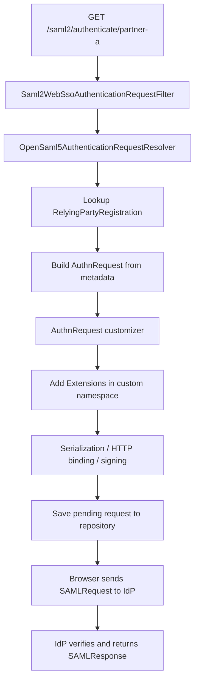

# Adding Extended Data to SAML2 AuthnRequest Without Breaking Protocol Structure

**Topic:** Spring Security – federation → AuthnRequest Customization.

A Service Provider (SP) sometimes needs to pass extra information to an Identity Provider (IdP): UI language hints, service context, attribute requests per an agreed profile, or specialized login policies. SAML 2.0 permits extending certain messages, including `<samlp:AuthnRequest>`, yet **only adding data at the proper extension point and namespace** preserves parseability, signature verification, and login session correlation.

In Spring Security (Servlet), the maintainable way is using **`OpenSaml5AuthenticationRequestResolver.setAuthnRequestCustomizer(...)`** to modify the OpenSAML object model **before** the request is serialized and sent via HTTP Redirect/POST binding. For standard SAML concepts, prefer built-in fields such as `ForceAuthn`, `NameIDPolicy`, or `RequestedAuthnContext`; for mutually agreed extended data, use **`samlp:Extensions` with elements in a custom namespace**. Never inject XML strings via regex after the request has been signed.

Examples in this article use **Java 17+, Spring Boot 4.1.x, and Spring Security 7.1.x/OpenSAML 5**. If using Security 6.x/OpenSAML 4, consult `OpenSaml4AuthenticationRequestResolver` and the Javadoc of that branch. Spring code belongs to a Maven project with dependencies and a real IdP, not standalone `javac`. At the end, standalone plain-JDK Java code is provided to inspect element order and namespaces.

## 1. Distinguishing Three Types of “Adding Information”

| Need | Proper Approach | Example | Common Mistake |
| --- | --- | --- | --- |
| Standard SAML requirement already has a field | Use the SAML 2.0 schema attribute/element | `ForceAuthn`, `IsPassive`, `NameIDPolicy`, `RequestedAuthnContext`, `Scoping` | Creating a custom element even though the spec already models the need |
| Extra data under an IdP-agreed **extension/profile** | Place a non-SAML namespaced element inside **`samlp:Extensions`** | `<ctx:LocaleHint>vi-VN</ctx:LocaleHint>` | Inserting `<ctx:LocaleHint>` directly under `AuthnRequest` |
| Carrying application state / return page | Store in session/`SavedRequest`, opaque `RelayState` secured by design | One-time transaction ID or allowlisted internal path | Putting PII, access tokens, or untrusted URLs in `RelayState` |

**Adding structure is not adding permissions.** The IdP may treat an extension as a **hint** and ignore it; the SP must never infer that the IdP performed MFA, authorized a tenant, or issued specific attributes merely because a request was sent. Critical conditions must be negotiated with the IdP and verified in the returned `SAMLResponse`/Assertion.

### 1.1. Roles of Each Party

- **SP/Relying Party:** Spring application creating the `AuthnRequest`, storing the session-bound request, redirecting the browser to the IdP, and verifying the response at the ACS.
- **IdP/Asserting Party:** receives and validates the request; if supporting the profile/extension, interprets values per contract; authenticates the user and issues the SAML Response.
- **Browser:** transports `SAMLRequest` via Redirect/POST; data passing through the browser is not inherently confidential.
- **RelyingPartyRegistration:** Spring config specifying SP issuer/entity ID, ACS, IdP issuer/SSO URL, certificates, and constraints.
- **Saml2AuthenticationRequestResolver:** request generation strategy; Spring Security uses `OpenSaml5AuthenticationRequestResolver` to build `AuthnRequest` on OpenSAML 5.
- **Customizer:** callback modifying the object model before the resolver's encoding/signing step; mutates only allowed parts.

**Scope limit:** this article covers **SP-initiated requests**. IdP-initiated/unsolicited login has no SP-generated `AuthnRequest` in that transaction, so nothing runs the customizer when the IdP sends a response.

## 2. SAML 2.0 AuthnRequest Structure That Must Remain Intact

Under the SAML 2.0 schema, `AuthnRequestType` extends `RequestAbstractType`. Identifying attributes and elements must follow XML Schema namespace/ordering rules.

Example of a request with an extension (illustrative XML, unsigned; URLs and `ID` are sample data):

```xml
<?xml version="1.0" encoding="UTF-8"?>
<samlp:AuthnRequest
    xmlns:samlp="urn:oasis:names:tc:SAML:2.0:protocol"
    xmlns:saml="urn:oasis:names:tc:SAML:2.0:assertion"
    xmlns:ctx="urn:example:portal:saml-ext:1"
    ID="_req-20261107-a1"
    Version="2.0"
    IssueInstant="2026-11-07T03:00:00Z"
    Destination="https://login.partner.example/sso"
    AssertionConsumerServiceURL="https://portal.example.com/login/saml2/sso/partner-a"
    ProtocolBinding="urn:oasis:names:tc:SAML:2.0:bindings:HTTP-POST"
    ForceAuthn="false">
    <saml:Issuer>https://portal.example.com/saml2/sp/partner-a</saml:Issuer>
    <samlp:Extensions>
        <ctx:LocaleHint>vi-VN</ctx:LocaleHint>
        <ctx:Interface>employee-portal</ctx:Interface>
    </samlp:Extensions>
    <samlp:NameIDPolicy
        Format="urn:oasis:names:tc:SAML:2.0:nameid-format:persistent"
        AllowCreate="true"/>
</samlp:AuthnRequest>
```

**Placement must be exact:** common `RequestAbstractType` elements comprise `saml:Issuer`, `ds:Signature` (when XML-signed), and `samlp:Extensions` in schema order; specialized `AuthnRequestType` elements such as `saml:Subject`, `NameIDPolicy`, `saml:Conditions`, `RequestedAuthnContext`, and `Scoping` appear after the common elements in prescribed order. Never copy arbitrary structures from JSON into XML.

Tree diagram:

```text
samlp:AuthnRequest  [ID, Version, IssueInstant, Destination, ...]
├── saml:Issuer                 (when present; must match the SP's entity ID)
├── ds:Signature                (if XML-signed, position defined by schema)
├── samlp:Extensions            (extension point belonging to RequestAbstractType)
│   └── ctx:LocaleHint          (custom namespace, after both parties agree)
├── saml:Subject                (optional per schema/profile)
├── samlp:NameIDPolicy          (optional)
├── saml:Conditions             (optional)
├── samlp:RequestedAuthnContext (optional)
└── samlp:Scoping               (optional)
```

**Not every field is mandatory**; this shows general structure and ordering. Some IdPs require or restrict certain elements per metadata and profile, so schema-valid XML is only a **necessary condition** to run smoothly.

### 2.1. Why Is a Non-SAML Namespace Needed for Extensions?

`samlp:Extensions` is the extension point defined by the SAML spec. Extension contents must have their own QName, typically:

```xml
<samlp:Extensions xmlns:ctx="urn:example:portal:saml-ext:1">
    <ctx:LocaleHint>vi-VN</ctx:LocaleHint>
</samlp:Extensions>
```

- `ctx` is only a **local prefix**, not what defines the extension's identity; the namespace URI `urn:example:portal:saml-ext:1` is the actual identification boundary.
- Do not use the `samlp`, `saml`, or standard metadata namespaces to name custom elements like `samlp:MyCustomField`.
- Avoid `urn:example:...` namespaces in real deployments: use a unique namespace defined in the SP–IdP contract, documenting fields, data types, versions, and semantics.
- Do not place a custom element **directly** under `AuthnRequest`; per schema it must sit inside `samlp:Extensions`.
- Limit nested payloads, element count, size, and characters; an extension with its own schema should be tested against that extension's XSD if published by both sides.

**Invalid example** (inserting a direct child outside the content model):

```xml
<samlp:AuthnRequest ...>
    <saml:Issuer>https://portal.example.com/saml2/sp/partner-a</saml:Issuer>
    <ctx:LocaleHint xmlns:ctx="urn:example:portal:saml-ext:1">
        vi-VN
    </ctx:LocaleHint>
</samlp:AuthnRequest>
```

The `...` is an abbreviation marker, **not valid parseable XML**. The point here is invalid child placement: even with prefix/namespace declared, `ctx:LocaleHint` cannot arbitrarily become a direct child of `AuthnRequest`.

### 2.2. Avoid Confusing with `AttributeStatement`

An `AuthnRequest` sent by the SP is a **login request**, not a place to self-declare that the user already has roles, groups, email, or MFA. Identity attributes verified by the IdP normally appear in an **`AttributeStatement` inside the IdP-signed SAML Assertion**. If you want to request additional attributes from the IdP, use an official SAML profile/extension or an agreed provisioning protocol; never send `<saml:Attribute>ROLE_ADMIN</saml:Attribute>` in the request and treat it as a permission.

Similarly, `RequestedAuthnContext` can request an authentication method/level; the **actual achieved value** must be verified from the assertion/`AuthnStatement` under application and IdP rules. Requesting MFA is not proof MFA was completed.

## 3. When to Use Standard Fields Before Thinking of `Extensions`?

| Goal | Standard Mechanism | Implementation Notes |
| --- | --- | --- |
| Force the IdP to authenticate the user directly in this request | `ForceAuthn="true"` | Confirm IdP support; does not guarantee a specific MFA level |
| Prevent the IdP from interactively prompting the user | `IsPassive="true"` | If the IdP cannot complete passively, it returns an error per profile; do not combine arbitrarily with interactive ForceAuthn |
| Request a stable identifier type | `NameIDPolicy@Format` and `AllowCreate` | Choose persistent/transient/email per IdP/contract; never create accounts from unverified email |
| Request an authentication class/context | `RequestedAuthnContext` + `AuthnContextClassRef` and `Comparison` | IdP may reject with `NoAuthnContext` if unmet; verify actual result |
| Constrain/coordinate IdP proxy chains | `Scoping`/`IDPList`/`ProxyCount` (when profile allows) | Use when federation proxying actually exists; does not replace tenant authorization |
| Select a registered ACS | `AssertionConsumerServiceURL` or `AssertionConsumerServiceIndex` per profile | Never construct URL from browser input; must match metadata and public ingress |
| Select response HTTP binding | `ProtocolBinding` | Binding of the **SAML Response**, independent of the binding used to send AuthnRequest |
| Supply requester display name | `ProviderName` | May be ignored by IdP; not an issuer/entityID used for trust |

Standard request example:

```xml
<samlp:RequestedAuthnContext Comparison="exact"
    xmlns:samlp="urn:oasis:names:tc:SAML:2.0:protocol"
    xmlns:saml="urn:oasis:names:tc:SAML:2.0:assertion">
    <saml:AuthnContextClassRef>
        urn:oasis:names:tc:SAML:2.0:ac:classes:PasswordProtectedTransport
    </saml:AuthnContextClassRef>
</samlp:RequestedAuthnContext>
```

This is a **standard element XML snippet**, which must be placed in the right position inside AuthnRequest for the entire document to be valid. Never put `RequestedAuthnContext` inside `Extensions` because the schema already defines it. For high assurance or step-up, never assume `PasswordProtectedTransport` means MFA; use only an `AuthnContextClassRef` published in the IdP contract and accepted by the application.

## 4. Preparing an Extension Contract with the IdP

An extension is valuable only if both SP and IdP agree on **semantics**, not merely because both can parse XML:

1. **Namespace URI + version**: e.g., `urn:example:portal:saml-ext:1`. Bump version on incompatible meaning or XML contract changes.
2. **Element name/QName**: e.g., `ctx:LocaleHint`. Names are case-sensitive.
3. **Data type and constraints**: BCP 47 language or agreed enum, length limit, whether optional, and whether a default exists.
4. **Producer and interpreter**: SP emits the hint; IdP may ignore, require additional constraints, or reject if unsupported.
5. **Business mandatory status**: if mandatory, the IdP must fail explicitly when unsupported; do not assume XML extensions have a universal `required=true` mechanism.
6. **Data protection**: is there PII or sensitive content? Redirect URLs may be stored in browser history, reverse proxies, and logs.
7. **Signing and trust**: does the IdP require signed AuthnRequests or only check SP metadata? Ensure the extension lies within the signed bytes per active binding.
8. **Backward compatibility**: older/newer IdPs, other tenants, sandboxes, child ordering, schema versions, fail-safe behavior, and how to toggle the extension off.
9. **Verification**: verify the IdP actually uses the field in the flow, not merely returning success after ignoring it.
10. **Change governance**: document owner, version date, rollback plan, and test cases for missing, invalid, and oversized values.

Short contract example:

| Attribute | Agreed Value |
| --- | --- |
| Namespace | `urn:example:portal:saml-ext:1` |
| XML path | `/samlp:AuthnRequest/samlp:Extensions/ctx:LocaleHint` |
| Content | Allowlisted locale string: `vi-VN`, `en-US` |
| Semantics | Only hints IdP UI language; **never decides identity/permissions** |
| When missing | IdP uses default locale |
| When unknown | IdP uses default or rejects per agreed profile |
| Request signing | Per IdP metadata, SP key, and supported binding |
| Responsibility | SP validates input values; IdP controls rendering |

Never add extensions to “pass role for fast login,” “select tenant without verifying issuer,” or “skip MFA because the user already logged into the SP,” because those are security decisions that cannot rely on self-asserted data inside AuthnRequest.

## 5. Spring Security: Modifying the OpenSAML Model Before Sending

Common flow:



The diagram depicts **logical responsibility** of each step, without guaranteeing exact internal method call order across all versions. Spring Security still manages `Saml2AuthenticationRequestRepository`, `RelayState`, binding, and request correlation per that version's filter mechanics.

### 5.1. Extension Point Supported by Spring Security

Spring Security 7.1 docs use:

```java
@Bean
Saml2AuthenticationRequestResolver authenticationRequestResolver(
        RelyingPartyRegistrationRepository registrations) {
    RelyingPartyRegistrationResolver parties =
            new DefaultRelyingPartyRegistrationResolver(registrations);
    OpenSaml5AuthenticationRequestResolver resolver =
            new OpenSaml5AuthenticationRequestResolver(parties);
    resolver.setAuthnRequestCustomizer(
            context -> context.getAuthnRequest().setForceAuthn(true));
    return resolver;
}
```

This is a **Spring Java snippet**: it needs imports/beans inside a Spring Security app, not standalone `javac`. `setForceAuthn(true)` illustrates modifying a **standard attribute**. To add a custom extension, interact with `context.getAuthnRequest().getExtensions()` and add an OpenSAML XMLObject in a custom namespace, as shown next.

**Rule:** modify through the object model, then let the resolver/framework execute serialization, compression, transport encoding, and signing. Never take Base64/DEFLATEd `SAMLRequest`, edit the string, and resend, because altering bytes can invalidate signatures, break encoding, and break correlation with the saved request.

## 6. Integration Example: Java 17 + Spring Boot 4.1.2 / OpenSAML 5

Example of an SP integrated with IdP `partner-a`, sending **a harmless locale hint** inside `samlp:Extensions` while preserving all framework-generated protocol fields. Request signing can be configured via metadata/credentials, yet a real IdP must confirm extension support before enabling in production.

Minimal structure:

```text
saml-request-extension/
├── pom.xml
└── src/main/
    ├── java/com/example/federation/
    │   ├── FederationApplication.java
    │   ├── SecurityConfig.java
    │   └── AuthnRequestCustomization.java
    └── resources/application.yml
```

### 6.1. Maven BOM and Dependencies

`pom.xml`:

```xml
<?xml version="1.0" encoding="UTF-8"?>
<project xmlns="http://maven.apache.org/POM/4.0.0"
         xmlns:xsi="http://www.w3.org/2001/XMLSchema-instance"
         xsi:schemaLocation="http://maven.apache.org/POM/4.0.0
           https://maven.apache.org/xsd/maven-4.0.0.xsd">
    <modelVersion>4.0.0</modelVersion>
    <parent>
        <groupId>org.springframework.boot</groupId>
        <artifactId>spring-boot-starter-parent</artifactId>
        <version>4.1.2</version>
        <relativePath/>
    </parent>
    <groupId>com.example</groupId>
    <artifactId>saml-request-extension</artifactId>
    <version>1.0.0</version>
    <properties><java.version>17</java.version></properties>
    <repositories>
        <repository>
            <id>shibboleth-releases</id>
            <url>https://build.shibboleth.net/maven/releases/</url>
            <snapshots><enabled>false</enabled></snapshots>
        </repository>
    </repositories>
    <dependencies>
        <dependency>
            <groupId>org.springframework.boot</groupId>
            <artifactId>spring-boot-starter-webmvc</artifactId>
        </dependency>
        <dependency>
            <groupId>org.springframework.boot</groupId>
            <artifactId>spring-boot-starter-security</artifactId>
        </dependency>
        <dependency>
            <groupId>org.springframework.boot</groupId>
            <artifactId>spring-boot-starter-security-saml2</artifactId>
        </dependency>
        <dependency>
            <groupId>org.springframework.boot</groupId>
            <artifactId>spring-boot-starter-test</artifactId>
            <scope>test</scope>
        </dependency>
    </dependencies>
    <build>
        <plugins>
            <plugin>
                <groupId>org.springframework.boot</groupId>
                <artifactId>spring-boot-maven-plugin</artifactId>
            </plugin>
        </plugins>
    </build>
</project>
```

The Spring Boot parent manages Spring Security and OpenSAML via dependency management; do not arbitrarily specify a different OpenSAML major version. SAML SP using OpenSAML may require the Shibboleth Releases repository above; in enterprises, mirror repositories via an approved artifact repository. On Boot 3.5, starters have different names and require OpenSAML 4/Security 6.x depending on version—avoid copying Boot 4 configs verbatim.

### 6.2. `FederationApplication.java`

```java
package com.example.federation;

import org.springframework.boot.SpringApplication;
import org.springframework.boot.autoconfigure.SpringBootApplication;

@SpringBootApplication
public class FederationApplication {
    public static void main(String[] args) {
        SpringApplication.run(FederationApplication.class, args);
    }
}
```

### 6.3. `AuthnRequestCustomization.java`: Adding `Extensions` Properly

```java
package com.example.federation;

import org.opensaml.core.xml.schema.XSAny;
import org.opensaml.core.xml.schema.impl.XSAnyBuilder;
import org.opensaml.saml.saml2.core.Extensions;
import org.opensaml.saml.saml2.core.impl.ExtensionsBuilder;
import org.springframework.context.annotation.Bean;
import org.springframework.context.annotation.Configuration;
import org.springframework.security.saml2.provider.service.registration
        .RelyingPartyRegistrationRepository;
import org.springframework.security.saml2.provider.service.web
        .DefaultRelyingPartyRegistrationResolver;
import org.springframework.security.saml2.provider.service.web
        .RelyingPartyRegistrationResolver;
import org.springframework.security.saml2.provider.service.web.authentication
        .OpenSaml5AuthenticationRequestResolver;
import org.springframework.security.saml2.provider.service.web.authentication
        .Saml2AuthenticationRequestResolver;

@Configuration
public class AuthnRequestCustomization {

    private static final String EXT_NS =
            "urn:example:portal:saml-ext:1";

    @Bean
    Saml2AuthenticationRequestResolver authenticationRequestResolver(
            RelyingPartyRegistrationRepository registrations) {

        RelyingPartyRegistrationResolver registrationResolver =
                new DefaultRelyingPartyRegistrationResolver(registrations);

        OpenSaml5AuthenticationRequestResolver resolver =
                new OpenSaml5AuthenticationRequestResolver(registrationResolver);

        resolver.setAuthnRequestCustomizer(context -> {
            var authnRequest = context.getAuthnRequest();

            // Do not change ID, Issuer, Destination, ACS, or IssueInstant.
            // Only add elements at the SAML-permitted extension point.
            Extensions extensions = authnRequest.getExtensions();
            if (extensions == null) {
                extensions = new ExtensionsBuilder().buildObject();
                authnRequest.setExtensions(extensions);
            }

            XSAny locale = new XSAnyBuilder().buildObject(
                    EXT_NS, "LocaleHint", "ctx");
            locale.setTextContent("vi-VN");

            extensions.getUnknownXMLObjects().add(locale);
        });

        return resolver;
    }
}
```

**Why this approach preserves structure:**

- `ExtensionsBuilder` is imported from **`org.opensaml.saml.saml2.core.impl`** (protocol extension), **not** the identically named class in `org.opensaml.saml.saml2.metadata.impl` for metadata.
- `XSAnyBuilder` builds an XMLObject with a QName in custom namespace `urn:example:portal:saml-ext:1`; `setTextContent` fills text via the OpenSAML API.
- If `AuthnRequest` already has `Extensions`, the code **preserves** existing children and appends a new child rather than overwriting with an object that drops library/other partner extensions.
- `authnRequest.setExtensions(...)` places the object in the exact slot defined by the OpenSAML model; OpenSAML handles child ordering during marshalling.
- Spring Security still handles mandatory fields, `RelayState`, the request repository, and transport; the code never slices encoded SAML strings.

**This is a fixed-contract example:** locale is always `vi-VN` for illustration. Production should configure a per-partner allowlist rather than reading `?locale=...` directly and putting raw user content into a signed SAMLRequest. If an IdP does not support the extension, emit it only for registrations that agreed to receive it; when branching is needed, build a trusted configuration selector keyed on `RelyingPartyRegistration` in the application/resolver bean layer.

### 6.4. `SecurityConfig.java`: Wiring the Resolver into `saml2Login`

```java
package com.example.federation;

import org.springframework.context.annotation.Bean;
import org.springframework.context.annotation.Configuration;
import org.springframework.security.config.annotation.web.builders.HttpSecurity;
import org.springframework.security.saml2.provider.service.web.authentication
        .Saml2AuthenticationRequestResolver;
import org.springframework.security.web.SecurityFilterChain;

@Configuration
public class SecurityConfig {
    @Bean
    SecurityFilterChain chain(
            HttpSecurity http,
            Saml2AuthenticationRequestResolver requestResolver) throws Exception {
        http.authorizeHttpRequests(auth -> auth
                    .requestMatchers("/", "/error").permitAll()
                    .anyRequest().authenticated()
                )
                .saml2Login(saml2 -> saml2
                    .authenticationRequestResolver(requestResolver));
        return http.build();
    }
}
```

Wiring `authenticationRequestResolver` **explicitly** makes it clear which resolver the filter chain uses. If the application has multiple `SecurityFilterChain` beans, verify `securityMatcher`, chain ordering, and request initiation endpoints; avoid accidentally configuring the customizer on a chain that is never invoked.

### 6.5. `application.yml`: Registration and IdP Metadata

```yaml
spring:
  security:
    saml2:
      relyingparty:
        registration:
          partner-a:
            assertingparty:
              metadata-uri: https://login.partner.example/metadata.xml
```

`example.com` domains are placeholders **in learning materials**, not a live IdP, and cannot perform real logins. To run, supply valid IdP metadata, SP entity ID, public ACS URL, and trusted certificates per SAML contract. If the IdP requires signed AuthnRequests, configure the SP private key/certificate via a secret manager and proper signing credentials; never put private keys in source code or Git.

The Java code in the example is Spring Boot/Spring Security config; to run, build with Maven alongside dependencies and a real IdP:

```bash
mvn -DskipTests compile
mvn test
mvn spring-boot:run
```

After configuring the IdP, open `/saml2/authenticate/partner-a` and inspect the request on the network. **There is no fixed SSO stdout** because output depends on IdP registration, browser, proxy, session, and certificates. A passing build confirms only that related classes/objects compile under the resolved dependency set, not that the IdP processes `LocaleHint`.

## 7. Inspecting XML After the Customizer and Before Hitting the IdP

The goal during verification is confirming **the actual outgoing message** contains the custom extension, remains parseable, retains core fields, and does not break signatures/bindings.

### 7.1. Inspect the Real Request, Not Just the Java Object

With HTTP Redirect binding, the browser is typically redirected to the IdP's SSO URL with `SAMLRequest` and possibly `RelayState`/`SigAlg`/`Signature`. `SAMLRequest` is typically DEFLATEd, Base64-encoded, and URL-encoded; decode per the binding to inspect the XML.

With HTTP POST binding, the browser carries a form with a Base64-encoded `SAMLRequest` hidden field; do not take a Redirect path and try to inflate it as POST. **Request signing differs by binding**: HTTP Redirect signs query parameters in the binding's exact order/rules; HTTP POST usually embeds an XML Signature in the message when signed. Do not conclude a signature is missing just because XML decoded from Redirect lacks `<ds:Signature>`.

When decoding in test environments, use only trusted tools; **never paste real SAMLRequest/SAMLResponse payloads, cookies, secrets, or PII-bearing assertions into public web decoders**.

### 7.2. Which Values Should Be Compared?

| Location | Before Customization | Expected After Customization |
| --- | --- | --- |
| `AuthnRequest@ID` | SP creates a unique new ID | **Unchanged** on the request object being processed |
| `Version` / `IssueInstant` | `2.0` / issuance timestamp | **Not altered unintentionally** |
| `Destination` | IdP SSO URL per metadata | **Unchanged** just from adding an extension |
| `Issuer` | SP entity ID per registration | **Unchanged** |
| `AssertionConsumerServiceURL` or Index | SP's ACS per metadata | **Unchanged** |
| `ProtocolBinding` | Response binding supported by SP/IdP | **Unchanged** unless explicitly contracted |
| `RelayState` | Managed by resolver/request repository | Not used as a channel to inject business payloads |
| `Extensions` | May be empty/absent | Contains exact `ctx:LocaleHint` while keeping other extensions |
| `NameIDPolicy`/`RequestedAuthnContext` | Per standard policy | Not deleted or altered unexpectedly |
| Signing/transport | Per metadata and binding | Signature remains valid **after** payload edits |
| `InResponseTo` on response | Absent at request creation time | Must match the session's stored request ID when IdP responds |

**One successful login does not prove the IdP used the extension.** Inspect controlled IdP test logs or verify UI results: e.g., send `vi-VN` and `en-US` per contract and check whether the IdP displays the matching language. If the IdP ignores the extension, login can still succeed.

## 8. Standalone Java 17: Checking XML Ordering and Namespaces

The following snippet **compiles/runs with JDK 17+ alone**. It builds sample XML with `Issuer → Extensions → NameIDPolicy` and uses a DOM parser with basic DTD/XXE protections to print child order and custom values. This is a **structural check**, not a SAML validator, and performs no XML Schema or X.509 signature validation.

File `AuthnRequestStructureDemo.java`:

```java
import java.io.StringReader;
import java.util.ArrayList;
import java.util.List;
import javax.xml.XMLConstants;
import javax.xml.parsers.DocumentBuilderFactory;
import org.w3c.dom.Element;
import org.w3c.dom.Node;
import org.w3c.dom.NodeList;
import org.xml.sax.InputSource;

public class AuthnRequestStructureDemo {
    private static final String PROTOCOL =
            "urn:oasis:names:tc:SAML:2.0:protocol";
    private static final String EXT =
            "urn:example:portal:saml-ext:1";

    public static void main(String[] args) throws Exception {
        String xml = """
            <samlp:AuthnRequest
                xmlns:samlp="urn:oasis:names:tc:SAML:2.0:protocol"
                xmlns:saml="urn:oasis:names:tc:SAML:2.0:assertion"
                xmlns:ctx="urn:example:portal:saml-ext:1"
                ID="_demo1" Version="2.0"
                IssueInstant="2026-11-07T03:00:00Z"
                Destination="https://login.partner.example/sso">
                <saml:Issuer>https://portal.example.com/saml2/sp</saml:Issuer>
                <samlp:Extensions>
                    <ctx:LocaleHint>vi-VN</ctx:LocaleHint>
                </samlp:Extensions>
                <samlp:NameIDPolicy AllowCreate="true"/>
            </samlp:AuthnRequest>
            """;

        DocumentBuilderFactory factory =
                DocumentBuilderFactory.newInstance();
        factory.setNamespaceAware(true);
        factory.setFeature(
                XMLConstants.FEATURE_SECURE_PROCESSING, true);
        factory.setFeature(
                "http://apache.org/xml/features/disallow-doctype-decl",
                true);
        factory.setXIncludeAware(false);
        factory.setExpandEntityReferences(false);

        Element root = factory.newDocumentBuilder()
                .parse(new InputSource(new StringReader(xml)))
                .getDocumentElement();

        List<String> children = new ArrayList<>();
        NodeList nodes = root.getChildNodes();
        for (int i = 0; i < nodes.getLength(); i++) {
            Node node = nodes.item(i);
            if (node instanceof Element child) {
                children.add(child.getLocalName());
            }
        }

        NodeList extensions =
                root.getElementsByTagNameNS(PROTOCOL, "Extensions");
        NodeList hints =
                root.getElementsByTagNameNS(EXT, "LocaleHint");

        System.out.println("Root: " + root.getLocalName());
        System.out.println("Children: " + String.join(",", children));
        System.out.println("Extensions count: " + extensions.getLength());
        System.out.println("Locale: " + hints.item(0).getTextContent());
    }
}
```

Compile/run in the folder containing the file:

```bash
javac AuthnRequestStructureDemo.java
java AuthnRequestStructureDemo
```

**Exact stdout of the program:**

```text
Root: AuthnRequest
Children: Issuer,Extensions,NameIDPolicy
Extensions count: 1
Locale: vi-VN
```

Explanation:

- `getLocalName()` strips the display prefix, while `getElementsByTagNameNS(...)` filters by **exact namespace URI**, avoiding confusing `ctx:LocaleHint` with an element sharing the same local name in another namespace.
- The DOM parser preserves element order from the sample XML, so `Issuer,Extensions,NameIDPolicy` reflects child positions.
- The demo confirms only that the XML parses and checks a few attributes; **it does not run full XSD validation, does not verify signatures, and does not prove the IdP supports the extension**. Production uses a trusted SAML library and a test suite against an IdP sandbox.

### 8.1. Validating Against Standard XSD

Obtain the **complete SAML 2.0 XSD set** from OASIS, including `saml-schema-protocol-2.0.xsd` and referenced assertion/XML Signature/XML Encryption imports. Use a validator configured with an offline trusted resolver, disabling unnecessary network/XXE access. If using pre-installed `xmllint` with resolved imports:

```bash
xmllint --noout --schema saml-schema-protocol-2.0.xsd \
  authn-request.xml
```

Note: Redirect-binding signed XML does not necessarily contain `ds:Signature` inside the XML, and XML schema validation **cannot prove** the request is accepted by the IdP, its signature is valid, or tenant mapping is right. If the custom extension has its own XSD, run additional validation against that schema per IdP contract.

## 9. Keeping Signatures Valid After Adding Content

**Never modify XML after signing**. Invariant rule:

- The customizer operates on objects **before** the resolver's marshalling/signing/encoding.
- Let Spring Security/OpenSAML apply the binding/signing configured on `RelyingPartyRegistration`; never perform string replacement on an emitted `SAMLRequest`.
- For HTTP Redirect binding, check `SigAlg` and `Signature` per binding and the SP certificate registered with the IdP; do not draw conclusions based on whether decoded XML contains `ds:Signature`.
- For POST binding with XML Signature, sign the right element and reference via the standard library. Adding children after signing can cause digest mismatches.
- Never disable `sign-request` or XML signature validation just to get the IdP to accept a new extension; align metadata, keys, algorithms, and policies per contract.
- Never send private keys, credentials, Assertions, session cookies, or raw SAML messages to unsecured logging systems.

**Why can the same XML log in when unsigned yet be rejected when signed?** Modifying extensions changes canonicalized content; if the payload after customization differs from the payload at signing time, signatures fail. Moreover, HTTP Redirect signing depends on query-parameter construction; a URL whose query encoding/ordering is modified by a proxy can break the signature. Test along the actual **browser → gateway → IdP** path.

## 10. Preserving Request–Response Correlation and the Initial Session

By default, Spring Security uses `HttpSessionSaml2AuthenticationRequestRepository` to save the pending `AuthnRequest` before redirecting the browser to the IdP. When the IdP POSTs the response to the ACS, `Saml2AuthenticationTokenConverter` and the provider use the saved request to handle `InResponseTo` and other conditions.

Adding an extension **must not alter**:

- `AuthnRequest@ID` and the session-bound pending request; never generate a new ID **after** saving the request.
- `RelayState`; never replace it with arbitrary data to patch flow behavior without understanding the repository.
- IdP/tenant registration and `Issuer`; extensions must never select trust anchors in place of metadata.
- `ACS`, `Destination`, `IssueInstant`, or request lifetime; never change them because “the IdP asked for another field.”
- Response/Assertion verification: signature, issuer, audience, recipient, validity window, SubjectConfirmationData, `InResponseTo`, replay, and authorization.

If the customizer has browser/session-dependent logic, decision data must be server-controlled (session state/allowlist) and tamper-resistant; never let a client query parameter like `registrationId` or `tenant` make the SP sign a request for an unauthorized tenant.

**IdP-initiated case:** the IdP sends a response without an SP-issued request, so this `AuthnRequest` extension is never applied. If passing SP data is mandatory, you need SP-initiated flow or another protocol/contract. Never convert an SP-initiated response missing state into unsolicited just to “make it work.”

## 11. Managing Size Across HTTP Redirect/POST Bindings

Custom extensions make `SAMLRequest` larger:

| Issue | Consequence | Prevention |
| --- | --- | --- |
| Redirect URL too long | Browser/proxy/IdP may return 400/414 or truncate query | Keep extensions small, test size after DEFLATE/Base64/URL encoding; consider POST binding if IdP supports |
| URL contains sensitive data | Browser history, access logs, proxies, and monitoring may record the request | Never put PII/tokens/credentials in AuthnRequest extensions; use an opaque identifier if genuinely needed and agreed |
| Many elements unknown to IdP | IdP ignores or rejects, varying by vendor/version | Emit per registration/feature flag; integration-test each IdP |
| Improper XML escaping | Invalid XML or injection when built from strings | Use OpenSAML XMLObject builders and value allowlists; never concatenate XML text manually |
| Duplicate content / inconsistent values | IdP may pick unintended field or reject | One clear config source per field; avoid appending multiple elements of the same QName unless contract permits |
| Signature mismatch | Request rejected even with all elements present | Modify objects only before signing; test signing over the real binding |
| Bad proxy rewrite | Signature/ACS/Destination mismatch | Preserve query strings, scheme/host forwarding, and accurate public metadata |
| Session cache loses pending request | `InResponseTo` not found; login fails | Verify SameSite cookies, session timeouts, load balancer, and Spring Session per architecture |

**Do not treat Google Sheets' 30,000-character limit** as guidance for SAML: those are two completely different kinds of limits. AuthnRequest payload size must stay within browser/gateway/IdP capabilities and security policy; most business extensions should be very short.

## 12. Deploying Extensions in Multi-IdP / Multi-Tenant Products

If a portal trusts `partner-a`, `partner-b`, and `employee`, do not automatically enable the same extension for all three. Create a contract table:

| Registration | IdP Supports `ctx:LocaleHint`? | Namespace / Profile | Allowed Values | Behavior on IdP Error |
| --- | --- | --- | --- | --- |
| `partner-a` | Yes, contracted | `urn:example:portal:saml-ext:1` | `vi-VN`, `en-US` | Controlled fallback or disable extension via rollout toggle |
| `partner-b` | Unconfirmed | Unused | None | Send standard AuthnRequest without extension |
| `employee` | May already have another standard locale mechanism | Check metadata/contract | Per IdP system | Do not assume custom support |

**Prefer server-side configuration**:

1. Look up the registration resolved from metadata/trusted tenant bindings.
2. Fetch extension policy from approved configuration or role-gated feature flags.
3. Validate values (enum/regex allowlist, length) and skip if the IdP has not agreed.
4. Construct `XSAny` with a fixed namespace/version; never let users pick arbitrary QNames or namespaces.
5. Monitor `UnsupportedRequest`, `Requester`, or specific status codes in SAML Responses when an IdP does not understand the extension.
6. Run regressions for both extension-**enabled** and extension-**disabled** IdPs before rollout.
7. Ensure turning off the feature flag restores standard AuthnRequests without changing entity ID, ACS, or signing keys.

**Never send tenant info as text “tenant=A” and let the IdP/app trust it instead of issuer/registration**. Each partner must be mapped via trusted IdP issuer and certificate, alongside post-login tenant isolation checks.

## 13. Mandatory Integration Test Suite

| Test Case | Action | Expected Result |
| --- | --- | --- |
| Standard XML without extension | Disable feature flag, start SP-initiated login | Request still parses; IdP processes normally |
| XML with valid extension | Enable for partner-a, decode SAMLRequest | Contains exact `samlp:Extensions/ctx:LocaleHint`, namespace/version, and contracted text |
| Required fields intact | Compare original/customized messages | `ID`, `Issuer`, `Destination`, ACS, and IssueInstant are not inadvertently altered |
| XML ordering | Validate with SAML XSD/inspector | `Extensions` in proper slot; no custom direct child under `AuthnRequest` |
| Unsupported extension | Send to sandbox IdP configured without support | Behavior logged, error/fallback per contract; do not claim IdP honored it |
| Invalid value | Unknown/oversized locale or malicious input | SP never generates request with disallowed data; no XML injection |
| Signed request | Enable signing per binding + real credentials | IdP verifies signature, valid response; no byte edits after signing |
| Large Redirect URL | Simulate extension near gateway limit | Not truncated or rejected safely by system; consider POST |
| SP-initiated callback | Send response with valid `InResponseTo` | Session-bound request found, provider verifies, session created |
| Wrong `InResponseTo` | IdP/test fixture sends uncorrelated response | Rejected; no fallback to out-of-policy unsolicited |
| Wrong issuer/audience/signature | Different IdP or tampered response | Rejected, no session created |
| Multi-tenant check | Log in via partner-a/b | Extension policies and registrations never bleed; tenant isolation preserved |
| Different browser/cookies | Callback lacks session that created request | Safe error handling; never accepts another browser's request |
| Rollback | Disable extension post-rollout | SP reverts to standard AuthnRequest without changing URLs/certs or breaking live sessions |
| Log inspection | Enable approved tracing in staging | Records error class/correlation/registration without leaking SAML payloads/PII/secrets |

**Negative tests are especially critical:** an app can log in successfully with an IdP simply because the IdP **ignored** the custom field. That does not prove the feature works; verify the agreed business effect (e.g., UI language) and cases where the IdP reports unsupported.

## 14. Common Mistakes and Root Causes

### Mistake 1 – “XML has all fields, yet IdP reports schema invalid”

The cause is usually that the new element was added directly to `AuthnRequest` or placed out of order; some string-concatenating XML templates put `Extensions` after `NameIDPolicy`, violating the content model.

**Fix:** use OpenSAML `ExtensionsBuilder`/`XSAnyBuilder`, add children to `Extensions` in the right namespace, and validate against the SAML XSD; never reorder children with regex.

### Mistake 2 – Importing the wrong metadata builder

OpenSAML has **two** similarly named `ExtensionsBuilder` classes: one in `org.opensaml.saml.saml2.core.impl` for protocol extensions, and one in `org.opensaml.saml.saml2.metadata.impl` for metadata. Importing the wrong package causes type mismatches or attaches extensions to the wrong document type.

**Fix:** cross-check imports directly against `AuthnRequest.getExtensions()` and your OpenSAML version. Here you need `org.opensaml.saml.saml2.core.Extensions`.

### Mistake 3 – Using `setForceAuthn(true)` thinking it enforces MFA

`ForceAuthn` requests direct authentication per profile/IdP, without mandating “must use a specific MFA method.” The IdP may use a password or another mechanism. For assurance requirements, negotiate `RequestedAuthnContext` and verify matching AuthnContext/claims from the Assertion; sensitive business steps may need dedicated re-auth/step-up design.

### Mistake 4 – Adding data after signing

Online snippets often decode `SAMLRequest`, alter XML, and re-Base64-encode. With Redirect/POST signing, signatures break; if the implementation also signs with an algorithm disallowed by the IdP, it fails further.

**Fix:** modify only in the customizer before serialization/signing and let Spring Security/OpenSAML send it. If signing fails, inspect metadata/certificates, binding, `SigAlg`, query encoding, and proxies rather than disabling signing to dodge errors.

### Mistake 5 – Passing extra fields via `RelayState` like a “role token”

`RelayState` carries post-login state/destination, not self-proving identity data. It travels through the browser; arbitrary URLs create open redirects, while PII/tokens risk leakage.

**Fix:** use server-side opaque state for navigation; base business permissions on verified identity/assertions and policy DBs. Use protocol extensions only with a contract understood by the IdP.

### Mistake 6 – Extension pushes request over gateway limits

HTTP Redirect + DEFLATE/Base64/URL encoding can still be very long; some IdPs and gateways block long URLs. Switching to HTTP POST can mitigate URL limits, provided metadata/IdP support it and test flows cover it.

**Fix:** minimize payload; send short identifiers instead of large data; fetch supplements via trusted APIs when needed.

### Mistake 7 – Multi-IdP mixes up namespace, issuer, or ACS

A shared customizer might add an extension unsupported by partner-b or read tenant from an untrusted query parameter. The IdP may return errors or cause mix-ups if the wrong registration is chosen.

**Fix:** enforce per-registration policy, allowlist issuers, use the standard registration resolver, test cross-tenant scenarios, and keep entity ID/ACS aligned with metadata.

## 15. Protocol-Safe Design Checklist

Before merging:

- [ ] Determined whether the need is a standard SAML field or a custom extension.
- [ ] Extension has an IdP contract: namespace, QName, version, type, default, and unsupported behavior.
- [ ] No custom direct child of `AuthnRequest` outside the schema.
- [ ] `Extensions` placed properly in `RequestAbstractType`, preserving order relative to `Issuer`/`Signature`/other `AuthnRequest` children.
- [ ] Used only OpenSAML XMLObject builders; never concatenated XML strings into encoded requests.
- [ ] Did not modify `ID`, `Issuer`, `Destination`, `ACS`, `IssueInstant`, or `RelayState` outside verified design.
- [ ] Request signing still matches binding/certificate, and the extension is genuinely covered when signed.
- [ ] Custom values are allowlisted, size-bounded, and contain no PII/secrets/roles.
- [ ] Decoded XML parsed and schema-validated; tested on an IdP sandbox with the exact version.
- [ ] Browser callback properly handles `InResponseTo`, signature, recipient/audience/time/replay, and session.
- [ ] Multi-IdP/tenants have separate policies; extensions never bypass trust/authorization checks.
- [ ] Backward compatibility/rollback tests and monitoring for unsupported/schema/signature errors exist.

## 16. Authoritative Reference Documentation

1. [Spring Security 7.1 – Producing AuthnRequests](https://docs.spring.io/spring-security/reference/servlet/saml2/login/authentication-requests.html): `OpenSaml5AuthenticationRequestResolver`, `setAuthnRequestCustomizer`, binding, signing, and repository.
2. [Spring Security – SAML2 Login Overview](https://docs.spring.io/spring-security/reference/servlet/saml2/login/overview.html): filter chain, SP, IdP, ACS, and login session.
3. [Spring Security – Authenticating SAML Responses](https://docs.spring.io/spring-security/reference/servlet/saml2/login/authentication.html): response/assertion verification and registration.
4. [Spring Security – Saml2LoginConfigurer JavaDoc](https://docs.spring.io/spring-security/reference/api/java/org/springframework/security/config/annotation/web/configurers/saml2/Saml2LoginConfigurer.html): wiring `authenticationRequestResolver` into the DSL.
5. [OpenSAML 5 – API documentation](https://shibboleth.net/api/java-opensaml/5.2.3/): `AuthnRequest`, `Extensions`, `XSAny`, builders, and XML library.
6. [OASIS SAML 2.0 Core and XML Schema](https://docs.oasis-open.org/security/saml/v2.0/): `RequestAbstractType`, `AuthnRequestType`, `saml-schema-protocol-2.0.xsd`, and extension rules.
7. [OASIS SAML 2.0 Bindings](https://docs.oasis-open.org/security/saml/v2.0/saml-bindings-2.0-os.pdf): HTTP Redirect/POST, `SAMLRequest`, RelayState, and per-binding signatures.
8. [OWASP SAML Security Cheat Sheet](https://cheatsheetseries.owasp.org/cheatsheets/SAML_Security_Cheat_Sheet): request/response validation, replay, login CSRF, and trust management.

**Guiding principle:** when adding data to an `AuthnRequest`, first pick **standard elements** if available; if it is truly extended data, place it inside **`samlp:Extensions` with a custom namespace and explicit IdP contract**. Customize via the OpenSAML object model **before signing/encoding**, keep ID–issuer–ACS–destination–session invariant, and validate both XML schema and actual IdP behavior.