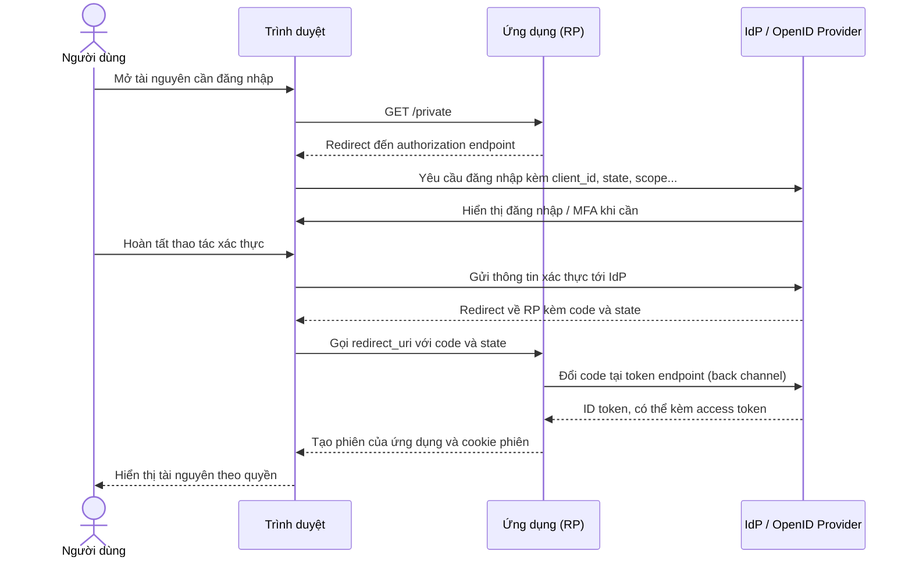

# Nhà cung cấp danh tính (IdP), ứng dụng sử dụng danh tính và người dùng

## Mục tiêu

Sau bài này, bạn có thể:

- Phân biệt **người dùng (End-User)**, **nhà cung cấp danh tính (Identity Provider – IdP)** và **ứng dụng sử dụng danh tính (Relying Party – RP / Service Provider – SP)**.
- Giải thích ai xác thực người dùng, ai tiếp nhận kết quả xác thực, ai quyết định quyền sử dụng chức năng trong ứng dụng.
- Mô tả luồng đăng nhập liên kết qua **OpenID Connect (OIDC)** hoặc **SAML 2.0** và lý do các bên phải thiết lập quan hệ tin cậy.
- Xác định vai trò tương ứng trong Spring Security, tránh nhầm ID token, access token và phiên đăng nhập của ứng dụng.

## 1. Ba vai trò cốt lõi của identity federation

**Identity federation (liên kết danh tính)** cho phép một ứng dụng tiếp nhận kết quả xác thực từ hệ thống danh tính bên ngoài đã được tin cậy. Nhờ đó, ứng dụng không nhất thiết phải tự quản lý mật khẩu của người dùng.

| Vai trò | Là ai? | Trách nhiệm chính | Không tự động chịu trách nhiệm về |
| --- | --- | --- | --- |
| **Người dùng (End-User)** | Cá nhân muốn truy cập ứng dụng, ví dụ nhân viên Linh | Yêu cầu tài nguyên, tương tác với màn hình đăng nhập của IdP, thực hiện MFA nếu cần, sử dụng phiên trong ứng dụng | Tự khẳng định danh tính bằng một tham số URL hoặc nội dung do trình duyệt tự tạo |
| **IdP (Identity Provider)** | Hệ thống danh tính như máy chủ đăng nhập doanh nghiệp | Xác thực người dùng theo chính sách của mình, quản lý trạng thái đăng nhập phía IdP, phát hành thông tin hoặc bằng chứng danh tính theo giao thức | Tự động quyết định Linh có được sửa báo cáo, duyệt hóa đơn hay xem dữ liệu nào trong mọi ứng dụng |
| **Ứng dụng sử dụng danh tính (RP/SP)** | Web app tin cậy IdP, ví dụ cổng báo cáo | Chuyển người dùng đến IdP, nhận và **xác minh** phản hồi theo giao thức, ánh xạ người dùng vào hệ thống, tạo phiên ứng dụng và kiểm soát truy cập | Tự kết luận một thông báo đăng nhập là thật khi chưa kiểm tra chữ ký, issuer, audience và các điều kiện liên quan |

**Trình duyệt (User Agent)** là thành phần thứ tư cần nhận biết trong luồng: nó chuyển hướng giữa ứng dụng và IdP và lưu cookie phù hợp. Trình duyệt **không phải IdP**, cũng không phải bên có thẩm quyền xác nhận danh tính. Thông tin được gửi qua trình duyệt phải được ứng dụng kiểm tra.

### Tên gọi theo giao thức

- Với **OpenID Connect**, IdP thường được gọi là **OpenID Provider (OP)**; ứng dụng là **Relying Party (RP)** và đồng thời là một **OAuth 2.0 Client**.
- Với **SAML 2.0**, IdP là **Asserting Party**; ứng dụng là **Service Provider (SP)**, cũng có thể gọi là **Relying Party**.
- Một tổ chức có thể vận hành cùng một hệ thống danh tính cung cấp nhiều giao thức, nhưng không vì thế mà OIDC token và SAML assertion hoán đổi trực tiếp cho nhau.

Điểm mấu chốt: **IdP cung cấp bằng chứng xác thực danh tính; ứng dụng kiểm tra bằng chứng và thực thi chính sách truy cập của chính mình.**

## 2. Ví dụ: một người dùng, một IdP, hai ứng dụng

Giả sử công ty có:

- IdP tại `https://login.example.com`, nơi nhân viên đăng nhập và thực hiện MFA.
- Ứng dụng A là `https://portal.example.com`; ứng dụng B là `https://reports.example.com`.
- Linh có danh tính tại IdP và được cấp quyền xem cổng nội bộ, nhưng chưa có quyền phê duyệt báo cáo.

Khi Linh mở ứng dụng A, ứng dụng chuyển hướng trình duyệt đến IdP. Linh xác thực ở IdP; ứng dụng A nhận phản hồi, xác minh nó rồi tạo **phiên riêng của A**. Sau đó Linh mở B: IdP có thể nhận ra Linh đã có **phiên riêng tại IdP** và hoàn tất đăng nhập liên kết mà không yêu cầu nhập lại mật khẩu. Tuy vậy, B vẫn phải kiểm tra phản hồi và tạo **phiên riêng của B**.

Đây là nền tảng của **Single Sign-On (SSO)**: có thể tái sử dụng lần xác thực tại IdP trong nhiều ứng dụng. SSO **không đồng nghĩa** với một cookie chung cho tất cả ứng dụng, không bảo đảm mọi ứng dụng đều cho phép mọi thao tác và cũng không bảo đảm đăng xuất tại A tức thì đăng xuất khỏi IdP hoặc B.

Nếu Linh truy cập trang “Phê duyệt”, B vẫn có thể trả về **403 Forbidden** do Linh thiếu quyền, dù danh tính đã được xác thực thành công.

## 3. Ai làm gì trong một lần đăng nhập OIDC?

Một luồng điển hình của ứng dụng web phía máy chủ là **OIDC Authorization Code Flow**. OIDC thêm lớp xác thực danh tính vào OAuth 2.0.



Giải thích theo trách nhiệm:

1. **Ứng dụng khởi tạo yêu cầu.** Khi tài nguyên cần đăng nhập, RP tạo yêu cầu đến IdP đã cấu hình. Các giá trị thường gồm `client_id` (định danh ứng dụng), `redirect_uri` (địa chỉ callback đã đăng ký), `scope` chứa `openid`, `state` chống giả mạo luồng, và những tham số bảo vệ thích hợp như `nonce`/PKCE.
2. **IdP xác thực người dùng.** Việc nhập mật khẩu, passkey, MFA hay kiểm tra phiên SSO thuộc IdP. Trong mô hình đăng nhập liên kết đúng chuẩn, ứng dụng không cần nhận mật khẩu IdP của người dùng.
3. **IdP đưa trình duyệt quay lại.** Trình duyệt nhận redirect chứa **authorization code** và `state`. Với code flow, code là giá trị ngắn hạn để RP đổi lấy token; không phải bằng chứng danh tính dùng độc lập.
4. **Ứng dụng xác minh và đổi code.** RP đối chiếu `state`, thực hiện trao đổi tại token endpoint, dùng PKCE `code_verifier` nếu đã áp dụng và xác thực client theo loại client. Kênh trao đổi này diễn ra giữa các máy chủ đối với ứng dụng web phía server.
5. **RP xử lý ID token.** RP phải dựa vào thư viện/giao thức để kiểm tra chữ ký, thuật toán được chấp nhận, `iss` (issuer), `aud` (audience có chứa client ID của RP), thời hạn, `nonce` khi được dùng và các điều kiện có liên quan. Có thể đọc thêm thuộc tính người dùng từ UserInfo khi hợp lệ và cần thiết.
6. **Ứng dụng tạo phiên và quyết định quyền.** Sau xác thực, Spring Security lưu đối tượng `Authentication` trong ngữ cảnh bảo mật và ứng dụng thường duy trì phiên đăng nhập qua cookie an toàn. Quyền xem/sửa/xóa tài nguyên tiếp tục do ứng dụng kiểm tra.

Không nên viết mã tự xử lý hay tự bỏ qua xác minh token/assertion khi Spring Security đã có cơ chế chuẩn.

## 4. Cùng ba vai trò, giao thức SAML 2.0

Trong SAML 2.0 Web Browser SSO, ứng dụng **SP** có thể gửi `AuthnRequest` qua trình duyệt đến **IdP**. Sau xác thực, IdP phát hành `SAMLResponse` chứa assertion thích hợp; trình duyệt chuyển nó về **Assertion Consumer Service (ACS)** của SP, thường bằng HTTP POST. SP xác minh phản hồi rồi tạo phiên ứng dụng.

| Tiêu chí | OIDC | SAML 2.0 |
| --- | --- | --- |
| Tên bên cung cấp danh tính | OpenID Provider (IdP/OP) | Identity Provider / Asserting Party |
| Tên ứng dụng sử dụng danh tính | Relying Party / OAuth Client | Service Provider / Relying Party |
| Bằng chứng đăng nhập thường gặp | **ID token**, thường là JWT | **SAML assertion** trong SAML Response |
| Thông tin thiết lập tin cậy | Issuer/discovery, client ID, redirect URI, khóa xác minh và cấu hình client | Entity ID, SSO endpoint, ACS URL, metadata, chứng thư X.509 và các điều kiện assertion |
| Spring Security cho ứng dụng web | `oauth2Login()` với OIDC client | `saml2Login()` với relying-party registration |

Dù giao thức khác nhau, trách nhiệm vẫn thống nhất: **IdP xác thực và đưa ra assertion/token; SP/RP kiểm tra tính hợp lệ, xác định người dùng cục bộ và áp dụng phân quyền.** Việc trình duyệt POST một `SAMLResponse` không đủ để tin tưởng nếu SP không xác minh chữ ký, issuer, audience, đích nhận, thời gian hiệu lực và chống tái sử dụng theo luồng.

### OAuth 2.0 có đồng nghĩa với đăng nhập danh tính không?

**Không.** OAuth 2.0 chủ yếu mô tả cơ chế ủy quyền truy cập tài nguyên. Một **access token** chứng minh quyền gọi một tài nguyên theo ngữ cảnh và audience phù hợp; không tự nó trở thành **ID token** hoặc bằng chứng đăng nhập OIDC của ứng dụng web. **OIDC** bổ sung các quy tắc xác thực người dùng, ID token và các yêu cầu kiểm tra tương ứng.

## 5. Các thông tin nhận được thuộc về ai?

| Dữ liệu/chứng cứ | Thường do bên nào phát hành? | Dùng để làm gì? | Lưu ý |
| --- | --- | --- | --- |
| **ID token** (OIDC) | OpenID Provider | RP xác minh sự kiện xác thực và danh tính End-User | Kiểm tra `iss`, `aud`, chữ ký, thời hạn, `nonce` khi áp dụng; không dùng như token gọi API chỉ vì nó là JWT |
| **Access token** (OAuth 2.0) | Authorization Server | Client gọi **Resource Server/API** theo audience và quyền được cấp | API phải xác minh token đúng đối tượng nhận, phạm vi và các ràng buộc liên quan |
| **SAML assertion** | SAML IdP | SP xác minh xác thực và thuộc tính theo quan hệ tin cậy | Cần xác minh chữ ký, issuer, audience, điều kiện thời gian và tính phù hợp với yêu cầu |
| **Cookie phiên của ứng dụng** | Chính ứng dụng RP/SP | Gắn các yêu cầu HTTP sau đăng nhập với phiên ứng dụng | Là dữ liệu riêng của ứng dụng; phải bảo vệ bằng HTTPS, các cờ cookie phù hợp và quản lý session |
| **Cookie phiên của IdP** | IdP | Nhận biết người dùng đã có phiên đăng nhập tại IdP | Không thay thế cookie phiên của từng RP/SP |

**Danh tính ổn định:** Trong OIDC, bộ khóa `(iss, sub)` thường phù hợp hơn email để liên kết một tài khoản cục bộ với danh tính liên kết. `sub` định danh chủ thể trong phạm vi issuer; cùng email không bảo đảm là cùng một tài khoản đáng tin, và email có thể đổi. Với SAML, cần hiểu loại NameID, tính ổn định của định danh và chính sách ánh xạ cụ thể với IdP. Không tự động ghép tài khoản nhạy cảm chỉ theo email chưa được kiểm chứng.

**Thuộc tính không tự biến thành quyền:** IdP có thể cung cấp `email`, tên, nhóm hoặc role; ứng dụng phải định nghĩa và kiểm soát cách ánh xạ thành authorities/quyền cục bộ. Ví dụ “đã đăng nhập qua IdP” không có nghĩa “được phép phê duyệt hóa đơn”.

## 6. Quan hệ tin cậy và ranh giới trách nhiệm

Để RP/SP tin một IdP, trước khi người dùng đăng nhập phải có **đăng ký và cấu hình tin cậy** phù hợp:

- **OIDC:** ứng dụng biết issuer đáng tin, endpoint và khóa xác minh (thường qua discovery/JWKS), có `client_id`, cấu hình phương thức xác thực client nếu cần và đăng ký chính xác redirect URI ở IdP. Chỉ chấp nhận kết quả dành cho chính ứng dụng, từ issuer mong đợi.
- **SAML:** SP và IdP thống nhất Entity ID, ACS/SSO endpoint, chứng thư/khóa xác minh chữ ký và chính sách assertion. SP không được tin một assertion chỉ vì XML có tên người dùng.
- **Người dùng:** tương tác với miền đăng nhập thật của IdP và các yếu tố xác thực mà IdP yêu cầu. Chính sách MFA, thời điểm xác thực và mức bảo đảm có thể khác nhau giữa các ứng dụng; nếu yêu cầu bảo đảm cao, RP cần cấu hình và kiểm tra tín hiệu tương ứng.
- **Ứng dụng:** kiểm soát session, tài khoản liên kết, quyền chức năng, ghi nhận audit và xử lý trường hợp người dùng bị khóa, thay nhóm hoặc mất quyền. Có thể cần cơ chế đồng bộ/provisioning riêng; một assertion đăng nhập không phải là hệ thống đồng bộ tài khoản hoàn chỉnh.

**Các ranh giới cần nhớ:**

1. **Xác thực (Authentication):** người đó là ai? IdP thực hiện xác thực và RP kiểm tra bằng chứng.
2. **Liên kết danh tính (Federation):** RP chấp nhận danh tính do IdP khác phát hành dưới một quan hệ tin cậy đã thiết lập.
3. **Phân quyền (Authorization):** người đó được làm gì tại ứng dụng/API? RP và Resource Server áp dụng chính sách của tài nguyên.
4. **Phiên đăng nhập (Session):** IdP và mỗi RP có phiên/lifecycle riêng; logout, hết hạn và thu hồi cần thiết kế phù hợp với giao thức và kiến trúc.

## 7. Gắn với Spring Security

| Vai trò của thành phần Spring | Cấu hình/cơ chế thường dùng | Phạm vi |
| --- | --- | --- |
| Web app là **OIDC Relying Party / OAuth Client** | `oauth2Login()`, `ClientRegistration`, `OidcUser` | Chuyển người dùng tới IdP, xử lý callback, xác thực đăng nhập, tạo `Authentication` của web app |
| Web app là **SAML 2.0 Service Provider** | `saml2Login()`, `RelyingPartyRegistration` | Nhận và xác minh SAML Response/assertion từ IdP rồi đăng nhập người dùng |
| Backend API là **OAuth 2.0 Resource Server** | `oauth2ResourceServer(oauth2 -> oauth2.jwt())` (nếu dùng JWT) | Kiểm tra bearer access token để bảo vệ API; vai trò khác với web app đăng nhập tương tác |
| Hệ thống đóng vai trò **Authorization Server / OIDC Provider** | Giải pháp IdP hoặc Spring Authorization Server được cấu hình phù hợp | Cung cấp authorization/token endpoints; đây là vai trò phía IdP, không phải tác dụng tự động của `oauth2Login()` |

Một web app có thể đồng thời là RP khi đăng nhập người dùng và OAuth Client khi gọi API. Một API có thể chỉ là Resource Server, không hề có màn hình đăng nhập. Đừng nhầm `oauth2Login()` với `oauth2ResourceServer()`.

### Ví dụ cấu hình tối thiểu cho ứng dụng Spring Boot dùng OIDC

Đây là ví dụ **cấu hình nằm trong một ứng dụng Spring Boot**, không phải chương trình Java độc lập chạy chỉ bằng `javac`. Ứng dụng cần `spring-boot-starter-security` và `spring-boot-starter-oauth2-client`, đồng thời phải đăng ký client hợp lệ ở IdP.

```java
import org.springframework.context.annotation.Bean;
import org.springframework.context.annotation.Configuration;
import org.springframework.security.config.Customizer;
import org.springframework.security.config.annotation.web.builders.HttpSecurity;
import org.springframework.security.web.SecurityFilterChain;

@Configuration
public class WebSecurityConfig {
    @Bean
    SecurityFilterChain securityFilterChain(HttpSecurity http) throws Exception {
        return http
            .authorizeHttpRequests(auth -> auth
                .requestMatchers("/", "/public/**").permitAll()
                .anyRequest().authenticated()
            )
            .oauth2Login(Customizer.withDefaults())
            .build();
    }
}
```

```yaml
spring:
  security:
    oauth2:
      client:
        registration:
          company:
            provider: company
            client-id: ${OIDC_CLIENT_ID}
            client-secret: ${OIDC_CLIENT_SECRET}
            scope: [openid, profile, email]
        provider:
          company:
            issuer-uri: https://idp.example.com/realms/company
```

Giải thích:

- `company` là `registrationId` do ứng dụng đặt. `issuer-uri` chỉ là URL minh họa; phải thay bằng issuer thật do IdP cung cấp và hỗ trợ OIDC discovery.
- Ứng dụng web phía máy chủ giữ client secret trong biến môi trường/secret manager, **không** chép secret vào Git. Phương thức xác thực client phụ thuộc registration thực tế.
- Với cấu hình callback mặc định, redirect URI của client thường là `{baseUrl}/login/oauth2/code/{registrationId}`, ví dụ `https://portal.example.com/login/oauth2/code/company`; phải đăng ký chính xác URI đó tại IdP.
- `oauth2Login()` cấu hình cơ chế đăng nhập, nhưng logic **phân quyền theo nghiệp vụ** (quyền duyệt, quyền xem dự án, quyền quản trị) vẫn phải được ứng dụng thiết kế và kiểm tra.
- Ví dụ không tạo IdP và không thể đăng nhập thành công nếu chưa có IdP/đăng ký client thật. Không có stdout cố định cho một phiên đăng nhập tương tác.

Nếu cùng ứng dụng dùng **SAML 2.0** thay OIDC, nhánh cấu hình đăng nhập tương ứng là `saml2Login()` và cần cấu hình **relying party registration** cùng metadata/chứng thư IdP thích hợp. Đây là lựa chọn giao thức, không phải thay tên hàm mà có thể dùng lại nguyên cấu hình OIDC.

## 8. Lỗi hiểu nhầm và rủi ro phổ biến

| Nhầm lẫn | Hiểu đúng / cách xử lý |
| --- | --- |
| “Người dùng đăng nhập IdP thành công nên mọi màn hình đều được phép.” | Đăng nhập chỉ xác nhận danh tính. Kiểm tra quyền theo tài nguyên vẫn cần thực hiện tại ứng dụng/API. |
| “Ứng dụng nhận `email` trên URL hoặc trong JSON là đủ tin.” | Thuộc tính chỉ đáng tin sau khi đã xác minh phản hồi đúng giao thức, issuer, audience và tính toàn vẹn. |
| “Có bất kỳ JWT nào là chứng minh đăng nhập OIDC.” | Phân biệt ID token và access token; kiểm tra issuer, audience, mục đích sử dụng và các claim bắt buộc. |
| “Ứng dụng phải lưu mật khẩu IdP của người dùng.” | RP/SP thường chuyển việc xác thực sang IdP; tránh thu thập hoặc lưu mật khẩu ngoài trách nhiệm của mình. |
| “Một phiên SSO là một phiên duy nhất dùng chung giữa các ứng dụng.” | IdP và từng RP/SP quản lý phiên riêng; tính năng single logout/thu hồi cần triển khai và kiểm chứng theo từng hệ thống. |
| “Chỉ cần xác minh chữ ký là đủ.” | Còn phải kiểm tra issuer, audience, thời gian, nonce/state hoặc điều kiện SAML thích hợp, cùng quan hệ giữa phản hồi và yêu cầu. |
| “Có role/nhóm trong token thì cứ tin và cho quyền admin.” | Chỉ ánh xạ claim từ nguồn tin cậy theo chính sách rõ ràng; xác minh đúng audience, issuer và kiểm soát quyền tối thiểu. |
| “Mọi email giống nhau đều là một người.” | Dùng định danh ổn định theo issuer và quy trình liên kết tài khoản có kiểm soát, nhất là khi có nhiều IdP. |

Ngoài ra, cần dùng **HTTPS**, giữ code/token và secret khỏi URL log hoặc application log, giới hạn phạm vi/claim cần thiết, phòng session fixation và sử dụng cookie bảo mật phù hợp. Thư viện xác thực có trách nhiệm thực thi phần lớn kiểm tra giao thức; ứng dụng vẫn phải cấu hình đúng và kiểm thử các trường hợp sai.

## 9. Tình huống tự kiểm tra

**Tình huống A:** Nhân viên đăng nhập công ty qua IdP và mở hai ứng dụng. Ứng dụng thứ hai không hỏi lại mật khẩu nhưng vẫn tạo cookie phiên mới. Điều này có hợp lý không?

**Đáp án:** Có. IdP có thể tái sử dụng phiên SSO để xác thực nhanh, còn từng ứng dụng vẫn kiểm tra phản hồi liên kết và duy trì phiên của mình.

**Tình huống B:** API nhận access token hợp lệ nhưng user không có quyền xóa dữ liệu. Ai từ chối lệnh DELETE?

**Đáp án:** API/Resource Server hoặc lớp nghiệp vụ chịu trách nhiệm kiểm tra phân quyền và trả lỗi phù hợp (thường là `403 Forbidden`). Token hợp lệ không bảo đảm đủ quyền thực hiện mọi thao tác.

**Tình huống C:** Hai IdP cùng trả về email `linh@example.com`. Có thể tự động ghép thành một tài khoản không?

**Đáp án:** Không nên. Cần phân biệt nguồn phát hành và định danh chủ thể (OIDC `iss` + `sub` hoặc định danh SAML đã được thiết lập ổn định), sau đó dùng quy trình liên kết tài khoản được phê duyệt.

**Tình huống D:** Một ứng dụng Spring Security cần đăng nhập web bằng OIDC, còn API riêng chỉ kiểm tra JWT access token. Hai thành phần sẽ chọn cơ chế gì?

**Đáp án:** Web app dùng `oauth2Login()`; API dùng `oauth2ResourceServer(...jwt())` nếu token là JWT và cấu hình xác minh phù hợp. Hai vai trò có trách nhiệm khác nhau.

## Ghi nhớ

**Người dùng** là chủ thể muốn đăng nhập; **IdP** xác thực và phát hành bằng chứng danh tính; **RP/SP** kiểm tra bằng chứng và quyết định cách ứng dụng xử lý người dùng. Nắm vững ba vai trò, ranh giới giữa xác thực/phân quyền và sự khác nhau giữa token/phiên là tiền đề để thiết kế SSO an toàn bằng Spring Security.

### Tài liệu tham khảo

- [Spring Security – OAuth 2.0 Login](https://docs.spring.io/spring-security/reference/servlet/oauth2/login/index.html)
- [Spring Security – SAML 2.0 Login Overview](https://docs.spring.io/spring-security/reference/servlet/saml2/login/overview.html)
- [OpenID Connect Core 1.0](https://openid.net/specs/openid-connect-core-1_0.html)
