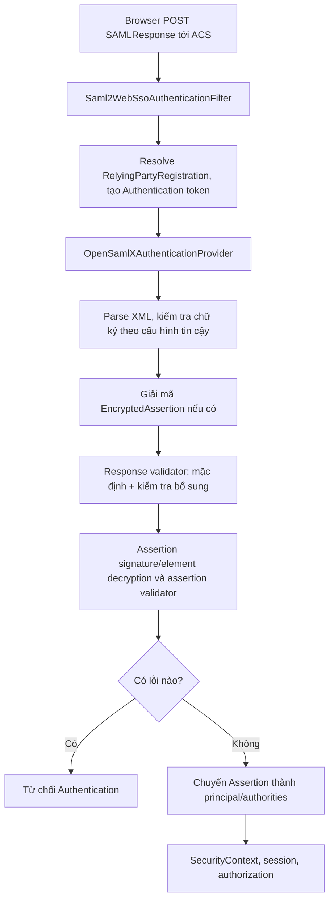

# Mở rộng bộ kiểm chứng của OpenSAML mà vẫn giữ các kiểm tra mặc định

## 1. Mục tiêu và phạm vi

Trong SAML 2.0 federation, ứng dụng Spring Boot đóng vai trò **Service Provider (SP)** nhận `SAMLResponse` từ **Identity Provider (IdP)**. Trước khi tạo phiên đăng nhập, Spring Security sử dụng OpenSAML để phân tích thông điệp, xác minh chữ ký, giải mã khi cần và kiểm tra các điều kiện của Response/Assertion. Doanh nghiệp đôi khi còn yêu cầu chính sách riêng, chẳng hạn:

- Chỉ cho phép **SP-initiated login**, không chấp nhận SAML Response không có ngữ cảnh yêu cầu trước đó.
- Chỉ cho phép một `AuthnContextClassRef` đã được IdP cam kết, hoặc yêu cầu xác thực đủ mới.
- Chặn assertion có thuộc tính nghiệp vụ không hợp lệ sau khi bảo đảm assertion thuộc IdP tin cậy.
- Yêu cầu thêm các điều kiện về `OneTimeUse`, thiết bị, nhóm người dùng hoặc dữ liệu tenant đã được xác minh.

Cách làm an toàn **không phải thay toàn bộ validator mặc định bằng một lambda trả về “thành công”**. Phải giữ nguyên các lớp kiểm tra cần thiết của framework, **bổ sung** điều kiện nghiệp vụ rồi gộp lỗi lại. Nếu một trong hai nhánh báo lỗi, Authentication phải thất bại.

Bài này dùng **Spring Security 6.x/OpenSAML 4** để minh họa hai hook `setResponseValidator` và `setAssertionValidator`, đồng thời đối chiếu khác biệt chính trong **Spring Security 7/OpenSAML 5**. Ví dụ Spring Boot dùng Java 17+; cần IdP SAML hợp lệ mới chạy được quy trình đăng nhập end-to-end.

**Kết quả cần đạt:** phân biệt response-level và assertion-level validation; bảo toàn default validation; bổ sung rule fail-closed; nối `Saml2ResponseValidatorResult` đúng cách; kiểm thử việc từ chối issuer/audience/signature sai; tránh nhầm validator với bước signature verification hoặc authentication conversion.

## 2. Nhìn đúng các tầng trong SAML authentication pipeline



Sơ đồ là **mô hình trách nhiệm**, không cam kết thứ tự mọi thao tác chi tiết cho mọi version, binding và vị trí chữ ký. Tùy Response hay Assertion được ký/mã hóa, provider xử lý chữ ký và decryption đúng vị trí phù hợp để không làm sai nội dung đã ký.

Trong Spring Security, các lớp có trách nhiệm riêng:

| Thành phần | Trách nhiệm | Không nên nhầm với |
| --- | --- | --- |
| `Saml2WebSsoAuthenticationFilter` | Nhận HTTP POST tại ACS; yêu cầu authentication | Validator nghiệp vụ độc lập |
| `Saml2AuthenticationTokenConverter` | Đọc response từ request và resolve `RelyingPartyRegistration` | Xác thực rằng IdP đã ký hợp lệ |
| `OpenSaml4AuthenticationProvider` / `OpenSaml5AuthenticationProvider` | Pipeline xác thực và các hook OpenSAML | Servlet filter hoặc controller thông thường |
| Response validator | Kiểm tra điều kiện **Response**, ví dụ issuer/destination/correlation theo version | Assertion-level audience và subject confirmation |
| Assertion validator | Kiểm tra **Assertion** và điều kiện/subject confirmation | Giải mã XML hoặc kiểm tra TLS |
| Signature verification | Đảm bảo chữ ký thuộc khóa IdP tin cậy, nội dung đã ký phù hợp | Chỉ kiểm tra một chuỗi `Issuer` |
| Response authentication converter | Biến kết quả đã xác minh thành `Authentication`/principal | Nơi thay thế mọi kiểm tra an ninh |
| `RelyingPartyRegistrationRepository` | Giữ trust configuration SP–IdP (Entity ID, ACS, verification key) | Kho lưu AuthnRequest đang chờ |

### Những điểm mặc định không được đánh mất

Tùy phiên bản/profile, pipeline mặc định kiểm tra một tập điều kiện như `Issuer`, `Destination`, correlation `InResponseTo`, `AudienceRestriction`, `SubjectConfirmation`, các giới hạn thời gian và các điều kiện assertion được triển khai. **Không giả định mọi kiểm tra chống replay hoặc chính sách nghiệp vụ đặc thù đều đã có đầy đủ chỉ nhờ bật `saml2Login`**; phải đối chiếu release, thỏa thuận SAML và threat model.

Một signature có thể được kiểm tra ở bước riêng với `setResponseValidator`/`setAssertionValidator`. Vì vậy, **không sửa validator để “thêm kiểm tra chữ ký” bằng cách đọc thuộc tính XML**; cần giữ nguyên cơ chế xác minh chữ ký do provider cấu hình với certificate IdP tin cậy.

## 3. Khi nào cần kiểm tra ở Response, khi nào ở Assertion?

Một SAML protocol Response mang các thuộc tính và một hoặc nhiều Assertion. Chọn hook theo thứ mà rule thực sự áp dụng.

### 3.1. Response-level rule

Ví dụ những điều kiện về phong bì giao thức:

- Đối tác chỉ chấp nhận phản hồi của **SP-initiated flow**, không cho unsolicited/IdP-initiated.
- Yêu cầu `Response@InResponseTo` có mặt theo chính sách giao dịch **đã được xác minh ở tầng correlation**, không coi “có chuỗi ID” là đủ.
- Kiểm tra bổ sung `Response@IssueInstant`, `StatusCode` hoặc thông tin được đối tác thỏa thuận **khi framework chưa áp dụng policy đó**.
- Ràng buộc endpoint, tenant hoặc loại response với một registration được phép.

`Response` có `Issuer`, `Destination`, `ID`, `InResponseTo`, `Status`, `IssueInstant`. Đừng chỉ so một URI do browser gửi đến rồi tự xem Response “đáng tin”; trước khi chuyển thành Authentication, chữ ký và trust key phải được xác minh theo `RelyingPartyRegistration`.

### 3.2. Assertion-level rule

Ví dụ những điều kiện đối với nội dung danh tính:

- `AuthnStatement/AuthnContextClassRef` thuộc tập phương thức xác thực được chấp nhận.
- `AuthnInstant` đạt ngưỡng freshness khi nghiệp vụ yêu cầu.
- Các thuộc tính đã được IdP ký và SP xác minh chứa tenant ID hợp lệ, định dạng email phù hợp hoặc thuộc tính bắt buộc.
- Assertion dùng `OneTimeUse` và ứng dụng có chiến lược replay cache tương ứng nếu profile yêu cầu.

`Assertion` có `Subject`, `Conditions`, `AuthnStatement`, `AttributeStatement` và có thể có chữ ký riêng. Các kiểm tra `AudienceRestriction`, `SubjectConfirmationData@Recipient`, `NotBefore`/`NotOnOrAfter` và correlation có thể nằm trong validator mặc định của OpenSAML. Khi bổ sung policy, **không vô hiệu hóa** các lớp kiểm tra này.

### 3.3. Quy tắc chọn vị trí

Nếu rule chỉ xem `Response.getInResponseTo()` thì đặt ở response validator. Nếu rule cần đọc `Assertion.getAuthnStatements()` hoặc attributes, đặt ở assertion validator. Nếu rule chỉ thay đổi cách ánh xạ **một assertion đã xác thực** thành vai trò người dùng, cân nhắc response authentication converter hoặc service phân quyền; đừng dùng validator để gán quyền trước khi tin tưởng dữ liệu.

Một yêu cầu mức xác thực cao có thể cần thêm **ngữ cảnh giao dịch đã lưu ở server**; chỉ nhìn response XML chưa đủ để biết browser này đã yêu cầu step-up hay chưa.

## 4. Những lỗi nguy hiểm khi tự mở rộng

### 4.1. Ghi đè toàn bộ validator rồi trả về success

```java
provider.setAssertionValidator(token ->
        Saml2ResponseValidatorResult.success());
```

**Không dùng cách này trong production.** Đoạn mã sẽ bỏ qua các lỗi mà **assertion validator** mặc định đáng lẽ trả về, như audience/subject confirmation/điều kiện assertion tùy version. Không vì thế mà mọi bước ngoài validator (như signature verification) tự biến mất, nhưng hệ thống vẫn đã mất các tầng bảo vệ quan trọng.

### 4.2. Chỉ kiểm tra rule riêng, không gọi validator mặc định

```java
provider.setResponseValidator(token -> {
    if (someBusinessRule(token)) {
        return Saml2ResponseValidatorResult.success();
    }
    return Saml2ResponseValidatorResult.failure(
            new Saml2Error(Saml2ErrorCodes.INVALID_RESPONSE,
                    "Application policy failed"));
});
```

Đây là **pseudocode có hàm `someBusinessRule` chưa định nghĩa**, chỉ minh họa anti-pattern, **không phải chương trình Java độc lập**. Nó chỉ phản ánh rule nghiệp vụ mà có thể bỏ kiểm tra issuer, destination và các điều kiện response mặc định.

### 4.3. Thay đổi metadata/trust để “sửa” lỗi policy

Nếu callback fail vì `AudienceRestriction` hoặc `Recipient`, không nên bỏ validator audience hoặc chấp nhận mọi ACS. Nguyên nhân có thể là IdP đăng ký sai Entity ID/ACS hoặc reverse proxy làm sai `{baseUrl}`. **Sửa cấu hình gốc** thay vì hạ chuẩn xác minh.

## 5. Spring Security 6.x: API nối validator an toàn

Với `OpenSaml4AuthenticationProvider`, API được cung cấp là:

```java
provider.setResponseValidator(responseToken -> ...);
provider.setAssertionValidator(assertionToken -> ...);
```

Hai phương thức nhận một Spring `Converter<...Token, Saml2ResponseValidatorResult>`. Spring Security cung cấp các factory:

```java
OpenSaml4AuthenticationProvider.createDefaultResponseValidator();
OpenSaml4AuthenticationProvider.createDefaultAssertionValidator();
```

**Điểm then chốt:** gọi factory **một lần** để lấy logic mặc định, đánh giá nó cho mỗi token, rồi **nối** kết quả riêng bằng `concat`.

```java
var responseDefaults =
        OpenSaml4AuthenticationProvider.createDefaultResponseValidator();

provider.setResponseValidator(token -> {
    Saml2ResponseValidatorResult builtIn =
            responseDefaults.convert(token);
    Saml2ResponseValidatorResult custom =
            validateApplicationResponsePolicy(token);
    return builtIn.concat(custom);
});
```

Đây là **mảnh cấu hình** với hàm `validateApplicationResponsePolicy` chưa định nghĩa, chỉ trình bày công thức; ví dụ đầy đủ ở mục 9. Điểm quan trọng của kết quả `Saml2ResponseValidatorResult`:

- `success()` biểu thị không có lỗi.
- `failure(new Saml2Error(code, description))` biểu thị có lỗi.
- `getErrors()` hoặc `hasErrors()` giúp kiểm tra trạng thái.
- `concat(Saml2Error)` hay `concat(Saml2ResponseValidatorResult)` tạo **một kết quả mới** chứa cả lỗi ban đầu lẫn lỗi được thêm. **Không bỏ qua giá trị trả về**.
- Nếu validator mặc định lỗi, nhưng custom trả thành công, kết quả gộp **vẫn lỗi**.
- Nếu mặc định thành công nhưng rule riêng lỗi, kết quả gộp **vẫn lỗi**.
- Chỉ khi cả hai không có lỗi thì có thể tiếp tục, với điều kiện các bước xác thực khác cũng thành công.

Một rule bổ sung không được dùng `return Saml2ResponseValidatorResult.success()` để **ghi đè lỗi mặc định**. Dùng phép kết hợp kiểu “tích lũy lỗi”, không phải “nếu custom OK thì cho qua”.

## 6. Minh họa độc lập: gộp kết quả fail-closed bằng Java 17

Để hiểu bản chất `concat` trước khi triển khai SAML thật, xét một ví dụ Java 17 độc lập dùng `List` giữ lỗi. Chương trình **không phải OpenSAML**, không xử lý chữ ký, chỉ minh họa logic giữ lỗi của hai bộ kiểm tra.

Lưu file `ValidatorCompositionDemo.java`:

```java
import java.util.ArrayList;
import java.util.List;

public final class ValidatorCompositionDemo {

    static List<String> combine(
            List<String> defaultErrors,
            List<String> customErrors) {
        List<String> errors = new ArrayList<>(defaultErrors);
        errors.addAll(customErrors);
        return List.copyOf(errors);
    }

    static void show(String name, List<String> defaults,
                     List<String> custom) {
        List<String> all = combine(defaults, custom);
        System.out.println(name + "=" + (all.isEmpty() ? "PASS" : "FAIL")
                + ",errors=" + all.size());
    }

    public static void main(String[] args) {
        show("bothGood", List.of(), List.of());
        show("issuerBad", List.of("invalid issuer"), List.of());
        show("contextBad", List.of(), List.of("low assurance"));
        show("bothBad",
                List.of("invalid audience"),
                List.of("low assurance"));
    }
}
```

Chạy bằng Java 17+:

```bash
javac ValidatorCompositionDemo.java
java ValidatorCompositionDemo
```

Stdout chính xác:

```text
bothGood=PASS,errors=0
issuerBad=FAIL,errors=1
contextBad=FAIL,errors=1
bothBad=FAIL,errors=2
```

Bốn trường hợp cho thấy **chỉ một lỗi ở bất kỳ bộ kiểm tra nào cũng đủ để từ chối**. Trong Spring Security, `Saml2ResponseValidatorResult` cung cấp sự tích lũy này mà không cần tự tạo `List`. Ví dụ trên không thay thế việc xác minh SAML protocol.

## 7. Phần cấu hình tối thiểu của ứng dụng Spring Boot

Ví dụ mục 9 sử dụng **Java 17+, Spring Boot 3.x/Spring Security 6.x và OpenSAML 4**. Nếu dự án dùng Spring Security 7, cần đi theo API `OpenSaml5AuthenticationProvider` ở mục 12; không copy các lớp từ hai phiên bản vào cùng file.

### 7.1. Gradle dependencies

Trong một dự án Spring Boot đã cấu hình Gradle wrapper, Java plugin và dependency management, có thể thêm vào `build.gradle`:

```groovy
repositories {
    mavenCentral()
    // Chỉ thêm Shibboleth repository nếu bộ OpenSAML phụ thuộc yêu cầu.
    maven { url "https://build.shibboleth.net/maven/releases/" }
}

dependencies {
    implementation "org.springframework.boot:spring-boot-starter-web"
    implementation "org.springframework.boot:spring-boot-starter-security"
    implementation "org.springframework.security:spring-security-saml2-service-provider"
}
```

Đoạn trên **không phải build file hoàn chỉnh**. Không ép version OpenSAML 5 nếu đang dùng ví dụ `OpenSaml4AuthenticationProvider`. Spring Security 6.5 hỗ trợ cả OpenSAML 4 và 5, nhưng từng bộ API có lớp/provider khác nhau.

### 7.2. application.yml

Cấu hình IdP được tin cậy:

```yaml
spring:
  security:
    saml2:
      relyingparty:
        registration:
          corp:
            assertingparty:
              metadata-uri: "${SAML_IDP_METADATA_URI}"
```

Spring cần một `RelyingPartyRegistration` hợp lệ, chứa Entity ID và endpoint IdP, verification certificate, ACS URL theo metadata hoặc cấu hình của SP. Biến `SAML_IDP_METADATA_URI` phải được cấp từ hạ tầng đáng tin cậy; không nhận metadata URI do người dùng truyền qua HTTP request chưa xác thực.

Ví dụ URL metadata sandbox chỉ để giải thích: `https://idp.example.test/metadata`. Muốn đăng nhập thật, ứng dụng phải được IdP đăng ký SP Entity ID và ACS URL đúng, có signing credentials khi profile đối tác đòi hỏi.

## 8. Chính sách bổ sung minh họa cho bài thực hành

Bài tập đặt hai chính sách bổ sung được tách rõ:

1. **Response rule – chỉ SP-initiated:** không chấp nhận một Response không mang `InResponseTo` trong ngữ cảnh được xử lý. Rule này yêu cầu **sự hiện diện**, không thay thế xác minh ID có thực sự khớp AuthnRequest đã lưu hay không; default protocol/correlation validation vẫn phải hoạt động.
2. **Assertion rule – authentication context:** chỉ chấp nhận một assertion có ít nhất một `AuthnStatement` báo `AuthnContextClassRef` chính xác là `urn:oasis:names:tc:SAML:2.0:ac:classes:PasswordProtectedTransport`. Đây là chính sách **minh họa về context cụ thể**, **không phải chính sách MFA**, và chỉ áp dụng nếu IdP thật hỗ trợ class này.

Cả hai rule đều không yêu cầu tự parse raw XML string hay xử lý HTTP form thủ công. Chúng đọc **đối tượng OpenSAML** trong pipeline của provider. Dù request/response có nhiều assertions, chỉ assertion được provider chấp nhận theo policy mới được dùng để xây identity. Custom rule không được xóa bớt assertion hoặc thay verification key trong lúc đánh giá.

**Quan trọng:** `PasswordProtectedTransport` không đồng nghĩa đăng nhập nhiều yếu tố. Nếu nghiệp vụ yêu cầu MFA, phishing resistance hoặc assurance level cao, cần thỏa thuận URI context riêng với IdP và kiểm tra đúng context đó, kết hợp freshness/authorization khi cần. Không đổi chuỗi URI để giả làm chính sách MFA.

## 9. Java 17+/Spring Security 6.x: cấu hình provider giữ mặc định và thêm rule

Lưu tại `src/main/java/demo/saml/SamlValidationApplication.java` trong dự án đã có dependency và application.yml ở trên:

```java
package demo.saml;

import org.opensaml.saml.saml2.core.AuthnContext;

import org.springframework.boot.SpringApplication;
import org.springframework.boot.autoconfigure.SpringBootApplication;
import org.springframework.context.annotation.Bean;
import org.springframework.core.convert.converter.Converter;
import org.springframework.security.authentication.ProviderManager;
import org.springframework.security.config.annotation.web.builders.HttpSecurity;
import org.springframework.security.saml2.core.Saml2Error;
import org.springframework.security.saml2.core.Saml2ErrorCodes;
import org.springframework.security.saml2.core.Saml2ResponseValidatorResult;
import org.springframework.security.saml2.provider.service.authentication.OpenSaml4AuthenticationProvider;
import org.springframework.security.web.SecurityFilterChain;
import org.springframework.web.bind.annotation.GetMapping;
import org.springframework.web.bind.annotation.RestController;

@SpringBootApplication
@RestController
public class SamlValidationApplication {

    private static final String REQUIRED_CONTEXT =
            "urn:oasis:names:tc:SAML:2.0:ac:classes:PasswordProtectedTransport";

    public static void main(String[] args) {
        SpringApplication.run(SamlValidationApplication.class, args);
    }

    @Bean
    SecurityFilterChain samlSecurity(HttpSecurity http) throws Exception {
        OpenSaml4AuthenticationProvider provider =
                new OpenSaml4AuthenticationProvider();

        // 1. Keep ALL built-in Response validation.
        Converter<OpenSaml4AuthenticationProvider.ResponseToken,
                Saml2ResponseValidatorResult> responseDefaults =
                OpenSaml4AuthenticationProvider.createDefaultResponseValidator();

        provider.setResponseValidator(token -> {
            Saml2ResponseValidatorResult result =
                    responseDefaults.convert(token);

            // Additional application policy: no unsolicited login.
            String inResponseTo = token.getInResponseTo();
            if (inResponseTo == null || inResponseTo.isBlank()) {
                result = result.concat(new Saml2Error(
                        Saml2ErrorCodes.INVALID_IN_RESPONSE_TO,
                        "SP-initiated SAML login is required"));
            }
            return result;
        });

        // 2. Keep ALL built-in Assertion validation.
        Converter<OpenSaml4AuthenticationProvider.AssertionToken,
                Saml2ResponseValidatorResult> assertionDefaults =
                OpenSaml4AuthenticationProvider.createDefaultAssertionValidator();

        provider.setAssertionValidator(token -> {
            Saml2ResponseValidatorResult result =
                    assertionDefaults.convert(token);

            boolean approved = token.getAssertion()
                    .getAuthnStatements().stream()
                    .anyMatch(statement ->
                            statement.getAuthnContext() != null
                            && statement.getAuthnContext()
                                    .getAuthnContextClassRef() != null
                            && REQUIRED_CONTEXT.equals(
                                    statement.getAuthnContext()
                                            .getAuthnContextClassRef().getURI()));

            if (!approved) {
                result = result.concat(new Saml2Error(
                        Saml2ErrorCodes.INVALID_ASSERTION,
                        "Authentication context is not permitted"));
            }
            return result;
        });

        return http
                .authorizeHttpRequests(auth -> auth
                        .requestMatchers("/").permitAll()
                        .anyRequest().authenticated())
                .saml2Login(saml -> saml
                        .authenticationManager(new ProviderManager(provider)))
                .build();
    }

    @GetMapping("/")
    public String publicPage() {
        return "Public page";
    }

    @GetMapping("/private")
    public String privatePage() {
        return "Authenticated SAML user";
    }
}
```

**Đọc ví dụ theo thứ tự:**

- `OpenSaml4AuthenticationProvider` là provider xử lý SAML2 authentication với OpenSAML 4; không được thay bằng một `AuthenticationManager` “luôn thành công”.
- `responseDefaults` được tạo bằng factory chính thức và được gọi **mỗi khi xác minh Response**.
- Rule riêng kiểm tra `token.getInResponseTo()` để từ chối unsolicited response theo chính sách **chỉ SP-initiated**. Sự tồn tại của `InResponseTo` không đủ chống replay/session confusion; các lớp mặc định vẫn phải đối chiếu transaction theo khả năng và cấu hình.
- `assertionDefaults` được gọi **cho mỗi Assertion**; các lỗi của nó được giữ trong `result`.
- `getAuthnStatements()` lấy statements của assertion; code yêu cầu một context thuộc allowlist để tiếp tục. Nếu IdP không công bố context hoặc dùng URI khác, authentication bị từ chối đúng chính sách bài tập.
- Mỗi `concat(new Saml2Error(...))` **tạo và trả một kết quả lỗi mới**, nên cần gán lại `result`.
- `ProviderManager(provider)` đưa provider đã cấu hình vào `saml2Login`, để các hook thực sự được dùng. Đừng tạo bean provider mà không wiring vào filter và nghĩ rằng app tự dùng.
- `/private` chỉ trả chuỗi cố định sau khi user đã được xác thực; code minh họa không đưa raw SAML XML ra response.

### 9.1. Điều kiện trước khi chạy

Ứng dụng chỉ có thể chạy SAML login end-to-end khi IdP metadata thật có issuer/cert, SP có entity ID/ACS đúng, và browser được gửi đến IdP SSO endpoint hợp lệ. Một số IdP yêu cầu SP ký AuthnRequest; khi đó còn cần private signing credential được cấp từ secret store.

Có thể khởi động dự án (shell POSIX):

```bash
SAML_IDP_METADATA_URI=https://idp.example.test/metadata ./gradlew bootRun
```

Domain `example.test` chỉ là ví dụ; không thể đăng nhập thực nếu không thay bằng IdP sandbox có cấu hình. **Không có stdout cố định** cho quá trình này: log startup, assertion class và trang IdP tùy môi trường. Khi Response hợp lệ, SP-initiated và context đúng, tài nguyên `/private` trả:

```text
Authenticated SAML user
```

Nếu IdP trả context khác, ví dụ `unspecified`, ứng dụng sẽ không đăng nhập theo rule đã đặt. Đây có thể là vấn đề **policy mapping**, không phải lỗi cú pháp Java.

### 9.2. Giới hạn của ví dụ

- Demo đặt policy context cho **mọi SAML login**. Ứng dụng thực tế có thể chỉ yêu cầu assurance cao với một số tài nguyên. Khi đó cần quản lý transaction/context đã được SP lưu và step-up riêng; không nới validator toàn cục cho tài nguyên quan trọng.
- Rule Response kiểm tra **sự hiện diện** của InResponseTo, không bảo đảm ID khớp AuthnRequest. Không bỏ repository/response correlation.
- Rule Assertion không so `AuthnInstant`, không thực hiện issuer signature check và không phân quyền nghiệp vụ. Các trách nhiệm đó thuộc framework hoặc chính sách kiểm tra khác.
- Không tự dùng context có mặt trong raw XML chưa xác minh để gán `ROLE_ADMIN`.

## 10. Giải thích chính xác: giữ mặc định khác gì thay thế toàn bộ?

Hai cách sau có cùng mục tiêu nghiệp vụ nhưng kết quả bảo mật rất khác:

| Cách làm | Default Response validation | Default Assertion validation | Rule bổ sung | Kết quả |
| --- | --- | --- | --- | --- |
| **Nối validator chuẩn** | Giữ | Giữ | Áp thêm | Có lỗi ở bất kỳ tầng nào → FAIL |
| Chỉ set Response validator custom | **Có thể mất** | Giữ nếu không sửa | Áp Response custom | Nguy cơ mất issuer/destination checking |
| Chỉ set Assertion validator custom | Giữ nếu không sửa | **Có thể mất** | Áp Assertion custom | Nguy cơ mất audience/subject confirmation |
| Tự `return success()` | Bị mất ở hook bị ghi đè | Bị mất ở hook bị ghi đè | Không/thiếu | Không an toàn |
| Giữ built-in nhưng bỏ `concat` return | Giữ built-in theo code | Giữ built-in theo code | **Lỗi custom bị bỏ** nếu không dùng kết quả | Không đúng mục tiêu |

Ở đây “mất” nói về **logic nằm trong validator hook bị thay**, không có nghĩa chữ ký XML sẽ tự động không được xác minh: provider có bước signature/decryption riêng. Tuy nhiên mất một phần validation mặc định có thể làm ứng dụng chấp nhận Assertion sai audience hoặc thiếu subject confirmation, nên vẫn là lỗi bảo mật nghiêm trọng.

### Quy tắc code review

- Có lời gọi `createDefaultResponseValidator()` hoặc cấu hình `ResponseValidator.withDefaults(...)` tương đương không?
- Có lời gọi `createDefaultAssertionValidator()` hoặc `AssertionValidator.builder()` giữ default validators không?
- Có ghép lỗi custom bằng `concat` và **return kết quả gộp** không?
- Có vô tình `try/catch` rồi trả `success()` nếu mặc định ném lỗi không?
- Có tách validation và conversion, không cấp quyền trước khi nhận SAML Response hợp lệ không?
- Có unit/integration tests chứng minh response sai chữ ký, issuer, audience vẫn bị từ chối không?

## 11. Các điều kiện bảo mật ngoài custom validators

### 11.1. Trust key và chữ ký

IdP verification certificate phải được cấu hình từ metadata/trust store đáng tin. Nếu app lấy key trực tiếp từ một URL do SAMLResponse chưa xác minh cung cấp, kẻ tấn công có thể khiến hệ thống tin key của mình. `Issuer` được viết dưới dạng text trong XML **không tự chứng minh ai ký**.

Một SAML Response có thể được ký ở cấp Response hoặc Assertion theo profile và chính sách. Provider cần dùng đúng phần được ký để tạo principal, tránh **XML Signature Wrapping**. Không tự lấy `NameID` ở một node khác node đã được xác minh.

### 11.2. ACS, Destination, Recipient

`Response@Destination` và `SubjectConfirmationData@Recipient` thường cần khớp ACS public URL. Khi ứng dụng sau reverse proxy, `{baseUrl}` có thể được resolve sai scheme/host nếu forwarded headers không được xử lý an toàn.

Không xóa Destination/Recipient validator để “khắc phục” lỗi proxy. Sửa public ACS, IdP registration và forwarded headers chỉ từ proxy tin cậy.

### 11.3. AudienceRestriction

`AudienceRestriction` định nghĩa assertion dành cho SP nào, thường là **SP Entity ID**. Nó không phải URL IdP SSO và không nhất thiết trùng ACS URL. Nếu default assertion validation từ chối audience, cần đối chiếu SP Entity ID trong metadata và IdP. Không thay `AudienceRestrictionValidator` bằng “accept all”.

### 11.4. Thời gian và clock skew

`Conditions@NotBefore`, `Conditions@NotOnOrAfter`, `SubjectConfirmationData@NotOnOrAfter` và `AuthnInstant` phục vụ những quy tắc khác nhau. Một clock skew ngắn có thể cần thiết nếu máy IdP/SP lệch vài giây, nhưng **không** nên tăng skew hàng giờ để chấp nhận assertion cũ. Dùng NTP, đồng hồ nhất quán và test đúng.

**`AuthnInstant` không phải thời điểm Response được gửi.** Nếu một nghiệp vụ yêu cầu xác thực gần đây, cần kiểm tra riêng AuthnInstant/freshness chứ không chỉ Response IssueInstant.

### 11.5. Request correlation và replay

Với SP-initiated SSO, `Saml2AuthenticationRequestRepository` lưu `AuthnRequest` để đối chiếu `InResponseTo`, RelayState và session theo flow. Nếu repository mất state vì cookie SameSite hoặc multi-replica, không nên chấp nhận Response thiếu correlation.

Chống replay có thể cần cache/cơ chế state đủ mạnh giữa nhiều instance. Việc đọc `OneTimeUse` rồi trả success không biến hệ thống thành cơ chế chống replay; cần lưu ID assertion/response đã sử dụng và xử lý TTL/atomic consume nếu chính sách yêu cầu.

## 12. Spring Security 7/OpenSAML 5: cách giữ default theo API mới

Khi nâng cấp lên Spring Security 7/OpenSAML 5, ví dụ `OpenSaml4AuthenticationProvider.createDefaultAssertionValidator()` **không nên copy sang OpenSaml5**. Tài liệu mới dùng kiểu helper/builder khác.

### 12.1. ResponseValidator.withDefaults(...)

Với response validation, cấu trúc được tài liệu hướng dẫn:

```java
OpenSaml5AuthenticationProvider provider =
        new OpenSaml5AuthenticationProvider();

ResponseValidator validator =
        ResponseValidator.withDefaults(myCustomValidator);

provider.setResponseValidator(validator);
```

Đây là **trích đoạn minh họa API của Spring Security 7**, giả định `myCustomValidator` là validator phù hợp với contract `ResponseValidator`. Ý tưởng là **giữ default** rồi thêm custom, không phải thay thế bằng logic chỉ kiểm tra rule riêng.

### 12.2. AssertionValidator.builder()

Một ví dụ Spring Security 7 theo hướng dẫn tích hợp thêm OpenSAML `ConditionValidator`:

```java
OpenSaml5AuthenticationProvider provider =
        new OpenSaml5AuthenticationProvider();

AssertionValidator validator = AssertionValidator.builder()
        .conditionValidators(validators -> validators.add(myConditionValidator))
        .build();

provider.setAssertionValidator(validator);
```

Đây là **mảnh cấu hình** (phụ thuộc định nghĩa `myConditionValidator` phù hợp với OpenSAML) chứ không phải Java SE độc lập. Builder bắt đầu từ các validator mặc định rồi thêm condition validator qua consumer; điều này khác việc tạo danh sách trống chỉ chứa custom. Cần đọc đúng API phiên bản đang dùng, đặc biệt nếu ứng dụng custom nhiều nhóm validators.

Một số mã cũ dùng `OpenSaml5AuthenticationProvider.createDefaultAssertionValidator()` sẽ phải điều chỉnh khi chuyển lên Spring Security 7. Không trộn Spring Security 6.x `Saml2ResponseValidatorResult` callback pattern với các helper mới mà chưa đối chiếu kiểu method.

### 12.3. Thay vì đoán, ghim release

Trong tài liệu triển khai và kiểm thử, hãy ghi:

- Phiên bản chính xác của Spring Boot và Spring Security.
- Phiên bản OpenSAML runtime (4 hay 5).
- Provider đang dùng: `OpenSaml4AuthenticationProvider` hay `OpenSaml5AuthenticationProvider`.
- API dựng default/extended validators tương ứng.
- Bộ negative tests chứng minh validation không suy giảm khi nâng cấp.

Đặc biệt trong migration, một cấu hình custom authentication provider có thể bypass cấu hình mà Spring Security tự dựng theo version mới. Vì vậy cần test lại ACS, metadata, signatures, assertion constraints và kết quả principal sau upgrade.

## 13. Nếu muốn tăng clock skew mà vẫn giữ các kiểm tra mặc định

Đôi khi người học nghĩ cần thay validator toàn bộ chỉ để cho phép sai lệch đồng hồ giữa IdP và SP. Spring Security 6.x/OpenSAML 4 có API xây **default assertion validator với tham số validation context**:

```java
provider.setAssertionValidator(
        OpenSaml4AuthenticationProvider
                .createDefaultAssertionValidatorWithParameters(parameters -> {
                    // Tùy chỉnh đúng tham số theo phiên bản OpenSAML
                    // và tài liệu validation context, không xóa validators.
                }));
```

Đoạn này **minh họa điểm mở rộng**, chưa truyền tham số cụ thể. Muốn điều chỉnh clock skew, phải tham khảo `SAML2AssertionValidationParameters.CLOCK_SKEW` và đơn vị dữ liệu được thư viện yêu cầu ở version đang chạy. Không tự suy luận cùng một key dùng “số mili giây” hay “Duration” trên mọi OpenSAML version.

Với Spring Security 7, `AssertionValidator.builder().clockSkew(Duration.ofMinutes(2)).build()` là kiểu API được tài liệu hỗ trợ, giữ bộ validator được builder quản lý. Chỉ tăng độ lệch trong giới hạn được tổ chức phê duyệt. Không sửa đồng hồ server qua tham số validator nếu NTP sai nghiêm trọng.

## 14. Bổ sung kiểm tra OneTimeUse: thiết kế đúng

`<saml:OneTimeUse/>` là điều kiện assertion theo SAML 2.0. Nếu bên tích hợp yêu cầu “assertion chỉ được sử dụng một lần”, một custom validator có thể kiểm tra điều kiện này, nhưng **việc thực thi chống replay có trạng thái** là trách nhiệm bổ sung.

Phương án an toàn cần:

1. Xác định profile SAML của IdP có thật sự phát `OneTimeUse` hay không; có thể từ chối assertion thiếu phần tử nếu đó là yêu cầu bắt buộc của ứng dụng.
2. Kiểm tra assertion đã xác minh chữ ký và điều kiện hợp lệ, không thao tác theo XML chưa kiểm tra.
3. Sử dụng replay cache với khóa phù hợp, ví dụ **issuer được tin + assertion ID**, lưu tới hết thời gian hiệu lực có thêm clock skew hợp lý.
4. Với multi-replica, cache phải chia sẻ và có thao tác ghi/consume đủ atomic để hai callback đồng thời không cùng được chấp nhận.
5. Nếu cache không truy cập được hoặc bị lỗi, quyết định fail-closed cho policy có yêu cầu bảo mật cao.

Nếu chỉ viết:

```java
boolean hasOneTimeUse = assertion.getConditions() != null
        && assertion.getConditions().getOneTimeUse() != null;
```

thì mới kiểm tra **sự có mặt của phần tử**, chưa thực hiện replay prevention. Đây là **đoạn Java minh họa trên biến `assertion` đã có**, không phải chương trình độc lập. Không tuyên bố đã chống replay chỉ vì có `OneTimeUse`.

## 15. Ngữ cảnh xác thực và chính sách MFA cần bổ sung hợp lý

`AuthnContextClassRef` mô tả context mà IdP báo cho SP trong `AuthnStatement`. Ví dụ code mục 9 yêu cầu `PasswordProtectedTransport` để minh họa cách mở rộng assertion validator. Đây chỉ là một lớp xác thực phổ biến; **không** được gọi nó là MFA.

Nếu ứng dụng yêu cầu MFA hoặc phishing-resistant authentication:

- Hai bên SP/IdP phải thống nhất một hoặc nhiều URI class có ý nghĩa thực tế và cách IdP gắn class vào phương thức xác thực.
- SP nên gửi `RequestedAuthnContext` thích hợp trong AuthnRequest của flow tương ứng.
- Sau khi nhận Response, SP kiểm tra **context thực tế** trong assertion đã được xác minh.
- Có thể cần kiểm tra `AuthnInstant` để bảo đảm lần xác thực đủ mới, nhất là với step-up.
- Authentication context không tự cấp quyền nghiệp vụ. Phải áp thêm `GrantedAuthority`/authorization của ứng dụng.

Một số IdP báo `unspecified` dù người dùng đã dùng MFA; nếu nghiệp vụ bắt buộc bảo đảm theo context, hãy phối hợp cấu hình IdP/mapping thay vì trả thành công vô điều kiện khi thiếu class.

## 16. Nhiều IdP/tenant: giữ đúng trust boundary

Một ứng dụng có thể có registrations `corp`, `partner` và `customer`, mỗi registration gắn với IdP issuer, metadata và certificate verify khác nhau.

Nếu mở rộng validator:

- Không dựa hoàn toàn vào request parameter `registrationId` do browser đưa đến; vẫn phải resolve registration theo flow tin cậy và xác minh issuer/cert.
- Rule custom có thể cần **policy riêng cho từng registration**. URI AuthnContextClassRef được IdP A hiểu chưa chắc có cùng ý nghĩa ở IdP B.
- Khi assertion chứa thuộc tính `tenant`, phải đối chiếu với tenant được giao dịch đang dùng, không chấp nhận một chuỗi do client tự gán.
- Nếu hợp nhất user từ hai IdP khác nhau vào cùng tài khoản, phải bảo vệ account linking; một `NameID` giống nhau không tự chứng minh cùng danh tính.
- Default signature/issuer/audience/destination validation phải được giữ cho **từng** IdP, không dùng một verification certificate chung hoặc bỏ audience check.

Với dữ liệu user/tenant, nên đưa policy server-side qua một service được cấu hình, không biến danh sách IdP được phép thành một biến runtime do browser sửa.

## 17. Đừng viết logic sau xác thực để thay validator trước xác thực

Có hai giai đoạn khác nhau:

1. **Authentication validation:** quyết định SAML Assertion có đáng tin để tạo identity không.
2. **Authorization:** quyết định identity đã xác thực có được truy cập route hoặc thực hiện thao tác không.

Một lỗi phổ biến:

```java
// Sai hướng khi muốn bảo vệ assertion:
String role = request.getParameter("role");
if ("admin".equals(role)) {
    // ...
}
```

Đây là **mã anti-pattern minh họa**, không phải triển khai. Bất kỳ tham số browser chưa tin cậy nào đều không thể thay thế thuộc tính đã được IdP ký và SP xác minh. Ngay cả một attribute `groups=admins` trong assertion cũng cần mapping chính sách rõ ràng, không nên cấp toàn bộ quyền của ứng dụng một cách mù quáng.

Nếu custom converter để tạo principal sau authentication, hãy giữ converter mặc định hoặc cơ chế an toàn tương đương; không tự tạo `Authentication(authenticated=true)` từ raw XML/HTTP request. Converter và validator có thể cùng được tùy chỉnh, nhưng cần test độc lập mỗi tầng.

## 18. Kế hoạch kiểm thử mở rộng validator

### 18.1. Positive test

Dùng IdP sandbox và certificate thử nghiệm, cấu hình SP đúng issuer, entity ID, ACS và response binding. Tạo SP-initiated AuthnRequest, IdP trả một Response có chữ ký/correlation/audience hợp lệ, Assertion có context nằm trong allowlist. Kỳ vọng: request được xác thực, `/private` được phép vào; không có lỗi do custom validator.

### 18.2. Negative tests quan trọng

| Trường hợp | Default validation | Custom validation | Kết quả SP phải nhận |
| --- | --- | --- | --- |
| Issuer khác IdP tin cậy | Thất bại | Dù custom hợp lệ | **FAIL** |
| Chữ ký sai | Thất bại ở signature stage | Không được quyền bỏ qua | **FAIL** |
| Audience dành cho SP khác | Thất bại | Dù context hợp lệ | **FAIL** |
| Destination/Recipient sai | Thất bại | Dù SP-initiated | **FAIL** |
| Assertion hết hạn | Thất bại | Dù context hợp lệ | **FAIL** |
| Response thiếu InResponseTo khi chỉ cho SP-initiated | Có thể phụ thuộc flow | Thất bại | **FAIL** |
| Có InResponseTo nhưng không khớp request đã lưu | Thất bại ở correlation | Chỉ presence check không đủ | **FAIL** |
| Context là `unspecified` | Default có thể hợp lệ | Thất bại | **FAIL** |
| Context là `PasswordProtectedTransport` và các điều kiện khác hợp lệ | Thành công | Thành công | **PASS** |
| SAML XML bị sửa (signature wrapping) | Chữ ký/payload validation phải chặn | Không xử lý raw node | **FAIL** |
| Replay Response/Assertion | Cần thiết kế replay/correlation đầy đủ | Không được bypass | **FAIL** theo policy |
| Kết nối IdP / metadata sai | Trust/configuration lỗi | Không liên quan | **FAIL** |

**Test phải chứng minh bảo toàn mặc định**: nếu unit test chỉ kiểm tra rule `PasswordProtectedTransport` mà không thử assertion sai audience, thì chưa chứng minh custom validator an toàn.

### 18.3. Unit test cho rule custom

Có thể tách logic `isAuthnContextAllowed(Assertion)` thành một class/predicate nhỏ rồi unit test các trường hợp:

- `getAuthnStatements()` rỗng.
- `getAuthnContext()` null.
- `getAuthnContextClassRef()` null.
- ClassRef đúng allowlist.
- ClassRef khác allowlist.
- Nhiều AuthnStatements, một class đúng.

Những test này kiểm tra quy tắc **nội dung**, không chứng minh SAML protocol validation. Cần integration test qua authentication provider thực với IdP/certificate test để bảo đảm chữ ký/issuer/audience vẫn bị từ chối.

## 19. Quan sát/log an toàn

Trong authentication failure, Spring Security có thể phát các lỗi từ `Saml2ResponseValidatorResult`. Nội dung mô tả lỗi cho người vận hành nên vừa đủ, ví dụ:

- `Response rejected by default issuer/destination validation`.
- `Assertion rejected: authentication context not permitted`.
- `Unsolicited SAML Response not allowed for registration corp`.
- `Validation failure: expected audience mismatch`.

Không log toàn bộ `SAMLResponse`, `SAMLRequest`, XML assertion, `NameID`, cookie, session ID, private key hoặc access token. Response có thể chứa thông tin định danh và bằng chứng đăng nhập. Khi tạo metric, nên đếm lỗi theo **mã lỗi**, registration và nhóm nguyên nhân đã redacted, không dùng chuỗi chứa nội dung nhạy cảm từ IdP làm label metric.

Không trả nguyên stack trace hoặc XML cho browser khi fail. Màn hình người dùng có thể nêu “Không xác thực được” hoặc “Phương thức đăng nhập chưa đáp ứng chính sách”; log nội bộ kiểm soát quyền chứa correlation ID an toàn để điều tra.

## 20. Checklist code review

- [ ] Dùng đúng Spring Security/OpenSAML version; không trộn provider OpenSAML 4/5.
- [ ] Response validator mặc định vẫn được gọi hoặc `ResponseValidator.withDefaults` được dùng đúng.
- [ ] Assertion validator mặc định vẫn được gọi hoặc builder giữ default validators.
- [ ] `concat` được dùng và **giá trị trả về** được trả cho provider.
- [ ] Custom errors dùng `Saml2Error`/`Saml2ErrorCodes` rõ ràng, không nuốt exception rồi trả success.
- [ ] Signature và decryption được giữ trong pipeline chuẩn.
- [ ] Verification certificate/metadata của IdP đến từ nguồn tin cậy.
- [ ] `Issuer`, `Destination`, `Recipient`, `AudienceRestriction` và timing/correlation không bị bỏ kiểm tra.
- [ ] Không dùng raw HTTP parameters làm identity/authority.
- [ ] Có quyết định rõ SP-initiated/IdP-initiated, cùng chiến lược replay.
- [ ] Nếu có assurance/MFA, đã xác minh class thực tế và freshness theo policy.
- [ ] Không bỏ qua `Saml2AuthenticationRequestRepository` để sửa lỗi session.
- [ ] Tests chứng minh **invalid signature/audience/destination** vẫn FAIL sau custom.
- [ ] Multi-replica và cookie/session đã được thử với IdP thực tế.
- [ ] Chỉ expose thông tin chẩn đoán đã redacted; không in SAML Response.

## 21. Câu hỏi tự đánh giá

**Câu 1. Vì sao không dùng `setAssertionValidator(token -> Saml2ResponseValidatorResult.success())`?**  
Vì nó thay thế các bước validation mặc định của assertion và có thể bỏ audience/subject confirmation/conditions tùy version. Chữ ký có thể còn được kiểm tra ở bước khác, nhưng một lớp bảo vệ quan trọng đã mất.

**Câu 2. Cách an toàn để nối custom validation trong Spring Security 6.x là gì?**  
Gọi `createDefaultAssertionValidator()` hoặc `createDefaultResponseValidator()`, xử lý token bằng validator mặc định, rồi ghép lỗi custom qua `Saml2ResponseValidatorResult.concat(...)` và trả lại kết quả đã gộp.

**Câu 3. Nếu default validator fail nhưng custom validator pass thì chấp nhận login được không?**  
Không. Kết quả gộp vẫn chứa lỗi mặc định.

**Câu 4. Assertion sai audience nhưng có AuthnContextClassRef đúng allowlist thì sao?**  
Authentication phải bị từ chối. Context đúng không thay `AudienceRestriction`.

**Câu 5. Nếu `Response.getInResponseTo()` không null thì chắc chắn response thuộc browser này chứ?**  
Không. Presence check chỉ là rule sơ bộ; vẫn phải kiểm tra correlation với AuthnRequest/server-side state.

**Câu 6. Muốn kiểm tra OneTimeUse chỉ cần xác định phần tử tồn tại không?**  
Không. Cần chính sách replay state/cache và consume phù hợp nếu yêu cầu dùng một lần.

**Câu 7. Spring Security 7 còn dùng y nguyên API `OpenSaml4AuthenticationProvider` không?**  
Không. Tài liệu Spring Security 7 hướng dẫn `OpenSaml5AuthenticationProvider`, `ResponseValidator.withDefaults` và `AssertionValidator.builder`; phải đối chiếu release.

**Câu 8. Có thể sửa issuer invalid bằng cách xóa issuer validator không?**  
Không. Phải kiểm tra registration/metadata/certificate IdP và cấu hình trust.

**Câu 9. Nếu chỉ muốn thay role mapping sau SAML login, có bắt buộc thay assertion validator không?**  
Không. Có thể xử lý bằng converter/authorization sau khi assertion đã được xác minh, bảo toàn kiểm tra identity.

**Câu 10. Bộ test tối thiểu cho custom validator cần chứa gì?**  
Ngoài case đúng context, phải có invalid issuer/signature/audience/destination/time/correlation và context thiếu/sai để chứng minh fail-closed.

## 22. Tài liệu tham khảo

- [Spring Security 6.x – Authenticating SAML Responses](https://docs.spring.io/spring-security/reference/6.5/servlet/saml2/login/authentication.html): hook mở rộng validation, `createDefaultAssertionValidator` và `concat`.
- [OpenSaml4AuthenticationProvider Javadoc](https://docs.spring.io/spring-security/site/docs/6.5.6/api/org/springframework/security/saml2/provider/service/authentication/OpenSaml4AuthenticationProvider.html): factory default validators, `setResponseValidator` và `setAssertionValidator`.
- [Saml2ResponseValidatorResult Javadoc](https://docs.spring.io/spring-security/site/docs/6.5.6/api/org/springframework/security/saml2/core/Saml2ResponseValidatorResult.html): `success`, `failure`, `getErrors` và `concat`.
- [Saml2Error / Saml2ErrorCodes Javadoc](https://docs.spring.io/spring-security/site/docs/6.5.6/api/org/springframework/security/saml2/core/Saml2Error.html): mã lỗi xác minh.
- [Spring Security – OpenSAML Support](https://docs.spring.io/spring-security/reference/6.5/servlet/saml2/opensaml.html): OpenSAML 4 và OpenSAML 5 trong Spring Security 6.5.
- [Spring Security 7 – Authenticating SAML Responses](https://docs.spring.io/spring-security/reference/7.0/servlet/saml2/login/authentication.html): `ResponseValidator.withDefaults`, `AssertionValidator.builder`.
- [SAML 2.0 Core](https://docs.oasis-open.org/security/saml/v2.0/saml-core-2.0-os.pdf): assertion conditions, subject confirmation, message validation.
- [OWASP SAML Security Cheat Sheet](https://cheatsheetseries.owasp.org/cheatsheets/SAML_Security_Cheat_Sheet.html): XML Signature Wrapping, replay, trust/key validation và các biện pháp bổ sung.
