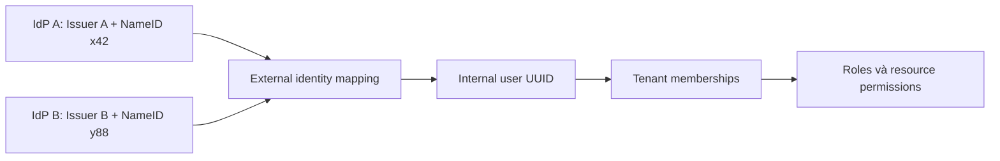
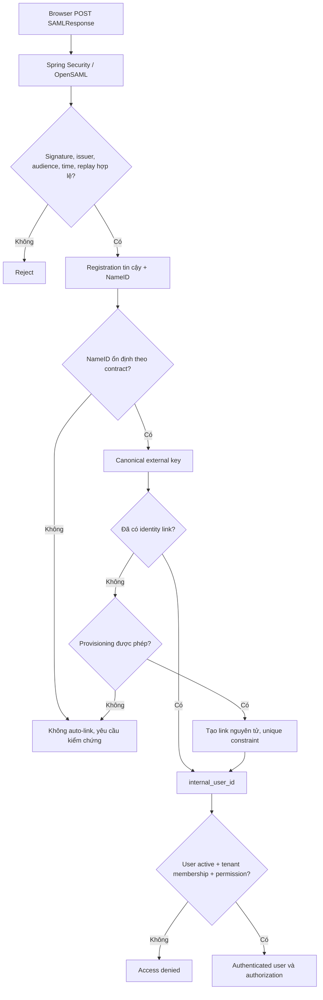

# Lựa chọn khóa định danh từ Issuer và NameID ổn định

**Module:** Spring Security – federation. **Nhóm kiến thức:** Danh tính và quyền.

Trong SAML2 federation, một người dùng có thể đăng nhập qua nhiều Identity Provider (IdP), đổi email, đổi tên đăng nhập hoặc chuyển hệ thống danh tính. Nếu ứng dụng Service Provider (SP) chọn email hay chỉ dùng chuỗi `NameID` làm khóa tài khoản, nguy cơ tạo tài khoản trùng, mất dữ liệu cũ hoặc nhầm quyền giữa tổ chức là rất lớn.

Giải pháp là phân biệt rõ **danh tính ngoài do IdP phát hành** với **tài khoản nội bộ của ứng dụng**. Điểm khởi đầu thường là một khóa ghép **(IdP Issuer đã xác minh, NameID ổn định)**. Khi có nhiều SP/tenant, NameID Format hoặc qualifier có ý nghĩa, khóa phải được **ràng buộc với đúng namespace** theo hợp đồng federation. Quyết định khóa diễn ra **sau khi Spring Security đã xác minh SAML Assertion**, không dựa vào XML hoặc tham số trình duyệt chưa được kiểm chứng.

Bài học dùng SAML 2.0 Web Browser SSO, Spring Security Servlet và Java 17+. Mã Spring Security minh họa API 7.x; các nhánh 6.x có một số khác biệt. Nội dung gồm cơ sở lựa chọn khóa, luồng xử lý, lược đồ SQL, ví dụ Java chạy độc lập, ví dụ Spring và checklist chống account takeover.

## 1. Ba khái niệm không được gộp làm một

| Khái niệm | Vai trò | Ví dụ |
| --- | --- | --- |
| **External subject** | Danh tính do một IdP tin cậy phát hành trong phạm vi federation | `Issuer A + persistent NameID x42` |
| **Internal user** | Người dùng được hệ thống nghiệp vụ quản lý qua ID bất biến | `user_id = 7c0e...` |
| **Authorization** | Quyền của internal user đối với tenant, hành động và tài nguyên | Được xem đơn hàng tenant A, không được duyệt thanh toán |

SAML xác nhận một subject đã được IdP xác thực theo giao thức; ứng dụng cần tra subject ấy sang một `internal_user_id` rồi tiếp tục đánh giá tài khoản đang hoạt động, membership và permission. Việc nhận một SAML Response có chữ ký hợp lệ **không tự cấp quyền**.



Hai external identities có thể cùng liên kết tới một internal user **chỉ khi qua quy trình account linking đáng tin**. Không suy luận rằng chúng thuộc cùng người từ email giống nhau.

## 2. Issuer: ai có thẩm quyền phát danh tính?

`Issuer` trong SAML Assertion thường là một URI xác định IdP phát hành, ví dụ:

```xml
<saml:Issuer
  xmlns:saml="urn:oasis:names:tc:SAML:2.0:assertion">
  https://idp.partner-a.example/metadata
</saml:Issuer>
```

Issuer tạo namespace cho NameID. Hai IdP độc lập hoàn toàn có thể phát cùng chuỗi `abc123` mà chỉ hai người khác nhau. Nếu ứng dụng dùng một mình `NameID` làm khóa toàn cục, subject của A có thể bị gộp nhầm với subject của B.

**Issuer dùng cho ánh xạ phải được kiểm chứng.** SP phải:
1. Xác định đúng `RelyingPartyRegistration` được phép xử lý giao dịch.
2. Xác minh SAML Response/Assertion: chữ ký, issuer, destination, audience, recipient, thời hạn, subject confirmation và replay theo chính sách.
3. Lấy **entity ID IdP tin cậy** gắn với registration đã xác minh; không tự đọc issuer từ body HTTP/XML chưa được thư viện xác thực.
4. Không dùng hostname của IdP login page, email domain hoặc `registrationId` làm thay thế vô điều kiện cho issuer/entity ID.

`registrationId` của Spring Security (ví dụ `partner-a`) là **nhãn cấu hình cục bộ**. Nó có thể đổi khi refactor ứng dụng mà IdP vẫn giữ cùng entity ID. `RelyingPartyRegistration.getAssertingPartyMetadata().getEntityId()` cho biết entity ID IdP trong metadata tin cậy. Nếu issuer thực tế đổi, cần quy trình migration đã xác minh — không coi hai URI gần giống nhau là cùng authority.

**Phân biệt Issuer của IdP với SP entity ID:** issuer phát danh tính; SP entity ID xác định đối tượng nhận assertion và đôi khi là thành phần scope của pairwise NameID. Đừng đảo vai trò này trong cơ sở dữ liệu.

## 3. NameID: chuỗi định danh có Format và phạm vi

Một `NameID` trong `Subject` có thể gồm:

```xml
<saml:Subject
  xmlns:saml="urn:oasis:names:tc:SAML:2.0:assertion">
  <saml:NameID
      Format="urn:oasis:names:tc:SAML:2.0:nameid-format:persistent"
      NameQualifier="https://idp.partner-a.example/metadata"
      SPNameQualifier="https://portal.example.com/saml/sp">
      opaque-x42
  </saml:NameID>
</saml:Subject>
```

Đây chỉ là **mảnh XML minh họa**, không phải Assertion đủ điều kiện xác thực.

- **Value:** nội dung text `opaque-x42`.
- **Format:** kiểu định danh đã công bố, có thể persistent, transient, emailAddress hoặc unspecified.
- **NameQualifier:** namespace/authority bổ sung cho tên; có thể quan trọng khi qua broker/federation proxy.
- **SPNameQualifier:** namespace của SP hoặc tập SP mà định danh hướng tới.
- **SPProvidedID:** thuộc tính tùy chọn, không mặc định có, có thể tham gia mô hình liên kết theo SAML.

### 3.1. Format nào phù hợp làm khóa lâu dài?

| NameID Format hoặc nguồn IdP | Đặc tính | Khuyến nghị |
| --- | --- | --- |
| `urn:oasis:names:tc:SAML:2.0:nameid-format:persistent` | Opaque, được thiết kế duy trì qua phiên; thường theo cặp IdP–SP | **Ưu tiên**, sau khi kiểm chứng hợp đồng stability và không tái cấp |
| `urn:oasis:names:tc:SAML:2.0:nameid-format:transient` | Tạm thời; có thể thay mỗi lần SSO | **Không** dùng làm khóa tài khoản lâu dài |
| `urn:oasis:names:tc:SAML:1.1:nameid-format:emailAddress` | Email có thể đổi, tái cấp hoặc có alias | Không mặc định làm khóa |
| `urn:oasis:names:tc:SAML:1.1:nameid-format:unspecified` | Không có bảo đảm chung về ngữ nghĩa | Chỉ dùng nếu có hợp đồng nguồn thuộc tính và lifecycle |
| UPN/username/`sAMAccountName` | Có thể đổi, tái sử dụng hoặc khác namespace | Không mặc định làm khóa |
| Immutable directory object ID | Có thể ổn định trong phạm vi một directory/tenant | Chỉ dùng khi IdP bảo đảm unique, bất biến, không tái cấp và phạm vi |
| HR/employee number | Có thể không duy nhất qua đối tác, thay khi rehiring | Không tự tin cậy nếu thiếu lifecycle contract |

Tên format `persistent` **không đủ chứng minh** việc IdP đang phát định danh persistent thật sự. Cấu hình IdP có thể lấy UPN/email làm source nhưng gắn nhãn persistent. Hãy thử khi đổi email, tên tài khoản, MFA, password, app registration và khi thay SP entity ID.

### 3.2. Pairwise NameID và quyền riêng tư

SAML Core mô tả persistent identifier như một giá trị opaque, thường **riêng theo cặp IdP–SP hoặc affiliation** để hạn chế khả năng liên kết hoạt động giữa các SP. Vì vậy:
- Một người có thể nhận **NameID khác nhau** tại hai SP dù dùng cùng IdP.
- SP A không có quyền suy rằng mã pairwise của SP B tương ứng cùng người.
- Không công bố raw persistent NameID lên analytics, log hay URL không được kiểm soát.
- Khi thay SP entity ID, clone enterprise application hoặc thiết lập lại federation, pairwise ID có thể thay — phải test/migrate có kiểm chứng.

`NameQualifier` và `SPNameQualifier` có thể bổ sung ranh giới định danh. Với IdP cố định và chỉ một SP, hai thuộc tính này có thể ổn định/không xuất hiện; khi thiết kế đa IdP/đa SP hoặc broker, cần hỏi IdP chính xác cách tạo/đổi chúng.

## 4. Xây khóa identity đúng phạm vi

### 4.1. Tổ hợp cơ bản

Với một SP và một chính sách NameID ổn định:

```text
external_identity = (trusted_idp_issuer, stable_name_id_value)
```

Ví dụ:

| Issuer | NameID | Kết quả |
| --- | --- | --- |
| `https://idp.a.example` | `42XYZ` | External identity A |
| `https://idp.b.example` | `42XYZ` | External identity B, **khác A** |
| `https://idp.a.example` | `99XYZ` | External identity C, **khác A** |

Tên text NameID giống nhau **không** có nghĩa cùng subject nếu issuer khác. Issuer giống nhau cũng không đủ nếu NameID khác.

### 4.2. Hệ thống đa tenant hoặc nhiều SP

Trong hệ thống phức tạp, chọn cấu trúc:

```text
VerifiedExternalSubject {
  trusted_issuer_entity_id
  relying_party_scope
  stable_name_id_value
  agreed_name_id_format
  canonical_name_qualifier (nếu thuộc namespace thực tế)
  canonical_sp_name_qualifier (nếu thuộc namespace thực tế)
}
```

Không nhất thiết phải đặt cả sáu trường trong unique constraint của mọi dự án. **Chỉ những thành phần thực sự quyết định uniqueness theo contract** mới nằm trong khóa:
- Một SP duy nhất, một issuer và persistent NameID → hai trường có thể đủ.
- Hai SP nhận pairwise NameID → cần scope SP để tránh gộp giá trị trùng tình cờ.
- Federation proxy dùng qualifiers có ngữ nghĩa → lưu và xét qualifier.
- Nhiều tenant dùng cùng IdP → cần chính sách tenant mapping/membership; tenant có thể là scope identity hoặc scope authorization tùy kiến trúc.
- IdP thay issuer URI → cần canonical alias được phê duyệt, không âm thầm chuẩn hóa.

**Điều không nên làm:** dùng `nameId.toLowerCase()`, `trim()`, URL-decode, Unicode-normalize hoặc hash không nhất quán. Opaque NameID có thể phân biệt cả case và ký tự. Chỉ chuẩn hóa theo quy tắc IdP đã công bố. Issuer URL cũng không được coi hai giá trị chỉ khác dấu `/` là tương đương nếu không có hợp đồng.

### 4.3. Không nối chuỗi ngây thơ

`issuer + "|" + nameId` có thể mơ hồ nếu thành phần được phép chứa ký tự `|`. Ưu tiên:
- **Composite columns + unique index** trong DB.
- **Java record** gồm typed fields.
- Nếu buộc phải có một key dạng string: serialization có độ dài từng phần hoặc encoding không mơ hồ, rồi HMAC nếu chính sách bảo vệ dữ liệu yêu cầu.

Hash chỉ thay đổi cách biểu diễn, **không sửa được lựa chọn issuer/NameID sai**. Khi dùng HMAC, cần quản lý version và rotation key; nếu không, thay secret có thể khiến mọi identity lookup thất bại.

## 5. Luồng ánh xạ từ SAML Response đến user nội bộ



**Ranh giới an ninh:** trước bước C, toàn bộ SAML XML từ browser là dữ liệu chưa tin cậy. Không tra tài khoản hoặc tự tạo người dùng dựa trên email/NameID từ raw POST. Sau bước C, NameID có thể đáng tin **theo IdP issuer**, nhưng quyền truy cập vẫn phụ thuộc chính sách ứng dụng.

Khi một IdP được tin cho mục đích login, điều đó không tự cho IdP quyền cấp role `ADMIN` tại SP. Phải có mapping roles theo allowlist, tenant và dữ liệu quyền nội bộ. Chỉ sử dụng claim/attribute từ nguồn có authority rõ.

## 6. Thiết kế DB liên kết danh tính

Mẫu PostgreSQL:

```sql
CREATE TABLE users (
    user_id UUID PRIMARY KEY,
    status VARCHAR(20) NOT NULL
        CHECK (status IN ('ACTIVE', 'DISABLED')),
    display_name TEXT,
    contact_email TEXT,
    created_at TIMESTAMPTZ NOT NULL DEFAULT now()
);

CREATE TABLE external_identities (
    identity_id UUID PRIMARY KEY,
    user_id UUID NOT NULL REFERENCES users(user_id),
    issuer_namespace TEXT NOT NULL,
    sp_scope TEXT NOT NULL,
    nameid_format TEXT NOT NULL,
    subject_value TEXT NOT NULL,
    created_at TIMESTAMPTZ NOT NULL DEFAULT now(),
    last_seen_at TIMESTAMPTZ,
    UNIQUE (issuer_namespace, sp_scope, nameid_format, subject_value)
);

CREATE INDEX idx_external_identities_user
    ON external_identities(user_id);
```

Đây là **schema tham khảo**. Giả sử `issuer_namespace` đã bao hàm NameQualifier khi hợp đồng cần phân biệt và `sp_scope` đã bao hàm SPNameQualifier cần thiết. Nếu cần qualifiers riêng, thêm cột và điều chỉnh unique index. Với PostgreSQL, nhiều giá trị `NULL` có thể vượt qua unique constraint; ưu tiên canonical value `NOT NULL` hoặc unique index có ngữ nghĩa NULL rõ ràng.

Đừng dùng `contact_email` làm khóa ngoại nghiệp vụ. Đơn hàng, sự kiện audit, quyền truy cập nên trỏ vào `users.user_id` — một surrogate key bất biến. Khi thay đổi IdP hoặc NameID theo quy trình, **external link có thể thay**, còn lịch sử dữ liệu nghiệp vụ vẫn gắn với cùng internal user.

### 6.1. JIT provisioning và race condition

Khi hai browser đăng nhập lần đầu đồng thời, cả hai có thể thấy external key chưa tồn tại. Không chạy `SELECT` rồi `INSERT` mà không có constraint. Cần:

1. Verify assertion và dựng canonical key.
2. Tìm mapping trong transaction.
3. Nếu chưa có, chỉ tạo user/link khi chính sách JIT của **issuer và tenant** cho phép.
4. Dựa vào unique constraint để bảo vệ trước race; khi conflict, rollback user/link tạo dở và đọc lại record đã tồn tại.
5. Không tự gán role hay membership vượt chính sách; nếu JIT không được phép, deny hoặc yêu cầu invitation/onboarding.

Nếu NameID vừa thay và email vẫn giống, **không tự gộp** vào user cũ. Có thể đây là người mới đã được cấp lại email. Cần xác minh qua IdP/admin, SCIM hoặc luồng account linking có proof.

## 7. Spring Security 7: đọc NameID đã được xác minh

Spring Security 7.x sử dụng `Saml2AssertionAuthentication` và `Saml2ResponseAssertionAccessor`. Interface `Saml2AuthenticatedPrincipal` của các phiên bản trước đã **deprecated**; tài liệu migration khuyên dùng `Saml2AssertionAuthentication.getRelyingPartyRegistrationId()` và assertion accessor.

Sau khi authentication SAML thành công:
- `Saml2AssertionAuthentication.getRelyingPartyRegistrationId()`: registration ID đã chọn.
- `getCredentials().getNameId()`: **text** NameID từ assertion đã xử lý.
- `RelyingPartyRegistrationRepository.findByRegistrationId(...)`: tra registration cấu hình.
- `registration.getAssertingPartyMetadata().getEntityId()`: **trusted IdP entity ID**.
- `registration.getEntityId()`: SP entity ID, hữu ích làm relying-party scope.

**Giới hạn API quan trọng:** `Saml2ResponseAssertionAccessor.getNameId()` chỉ trả giá trị NameID; nó **không phơi bày toàn bộ Format/NameQualifier/SPNameQualifier qua accessor này**. Nếu cần những thuộc tính đó để xác định uniqueness, xây extractor tại **bước xử lý assertion đã xác minh** bằng OpenSAML/converter theo API đúng phiên bản. Không parse raw browser `SAMLResponse` trong controller và coi các thuộc tính thu được là đã tin cậy.

### 7.1. Ví dụ Spring Boot 4.1 + Security 7

Dùng các dependency Spring Boot có BOM tương thích:

```xml
<dependencies>
    <dependency>
        <groupId>org.springframework.boot</groupId>
        <artifactId>spring-boot-starter-webmvc</artifactId>
    </dependency>
    <dependency>
        <groupId>org.springframework.boot</groupId>
        <artifactId>spring-boot-starter-security</artifactId>
    </dependency>
    <dependency>
        <groupId>org.springframework.boot</groupId>
        <artifactId>spring-boot-starter-security-saml2</artifactId>
    </dependency>
</dependencies>
```

Mẫu này là **đoạn trong dự án Maven** có Spring Boot parent/plugin, Shibboleth Releases repository khi OpenSAML yêu cầu và IdP metadata thật. Không biên dịch lớp Spring riêng bằng `javac`.

`src/main/java/com/example/identity/ExternalSubject.java`:

```java
package com.example.identity;

import java.util.Objects;

public record ExternalSubject(String issuer, String spScope, String nameId) {
    public ExternalSubject {
        Objects.requireNonNull(issuer);
        Objects.requireNonNull(spScope);
        Objects.requireNonNull(nameId);
        if (issuer.isBlank() || spScope.isBlank() || nameId.isBlank()) {
            throw new IllegalArgumentException("Identity key is incomplete");
        }
    }
}
```

`src/main/java/com/example/identity/SamlSubjectResolver.java`:

```java
package com.example.identity;

import org.springframework.security.access.AccessDeniedException;
import org.springframework.security.core.Authentication;
import org.springframework.security.saml2.provider.service.authentication
        .Saml2AssertionAuthentication;
import org.springframework.security.saml2.provider.service.registration
        .RelyingPartyRegistration;
import org.springframework.security.saml2.provider.service.registration
        .RelyingPartyRegistrationRepository;
import org.springframework.stereotype.Component;

@Component
public class SamlSubjectResolver {
    private final RelyingPartyRegistrationRepository registrations;

    public SamlSubjectResolver(
            RelyingPartyRegistrationRepository registrations) {
        this.registrations = registrations;
    }

    public ExternalSubject resolve(Authentication auth) {
        if (!(auth instanceof Saml2AssertionAuthentication saml)
                || !saml.isAuthenticated()) {
            throw new AccessDeniedException("Verified SAML login required");
        }
        RelyingPartyRegistration registration = registrations
                .findByRegistrationId(
                        saml.getRelyingPartyRegistrationId());
        if (registration == null || saml.getCredentials() == null) {
            throw new AccessDeniedException("Missing SAML identity context");
        }
        String nameId = saml.getCredentials().getNameId();
        if (nameId == null || nameId.isBlank()) {
            throw new AccessDeniedException("Missing NameID");
        }
        String issuer = registration.getAssertingPartyMetadata()
                .getEntityId();
        String spScope = registration.getEntityId();
        return new ExternalSubject(issuer, spScope, nameId);
    }
}
```

**Vai trò chính xác của mẫu:** nó chỉ lấy tuple issuer–SP scope–NameID **sau authentication**. Không có nghĩa mọi NameID được chấp nhận là persistent. Trước khi tra hoặc tạo account link, ứng dụng phải có **allowlist IdP registration với NameID contract ổn định**, ánh xạ qualifier/format đúng policy và chặn các registration không đáp ứng. Nếu assertion đang dùng format transient thì không dùng kết quả này như durable key.

Nếu SecurityContext đã erase credentials hoặc ứng dụng có custom authentication, accessor có thể không còn tại một số điểm đọc. Nên thực hiện identity mapping trong **bước authentication success / response converter đã được xác minh**, rồi lưu **internal user ID**/custom principal tối thiểu cho các request nghiệp vụ; tránh giữ toàn bộ raw SAML response/Assertion trong session lâu hơn cần thiết.

### 7.2. Cấu hình Servlet login

`src/main/java/com/example/identity/SecurityConfig.java`:

```java
package com.example.identity;

import org.springframework.context.annotation.Bean;
import org.springframework.context.annotation.Configuration;
import org.springframework.security.config.Customizer;
import org.springframework.security.config.annotation.web.builders.HttpSecurity;
import org.springframework.security.web.SecurityFilterChain;

@Configuration
public class SecurityConfig {
    @Bean
    SecurityFilterChain securityFilterChain(HttpSecurity http)
            throws Exception {
        http.authorizeHttpRequests(auth -> auth
                .requestMatchers("/", "/error").permitAll()
                .anyRequest().authenticated())
            .saml2Login(Customizer.withDefaults());
        return http.build();
    }
}
```

`src/main/resources/application.yml`:

```yaml
spring:
  security:
    saml2:
      relyingparty:
        registration:
          partner-a:
            assertingparty:
              metadata-uri: https://idp.partner-a.example/metadata
```

URL này chỉ là ví dụ; cần thay bằng IdP metadata, certificate và ACS/SP entity ID thực tế. `saml2Login` kích hoạt xác thực, không tự cung cấp bảng mapping hay tenant authorization. Việc `GET /private` dẫn đến SAML login thành công chưa đủ để chứng minh NameID có thể dùng dài hạn.

### 7.3. Nếu dự án đang ở Spring Security 6

Trong Spring Security 6.x, nhiều code dùng `Saml2AuthenticatedPrincipal` và `principal.getName()` để lấy NameID. Security 7 chuyển sang `Saml2AssertionAuthentication` và `Saml2ResponseAssertionAccessor`. Khi nâng major, đối chiếu JavaDoc và [SAML migration reference](https://docs.spring.io/spring-security/reference/migration/servlet/saml2.html); không ép module test/framework khác version. Việc nâng API không thay đổi quy tắc nghiệp vụ: **NameID value vẫn phải nằm trong issuer/scope đáng tin và ổn định**.

## 8. Java 17 chạy độc lập: cùng NameID, khác Issuer

Ví dụ dưới đây chỉ minh họa cấu trúc tuple khóa bằng Java `record` và `HashMap`; **không xử lý XML, chữ ký, SAMLResponse hoặc database**. Giả định các chuỗi issuer/nameID đã được một SAML validation layer xác thực và IdP bảo đảm độ ổn định.

Tệp `IdentityKeyDemo.java`:

```java
import java.util.HashMap;
import java.util.Map;

public class IdentityKeyDemo {
    record Key(String issuer, String spScope, String nameId) {
        Key {
            if (issuer == null || spScope == null || nameId == null
                    || issuer.isBlank() || spScope.isBlank()
                    || nameId.isBlank()) {
                throw new IllegalArgumentException("Incomplete identity");
            }
        }
    }

    public static void main(String[] args) {
        String portal = "https://portal.example.com/sp";
        Key a = new Key("https://idp-a.example", portal, "n42");
        Key aAgain = new Key("https://idp-a.example", portal, "n42");
        Key b = new Key("https://idp-b.example", portal, "n42");
        Key otherSp = new Key("https://idp-a.example",
                "https://billing.example/sp", "n42");

        Map<Key, String> links = new HashMap<>();
        links.put(a, "user-100");

        System.out.println("Same issuer and NameID: "
                + a.equals(aAgain));
        System.out.println("Different issuer: " + a.equals(b));
        System.out.println("Different SP scope: "
                + a.equals(otherSp));
        System.out.println("Known login: " + links.get(aAgain));
        System.out.println("Other IdP: "
                + links.getOrDefault(b, "unlinked"));
    }
}
```

Chạy bằng JDK 17+:

```bash
javac IdentityKeyDemo.java
java IdentityKeyDemo
```

Stdout **chính xác**:

```text
Same issuer and NameID: true
Different issuer: false
Different SP scope: false
Known login: user-100
Other IdP: unlinked
```

Dùng `record` giúp equality so sánh từng thành phần thay vì ghép string với `|` hoặc ký tự phân cách dễ gây collision. Trong production, chỉ lưu từ dữ liệu **đã xác minh**, dùng DB unique constraint, tenant mapping và transaction để liên kết.

## 9. Bốn kịch bản vòng đời cần xử lý

### 9.1. Người dùng đổi email

```text
Trước: Issuer=A, NameID=opaque-42, email=alice@old.example
Sau : Issuer=A, NameID=opaque-42, email=alice@new.example
```

Vì NameID không đổi, external identity link vẫn trỏ cùng internal user. Email là thuộc tính profile có thể cập nhật; không tạo user mới, không tự thay quyền.

### 9.2. Email giữ nguyên nhưng NameID đổi

```text
Trước: Issuer=A, NameID=opaque-42, email=alice@example.com
Sau : Issuer=A, NameID=opaque-99, email=alice@example.com
```

**Không tự map** `opaque-99` vào internal user cũ theo email. Nguyên nhân có thể là đổi application registration, IdP thay source attribute, đổi SP entity ID, reset pairwise ID hoặc người khác đã được cấp lại email. Cần ticket migration, bằng chứng IdP và approval trước khi thêm external link mới.

### 9.3. IdP đổi Issuer/entity ID

`https://idp.old.example/entity` và `https://idp.new.example/entity` là **hai namespace khác nhau theo SAML**, dù cùng đơn vị quản lý. Nếu đây là migration chính thức, lập alias/mapping có xác thực theo thời gian, đối chiếu từng subject/tenant, lưu audit và kế hoạch rollback. Không tự chuyển toàn bộ user bằng cách sửa URI trong DB chỉ vì hai URL nhìn gần giống nhau.

### 9.4. Đổi IdP A sang B

Đây là đổi nhà phát hành danh tính, không thể suy `Issuer A + n42` = `Issuer B + n42`. Muốn giữ internal user:
- Dùng mapping được IdP/HR/SCIM hoặc admin xác minh.
- Hoặc cho người dùng chứng minh quyền sở hữu **cả hai** tài khoản bằng luồng account linking có bảo vệ.
- Tạo external link B mới trỏ cùng internal user, không tái cấp role cũ không kiểm soát.
- Ghi audit, giữ khả năng rollback và xử lý account bị disable/deprovision.

**Đặc biệt với pairwise ID:** clone ứng dụng enterprise/đổi SP entity ID có thể đổi NameID. Thử các thao tác này trên IdP sandbox trước khi nâng cấp.

## 10. Multi-tenant, broker và qualifier

Một broker C có thể đứng giữa IdP A/B và SP. Nếu broker C phát hành assertion cho SP, Issuer có thể là **C**; các thuộc tính mô tả upstream IdP chỉ đáng tin theo hợp đồng và validation của broker. Không dùng một attribute `originalIssuer` chưa được phê duyệt để lật sang namespace A/B.

Nếu `NameQualifier` và `SPNameQualifier` có ý nghĩa theo SAML profile, phải dùng chúng **trong canonical namespace hoặc key**. Nếu API `getNameId()` không cung cấp qualifiers, không được ngầm giả định chúng không tồn tại trong hệ thống. Có thể:
1. Lập registration contract cố định: qualifiers hằng hoặc không có, NameID scoped theo Issuer + SP.
2. Hoặc xây converter đọc đúng NameID XMLObject **sau bước chữ ký/Assertion validation** và map vào cấu trúc nội bộ, kiểm thử integration.
3. Nếu không thể bảo đảm uniqueness, từ chối JIT linking và yêu cầu IdP phát stable subject attribute khác.

Tenant boundary là vấn đề riêng: một IdP có thể phục vụ nhiều tenant, hoặc một tenant có nhiều IdP. Giới hạn IdP registration được phép cho tenant và kiểm tra membership khi đọc/ghi dữ liệu; không suy tenant từ email suffix.

## 11. Phòng ngừa account takeover và sự cố vận hành

| Lỗi | Vì sao nguy hiểm? | Giải pháp |
| --- | --- | --- |
| Dùng email làm khóa user | Đổi/tái cấp email gây takeover hoặc mất dữ liệu | Stable issuer+NameID, email là profile attribute |
| Dùng NameID đơn lẻ | Hai IdP cùng phát chuỗi → collision | Composite key có issuer được xác minh |
| Dùng transient NameID | Sinh tài khoản mới mỗi SSO | Require stable contract, reject transient cho durable mapping |
| Nối string issuer+NameID bằng separator tùy ý | Tuple collision nếu ký tự xuất hiện trong thành phần | Composite columns hoặc typed tuple |
| Lowercase/trim NameID opaque | Có thể gộp hai identifier khác nhau | Exact comparison, chỉ normalize theo contract |
| Parse raw SAMLResponse trong controller | Có thể đọc dữ liệu giả từ browser | Chỉ sau Spring Security/OpenSAML validation |
| Auto-link hai IdP vì email trùng | Attacker sở hữu email tương tự/được tái cấp | Approval/proof, explicit external link |
| Mọi user IdP đều được quyền admin | Authentication bị nhầm với authorization | Deny-by-default, mapping role per IdP/tenant |
| JIT provisioning không transaction | Tạo user/link trùng khi concurrent first login | Unique constraint + transaction/conflict handling |
| IdP thay source NameID không thông báo | User bị tách/mapped nhầm | Contract monitoring, migration/rollback |
| Log raw NameID hoặc assertion | Rò định danh pairwise và PII | Hash/mask khi cần, retention và ACL |
| Bỏ kiểm tra signed assertion/replay | Kẻ tấn công tạo hoặc tái sử dụng subject sai | Verify signature, issuer, audience, time, InResponseTo, replay |

**Quy tắc:** dùng account key để **nhận biết** user; dùng session/authentication để **xác minh** SSO; dùng policy engine/DB để **ủy quyền**. Không một thành phần nào thay được hai thành phần còn lại.

## 12. Checklist kiểm thử trước khi đưa lên production

| Test case | Kỳ vọng |
| --- | --- |
| Cùng Issuer + persistent NameID đăng nhập nhiều lần | Cùng internal user |
| Cùng NameID nhưng Issuer khác | External identity khác; không tự link |
| Cùng NameID/Issuer nhưng SP scope khác | Không gộp ngoài contract |
| Email đổi, NameID ổn định | Giữ internal user và lịch sử |
| Email tái cấp, NameID khác | Không truy cập user cũ |
| Format transient | Không dùng làm stable key |
| Format unspecified không có bảo đảm | Không tự JIT/link |
| NameQualifier/SPNameQualifier đổi có ý nghĩa | Không gộp; có migration được kiểm chứng |
| Issuer đổi mà chưa phê duyệt | Không tự nhận user cũ |
| Login user DISABLED | Authentication có thể hợp lệ, authorization bị từ chối |
| User có quyền tenant A nhưng truy cập tenant B | Deny theo membership/resource |
| Hai JIT login đồng thời | Một external link, không tạo hai user |
| IdP signing cert rotation | Cùng issuer/NameID thì internal user không đổi |
| SP entity ID/enterprise app đổi | Test pairwise NameID, có kế hoạch migration |
| SAML Response sai chữ ký/issuer/audience | Reject, không lookup/create user |
| Replay assertion | Reject; không dùng lại để lập phiên |
| Logout/login lại, SessionIndex đổi | Không thay internal user vì session ID không phải identity |
| Privacy audit | Không log nguyên raw persistent NameID/Assertion nếu không cần |
| Account linking IdP A–B | Có proof/admin approval, audit trail và khả năng revoke |

Có thể tạo **test fixtures** với cùng NameID qua hai issuer, cùng email qua hai NameID, transient ID và changed issuer; nhưng để test security end-to-end phải dùng IdP sandbox và signed assertions, không chỉ unit test một hàm so sánh string.

## 13. Câu hỏi nhanh

**Q1. Tại sao cần Issuer nếu NameID là persistent?** Vì NameID chỉ có ngữ nghĩa trong namespace IdP và có thể pairwise theo SP. Hai IdP có thể cấp cùng value cho hai người khác nhau.

**Q2. `NameID Format=persistent` có đủ chưa?** Chưa; xác nhận IdP thực sự lấy nguồn ổn định, không tái cấp, không đổi sau email/UPN/registration và có scope rõ.

**Q3. Có nên thêm NameQualifier vào khóa không?** Có nếu đó là ranh giới định danh theo contract; nếu hằng hoặc absent trong một federation được định nghĩa rõ, có thể dùng canonical namespace tương ứng. Không tự bỏ qualifier quan trọng.

**Q4. Một user đổi email thì điều gì thay đổi?** Email profile; không thay external subject key khi NameID persistent đúng cam kết.

**Q5. Một IdP đã xác thực user có đủ để cấp quyền không?** Không; còn phải tìm internal user, kiểm tra active status, tenant membership, role và resource permission.

## 14. Nguồn tham khảo

1. [OASIS – SAML 2.0 Core](https://docs.oasis-open.org/security/saml/v2.0/saml-core-2.0-os.pdf): `NameIDType`, persistent/transient, privacy, issuer và qualifiers.
2. [OASIS – SAML 2.0 Technical Overview](https://docs.oasis-open.org/security/saml/Post2.0/sstc-saml-tech-overview-2.0.html): Subject, NameID, assertions và federation roles.
3. [Spring Security – SAML2 Login Overview](https://docs.spring.io/spring-security/reference/servlet/saml2/login/overview.html): flow xác minh, RP/AP, registration và principal.
4. [Spring Security – SAML2 Migration](https://docs.spring.io/spring-security/reference/migration/servlet/saml2.html): chuyển từ Saml2AuthenticatedPrincipal sang API Security 7.
5. [JavaDoc – Saml2AssertionAuthentication](https://docs.spring.io/spring-security/reference/api/java/org/springframework/security/saml2/provider/service/authentication/Saml2AssertionAuthentication.html) và [Saml2ResponseAssertionAccessor](https://docs.spring.io/spring-security/reference/api/java/org/springframework/security/saml2/provider/service/authentication/Saml2ResponseAssertionAccessor.html).
6. [JavaDoc – RelyingPartyRegistration](https://docs.spring.io/spring-security/reference/api/java/org/springframework/security/saml2/provider/service/registration/RelyingPartyRegistration.html).
7. [Microsoft Entra – SAML Claims Customization](https://learn.microsoft.com/en-us/entra/identity-platform/saml-claims-customization): NameID source, pairwise ID và format.
8. [OWASP – SAML Security Cheat Sheet](https://cheatsheetseries.owasp.org/cheatsheets/SAML_Security_Cheat_Sheet): trust, replay, issuer, signature, audience.

**Kết luận:** lấy **Issuer từ IdP đã được xác minh**, dùng **NameID thật sự ổn định** và thêm **SP/qualifier/tenant scope** khi hợp đồng yêu cầu. Ánh xạ khóa ngoài sang **internal user ID bất biến** qua transaction/unique constraint; không gộp tài khoản bằng email, không dùng NameID transient và không để cơ chế định danh thay thế authorization.