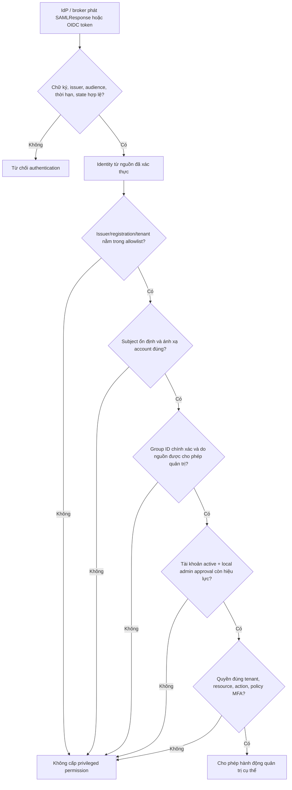

# Không tự cấp quyền quản trị từ tên nhóm hoặc thuộc tính chưa được cho phép

## Mục tiêu học tập

Sau bài học, bạn có thể:

1. Phân biệt **xác thực danh tính (authentication)**, **thuộc tính được IdP khẳng định (claims/attributes)**, **nhóm ở hệ thống danh tính (groups)**, **quyền ứng dụng (authorities/permissions)** và **phê duyệt quyền quản trị (privileged entitlement)**.
2. Giải thích vì sao **SAML Assertion hoặc OIDC token có chữ ký hợp lệ** không đồng nghĩa mọi tên nhóm/thuộc tính trong đó được phép biến thành `ROLE_ADMIN`.
3. Thiết kế ánh xạ quyền theo nguyên tắc **deny by default**, **least privilege** và **explicit allowlist**, với ràng buộc `issuer`/`registrationId`, tenant, subject ổn định, nguồn quản trị nhóm và quyền được phê duyệt cục bộ.
4. Nhận diện các lỗ hổng cấp quyền phổ biến: `contains("admin")`, tự thêm `ROLE_` vào claim, ghép tài khoản theo email, chấp nhận thuộc tính người dùng tự sửa, nhầm nhóm đối tác với nhóm nội bộ, hoặc tin group đã hết hiệu lực.
5. Viết một **demo Java 17+ có thể chạy độc lập** để kiểm tra quyết định cho phép/từ chối và cấu hình **Spring Boot 3/Spring Security 6** để cưỡng chế quyền quản trị theo tenant tại lớp nghiệp vụ.
6. Kiểm thử các trường hợp đúng/sai, quản lý vòng đời quyền và phản ứng khi có IdP/broker/group mapping thay đổi.

## 1. Bối cảnh: SSO xác thực danh tính, không tự cấp toàn bộ quyền

Trong hệ thống **federated identity**, ứng dụng Spring Security có thể đăng nhập người dùng bằng **SAML2** hoặc **OpenID Connect (OIDC)** qua một Identity Provider (IdP) hay một identity broker.

Ví dụ: nhân viên `u-42` đăng nhập ứng dụng quản lý báo cáo. IdP phát SAML Assertion hợp lệ:

- `NameID`/subject: `u-42`;
- một thuộc tính tên `groups` có giá trị `Administrators`;
- email: `user@company.example`.

Nếu SP đã **xác minh chữ ký, issuer, audience, thời hạn, recipient và các điều kiện SAML**, ứng dụng có thể tin IdP đã **khẳng định** các giá trị trên. Nhưng điều đó **chưa chứng minh** nhóm `Administrators` có ý nghĩa “quản trị mọi dữ liệu của ứng dụng này”, cũng chưa chứng minh IdP chỉ cho nhân viên được ủy quyền thêm người vào nhóm đó.

**Quy tắc trọng tâm: một claim được xác thực nguồn gốc không tự trở thành một quyền ứng dụng được phê duyệt.**

| Khái niệm | Câu hỏi nó trả lời | Ví dụ | Có tự cấp quyền admin không? |
| --- | --- | --- | --- |
| **Authentication** | Người này đã đăng nhập qua nguồn nào? | SAMLResponse hợp lệ từ IdP công ty | **Không** |
| **Identity subject** | Định danh ổn định của ai trong miền issuer nào? | `(IdP company, u-42)` | **Không** |
| **Group membership** | IdP khẳng định subject thuộc nhóm nào? | `groups=["Administrators"]` | **Không** |
| **Role mapping** | Theo chính sách ứng dụng, nhóm nào được ánh xạ sang quyền nào? | `urn:company:portal:reviewers → REPORT_VIEW` | Chỉ quyền được cho phép |
| **Local privileged entitlement** | Quyền admin đã được người có thẩm quyền phê duyệt cho chủ thể/tenant/chức năng này chưa? | Bản ghi quyền active trong DB IAM/ứng dụng | Có thể là **một điều kiện cần** |
| **Authorization decision** | Request này có được thực thi trên tài nguyên cụ thể không? | `MANAGE_USERS` tại `tenant-a` | Chỉ cấp khi **mọi điều kiện** thỏa |

SAML và OIDC cung cấp cơ chế xác thực danh tính; ứng dụng phải tự định nghĩa và cưỡng chế **mô hình phân quyền**. Đừng dùng `hasRole("ADMIN")` như một lối tắt nếu bất kỳ claim có chứa chuỗi `admin` đều có thể tạo ra `ROLE_ADMIN`.

## 2. Mối nguy: biến tên nhóm thành quyền quản trị

### 2.1. Những kiểu ánh xạ nguy hiểm

Ví dụ **sai**:

```java
// SAI: chuỗi group nào chứa "admin" đều tự trở thành ROLE_ADMIN.
if (groupName.toLowerCase().contains("admin")) {
    authorities.add(new SimpleGrantedAuthority("ROLE_ADMIN"));
}
```

Tại sao sai?

1. Nhóm `backup-admin-docs` có thể chỉ là nhóm biên tập **tài liệu về quản trị**, không phải nhóm người được cấp quyền quản trị ứng dụng.
2. Một IdP khác có thể có nhóm `Administrators` với ý nghĩa chỉ là quản trị một **tenant hoặc tài nguyên khác**.
3. Thuộc tính `department=Admin`, `title=System Administrator` hoặc `email=admin@...` có thể là dữ liệu hồ sơ; **không phải authorization grant**.
4. Người dùng có thể tự đổi display name, một phần profile, hoặc tham gia nhóm self-service; các giá trị đó không được biến thành quyền cao.
5. Thao tác `toUpperCase()`, `trim()`, tự thêm `ROLE_` hoặc dùng regex “gần giống” có thể tạo các khớp vô tình không được duyệt.

Một ví dụ sai khác:

```java
// SAI: mọi giá trị role từ assertion đều được cấp trực tiếp.
for (String claimRole : assertedRoles) {
    authorities.add(new SimpleGrantedAuthority("ROLE_" + claimRole));
}
```

Nếu `assertedRoles` chứa `ADMIN` từ một IdP hay attribute không được phép điều khiển quyền ứng dụng, đoạn mã có thể biến một claim thành `ROLE_ADMIN` mà không có **policy**, **issuer scope** hay **phê duyệt**.

### 2.2. Nhận diện bề mặt tấn công

| Dữ liệu đầu vào | Tình huống rủi ro | Kết luận |
| --- | --- | --- |
| `displayName=Admin Team` | Tên hiển thị do user/HR sửa | Không dùng làm role |
| `email=admin@company.example` | Email có thể đổi/tái cấp hoặc chưa verified đúng chính sách | Không dùng email để nhận diện admin |
| `jobTitle=Administrator` | Chức danh nhân sự không phải đặc quyền ứng dụng | Không dùng job title làm quyền |
| `groups=["Admins"]` | Nhóm cùng tên ở nhiều IdP/tenant, owner không rõ | Không cấp admin theo display name |
| `groups=["urn:company:app:admins"]` | Group ID chính xác nhưng ai có thể tự tham gia? Chính sách có cho phép IdP này cấp quyền đó? | Chỉ là **một điều kiện** sau khi đã xác minh governance |
| `isAdmin=true` | Thuộc tính có thể do source tùy ý phát hoặc user tự điều khiển | Không tự tin; cần explicit trust/policy |
| `roles=["ROLE_ADMIN"]` | Chuỗi role giống format Spring Security | Không tự thêm vào `GrantedAuthority` |
| `scope=admin` | Scope/permission được phát cho audience khác | Không tự dùng cho tài nguyên hiện tại |
| Đã xác thực qua IdP đối tác | IdP đối tác gọi user “admin” trong hệ thống đối tác | Không suy ra quyền admin của công ty mình |

**SAML signature chứng minh IdP đã gửi claim, không chứng minh quy trình quản trị membership của claim đó đáng tin cho chức năng cụ thể.** Cần hai bước khác nhau: **trust kỹ thuật** đối với assertion và **policy trust** đối với ý nghĩa/quyền của thuộc tính.

## 3. Các tầng tin cậy từ IdP tới quyết định quyền

Một thiết kế an toàn có thể hình dung theo đường đi:



Thứ tự trên là **mô hình quyết định**, không phải yêu cầu bạn tự thực hiện SAML cryptography. Spring Security/OpenSAML phải kiểm chứng message theo giao thức **trước** khi code ứng dụng đọc principal. Ứng dụng chỉ đánh giá nhóm/entitlement từ identity đã được framework xác thực.

### 3.1. Điều kiện bắt buộc tối thiểu

Với một hành động như “đổi quyền user trong tenant A”, ứng dụng nên xét các điều kiện **đồng thời**:

1. **Authentication hợp lệ:** SP đã xác minh SAML Response hoặc OIDC RP/API đã xác minh đúng token/issuer/audience theo vai trò. Không xây authorization từ HTTP request param, cookie tự định nghĩa hoặc JWT chưa verify.
2. **Đúng IdP/registration:** quyền quản trị chỉ có thể đến từ danh sách IdP/broker được phép cấp assertion cho tenant tương ứng.
3. **Đúng subject:** dùng khóa định danh bền vững theo namespace như `(issuer, subject)` hoặc `(registrationId, persistent NameID)` đã thiết lập. Tránh ghép user dựa trên email/display name.
4. **Nhóm được phê duyệt:** nếu chính sách sử dụng group claim, nó phải là ID **được allowlist chính xác** cho ứng dụng và phát từ nguồn có quy trình quản lý membership hợp lệ. Group có thể là điều kiện bổ sung, **không phải điều kiện duy nhất**.
5. **Entitlement cục bộ còn hiệu lực:** có bản ghi quyền admin gắn với đúng account/tenant, được duyệt qua quy trình kiểm soát, chưa bị thu hồi/khóa/hết hạn.
6. **Đúng action/resource:** quyền quản trị user không đồng nghĩa quyền sửa thanh toán, export hồ sơ toàn tổ chức hay quản trị tenant khác.
7. **Mức bảo đảm xác thực phù hợp:** một số hành động nhạy cảm cần MFA/step-up vừa đủ mới, đúng policy. Không tự suy diễn MFA chỉ từ tên nhóm.
8. **Đánh giá tại điểm cưỡng chế:** mọi endpoint/service thao tác nhạy cảm đều phải kiểm quyền; không chỉ ẩn nút admin trên frontend.

**Deny by default:** nếu không xác định rõ nguồn, subject, policy, thời hạn hoặc trạng thái quyền, trả **từ chối**, không tự rơi về “admin để tránh lỗi trải nghiệm”.

### 3.2. “Exact group ID” khác “group display name”

Ví dụ chỉ được chấp nhận group ID do đội IAM quản lý:

```text
issuer        = https://idp.company.example/saml
registration = company
tenant        = tenant-a
attribute     = urn:company:identity:groups
group_id      = urn:company:app:portal:administrators
```

Đây là ví dụ namespace, không phải giá trị chuẩn do SAML tự quy định. Ứng dụng quyết định **đúng namespace và value** cần xuất hiện theo thỏa thuận với IdP. Nếu IdP khác sử dụng cùng `group_id` string, không tự cho rằng có cùng ý nghĩa; phải đối chiếu **issuer/registration** và cơ chế quản trị nhóm.

**Không dùng fuzzy matching**: `contains("admin")`, `startsWith("ROLE_")`, `equalsIgnoreCase("administrator")` hoặc chuyển tên nhóm thành quyền bằng cách “chuẩn hóa chuỗi” không phải thay thế allowlist đã được duyệt.

## 4. Nguồn của attribute quan trọng không kém chữ ký

Một attribute có thể là:

- Dữ liệu directory do nhóm IAM điều khiển với workflow phê duyệt.
- Dữ liệu từ HRIS đã đồng bộ; có thể dùng nhận diện phòng ban nhưng chưa chắc dùng cấp quyền admin.
- Thuộc tính do người dùng tự sửa (profile, title, nickname).
- Claims do identity broker biến đổi/tổng hợp từ nhiều IdP.
- Group membership lấy từ external directory có ý nghĩa khác với internal authorization.

**Ví dụ:** IdP ký assertion chứa `department=IT`. Điều này có thể xác thực rằng directory của IdP đang ghi người dùng thuộc phòng IT, nhưng không cho phép suy ra mọi nhân viên IT được quản trị toàn bộ khách hàng.

| Nguồn | Dùng để hiển thị hồ sơ? | Dùng tự cấp admin? |
| --- | --- | --- |
| `displayName`/`preferred_username` | Có thể, sau khi escape output | **Không** |
| `email`/`email_verified` | Có thể hỗ trợ liên hệ/khớp identity theo chính sách | **Không** |
| `department`/`title` | Có thể hỗ trợ tổ chức công việc | **Không** |
| Group display name từ bất kỳ IdP | Có thể dùng gợi ý hiển thị khi được phép | **Không** |
| Stable group ID từ IdP đã tin và governance đã duyệt | Có thể làm điều kiện để xét cấp role cụ thể | **Chưa đủ một mình** |
| Phê duyệt quyền tại hệ thống IAM/ứng dụng | Nguồn quản lý authorization chuyên biệt | Chỉ sau khi kiểm account/tenant/action và trạng thái |

Một thiết kế có thể chọn **chỉ dựa trên local authorization DB**, hoàn toàn không dựa vào group claim để quyết định admin. Đây thường là lựa chọn dễ kiểm soát khi nhiều IdP có semantics nhóm khác nhau. Nếu dùng cả group ID và local approval, hãy xác định quy tắc là AND hay OR. Với đặc quyền cao, **không vô tình dùng OR** giữa group claim và local approval khi chính sách yêu cầu cả hai.

## 5. Phân biệt role, authority và permission trong Spring Security

Trong Spring Security:

- `GrantedAuthority` là chuỗi/quyền đã được hệ thống **xác thực và ánh xạ**.
- `hasAuthority("APP_ADMIN")` yêu cầu **đúng chuỗi** `APP_ADMIN`.
- `hasRole("ADMIN")` mặc định là cú pháp ngắn cho quyền `ROLE_ADMIN` (prefix có thể được cấu hình).
- `@PreAuthorize` hoặc `authorizeHttpRequests` kiểm các authority/điều kiện theo ngữ cảnh.
- `hasRole("ADMIN")` **không tự tạo quyền**; nguy hiểm xảy ra ở bước **mapping claims thành GrantedAuthority** thiếu chính sách.

### 5.1. Mô hình quyền ứng dụng nên hẹp

Thay vì một `ROLE_ADMIN` chung cho mọi ứng dụng, có thể dùng:

| Permission | Tác vụ được cho phép | Phạm vi |
| --- | --- | --- |
| `REPORT_READ` | Xem báo cáo | Tenant cụ thể |
| `REPORT_EXPORT` | Xuất báo cáo | Tenant, loại dữ liệu cụ thể |
| `USER_MANAGE` | Mời, khóa, phân vai user | Tenant cụ thể |
| `BILLING_APPROVE` | Duyệt hóa đơn/thanh toán | Tenant và hạn mức |
| `AUDIT_VIEW` | Xem audit log | Phạm vi theo chức năng |
| `APP_ADMIN` | Một nhóm hành động quản trị định nghĩa rõ | Không mặc định toàn tổ chức |

Khi phân quyền đa tenant, chỉ kiểm một chuỗi `APP_ADMIN` trong session có thể **thiếu thông tin tenant**. Hãy dùng policy động nhận `tenantId`/resource; hoặc authority có namespace/scope và kiểm thêm owner/tenant. Đừng để admin tenant A quản trị tenant B bằng cách đổi ID trong URL.

### 5.2. Authentication mặc định không gán admin từ SAML group

Spring Security SAML2 Login có thể trích SAML attributes vào principal và cung cấp một authority cơ bản như `ROLE_USER` tùy version/configuration. Điều đó **không có nghĩa** framework đã tự tin rằng `groups=["Administrators"]` phải biến thành `ROLE_ADMIN`.

Việc tạo thêm authority đặc quyền thường do ứng dụng **tùy chỉnh converter/authorization mapping**. Điểm bắt buộc: authority đến từ policy có kiểm soát, không lấy nguyên tên nhóm/role từ SAML Assertion rồi thêm vào `Authentication` một cách tự động.

## 6. Sai và đúng khi xử lý group claim

### 6.1. Sai: cấp admin theo “tên gọi trông giống admin”

```java
// KHÔNG dùng trong sản phẩm.
boolean admin = assertedGroups.stream()
    .anyMatch(group -> group.toLowerCase().contains("admin"));

if (admin) {
    authorities.add(new SimpleGrantedAuthority("ROLE_ADMIN"));
}
```

Một group tên `not-an-admin` hay `admin-document-readers` cũng bị trúng điều kiện. Nếu user có quyền đặt tên group hoặc dùng một IdP khác, đây có thể tạo đường nâng quyền.

### 6.2. Đúng hướng: chỉ nhận group ID đã allowlist và kết hợp quyết định cục bộ

```java
// Trích đoạn minh họa bên trong logic đã nhận Authentication
// hợp lệ từ Spring Security. Không phải ACS verifier tự viết.
String requiredGroup = "urn:company:app:portal:administrators";
boolean groupApproved = verifiedGroupIds.stream()
    .anyMatch(requiredGroup::equals);

// Phải kết hợp nguồn IdP/tenant/subject và phê duyệt cục bộ.
boolean canManageUsers =
    verifiedIssuerAllowed
    && tenantMatches
    && persistentSubjectMapped
    && groupApproved
    && localAdminApprovalIsActive;
```

Các biến `verifiedIssuerAllowed`, `tenantMatches`, `persistentSubjectMapped`, `localAdminApprovalIsActive` không phải giá trị browser tự khai báo; chúng phải được tính từ **registration/trust configuration và entitlement store đã được thẩm định**. Nếu bất kỳ giá trị nào thiếu/mâu thuẫn, từ chối.

**Chú ý:** “group ID chính xác” vẫn có thể bị người dùng thao túng nếu nguồn IdP cho phép tự tham gia group. Cần kiểm soát **ai được đổi membership** và **IdP/broker có thực sự phát claim từ directory được quản lý**.

## 7. Java 17+ chạy độc lập: phép quyết định admin theo allowlist

Đây là một bài tập **quy tắc authorization thuần Java**, không phải chương trình SAML verifier. Object `VerifiedIdentity` trong demo được **tạo thủ công làm fixture** để kiểm thử policy; trong sản phẩm, chỉ tạo identity tương đương **sau khi** Spring Security đã xác thực SAML Response/OIDC token. Không dùng class demo để biến dữ liệu HTTP/JSON do user gửi thành principal.

**Tệp `AdminPolicyDemo.java`:**

```java
import java.util.Set;

public final class AdminPolicyDemo {
    private static final String TRUSTED_REGISTRATION = "company";
    private static final String TRUSTED_TENANT = "tenant-a";
    private static final String APPROVED_GROUP =
            "urn:company:app:portal:administrators";

    // "Verified" chỉ là giả định fixture cho bài test này.
    record VerifiedIdentity(String registrationId, String subject,
                            String tenantId, Set<String> groups) {}

    record LocalApproval(String registrationId, String subject,
                         String tenantId, boolean active,
                         boolean approvedForAdmin) {}

    static boolean canManage(VerifiedIdentity identity,
                             LocalApproval local) {
        if (identity == null || local == null) {
            return false;
        }
        // Không cấp quyền từ issuer/tenant chưa được phép.
        if (!TRUSTED_REGISTRATION.equals(identity.registrationId())
                || !TRUSTED_TENANT.equals(identity.tenantId())) {
            return false;
        }
        if (identity.subject() == null || identity.subject().isBlank()) {
            return false;
        }
        if (identity.groups() == null
                || !identity.groups().contains(APPROVED_GROUP)) {
            return false;
        }
        // Bắt buộc có approval nội bộ, cùng namespace định danh.
        return local.active()
                && local.approvedForAdmin()
                && identity.registrationId().equals(local.registrationId())
                && identity.subject().equals(local.subject())
                && identity.tenantId().equals(local.tenantId());
    }

    public static void main(String[] args) {
        VerifiedIdentity approved = new VerifiedIdentity(
                "company", "u-42", "tenant-a", Set.of(APPROVED_GROUP));
        LocalApproval local = new LocalApproval(
                "company", "u-42", "tenant-a", true, true);

        VerifiedIdentity lookalike = new VerifiedIdentity(
                "company", "u-42", "tenant-a", Set.of("admin-doc-readers"));
        VerifiedIdentity otherIdP = new VerifiedIdentity(
                "partner", "u-42", "tenant-a", Set.of(APPROVED_GROUP));
        VerifiedIdentity otherTenant = new VerifiedIdentity(
                "company", "u-42", "tenant-b", Set.of(APPROVED_GROUP));
        LocalApproval revoked = new LocalApproval(
                "company", "u-42", "tenant-a", true, false);
        LocalApproval disabled = new LocalApproval(
                "company", "u-42", "tenant-a", false, true);

        System.out.println("Approved admin: "
                + canManage(approved, local));
        System.out.println("Similar group: "
                + canManage(lookalike, local));
        System.out.println("Other IdP: "
                + canManage(otherIdP, local));
        System.out.println("Other tenant: "
                + canManage(otherTenant, local));
        System.out.println("Revoked approval: "
                + canManage(approved, revoked));
        System.out.println("Disabled account: "
                + canManage(approved, disabled));
    }
}
```

Lệnh chạy bằng JDK 17 trở lên:

```bash
javac AdminPolicyDemo.java
java AdminPolicyDemo
```

**Stdout chính xác:**

```text
Approved admin: true
Similar group: false
Other IdP: false
Other tenant: false
Revoked approval: false
Disabled account: false
```

Đoạn mã minh họa rõ **tính hội (AND)**: chỉ khi registration, tenant, subject, group ID và approval khớp thì có thể cho phép. Trong sản phẩm, cần thêm kiểm resource/action, bảo đảm subject không transient và cài đặt membership/entitlement store thật. Một identity record tên “Verified” **không thay thế quá trình xác minh mật mã**; riêng đoạn Java này không thể nói user đã đăng nhập.

## 8. Spring Boot 3/Spring Security 6: cưỡng chế admin đúng chỗ

Ví dụ tiếp theo là **các tệp trong một dự án Spring Boot Servlet Java 17+**, không phải chương trình độc lập chạy với `javac`. Để SSO end-to-end hoạt động cần một IdP thật, certificate X.509 tin cậy, registration/ACS được cấu hình đúng, app session và cơ sở dữ liệu quyền. Các tên host, subject và group ID dưới đây là giá trị **minh họa cho môi trường lab**.

Ý tưởng thiết kế:

- Để `saml2Login()`/OpenSAML thực hiện toàn bộ **SAML signature, issuer, audience, recipient, time và request correlation validation**.
- **Không cấp `ROLE_ADMIN` trong success handler** chỉ vì `groups` chứa chữ `admin`.
- Bảo vệ thao tác admin ở **service method**, kiểm đúng `registrationId`, tenant, subject ổn định, group ID và **local admin approval**.
- Chỉ cho phép thao tác admin khi **tất cả điều kiện** vẫn đúng; không dựa vào UI ẩn/hiện nút.

### 8.1. Gradle dependencies

Đối với project đã dùng Spring Boot 3 plugin và BOM đồng bộ Spring Security:

```groovy
dependencies {
    implementation 'org.springframework.boot:spring-boot-starter-web'
    implementation 'org.springframework.boot:spring-boot-starter-security'
    implementation 'org.springframework.security:spring-security-saml2-service-provider'

    testImplementation 'org.springframework.boot:spring-boot-starter-test'
    testImplementation 'org.springframework.security:spring-security-test'
}
```

Chọn đúng version/repository OpenSAML theo Spring Security được quản lý. Không tự ép một bản thư viện không tương thích. Ví dụ sử dụng API `Saml2AuthenticatedPrincipal` của **Spring Security 6.x**; các nhánh Spring Security 7 có thay đổi API principal/accessor, nên khi nâng version phải đối chiếu tài liệu migration chính thức.

### 8.2. Registration SAML cho IdP công ty

Tệp `src/main/resources/application.yml`:

```yaml
spring:
  security:
    saml2:
      relyingparty:
        registration:
          company:
            entity-id: "https://portal.example.org/saml2/service-provider-metadata/company"
            acs:
              location: "https://portal.example.org/login/saml2/sso/company"
            assertingparty:
              entity-id: "https://idp.company.example/saml"
              verification:
                credentials:
                  - certificate-location: "classpath:idp-company.crt"
              singlesignon:
                url: "https://idp.company.example/sso"
                sign-request: false
```

`company` là registration **do server cấu hình**, gắn với IdP issuer và certificate của công ty; không cho client tùy ý thay issuer hoặc tải metadata mới từ URL do browser gửi. `sign-request: false` chỉ phù hợp khi IdP cho phép AuthnRequest không ký; nếu yêu cầu signed request thì phải thêm signing credential của SP và đổi cấu hình.

**Điều kiện nghiệp vụ riêng cho demo:** sau khi SAML response được xác minh, `principal.getName()` phải là **NameID/subject ổn định và duy nhất trong miền IdP công ty**. Nếu IdP sử dụng transient NameID, email có thể thay đổi hoặc NameID tái cấp, **không dùng nguyên giá trị đó làm khóa cấp admin**; phải thiết lập stable identifier/subject mapping với đội IAM trước khi cho phép quản trị.

### 8.3. Lớp khởi động và bật method security

Tệp `src/main/java/com/example/federation/FederationApplication.java`:

```java
package com.example.federation;

import org.springframework.boot.SpringApplication;
import org.springframework.boot.autoconfigure.SpringBootApplication;

@SpringBootApplication
public class FederationApplication {
    public static void main(String[] args) {
        SpringApplication.run(FederationApplication.class, args);
    }
}
```

Tệp `src/main/java/com/example/federation/SecurityConfiguration.java`:

```java
package com.example.federation;

import org.springframework.context.annotation.Bean;
import org.springframework.context.annotation.Configuration;
import org.springframework.security.config.Customizer;
import org.springframework.security.config.annotation.method.configuration.EnableMethodSecurity;
import org.springframework.security.config.annotation.web.builders.HttpSecurity;
import org.springframework.security.web.SecurityFilterChain;

@Configuration
@EnableMethodSecurity
public class SecurityConfiguration {

    @Bean
    SecurityFilterChain securityFilterChain(HttpSecurity http) throws Exception {
        return http
            .authorizeHttpRequests(auth -> auth
                .requestMatchers("/").permitAll()
                .anyRequest().authenticated()
            )
            .saml2Login(Customizer.withDefaults())
            .build();
    }
}
```

`@EnableMethodSecurity` kích hoạt kiểm `@PreAuthorize` ở service bean được Spring quản lý. Nếu chỉ gọi `saml2Login()` mà không bật method security, annotation bảo vệ method sẽ **không tự hoạt động**. `.anyRequest().authenticated()` yêu cầu user có authentication nhưng chưa quyết định quyền admin; phép kiểm admin nằm ở policy bean và service method.

### 8.4. Nguồn phê duyệt quyền cục bộ trong demo

Tệp `src/main/java/com/example/federation/LocalAdminApprovals.java`:

```java
package com.example.federation;

import java.util.Set;
import org.springframework.stereotype.Component;

@Component
public class LocalAdminApprovals {
    private record Key(String registrationId, String subject,
                       String tenantId) {}

    // CHỈ CHO DEMO: bản ghi này tượng trưng tài khoản đang active
    // và được duyệt quyền quản trị qua quy trình của công ty.
    private final Set<Key> activeApprovedGrants =
            Set.of(new Key("company", "u-42", "tenant-a"));

    public boolean isActiveAndApproved(
            String registrationId, String stableSubject, String tenantId) {
        return activeApprovedGrants.contains(
                new Key(registrationId, stableSubject, tenantId));
    }
}
```

Trong production, **không hard-code grant** ở source, không cho user tự thêm `Key`. Thay bằng repository/service truy vấn dữ liệu có phê duyệt, trạng thái tài khoản, tenant ownership, thời hạn grant, người duyệt và audit; bảo đảm thu hồi quyền có hiệu lực theo SLA. Đây là mô hình “nguồn thứ hai” do ứng dụng/IAM kiểm soát.

### 8.5. Bean policy chỉ nhận authentication SAML đã được Spring Security xác minh

Tệp `src/main/java/com/example/federation/AdminGate.java`:

```java
package com.example.federation;

import java.util.List;
import org.springframework.security.core.Authentication;
import org.springframework.security.saml2.provider.service.authentication.Saml2Authentication;
import org.springframework.security.saml2.provider.service.authentication.Saml2AuthenticatedPrincipal;
import org.springframework.stereotype.Component;

@Component("adminGate")
public class AdminGate {
    private static final String REGISTRATION = "company";
    private static final String TENANT = "tenant-a";
    private static final String GROUP_ATTRIBUTE =
            "urn:company:identity:groups";
    private static final String APPROVED_GROUP =
            "urn:company:app:portal:administrators";

    private final LocalAdminApprovals approvals;

    public AdminGate(LocalAdminApprovals approvals) {
        this.approvals = approvals;
    }

    public boolean canManage(Authentication auth, String tenantId) {
        // Fail closed: không nhận token chưa xác thực/khác loại.
        if (!(auth instanceof Saml2Authentication saml)
                || !saml.isAuthenticated()) {
            return false;
        }
        if (!(saml.getPrincipal()
                instanceof Saml2AuthenticatedPrincipal principal)) {
            return false;
        }

        // registrationId phải gắn với đúng issuer/certificate do SP
        // kiểm soát trong RelyingPartyRegistrationRepository.
        if (!REGISTRATION.equals(
                principal.getRelyingPartyRegistrationId())) {
            return false;
        }
        if (!TENANT.equals(tenantId)) {
            return false;
        }

        // Phải có thỏa thuận dùng stable/persistent NameID từ IdP.
        String stableSubject = principal.getName();
        if (stableSubject == null || stableSubject.isBlank()) {
            return false;
        }

        // Attribute name và group ID phải được allowlist chính xác.
        // Giá trị chỉ được xem xét SAU khi Spring Security verify SAML.
        List<?> groups = principal.getAttribute(GROUP_ATTRIBUTE);
        boolean hasApprovedGroup = groups != null
                && groups.stream().anyMatch(
                        value -> APPROVED_GROUP.equals(value));
        if (!hasApprovedGroup) {
            return false;
        }

        // Bắt buộc quyền quản trị nội bộ active + được phê duyệt.
        return approvals.isActiveAndApproved(
                REGISTRATION, stableSubject, tenantId);
    }
}
```

**Giải thích quan trọng:**

1. `Saml2Authentication` trong đoạn mã đến từ Spring Security authentication pipeline; **không tạo object đó từ JSON/form/header tự khai báo**.
2. `Saml2AuthenticatedPrincipal.getRelyingPartyRegistrationId()` được dùng theo API Spring Security 6.x để namespace trust; registration phải được cố định server-side với **IdP issuer + verification cert** đúng.
3. `principal.getName()` chỉ dùng được làm khóa quyền khi IdP đảm bảo **NameID bền vững**. Nếu hợp đồng dùng thuộc tính user ID khác, phải ánh xạ subject đúng bằng cơ chế đã xác thực.
4. `getAttribute(GROUP_ATTRIBUTE)` nhận danh sách values vì SAML Attribute có thể đa giá trị. Mã **so khớp đúng chuỗi ID** và không thêm `ROLE_ADMIN` tự động.
5. `LocalAdminApprovals` tượng trưng nguồn approval thứ hai. Group có mặt nhưng approval bị thu hồi → **deny**. Account admin cục bộ nhưng IdP/subject/tenant sai → **deny**.
6. Group ID là **một giá trị ví dụ được phép dùng bởi chính policy**, không phải một ID có ý nghĩa toàn cầu. Nếu IdP cho phép user tự sửa membership của group đó, chính sách group source vẫn không đủ an toàn; phải sửa governance/nguồn trước khi bật.
7. Nếu hệ thống có nhiều tenant/IdP, thay các hằng trong demo bằng **bảng ánh xạ được quản lý**: `(registrationId, issuer, tenant, groupID, permission)`, có version và audit. Không tạo map từ dữ liệu người dùng truyền lên.

**Giới hạn của demo:** grant cục bộ `u-42`/`tenant-a` là fixture, không chứng minh người đó đang active trong hệ thống thật. Khi dùng production, phải thay repository tương ứng và tích hợp entitlement lifecycle, risk/MFA checks, tenant isolation và kiểm bảo mật quy trình grant.

### 8.6. Cưỡng chế trên một service method

Tệp `src/main/java/com/example/federation/AdminService.java`:

```java
package com.example.federation;

import org.springframework.security.access.prepost.PreAuthorize;
import org.springframework.stereotype.Service;

@Service
public class AdminService {

    // #p0 là tham số đầu tiên, không phụ thuộc -parameters của compiler.
    @PreAuthorize("@adminGate.canManage(authentication, #p0)")
    public String viewAdminStatus(String tenantId) {
        return "Admin status available for " + tenantId;
    }
}
```

Tệp `src/main/java/com/example/federation/AdminController.java`:

```java
package com.example.federation;

import org.springframework.web.bind.annotation.GetMapping;
import org.springframework.web.bind.annotation.PathVariable;
import org.springframework.web.bind.annotation.RestController;

@RestController
public class AdminController {
    private final AdminService adminService;

    public AdminController(AdminService adminService) {
        this.adminService = adminService;
    }

    @GetMapping("/tenants/{tenantId}/admin/status")
    public String status(@PathVariable String tenantId) {
        // Gọi qua Spring bean/proxy để @PreAuthorize có hiệu lực.
        return adminService.viewAdminStatus(tenantId);
    }
}
```

Với một browser đã **đăng nhập SAML thật** qua `company`, có subject `u-42`, group ID chính xác và approval lab `tenant-a`:

```text
GET /tenants/tenant-a/admin/status
-> 200: Admin status available for tenant-a
```

Nếu group lạ/approval bị gỡ/tenant khác:

```text
GET /tenants/tenant-b/admin/status
-> 403 Forbidden (sau khi authentication hợp lệ nhưng policy từ chối)
```

Đây là **HTTP output dự kiến theo các tiền đề**, không phải stdout của một ứng dụng đã chạy thật. Nếu browser chưa đăng nhập, Spring Security có thể **redirect tới IdP** thay vì trả ngay 403 vì nguyên nhân lúc đó là authentication chưa có.

**Lưu ý quan trọng:** `@PreAuthorize` hoạt động trên Spring-managed bean/proxy. Nếu gọi nội bộ `this.viewAdminStatus(...)` từ một method khác **trong cùng object** mà không qua proxy, method security có thể không được áp dụng theo cơ chế Spring AOP thông thường. Đặt boundary bảo vệ tại service, kiểm cả HTTP authorization nếu cần, và viết integration tests để tránh đường vòng.

### 8.7. Khi quyền cho phép sửa dữ liệu

Ví dụ trên dùng **GET chỉ đọc**. Nếu mở action thay đổi quyền như `POST /tenants/{id}/admin/users`, cần:

- Giữ **CSRF protection** cho web application dùng cookie/session; không tắt toàn cục chỉ vì POST gặp 403.
- Kiểm method permission/tenant/object cụ thể trong service.
- Xác minh admin approval còn hiệu lực, có thể yêu cầu xác thực mới/step-up.
- Ghi audit ai làm gì cho user nào trong tenant nào, trước/sau thay đổi.
- Có quy trình hai người duyệt/just-in-time grant khi mức rủi ro cao.

Không dựa vào `isAdmin=true` trong request body; frontend/HTTP request không phải nguồn cấp quyền.

## 9. SAML2 và OIDC: giống nguyên tắc, khác kiểu token

| Tình huống | Bằng chứng được xác minh | Trường danh tính thường dùng | Điều kiện riêng |
| --- | --- | --- | --- |
| **SAML2 Login** | `SAMLResponse`/`Assertion` qua ACS đã verify | `Issuer` + persistent `NameID` hoặc thuộc tính ID đã thỏa thuận | Kiểm signature/trust/issuer/audience/recipient/conditions; nhóm là `AttributeStatement` |
| **OIDC Login** | `ID token` dùng xác thực user với OIDC RP | Cặp `(iss, sub)` | Kiểm issuer, audience/client, expiry, nonce/state theo flow; nhóm là claim tùy IdP |
| **OAuth2 Resource Server** | `Access token` dành cho API/resource cụ thể | Cặp issuer + subject hoặc user ID đã mapping | API kiểm audience/scope/signature, không nhận ID token thay access token |
| **Identity broker** | Ứng dụng tin **token/assertion do broker phát**, broker xác minh upstream | Broker `iss/sub` cộng account-linking được duyệt | Không đồng nhất upstream groups với app admin khi broker tự dịch claim |

OIDC `groups`, `roles` hoặc `email_verified` **không có ngữ nghĩa phân quyền ứng dụng toàn cầu**. Bên phát có thể có group hierarchy hoặc naming conventions riêng. JWT hợp lệ về chữ ký **không đủ** nếu `aud` dành cho dịch vụ khác hoặc issuer không thuộc allowlist.

Ví dụ OIDC:

```json
{
  "iss": "https://login.company.example",
  "sub": "u-42",
  "aud": "portal-client",
  "groups": ["Administrators", "docs-admin"]
}
```

Đây là **JSON minh họa claim**, không phải JWT thật có chữ ký. Application phải kiểm issuer/audience/expiry/nonce tùy flow trước khi dùng claims, rồi tra quyền local. Tên `Administrators` không tự trở thành `ROLE_ADMIN`.

### 9.1. Broker có thể làm mờ nguồn của thuộc tính

Broker thường nhận assertion/token từ upstream IdP A/B, rồi phát token mới cho ứng dụng. Ứng dụng downstream có thể chỉ thấy issuer **broker**, không thấy issuer upstream. Khi đó:

- Phải có hợp đồng **claim provenance** giữa broker và ứng dụng.
- Đảm bảo broker phân biệt group/role của từng upstream tenant.
- Chỉ broker/IAM có quyền ánh xạ một upstream group đã được duyệt sang **entitlement dành riêng cho ứng dụng**; mapping phải có audit và isolation.
- Không cho tenant A đặt một group tên “Administrators” rồi broker phát một claim trông giống admin của tenant B.
- Nếu downstream không có đủ dữ liệu xác định provenance/tenant, **không cấp quyền admin**; dùng local authorization policy hoặc bổ sung contract.

Ngay cả khi broker hợp lệ và token có chữ ký đúng, **ý nghĩa của quyền** vẫn phải được thiết kế, không suy từ chuỗi tên.

## 10. Danh tính ổn định và chống ghép tài khoản sai

Hai hệ thống có thể cùng thấy `user@company.example` hoặc `NameID=alice`. Không vì thế được coi là một người khi **issuer khác nhau**.

Ví dụ:

| Issuer/registration | Subject | Email hiển thị | Quyền |
| --- | --- | --- | --- |
| `company` / IdP công ty | `u-42` | `alice@company.example` | Có thể được duyệt `USER_MANAGE` ở tenant A |
| `partner` / IdP đối tác | `u-42` | `alice@company.example` | **Không** tự kế thừa quyền của công ty |
| `company` / IdP công ty | `u-43` | `alice@company.example` | **Không** vì email trùng |
| `company` / IdP công ty | `u-42` | Email đã đổi | Quyền chỉ theo quy trình account lifecycle |

Với SAML, `NameID` có thể có `Format` và các qualifiers. Một hệ thống dùng transient `NameID` cần stable subject qua thuộc tính ID/định danh được thiết lập riêng; không dùng transient string làm khóa dài hạn cho quyền quản trị.

**Account linking** giữa hai identities có thể hợp lệ, nhưng phải qua quy trình có kiểm chứng quyền sở hữu cả hai tài khoản hoặc phê duyệt của quản trị viên có thẩm quyền. Không tự link chỉ vì email giống, người dùng đổi tên hoặc IdP trả cùng display name.

## 11. Quản lý vòng đời quyền quản trị

Quyền admin không tồn tại vĩnh viễn chỉ vì một lúc nào đó IdP từng trả group claim phù hợp.

### 11.1. Cấp quyền (grant)

- Người xin quyền phải là identity ổn định đã xác thực.
- Người cấp/duyệt quyền phải có thẩm quyền và không tự phê duyệt theo quy tắc áp dụng.
- Ghi rõ **ứng dụng, tenant, tài nguyên/chức năng, thời hạn, lý do và ticket phê duyệt**.
- Nếu dùng group claim, nhóm phải do **nguồn IAM được phép** quản trị và không cho user tự tham gia.
- Cấp quyền tối thiểu và ưu tiên **just-in-time/temporary elevation** khi phù hợp.

### 11.2. Thu hồi (revoke)

Nếu một admin bị rời nhóm, tài khoản bị vô hiệu hóa hoặc local grant hết hạn:

- Hệ thống phải cập nhật entitlement store/quyền hiệu lực; không dựa vào claim cũ vô thời hạn.
- Cần chiến lược **session/token TTL**, revocation, tái đánh giá policy tại mỗi request/action nhạy cảm và caching TTL phù hợp.
- SAML assertion đã được dùng để tạo session; user có thể còn session sau khi group membership upstream thay đổi. Nếu admin gate chỉ đọc **claims cũ trong session**, group còn xuất hiện dù đã bị gỡ. Vì vậy **local active approval check mỗi lần gọi** là lớp thu hồi nhanh; với yêu cầu “gỡ group phải có hiệu lực ngay”, cũng cần cơ chế cập nhật/recheck group membership hoặc thu hồi session chủ động.
- Nếu IdP bị lỗi hoặc không rõ trạng thái entitlement, đối với admin action nên **fail closed** theo policy và khả năng dự phòng đã thiết kế.

### 11.3. MFA và step-up

Với thao tác rất nhạy cảm (tạo admin khác, thay khóa, export dữ liệu lớn), tổ chức có thể yêu cầu mức xác thực cao hơn:

- SAML có `AuthnContext`; OIDC có `acr`/`amr`/`auth_time` khi được cung cấp theo hợp đồng.
- Không tự coi claim `mfa=true` hoặc một chuỗi `acr` bất kỳ là đã đạt mức MFA yêu cầu nếu không hiểu nguồn/semantics.
- Mức bảo đảm phải được **IdP/broker và ứng dụng thỏa thuận**, kiểm tính mới của auth, step-up và các ràng buộc cần thiết.
- Group/role admin **không tự chứng minh** người đó vừa thực hiện MFA; đây là các trục kiểm soát khác nhau.

## 12. Thiết kế policy đa tenant và đa IdP

Với nhiều IdP, một bảng ánh xạ được phê duyệt có thể có dạng:

| Registration | IdP issuer đã đăng ký | Tenant cho phép | Group ID được phép | Permission ứng dụng |
| --- | --- | --- | --- | --- |
| `company` | `https://idp.company.example/saml` | `tenant-a` | `urn:company:app:portal:administrators` | `USER_MANAGE` trong tenant-a, nếu có local approval |
| `partner` | `https://idp.partner.example/saml` | `tenant-b` | `urn:partner:app:reports:reviewers` | `REPORT_REVIEW` trong tenant-b |
| `company` | `https://idp.company.example/saml` | `tenant-a` | `urn:company:app:portal:readers` | `REPORT_READ` trong tenant-a |

**Không có entry** nào cho phép IdP partner cấp `USER_MANAGE` trong tenant-a. Khi nhóm mới xuất hiện, mặc định **không ánh xạ**; thay đổi policy phải được review/audit, không tự động sinh permission từ tên mới.

### 12.1. Phân biệt RBAC và ABAC

- **RBAC (role-based access control):** kiểm user có role đã cấp như `REPORT_REVIEWER`.
- **ABAC (attribute-based access control):** quyết định dựa trên nhiều thuộc tính được thẩm định như subject, tenant, resource owner, action, time, MFA level.
- **Policy kết hợp:** group ID được duyệt có thể là điều kiện **đầu vào** để xét một role, nhưng quyền cuối cùng có thể cần kiểm tenant, resource, trạng thái phê duyệt và các thuộc tính khác.

Dù theo mô hình nào, phải **deny by default** và kiểm tất cả đường truy cập tới tài nguyên; nếu chỉ ẩn nút giao diện, API có thể vẫn bị gọi trực tiếp.

## 13. Kiểm thử bảo mật cần có

### 13.1. Ma trận unit test cho mapping

| Case | Giả định | Kết quả mong đợi |
| --- | --- | --- |
| Hợp lệ | IdP company; subject `u-42`; tenant-a; đúng exact group ID; local grant active + approved | **ALLOW** hành động được cấp |
| Tên gần giống | Nhóm `admin-doc-readers` | **DENY** |
| Chỉ có tên nhóm display | `Administrators` nhưng không có ID approved | **DENY** |
| IdP khác | IdP partner trả group ID giống của company | **DENY** đối với permission của company |
| Tenant khác | User admin tenant-a gọi tài nguyên tenant-b | **DENY** |
| Chưa phê duyệt | Group đúng nhưng local grant không tồn tại | **DENY** |
| Grant bị thu hồi | Nhóm vẫn ở session nhưng local grant revoked | **DENY** |
| User disabled | Tài khoản local/IdP bị khóa theo policy | **DENY** |
| Subject khác | Email giống nhưng subject khác | **DENY** |
| Sai source | User tự sửa `department`/`title` thành “Admin” | **DENY** |
| Missing claim | `groups` không có hoặc rỗng | **DENY** đối với policy yêu cầu group |
| Claim không phải string ID | Attribute group trả kiểu lạ/format sai | **DENY**, không tự ép thành quyền |
| Assertion/token chưa verify | Sai issuer/aud/signature/time/recipient | **Authentication FAIL**, chưa đến quyền |
| Đã xác thực nhưng thiếu role | User hợp lệ gọi API admin | **403 Forbidden** nếu authenticated mà không đủ quyền |

### 13.2. Kiểm thử HTTP và Spring Security

Trong ứng dụng thực:

1. Kiểm route public; anonymous vào admin endpoint phải yêu cầu login/401 theo loại app.
2. Dùng một IdP test đã được cấu hình và SAML Response **được xác minh thật** để kiểm nhánh admin.
3. Đổi/giả tên group thành `ROLE_ADMIN`, `administrators`, `admin-docs` – không trường hợp nào tự cấp admin.
4. Kiểm IdP partner không dùng được quyền của IdP company dù có chung subject/email/group text.
5. Tạo tài khoản có local approval, sau đó thu hồi; request admin mới phải bị từ chối theo SLA.
6. Test tenant A → tenant B bằng cách đổi path parameter, body ID và object ID; không được cross-tenant access.
7. Xác thực MFA/step-up đối với hành động rủi ro nếu chính sách yêu cầu.
8. Test SAML/XSS/CSRF/token replay theo năng lực của thư viện; không tạo custom ACS validator để “giả login”.
9. Đảm bảo `@EnableMethodSecurity` được bật, service được gọi qua Spring proxy và các endpoint nhạy cảm đều có coverage.
10. Kiểm audit không lộ raw SAMLResponse, access token, private key, session cookie, user claims nhạy cảm.

**Đừng chỉ test URL bằng browser đã có `ROLE_ADMIN` tự chế.** Cần negative tests cho đường đi SAML/OIDC claim → local policy → service enforcement.

### 13.3. Build và kiểm nguồn

Trong dự án Spring Boot Gradle đã có wrapper:

```bash
./gradlew dependencyInsight --configuration runtimeClasspath --dependency spring-security-saml2-service-provider
./gradlew compileJava
./gradlew test
```

Trên Windows có thể dùng `.\gradlew.bat`. Những lệnh này xác minh dependency/build/tests đã cấu hình; **không chứng minh SSO end-to-end** nếu không có IdP thật, certificate, SP entity ID và ACS đã đăng ký. Với demo thuần Java tại mục 7, `javac AdminPolicyDemo.java` và `java AdminPolicyDemo` cho stdout đã nêu.

## 14. Sai sót phổ biến và cách sửa

| Sai sót | Hậu quả | Sửa đúng |
| --- | --- | --- |
| `group.contains("admin")` | Nhóm gần giống kích hoạt quyền cao | So khớp **exact stable group ID** từ allowlist |
| `ROLE_` + mọi giá trị claim | User/IdP mới có thể tự tạo role ứng dụng | Chỉ ánh xạ qua policy approved; không copy raw groups |
| Trust một chuỗi `isAdmin=true` | Attribute tự khai có thể nâng quyền | Kiểm source governance, issuer, local approval |
| Chỉ so email/group, không so issuer | Account/tenant mix-up | Key theo issuer+subject hoặc registration+stable subject |
| Nhóm từ IdP đối tác được tính như nhóm công ty | Cross-tenant privilege escalation | Allowlist theo IdP/tenant và group namespace |
| Group đúng nhưng approval bị thu hồi | Admin vẫn vào được | Tái kiểm local active entitlement, TTL/session revocation |
| SAML signature đúng nên bỏ authorization | User xác thực có quyền vượt mức | Bảo vệ service/API/object-level access |
| Quyền chỉ kiểm khi render nút UI | Gọi API trực tiếp bypass | Kiểm tại server-side policy enforcement |
| Dùng `hasRole("ADMIN")` với authority không được kiểm soát | Privilege escalation nếu mapper sai | Kiểm/giới hạn nguồn tạo `GrantedAuthority` |
| Chỉ kiểm `@PreAuthorize` ở method tự gọi nội bộ | Proxy AOP có thể không chạy | Đặt service boundary, gọi qua Spring proxy, test |
| Chỉ dựa vào claim cũ trong session | Quyền upstream đã thu hồi chưa có hiệu lực | Recheck local entitlement và chiến lược session/token revocation |
| API dùng ID token như access token | Sai mục đích/audience của token | API kiểm access token với issuer/audience/scope chính xác |
| Error khi thiếu claim thì fallback admin | Fail-open | Deny by default, log lỗi có kiểm soát |
| Tự merge account theo email | Quyền admin chuyển sang sai subject | Account linking có kiểm chứng/approval |
| Role admin toàn cục không có tenant | Admin tenant A thao tác tenant B | Scope theo tenant, action, resource và deny ngoài phạm vi |

### 14.1. Khi nào dùng group claim để quyết định quyền?

Có thể dùng **khi tất cả điều kiện sau đã được thiết kế và chứng minh**: IdP đúng; claim được bảo vệ bằng assertion/token đã verify; nguồn group do IAM có thẩm quyền quản lý; membership không tự đăng ký; group ID chính xác và namespaced; permission mapping approved; tenant/resource được kiểm; có giải pháp thu hồi. Nếu không đủ cơ sở, **không cho claim đó cấp quyền cao**.

### 14.2. Vì sao “signed claim” chưa đủ?

Chữ ký xác thực việc **issuer đã phát biểu điều gì**. Nếu issuer phát biểu rằng người dùng thuộc `Administrators` của **IdP partner**, thì chữ ký chỉ chứng minh điều đó là lời khẳng định của partner. Nó không chứng minh partner có thẩm quyền cấp quyền admin cho hệ thống công ty, hoặc user đã được hội đồng ủy quyền nội bộ chấp thuận.

## 15. Checklist triển khai production

- [ ] Tài liệu hóa các **hành động admin** và phạm vi tenant/resource; không dùng “admin” như vai trò vô hạn không phân biệt chức năng.
- [ ] Bật signature/issuer/audience/time/state validation theo Spring Security SAML2/OIDC; không tự cấp session từ claims chưa verify.
- [ ] Cố định **issuer/registration ID → tenant → attribute namespace → group ID → permission** trong cấu hình được duyệt.
- [ ] Không cấp `ROLE_ADMIN` từ `contains("admin")`, tên nhóm hiển thị, email, job title, department hoặc user-controlled attributes.
- [ ] Có **local approved grants** với trạng thái active, người duyệt, thời hạn, reason và audit; nguyên tắc deny khi thiếu.
- [ ] Subject dùng cho mapping là **bền vững**, đúng namespace issuer, không tự link theo email.
- [ ] Cưỡng chế quyền trên **server-side service/API/object**, bật `@EnableMethodSecurity` và kiểm proxy behavior.
- [ ] Recheck entitlement/tính active/tenant trên mỗi hành động nhạy cảm, có TTL/revocation và session strategy.
- [ ] Tách authentication khỏi authorization; authenticated user thiếu quyền phải bị từ chối (thường 403), không phát lại admin login.
- [ ] Quyền admin rủi ro cao có step-up/MFA phù hợp; không tự diễn dịch claim không rõ semantics.
- [ ] Unit + integration tests phủ issuer khác, tenant khác, group gần giống, missing claim, revoked grant, account disabled.
- [ ] Quản lý thay đổi policy/IdP/broker/claims bằng review, triển khai thử, audit và phương án rollback.

## 16. Câu hỏi tự kiểm tra

**1. Một SAML Response có chữ ký hợp lệ chứa `groups=["Administrators"]`. Có nên cấp `ROLE_ADMIN` ngay không?**

**Không.** Chữ ký chỉ chứng minh IdP đã phát claim. Cần xác định nhóm được thỏa thuận và allowlist, ai quản trị membership, tenant/subject, quyền cục bộ và action trước khi quyết định.

**2. Vì sao `contains("admin")` là anti-pattern?**

Vì các nhóm như `admin-docs`, `not-admin` hoặc `team-administration` cũng trúng điều kiện, trong khi không được cấp quyền quản trị ứng dụng.

**3. Hai IdP phát cùng `NameID=u-42` hoặc cùng email. Đó có chắc là một tài khoản không?**

**Không.** Subject phải được namespaced theo issuer/registration; email và display name không đủ chứng minh cùng người. Account linking cần quy trình phê duyệt/kiểm chứng riêng.

**4. Vì sao chính sách ví dụ yêu cầu cả group ID chính xác **và** local approval?**

Để tách **nguồn xác nhận membership** với **quyền ứng dụng đã phê duyệt**. Thiếu một điều kiện thì không được cấp đặc quyền cao; local grant cũng giúp thu hồi quyền có kiểm soát.

**5. `hasRole("ADMIN")` có tự cấp `ROLE_ADMIN` không?**

**Không.** Nó kiểm authority đã có (theo default prefix). Rủi ro nằm ở code mapping tùy tiện claim/group thành `GrantedAuthority`.

**6. Một admin tenant A thay URL `tenant-a` thành `tenant-b`. Nếu group và local grant của A hợp lệ, có được phép không?**

**Không.** Policy phải kiểm tenant/resource/action được yêu cầu khớp phạm vi quyền đã được cấp. Đổi path ID không làm mở rộng entitlement.

**7. Người dùng bị gỡ khỏi group upstream nhưng session SAML vẫn còn group claim cũ. Hệ thống nên làm gì?**

Có chiến lược session TTL/thu hồi/tái kiểm group khi cần, đặc biệt phải kiểm local active privileged entitlement tại thời điểm thực hiện hành động. Không để thông tin cũ duy trì admin vô hạn.

**8. Group claim được broker ký và có `iss` của broker. Có thể coi đó là bằng chứng admin của tất cả IdP upstream không?**

**Không.** Cần hợp đồng provenance, tenant isolation, mapping và governance của broker; nếu không rõ nguồn, không cho phép claim đó cấp admin.

**9. Vì sao `@PreAuthorize` chưa đủ nếu method gọi nội bộ bằng `this.`?**

Method security thường dựa trên Spring AOP proxy; lời gọi nội bộ không đi qua proxy có thể bỏ qua interceptor. Phải bố trí boundary và integration test đúng.

**10. Để cho admin user tạo thêm admin khác, một group `APP_ADMIN` có đủ không?**

Thường **không**. Đó là hành động đặc quyền cao, có thể yêu cầu quyền `USER_MANAGE` riêng, tenant scope, active local approval, MFA gần đây, audit và phê duyệt kép theo chính sách.

## Ghi nhớ

**Không tự cấp quyền quản trị từ tên nhóm hoặc thuộc tính chưa được cho phép.** Với ứng dụng federated identity, hãy phân biệt:

**SAML/OIDC chứng minh nguồn danh tính → group/attribute là dữ liệu đầu vào → policy mapping xác định ý nghĩa được duyệt → local entitlement xác nhận quyền còn hiệu lực → authorization kiểm tenant, resource và action.**

Một cấu hình an toàn có **explicit allowlist**, **stable subject theo issuer/registration**, **deny by default**, **least privilege**, **audit**, **revocation** và **server-side enforcement**. Nếu nhóm không rõ chủ sở hữu, dữ liệu tự sửa được, claim sai namespace hoặc không có phê duyệt quyền cao, hãy **từ chối thay vì tự suy diễn ADMIN**.

### Tài liệu tham khảo

- [Spring Security – SAML2 Login: Authenticating Responses](https://docs.spring.io/spring-security/reference/servlet/saml2/login/authentication.html)
- [Spring Security – SAML2 Login Overview](https://docs.spring.io/spring-security/reference/servlet/saml2/login/overview.html)
- [Spring Security – Method Security](https://docs.spring.io/spring-security/reference/servlet/authorization/method-security.html)
- [Spring Security – Authorize HTTP Requests](https://docs.spring.io/spring-security/reference/servlet/authorization/authorize-http-requests.html)
- [OWASP – Authorization Cheat Sheet](https://cheatsheetseries.owasp.org/cheatsheets/Authorization_Cheat_Sheet.html)
- [OWASP – Access Control Patterns](https://cheatsheetseries.owasp.org/cheatsheets/Authorization_Patterns_Cheat_Sheet.html)
