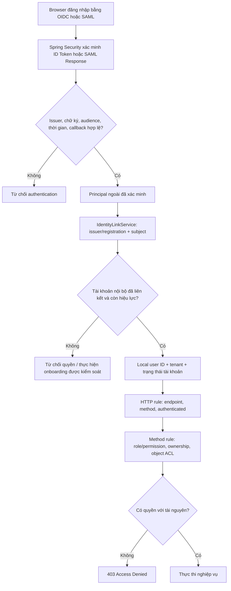

# Phân quyền HTTP và phương thức dựa trên danh tính đã liên kết trong Spring Security Federation

## 1. Bài toán: đăng nhập liên kết chưa đồng nghĩa được cấp quyền

Một ứng dụng Spring Boot có thể dùng **OpenID Connect (OIDC)** hoặc **SAML 2.0** để xác thực người dùng tại một hệ thống định danh bên ngoài. Sau khi OpenID Provider (OP) hoặc SAML Identity Provider (IdP) xác thực thành công, Spring Security tạo một `Authentication` trong `SecurityContext`. Tuy nhiên, ứng dụng vẫn phải quyết định: người đó là **tài khoản nội bộ nào**, được phép truy cập **endpoint nào**, xem/sửa **bản ghi nào**, và thực hiện **nghiệp vụ nào**.

Hai câu hỏi có ranh giới khác nhau:

- **Authentication (xác thực):** “Người này vừa được nhà cung cấp định danh đáng tin xác thực với định danh ngoài nào?”
- **Authorization (phân quyền):** “Tài khoản nội bộ tương ứng có quyền gì, trên tài nguyên và tenant nào, tại thời điểm hiện tại?”

Ví dụ một người dùng đã đăng nhập SSO hợp lệ nhưng chưa được liên kết với tài khoản nhân sự nội bộ: ứng dụng **không được tự cấp quyền** truy cập hồ sơ chỉ vì SAMLResponse/ID Token hợp lệ. Một người dùng đã liên kết cũng không mặc nhiên được đọc tài liệu của người khác chỉ vì truy cập được `GET /api/documents/{id}`.

Mục tiêu bài học là xây dựng phân quyền **hai lớp** bằng Spring Security Servlet:

1. **HTTP request authorization** với `SecurityFilterChain` và `authorizeHttpRequests`: kiểm soát truy cập vào route, HTTP method và yêu cầu xác thực tối thiểu.
2. **Method authorization** với `@EnableMethodSecurity` và `@PreAuthorize`/`@PostAuthorize`: áp chính sách nghiệp vụ theo **tài khoản nội bộ đã liên kết** và đối tượng cụ thể.

Bài sử dụng Java 17+, Spring Boot 3.x và Spring Security 6.x để minh họa. Các URL/ID tài khoản trong code là **dữ liệu thử nghiệm giả định**; để chạy federation thật cần OIDC/SAML provider, cấu hình client/metadata, callback và credential hợp lệ.

## 2. Luồng tin cậy từ danh tính ngoài đến quyết định truy cập



Sơ đồ này biểu thị **các bước logic**; Spring Security mặc định xác minh giao thức và thực hiện HTTP/method authorization ở các thời điểm thích hợp. Việc ánh xạ danh tính liên kết có thể được thực hiện lúc login, trong một `Authentication` tùy biến hoặc tại một service phân quyền. **Nơi ánh xạ không thay đổi nguyên tắc:** chỉ tin principal đã qua xác minh và lấy quyết định quyền từ nguồn được tổ chức quản lý.

Nếu một liên kết được tạo sai, mọi rule HTTP và method phía sau có thể vô tình cho phép nhầm người. Vì thế việc chọn khóa nhận dạng và quy trình liên kết tài khoản là nền tảng của bài.

## 3. Ba loại ID không được đánh đồng

| Dữ liệu | Ví dụ | Ý nghĩa | Có thích hợp làm khóa liên kết? |
| --- | --- | --- | --- |
| OIDC `iss` | `https://login.example.test/realms/corp` | Nhà phát hành ID Token đã xác minh | **Có**, đi cùng `sub` |
| OIDC `sub` | `sub-001` | Định danh người dùng **trong phạm vi issuer** | **Có**, nhưng không được dùng một mình |
| SAML IdP/entity ID hoặc registration đáng tin | `partner` tại RP | Xác định nguồn/đối tác SAML | **Có** trong tổ hợp khóa được quy định |
| SAML persistent NameID | `persistent-401` | Định danh SP nhận từ assertion | **Có điều kiện**, nếu IdP cam kết ổn định/không gán lại |
| SAML transient NameID | Giá trị đổi theo phiên | Định danh tạm thời | **Không phù hợp** làm liên kết lâu dài |
| Email | `user@example.test` | Thuộc tính hồ sơ/liên lạc | **Không đủ** làm khóa liên kết tự động |
| `preferred_username`/display name | `nguyenvana` | Tên hiển thị/đăng nhập | Không bảo đảm duy nhất, bền vững |
| Local user ID | `1001` | Định danh tài khoản **trong ứng dụng** | **Có**, là khóa chính cho quyền nghiệp vụ |
| Tenant ID | `tenant-a` | Phạm vi tổ chức/dữ liệu | Phải tham gia kiểm tra tách tenant |

Theo OIDC Core, **tổ hợp `(iss, sub)`** là khóa mà RP có thể tin là định danh duy nhất, ổn định trong phạm vi issuer. `sub` chỉ có nghĩa trong một issuer; hai issuer có thể cùng cấp chuỗi `sub-001` cho hai người khác nhau. OIDC có thể dùng *pairwise subject*, khiến cùng một người có `sub` khác nhau giữa các RP; liên kết các subject này cần một quy trình được ủy quyền, không suy đoán từ email.

Với SAML, `Saml2AuthenticatedPrincipal#getName()` thường lấy NameID từ assertion. NameID **không mặc nhiên bền vững**: phải kiểm tra `NameID Format`, quan hệ issuer, `NameQualifier`/`SPNameQualifier` khi profile dùng, và cam kết từ IdP. Trong ví dụ đơn giản, `registrationId` là khóa nội bộ đã ánh xạ đến một IdP đáng tin; kết hợp nó với NameID đã được IdP cam kết persistent. Một hệ thống nhiều tenant/đối tác nên lưu thêm issuer/qualifier cần thiết để tránh collision.

### Không liên kết tài khoản chỉ bằng email

Tấn công account takeover có thể xảy ra nếu một ID Token/SAML Assertion từ một nhà cung cấp ít tin cậy khai báo email trùng tài khoản quản trị đã tồn tại ở ứng dụng, và ứng dụng tự động nối hai tài khoản. Ngay cả `email_verified=true` trong OIDC cũng không tự chứng minh địa chỉ đó được kiểm soát bởi **đúng tài khoản nội bộ**, trong mọi vòng đời và mọi issuer.

Liên kết tài khoản cần một trong các quy trình kiểm soát: người dùng đã đăng nhập tài khoản nội bộ rồi chủ động liên kết bằng flow được xác minh, quản trị viên phê duyệt, hoặc provision từ nguồn identity lifecycle được ủy quyền. Cần audit, giới hạn ai có quyền link/unlink, và unique constraint ngăn một external identity được gắn trái phép tới hai local users.

## 4. Mô hình dữ liệu đề xuất cho danh tính đã liên kết

Một schema khái niệm:

```sql
CREATE TABLE app_user (
    id BIGINT PRIMARY KEY,
    tenant_id VARCHAR(80) NOT NULL,
    status VARCHAR(20) NOT NULL
);

CREATE TABLE external_identity_link (
    id BIGINT PRIMARY KEY,
    user_id BIGINT NOT NULL REFERENCES app_user(id),
    provider_kind VARCHAR(20) NOT NULL,
    provider_key VARCHAR(500) NOT NULL,
    external_subject VARCHAR(500) NOT NULL,
    status VARCHAR(20) NOT NULL,
    UNIQUE (provider_kind, provider_key, external_subject)
);

CREATE TABLE document_acl (
    document_id BIGINT NOT NULL,
    local_user_id BIGINT NOT NULL REFERENCES app_user(id),
    permission VARCHAR(30) NOT NULL,
    PRIMARY KEY (document_id, local_user_id, permission)
);
```

Đây là **schema ví dụ để giải thích**, không phải migration tối ưu cho mọi DBMS. Production cần index, tenant constraints, audit trail và quản lý trạng thái rõ ràng. `provider_key` có thể là issuer URI đã chuẩn hóa/whitelist cho OIDC, hoặc định danh IdP tin cậy gắn với registration SAML. Không dùng chuỗi tùy ý do browser gửi để lựa chọn khóa.

Một quyết định phân quyền nên xét ít nhất:

```text
trusted external identity
  -> active external_identity_link
  -> active local app_user
  -> tenant and membership
  -> local roles / permissions
  -> document ownership / ACL
  -> requested action (READ, APPROVE, DELETE...)
  -> optional assurance/freshness requirements
```

Trong ứng dụng nhiều tenant, kiểm tra `tenant_id` trước hoặc cùng lúc tra quyền. Đừng chỉ hỏi “document này có user ID nằm trong ACL không?” nếu ACL/ID có thể trỏ sai tenant hoặc user đang bị vô hiệu hóa. Khi account bị khóa hoặc link bị thu hồi, quyết định mới phải phản ánh trạng thái hiện tại theo yêu cầu nghiệp vụ.

## 5. Các lớp phân quyền trong Spring Security

| Lớp | API thường dùng | Ví dụ rule | Điểm mạnh | Không đủ khi nào? |
| --- | --- | --- | --- | --- |
| HTTP | `authorizeHttpRequests`, `requestMatchers`, `AuthorizationManager<RequestAuthorizationContext>` | Chỉ authenticated được gọi `/api/documents/**`; chỉ local admin được vào `/api/admin/**` | Kiểm soát sớm trước controller | Không biết đầy đủ quyền trên từng document nếu chỉ kiểm tra path |
| Method | `@PreAuthorize`, `@PostAuthorize`, `@PreFilter`/`@PostFilter` | `canRead(authentication, documentId)` | Gắn policy với service/use case kể cả khi gọi ngoài HTTP | Cần proxy hoạt động và policy đúng dữ liệu |
| Domain/repository | Query theo tenant + owner/ACL, transaction checks | `WHERE tenant_id=:t AND id=:id` | Bảo vệ tránh IDOR/BOLA và TOCTOU | Không thay xác thực giao thức hoặc HTTP session security |
| Data propagation | Authority/role mapping từ link đã xác minh | `APP_DOC_APPROVE` | Dễ dùng `hasAuthority`/`hasRole` | Dễ stale khi quyền bị thu hồi; không đủ cho object-level ACL |

**Mô hình nên kết hợp các lớp.** HTTP rule có thể yêu cầu user đăng nhập hợp lệ. Service rule kiểm tra user đó đã liên kết và có quyền trên document cụ thể. Query dữ liệu tiếp tục giới hạn tenant/ownership trước khi cập nhật. Không đặt toàn bộ quyết định chỉ ở frontend, API gateway hoặc `if (userId == ...)` trong controller.

## 6. Hiểu chính xác GrantedAuthority, role và scope

Spring Security sử dụng `GrantedAuthority` để biểu đạt quyền mà một `Authentication` mang theo:

- `hasAuthority("APP_ADMIN")` kiểm tra **chính xác** chuỗi `APP_ADMIN`.
- `hasRole("ADMIN")` theo cấu hình mặc định kiểm tra authority `ROLE_ADMIN` (thêm tiền tố `ROLE_`; tiền tố có thể tùy biến trong hệ thống).
- `hasAuthority("SCOPE_documents.read")` thường áp dụng authority đến từ **OAuth2/JWT scope** khi được mapper chuyển thành `SCOPE_...`. Scope của access token **không tự cấp** quyền sở hữu tài liệu hoặc quyền quản trị nội bộ.
- OIDC login có thể có authority như `OIDC_USER`, `SCOPE_openid`; SAML login có các authority framework cung cấp, nhưng chúng không nhất thiết là `APP_ADMIN` hay quyền đọc tài liệu.

Nếu IdP gửi attribute `groups=["admins"]` hoặc claim `roles=["admin"]`, **không** đổi nó thành `ROLE_ADMIN` theo quy tắc mù quáng. Cần allowlist tên nhóm, trust issuer cụ thể, mapping theo tenant, giới hạn thời hạn và lifecycle. Một nhóm có tên `admin` ở IdP sandbox không được cấp quyền quản trị hệ thống production.

**Cách triển khai an toàn:** nơi liên kết danh tính ngoài với `localUserId`, ứng dụng lấy role/permission nội bộ từ database hoặc policy service được kiểm soát, rồi nếu cần mới chuyển chúng thành `GrantedAuthority` trong một quá trình rõ ràng. Các quyền phụ thuộc resource như `document:42:read` thường hợp lý hơn khi kiểm tra tại service thay vì tạo hàng nghìn authority cho session.

## 7. Quy tắc phân quyền HTTP bằng authorizeHttpRequests

Với Spring Security Servlet hiện đại, cấu hình được xây ở `SecurityFilterChain`:

```java
@Bean
SecurityFilterChain security(HttpSecurity http) throws Exception {
    return http
            .authorizeHttpRequests(auth -> auth
                    .requestMatchers("/", "/error").permitAll()
                    .requestMatchers(HttpMethod.GET, "/api/documents/**")
                        .authenticated()
                    .requestMatchers(HttpMethod.POST, "/api/documents/**")
                        .authenticated()
                    .anyRequest().authenticated())
            .oauth2Login(Customizer.withDefaults())
            .saml2Login(Customizer.withDefaults())
            .build();
}
```

Đây là **đoạn cấu hình Java cần import** trong ứng dụng có OIDC/SAML dependencies; class hoàn chỉnh xuất hiện ở mục 10. Rule HTTP trên chủ ý mới kiểm tra **authenticated**, còn quyền từng tài liệu sẽ do method security xử lý ở service. Không vì vậy mà thiếu bảo mật: hai lớp có trách nhiệm khác nhau.

### Thứ tự matcher và nguyên tắc deny by default

- `requestMatchers` được xét theo thứ tự; một matcher rộng đứng trước có thể làm rule hẹp không còn tác dụng.
- Luôn đặt rule rõ ràng cho endpoint nhạy cảm trước fallback `anyRequest()`.
- Khi ứng dụng có API nội bộ không sử dụng SSO, có thể chọn `anyRequest().denyAll()` sau khi khai báo chính xác các endpoint được phép; kiểm tra kỹ endpoints do SAML/OIDC filters xử lý.
- `permitAll()` nên chỉ áp dụng resource public và callback/protocol route mà framework đã thiết kế phù hợp. Không gắn `permitAll()` lên `/api/**` vì “đã có method security” nếu chưa kiểm soát mọi code path.
- Nếu nhiều `SecurityFilterChain` cùng tồn tại, `securityMatcher` và `@Order` quyết định chain nào áp dụng. Một chain cho callback/login phải tránh bị chain API stateless chặn ngoài ý muốn.

### Vì sao chỉ kiểm tra URL chưa đủ?

Hai user có thể cùng truy cập `GET /api/documents/42`. HTTP rule `authenticated()` đúng với cả hai, nhưng một user có quyền trong `document_acl` và user kia không. Đây là tình huống **Broken Object Level Authorization (BOLA/IDOR)** nếu API chỉ check “đăng nhập rồi”. Phải kiểm tra object-level ở service hoặc truy vấn có điều kiện.

## 8. Method security: bảo vệ lời gọi nghiệp vụ

Spring Security hỗ trợ:

- `@EnableMethodSecurity`: kích hoạt method authorization (không tự bật chỉ vì thêm starter security).
- `@PreAuthorize("...")`: đánh giá policy **trước khi** chạy method; phù hợp thao tác đọc/sửa/duyệt có side effect.
- `@PostAuthorize("...")`: đánh giá dựa vào kết quả trả về **sau khi** method chạy; phù hợp một số phép đọc không side effect.
- `@PreFilter`/`@PostFilter`: lọc danh sách/đầu vào nhưng phải hiểu hiệu năng và độ phủ policy.
- `@Secured` và `@RolesAllowed`: các lựa chọn khác; `@PreAuthorize` biểu đạt policy linh hoạt hơn.

Ví dụ:

```java
@PreAuthorize("@linkedPolicy.canRead(authentication, #p0)")
public DocumentView read(long documentId) {
    return repository.load(documentId);
}
```

Phần `#p0` là **tham số đầu tiên** của method; cách tham chiếu này không cần dựa vào việc compiler giữ tên parameter. Có thể dùng `#documentId` nếu tham số được expose qua `-parameters` hoặc `@P` đúng phiên bản. `@linkedPolicy` là bean Spring có method `canRead` công khai; `authentication` do method-security expression cung cấp.

### Cẩn thận với proxy và self-invocation

Method security thường được thực thi qua Spring AOP proxy. Nếu một method của bean **tự gọi** method khác trong **chính bean đó** bằng `this.restrictedMethod()`, lời gọi có thể không đi qua proxy và `@PreAuthorize` không được kích hoạt. Hãy đặt method được bảo vệ trong **một service Spring-managed riêng**, được controller hoặc service khác gọi qua bean proxy, và có unit/integration tests.

Không đặt `@PreAuthorize` lên private method rồi giả định Spring AOP luôn chặn được. Với một transaction có side effect, ưu tiên `@PreAuthorize`/check trước khi ghi dữ liệu; `@PostAuthorize` chạy **sau** method nên có thể quá muộn để ngăn hành động đã xảy ra.

## 9. Ví dụ cấu hình dự án Spring Boot có cả OIDC và SAML

### 9.1. Dependencies

Trong dự án Gradle Groovy DSL đã có plugin Spring Boot/Java và dependency management nhất quán, thêm:

```groovy
repositories {
    mavenCentral()
    // Một số tổ hợp OpenSAML cần Shibboleth Maven repository.
    maven { url "https://build.shibboleth.net/maven/releases/" }
}

dependencies {
    implementation "org.springframework.boot:spring-boot-starter-web"
    implementation "org.springframework.boot:spring-boot-starter-security"
    implementation "org.springframework.boot:spring-boot-starter-oauth2-client"
    implementation "org.springframework.security:spring-security-saml2-service-provider"
    testImplementation "org.springframework.boot:spring-boot-starter-test"
    testImplementation "org.springframework.security:spring-security-test"
}
```

Đây là **phần cấu hình build**, không phải `build.gradle` hoàn chỉnh. Java 17+ và Spring Boot 3.x/Spring Security 6.x phải được chọn tương thích. Nếu ứng dụng chỉ dùng OIDC hoặc chỉ SAML, chỉ cần dependency giao thức tương ứng. Không ép version OpenSAML xung đột với Spring Security.

### 9.2. application.yml

```yaml
spring:
  security:
    oauth2:
      client:
        registration:
          corp:
            provider: corp
            client-id: "${OIDC_CLIENT_ID}"
            client-secret: "${OIDC_CLIENT_SECRET}"
            authorization-grant-type: authorization_code
            scope:
              - openid
              - profile
        provider:
          corp:
            issuer-uri: "https://login.example.test/realms/corp"
    saml2:
      relyingparty:
        registration:
          partner:
            assertingparty:
              metadata-uri: "${SAML_IDP_METADATA_URI}"

server:
  servlet:
    session:
      cookie:
        http-only: true
```

OIDC `corp` và SAML `partner` là hai đối tác minh họa. Các giá trị `OIDC_CLIENT_ID`, `OIDC_CLIENT_SECRET` và `SAML_IDP_METADATA_URI` được cung cấp ngoài source control, từ secret/config manager hoặc môi trường triển khai. Domain `example.test` là giả định, không phải IdP hoạt động sẵn. Trong production, kết nối HTTPS và cookie `Secure`, callback OIDC, SAML SP Entity ID/ACS, trust certificates, ingress và session policy phải được cấu hình đúng.

**Không dùng client secret hoặc SAML private key thật trong source code hay README**. Nếu SAML IdP yêu cầu ký AuthnRequest hoặc mã hóa assertion, phải bổ sung signing/decryption credential theo hướng dẫn Spring Security; bộ ví dụ này không tự tạo key.

Khi OIDC trả ID Token có `iss=https://login.example.test/realms/corp`, nó phải được Spring Security xác minh đúng issuer/audience/signature trước khi dùng làm identity link. Với SAML, registration `partner` phải được tin cậy và NameID cần persistent theo hợp đồng IdP.

## 10. Ví dụ Java 17: liên kết danh tính rồi phân quyền HTTP và service

Ví dụ hoàn chỉnh dưới đây dùng **một Java source file** với các bean/class package-private để dễ học. Nó có thể biên dịch trong dự án Spring Boot đã có dependencies và cấu hình thực tế ở mục 9; để chạy SSO end-to-end cần OIDC/SAML IdP sandbox đã đăng ký SP/RP. Không tự tạo tài khoản tại IdP.

Để đơn giản, các identity links và ACL được lưu trong `Map.of` **chỉ để minh họa**, không phải database production. Mỗi request kiểm tra identity đã được xác minh trong `Authentication` rồi tìm **local user ID** trong Map; trong ứng dụng thật thay Map bằng repository giao dịch, tenant constraints và trạng thái liên kết.

Lưu tại `src/main/java/demo/federation/FederationAccessApplication.java`:

```java
package demo.federation;

import java.util.Map;
import java.util.Set;

import org.springframework.boot.SpringApplication;
import org.springframework.boot.autoconfigure.SpringBootApplication;
import org.springframework.context.annotation.Bean;
import org.springframework.http.HttpMethod;
import org.springframework.http.HttpStatus;
import org.springframework.security.config.Customizer;
import org.springframework.security.config.annotation.method.configuration.EnableMethodSecurity;
import org.springframework.security.config.annotation.web.builders.HttpSecurity;
import org.springframework.security.core.Authentication;
import org.springframework.security.oauth2.core.oidc.user.OidcUser;
import org.springframework.security.saml2.provider.service.authentication.Saml2AuthenticatedPrincipal;
import org.springframework.security.access.prepost.PreAuthorize;
import org.springframework.security.web.SecurityFilterChain;
import org.springframework.stereotype.Service;
import org.springframework.web.bind.annotation.GetMapping;
import org.springframework.web.bind.annotation.PathVariable;
import org.springframework.web.bind.annotation.PostMapping;
import org.springframework.web.bind.annotation.RestController;
import org.springframework.web.server.ResponseStatusException;

@SpringBootApplication
@EnableMethodSecurity
public class FederationAccessApplication {
    public static void main(String[] args) {
        SpringApplication.run(FederationAccessApplication.class, args);
    }

    @Bean
    SecurityFilterChain webSecurity(HttpSecurity http) throws Exception {
        return http
                .authorizeHttpRequests(auth -> auth
                        .requestMatchers("/", "/error").permitAll()
                        .requestMatchers(HttpMethod.GET, "/api/documents/**")
                            .authenticated()
                        .requestMatchers(HttpMethod.POST, "/api/documents/**")
                            .authenticated()
                        .anyRequest().authenticated())
                .oauth2Login(Customizer.withDefaults())
                .saml2Login(Customizer.withDefaults())
                .build();
    }
}

// Key của một danh tính ngoài đã được provider xác minh.
// "issuer/registration" và "subject" tạo khóa trong đúng trust domain.
record ExternalKey(String protocol, String provider, String subject) {}

// DTO cho API.
record DocumentView(long id, String title) { }

@Service("linkedPolicy")
class LinkedIdentityPolicy {

    // Dữ liệu ví dụ: hai định danh ngoài ánh xạ vào local user 1001.
    private static final Map<ExternalKey, Long> LINKS = Map.of(
            new ExternalKey(
                    "oidc",
                    "https://login.example.test/realms/corp",
                    "sub-001"),
            1001L,
            new ExternalKey(
                    "saml",
                    "partner",
                    "persistent-401"),
            1001L,
            new ExternalKey(
                    "oidc",
                    "https://login.example.test/realms/corp",
                    "sub-002"),
            1002L
    );

    // Trong production, truy vấn DB có kiểm tra tenant, trạng thái
    // account và ACL. Demo này chỉ mô phỏng ACL.
    private static final Map<Long, Set<Long>> DOCUMENT_READERS = Map.of(
            42L, Set.of(1001L),
            77L, Set.of(1002L)
    );

    private static final Map<Long, Set<Long>> DOCUMENT_APPROVERS = Map.of(
            42L, Set.of(1001L)
    );

    private Long localUserId(Authentication authentication) {
        if (authentication == null || !authentication.isAuthenticated()) {
            return null;
        }

        Object principal = authentication.getPrincipal();
        ExternalKey key;

        if (principal instanceof OidcUser oidc) {
            // Chỉ dùng ID Token đã được OIDC login provider xác minh.
            if (oidc.getIdToken() == null
                    || oidc.getIdToken().getIssuer() == null) {
                return null;
            }
            key = new ExternalKey(
                    "oidc",
                    oidc.getIdToken().getIssuer().toString(),
                    oidc.getIdToken().getSubject());
        } else if (principal instanceof Saml2AuthenticatedPrincipal saml) {
            // NameID chỉ dùng làm khóa dài hạn nếu IdP bảo đảm persistent.
            key = new ExternalKey(
                    "saml",
                    saml.getRelyingPartyRegistrationId(),
                    saml.getName());
        } else {
            return null;
        }

        return LINKS.get(key); // Không có link => từ chối.
    }

    public boolean canRead(Authentication authentication, long documentId) {
        Long userId = localUserId(authentication);
        return userId != null
                && DOCUMENT_READERS.getOrDefault(documentId, Set.of())
                        .contains(userId);
    }

    public boolean canApprove(Authentication authentication, long documentId) {
        Long userId = localUserId(authentication);
        return userId != null
                && DOCUMENT_APPROVERS.getOrDefault(documentId, Set.of())
                        .contains(userId);
    }
}

@Service
class DocumentService {

    private static final Map<Long, DocumentView> DOCUMENTS = Map.of(
            42L, new DocumentView(42L, "Budget 2026"),
            77L, new DocumentView(77L, "Partner contract")
    );

    // #p0 trỏ tới tham số đầu tiên: documentId.
    @PreAuthorize("@linkedPolicy.canRead(authentication, #p0)")
    public DocumentView read(long documentId) {
        DocumentView result = DOCUMENTS.get(documentId);
        if (result == null) {
            throw new ResponseStatusException(HttpStatus.NOT_FOUND);
        }
        return result;
    }

    // Kiểm tra quyền TRƯỚC lời gọi. Không dùng PostAuthorize
    // cho thao tác có side effect như duyệt giao dịch.
    @PreAuthorize("@linkedPolicy.canApprove(authentication, #p0)")
    public String approve(long documentId) {
        if (!DOCUMENTS.containsKey(documentId)) {
            throw new ResponseStatusException(HttpStatus.NOT_FOUND);
        }
        // Demo chỉ trả chuỗi; production phải cập nhật DB có transaction.
        return "approved:" + documentId;
    }
}

@RestController
class DocumentController {
    private final DocumentService documents;

    DocumentController(DocumentService documents) {
        this.documents = documents;
    }

    @GetMapping("/")
    public String index() {
        return "Public federation demo";
    }

    @GetMapping("/api/documents/{id}")
    public DocumentView read(@PathVariable long id) {
        return documents.read(id);
    }

    @PostMapping("/api/documents/{id}/approve")
    public String approve(@PathVariable long id) {
        return documents.approve(id);
    }
}
```

### Giải thích những điểm bảo mật của code

1. `@EnableMethodSecurity` bật proxy kiểm tra `@PreAuthorize`. Nếu bỏ, HTTP rule `authenticated()` vẫn chạy nhưng service **không tự kiểm tra document ACL**.
2. `SecurityFilterChain` bảo vệ `/api/documents/**`. Nó không cố quyết định owner của từng tài liệu tại matcher URL.
3. `LinkedIdentityPolicy` nhận `Authentication` đã tạo bởi Spring Security, **không lấy email/sub/NameID do browser tự truyền**. Nếu principal không thuộc OIDC/SAML đã cấu hình, trả `null`.
4. Với OIDC, key gồm `iss` đã xác minh và `sub`, không dùng `sub` một mình.
5. Với SAML, key gồm tên registration **được ứng dụng đăng ký** và NameID. Đây là cách mô phỏng trong bài; production phải xác minh format/persistence của NameID và có thể cần issuer/qualifiers đã được IdP cam kết.
6. Chỉ khi identity link tồn tại, policy mới lấy local user ID. Một người có SSO hợp lệ nhưng chưa được liên kết bị từ chối truy cập tài liệu.
7. `canRead` và `canApprove` là **hai quyền khác nhau**. Không suy diễn quyền duyệt từ quyền đọc.
8. `DocumentService` là Spring bean riêng, được controller gọi thông qua proxy nên `@PreAuthorize` chạy trước method. Không gọi service method qua `this` nội bộ.
9. Nếu ACL không có document ID hoặc user ID tương ứng, `Set.of()` rỗng khiến policy fail-closed.
10. `POST /approve` vẫn chịu CSRF protection mặc định đối với browser session. Client phải gửi CSRF token hợp lệ; **không** tắt CSRF toàn ứng dụng để thử endpoint. Endpoint SAML ACS là protocol callback do framework xử lý riêng.

### Kết quả truy cập dự kiến

Khi principal đã được xác minh tương ứng với OIDC `(iss=https://login.example.test/realms/corp, sub=sub-001)` hoặc SAML `(registration=partner, NameID=persistent-401)`:

| Request | HTTP gate | Method rule | Kết quả |
| --- | --- | --- | --- |
| `GET /` | Public | Không cần method guard | HTTP 200 |
| `GET /api/documents/42` | Authenticated | local 1001 trong readers(42) | HTTP 200, JSON document 42 |
| `GET /api/documents/77` | Authenticated | local 1001 không nằm trong readers(77) | **Access denied** |
| `POST /api/documents/42/approve` | Authenticated + CSRF | local 1001 trong approvers(42) | Trả `approved:42` sau khi gửi CSRF hợp lệ |
| `POST /api/documents/77/approve` | Authenticated + CSRF | local 1001 không có quyền | **Access denied** |
| Người dùng SSO chưa có link | Authenticated | Không tìm được local ID | **Access denied** |

Một authentication qua browser chưa có session có thể nhận **302 redirect đến trang đăng nhập** thay vì HTTP 401; authenticated nhưng thiếu quyền thường dẫn đến HTTP 403. Response thực tế phụ thuộc entry point, exception handler, CSRF và cấu hình API. Với SAML/OIDC sandbox giả lập không tồn tại, không có kết quả network hay stdout cố định.

## 11. Java 17 độc lập: vì sao khóa liên kết cần cả issuer

Đoạn sau minh họa một lỗi thiết kế thường gặp: lấy `sub` một mình làm ID người dùng. Nó **không cần Spring**, biên dịch được bằng Java 17 và có stdout xác định.

Lưu `ExternalIdentityKeyDemo.java`:

```java
import java.util.Map;

public final class ExternalIdentityKeyDemo {

    record Key(String issuer, String subject) { }

    public static void main(String[] args) {
        Map<Key, Long> links = Map.of(
                new Key("https://idp-a.example.test", "42"), 1001L,
                new Key("https://idp-b.example.test", "42"), 1002L
        );

        System.out.println("idpA=" +
                links.get(new Key("https://idp-a.example.test", "42")));
        System.out.println("idpB=" +
                links.get(new Key("https://idp-b.example.test", "42")));
        System.out.println("unlinked=" +
                links.get(new Key("https://idp-c.example.test", "42")));
    }
}
```

Chạy:

```bash
javac ExternalIdentityKeyDemo.java
java ExternalIdentityKeyDemo
```

Stdout chính xác:

```text
idpA=1001
idpB=1002
unlinked=null
```

Hai nhà phát hành cùng dùng subject `42` nhưng ứng dụng biết đó là **hai liên kết khác nhau**. Nếu chỉ lấy `subject` làm key, có nguy cơ hợp nhất sai danh tính. Chương trình này chỉ minh họa khóa dữ liệu; **không xác minh chữ ký ID Token**. Production phải xác minh OIDC token/SAML assertion trước khi tạo key.

## 12. Phân quyền HTTP nâng cao: role do ứng dụng phát hành

Ví dụ muốn chỉ người có quyền nội bộ `APP_ADMIN` truy cập endpoint quản trị. Rule request có thể là:

```java
.requestMatchers("/api/admin/**").hasAuthority("APP_ADMIN")
```

Đây là **một dòng thêm vào `authorizeHttpRequests` trước fallback**, không phải cấu hình độc lập. Dòng này chỉ có hiệu lực nếu ứng dụng **thật sự cấp** `GrantedAuthority("APP_ADMIN")` cho `Authentication` sau quy trình ánh xạ tin cậy. Ví dụ mục 10 không thêm authority này, nên endpoint admin sẽ không được cấp chỉ bằng cách có link.

Nếu authority được map lúc đăng nhập:

- Lấy `localUserId` từ identity link **đã xác minh**.
- Tra quyền nội bộ/tenant ở nguồn có kiểm soát.
- Chỉ map những quyền hiện hành, được phép cho loại client/session đó.
- Thiết kế refresh hoặc recheck khi role thay đổi/thu hồi; quyền nằm trong session cũ có thể stale.

Một mapper bên OIDC login có thể dùng `GrantedAuthoritiesMapper` hoặc `OidcUserService` tùy nhu cầu. Không lấy ví dụ `OidcUserAuthority` rồi áp dụng nguyên xi lên `Saml2Authentication`: hai cơ chế xác thực có cách tạo principal/authorities khác nhau.

### Request-level AuthorizationManager tùy biến

Khi quyền phụ thuộc URL/path biến động và cần kiểm tra ngay tại filter, có thể dùng `AuthorizationManager<RequestAuthorizationContext>` kết hợp với service policy đã liên kết. Về mặt ý tưởng:

```java
.requestMatchers("/api/reports/**")
.access((authentication, context) ->
        new AuthorizationDecision(
                policy.canViewReport(authentication.get(), context.getRequest())))
```

Đây là **mảnh cấu hình**, giả định `policy.canViewReport(...)` đã được tự triển khai và import `AuthorizationDecision`. Nó không tự có trong project mẫu. Nếu authorization cần thông tin domain (document owner, tenant, action), dùng service method `@PreAuthorize` thường dễ kiểm thử, dễ tái dùng cho background jobs và tránh nhét quá nhiều truy vấn DB vào filter.

### Đừng đặt rule mở rộng đứng trước rule bảo vệ

Ví dụ **sai**:

```java
.requestMatchers("/api/**").permitAll()
.requestMatchers("/api/admin/**").hasAuthority("APP_ADMIN")
```

Matcher đầu tiên đã cho phép toàn bộ `/api/**`, nên rule admin đặt sau không còn bảo vệ như mong đợi. Với HTTP rules, thứ tự là một phần của chính sách bảo mật.

## 13. Method authorization với @PreAuthorize và @PostAuthorize

### @PreAuthorize: lựa chọn mặc định cho nghiệp vụ có side effect

Ví dụ ở service:

```java
@PreAuthorize("@linkedPolicy.canApprove(authentication, #p0)")
public void approvePayment(long paymentId) {
    // Chỉ chạy khi policy đã đồng ý.
}
```

Policy nên xét quyền approver, tenant, trạng thái tài khoản, trạng thái giao dịch và điều kiện nghiệp vụ trước thay đổi. Với concurrency, kiểm tra lại trạng thái bắt buộc trong transaction/atomic update để tránh **time-of-check to time-of-use (TOCTOU)**.

### @PostAuthorize: kiểm tra đối tượng trả về

Ví dụ chỉ đọc:

```java
@PostAuthorize("returnObject != null && " +
        "@linkedPolicy.canRead(authentication, returnObject.id())")
public DocumentView loadForViewing(long id) {
    return repository.load(id);
}
```

Đây là **đoạn minh họa**, không phải phần tự có trong class mục 10: `repository` chưa được khai báo ở đây. `returnObject` là kết quả của method, có thể dùng để kiểm tra quyền truy cập dữ liệu trả về. Tuy nhiên, method **đã chạy** trước khi policy kiểm tra: không dùng `@PostAuthorize` cho xóa, chuyển tiền, gửi email, ghi DB hoặc bất kỳ side effect nào cần bị chặn từ đầu.

### @PreFilter và @PostFilter có giới hạn

`@PostFilter` có thể lọc phần tử sau khi lấy danh sách, nhưng nếu database đã tải hàng triệu bản ghi của nhiều tenant, việc lọc ở Java sau truy vấn vừa tốn tài nguyên vừa có thể mở rủi ro log/cache. Với danh sách phân trang, đếm tổng và phân quyền tenant, **lọc ngay trong repository/query** thường phù hợp hơn. `@PreFilter` lọc input nhưng không thay kiểm tra việc user được phép sửa từng item.

## 14. Authentication từ OIDC, SAML và JWT Resource Server khác nhau

| Luồng | Authentication/principal thường thấy | Cách lấy identity đáng tin | Điều cần phân biệt |
| --- | --- | --- | --- |
| OIDC browser login | `OAuth2AuthenticationToken` + `OidcUser` | `oidc.getIdToken().getIssuer()` và `getSubject()` | Access token scope không tự là quyền object trong app |
| SAML browser login | `Saml2Authentication` + `Saml2AuthenticatedPrincipal` | Registration IdP đáng tin + NameID persistent/qualifiers đã thỏa thuận | NameID không phải lúc nào cũng bền vững |
| OAuth2 Resource Server JWT | `JwtAuthenticationToken` / `Jwt` | Verified JWT issuer + sub, thêm audience/client/tenant theo policy | Bearer API và browser session có threat model khác |

**Quan trọng:** `JwtAuthenticationToken` không phải `OidcUser`. Nếu một API nhận bearer JWT, code chỉ xử lý `OidcUser`/`Saml2AuthenticatedPrincipal` như ví dụ mục 10 sẽ **fail-closed** (không tìm link), chứ không mặc nhiên hoạt động cho bearer. Khi muốn hỗ trợ JWT resource server, cần thêm nhánh chuyển `Jwt` đã được `JwtDecoder` xác minh thành key theo chính sách resource-server, đồng thời kiểm tra audience, token type/scopes và tenant.

Không dùng `authentication.getName()` một cách vô điều kiện để liên kết cùng người dùng giữa OIDC, SAML và JWT. Nó có thể đại diện subject, NameID hoặc một tên được cấu hình khác nhau, không có namespace chung.

### Mapping claims/attributes thành quyền

OIDC: claims trong ID Token/UserInfo đã được thư viện kiểm tra theo luồng; nhưng độ tin cậy của **từng claim** và quyền sử dụng nó cho authorization phải được xác định. SAML: chỉ attributes thuộc Assertion đã được SP xác minh mới được dùng. Với một nhóm ngoài `finance-approvers`, map sang quyền nội bộ `APP_PAYMENT_APPROVE` chỉ khi issuer/tenant/nhóm đã được allowlist và tổ chức thực sự ủy quyền IdP quản lý nhóm đó.

Thông thường ứng dụng vẫn cần **local account status**, policy đối tượng và trạng thái nghiệp vụ, ngay cả khi role mapping được phép từ IdP.

## 15. Quyền theo bản ghi: tránh IDOR/BOLA và lộ dữ liệu chéo tenant

Giả sử có hai URL:

```text
GET /api/documents/42
GET /api/documents/77
```

Thay ID từ 42 sang 77 rất dễ. Nếu code chỉ kiểm tra user đã đăng nhập, attacker có thể đọc tài liệu không thuộc quyền mình. **ID bất kỳ từ URL không phải bằng chứng được phép truy cập**.

Kiểm tra nên gắn với **local user ID + tenant + resource ID + action**:

```sql
SELECT d.id, d.title
FROM documents d
JOIN document_acl a ON a.document_id = d.id
JOIN app_user u ON u.id = a.local_user_id
WHERE d.id = :documentId
  AND u.id = :localUserId
  AND u.tenant_id = d.tenant_id
  AND u.status = 'ACTIVE'
  AND a.permission = 'READ';
```

SQL này là **minh họa cấu trúc truy vấn**, giả định có bảng `documents` cùng các cột thích hợp, không phải migration hay query hoàn chỉnh. Trong production, cần chống SQL injection bằng prepared statements/binding, bảo đảm tenant filter được áp dụng nhất quán, xem xét soft-delete, versioning, visibility và quyền role-based nếu chính sách cho phép.

Một check authorization trong `@PreAuthorize` ở bên ngoài transaction có thể trở nên lỗi thời nếu ACL/trạng thái resource đổi trước khi update. Các hành động quan trọng nên kiểm tra/ghi trong cùng transaction, dùng optimistic locking, row-level locking hoặc atomic update phù hợp. Method guard vẫn hữu ích nhưng **không thay thế kiểm tra tính toàn vẹn dữ liệu**.

## 16. Lifecycle của identity link và quyền: không chỉ kiểm tra lúc login

Một tài khoản ngoài có thể bị khóa, IdP group bị thay, nhân viên rời tổ chức, hoặc một identity link bị thu hồi **khi browser vẫn có phiên Spring Security**. Nếu ứng dụng chỉ chụp roles vào `Authentication` lúc đăng nhập, user có thể tiếp tục mang quyền cũ trong thời gian session còn hiệu lực.

Thiết kế cần quyết định rõ:

- Quyền chỉ cập nhật khi login lại hay kiểm tra lại mỗi request/nghiệp vụ nhạy cảm?
- Identity link bị disable thì session hiện tại có bị invalidate ngay không?
- Cache role/ACL có TTL bao lâu và nhận sự kiện thu hồi như thế nào?
- Resource transfer giữa tenant được thực hiện atomically ra sao?
- Có yêu cầu audit “ai đã phê duyệt, local user ID nào, link/issuer nào, tại thời điểm nào” không?

Với hành động tài chính, xóa dữ liệu hoặc thay quyền người khác, nên tra **trạng thái link + account + permission** hiện hành ở thời điểm quyết định, hoặc dùng cơ chế invalidation đáng tin cậy. Ở mức đọc thông thường, TTL cache có thể được chấp nhận nếu nguy cơ được đánh giá và timeout được quy định rõ.

Không lưu quyền bằng một claim do browser có thể sửa. Session cookie và CSRF token cũng không chứng minh user có quyền trên một bản ghi cụ thể.

## 17. Step-up authentication và quyền nghiệp vụ là hai điều kiện khác nhau

Một người có thể có local role `APP_PAYMENT_APPROVE` nhưng lần đăng nhập hiện tại chỉ dùng xác thực thông thường. Với giao dịch lớn, chính sách có thể yêu cầu **MFA/phishing-resistant authentication** và **freshness** ngoài role.

Hai điều kiện độc lập:

1. **Authorization:** local user được phép duyệt giao dịch cụ thể (`tenant`, `role`, `ACL`, trạng thái giao dịch).
2. **Authentication assurance:** phiên hiện tại đạt mức xác thực được IdP chứng thực, còn mới và thuộc đúng user/session.

Trong OIDC có thể dùng `acr`, `amr`, `auth_time` theo thỏa thuận issuer; trong SAML có `AuthnContextClassRef`, `AuthnInstant` và `RequestedAuthnContext`. **Không coi việc đã gửi yêu cầu MFA là bằng chứng nó được thực hiện**. SP cần kiểm tra context thực tế trong ID Token/SAML Assertion đã được xác minh, và lưu assurance server-side khi cần.

Quy tắc ví dụ:

```text
canApprovePayment(user, payment)
    = linkedLocalAccountIsActive
    AND userHasPermissionForPayment
    AND paymentTenantMatchesUserTenant
    AND paymentStateAllowsApproval
    AND verifiedAuthenticationContextMeetsPolicy
    AND authenticationIsFreshEnough
```

Đây là pseudocode điều kiện nghiệp vụ, không phải Spring SpEL có thể chạy nguyên văn. Nếu chưa đáp ứng assurance, ứng dụng cần flow step-up được kiểm soát; không tự cấp role cao hơn từ một request parameter như `?mfa=true`.

## 18. HTTP status, CSRF, CORS và session trong federated apps

### 18.1. 401, 403 và redirect login

- Người chưa đăng nhập vào web app có `oauth2Login`/`saml2Login` thường được redirect tới entry point IdP (HTTP 302) thay vì API trả 401 JSON.
- Người đã đăng nhập nhưng bị `@PreAuthorize` từ chối thường gặp HTTP 403.
- API bearer token stateless có thể trả 401 cho token thiếu/sai và 403 cho quyền thiếu, tùy entry point/handler.
- Nếu API chỉ cần JSON, có thể cấu hình `AuthenticationEntryPoint`/`AccessDeniedHandler` riêng để tránh redirect sang IdP; không thay đổi chính sách phân quyền khi đổi định dạng response.

### 18.2. CSRF

Browser dùng cookie session có nguy cơ CSRF đối với phương thức có side effect. Trong ví dụ mục 10, `POST /api/documents/42/approve` phải có CSRF token phù hợp theo mặc định. Nếu request POST bị 403, hãy phân biệt **CSRF denial** với **method security denial**, không tắt CSRF toàn ứng dụng.

SAML HTTP-POST ACS và callback OAuth2 là các protocol endpoints có xử lý riêng; không coi ngoại lệ CSRF của callback là lý do vô hiệu hóa CSRF cho toàn bộ API nghiệp vụ.

### 18.3. CORS và proxy

CORS chỉ điều chỉnh chính sách trình duyệt với cross-origin requests, **không phải cơ chế authorization** và không thay kiểm tra identity link. Reverse proxy cần chuyển forwarded headers đúng, bảo vệ cookie `Secure`/`HttpOnly`/`SameSite`, tránh route callback sai và tránh open redirect. HTTPS, chữ ký ID Token/SAML Assertion và kiểm tra issuer/audience là nền tảng trước khi quyết định quyền.

## 19. Testing HTTP và method authorization

### 19.1. Ma trận kiểm thử bắt buộc

| Tình huống | Kỳ vọng |
| --- | --- |
| User chưa đăng nhập vào tài nguyên protected | Bắt đầu login/401 tùy entry point; không xem dữ liệu |
| OIDC token hợp lệ, `iss+sub` đã link local 1001, đọc doc 42 | Cho phép |
| OIDC token hợp lệ, local 1001 đọc doc 77 | Từ chối |
| OIDC cùng `sub` nhưng **issuer khác** | Không tự dùng link từ issuer cũ |
| SAML NameID persistent đã link local 1001 | Có quyền theo ACL của 1001 |
| SAML NameID transient hoặc IdP registration không tin cậy | Không tự link, fail-closed |
| Email trùng nhưng `iss+sub` khác | Không tự chiếm local account |
| Local user inactive hoặc external link revoked | Từ chối theo lifecycle policy |
| Group claim `admins` từ IdP chưa được ủy quyền mapping | Không cấp local admin |
| Đã có `ROLE_USER` nhưng thiếu document ACL | Từ chối truy cập bản ghi |
| Đổi document ID trong URL | Object-level policy vẫn chặn |
| Approve không có CSRF token | Bị chặn khi dùng cookie session |
| Approve có CSRF nhưng thiếu APP permission | Method security từ chối |
| Đường đi gọi service qua background job | Vẫn phải qua authorization phù hợp hoặc service account policy riêng |
| Gọi method nội bộ bằng `this.method()` | Test phát hiện tình trạng bypass proxy |
| SSO session còn nhưng link/role vừa bị thu hồi | Phản ánh chính sách cập nhật quyền đã chọn |
| Tenant A yêu cầu dữ liệu tenant B | Từ chối ngay cả khi ID có thể đoán |
| Resource chuyển owner giữa lúc kiểm tra và ghi | Transaction/atomic guard ngăn TOCTOU |

### 19.2. Dùng Spring Security Test với OIDC principal

Spring Security Test cung cấp `oidcLogin()` để mô phỏng `OidcUser` ở lớp HTTP mà không gọi OP thật. Trong một test Spring Boot/MockMvc đã khởi tạo application context, ví dụ:

```java
mvc.perform(get("/api/documents/42")
        .with(oidcLogin().idToken(token -> token
                .claim("iss", "https://login.example.test/realms/corp")
                .claim("sub", "sub-001"))))
        .andExpect(status().isOk());

mvc.perform(get("/api/documents/77")
        .with(oidcLogin().idToken(token -> token
                .claim("iss", "https://login.example.test/realms/corp")
                .claim("sub", "sub-001"))))
        .andExpect(status().isForbidden());
```

Đây là **trích đoạn test** (cần `MockMvc mvc`, static imports `get`/`oidcLogin`/`status` và Spring test context), không phải class Java chạy độc lập. Bài test giả lập security context để kiểm tra **HTTP/method policy**; nó **không chứng minh** luồng ID Token được OP ký và Spring Security đã xác minh trong production. Cần E2E test với OP/IdP sandbox riêng cho authentication.

Với POST có session, test cần `with(csrf())` nếu CSRF bật. Với SAML principal, dùng bộ test support hoặc tạo `Authentication` fixture đã mô phỏng chính xác registration/NameID; không dùng `@WithMockUser(username="persistent-401")` rồi nghĩ đã kiểm tra branch `Saml2AuthenticatedPrincipal`.

**Lưu ý về metadata tại test startup:** nếu application.yml tham chiếu metadata SAML thật, context có thể cố tải nó; môi trường test phải dùng IdP mock/sandbox hoặc repository test fixture được cấu hình rõ. Không đưa private key hay production SAMLResponse vào fixture.

### 19.3. Test method service độc lập

Có thể unit test `LinkedIdentityPolicy` với các `Authentication` fixture có principal OIDC/SAML chuẩn, hoặc integration test `DocumentService` cùng `@EnableMethodSecurity`. Đặc biệt cần test hai điều:

1. Controller thực sự gọi service qua Spring bean proxy, `@PreAuthorize` được kích hoạt.
2. User có authentication hợp lệ nhưng không có external link hoặc không thuộc ACL **không được thực thi** method nghiệp vụ.

Nếu test chỉ dùng `@WithMockUser(roles="ADMIN")`, nó chưa kiểm tra nhánh map OIDC `iss+sub` hoặc SAML `registrationId+NameID` của bài này.

## 20. Anti-pattern phổ biến

| Anti-pattern | Vì sao nguy hiểm | Cách đúng |
| --- | --- | --- |
| `authentication.getName()` làm ID chung cho mọi SSO provider | NameID/sub/name có phạm vi và semantics khác | Namespace issuer/registration + stable subject |
| Tự link user theo email từ IdP bất kỳ | Account takeover, email đổi/tái cấp | Quy trình link có xác minh và audit |
| Gán `ROLE_ADMIN` từ chuỗi `groups=admin` không kiểm soát | Ngoại bộ nâng quyền nội bộ | Mapping allowlist, IdP trust, tenant, local policy |
| Chỉ `anyRequest().authenticated()` và không kiểm tra ACL | IDOR/BOLA | HTTP + method + repository scoping |
| Chỉ bảo vệ controller | Service có thể bị gọi ở luồng khác | Guard ở service/use case |
| Chỉ dùng `@PostAuthorize` cho lệnh ghi | Side effect đã xảy ra trước check | `@PreAuthorize` và transaction authorization |
| Self-invocation bypass proxy | Annotation không được intercept | Gọi qua bean proxy, cấu trúc lại service |
| Link một SAML transient NameID như permanent | Không ổn định, có thể trỏ sai | Persistent ID/qualified name theo IdP contract |
| Quên tenant khi lookup local account | Cross-tenant access | Composite constraints, tenant-aware policy |
| Dùng quyền trong session vô hạn | Revocation không có hiệu lực | Refresh/recheck/invalidation theo rủi ro |
| Gọi `permitAll()` cho `/api/**` để tránh login redirect | Mở toàn bộ tài nguyên | Thiết kế entry point/handler riêng |
| Tắt CSRF vì POST bị 403 | CSRF trên cookie session | Gửi token đúng và debug denial |
| Copy policy OIDC sang `JwtAuthenticationToken` mà không xử lý JWT | Principal khác, token type/audience khác | Resource server policy riêng |
| Log toàn bộ token/assertion để debug quyền | Lộ credentials, PII, session state | Log audit IDs/decision metadata đã redact |

## 21. Checklist triển khai production

- [ ] OP/IdP đã được cấu hình tin cậy, chữ ký/issuer/audience/recipient/time được xác minh theo giao thức.
- [ ] Khóa liên kết OIDC dùng **`iss + sub`** và chỉ từ ID Token đã được xác minh.
- [ ] Khóa liên kết SAML gắn với registration/issuer đáng tin và NameID **thực sự persistent**, xử lý qualifier nếu cần.
- [ ] Không tự link theo email/name/group không có quy trình kiểm soát.
- [ ] Database có unique constraints cho external identity link, audit link/unlink và trạng thái ACTIVE/REVOKED.
- [ ] LocalUser/tenant được tra cứu trước khi quyết định quyền.
- [ ] Mapping external groups/claims sang app authorities dùng allowlist và được tổ chức phê duyệt.
- [ ] HTTP rules giới hạn endpoint/method, đúng thứ tự matcher; fallback bảo vệ toàn bộ request.
- [ ] `@EnableMethodSecurity` được bật và tất cả service nhạy cảm có guard phù hợp.
- [ ] Không dùng self-invocation/private method làm vùng bảo vệ duy nhất.
- [ ] BOLA/IDOR được chặn bằng owner/ACL/tenant-aware query hoặc domain policy.
- [ ] Side-effecting methods được kiểm tra quyền trước khi chạy; transaction guards chống race.
- [ ] `hasRole`/`hasAuthority`/`SCOPE_` không bị nhầm là quyền object.
- [ ] Phân biệt browser SSO và bearer JWT resource server; không dùng một identity extractor sai loại.
- [ ] Role/link revocation được phản ánh trong session/caching theo chính sách.
- [ ] Các thao tác nhạy cảm có kiểm tra authentication assurance/freshness khi cần.
- [ ] CSRF/cookie/HTTPS/proxy/CORS được cấu hình đúng, không tắt bảo vệ toàn hệ thống.
- [ ] Negative tests có issuer khác, unlinked identity, tenant khác, thiếu ACL, self-invocation, CSRF.
- [ ] Không log ID Token, SAMLResponse, access/refresh token, cookie, NameID hoặc thông tin bí mật.
- [ ] Audit nêu local user ID, action, resource ID, tenant và quyết định, theo quy định bảo vệ dữ liệu cá nhân.

## 22. Câu hỏi tự đánh giá

**1. OIDC `sub` có đủ làm khóa local user không?**  
Không. Nó chỉ ổn định/duy nhất trong phạm vi issuer; cần `(iss, sub)` đã được xác minh.

**2. Người dùng đăng nhập SAML thành công và `authentication.isAuthenticated()` là true có được tự truy cập mọi document không?**  
Không. Cần identity link tới local account và kiểm tra quyền của account đó trên đúng document/tenant.

**3. Tại sao không dùng email để liên kết tài khoản SSO tự động?**  
Email có thể đổi, bị tái sử dụng hoặc giống nhau giữa các issuer; auto-link có thể dẫn tới account takeover.

**4. `hasRole("ADMIN")` khác `hasAuthority("APP_ADMIN")` thế nào?**  
Mặc định `hasRole("ADMIN")` tìm `ROLE_ADMIN`; `hasAuthority("APP_ADMIN")` tìm đúng `APP_ADMIN`.

**5. Vì sao cần cả HTTP và method authorization?**  
HTTP chặn sớm route/method không phù hợp, còn method kiểm tra quyền nghiệp vụ và object-level ACL, kể cả khi service được gọi ngoài controller.

**6. `@EnableMethodSecurity` có tự bật khi cài spring-boot-starter-security không?**  
Không. Phải khai báo `@EnableMethodSecurity` hoặc cơ chế tương ứng.

**7. Có nên dùng `@PostAuthorize` cho lệnh approve payment không?**  
Không nên. Method có side effect đã chạy trước khi `@PostAuthorize` đánh giá. Dùng pre-check và transaction guard.

**8. Khi method bị gọi bằng `this.someProtectedMethod()`, điều gì có thể xảy ra?**  
Lời gọi không đi qua Spring AOP proxy nên method-security advice có thể bị bỏ qua; cần cấu trúc service và test đúng.

**9. SAML NameID có luôn bền vững không?**  
Không. Transient NameID không thích hợp làm khóa dài hạn; persistent NameID cần IdP cam kết và xét qualifiers.

**10. OIDC scope `SCOPE_read` có cho phép xem mọi document không?**  
Không. Scope chỉ biểu thị phạm vi quyền token trong context phát hành; ACL/ownership/tenant của ứng dụng vẫn cần kiểm tra.

**11. Khi một nhân viên bị thu hồi quyền, session SSO còn sống thì sao?**  
Cần chiến lược recheck/invalidation/cache TTL theo mức rủi ro. Không nên mặc định quyền đã snapshot lúc login tồn tại mãi.

**12. Làm gì khi một user có quyền approve nhưng phiên hiện tại không đạt MFA/assurance yêu cầu?**  
Từ chối thao tác hoặc kích hoạt flow step-up; sau khi IdP xác thực mạnh, SP vẫn phải xác minh mức assurance/freshness thực tế.

## 23. Tài liệu đối chiếu

- [Spring Security – Authorize HTTP Servlet Requests](https://docs.spring.io/spring-security/reference/servlet/authorization/authorize-http-requests.html): `authorizeHttpRequests`, `requestMatchers`, custom `AuthorizationManager`, thứ tự rule.
- [Spring Security – Method Security](https://docs.spring.io/spring-security/reference/servlet/authorization/method-security.html): `@EnableMethodSecurity`, `@PreAuthorize`, `@PostAuthorize`, Spring AOP proxy, parameter binding.
- [Spring Security – OIDC Login Advanced Configuration](https://docs.spring.io/spring-security/reference/servlet/oauth2/login/advanced.html): `OidcUser`, `GrantedAuthoritiesMapper` và `OidcUserService`.
- [Spring Security – SAML 2.0 Login Overview](https://docs.spring.io/spring-security/reference/servlet/saml2/login/overview.html): `Saml2Authentication` và `Saml2AuthenticatedPrincipal`, NameID/registration.
- [Spring Security – OAuth 2.0 Resource Server JWT](https://docs.spring.io/spring-security/reference/servlet/oauth2/resource-server/jwt.html): verified JWT principal và scopes `SCOPE_`.
- [Spring Security – MockMvc OAuth2 Test](https://docs.spring.io/spring-security/reference/servlet/test/mockmvc/oauth2.html): `oidcLogin()` và cách kiểm thử claims.
- [OpenID Connect Core 1.0 – Subject Identifiers and Claim Stability](https://openid.net/specs/openid-connect-core-1_0.html): `(iss,sub)` làm định danh ổn định, không dùng email/name làm unique ID.
- [OWASP Authorization Cheat Sheet](https://cheatsheetseries.owasp.org/cheatsheets/Authorization_Cheat_Sheet.html): deny-by-default, least privilege, object-level authorization và tests.
- [OWASP API Security – Broken Object Level Authorization](https://owasp.org/API-Security/editions/2023/en/0xa1-broken-object-level-authorization/): IDOR/BOLA và kiểm tra ownership/tenant cho từng tài nguyên.
- [OWASP Session Management Cheat Sheet](https://cheatsheetseries.owasp.org/cheatsheets/Session_Management_Cheat_Sheet.html): phiên, cookie và thu hồi quyền.
