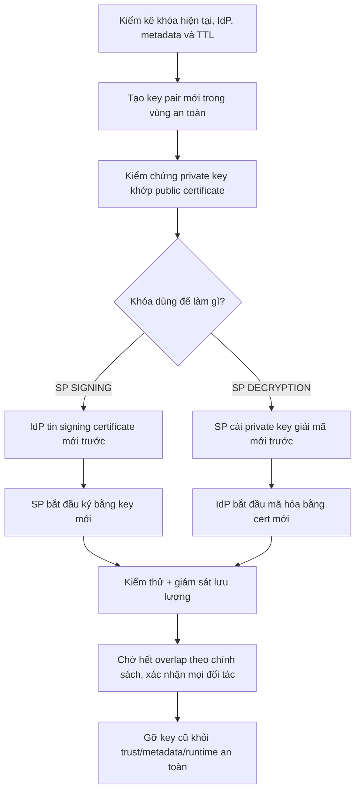
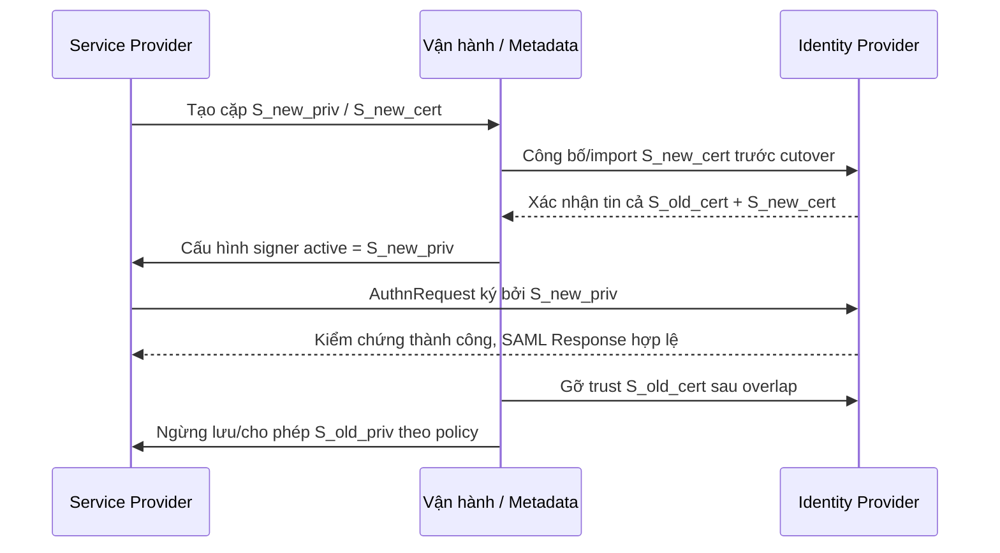
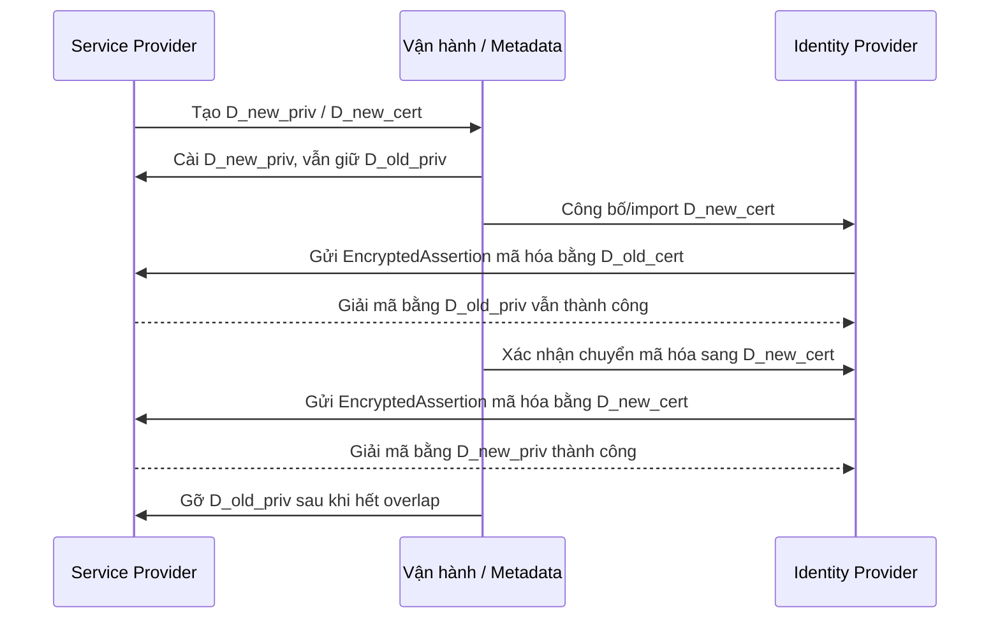

# Luân chuyển khóa ký và khóa giải mã của Service Provider trong SAML2

**Chủ đề:** Spring Security – federation → Khóa và chứng thư.

Một ứng dụng SAML2 Service Provider (SP/Relying Party) có thể sở hữu **khóa riêng dùng để ký** các thông điệp gửi đến Identity Provider (IdP/Asserting Party) và **khóa riêng dùng để giải mã** các assertion hoặc thuộc tính mà IdP mã hóa cho SP. Hai mục đích đều có thể sử dụng X.509 certificate công khai trong metadata, nhưng **trình tự thay khóa không giống nhau**. Nếu chuyển khóa mà không phối hợp với IdP và không có thời gian giao thoa phù hợp, người dùng có thể không đăng nhập được dù cả hai bên vẫn triển khai đúng SAML.

**Nguyên tắc trọng tâm:**

- **Đổi khóa ký của SP:** IdP cần biết và **tin certificate công khai mới trước khi SP bắt đầu ký bằng private key mới**. Trong giai đoạn chuyển tiếp, IdP có thể phải chấp nhận chữ ký tạo bởi cả khóa cũ và khóa mới.
- **Đổi khóa giải mã của SP:** SP cần **cài sẵn private key mới trước khi IdP bắt đầu mã hóa bằng public certificate mới**, đồng thời giữ private key cũ đủ lâu để giải mã các SAML Response đang di chuyển hoặc IdP còn gửi bằng chứng thư cũ.
- **Nếu private key bị lộ:** không coi đây là rollover thông thường có giai đoạn chờ thoải mái. Cần kích hoạt quy trình sự cố, loại bỏ/thu hồi trust với khóa bị xâm phạm và phối hợp chuyển đổi khẩn cấp.

Bài học sử dụng Spring Security Servlet/MVC, `RelyingPartyRegistration`, `Saml2X509Credential` và `saml2Metadata`; cấu hình mẫu hướng tới Spring Boot 4.1.x, Java 17+. Nguyên tắc mật mã và SAML metadata áp dụng rộng hơn, nhưng đường dẫn cấu hình và API cần đối chiếu đúng phiên bản đang chạy.

## 1. Phân biệt chính xác ai dùng khóa nào

Trong SAML federation, thường có **hai chủ thể giữ khóa riêng** và **bốn vai trò mật mã**. Nhầm hướng sử dụng là nguyên nhân của nhiều sự cố rotation.

| Chủ sở hữu | Vai trò | Private key nằm ở đâu? | Public certificate được ai dùng? |
| --- | --- | --- | --- |
| **SP** | **SIGNING**: ký `AuthnRequest`, có thể ký `LogoutRequest`/`LogoutResponse` theo cấu hình | **Chỉ SP** (hoặc dịch vụ HSM/KMS thực hiện ký thay SP) | **IdP** dùng certificate công khai của SP để xác minh chữ ký |
| **SP** | **DECRYPTION**: giải mã `EncryptedAssertion`, `EncryptedID`, `EncryptedAttribute` gửi cho SP | **Chỉ SP** | **IdP** dùng public certificate của SP để mã hóa thông điệp dành cho SP |
| **IdP** | **SIGNING**: ký SAML Response/Assertion | **Chỉ IdP** | **SP** giữ IdP verification certificate để xác minh chữ ký |
| **IdP** | **ENCRYPTION**: mã hóa payload gửi đi | Thường không cần private key IdP cho việc mã hóa bằng public key SP; vai trò cụ thể phụ thuộc giao thức | **SP decryption public certificate** là đầu vào để IdP mã hóa |

**Chữ ký ≠ mã hóa.** Chữ ký cho phép phía nhận kiểm tra nguồn gốc/tính toàn vẹn; mã hóa bảo vệ tính bí mật của nội dung khi đúng private key giải mã được giữ an toàn. Một chữ ký hợp lệ **không làm assertion trở thành bí mật**; một assertion đã mã hóa **không tự chứng minh IdP là nguồn tin cậy** nếu bỏ qua xác minh chữ ký/issuer/conditions.

**Còn một loại certificate khác:** chứng thư HTTPS/TLS của `https://portal.example.com` bảo vệ kết nối browser/gateway. Nó có vòng đời **riêng**, không tự động thay khi cập nhật `signing.credentials` hay `decryption.credentials` của SAML. TLS certificate, SP signing certificate và SP decryption certificate có thể có chu kỳ khác nhau.

### 1.1. Có thể dùng một khóa cho hai chức năng không?

Spring Security cung cấp `Saml2X509Credential` với các loại `SIGNING`, `DECRYPTION` ở phía SP; cùng một key pair có thể được cấu hình cho cả hai nếu thuật toán, IdP và policy cho phép. Tuy nhiên ở hệ thống có yêu cầu bảo mật cao, nên cân nhắc **tách khóa ký và khóa giải mã**:

- Rotation độc lập theo mục đích; không cần ép IdP đổi cấu hình mã hóa mỗi lần SP đổi khóa ký.
- Giới hạn phạm vi ảnh hưởng nếu một khóa bị lộ.
- Phân quyền sử dụng key/HSM rõ ràng: signing service không cần quyền giải mã dữ liệu nhạy cảm.
- Dễ xác định certificate nào tương ứng với `KeyDescriptor use="signing"` hoặc `use="encryption"`.

Nếu hiện tại SP dùng chung một cặp khóa cho hai vai trò, **phải lập kế hoạch rollover của cả hai vai trò**, vì một thay đổi có thể đồng thời ảnh hưởng kiểm chứng AuthnRequest và khả năng giải mã Assertion. Không tự đổi riêng alias key mà bỏ qua bên còn lại.

## 2. Ranh giới metadata và certificate

`RelyingPartyRegistration` mô tả một kết nối SP–IdP, bao gồm:

- `registrationId` cục bộ trong Spring Security.
- SP `entityId` và địa chỉ ACS.
- **SP signing credentials**: private key + X.509 certificate của SP.
- **SP decryption credentials**: private key + X.509 certificate của SP.
- **IdP verification credentials**: certificate công khai tin cậy để SP kiểm chứng chữ ký IdP.
- Thông tin SSO URL, issuer/entity ID và các yêu cầu từ IdP metadata.

Spring Security có DSL:

```java
http.saml2Login(Customizer.withDefaults())
    .saml2Metadata(Customizer.withDefaults());
```

Khi bật `saml2Metadata`, SP công bố metadata từ registration tại đường dẫn như:

```text
GET https://portal.example.com/saml2/metadata/partner-a
GET https://portal.example.com/saml2/service-provider-metadata/partner-a
```

Metadata giúp IdP nạp public key/certificate phù hợp. Tuy nhiên **metadata đã xuất bản ≠ IdP đã chấp nhận hoặc refresh**. Một số IdP nhập XML một lần, một số tự fetch định kỳ, một số chỉ cho phép một signing certificate hoặc một encryption certificate, và một số cần thao tác quản trị thủ công để chuyển active key.

### 2.1. `KeyDescriptor` trong SP metadata

Một metadata SAML đơn giản có thể chứa:

```xml
<md:SPSSODescriptor
    xmlns:md="urn:oasis:names:tc:SAML:2.0:metadata"
    xmlns:ds="http://www.w3.org/2000/09/xmldsig#"
    protocolSupportEnumeration="urn:oasis:names:tc:SAML:2.0:protocol">
  <md:KeyDescriptor use="signing">
    <ds:KeyInfo>
      <ds:X509Data>
        <ds:X509Certificate>BASE64_PUBLIC_CERT_OLD</ds:X509Certificate>
      </ds:X509Data>
    </ds:KeyInfo>
  </md:KeyDescriptor>
  <md:KeyDescriptor use="signing">
    <ds:KeyInfo>
      <ds:X509Data>
        <ds:X509Certificate>BASE64_PUBLIC_CERT_NEW</ds:X509Certificate>
      </ds:X509Data>
    </ds:KeyInfo>
  </md:KeyDescriptor>
  <md:KeyDescriptor use="encryption">
    <ds:KeyInfo>
      <ds:X509Data>
        <ds:X509Certificate>BASE64_PUBLIC_DECRYPTION_CERT_NEW</ds:X509Certificate>
      </ds:X509Data>
    </ds:KeyInfo>
  </md:KeyDescriptor>
</md:SPSSODescriptor>
```

**Đây là trích đoạn XML minh họa, không phải metadata hoàn chỉnh hay certificate Base64 hợp lệ.** SAML metadata thật cần `EntityDescriptor@entityID`, ACS và các trường bắt buộc; các certificate cần là PEM/DER X.509 public key thực. Mỗi certificate/key có vai trò riêng. Trường `KeyDescriptor@use` có thể là `signing`, `encryption` hoặc bị bỏ trống theo schema/hợp đồng; phía import phải diễn giải đúng.

**Khi rollover có nhiều key:** OASIS Metadata Interoperability Profile cho phép quảng bá signing key dự kiến dùng trong tương lai để chuẩn bị chuyển đổi; các key còn được chấp nhận cần được thể hiện theo metadata contract. Không được chỉ nhìn sự có mặt của cả hai certificate rồi suy rằng IdP sẽ tự động tin hoặc dùng chúng: **kiểm tra khả năng thực tế của IdP**.

### 2.2. Certificate public không phải private key

- `.crt` thường chứa **X.509 certificate công khai**, có thể gửi cho IdP theo kênh được xác thực.
- `.key`/private key phải nằm trong secret manager, HSM hoặc filesystem có quyền hạn chế, không ghi Git, image layer, log, ticket hoặc metadata.
- **Fingerprint SHA-256** của certificate là giá trị hữu ích để đối chiếu hai bên; không phải bí mật và không thay thế cơ chế xác minh nguồn của metadata.
- **Không sửa XML metadata thủ công** để chèn certificate mới nếu ứng dụng thực tế không có private key tương ứng. Cần cấu hình runtime, xuất metadata mới và kiểm chứng từ đúng môi trường.
- **Đừng dùng hạn X.509 như cơ chế duy nhất quyết định trust SAML.** Trong nhiều profile SAML, certificate được dùng như vật chứa public key đã tin qua metadata; quy tắc hết hạn/CA chain do IdP, metadata trust policy và chính sách tổ chức quyết định. Dù vậy vẫn phải theo dõi `notBefore/notAfter` để đáp ứng vendor/policy và kế hoạch rollover.

## 3. Chiến lược tổng quát: chuẩn bị → công bố → chuyển → kết thúc

Hai luồng có chung nguyên lý **giai đoạn giao thoa (overlap)** nhưng “ai phải có key trước” khác nhau.



**Thời gian overlap không phải một con số chung**. Phải tính tối thiểu từ: chu kỳ IdP refresh metadata, cache/`validUntil`/`cacheDuration`, propagation trong cluster/cấu hình, retry của IdP, phiên SAML đang bay qua mạng, khả năng rollback và SLA đối tác. Nhiều IdP không refresh metadata tự động, vì thế overlap theo “24 giờ” sẽ không giải quyết được nếu họ vẫn tin certificate cũ.

### 3.1. Danh sách đối tác nên được kiểm kê trước

| Trường | Ví dụ / lý do |
| --- | --- |
| `registrationId` | `partner-a` hoặc `partner-b` — một IdP riêng có thể có lịch cutover khác |
| SP entity ID / ACS | Phải giữ **ổn định** trong rotation key, trừ khi thay đổi độc lập đã được duyệt |
| Signing cert cũ / mới | Fingerprint, serial, `notAfter`, nơi giữ private key |
| Decryption cert cũ / mới | Fingerprint, nơi giữ private key, danh sách IdP đang mã hóa bằng cert nào |
| IdP metadata refresh | Tải tự động, cần import file hay thao tác admin? Chu kỳ bao lâu? |
| Multiple cert support | Có thể tin hai signing cert? Có thể chọn encryption cert và đổi dần? |
| Test endpoint | Staging IdP/SP/ACS, người thử đăng nhập, quyền liên hệ |
| Deployment architecture | Một instance hay nhiều pod, secret mount, HSM/KMS và thứ tự rollout |
| Rollback | Có thể bật lại signer cũ không? IdP còn tin cả hai? Old decrypt key được giữ đến khi nào? |

Không bắt đầu rollout nếu chưa biết **đối tác nào nhận public key mới, khóa nào đang active và có thể rollback hay không**.

## 4. Luân chuyển **khóa ký SP** không gián đoạn

### 4.1. Bối cảnh

SP dùng `S_old_priv` ký `AuthnRequest`. IdP tin `S_old_cert`. Mục tiêu là SP ký bằng `S_new_priv` và IdP tin `S_new_cert`, giữ nguyên entity ID/ACS.

**Thứ tự đúng:** chuẩn bị **trust trước**, đổi signer sau.



### 4.2. Các giai đoạn

**S0 — Baseline:** SP ký bằng khóa cũ; IdP chỉ tin certificate cũ. Chụp metadata/fingerprint và tỷ lệ login thành công, cấu hình IdP hiện tại.

**S1 — Prepare:** Tạo key mới bằng công cụ/HSM đáp ứng thuật toán và kích thước do hai bên cho phép (ví dụ RSA với chính sách của tổ chức); kiểm tra certificate khớp private key, thời hạn, nơi lưu và quyền truy cập.

**S2 — Publish/pretrust:** Đưa certificate công khai mới vào cấu hình trust tại IdP hoặc metadata được họ import. Nếu IdP hỗ trợ cả cũ+mới, yêu cầu họ tin **cả hai** trước cutover. Một số IdP giới hạn một key duy nhất; khi đó cần kế hoạch đồng bộ thời điểm chuyển đổi, canary hoặc cửa sổ bảo trì — **không hứa zero downtime**.

**S3 — Activate new signer:** Sau khi đối tác xác nhận đã trust key mới, chuyển **credential thực sự dùng để ký** sang private key mới. Kiểm tra signature của AuthnRequest trong **binding thực tế** và đối chiếu public certificate IdP tin. Đừng coi “đã thêm một phần tử `signing.credentials`” là bằng chứng framework đã chọn key mới; quan sát request thực tế.

**S4 — Observe:** Kiểm thử login với từng IdP/tenant, luồng SP-initiated, các SAML Logout Request nếu dùng, nhiều node/canary, và error rate `SignatureVerificationFailed` ở IdP. Trong overlap, đối tác có thể phải tiếp tục tin old+new nếu một pod chưa chuyển.

**S5 — Retire old:** Khi mọi SP node ký mới, IdP không còn cần trust cũ, rollback đã hết thời hạn và giao dịch cũ đã kết thúc, xóa old cert khỏi trust/metadata phù hợp và khóa riêng cũ khỏi runtime; hủy key theo chính sách. Không xóa trước khi chưa chắc các đối tác đã chuyển.

### 4.3. Vì sao thứ tự ngược gây lỗi?

Sai:

```text
T=0: SP đổi sang S_new_priv
T=1: IdP vẫn chỉ trust S_old_cert
T=2: IdP nhận AuthnRequest ký S_new_priv
T=3: IdP reject InvalidSignature
```

Đúng:

```text
T=0: IdP trust S_old_cert + S_new_cert
T=1: SP đổi sang S_new_priv
T=2: IdP verify bằng S_new_cert
T=3: SP và IdP hoàn tất login
T=4: Sau overlap, retire S_old_cert
```

**Lưu ý signing binding:** SAML HTTP-Redirect có thể ký tham số query (`SAMLRequest`/`RelayState`/`SigAlg`), trong khi HTTP-POST có thể dùng XML Signature bên trong message. **Không kết luận không ký chỉ vì XML AuthnRequest giải mã từ Redirect thiếu `ds:Signature`.** Hãy kiểm tra chữ ký theo binding và cấu hình thật.

## 5. Luân chuyển **khóa giải mã SP** không gián đoạn

### 5.1. Bối cảnh

IdP đang mã hóa `EncryptedAssertion` bằng `D_old_cert`; SP dùng `D_old_priv` để giải mã. Mục tiêu IdP mã hóa bằng `D_new_cert` và SP dùng `D_new_priv`.

**Thứ tự đúng: SP hỗ trợ giải mã bằng private key mới trước khi IdP sử dụng public key mới.** Đồng thời SP thường phải tiếp tục nhận nội dung mã hóa bằng old cert trong giai đoạn giao thoa.



### 5.2. Các giai đoạn

**D0 — Baseline:** IdP chọn old public certificate để encrypt; SP chỉ có old private decryption key.

**D1 — Prepare new decryptor:** Tạo new key pair và **cài `D_new_priv` trên tất cả SP nodes** trong danh sách decryption credentials trước; vẫn giữ `D_old_priv`. Kiểm tra runtime có thể giải mã payload test bằng cả hai private keys. Nếu IdP chưa gửi payload encrypted, dùng fixture được tạo bởi công cụ đáng tin từ public cert hoặc IdP sandbox.

**D2 — Publish new encryption certificate:** Công bố SP metadata mới có public cert mới theo contract. **Cẩn thận:** nếu metadata liệt kê hai `KeyDescriptor use="encryption"`, IdP có thể chọn một trong hai key khi mã hóa, tùy triển khai. Không giả định thứ tự trong XML buộc IdP chọn cert mong muốn. Vì vậy mọi SP node phải sẵn sàng giải mã bằng **cả hai private keys trước khi công bố cert mới**.

**D3 — Ask IdP to switch encryptor:** Đối tác import metadata/chọn key active và xác nhận thời điểm họ mã hóa bằng cert mới. Gửi test response có `EncryptedAssertion`/`EncryptedID`/`EncryptedAttribute` tương ứng. Khi thiếu encrypted payload trong test, không có bằng chứng đã thử decryption.

**D4 — Observe mixed traffic:** Giữ old+new private keys, vì IdP có cache/đường song song hoặc request đã bắt đầu trước cutover. Kiểm tra từng tenant, certificate fingerprint/chỉ báo key trong encrypted data (khi có), lỗi decryption, login và phiên SSO.

**D5 — Retire old decryptor:** Chỉ khi xác nhận **không IdP nào còn encrypt bằng old cert**, thời gian tồn tại message/retry/cache phù hợp đã qua, và rollback đã được chốt, gỡ old public cert khỏi metadata và old private key khỏi active runtime. Hủy/niêm phong old private key theo retention policy; không vội xóa nếu hệ thống có dữ liệu đã mã hóa cần giải mã lịch sử, nhưng không giữ key vô thời hạn “để đề phòng”.

### 5.3. Vì sao thứ tự ngược gây lỗi?

Sai:

```text
T=0: SP metadata đã công bố D_new_cert
T=1: IdP chọn D_new_cert để mã hóa response
T=2: SP vẫn chỉ giữ D_old_priv
T=3: Spring Security không thể giải mã EncryptedAssertion
```

Đúng:

```text
T=0: SP runtime có D_old_priv + D_new_priv
T=1: SP metadata công bố D_new_cert theo hợp đồng
T=2: IdP chuyển encryptor sang D_new_cert
T=3: SP giải mã bằng D_new_priv
T=4: Khi hết overlap, gỡ D_old_priv
```

### 5.4. Không nhầm với IdP verification certificate

SP decrypt bằng **SP private key**; SP verify signature IdP bằng **IdP public certificate**. Nếu login thất bại báo InvalidSignature từ OpenSAML, đó không tự động là lỗi `decryption.credentials`. Cần phân biệt:

- `Cannot decrypt EncryptedAssertion`: xem SP decryption key matching và encryption algorithm/binding.
- `Signature validation failed`: xem **IdP verification trust** và chứng chỉ IdP ký.
- `AuthnRequest signature invalid` ở IdP: xem **SP signing private key** và SP signing certificate IdP tin.

Đổi IdP signing cert là một runbook khác với đổi SP signing/decryption; không ghi đè nhầm `assertingparty.verification.credentials` khi chỉ làm SP key rotation.

## 6. Tách hai quy trình khi SP đang dùng **cùng một cặp khóa**

Trường hợp legacy thường có:

```text
SP.key = K_old_private
SP.cert = K_old_public

K_old dùng cho SIGNING và DECRYPTION
```

Muốn chuyển sang hai cặp riêng:

1. Tạo `S_new` dùng ký và `D_new` dùng giải mã; xác định thuật toán/keystore/HSM phù hợp.
2. Cài `D_new_priv` lên toàn bộ SP nodes, **vẫn giữ `K_old_priv` làm decryption**.
3. Phát hành certificate ký `S_new_cert` đến IdP và yêu cầu IdP trust trước.
4. Chỉ sau khi trust đã sẵn sàng, chuyển signer sang `S_new_priv`.
5. Phát hành certificate giải mã `D_new_cert` (SP đã cài decryptor), cho IdP bắt đầu encrypt bằng cert mới.
6. Giữ `K_old_priv` cho các encrypted assertion đến trễ, và giữ old signing cert được IdP tin nếu còn node ký cũ.
7. Kiểm chứng mọi IdP, từng encryption/signature flow; kết thúc overlap mới retire `K_old`.

Không thực hiện mọi bước trong **một deployment không quan sát được** nếu hệ thống có nhiều IdP khác biệt về cơ chế import/trust. Tách signing cutover và decryption cutover giúp xác định nguyên nhân khi login lỗi.

## 7. Cấu hình Spring Boot cho SAML SP

### 7.1. Maven dependencies và Spring Security Servlet

Ví dụ cho **Spring Boot 4.1.2 + Spring Security do Boot BOM quản lý + Java 17+**. Tài liệu học chỉ chứa các mảnh cần thiết của một dự án Maven, không phải một ứng dụng có thể login với domain giả.

`pom.xml` (rút gọn nhưng thể hiện dependencies và repository):

```xml
<?xml version="1.0" encoding="UTF-8"?>
<project xmlns="http://maven.apache.org/POM/4.0.0"
         xmlns:xsi="http://www.w3.org/2001/XMLSchema-instance"
         xsi:schemaLocation="http://maven.apache.org/POM/4.0.0
           https://maven.apache.org/xsd/maven-4.0.0.xsd">
  <modelVersion>4.0.0</modelVersion>
  <parent>
    <groupId>org.springframework.boot</groupId>
    <artifactId>spring-boot-starter-parent</artifactId>
    <version>4.1.2</version>
    <relativePath/>
  </parent>
  <groupId>com.example</groupId>
  <artifactId>saml-key-rotation</artifactId>
  <version>1.0.0</version>
  <properties><java.version>17</java.version></properties>
  <repositories>
    <repository>
      <id>shibboleth-releases</id>
      <url>https://build.shibboleth.net/maven/releases/</url>
      <snapshots><enabled>false</enabled></snapshots>
    </repository>
  </repositories>
  <dependencies>
    <dependency>
      <groupId>org.springframework.boot</groupId>
      <artifactId>spring-boot-starter-webmvc</artifactId>
    </dependency>
    <dependency>
      <groupId>org.springframework.boot</groupId>
      <artifactId>spring-boot-starter-security</artifactId>
    </dependency>
    <dependency>
      <groupId>org.springframework.boot</groupId>
      <artifactId>spring-boot-starter-security-saml2</artifactId>
    </dependency>
    <dependency>
      <groupId>org.springframework.boot</groupId>
      <artifactId>spring-boot-starter-test</artifactId>
      <scope>test</scope>
    </dependency>
  </dependencies>
</project>
```

Spring Security SAML2 Service Provider sử dụng OpenSAML; tài liệu chính thức yêu cầu cấu hình kho **Shibboleth Releases**. Tùy nhánh Boot, starter có tên khác (ví dụ Boot 3.5 dùng `spring-security-saml2-service-provider` trực tiếp). Không thay một mình Spring Security 6/7 hoặc OpenSAML major trái với BOM mà không kiểm thử.

`SecurityConfig.java` (mảnh lớp cần đặt trong ứng dụng Spring Boot đã cấu hình):

```java
package com.example.federation;

import org.springframework.context.annotation.Bean;
import org.springframework.context.annotation.Configuration;
import org.springframework.security.config.Customizer;
import org.springframework.security.config.annotation.web.builders.HttpSecurity;
import org.springframework.security.web.SecurityFilterChain;

@Configuration
public class SecurityConfig {

    @Bean
    SecurityFilterChain securityFilterChain(HttpSecurity http)
            throws Exception {
        http.authorizeHttpRequests(auth -> auth
                .requestMatchers(
                    "/",
                    "/error",
                    "/saml2/metadata",
                    "/saml2/metadata/**",
                    "/saml2/service-provider-metadata/**"
                ).permitAll()
                .anyRequest().authenticated())
            .saml2Login(Customizer.withDefaults())
            .saml2Metadata(Customizer.withDefaults());
        return http.build();
    }
}
```

Trong dự án thật, cần có `@SpringBootApplication`/main class, IdP metadata/registration đúng, certificate và secret files hiện hữu; **code này tự nó không tạo tài khoản hay IdP**. `saml2Login` xử lý SSO; `saml2Metadata` phát hành SP metadata cho đối tác. Nếu tổ chức hạn chế việc công bố metadata, dùng trusted network/gateway policy đúng để IdP có thể lấy XML; không buộc người dùng đăng nhập chỉ để import metadata.

### 7.2. Cấu hình nhiều decryption credentials khi rollover

`application.yml` (giai đoạn **D1/D2**: SP đã có hai decryptors, signer mới chỉ được bật **sau khi IdP trust**):

```yaml
spring:
  security:
    saml2:
      relyingparty:
        registration:
          partner-a:
            entity-id: https://portal.example.com/saml2/sp/partner-a
            signing:
              credentials:
                - private-key-location: file:/run/secrets/saml/signing-new.key
                  certificate-location: file:/run/secrets/saml/signing-new.crt
            decryption:
              credentials:
                - private-key-location: file:/run/secrets/saml/decrypt-new.key
                  certificate-location: file:/run/secrets/saml/decrypt-new.crt
                - private-key-location: file:/run/secrets/saml/decrypt-old.key
                  certificate-location: file:/run/secrets/saml/decrypt-old.crt
            assertingparty:
              metadata-uri: https://login.partner.example/metadata.xml
```

**Chú thích quan trọng:** đây là **snapshot mục tiêu sau khi IdP đã chấp nhận signing cert mới**, không phải cấu hình an toàn để áp ngay ở giai đoạn S0 khi IdP vẫn chỉ tin signing cert cũ. Nếu đang ở S0/S1, giữ `signing-old.key/crt` làm signer active cho đến khi IdP đã pretrust. Có thể công bố signing cert mới trong metadata/trust trước khi chuyển signer nhưng cần xác nhận **ứng dụng thực sự chọn key nào** để ký (kiểm tra flow/JavaDoc của đúng phiên bản, nhất là nếu khai báo nhiều signing credentials). Nếu không thể kiểm soát rõ active signing credential, nên tách pretrust khỏi runtime signer và phối hợp cutover.

**Giá trị trong ví dụ:**
- `signing-new.key` là SP private key mới dùng ký; `signing-new.crt` là public certificate cùng cặp.
- `decrypt-new.key/crt` và `decrypt-old.key/crt` giữ **hai private decryptors** trong overlap. Thứ tự có thể ảnh hưởng chiến lược thử decryption ở từng phiên bản — cần kiểm tra bằng thực nghiệm, không đoán từ tên file.
- `assertingparty.metadata-uri` là **IdP metadata URL**; SP metadata được công bố qua `saml2Metadata` trên domain SP. Đừng đảo hai URL.
- `entity-id` nên ổn định trong rotation. Thay đổi entity ID có thể khiến IdP coi ứng dụng là một SP mới.

**Đừng đưa private key vào Git/ConfigMap không bảo vệ.** Với Kubernetes, dùng secret được kiểm soát/HSM/CSI driver theo chính sách, mount read-only, giới hạn RBAC và quyền filesystem, audit quyền truy cập; cập nhật key version theo deployment có kế hoạch. Một số hệ thống HSM ký qua API mà private key không export được; khi đó cần hỗ trợ tùy biến của thư viện và kiểm thử tích hợp theo vendor.

### 7.3. SAML metadata sau rotation phải được xác minh từ **host public**

```bash
curl -fSL \
  https://portal.example.com/saml2/metadata/partner-a \
  -o sp-metadata.xml

xmllint --noout sp-metadata.xml
```

`xmllint` không thuộc Java JDK, cần cài công cụ XML tương ứng. XML well-formed chỉ là bước đầu; kiểm tra `EntityDescriptor@entityID`, `SPSSODescriptor`, `KeyDescriptor`, `AssertionConsumerService` và certificate fingerprint trong metadata.

Nếu ứng dụng chạy qua reverse proxy/ingress, metadata có thể vô tình xuất `http://localhost` hoặc host nội bộ, dẫn đến IdP import ACS/entity ID sai. Cấu hình forwarded headers **chỉ tin từ proxy được kiểm soát**; đừng lợi dụng việc rotate key để âm thầm đổi ACS hoặc SP entity ID.

### 7.4. Java API khi không dùng YAML auto-configuration

Spring Security có `Saml2X509Credential.signing(privateKey, certificate)` và `Saml2X509Credential.decryption(privateKey, certificate)` cùng builder `RelyingPartyRegistration`. Đoạn bên dưới là **mảnh Java thể hiện vai trò của đối tượng**, không phải một chương trình độc lập; việc tải key/cert cần cung cấp theo security/secret manager.

```java
// Ví dụ thuộc bước xây RelyingPartyRegistration đã có từ IdP metadata.
Saml2X509Credential signingNew =
        Saml2X509Credential.signing(signingPrivateKey, signingCertificate);

Saml2X509Credential decryptionNew =
        Saml2X509Credential.decryption(decryptionNewPrivateKey,
                decryptionNewCertificate);
Saml2X509Credential decryptionOld =
        Saml2X509Credential.decryption(decryptionOldPrivateKey,
                decryptionOldCertificate);

// Builder đã được tạo từ metadata IdP tin cậy:
builder.signingX509Credentials(credentials -> {
    credentials.clear();
    credentials.add(signingNew);
});
builder.decryptionX509Credentials(credentials -> {
    credentials.clear();
    credentials.add(decryptionNew);
    credentials.add(decryptionOld);
});
```

Nếu code Spring phiên bản thực tế không hỗ trợ chính xác overload/collection này, phải đối chiếu JavaDoc của phiên bản đang dùng. **Không tự viết bước decrypt XML hoặc ký SAML bằng private key theo cách thủ công trong controller**. Spring Security/OpenSAML quản lý XML signature, SAML bindings và validation; custom resolver, metadata builder hay HSM adapter phải được test riêng.

### 7.5. Tránh rollover chỉ một node

Nếu có 6 pod:

```text
Pod 1–3: decrypt new + old
Pod 4–6: decrypt old only
IdP: vừa bắt đầu encrypt bằng new cert
```

Các callback được load balancer gửi đến pod 4–6 có thể thất bại ngẫu nhiên. Vì vậy phải **hoàn tất triển khai decryptor mới trên toàn bộ SP fleet trước khi IdP bắt đầu encrypt mới**. Khi chuyển signer, trong giai đoạn một nửa pod ký cũ/một nửa ký mới, IdP phải trust cả hai signing cert. Không nên để các pod công bố metadata với bộ key khác nhau sau cùng một URL nếu đối tác có cơ chế cache/refresh không biết pod nào tạo XML.

## 8. Quản lý certificate/key và đối chiếu bằng OpenSSL

### 8.1. Xem certificate công khai, không đọc giá trị private key

Các lệnh chạy trong môi trường có `openssl` và chỉ đọc **public certificate**:

```bash
openssl x509 -in signing-new.crt -noout -subject -issuer -serial -dates
openssl x509 -in signing-new.crt -noout -fingerprint -sha256

openssl x509 -in decrypt-new.crt -noout -subject -issuer -serial -dates
openssl x509 -in decrypt-new.crt -noout -fingerprint -sha256
```

Các giá trị xuất ra tùy certificate thực; **không có stdout cố định**. Ghi trong change ticket: fingerprint SHA-256 cũ/mới, public cert roles, serial, thời điểm cutover, IdP owner và thông tin xác nhận import. Fingerprint **không thay thế việc bảo vệ private key**.

### 8.2. Kiểm tra certificate khớp private key

Một cách kiểm chứng với OpenSSL (chỉ chạy ở máy bảo mật có quyền đọc private key, không đăng xuất key ra đĩa/log):

```bash
openssl x509 -in signing-new.crt -pubkey -noout \
  | openssl pkey -pubin -outform DER \
  | openssl dgst -sha256

openssl pkey -in signing-new.key -pubout -outform DER \
  | openssl dgst -sha256
```

Hai digest phải **bằng nhau** nếu public key của certificate khớp private key. Phương pháp này không yêu cầu cùng modulus RSA cụ thể và hữu ích cho nhiều kiểu key được OpenSSL hỗ trợ. Nếu private key được HSM giữ không export, dùng API kiểm chứng public key/key alias hoặc một chữ ký thử được kiểm tra bằng certificate tương ứng; không buộc xuất private key chỉ để so fingerprint.

**An toàn:** file `.key` không được lưu vào screenshot/ticket; không chạy lệnh có thể in private key lên stdout, không copy secret sang máy cá nhân và không đưa key vào môi trường CI chưa kiểm soát.

### 8.3. Khi tạo key pair mới

Có thể dùng OpenSSL/HSM theo tiêu chuẩn thuật toán của tổ chức. Ví dụ tạo RSA key pair **trong vùng được kiểm soát** (chỉ minh họa, tuyệt đối không dùng tên/path đơn giản này cho production khi chưa có secret policy):

```bash
openssl genpkey -algorithm RSA -pkeyopt rsa_keygen_bits:3072 \
  -out sp-signing-new.key

openssl req -new -x509 -sha256 -days 365 \
  -key sp-signing-new.key \
  -subj "/CN=portal-saml-sp-signing" \
  -out sp-signing-new.crt
```

Ví dụ trên tạo self-signed X.509 certificate để biểu diễn public key; trong SAML federation, trust thường theo metadata/pinned certificate và chính sách IdP, **không tự kết luận IdP sẽ chấp nhận self-signed cert**. Production có thể yêu cầu certificate do CA nội bộ/đối tác phê duyệt, key không export từ HSM, thuật toán/kích thước khác, kiểm tra KeyUsage/ExtendedKeyUsage và rotation schedule theo hợp đồng. Tạo key trong secret manager/HSM được phê duyệt là ưu tiên khi có khả năng.

## 9. Java 17 độc lập: mô phỏng hai lịch chuyển đổi

Chương trình sau là **mô phỏng dependency an ninh giữa các bên**, không đọc SAML/XML, không ký/giải mã thực và không thay thế integration test. Nó làm rõ điều kiện tại từng bước: signer mới chỉ được dùng sau khi IdP tin, và encryptor mới chỉ được bật sau khi SP cài decryptor tương ứng.

Tệp `SamlKeyRotationDemo.java`:

```java
public class SamlKeyRotationDemo {
    record SigningState(
            boolean idpTrustOld,
            boolean idpTrustNew,
            String activeSigner) {

        boolean canSignAndVerify() {
            return switch (activeSigner) {
                case "old" -> idpTrustOld;
                case "new" -> idpTrustNew;
                default -> false;
            };
        }
    }

    record EncryptionState(
            boolean spCanDecryptOld,
            boolean spCanDecryptNew,
            String activeIdpEncryptor) {

        boolean canEncryptAndDecrypt() {
            return switch (activeIdpEncryptor) {
                case "old" -> spCanDecryptOld;
                case "new" -> spCanDecryptNew;
                default -> false;
            };
        }
    }

    public static void main(String[] args) {
        SigningState unsafeSign =
                new SigningState(true, false, "new");
        SigningState safeSign =
                new SigningState(true, true, "new");

        EncryptionState unsafeDecrypt =
                new EncryptionState(true, false, "new");
        EncryptionState safeDecrypt =
                new EncryptionState(true, true, "new");

        System.out.println("Signer before IdP trust: "
                + unsafeSign.canSignAndVerify());
        System.out.println("Signer after IdP trust: "
                + safeSign.canSignAndVerify());
        System.out.println("IdP encrypts before SP setup: "
                + unsafeDecrypt.canEncryptAndDecrypt());
        System.out.println("IdP encrypts after SP setup: "
                + safeDecrypt.canEncryptAndDecrypt());
    }
}
```

Chạy tại thư mục chứa file:

```bash
javac SamlKeyRotationDemo.java
java SamlKeyRotationDemo
```

**Stdout chính xác với JDK 17+:**

```text
Signer before IdP trust: false
Signer after IdP trust: true
IdP encrypts before SP setup: false
IdP encrypts after SP setup: true
```

Mô hình boolean không có metadata cache, network, XML Signature, encryption algorithms hay distributed session; nó chỉ dạy quy tắc thứ tự. Với hệ thống thật, cần **IdP sandbox có ký/giải mã thực, browser SSO và nhiều node runtime** để xác minh an toàn.

## 10. Bảng trạng thái chuyển tiếp và rollback

| Giai đoạn | SP active signing | IdP trust SP signing | IdP encryption key | SP decryption keys | Có thể login? |
| --- | --- | --- | --- | --- | --- |
| Trước thay khóa | Old | Old | Old | Old | Có, nếu các điều kiện SAML khác đúng |
| Chuẩn bị ký | Old | Old + New | Old | Old | Có; chưa chuyển signing |
| Chuyển ký | New | Old + New | Old | Old | Có; xem kết quả trên từng IdP |
| Chuẩn bị giải mã | New | Old + New | Old | Old + New | Có; SP sẵn sàng cho encryptor mới |
| Chuyển giải mã | New | Old + New | New hoặc còn Old tạm thời | Old + New | Có trong overlap nếu SP xử lý cả hai |
| Kết thúc | New | New | New | New | Có, khi mọi bên đã xác nhận |

**Đây là trạng thái mục tiêu, không phải bảo đảm tự động.** Nếu IdP chỉ tin một signing key, chỉ hỗ trợ một encryption certificate hoặc không tải metadata mới, kế hoạch phải có cutover phối hợp riêng và có thể cần maintenance. Nếu certificate mới có thời hạn chưa hiệu lực hoặc IdP có chính sách không chấp nhận thuật toán/key mới, phải khắc phục trước.

### 10.1. Rollback khi lỗi signer

Nếu SP đã ký mới nhưng IdP chưa trust được:
1. Chặn rollout signer mới trên phần còn lại của fleet.
2. Nếu IdP vẫn tin old cert, có thể tạm **quay active signer về old key** từ secret version đã bảo vệ; phải có change/incident approval.
3. Kiểm tra request thực sau rollback đã ký bằng old cert; chạy lại login/SP logout.
4. Sửa trust metadata/import tại IdP, xác nhận rồi mới thử lại.
5. Không dùng rollback old key nếu lý do rotate là **private key đã bị xâm phạm**.

### 10.2. Rollback khi lỗi decryptor

Nếu IdP đã encrypt mới nhưng một số SP nodes không giải mã được:
1. Kiểm tra mọi node có **new private key thực** và key khớp certificate mà IdP dùng.
2. Nếu hạ tầng an toàn, có thể yêu cầu IdP tạm encrypt old cert **chỉ khi old private key còn an toàn và mọi node decrypt old được**.
3. Không xóa new decrypt key khỏi runtime trong khi IdP còn gửi ciphertext dùng public cert mới.
4. Kiểm tra rollout consistency, encoding/algorithms, key selection, format key file.
5. Nếu old key bị lộ, không quay lại old encryptor; ưu tiên hoàn tất triển khai new decryptor và xử lý sự cố.

**Rollback không đồng nghĩa khôi phục một container image cũ không có private key mới**. Có thể image cũ chỉ decrypt old trong khi IdP đang encrypt new; phải chuẩn bị secret compatibility trong cả phiên bản release và rollback.

## 11. Xử lý khi khóa riêng bị xâm phạm

Rollover định kỳ và xử lý key compromise khác nhau:

| Tình huống | Mức độ | Quyết định |
| --- | --- | --- |
| Certificate gần hết hạn nhưng key chưa bị lộ | Planned rotation | Lập overlap theo metadata/cache/partner SLA |
| Thuật toán yếu, cần chuyển RSA/key size hoặc policy | Planned migration có rủi ro | Kiểm tra IdP support thuật toán và sign/encrypt test trước |
| Private signing key SP bị lộ | **Sự cố an ninh** | Ngăn dùng key, thông báo IdP để gỡ trust cũ khẩn cấp, rotate và điều tra AuthnRequest/LogoutRequest giả mạo |
| Private decryption key SP bị lộ | **Sự cố bí mật dữ liệu** | Ngăn IdP encrypt thêm bằng public cert cũ, thay key, đánh giá encrypted assertions đã bị thu thập, rà soát log/lưu trữ |
| Chứng chỉ IdP verification bị thay không có thông báo | Có thể là sự cố trust hoặc migration | Không tự import để “chạy lại”; xác minh IdP qua kênh chính thức |
| Key cũ đã retire theo quy trình | Kết thúc overlap | Xóa trust/public metadata/key khỏi runtime theo policy, giữ audit/backup bảo vệ nếu được yêu cầu |

**Theo OASIS Metadata Interoperability Profile, khóa bị compromise phải bị loại khỏi metadata của thực thể sở hữu.** Không tiếp tục quảng bá old cert vì “đối tác chậm cập nhật” nếu điều đó giữ một khóa đã bị lộ như một lựa chọn tin cậy. Phối hợp cô lập/rollback có kiểm soát trong incident response, chấp nhận gián đoạn nếu cần để bảo vệ người dùng và dữ liệu.

Với compromised **decryption key**, các payload trước đây đã được mã hóa bằng public cert tương ứng có thể bị giải mã nếu kẻ tấn công từng thu thập ciphertext. Vì vậy cần đánh giá mức độ lộ dữ liệu theo thời gian và chính sách bảo mật, không chỉ đổi certificate rồi đóng ticket.

## 12. Khác biệt theo nhà cung cấp IdP và nhiều đối tác

| Đặc điểm IdP | Ảnh hưởng rotation | Câu hỏi cần xác nhận |
| --- | --- | --- |
| Hỗ trợ nhiều SP signing certificates | Cho phép pretrust old+new và cutover mềm | Có verify cả hai khi nhận AuthnRequest? Thứ tự có ảnh hưởng? |
| Chỉ hỗ trợ một SP signing certificate | Cutover phải đồng bộ, không thể giả định zero downtime | Thời điểm thay trên IdP? Có staged/app duplicate hoặc test slot? |
| Hỗ trợ nhiều SP encryption certificates | Có thể chọn cert mới ngay khi nhập metadata | SP đã cài new decrypt key trên **mọi node** chưa? IdP chọn cert theo rule nào? |
| Chỉ hỗ trợ một encryption certificate | Đổi encryptor phải phối hợp chính xác | Cơ chế rollback cert, retry và stale messages? |
| Tự refresh metadata | Cần hiểu cache/validUntil/refresh schedule | Lần refresh gần nhất, lỗi fetch, bản cert đang tin? |
| Import metadata thủ công | XML thay ở SP không đủ | Ai xác nhận import fingerprint mới và lúc nào? |
| Có signing SAML Logout | SP signer thay có thể làm SLO fail | Đối tác test LogoutRequest/LogoutResponse đã ký chưa? |
| Có encrypted attributes/EncryptedID | Không chỉ EncryptedAssertion cần decrypt | Đã thử cả các loại payload mã hóa thực tế chưa? |
| Có federation proxy/broker | Nhiều mức trust và cache | Broker hay upstream IdP đang thực sự verify/encrypt? |
| Nhiều SP instances/regions | Các instance có thể dùng key khác nhau | Metadata xuất giống nhau không? Secret rollout hoàn tất chưa? |

Với mỗi đối tác, tạo một **change record** có fingerprint old/new của signing và decryption cert, đăng ký tenant, trạng thái import IdP, ngày cutover, người xác nhận test, thời hạn overlap, điều kiện gỡ old và phương án rollback. Đừng chỉ ghi “đã đổi certificate” — phải ghi **role** và **bên sở hữu private key**.

## 13. Kiểm thử thực tế trước, trong và sau rollover

### 13.1. Trước cutover

- [ ] Kiểm tra baseline login của từng IdP, issuer/entity ID, ACS, response chữ ký và encryption thực tế.
- [ ] Lập inventory SP signing/decryption keys (không copy private key vào tài liệu).
- [ ] Kiểm tra key pair mới bằng public-key digest hoặc thao tác HSM test; certificate fingerprint ghi chính xác.
- [ ] Tài liệu hóa key role, algorithm, độ dài, hiệu lực certificate và policy IdP.
- [ ] Tải SP metadata qua domain public, không qua localhost; XML chứa key descriptors và ACS đúng.
- [ ] Nếu dùng multiple signing certs, chứng minh IdP **thực sự verify cả hai**.
- [ ] Triển khai decryptor mới đến mọi node **trước khi** bất kỳ IdP nào dùng cert mới.
- [ ] Kiểm tra key/secret mount và quyền truy cập trên mọi pod/region.
- [ ] Thử SAML login và SLO nếu có, kiểm tra correlation `InResponseTo`, request repository và tenant.
- [ ] Chốt canary, observability, liên hệ on-call, freeze các thay đổi IdP khác trong cửa sổ rotation.

### 13.2. Trong cutover

| Test | Cách thử | Kỳ vọng |
| --- | --- | --- |
| Signed AuthnRequest old | Khi old signer vẫn active, IdP trust old | Đăng nhập được, đúng certificate |
| Signed AuthnRequest new | Sau khi IdP pretrust, SP ký new | Đăng nhập được, IdP xác minh signature |
| Mixed signer nodes | Canary chia old/new | Mọi request được IdP nhận; nếu không, dừng rollout |
| Encryption old cert | IdP gửi `EncryptedAssertion` dùng old cert | SP decrypt được bằng old private key |
| Encryption new cert | IdP gửi payload mã hóa bằng new cert | SP decrypt được bằng new private key trên mọi node |
| EncryptedID/Attribute | Nếu đối tác sử dụng loại này | Giải mã và xác thực đúng |
| SAML Response signature | IdP ký response/assertion | SP vẫn verify issuer/certificate chuẩn, không nhầm với decrypt |
| Replay/malformed SAML | Gửi assertion hết hạn, chữ ký sai, sai audience | SP từ chối; không vô tình tắt validation |
| SP-initiated callback | IdP trả `InResponseTo` đúng | Session/authentication request match |
| IdP-initiated (nếu có) | App launcher gửi unsolicited response | Tuân theo policy riêng, không bypass kiểm chứng |
| SAML Single Logout | Nếu triển khai | Đối tác xác minh request/response dùng signer mới |
| Certificate metadata | XML public sau deploy | Certificate/KeyDescriptor đúng, không rò private key |
| Rollback version | Khởi chạy bản trước khi rotation theo kế hoạch | Vẫn nhận payload theo cert IdP đang dùng, không mất new decryptor |

### 13.3. Sau cutover

- [ ] Không còn node active ký old khi IdP sắp gỡ trust old.
- [ ] Không IdP nào còn encrypt bằng old certificate trước khi SP gỡ old decryptor.
- [ ] Metadata cache/refresh hoặc manual import của **từng** IdP đã được xác nhận.
- [ ] Không đổi `entityId`, `registrationId`, ACS URL, session cookie hay signing algorithm ngoài phạm vi được duyệt.
- [ ] Tỷ lệ SSO success, signature verification fail và decryption fail ổn định so với baseline.
- [ ] Thử lại user thuộc các tenant, IdP app tile, sâu link, MFA và logout.
- [ ] Giữ nhật ký thay đổi fingerprint/key version có audit, không lưu private keys.
- [ ] Gỡ old cert/keys đúng thời hạn; xoá cache nếu cần, thu hồi quyền truy cập key cũ.
- [ ] Chốt rằng định dạng NameID/user mapping và authorization không bị thay đổi vì rotation.

## 14. Chẩn đoán lỗi sau khi đổi certificate

| Dấu hiệu | Nguyên nhân thường gặp | Cách điều tra đúng |
| --- | --- | --- |
| IdP báo `InvalidSignature` khi nhận AuthnRequest | SP đã ký new nhưng IdP chưa trust public cert new, hoặc algorithm/binding khác | Đối chiếu fingerprint, ký theo Redirect/POST, metadata IdP đã import, clock/relay state |
| Chỉ một số pod login lỗi | Mixed keys/secret versions, pod đọc file cũ, metadata không nhất quán | Xác minh certificate hash và secret version trên **mọi** pod, canary traffic |
| `Unable to decrypt EncryptedAssertion` | IdP encrypt new nhưng SP còn old-only, private key không khớp cert hoặc algorithm không hỗ trợ | Xác minh `decryption.credentials`, key pair, IdP active cert, payload test |
| `EncryptedAttribute` lỗi nhưng login cơ bản vẫn hoạt động | Không thử loại encrypted payload này, decrypter/credential khác | Test đúng payload/`OpenSaml5AuthenticationProvider` strategy |
| XML metadata có cả cert nhưng IdP dùng old | IdP cache/nhập thủ công, không auto-refresh hoặc lựa chọn key khác | Hỏi IdP active encryption/signing key, metadata import timestamp |
| Metadata public thay đổi nhưng login vẫn lỗi | Chưa đồng bộ runtime private key, SP entity ID/ACS sai | Kiểm tra file mounted, active signer/decryptors, metadata và callback |
| Cert public mới có fingerprint khác dự kiến | Nhầm file/cặp khóa hoặc upload nhầm cert | So hash public key với private key, kiểm tra cert chain/serial |
| Key/cert hết hạn bị vendor từ chối | Chính sách IdP yêu cầu validity/CA cụ thể | Xem vendor profile và hiệu lực, tái phát cert đúng policy |
| SAML Response `Signature validation failed` | IdP signing cert đổi, SP chưa có IdP verification trust mới | Điều tra **IdP verification certificate** riêng, không sửa SP decryptor |
| `AudienceRestriction` hoặc `Recipient` mismatch | SP entity ID/ACS vô tình đổi khi redeploy | Giữ entity ID/ACS ổn định; kiểm tra public host/forwarded headers |
| SSO callback mất session | SameSite/cookie/backend session; không liên quan trực tiếp key | Xem `HttpSessionSaml2AuthenticationRequestRepository`, proxy và request correlation |
| Signing được nhưng SLO lỗi | IdP chưa trust cert mới cho logout signing | Test riêng LogoutRequest/LogoutResponse và key role |
| Đã gỡ old decryptor nhưng vẫn có old ciphertext | IdP stale cache, retry hoặc tenant chưa chuyển | Khôi phục old decryptor **chỉ nếu key còn an toàn**, hoặc yêu cầu IdP dừng old encryptor; xử lý theo plan |
| Rotate khẩn cấp gây downtime | Old key đã bị compromise nên không thể overlap | Ưu tiên incident response, remove trust cũ, tăng cường kiểm soát |

**Cách đọc log:** tách lỗi **signature phía IdP đối với AuthnRequest**, **decryption phía SP đối với EncryptedAssertion** và **verification phía SP đối với chữ ký của IdP**. Không vì thấy cùng chữ “certificate” mà đổi tất cả trường credentials. Log fingerprint/id/registration/timestamp và lỗi đã lọc; không log private key, raw SAML Assertion, session cookie hay secret.

## 15. Kịch bản thực tế

**A — Portal đối tác, chỉ ký AuthnRequest:** SP không nhận encrypted assertion. Chỉ cần thay SP signing credential theo lịch IdP pretrust → SP activate → remove old. Không tự thêm decryption key vì “rotation phải có đủ hai loại”.

**B — Portal bệnh viện, IdP mã hóa assertion:** ưu tiên bảo vệ nội dung; SP phải cài old+new decryptors trước khi công bố encryption cert mới. Chạy test `EncryptedAssertion` thật, không chỉ kiểm tra metadata.

**C — Portal dùng chung key cho signing/decryption:** tách hai key roles, thực hiện theo từng pha và bảo đảm quá trình chuyển signer không làm IdP mất decryptor cũ. Tài liệu hóa key nào được phép dùng cho từng vai trò.

**D — SaaS đa đối tác với IdP A, B, C:** IdP A hỗ trợ hai signing cert, B chỉ một; C import metadata thủ công. Không có “một click rotate tất cả” bảo đảm zero downtime. Chốt cutover/overlap theo từng partner, có bảng trạng thái chứng nhận.

**E — Private signing key bị rò rỉ:** phải thông báo và yêu cầu IdP gỡ trust key cũ; không dùng planned overlap giữ compromised key active. Nếu IdP B không thể cập nhật ngay, tạm chặn luồng liên quan có thể an toàn hơn chấp nhận chữ ký giả mạo.

## 16. Runbook rút gọn cho vận hành

**Trước:** thông báo đối tác, tạo mới key pairs, lưu trong HSM/secret manager, kiểm tra fingerprint, xây test matrix, snapshot metadata và rollout baseline.

**Khóa ký:** IdP trust **public signing cert mới trước** → xác minh key active → SP ký mới → thử đăng nhập/Logout thực → retire old trust/key khi hết overlap.

**Khóa giải mã:** SP cài **new private decryptor trước** và giữ old decryptor → công bố public encryption cert mới → IdP encrypt mới → thử cả old/new ciphertext → retire old private decryptor khi tất cả đối tác đã chuyển.

**Đóng thay đổi:** metadata, runtime secret version và IdP settings nhất quán; SSO pass across tenants; không có key cũ được giữ trái chính sách; audit đủ fingerprint, người duyệt và rollback condition.

**Nếu xảy ra compromise:** chuyển ngay sang incident response; không kéo dài trust key đã bị lộ chỉ để tránh lỗi login.

## 17. Tài liệu chính thức và tiêu chuẩn

1. [Spring Security – SAML2 Login Overview](https://docs.spring.io/spring-security/reference/servlet/saml2/login/overview.html): `RelyingPartyRegistration`, signing/decryption credentials và SP/IdP key roles.
2. [Spring Security – SAML2 Metadata](https://docs.spring.io/spring-security/reference/servlet/saml2/metadata.html): `saml2Metadata`, SP metadata endpoint và tùy biến resolver.
3. [Spring Security – Authenticating SAML Responses](https://docs.spring.io/spring-security/reference/servlet/saml2/login/authentication.html): `OpenSaml5AuthenticationProvider`, decryption của `EncryptedAssertion`/`EncryptedID`/`EncryptedAttribute`.
4. [Spring Security JavaDoc – Saml2X509Credential](https://docs.spring.io/spring-security/reference/api/java/org/springframework/security/saml2/core/Saml2X509Credential.html): các loại `SIGNING`, `DECRYPTION`, `VERIFICATION`, `ENCRYPTION`.
5. [Spring Security JavaDoc – RelyingPartyRegistration](https://docs.spring.io/spring-security/reference/api/java/org/springframework/security/saml2/provider/service/registration/RelyingPartyRegistration.html): cấu hình và builders signing/decryption.
6. [Spring Boot – SAML2 Relying Party configuration](https://docs.spring.io/spring-boot/4.1/reference/web/spring-security.html): cấu hình `signing.credentials`, `decryption.credentials` và IdP metadata.
7. [OASIS – SAML 2.0 Metadata](https://docs.oasis-open.org/security/saml/v2.0/saml-metadata-2.0-os.pdf): `SPSSODescriptor` và `KeyDescriptor use`.
8. [OASIS – SAML Metadata Interoperability Profile](https://docs.oasis-open.org/security/saml/Post2.0/sstc-metadata-iop-os.html): công bố signing/encryption keys, key rollover, xử lý compromised keys.
9. [OWASP – SAML Security Cheat Sheet](https://cheatsheetseries.owasp.org/cheatsheets/SAML_Security_Cheat_Sheet): chữ ký, metadata trust, XML validation, replay và federation threat model.
10. [Spring Security – SAML2 Login and Logout](https://docs.spring.io/spring-security/reference/servlet/saml2/logout.html): kiểm chứng ký SLO khi SP đổi signing key.

**Tóm tắt:** Trong luân chuyển key của SAML SP, hãy luôn hỏi **“phía nào phải sẵn sàng trước?”**. Với **SP signing**, IdP tin certificate mới trước rồi SP mới ký. Với **SP decryption**, SP có private key mới trước rồi IdP mới mã hóa bằng public certificate mới. Đảm bảo overlap, xác minh metadata lẫn runtime, kiểm thử login/SLO có chữ ký và encrypted assertion thật, rồi chỉ retire key cũ khi tất cả đối tác đã chuyển — trừ trường hợp key bị compromise, khi đó an toàn thông tin được ưu tiên hơn tránh downtime.