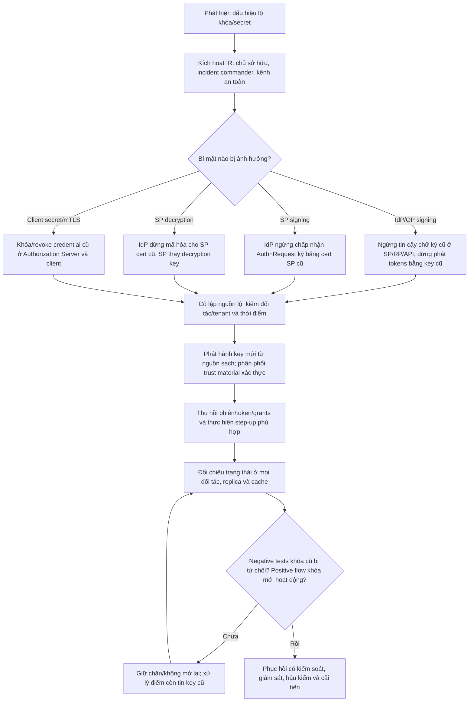

# Ứng phó khi lộ khóa: ngừng tin cậy, thu hồi phiên và phối hợp đối tác

## Mục tiêu học tập

Sau bài học này, bạn có thể:

1. Phân biệt sự cố **lộ khóa ký của IdP**, **lộ khóa ký của Service Provider (SP)**, **lộ khóa giải mã của SP**, **lộ khóa ký JWT của OpenID Provider (OP)** và **lộ OAuth client secret**; không dùng một biện pháp chung cho mọi loại khóa.
2. Lập một **runbook ứng phó khẩn cấp**: phát hiện → phân loại và khoanh phạm vi → cô lập/giảm quyền tin cậy → phát hành khóa mới từ môi trường sạch → thu hồi phiên, token hoặc quyền liên quan → phối hợp đối tác → kiểm chứng và phục hồi.
3. Hiểu vì sao **thay chứng thư hoặc xoay khóa không tự xóa những phiên Spring Security/IdP đã tồn tại**, không tự vô hiệu hóa JWT đã ký, và **Single Logout không phải bằng chứng chắc chắn mọi phiên đã được thu hồi**.
4. Cập nhật đúng **SAML2 Relying Party Registration**, IdP metadata hoặc **OIDC JWKS**; hiểu khác biệt giữa **chuyển khóa theo lịch** và **cắt bỏ ngay khóa có nguy cơ bị kiểm soát**.
5. Sử dụng Spring Security/Spring Session để minh họa cách bảo vệ login sau thay đổi trust và **xóa các session được xác định**; biết những giới hạn khi cần thu hồi toàn bộ user/tenant/ứng dụng.
6. Thiết kế thông báo và kế hoạch chung giữa **IdP, SP, identity broker, đối tác doanh nghiệp và các API Resource Servers**, có tiêu chí đóng sự cố, audit và phòng ngừa tái diễn.

## 1. Bối cảnh: khóa bị lộ là sự cố về quan hệ tin cậy

Trong **federated identity**, các bên giao tiếp qua SAML 2.0, OpenID Connect (OIDC) và OAuth 2.0. Những khóa/chứng thư quyết định **bên nào được ký**, **bên nào xác minh**, **ai có thể giải mã**, và **bí mật nào chứng minh danh tính client**. Khi private key hoặc secret bị lộ, sự cố có thể vượt qua ranh giới của một ứng dụng và ảnh hưởng đến nhiều đối tác.

Ví dụ hệ thống:

- IdP `https://idp.company.example/saml` ký SAML Assertion bằng private signing key.
- Ứng dụng Spring Boot là SP, nhận `SAMLResponse` tại `/login/saml2/sso/company` và xác minh bằng **public verification certificate** đã được cấp/phê duyệt.
- SP có thể ký `AuthnRequest` bằng **SP private signing key** và nhận `EncryptedAssertion` được mã hóa cho **SP public encryption certificate**.
- Một hệ OIDC tương tự có OP ký `ID token`/`JWT access token` bằng private signing key; RP/API xác minh bằng public keys công bố ở JWKS.
- Các bên có thể dùng **client secret**, client assertion hoặc mTLS để xác thực ứng dụng khi gọi token endpoint.

**Điểm cốt lõi:** nếu bí mật dùng ký/giải mã bị lộ, việc “vẫn còn một chứng thư X.509 chưa hết hạn” không phải lý do tiếp tục tin cậy. Khi phát hiện compromised key, hãy xử lý theo **cơ chế incident response**, khác với quy trình rotation định kỳ có thể cho phép khóa cũ và mới hoạt động song song.

### 1.1. Khóa nào thuộc ai?

| Loại bí mật | Bên sở hữu | Công dụng | Khi bị lộ có nguy cơ gì? |
| --- | --- | --- | --- |
| **IdP SAML signing private key** | IdP / Asserting Party | Ký SAMLResponse/Assertion cho SP | Kẻ giữ khóa có thể giả mạo chữ ký IdP, tạo response/assertion giả nếu vượt các điều kiện giao thức và state |
| **SP SAML signing private key** | SP / Relying Party | Ký AuthnRequest, có thể ký SAML LogoutRequest/metadata tùy thiết kế | Có thể giả mạo yêu cầu ký của SP với IdP/đối tác; **không tự động cho phép ký SAML Assertion của IdP** |
| **SP SAML decryption private key** | SP | Giải mã EncryptedAssertion được IdP mã hóa bằng public key SP | Nguy cơ mất **tính bí mật** của assertion đã thu thập và assertion tương lai dùng cert cũ; không mặc nhiên tạo chữ ký IdP hợp lệ |
| **OIDC OP / OAuth Authorization Server JWT signing private key** | OP/Authorization Server | Ký ID tokens hoặc JWT access tokens | Có thể giả mạo token trong phạm vi audiences/validators tin khóa; token cũ có thể vẫn hợp lệ tới khi validators ngừng tin hoặc có kiểm thu hồi |
| **OAuth client secret** | Confidential client và Authorization Server | Chứng thực client trong các luồng hỗ trợ secret | Attacker có thể giả danh client tại token endpoint trong phạm vi giao thức/các credential còn cần; **không đồng nghĩa** có ngay access token bất kỳ user |
| **Khóa của identity broker** | Broker | Ký assertion/token downstream hoặc xác minh/đổi giao thức | Có thể ảnh hưởng đồng thời nhiều upstream IdPs và downstream apps; phải xác định **đúng hop tin cậy** |
| **Khóa TLS/mTLS** | Endpoint hoặc client | Chứng minh endpoint/kết nối TLS | Có thể tạo rủi ro MITM/giả danh endpoint trong điều kiện thích hợp; cần thay chứng thư, cập nhật trust, nhưng **khác** SAML signing key |

**Không lẫn vai trò:** SP chỉ cần **public certificate IdP** để verify Assertion, không được sở hữu IdP private signing key. Khi SP private decryption key lộ, thay certificate xác minh IdP không chữa được rủi ro giải mã. Khi IdP signing key lộ, thay SP decryption key cũng không loại bỏ khả năng ký giả.

## 2. Nhận biết và xác minh mức độ compromise

Sự cố có thể bắt đầu từ:

- Secret/private key xuất hiện trong Git history, CI artifact, log, backup không được bảo vệ, email/chat hoặc tệp cấu hình public.
- HSM/KMS ghi nhận truy cập ký/giải mã trái phép, permission của key bị mở quá mức, token của automation bị chiếm hoặc có dấu hiệu xuất khóa.
- IdP/SP thấy SAMLResponse, signed AuthnRequest hay JWT có chữ ký hợp lệ nhưng **không khớp giao dịch, phiên hoặc nguồn phát hành** mong đợi.
- Đối tác cảnh báo key/certificate fingerprint đã bị lộ hoặc nhận các assertions/tokens không mong đợi.
- Có malware trên máy chủ/container có quyền đọc private key; người vận hành hoặc vendor thông báo nghi ngờ compromise.

**Không đợi thấy một assertion giả mới hành động:** với private signing key đã bị public/đã có bằng chứng bị xuất trái phép, giả định khóa không còn đáng tin. Một key lưu trong HSM được thiết kế non-exportable vẫn có thể bị **lạm dụng để ký** nếu credentials/permissions điều khiển HSM bị chiếm; phải xem cả **use capability**, không chỉ file private key.

### 2.1. Thu thập tối thiểu nhưng đủ để ra quyết định

| Dữ liệu | Cần làm rõ |
| --- | --- |
| **Key ID/fingerprint** | Fingerprint SHA-256 của certificate hoặc JWK thumbprint/key ID `kid` kèm issuer; `kid` đơn độc không xác minh trust |
| **Vai trò khóa** | IdP signing, SP signing, SP decryption, OP signing, client secret, mTLS hay broker |
| **Phạm vi sử dụng** | IdP issuer, SP entityId, OAuth client IDs, audiences, tenants, registrations, environments |
| **Nơi lưu/backup** | KMS/HSM, filesystem, Kubernetes secret, secret manager, CI/CD, images, backups |
| **Thời điểm rủi ro** | Phát hiện lúc nào, khóa có thể lộ từ khi nào, log sử dụng đáng ngờ từ khi nào |
| **Bên tin khóa** | Danh sách các SPs/RPs, API Resource Servers, đối tác, broker, gateway, cache JWKS/metadata |
| **Phiên/token đã phát** | IdP SSO sessions, SP sessions, refresh tokens, JWTs, API sessions, logout topology |
| **Mức xác nhận** | Lộ key bytes, bị dùng ký trái phép, nghi quyền truy cập, hay chỉ public certificate được chia sẻ đúng |

**Public certificate xuất hiện trong metadata công khai thường là bình thường**. Đừng gọi đó là lộ private key khi chỉ có `BEGIN CERTIFICATE`. Ngược lại `BEGIN PRIVATE KEY`, `BEGIN RSA PRIVATE KEY`, private JWK có thành phần `d` hoặc client secret trong kho public là dấu hiệu đáng báo động.

### 2.2. Quy tắc ra quyết định

- **Đã xác nhận private key/secret lộ hoặc signing service bị chiếm:** xử lý như compromise, triển khai các biện pháp giảm trust khẩn cấp.
- **Nghi ngờ đủ mạnh nhưng chưa kết luận:** kích hoạt incident commander, bảo vệ chứng cứ, áp dụng containment tương xứng; không tuyên bố an toàn chỉ vì chưa thấy đăng nhập giả.
- **Chỉ certificate public được phổ biến đúng thiết kế:** không cần thu hồi toàn bộ phiên chỉ vì public cert; vẫn kiểm fingerprint và metadata nếu có cảnh báo khác.
- **Không biết phạm vi:** dùng giả định bảo thủ cho các khóa liên quan cho đến khi chứng minh được key separation/usage isolation.

Không công bố thời điểm khôi phục hoặc thời hạn pháp lý không có căn cứ. SLA ứng phó, thông báo khách hàng/cơ quan quản lý phải theo **hợp đồng, đánh giá tác động và luật áp dụng** của đơn vị, không bịa một con số chung cho mọi loại sự cố.

## 3. Sơ đồ quyết định khẩn cấp



**Nguyên tắc ưu tiên:** chặn đường tiếp tục lạm dụng ngay cả khi gây gián đoạn login; khôi phục bằng **trust mới đã được hai phía xác minh**. Một bản sao private key/secret cũ ở nơi khác không trở thành an toàn vì đã đổi tên file hoặc tạo certificate mới cho cùng public key.

## 4. Runbook giai đoạn 1 — Cô lập tức thời và ngừng tin cậy

### 4.1. Kích hoạt kênh sự cố có trách nhiệm rõ ràng

Chỉ định:

- **Incident commander:** quyền quyết định tạm ngừng login/endpoint, mức ưu tiên và thông tin phối hợp.
- **Chủ sở hữu IdP/OP/broker:** dừng sử dụng signing key cũ, cập nhật metadata/JWKS, sessions/token revocation.
- **Chủ sở hữu SP/RP:** loại old verification credential, cập nhật decryption/signing credentials, thu hồi sessions.
- **Security/forensics:** thu thập log an toàn, giữ chain of custody, phân tích thời điểm/phạm vi lộ.
- **Đầu mối đối tác:** xác nhận fingerprint/issuer/certificate mới qua kênh ngoài bị ảnh hưởng, ghi nhận thời điểm cutover.
- **Vận hành/SRE:** triển khai config tới từng replica, kiểm CDN/JWKS/metadata caches, quan sát SSO.

Nếu kẻ tấn công có khả năng truy cập hệ thống quản lý bí mật, **đừng lưu private key mới ở cùng vùng bị chiếm** trước khi làm sạch môi trường. Có thể cần tạm ngừng một integration thay vì chuyển ngay sang key mới không an toàn.

### 4.2. “Ngừng tin cậy” thực sự nghĩa là gì?

**Với IdP signing key bị lộ:** các SP đang tin public signing certificate tương ứng có thể tiếp tục xác minh các assertion giả. Phải **ngừng dùng private key cũ để ký** và **loại cert/khóa cũ khỏi tập verification credentials của SPs**. Không chỉ xóa file ký phía IdP mà để SP tiếp tục tin certificate công khai cũ.

**Với OP signing key bị lộ:** dừng ký JWT bằng key cũ; bỏ public key cũ khỏi **JWKS tin cậy của OP/RP/resource servers**, xử lý caches và validator state. Nếu hệ thống vẫn cache key cũ, chúng có thể tiếp tục chấp nhận tokens giả tới khi cache hết hạn hoặc bị làm mới.

**Với SP signing key bị lộ:** IdP/đối tác phải **bỏ trust của SP signing certificate cũ** khi xác minh signed AuthnRequest/LogoutRequest; SP ngừng dùng private key cũ. Không suy ra SP signing key có quyền tạo IdP-signed Assertion.

**Với SP decryption key bị lộ:** IdP cần **ngừng mã hóa assertion cho public encryption certificate cũ**, SP cần đổi private decryption key và xem xét assertion/ciphertext đã bị truy cập. Nếu vẫn cho phép SP decrypt bằng key cũ theo chính sách transition, rủi ro bảo mật vẫn tồn tại; không dùng overlap bình thường như một đáp án mặc định cho incident compromise.

**Với OAuth client secret bị lộ:** revoke/disable secret cũ tại authorization server và client; nếu có nhiều client credentials, xác định credential nào bị lộ và client/resource scope liên quan. Không chỉ đổi một biến môi trường trên client khi authorization server vẫn chấp nhận secret cũ.

### 4.3. Không dùng “overlap” kiểu rotation định kỳ cho khóa đã bị lộ

Rotation **theo lịch** thường:

```text
Old trusted + new trusted -> new active -> old retired
```

Khi **old signing key bị compromise**, phương án trên có thể duy trì khả năng attacker tạo chữ ký giả trong giai đoạn cả hai đều được tin. Phải ưu tiên:

```text
Khóa cũ bị chặn / bỏ trust khẩn cấp
    -> cấp khóa mới từ môi trường sạch
    -> partner xác nhận trust mới
    -> bật lại flow sau kiểm thử
```

Nếu vì điều kiện vận hành bắt buộc phải có khoảng chuyển tiếp, incident commander phải lập **risk acceptance rõ ràng**, biện pháp giảm thiểu, thời hạn ngắn và giám sát phù hợp. Không tự coi khoảng overlap là an toàn chỉ vì tất cả certificates chưa hết hạn.

**CRL/OCSP không phải công tắc toàn cầu của SAML:** nhiều triển khai SAML sử dụng **certificate pinning trong metadata/registration**, không mặc nhiên thực thi revocation check của PKI public web. Cần **thay tập certificate được tin thực tế ở SP**, cập nhật metadata, reload ứng dụng và xác nhận signature validator đã bỏ key cũ. Thu hồi chứng thư ở CA (nếu có) là việc bổ sung, không thay việc sửa trust configuration.

## 5. Runbook giai đoạn 2 — Tạo khóa mới và phối hợp cutover

### 5.1. Sinh credential từ nguồn sạch

- Dùng **KMS/HSM/secret manager đã kiểm soát**, tài khoản/cấp quyền mới nếu nghi bị chiếm, và thuật toán có hỗ trợ phù hợp policy.
- Tạo **key pair mới**; không reissue certificate trên **cùng private key lộ**.
- Xác nhận identity của certificate/issuer/registration, fingerprint, key usage, key strength và cryptographic algorithm.
- Private key chỉ ở bên sở hữu đúng chức năng; chỉ chuyển **public certificate/JWK** đến bên kiểm chứng.
- Phân phối certificate/JWKS/metadata qua kênh được thẩm định, đối chiếu fingerprint bằng **kênh ngoài luồng**.
- Ghi người tạo, người duyệt, KMS key ID/version và thời điểm kích hoạt; không ghi key bytes vào ticket/log.
- Kiểm tất cả pods/replicas/configmaps/secrets, gateway, worker apps, scheduled jobs, DR environments và backup deployment paths.

Không tạo khóa trong build log hay copy private PEM vào email, chat hoặc sheet. Dấu vân tay certificate công khai có thể dùng phối hợp, **private key không được đính kèm báo cáo sự cố**.

### 5.2. Kịch bản A — IdP SAML signing key bị lộ

1. **IdP:** dừng ký bằng private key cũ, khóa các tài khoản/service có thể sử dụng nó, điều tra audit ký trái phép.
2. **Các SP:** xác định toàn bộ `RelyingPartyRegistration`/verification certificates đang tin IdP issuer và certificate cũ; đưa ứng dụng vào chế độ không cho SSO mới từ khóa cũ.
3. **IdP:** tạo signing key pair mới từ vùng an toàn, phát hành public cert/metadata mới và công bố fingerprint đã xác minh.
4. **Các SP:** thay `assertingparty.verification.credentials` hoặc metadata đã kiểm nguồn, **loại public certificate cũ khỏi trust**; không chấp nhận hai chứng thư cũ/mới theo mặc định trong incident này.
5. **IdP và SP:** xác nhận issuer, audience, ACS, signature placement, algorithm và metadata cache, kiểm login bằng key mới.
6. **Sessions:** xem xét thu hồi cả phiên IdP và **phiên ứng dụng SP được tạo trong cửa sổ rủi ro**; bước này **không xảy ra tự động** khi thay verification cert.
7. **Theo dõi:** tìm response/assertion bất thường trong log có kiểm soát, truy cập admin/role changes, các SPs chưa cập nhật, và các dấu hiệu lặp lại key fingerprint cũ.

**Rủi ro:** attacker có private signing key IdP có thể tạo chữ ký giống IdP; SP cần vẫn kiểm issuer, audience, recipient, `InResponseTo`/request correlation, thời hạn và chống replay. Nhưng các kiểm tra này **không làm việc tiếp tục trust một key signing đã lộ trở nên an toàn**.

### 5.3. Kịch bản B — SP SAML signing key bị lộ

1. **SP:** vô hiệu hóa key ký cũ và đường sử dụng từ CI/jobs/replicas; tạo private signing key mới.
2. **IdP:** **ngừng chấp nhận public signing certificate cũ của SP** trong service registration/metadata. Nếu yêu cầu signed `AuthnRequest`, IdP phải nạp cert mới trước khi cho phép flow mới.
3. **SP:** xuất SP metadata mới (chỉ cert công khai), xác nhận `entityId`/ACS/`registrationId` không bị đổi vô cớ.
4. **Hai bên:** kiểm AuthnRequest mới được ký với key mới và IdP verify thành công; kiểm signed logout requests/responses nếu có SLO.
5. **Phạm vi tác động:** điều tra unauthorized AuthnRequest, SLO/logout hoặc kết nối đối tác có thể bị ảnh hưởng. **Không tự kết luận** SP signing key lộ cho phép attacker giả chữ ký Assertion của IdP.

Nếu SP dùng **cùng một private key** cho signing và decryption, việc key lộ kéo theo **hai loại tác động**. Phải xử lý cả signing trust của IdP **và** confidentiality của encrypted assertions.

### 5.4. Kịch bản C — SP SAML decryption key bị lộ

1. Dừng gửi dữ liệu nhạy cảm được mã hóa bằng public certificate cũ; trao đổi ngay với IdP về **SP public encryption certificate mới**.
2. SP tạo private decryption key mới; bảo vệ và phân phối tới toàn bộ replica cần xử lý ACS.
3. IdP cập nhật SP encryption certificate trong metadata/config, chuyển sang mã hóa assertions mới cho cert mới.
4. SP xác minh giải mã assertion mới thành công, chữ ký và mọi SAML conditions vẫn được kiểm.
5. Điều tra dữ liệu đã được ghi/capture trước đây và đánh giá rủi ro hồi tố: **ciphertext đã lưu trước đó có thể đọc được nếu attacker có key cũ và bản mã**. Rotation không xóa dữ liệu đã lộ.
6. Nếu có in-flight messages dùng key cũ, ưu tiên **từ chối/reissue authentication mới** hoặc điều phối tạm ngừng flow, thay vì giữ private key lộ trong runtime vô thời hạn.
7. Xem xét tác động bảo mật dữ liệu cá nhân và nghĩa vụ thông báo theo phạm vi thực tế.

**Điểm khác biệt:** rủi ro chính là **bí mật** assertion, không phải giả mạo IdP signature. Thay decryption key mà không dừng IdP mã hóa cho cert cũ vẫn để attacker giải mã dữ liệu tương lai.

### 5.5. Kịch bản D — OP/OAuth signing key hoặc client secret bị lộ

**OP/Authorization Server signing key:**

- Ngừng phát hành token bằng key cũ, thay signing key và công bố JWKS phù hợp.
- Các RP/API Resource Servers phải **ngừng tin key cũ**; kiểm lại issuer, audience, `alg`, `kid`, expiry và các validators.
- **`kid` chỉ là nhãn chọn key**, không phải bằng chứng tin cậy. Không nhận bất kỳ JWK do token tự nhúng hoặc URL `jku`/`x5u` chưa thẩm định.
- Kiểm JWKS cache, CDN, proxy và bản sao offline; đừng nghĩ “JWKS đã sửa” đồng nghĩa mọi resource server lập tức bỏ key cũ.
- Xử lý token đã phát: **JWT tự chứa** có thể còn được chấp nhận tới `exp` nếu validator vẫn tin khóa cũ; cần cập nhật validator, dùng denylist/epoch/revocation nếu hệ thống hỗ trợ, hoặc chuyển sang introspection cho flow nhạy cảm.
- Refresh tokens, IdP/OP sessions và các grants khác cần thu hồi theo chính sách. Key rotation **không tự revoke refresh token**.

**OAuth client secret:**

- Vô hiệu secret cũ tại AS, triển khai secret mới đến client qua secret manager, cập nhật toàn bộ jobs/replicas.
- Kiểm token issuance events, OAuth grants, refresh tokens và client actions bất thường từ thời điểm nghi lộ.
- Tùy grant type, attacker có client secret **chưa chắc** đã có user authorization code/refresh token; đánh giá chính xác điều kiện và blast radius.
- Khi có điều kiện, cân nhắc phương thức client authentication mạnh hơn như private-key JWT/mTLS và bảo vệ khóa tương ứng.

## 6. Runbook giai đoạn 3 — Thu hồi phiên, token và quyền đã phát

**Thay trust material chỉ ảnh hưởng việc kiểm chứng những yêu cầu mới hoặc token được validate lại.** Các phiên được tạo trước đó có thể chứa `SecurityContext` hợp lệ trong session store. Chúng không đòi SP phải reverify SAMLResponse ở mỗi HTTP request.

### 6.1. Các lớp cần thu hồi độc lập

| Lớp | Nơi quản lý | Vì sao phải xử lý riêng? |
| --- | --- | --- |
| **IdP SSO session** | IdP, cookie thuộc domain IdP | Người dùng có thể tiếp tục dùng SSO; phải invalidate/force reauth theo phạm vi ảnh hưởng |
| **SP/RP application session** | Spring Security `HttpSession` hoặc Spring Session store | Đăng nhập đã tạo `Authentication` vẫn còn sau khi bỏ cert IdP cũ |
| **Broker session/downstream sessions** | Identity broker và những SP ứng dụng downstream | Broker có thể có phiên riêng, đã phát token/assertion cho nhiều đối tác |
| **OAuth authorization grants** | Authorization Server | Có thể tiếp tục cho cấp token theo refresh/grant mà không cần browser login mới |
| **Refresh tokens** | Authorization Server / grant store | Có thể được dùng xin token mới dù signing key cũ không còn |
| **JWT access tokens / ID tokens** | Client và Resource Server token validators | JWT self-contained không có một cơ chế thu hồi tức thời phổ quát; cần validator change/denylist/TTL |
| **Local privileged authorizations** | Application/IAM DB/cache | Một tài khoản giả mạo có thể đã được cấp role/admin; cần review và thu hồi quyền đã thay đổi |
| **Application-specific API keys/sessions** | Từng ứng dụng/downstream API | Không tự bị revoke bằng SAML Single Logout |

**SAML Single Logout (SLO)** và **OIDC Back-Channel Logout** hữu ích nhưng phải đánh giá theo thực tế: đối tác nào triển khai, thông điệp nào được ký/xác minh, phiên nào được định danh, callback nào thành công. Đây **không phải bảo đảm toán học** rằng mọi session ở mọi ứng dụng đã biến mất.

### 6.2. Thu hồi với Spring Security theo phiên Servlet

Ở web app dùng `saml2Login()` hoặc `oauth2Login()`, Spring Security có thể lưu `SecurityContext` trong HTTP session. Người dùng có thể được xác thực ở request tiếp theo **mà không quay lại IdP**. Vì vậy:

- **Local logout** ở một browser (`/logout`) chỉ xử lý phiên liên quan và các thành phần cấu hình, không tự xóa sessions của toàn bộ người dùng/đối tác.
- **Session TTL ngắn hơn** chỉ giới hạn tuổi phiên; không thay yêu cầu thu hồi khẩn cấp.
- Để thu hồi theo user, cần **session index** đáng tin và truy cập session repository toàn cụm.
- Để thu hồi theo phạm vi issuer/tenant/incident window, cần **có dữ liệu gắn phiên với nguồn IdP/registration và thời gian tạo** (ví dụ audit/session index server-side); không thể xóa chính xác những phiên “từ IdP X” nếu trước đó không lưu metadata đó.
- Với cluster, xóa session ở một pod nhưng session lưu ở pod khác có thể không đủ. Dùng **distributed session store** hoặc tác động ở đúng mỗi session owner.
- Tránh chỉ xóa `JSESSIONID` cookie trên browser của admin đang thao tác, vì điều đó không thu hồi những phiên khác.

**Chính sách lựa chọn phạm vi:**

1. Nếu không phân biệt được sessions nghi vấn với sessions sạch, cân nhắc **thu hồi rộng hơn** và yêu cầu login lại.
2. Nếu có thể xác định user/tenant và window bằng audit đáng tin, thu hồi đúng tập sessions theo mức độ chấp nhận rủi ro.
3. Nếu cần **immediate deny** cho các requests đang có session, bổ sung **server-side incident epoch/deny flag/entitlement recheck** ở mỗi request hoặc tại các hành động nhạy cảm, thay vì chỉ đợi cookie expire.
4. Khi xóa session, kiểm dữ liệu cache/remember-me, WebSocket connections và long-lived operations riêng; session deletion không nhất thiết hủy các tác vụ đã chạy hoặc kết nối đang mở.

### 6.3. Spring Session hỗ trợ xóa các session đã được index

Giả sử ứng dụng đã **cấu hình Spring Session với repository hỗ trợ `FindByIndexNameSessionRepository`**, principal name được index đúng và cluster dùng chung store. Dịch vụ Java minh họa:

```java
package com.example.security.incident;

import java.util.Set;
import org.springframework.session.FindByIndexNameSessionRepository;
import org.springframework.session.Session;
import org.springframework.stereotype.Service;

@Service
public class IncidentSessionRevoker {
    private final FindByIndexNameSessionRepository<? extends Session> sessions;

    public IncidentSessionRevoker(
            FindByIndexNameSessionRepository<? extends Session> sessions) {
        this.sessions = sessions;
    }

    public int revokeAllForPrincipal(String principalName) {
        if (principalName == null || principalName.isBlank()) {
            throw new IllegalArgumentException("principalName is required");
        }

        // Chỉ dùng trên repository/index đã được kiểm chứng.
        // Cần gọi từ workflow IR có phê duyệt, KHÔNG public endpoint.
        Set<String> ids =
                Set.copyOf(sessions.findByPrincipalName(principalName).keySet());
        ids.forEach(sessions::deleteById);
        return ids.size();
    }
}
```

**Đây là service snippet của Spring Boot, không phải chương trình Java độc lập.** Nó cần dependency `spring-session-core` cùng implementation Redis/JDBC hoặc store được quản lý đúng. Không kết luận tự động rằng mọi Spring Security session đều được tìm thấy nếu principal name index chưa có, thay đổi NameID qua issuer, session nằm ngoài store, hoặc ứng dụng còn cách lưu session khác.

Giải thích chi tiết:

- `findByPrincipalName` dựa trên index; nếu index rỗng vì ứng dụng không ghi principal, kết quả `0` **không phải bằng chứng** không còn phiên.
- `deleteById` thu hồi session trong repository đang dùng, thường làm request tiếp theo không lấy được security context. Nó **không đảm bảo** request đang xử lý, WebSocket đã thiết lập, external JWT, IdP cookie hay downstream application session bị đóng tức thì.
- Cùng principal string có thể xuất hiện ở hai IdP; nếu index không namespace issuer/tenant, hãy kiểm mapping trước khi xóa hoặc chủ động thu hồi rộng hơn. Không dùng `email` trùng nhau làm chỉ số duy nhất mà không có chính sách.
- Không dựng public REST endpoint `/revoke?principal=...` để gọi dịch vụ này. Chỉ chạy qua kênh quản trị đã xác thực, có approval, audit và giới hạn truy cập trong incident.
- Đối với **thu hồi toàn bộ phiên do một IdP bị compromise**, repository principal index không có query “theo issuer” mặc định. Hãy dùng index/audit đã thiết kế hoặc cơ chế purge/session epoch được kiểm soát và kiểm kết quả thật.

### 6.4. Xử lý JWT và refresh token

JWT đã ký bằng khóa lộ có thể nguy hiểm vì **người có private signing key có khả năng tạo token giả** trong phạm vi verifier còn tin key. Phương án cần phối hợp:

1. Loại khóa cũ khỏi trust/JWKS của **tất cả resource servers**, không chỉ authorization server.
2. Force refresh/rollout validator cache hoặc cấu hình “deny old `kid`/fingerprint” ở **một lớp trust riêng**, không dựa vào giá trị `kid` do attacker tự khai.
3. Thu hồi refresh tokens/grants và buộc lại authentication/authorization theo phạm vi rủi ro.
4. Nếu API chấp nhận JWT qua public-key validation offline, không kỳ vọng AS gọi một endpoint revocation là API tự biết token đã thu hồi.
5. Áp dụng incident epoch/denylist dựa trên `jti`/`sub`/`iss`/`iat` khi hệ thống **thực sự hỗ trợ**, với TTL và tính nhất quán cần thiết.
6. Với introspection-based opaque tokens, Authorization Server có thể trả inactive theo chính sách; resource servers vẫn cần xử lý **introspection caching**.
7. Không nhầm `ID token` (xác thực tại OIDC RP) với `access token` (quyền truy cập API). Thu hồi một loại không đảm bảo loại kia đã mất hiệu lực.

**OIDC Back-Channel Logout** yêu cầu RP xác minh logout token, dùng `iss`/`sub`/`sid` tìm session và xóa trạng thái tương ứng. Hãy xem cấu hình hỗ trợ thực tế của RP và OP. Nếu không có triển khai tương thích, phải chủ động xóa sessions qua cơ chế quản trị của ứng dụng.

## 7. Mẫu cấu hình Spring Security SAML2 sau khi đổi IdP signing certificate

Trường hợp **IdP company signing key lộ**, SP được yêu cầu **ngừng tin public cert cũ** và chỉ trust public cert mới `idp-signing-replacement.crt` qua nguồn đã thẩm định.

Ví dụ Spring Boot 3/Spring Security 6:

### 7.1. `build.gradle` (phần dependency liên quan)

```groovy
dependencies {
    implementation 'org.springframework.boot:spring-boot-starter-web'
    implementation 'org.springframework.boot:spring-boot-starter-security'
    implementation 'org.springframework.security:spring-security-saml2-service-provider'

    // CHỈ khi dùng Spring Session để quản lý session qua cụm:
    // implementation 'org.springframework.session:spring-session-data-redis'
}
```

Version do Spring Boot BOM và repositories chính thức của dự án quản lý. Spring SAML2 dùng OpenSAML bên dưới; không tự ép version không tương thích để xử lý incident.

### 7.2. `application.yml` chỉ có IdP certificate mới

```yaml
spring:
  security:
    saml2:
      relyingparty:
        registration:
          company:
            entity-id: "https://portal.example.org/saml2/service-provider-metadata/company"
            acs:
              location: "https://portal.example.org/login/saml2/sso/company"
            assertingparty:
              entity-id: "https://idp.company.example/saml"
              verification:
                credentials:
                  - certificate-location: "file:/run/certs/saml/idp-signing-replacement.crt"
              singlesignon:
                url: "https://idp.company.example/sso"
                sign-request: false
```

**Vì sao chỉ có certificate mới?** Trong incident compromise của IdP signing key, để cả `old.crt` và `replacement.crt` dưới `verification.credentials` có thể khiến SP tiếp tục chấp nhận signature giả bằng khóa cũ. Việc không khai báo old cert **chỉ là một phần**: phải bảo đảm cache, các version của configuration, metadata URI, replica chưa cập nhật và fallback validation paths **không thêm lại cert cũ**.

**Chú ý:**

- `company` là `registrationId` nội bộ, gắn với đúng issuer `https://idp.company.example/saml`.
- Certificate mới ở ví dụ là **public verification cert của IdP**, không chứa private key.
- `sign-request: false` giả định IdP cho phép unsigned AuthnRequest. Nếu IdP yêu cầu ký, cần SP signing credentials tương ứng và `true`.
- Nếu SP dùng metadata URI tự động thay cấu hình thủ công, phải kiểm nguồn metadata, reload/cache và giá trị trust thực tế sau cập nhật.
- Ký SAMLResponse thành công bằng cert mới **không thay** kiểm `Issuer`, `AudienceRestriction`, `Destination`, `Recipient`, `NotBefore/NotOnOrAfter` và request correlation.
- Đây là **mẫu cấu hình cần IdP thật**; các domain `example.org` không trỏ đến hệ thống dành cho người học.

### 7.3. `SecurityFilterChain` cho web SSO

```java
package com.example.security.incident;

import org.springframework.context.annotation.Bean;
import org.springframework.context.annotation.Configuration;
import org.springframework.security.config.Customizer;
import org.springframework.security.config.annotation.web.builders.HttpSecurity;
import org.springframework.security.web.SecurityFilterChain;

@Configuration
public class SamlSecurityConfiguration {

    @Bean
    SecurityFilterChain securityFilterChain(HttpSecurity http) throws Exception {
        return http
            .authorizeHttpRequests(auth -> auth
                .requestMatchers("/", "/error").permitAll()
                .anyRequest().authenticated()
            )
            .saml2Login(Customizer.withDefaults())
            .logout(logout -> logout
                .invalidateHttpSession(true)
                .deleteCookies("JSESSIONID")
            )
            .build();
    }
}
```

- `saml2Login()` dùng Spring Security/OpenSAML validate incoming SAMLResponse với `RelyingPartyRegistration`.
- `logout().invalidateHttpSession(true)` chỉ hỗ trợ **logout phiên đang xử lý** theo flow thông thường; **không** chủ động tìm/xóa mọi session từ certificate cũ hoặc issuer cũ.
- `deleteCookies("JSESSIONID")` phụ thuộc servlet container/cookie path thực tế; nên kiểm bằng browser. Nó không thu hồi JWT hay các SP khác.
- Trong sự cố, phải triển khai **session-revocation operation độc lập** như mục 6; tắt login mới bằng cert cũ mà giữ mọi phiên cũ có thể vẫn để attacker dùng session đã tạo.
- Không viết một controller POST ACS “kiểm riêng fingerprint” rồi tạo authentication từ XML tự parse. Giữ verify/validation của framework.

**Cài đặt khóa mới phải thống nhất ở mọi instance**. Nếu một replica vẫn chứa `old.crt` trong trust store, load balancer có thể định tuyến login giả qua replica đó dù instance khác đã cập nhật.

## 8. Demo Java 17+ độc lập: fail-closed trust policy theo issuer và fingerprint

Ví dụ bên dưới **không thực hiện SAML/JWT cryptographic verification**. Nó mô phỏng phần **quản lý tập khóa tin cậy** khi old key bị chặn. Trong thực tế, fingerprint chỉ được tính từ certificate đã được đối chiếu với metadata/kênh IdP và validator còn phải kiểm chữ ký bằng khóa thực. Không lấy một fingerprint attacker gửi qua request rồi coi đó là identity đã xác thực.

Tệp `TrustCutoverDemo.java`:

```java
import java.util.Set;

public final class TrustCutoverDemo {
    record VerificationKey(String issuer, String fingerprint) {}

    private static final String ISSUER =
            "https://idp.company.example/saml";

    static boolean mayUseForVerification(
            VerificationKey candidate,
            Set<VerificationKey> explicitlyTrusted,
            Set<VerificationKey> compromised) {

        if (candidate == null) {
            return false;
        }
        // Mô phỏng quản lý trust store; không kiểm chữ ký ở đây.
        return explicitlyTrusted.contains(candidate)
                && !compromised.contains(candidate);
    }

    public static void main(String[] args) {
        VerificationKey oldKey =
                new VerificationKey(ISSUER, "SHA256:OLD");
        VerificationKey newKey =
                new VerificationKey(ISSUER, "SHA256:NEW");
        VerificationKey otherIssuer =
                new VerificationKey("https://partner.example/saml", "SHA256:NEW");

        // Giả định vẫn có cấu hình cũ trong một kho dữ liệu tổng hợp.
        Set<VerificationKey> known =
                Set.of(oldKey, newKey);
        Set<VerificationKey> blocked =
                Set.of(oldKey);

        System.out.println("Old compromised key allowed: "
                + mayUseForVerification(oldKey, known, blocked));
        System.out.println("Replacement key allowed: "
                + mayUseForVerification(newKey, known, blocked));
        System.out.println("Other issuer allowed: "
                + mayUseForVerification(otherIssuer, known, blocked));
        System.out.println("Unknown key allowed: "
                + mayUseForVerification(
                        new VerificationKey(ISSUER, "SHA256:UNKNOWN"),
                        known, blocked));
    }
}
```

Biên dịch và chạy với JDK 17+:

```bash
javac TrustCutoverDemo.java
java TrustCutoverDemo
```

**Stdout chính xác:**

```text
Old compromised key allowed: false
Replacement key allowed: true
Other issuer allowed: false
Unknown key allowed: false
```

Bài tập minh họa **fail closed**: dù old key còn ở một tập khóa “known” bị quên xóa, deny list vẫn từ chối; key issuer khác không được dùng. **Trong production cần thực sự loại old key khỏi verification credentials/JWKS và mọi cache/replica**, không chỉ dựa vào `Set` trong code. Quan trọng nhất: `mayUseForVerification` **không xác minh SAML Signature**; nó chỉ mô phỏng quyết định chính sách **trước hoặc bên cạnh** verifier đã được thư viện triển khai.

### 8.1. Vì sao không chỉ so chuỗi `kid` hoặc fingerprint do browser gửi?

Kẻ tấn công có thể điền bất kỳ `kid`, XML `KeyInfo` hoặc fingerprint text vào message của mình. Identifier chỉ là **khóa tra cứu** trong danh sách đã được cấp/phê duyệt, không chứng minh chữ ký hợp lệ. Verifier phải:

1. Chọn tập trusted keys theo **issuer/registration/audience** được server thiết lập.
2. Kiểm certificate/key thực và thuật toán/usage có được phép.
3. Verify chữ ký bằng khóa public tương ứng.
4. Kiểm mọi SAML/OIDC conditions/time/state; nếu bất kỳ bước nào thất bại thì từ chối.

Không cho URL `jku`/`x5u` trong token dẫn verifier tới máy chủ do attacker chọn rồi tự tải JWKS để tin.

## 9. Phối hợp với đối tác: thông điệp phải hành động được

Một sự cố federation thường không thể xử lý bởi một bên vì **bên ký và bên kiểm tin có thể thuộc hai tổ chức khác nhau**.

### 9.1. Những thông tin cần gửi cho đối tác qua kênh đã xác minh

| Trường | Ý nghĩa |
| --- | --- |
| Incident/correlation ID | Mã theo dõi chung, không chứa private key |
| Bên bị ảnh hưởng | IdP/SP/OP/AS/broker, tenant và environment |
| Vai trò khóa | IdP signing, SP signing/decryption, OP JWT signing, client secret |
| Issuer/entityId/clientId | Chỉ định đúng quan hệ federation |
| Old public certificate fingerprint / JWK `kid` | Giúp đối tác tìm đúng key cần bỏ trust; `kid` đi kèm issuer/fingerprint |
| Phạm vi và mốc thời gian rủi ro | Từ khi nào có thể bị ảnh hưởng (nếu chưa biết, nêu chưa rõ) |
| Lệnh containment | Dừng tin old verification cert, ngừng mã hóa cho SP encryption cert cũ, hoặc disable old client credential |
| Chứng thư/JWKS mới | Public material đã xác minh qua kênh tin cậy, key usage và thuật toán |
| Cần thu hồi phiên nào | IdP/RP/downstream sessions, token grants, API authorization |
| Kiểm thử bắt buộc | Old signatures bị từ chối; new signatures hợp lệ; session cũ bị chặn theo phạm vi |
| Đầu mối và cách xác nhận | Người xử lý, kênh out-of-band, trạng thái và thời điểm cutover |

**Không gửi private key, client secret hay raw SAMLResponse/JWT chứa PII** trong thông báo rộng rãi. Nếu phải trao đổi chứng cứ, sử dụng kho bảo mật có kiểm soát truy cập và thời hạn phù hợp.

### 9.2. Mẫu thông báo tác nghiệp

```text
INCIDENT: FED-2026-11-07-01
SEVERITY: Đang phân loại theo tác động và dữ liệu hiện có
PROTOCOL: SAML2
AFFECTED PARTY: IdP company
ISSUER: https://idp.company.example/saml
KEY ROLE: IdP SAML signing
COMPROMISED PUBLIC CERT FINGERPRINT: SHA-256:<fingerprint đã xác minh>
REQUIRED NOW: Ngừng tin/loại certificate cũ khỏi verification credentials
REPLACEMENT CERT: Cung cấp qua kênh xác thực riêng
SESSION ACTION: Thu hồi các phiên thuộc phạm vi được thống nhất và kiểm tra các phiên không còn hợp lệ
VALIDATION: Old cert bị từ chối; new cert được chấp nhận; audience/ACS/issuer đúng
CONFIRMATION: Xác nhận người phụ trách, thời điểm rollout và mọi replica đã cập nhật
```

Đây là **mẫu cấu trúc**, không phải một sự cố thực tế đã xảy ra; số incident và fingerprint phải được thay bằng giá trị được xác minh của hệ thống. Thông báo bên ngoài cần được bộ phận pháp lý/compliance và đầu mối quan hệ đối tác duyệt khi chính sách yêu cầu.

### 9.3. Ai có trách nhiệm làm gì?

- **IdP owner:** signing key, SAML metadata, IdP SSO sessions và audit events phía IdP.
- **SP owner:** trusted IdP verification cert, SP sessions, user/role mapping, ACS và SAML negative tests.
- **OAuth/OIDC AS owner:** JWKS, client credentials, refresh tokens/grants, revocation endpoint hoặc introspection.
- **Resource Server owner:** JWT/JWKS cache, audience/issuer validation, session/token policy, denylist/epoch.
- **Broker owner:** trust upstream và downstream key pairs; account linking, scopes/claims và logout propagation.
- **KMS/Platform team:** key generation, access logs, secret manager, distribution, non-exportability/rotation.
- **Incident commander:** bằng chứng hoàn tất, phối hợp giờ cutover, quyết định duy trì gián đoạn hay phục hồi, báo cáo rủi ro tồn dư.

**Mỗi đối tác phải xác nhận bằng hành động đã làm**, không chỉ trả lời “đã nhận được email”. Ví dụ: “Đã loại SHA-256:... khỏi tất cả SAML verification sets, redeploy xong 5/5 nodes, negative test old signature fail, positive test new signature pass.”

## 10. Tiêu chí kiểm chứng trước khi mở lại dịch vụ

### 10.1. Kiểm tra trust/certificate

- Old compromised IdP signing certificate **không** có trong `verification.credentials` của mọi SP liên quan.
- Old OP signing public key không còn được chấp nhận bởi tất cả JWT validators; kiểm JWKS caches, proxy/CDN và offline copies.
- SP signing certificate cũ không còn được IdP/đối tác chấp nhận cho các signed requests; certificate mới được đăng ký.
- SP encryption certificate cũ không còn được IdP sử dụng cho assertions mới; SP decryption key mới hoạt động.
- OAuth client secret cũ không được AS chấp nhận, secret mới được phân phối an toàn.
- Với key pair mới, public key/cert **khớp private key**, thuật toán/usage phù hợp, không dùng lại private key lộ.

**Lưu ý:** với key bị compromise, không đặt yêu cầu “phải có token đăng nhập old key bị chấp nhận trong overlap cho rollback”. Mục tiêu negative test là **old key bị từ chối**. Nếu cần rollback vì key mới lỗi, rollback về **trạng thái không chấp nhận login** hoặc một đường phục hồi an toàn đã phê duyệt, không tự bật lại khóa đã lộ.

### 10.2. Kiểm tra sessions và tokens

- Tập sessions cần thu hồi đã được xác định, xóa/đánh dấu deny và thử request sau đó → không còn authenticated access theo phạm vi.
- IdP SSO session được thu hồi hoặc force reauth cho người dùng cần thiết.
- OIDC RP/Broker/downstream apps được thông báo và xác nhận logout/invalidation theo thiết kế.
- Refresh token/grant nghi vấn không thể được dùng cấp token mới; kiểm bằng negative test an toàn có giám sát.
- JWT với key cũ không thể xác minh tại resource servers sau khi trust cutover; bảo đảm không có cache key cũ tồn tại ở node chưa cập nhật.
- Kiểm local privileged entitlement/role changes, account creations, API keys do tài khoản nghi vấn tạo và thu hồi theo kết quả điều tra.
- Session store, web socket/session-based transports và background workers không còn đường truy cập đặc quyền dựa trên state cũ.
- Nếu không thể liệt kê đầy đủ tất cả sessions/tokens, ghi rõ **coverage gap** và biện pháp phòng vệ bổ sung; không tuyên bố “thu hồi hết” khi chỉ xóa một cookie.

### 10.3. Positive/negative tests SAML

| Test | Kết quả mong đợi |
| --- | --- |
| IdP ký SAML Response bằng **key cũ bị lộ** | **FAIL** ở SP, không tạo session |
| IdP ký bằng **key mới đã được thẩm định** | **PASS** nếu issuer/audience/recipient/time/state đúng |
| Response có chữ ký hợp lệ nhưng issuer khác | **FAIL** |
| Response hợp lệ về chữ ký nhưng audience của SP khác | **FAIL** |
| Response hết hạn hoặc sai `InResponseTo` | **FAIL** |
| Assertion mã hóa bằng public cert SP đã nghỉ hưu | **FAIL hoặc yêu cầu phát lại** theo policy incident |
| Browser session đã bị thu hồi thử `GET /private` | Yêu cầu login lại/không trả dữ liệu, không tái tạo phiên cũ |
| User đăng nhập đúng nhưng không có role nghiệp vụ | 403 theo authorization |
| Một replica chưa cập nhật verification cert | **Không được mở lại**; khắc phục/loại khỏi traffic |

**Không dùng SAMLResponse giả của attacker trên production làm thử nghiệm gây hại.** Tạo các test fixtures trong môi trường tích hợp riêng hoặc theo quy trình kiểm thử bảo mật được phép. Có thể đối chiếu trust state của verifier/config để chắc chắn old signing cert không còn active.

### 10.4. Negative tests OIDC/OAuth

| Test | Kết quả mong đợi |
| --- | --- |
| JWT ký bằng compromised signing key cũ | Resource Server **từ chối** sau cutover |
| JWT ký bằng key mới, issuer/audience/expiry đúng | Chấp nhận theo policy nếu chưa bị revoke |
| JWT có `kid` trùng key mới nhưng signature sai | **Từ chối** |
| Token dùng `jku`/`x5u` trỏ tới key attacker | Không được tự thêm key ngoài trust source |
| Refresh token bị revoke | Không cấp token mới |
| Client dùng secret cũ | Token endpoint từ chối client authentication |
| RP session cũ thuộc phạm vi đã revoke | Không tiếp tục truy cập dựa vào session cũ |
| API node còn JWKS cache cũ | Bị coi là rollout chưa hoàn tất, chưa mở lại |

## 11. Quan sát sự cố và lưu chứng cứ

Duy trì một timeline có thể audit:

| Mốc | Dữ liệu cần ghi |
| --- | --- |
| T0 – phát hiện | Ai báo, nguồn alert, loại key/secret, bằng chứng ban đầu |
| T1 – cô lập | Key use/credentials disabled, ứng dụng/đối tác nào được tạm chặn |
| T2 – xác định phạm vi | Issuers, clients, registrations, audiences, tenants, SPs/APIs bị ảnh hưởng |
| T3 – phát khóa mới | Key ID/fingerprint công khai, nguồn tạo, người duyệt, vùng bảo mật |
| T4 – trust cutover | Đối tác/replicas đã cập nhật, cache invalidation, config revision |
| T5 – thu hồi | Số sessions/grants bị xóa, phương thức chọn phạm vi, phần chưa quan sát được |
| T6 – thử nghiệm | Negative/positive test đã chạy, hệ thống nào PASS/FAIL |
| T7 – phục hồi | Ai phê duyệt mở lại, thời điểm, điều kiện giám sát |
| T8 – hậu kiểm | Root cause, quyền truy cập quá mức, cải tiến và kiểm tra lại |

**Bảo toàn chứng cứ vs loại bí mật khỏi production:** không xóa sạch mọi log/artifact có thể cần forensics trước khi ghi nhận bằng chứng, nhưng **không giữ key lộ trong đường chạy active**. Nếu phải bảo toàn bản sao key bytes như chứng cứ, chỉ làm qua quy trình pháp y được phê duyệt, mã hóa, hạn chế quyền và không phát tán qua ticket.

Thu thập log ở mức an toàn: key ID/certificate fingerprint, issuer, request ID, status, thời điểm, địa chỉ IP được quản lý theo policy, events phát token và tài khoản quản trị thực hiện thay đổi. Không log nguyên private key, `SAMLResponse`, ID token/access token/refresh token hoặc cookie phiên. Với dấu hiệu chiếm quyền, kiểm cả các thao tác **tạo user admin, đổi role, tạo API key, export dữ liệu** trong cửa sổ rủi ro.

## 12. Lỗi ứng phó thường gặp

| Anti-pattern | Vì sao nguy hiểm | Cách làm đúng |
| --- | --- | --- |
| Chỉ đổi file private key trên IdP | SP vẫn trust public cert cũ và có thể nhận chữ ký giả | Cập nhật **verification trust** ở tất cả SP |
| Thêm cert mới bên cạnh cert cũ bị lộ | Kẻ tấn công vẫn có thể ký bằng key cũ được chấp nhận | Emergency remove/deny old key; overlap chỉ theo risk acceptance |
| Chỉ revoke chứng thư tại CA | SP SAML dùng cert pinning/metadata có thể không kiểm OCSP/CRL | Bỏ cert cũ khỏi SAML registration/trust thực tế |
| Chỉ đổi `kid` trong JWKS | Không chứng minh private key đã thay hoặc cache đã mất | Tạo key pair mới, bỏ trust key cũ, kiểm mọi resource server |
| Cho JWT tự chọn `jku`/public key | Attacker điều khiển nguồn verification key | Chỉ dùng issuer JWKS URI/allowlist đã cấu hình |
| Thay cert rồi tuyên bố mọi user đã logout | `HttpSession` đã tạo vẫn authenticated | Xóa/deny sessions ở SP, IdP và downstream theo phạm vi |
| Chỉ xóa cookie của một browser | Không ảnh hưởng sessions của người dùng khác | Thu hồi ở session store/central policy |
| Chỉ gửi SAML Single Logout | Một số SP không có SLO hoặc logout thất bại | Có kiểm chứng từng SP; chủ động revocation khi cần |
| Dừng phát JWT bằng old key nhưng vẫn cho API trust old | Token giả vẫn được chấp nhận trong cache/validator | Thay trust tại resource server, kiểm token TTL/revocation |
| Xóa chứng cứ vội vàng | Không điều tra được nguồn/cửa sổ tấn công | Cô lập production và bảo toàn chứng cứ có kiểm soát |
| Sinh key mới trong cùng môi trường đã bị chiếm | Attacker có thể lấy key mới | Làm sạch/đổi quyền, tạo key qua môi trường KMS/HSM đáng tin |
| Dùng cùng key cho signing/decryption nhưng xử lý một nửa | Bỏ sót confidentiality hoặc signing attack surface | Đánh giá mọi **key usage** và phân phối tương ứng |
| Quên non-production/DR/backup | Old key có thể quay lại khi deploy/restore | Quét config nguồn, secrets, backup restore path và replicas |
| Không kiểm issuer/tenant khi đổi cert | Có thể tin nhầm IdP khác | Liên kết fingerprint/key với đúng issuer/registration |
| Không phối hợp đối tác | Một bên đã ký mới nhưng bên kia chưa trust | Đồng bộ cutover, xác nhận out-of-band và hai chiều |
| Khôi phục ngay khi positive login PASS | Old key có thể vẫn PASS ở một replica | Bắt buộc negative tests và kiểm mọi node/cache |

## 13. Tình huống thực hành end-to-end

### 13.1. Tình huống 1: rò rỉ private signing key của IdP công ty

**Bối cảnh:** một private PEM của IdP được lưu nhầm vào artifact công khai. Chứng thư IdP còn hiệu lực và được năm SP tin dùng. Không thể dựa vào việc SPs có anti-replay để tiếp tục tin ký cũ.

**Phương án:**

1. Xác minh đúng private signing key thực sự lộ (không nhầm với public certificate trong metadata).
2. Kích hoạt IR, chặn cấp quyền sử dụng key cũ; điều tra nơi key có thể đã bị sao chép.
3. Thông báo ngay năm SP về issuer, fingerprint old key, hành động **bỏ trust**, ảnh hưởng login.
4. Tạo signing key mới từ HSM/KMS đáng tin, xác minh public certificate mới qua out-of-band channel.
5. Mỗi SP remove old cert khỏi verification list; refresh metadata/caches, mọi replica; giữ hệ thống chặn login trong lúc chưa đồng bộ.
6. IdP dùng key mới phát SAMLResponse; thử positive SSO và negative old signature, sai issuer/audience/time.
7. Xác định các sessions được tạo trong cửa sổ rủi ro; thu hồi IdP/SP sessions theo đánh giá, bắt buộc reauth khi cần.
8. Kiểm user/role changes trái phép; chỉ mở lại khi từng SP xác nhận kết quả. Hậu kiểm nguồn lộ và secret scanning CI.

**Điểm kiểm:** một SP nói “đã thay cert” nhưng SAMLResponse ký bằng old key vẫn thành công ở một node → sự cố **chưa được kiểm soát**.

### 13.2. Tình huống 2: SP mất private decryption key

**Bối cảnh:** backup một SP chứa private key giải mã EncryptedAssertion bị lộ cho bên ngoài.

**Phương án:**

- SP và IdP cùng xác định public cert tương ứng, lưu lượng nào từng được mã hóa cho cert đó.
- Tạo SP decryption key mới; IdP nhận SP encryption certificate mới từ nguồn đã xác thực.
- IdP ngừng mã hóa bằng cert cũ; SP từ chối ciphertext dùng cert cũ hoặc điều phối phát lại assertion khi cần.
- Đánh giá dữ liệu đã capture trong backup/log/proxy; thông báo tác động confidentiality khi có bằng chứng/căn cứ.
- Kiểm login mới, verify IdP signatures, xóa key cũ khỏi runtime, kiểm bí mật của secret store và quy trình backup.

**Điểm kiểm:** rotation không thể khiến attacker “quên” các ciphertext cũ mà họ đã thu thập. Một key decryption bị lộ không tự động đồng nghĩa attacker ký được IdP assertion.

### 13.3. Tình huống 3: OP ký JWT bị lộ, nhiều API có JWKS cache

**Bối cảnh:** OP xoay key tại JWKS endpoint nhưng một số resource servers vẫn cache public key cũ.

**Phương án:**

- Chặn phát JWT bằng signing key cũ và thu hồi các grants/refresh tokens thuộc phạm vi cần xử lý.
- Các resource servers cập nhật trust/caches; fail closed khi JWKS không thể xác nhận phiên bản mới.
- Kiểm một JWT ký bằng old key bị từ chối ở **từng API node**, không chỉ ở OP.
- Với sessions/tokens có thể dùng tiếp mà không validate lại, áp dụng token denylist/epoch/session invalidation theo kiến trúc.
- Chỉ mở lại khi mọi API trọng yếu đã PASS và có giám sát misconfig/unknown `kid`.

**Điểm kiểm:** “JWT mới hoạt động” không chứng minh “JWT giả ký bằng key cũ đã bị chặn”.

## 14. Checklist kiểm soát và phục hồi

### 14.1. Trong giai đoạn cô lập

- [ ] Phân loại **key usage** và xác nhận private secret thực sự nghi lộ.
- [ ] Xác định issuer, registrations, client IDs, audiences, tenant và đối tác liên quan.
- [ ] Dừng sử dụng signing/decryption/client credential cũ ở nơi phù hợp; bảo vệ nguồn tạo khóa mới.
- [ ] Bên verifier **loại bỏ old trust**; không chỉ phát hành public certificate mới.
- [ ] Đánh giá nhu cầu tạm dừng login để tránh tiếp tục chấp nhận assertions/tokens giả.
- [ ] Lưu chứng cứ an toàn và ghi mốc sự cố; không phát tán raw key hoặc tokens.

### 14.2. Trước khi tái mở

- [ ] Key pair thay thế được tạo trong môi trường sạch; public material/fingerprint được xác nhận ngoài luồng.
- [ ] SP/IdP/OP/broker/Resource Server liên quan xác nhận trust mới và không còn trust key cũ.
- [ ] Không còn replica, CDN/JWKS cache, metadata cache, pipeline hoặc DR restore mang cấu hình cũ.
- [ ] **Old signature/tokens bị từ chối**, new flow hợp lệ, các điều kiện SAML/OIDC đầy đủ được kiểm.
- [ ] Session/refresh token/grant/relevant privileged entitlements được thu hồi đúng phạm vi; ghi rõ điểm chưa quan sát được.
- [ ] Đối tác xác nhận một cách có thể audit; các quy trình SLO/backchannel được kiểm thực tế.
- [ ] Có người phê duyệt mở lại, kế hoạch giám sát tăng cường và đường rollback **không khôi phục key lộ**.

### 14.3. Sau sự cố

- [ ] Root cause, blast radius và thời điểm lộ được phân tích (ghi **chưa biết** nơi chưa có bằng chứng).
- [ ] Thay/khóa credentials bị lộ trong Git, CI, backups, DR và secret manager.
- [ ] Giảm quyền key access; sử dụng KMS/HSM và non-exportable keys khi khả thi.
- [ ] Bổ sung secret scanning, key usage audit, alert khi trust material ngoài lịch thay đổi.
- [ ] Tự động hóa danh sách đối tác đang tin issuer/certificate theo environment.
- [ ] Có khả năng thu hồi session ở quy mô toàn cụm, kể cả theo issuer/tenant/incident epoch.
- [ ] Diễn tập emergency key cutover khác với planned rollover; bao gồm negative tests và outage trade-offs.

## 15. Câu hỏi tự kiểm tra

**1. IdP signing private key bị lộ nhưng public certificate vẫn còn hạn. SP có nên tiếp tục chấp nhận chữ ký từ key đó không?**

**Không.** Tính còn hạn của cert không xóa rủi ro private key bị chiếm. SP phải ngừng tin old certificate/verification key và chỉ chấp nhận replacement key đã được xác thực; cần xử lý session/token đã có riêng.

**2. SP signing key bị lộ có tự động cho phép attacker ký SAML Assertion của IdP không?**

**Không.** SP signing key thường dùng ký AuthnRequest/LogoutRequest gửi IdP. Tuy nhiên phải ngừng trust SP cert cũ ở IdP và điều tra request/logout giả; nếu key được dùng chung vai trò khác, phải xử lý tất cả key usages.

**3. Nếu SP decryption key bị lộ, chỉ cập nhật IdP verification certificate có đủ không?**

**Không.** IdP verification cert dùng kiểm chữ ký IdP; sự cố giải mã yêu cầu SP decryption key mới và IdP chuyển sang mã hóa assertion cho **SP public encryption cert mới**. Có thể tồn tại rủi ro hồi tố của ciphertext cũ.

**4. Vì sao đổi JWKS của OP không tự làm tất cả JWT cũ mất hiệu lực?**

Vì resource servers có thể cache old public key và tiếp tục offline JWT validation; refresh token/grant/session cũng tồn tại độc lập. Phải cập nhật trust tại validators, caches và xử lý revocation theo kiến trúc.

**5. Khi key bị compromise, có nên luôn giữ old + new cert song song vài tuần như rotation định kỳ không?**

**Không.** Old signing key còn được tin nghĩa là attacker còn có thể giả chữ ký. Emergency cutover ưu tiên bỏ trust old key ngay, có thể cần chấp nhận gián đoạn login. Overlap chỉ sau khi có risk acceptance và biện pháp giảm thiểu rõ ràng.

**6. SAML Single Logout thành công tại một SP có bảo đảm các SP khác đều đã logout?**

**Không.** Phải kiểm các SP đã triển khai SLO và xác nhận session invalidation thực tế; còn API keys, JWT và broker sessions không tự bị xóa theo SLO.

**7. Gọi `sessions.deleteById(...)` cho mọi session tìm được của một username đã đủ để tuyên bố thu hồi toàn bộ chưa?**

**Chưa.** Cần xác minh session index đầy đủ, đa IdP namespace, cluster store, các sessions ngoài index, ongoing requests, WebSockets và các session/token không do repository đó quản lý.

**8. Public cert xuất hiện trong metadata có phải chắc chắn là “lộ khóa” không?**

**Không.** Public certificate được thiết kế để chia sẻ cho bên xác minh/mã hóa. Nguy cơ lớn khi private key/secret hay khả năng dùng signing service trái phép bị lộ/chiếm quyền.

**9. Đối tác nói “đã thêm cert mới” nhưng negative test với cert cũ vẫn thành công. Có thể mở lại chưa?**

**Chưa.** Bên kiểm chứng vẫn tin old compromised key; phải xóa trust/cache hoặc cách validation thay thế, test mọi replica trước khi phục hồi.

**10. Trong runbook, ai thu hồi local user roles đã bị attacker cấp trong giai đoạn sự cố?**

Ứng dụng/IAM sở hữu authorization và audit phải điều tra, thu hồi grants/roles/API keys trái phép. IdP đổi signing key hoặc logout session không tự hoàn tác các thay đổi dữ liệu quyền trong ứng dụng.

## Ghi nhớ

**Lộ khóa trong hệ thống federation không chỉ là thao tác phát chứng thư mới.** Một quy trình an toàn phải kết hợp:

**Ngừng tin cậy khóa cũ tại mọi bên xác minh → tạo khóa mới từ môi trường sạch → cập nhật trust/metadata/JWKS ở tất cả đối tác → thu hồi sessions/tokens/grants liên quan → kiểm old key bị từ chối và new key hoạt động → phối hợp phục hồi có audit.**

- **IdP/OP signing bị lộ:** chặn **signature trust** và điều tra xác thực giả.
- **SP signing bị lộ:** IdP chặn cert ký request cũ; không đồng nhất với IdP signing.
- **SP decryption bị lộ:** dừng encrypt cho public cert cũ, xử lý rủi ro confidentiality, cả dữ liệu quá khứ khi có ciphertext.
- **Session/token revocation là lớp riêng:** thay certificate không tự xóa phiên hoặc refresh token đã có.
- **Planned rollover khác emergency compromise:** không giữ old signing key đã lộ trong trusted set chỉ để tránh downtime.
- **Xác nhận từng đối tác, cache, replica và downstream:** một node còn tin key cũ có thể làm toàn bộ containment thất bại.

### Tài liệu tham khảo

- [Spring Security – SAML 2.0 Login Overview và quản lý credentials](https://docs.spring.io/spring-security/reference/servlet/saml2/login/overview.html)
- [Spring Security – SAML2 Authentication Responses](https://docs.spring.io/spring-security/reference/servlet/saml2/login/authentication.html)
- [Spring Security – Session Management](https://docs.spring.io/spring-security/reference/servlet/authentication/session-management.html)
- [Spring Session – Indexed Sessions và FindByIndexNameSessionRepository](https://docs.spring.io/spring-session/reference/api.html)
- [OWASP – Key Management Cheat Sheet](https://cheatsheetseries.owasp.org/cheatsheets/Key_Management_Cheat_Sheet.html)
- [OpenID Connect – Back-Channel Logout 1.0](https://openid.net/specs/openid-connect-backchannel-1_0.html)
- [RFC 7009 – OAuth 2.0 Token Revocation](https://www.rfc-editor.org/rfc/rfc7009)
