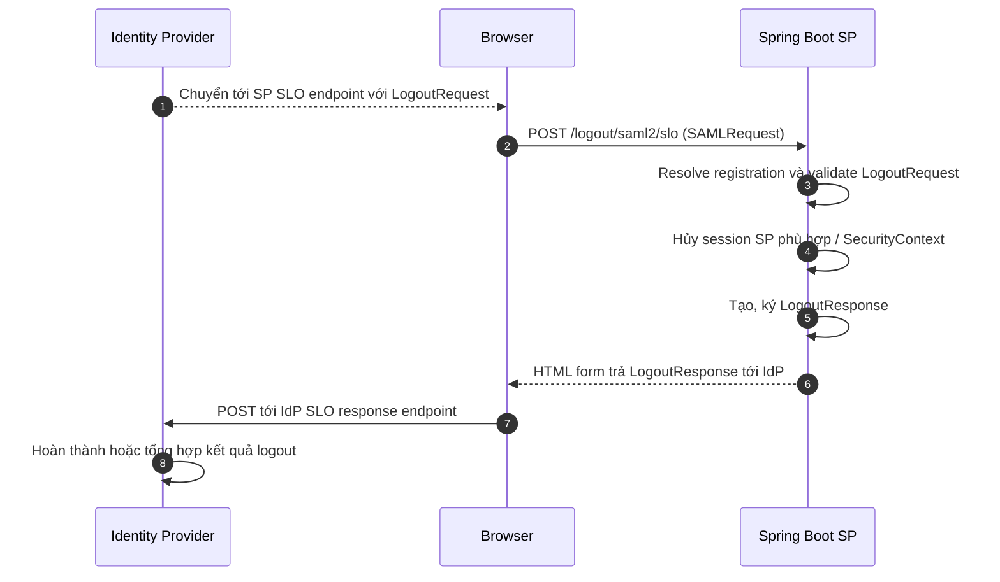

# Cấu hình saml2Logout và endpoint SingleLogoutService trong metadata

## 1. Bối cảnh: đăng xuất một ứng dụng khác đăng xuất liên kết

Khi một người dùng đăng nhập Spring Boot bằng **SAML 2.0**, ứng dụng đóng vai trò **Service Provider (SP)** hoặc *Relying Party (RP)*, còn hệ thống định danh là **Identity Provider (IdP)** hoặc *Asserting Party (AP)*. Hai bên thường có phiên riêng:

- **Phiên tại SP:** HTTP session/Spring Security `SecurityContext`, cookie session ứng dụng và những trạng thái nghiệp vụ của SP.
- **Phiên tại IdP:** phiên đăng nhập SSO được IdP quản lý, có thể đang phục vụ nhiều SP khác nhau.

Nếu chỉ xóa cookie hoặc session tại SP, người dùng có thể truy cập ứng dụng lại và được IdP đăng nhập tự động nhờ phiên SSO chưa hết hạn. **SAML 2.0 Single Logout (SLO)** là giao thức phối hợp yêu cầu đăng xuất, cho phép SP và IdP trao đổi thông điệp `LogoutRequest` và `LogoutResponse` nhằm kết thúc các phiên liên quan theo năng lực/chính sách của hệ thống.

Trong Spring Security Servlet, cấu hình **`saml2Logout`** cho phép ứng dụng tham gia **RP-initiated SLO** (SP khởi tạo) và **AP-initiated SLO** (IdP khởi tạo). Một mảnh cấu hình quan trọng khác là **`SingleLogoutService` trong SAML metadata**, khai báo endpoint nhận thông điệp SLO, binding và địa chỉ trả response.

**Mục tiêu bài học:**

1. Hiểu sự khác nhau giữa **local logout**, **RP-initiated SLO**, **AP-initiated SLO** và logout response.
2. Biết những endpoint mặc định của Spring Security và tại sao `/logout` khác `/logout/saml2/slo`.
3. Cấu hình được `saml2Logout`, signing credential và `singlelogout.url` theo Spring Boot 3.x/Spring Security 6.x.
4. Phân biệt `SingleLogoutService` trong **metadata SP** với `SingleLogoutService` trong **metadata IdP**.
5. Đồng bộ metadata, HTTP binding, public HTTPS URL và filter matcher khi thay endpoint.
6. Kiểm tra signature, issuer, Destination, `InResponseTo`, `NameID`/`SessionIndex`, session correlation và các lỗi thường gặp.
7. Thiết kế hành vi đăng xuất an toàn, không tuyên bố tất cả phiên đã chấm dứt khi IdP hoặc một SP khác chưa xác nhận.

Các URL `example.test`, ID, đường dẫn secret trong bài chỉ là **ví dụ**, phải thay bằng hạ tầng và metadata IdP thật khi triển khai.

## 2. Bản đồ các endpoint SAML cần phân biệt

| Endpoint mặc định | Phương thức/binding thường gặp | Ai gọi? | Mục đích |
| --- | --- | --- | --- |
| `/saml2/authenticate/{registrationId}` | GET/redirect để bắt đầu login | Browser → SP | Tạo SAML `AuthnRequest`; **không phải logout** |
| `/login/saml2/sso/{registrationId}` | POST HTTP-POST binding | IdP qua browser → SP | ACS nhận **login** `SAMLResponse`; không phải LogoutResponse |
| **`/logout`** | **POST** trong ứng dụng có CSRF | Browser đang đăng nhập → SP | Spring logout trigger; khi `saml2Logout` cấu hình và principal SAML hợp lệ, có thể khởi tạo RP SLO |
| **`/logout/saml2/slo`** | POST HTTP-POST binding theo cấu hình chuẩn | IdP qua browser → SP | Nhận **`SAMLRequest` chứa LogoutRequest** hoặc **`SAMLResponse` chứa LogoutResponse** |
| `/saml2/metadata` | GET | Quản trị viên/IdP → SP | Xuất metadata của một hoặc nhiều SP registrations |
| `/saml2/metadata/{registrationId}` | GET | Quản trị viên/IdP → SP | Xuất metadata cho một SP registration cụ thể |

Với Spring Security 6.x, đường dẫn chuẩn SLO nhận request và response là `/logout/saml2/slo`; một số API hoặc release mới có biến thể route, vì vậy cần đối chiếu phiên bản đã ghim. URL SLO theo mô hình này **không cần chứa `registrationId`**, bởi framework có thể lấy registration từ phiên đã xác thực, yêu cầu trước đó hoặc dữ liệu giao thức theo cơ chế resolver.

**Không nhầm hai trường form cùng tên:** `SAMLResponse` gửi đến ACS trong luồng login chứa **`<samlp:Response>`**, còn `SAMLResponse` gửi đến SLO callback chứa **`<samlp:LogoutResponse>`**. Tên HTTP form field giống nhau nhưng **nội dung, filter xử lý và mục tiêu bảo mật khác nhau**.

## 3. Phân biệt local logout và Single Logout

**Local logout** là thao tác bên SP: xóa `Authentication` và `SecurityContext`, vô hiệu hóa HTTP session (theo cấu hình), xóa các cookie có liên quan khi cần. Nó không gửi yêu cầu đến IdP.

**Single Logout** thêm giao thức SAML để thông báo bên còn lại và có thể phối hợp chấm dứt các phiên SSO liên quan:

| Tình huống | Xóa session SP? | Gửi SAML LogoutRequest? | Kỳ vọng ở IdP |
| --- | --- | --- | --- |
| Local logout | Có theo handler | Không | Phiên IdP có thể vẫn hoạt động |
| RP-initiated SLO | Có | SP → IdP | IdP xử lý logout và có thể phản hồi |
| AP-initiated SLO | Có nếu request hợp lệ/phù hợp phiên | SP nhận LogoutRequest, trả LogoutResponse | IdP điều phối logout |
| Đóng tab/browser | Không bảo đảm | Không | Không phải SAML logout |
| Hết session timeout tại SP | Phiên SP hết hiệu lực | Không mặc nhiên | IdP có thể còn session |

**Không hứa “logout ở một SP chắc chắn đăng xuất mọi SP”.** SLO là một giao thức có điều kiện: IdP có thể không hỗ trợ, một SP khác có thể offline, callback có thể thất lạc, hoặc IdP trả trạng thái lỗi/`PartialLogout`. Trình duyệt có thể tiếp tục giữ session riêng của bên thứ ba ngoài liên kết SAML. Ứng dụng phải phân biệt “đã xóa phiên cục bộ” với “đã nhận xác nhận SLO”.

## 4. RP-initiated SLO: ứng dụng khởi tạo đăng xuất

Trong **RP-initiated** flow, một người dùng đang có `Saml2Authentication` gửi POST tới logout trigger tại SP. Spring Security thực hiện local logout và dùng cấu hình RP/IdP để tạo `LogoutRequest` gửi sang endpoint SLO của IdP. IdP xử lý rồi có thể gửi `LogoutResponse` về SLO endpoint của SP.

```mermaid
sequenceDiagram
    autonumber
    participant B as Browser
    participant SP as Spring Boot SP
    participant IdP as SAML IdP
    B->>SP: POST /logout + CSRF token
    SP->>SP: LogoutHandler xóa SecurityContext / session
    SP->>SP: Tạo, ký LogoutRequest; lưu request state
    SP-->>B: Chuyển browser tới IdP SLO endpoint
    B->>IdP: HTTP-POST mang SAMLRequest
    IdP->>IdP: Xác minh, xử lý phiên SSO và SP liên quan
    opt IdP trả LogoutResponse
        IdP-->>B: Form có SAMLResponse (LogoutResponse)
        B->>SP: POST /logout/saml2/slo
        SP->>SP: Verify chữ ký, issuer, status, InResponseTo
        SP-->>B: Chuyển tới trang logout-success theo cấu hình
    end
```

**Các điểm quan trọng:**

- `POST /logout` là **trigger trong ứng dụng**, không phải endpoint `SingleLogoutService` để IdP POST callback.
- `LogoutRequest` do SP tạo cần ký theo chính sách SAML/đối tác; Spring Security dùng **SP signing credential** trong `RelyingPartyRegistration`.
- `Destination` của LogoutRequest đi tới **IdP SLO Location** (lấy từ IdP metadata/trust configuration), không phải ACS/login URL.
- Khi IdP trả `LogoutResponse`, SP kiểm tra `InResponseTo` so với request đã tạo và thường có correlation state được lưu; session đã bị invalidate nên cách giữ request state phải được thiết kế.
- IdP **có thể không phản hồi**; việc xóa session cục bộ không thể bị “hoàn tác” chỉ vì không có callback.
- Nếu principal không phải SAML hoặc registration không có cấu hình SLO, hành vi logout có thể khác; kiểm tra flow từng loại đăng nhập.

Trong thiết lập browser cookie/session, gọi POST /logout cần CSRF token hợp lệ theo Spring Security mặc định. Không sửa thành GET logout chỉ để đơn giản hóa giao diện.

## 5. AP-initiated SLO: IdP khởi tạo đăng xuất

Trong **AP-initiated SLO**, IdP bắt đầu giao dịch bằng cách gửi `<samlp:LogoutRequest>` đã ký (qua browser theo binding) đến **SLO endpoint của SP**. Spring Security xác minh request rồi thực hiện local logout theo kết quả xác minh, tạo và gửi `LogoutResponse` trở lại IdP.



Một số điều khác RP-initiated:

- Địa chỉ **IdP gửi LogoutRequest tới SP** là URL `SingleLogoutService` trong **SP metadata**.
- Ở nhánh AP-initiated, nếu SP gửi LogoutResponse về IdP, **IdP nắm điều khiển browser tiếp theo**, nên cấu hình redirect cục bộ của SP có thể không được nhìn thấy.
- IdP cần có certificate được SP tin tưởng để xác minh chữ ký; một POST từ browser có `SAMLRequest` không tự đáng tin.
- `NameID`/`SessionIndex` phải được so với phiên/identity thích hợp theo profile; đừng dùng một chuỗi tùy ý trong XML để hủy mọi phiên của ứng dụng.
- Ứng dụng nhiều replica cần chính sách session store/lookup phù hợp để request đến node khác vẫn có thể tìm hoặc hủy phiên cần thiết khi framework hỗ trợ.

**Không đặt Controller `@PostMapping("/logout/saml2/slo")` để tự parse XML và xóa session.** Luồng SLO được Spring Security filter và bộ validator thực hiện. Bỏ qua signature/issuer/destination khi xử lý IdP-initiated logout có thể tạo lỗ hổng **logout CSRF/denial-of-service**.

## 6. SingleLogoutService trong metadata là gì?

Trong SAML metadata, phần tử **`<md:SingleLogoutService>`** mô tả endpoint mà một entity nhận thông điệp Single Logout. Nó thường có các thuộc tính:

- **`Binding`:** cách gửi thông điệp, ví dụ `urn:oasis:names:tc:SAML:2.0:bindings:HTTP-POST` hoặc `...:HTTP-Redirect`.
- **`Location`:** địa chỉ URL nhận `LogoutRequest` (và trong nhiều profile cũng có thể nhận LogoutResponse nếu không có URL riêng).
- **`ResponseLocation` (tùy chọn):** địa chỉ nhận `LogoutResponse` khi dùng endpoint khác `Location`.
- Có thể có nhiều `SingleLogoutService` cho các binding khác nhau; **không** tự suy rằng tất cả đều được phiên bản Spring Security/IdP của bạn hỗ trợ.

`SingleLogoutService` nằm trong:

- **`IDPSSODescriptor` của metadata IdP:** mô tả **điểm nhận SLO phía IdP**. SP dùng thông tin này để gửi LogoutRequest/LogoutResponse tới IdP theo tình huống.
- **`SPSSODescriptor` của metadata SP:** mô tả **điểm nhận SLO phía SP**. IdP dùng thông tin này để gửi LogoutRequest/LogoutResponse tới ứng dụng.

Đây là **hai thực thể độc lập**, dù có cùng tên phần tử. Cần phân biệt “URL chúng ta công bố” (SP) với “URL của IdP chúng ta gọi” (IdP).

## 7. Ví dụ SP metadata có SingleLogoutService

Đoạn XML dưới đây **chỉ trích một phần** metadata SP, không phải tài liệu metadata ký số đầy đủ:

```xml
<md:EntityDescriptor
    xmlns:md="urn:oasis:names:tc:SAML:2.0:metadata"
    entityID="https://app.example.test/saml2/service-provider-metadata/corp">
  <md:SPSSODescriptor
      protocolSupportEnumeration="urn:oasis:names:tc:SAML:2.0:protocol">
    <md:SingleLogoutService
        Binding="urn:oasis:names:tc:SAML:2.0:bindings:HTTP-POST"
        Location="https://app.example.test/logout/saml2/slo"
        ResponseLocation="https://app.example.test/logout/saml2/slo"/>
    <md:AssertionConsumerService
        Binding="urn:oasis:names:tc:SAML:2.0:bindings:HTTP-POST"
        Location="https://app.example.test/login/saml2/sso/corp"
        index="0" isDefault="true"/>
  </md:SPSSODescriptor>
</md:EntityDescriptor>
```

Điểm cần kiểm tra:

1. `entityID` xác định SP; **không phải địa chỉ logout callback**.
2. `SingleLogoutService@Location` là public URL **IdP dùng để gửi LogoutRequest**.
3. `ResponseLocation` trong ví dụ trùng `Location`. Đây là lựa chọn cấu hình thông dụng, không bắt buộc mọi IdP phải hỗ trợ cả hai endpoint khác nhau.
4. `AssertionConsumerService` dành cho **login SAMLResponse**, không dùng làm SLO.
5. `KeyDescriptor` dùng chứng chỉ public của SP (khi công bố) không xuất private key; ở đây được lược bỏ để ví dụ ngắn.
6. Metadata thực có thêm namespace, descriptors và signing certificate theo cấu hình; **không upload đoạn XML cắt ngắn này vào IdP**.

Muốn IdP khởi tạo SLO, IdP cần biết đúng `SingleLogoutService` của SP. Nếu IdP vẫn lưu URL SLO cũ sau deployment, request có thể bị 404 hoặc lọt vào filter sai.

## 8. Ví dụ IdP metadata có SingleLogoutService

Tương tự, một phần metadata IdP có thể mô tả:

```xml
<md:EntityDescriptor
    xmlns:md="urn:oasis:names:tc:SAML:2.0:metadata"
    entityID="https://idp.example.test/entity">
  <md:IDPSSODescriptor
      protocolSupportEnumeration="urn:oasis:names:tc:SAML:2.0:protocol">
    <md:SingleLogoutService
        Binding="urn:oasis:names:tc:SAML:2.0:bindings:HTTP-POST"
        Location="https://idp.example.test/saml/logout"
        ResponseLocation="https://idp.example.test/saml/logout/response"/>
    <md:SingleSignOnService
        Binding="urn:oasis:names:tc:SAML:2.0:bindings:HTTP-Redirect"
        Location="https://idp.example.test/saml/login"/>
  </md:IDPSSODescriptor>
</md:EntityDescriptor>
```

Những điều cần chú ý:

- `SingleLogoutService Location` ở đây nằm trên **IdP domain**: RP-initiated LogoutRequest của SP sẽ gửi **tới IdP**, không gửi đến `/logout/saml2/slo` của SP.
- `ResponseLocation` nếu được khai báo là endpoint nhận LogoutResponse tại IdP trong flow AP-initiated.
- `SingleSignOnService` dùng **đăng nhập**, khác `SingleLogoutService`.
- Spring Security đọc metadata IdP đã được cấu hình tin cậy để biết đối tác có hỗ trợ SLO hay không và endpoint/binding nào dùng.
- Certificate công khai của IdP dùng để verify chữ ký SAML message không phải private signing key của SP; cần quản lý đúng nguồn, cập nhật và rotation.

Trước khi khẳng định SLO hoạt động, phải xác nhận metadata IdP **thực sự có `SingleLogoutService`**; chỉ có `SingleSignOnService` thì chưa đủ. Một số IdP hỗ trợ login nhưng không hỗ trợ logout profile đã yêu cầu.

## 9. Điều kiện tối thiểu để Spring Security thực hiện SLO

Theo hướng dẫn Spring Security Servlet 6.x, một cấu hình SLO điển hình cần:

1. **IdP hỗ trợ SAML SLO**, công bố `SingleLogoutService` trong IdP metadata.
2. **SP có signing credential**: private key PKCS#8 và certificate X.509 tương ứng để ký `LogoutRequest`/`LogoutResponse` theo chính sách đối tác.
3. **RelyingPartyRegistration có SLO Location** của SP, chẳng hạn `{baseUrl}/logout/saml2/slo`; enable theo từng registration.
4. **Bật `saml2Logout`** trong `SecurityFilterChain` để framework lắp đặt các filter/handlers SLO.
5. **SP metadata được công bố/cập nhật tại IdP** để IdP biết SLO endpoint và SP signing certificate.
6. **Endpoint HTTP thật** tiếp nhận đúng đường dẫn và binding, kể cả sau proxy/context path.
7. Các điều kiện session, cookie, CSRF, chữ ký và tương quan SAML được bảo đảm.

**Chỉ gọi `.saml2Logout(withDefaults())` là chưa đủ** nếu registration chưa có SLO service location hoặc IdP chưa hỗ trợ SLO. Đăng nhập SAML có thể hoạt động bình thường mà SLO không hoàn chỉnh.

## 10. Cấu hình Spring Boot 3.x bằng application.yml

Ví dụ dự án Spring Boot 3.x / Spring Security 6.x đã có các dependency SAML tương thích. `registrationId` là `corp`, ứng dụng được truy cập từ public HTTPS host. Cấu hình sau dùng IdP metadata làm nguồn endpoint/certificate tin cậy:

```yaml
spring:
  security:
    saml2:
      relyingparty:
        registration:
          corp:
            assertingparty:
              metadata-uri: "${SAML_IDP_METADATA_URI}"
            signing:
              credentials:
                - private-key-location: "file:/run/secrets/saml/sp-signing.key"
                  certificate-location: "file:/etc/app/saml/sp-signing.crt"
            singlelogout:
              url: "{baseUrl}/logout/saml2/slo"
              binding: POST
```

**Các trường quan trọng:**

- `assertingparty.metadata-uri`: IdP metadata từ nguồn do quản trị ứng dụng phê duyệt, không nhận từ user HTTP request. Metadata phải có SLO service, verification credentials và các endpoint phù hợp.
- `signing.credentials`: SP private key và certificate. Private key không nên đóng gói vào JAR hoặc commit Git; cấp qua secret manager/mount read-only với quyền tối thiểu.
- `singlelogout.url`: URL nhận request/response SLO **của SP**. `{baseUrl}` do framework resolve theo request/host được tin cậy; có thể thay bằng HTTPS absolute URL đã đăng ký nếu kiến trúc yêu cầu.
- `singlelogout.binding: POST`: chỉ định HTTP-POST binding phù hợp cấu hình ở SP/IdP metadata.
- **Không tự thêm `singlelogout.response-url` phía IdP vào SP location**. `ResponseLocation` là một trường riêng, thuộc metadata của entity nào thì dùng đường dẫn của entity đó.

Cấu hình trên là phương án dùng property binding. Khi muốn thiết lập bằng Java `RelyingPartyRegistration.Builder`, có thể dùng `singleLogoutServiceLocation("{baseUrl}/logout/saml2/slo")` cùng `signingX509Credentials(...)` theo API Spring Security; **không cần giữ hai nguồn cấu hình song song**.

### 10.1. File khóa và nguồn bí mật

Ví dụ đường dẫn:

```text
/run/secrets/saml/sp-signing.key   <-- SP private key, PKCS#8
/etc/app/saml/sp-signing.crt       <-- SP public X.509 certificate
```

Private key là bí mật, certificate public thường không. Thực tế, nhiều tổ chức cấp cả certificate và private key qua secret manager/volume, quản lý phiên bản/rotation. Key phải khớp với certificate SP đã đăng ký cho IdP; đổi key mà không cập nhật certificate có thể làm IdP từ chối chữ ký LogoutRequest.

**Không lấy private key IdP để ký thay SP.** SP ký bằng khóa của SP; SP verify thông điệp IdP bằng certificate **của IdP** đã tin cậy. IdP cũng phải tin certificate public của SP để verify LogoutRequest/LogoutResponse do SP ký.

## 11. Java 17+: bật saml2Logout và xuất SP metadata

Trong dự án Spring Boot/Gradle đã có plugin và dependency management phù hợp, khai báo dependencies:

```groovy
repositories {
    mavenCentral()
    // Một số phiên bản OpenSAML cần repository phát hành Shibboleth.
    maven { url "https://build.shibboleth.net/maven/releases/" }
}

dependencies {
    implementation "org.springframework.boot:spring-boot-starter-web"
    implementation "org.springframework.boot:spring-boot-starter-security"
    implementation "org.springframework.security:spring-security-saml2-service-provider"
}
```

Đây là **đoạn build.gradle**, không phải build file hoàn chỉnh. Phải dùng Spring Boot 3.x/Spring Security 6.x và Java 17+ tương thích.

Class đầy đủ ở `src/main/java/demo/saml/SamlLogoutApplication.java`:

```java
package demo.saml;

import org.springframework.boot.SpringApplication;
import org.springframework.boot.autoconfigure.SpringBootApplication;
import org.springframework.context.annotation.Bean;
import org.springframework.security.config.Customizer;
import org.springframework.security.config.annotation.web.builders.HttpSecurity;
import org.springframework.security.core.annotation.AuthenticationPrincipal;
import org.springframework.security.saml2.provider.service.authentication.Saml2AuthenticatedPrincipal;
import org.springframework.security.web.SecurityFilterChain;
import org.springframework.web.bind.annotation.GetMapping;
import org.springframework.web.bind.annotation.RestController;

@SpringBootApplication
@RestController
public class SamlLogoutApplication {

    public static void main(String[] args) {
        SpringApplication.run(SamlLogoutApplication.class, args);
    }

    @Bean
    SecurityFilterChain securityFilterChain(HttpSecurity http) throws Exception {
        return http
                .authorizeHttpRequests(auth -> auth
                        .requestMatchers("/", "/error").permitAll()
                        .anyRequest().authenticated())
                .saml2Login(Customizer.withDefaults())
                .saml2Logout(Customizer.withDefaults())
                .saml2Metadata(Customizer.withDefaults())
                .build();
    }

    @GetMapping("/")
    public String home() {
        return "SAML 2.0 Single Logout demo";
    }

    @GetMapping("/whoami")
    public String whoami(
            @AuthenticationPrincipal Saml2AuthenticatedPrincipal principal) {
        return "registration=" + principal.getRelyingPartyRegistrationId()
                + ",subject=" + principal.getName();
    }
}
```

**Đọc ví dụ:**

- `saml2Login` bật Web Browser SSO login. Để truy cập `/whoami` cần một SAML Response hợp lệ từ IdP.
- `saml2Logout` bật SLO filters/handler; đây là bước **bổ sung** so với một app chỉ có `saml2Login`.
- `saml2Metadata` bật endpoint xuất SP metadata. Bạn dùng metadata này để cấu hình IdP biết SP Entity ID, ACS URL, certificate và **SingleLogoutService**.
- Không cần tự viết controller `/logout/saml2/slo` hay `/logout`; Spring Security filter/handler xử lý giao thức.
- `/whoami` minh họa principal SAML đã xác thực. **Không in raw SAMLResponse hoặc private key** trong production; NameID có thể là dữ liệu nhạy cảm, nên endpoint debug kiểu này chỉ dùng kiểm thử và cần kiểm soát trước khi phát hành.

Ví dụ sử dụng `application.yml` ở mục 10 và những file secret thực sự tồn tại. Nếu không có IdP metadata hợp lệ hoặc private key/certificate, ứng dụng **không thể hoàn tất SLO thật**.

### 11.1. Khởi chạy và kết quả quan sát

Trong môi trường có IdP sandbox:

```bash
SAML_IDP_METADATA_URI=https://idp.example.test/metadata ./gradlew bootRun
```

`example.test` chỉ là miền minh họa; lệnh phải dùng URL metadata thực được IdP sandbox cấp. Khi mở `/whoami`, browser được chuyển sang IdP đăng nhập. Sau login thành công, truy cập `POST /logout` với CSRF token và cookie phiên để thử SLO.

Không có stdout SLO cố định: request/response và trạng thái tùy IdP. Nếu cấu hình hợp lệ, một logout thành công có thể đưa người dùng về trang `/login?logout` hoặc success URL đã cấu hình. Không coi chỉ việc điều hướng tới IdP là bằng chứng đã chấm dứt toàn bộ các phiên.

## 12. Tạo form POST logout an toàn cho trình duyệt

Sử dụng `GET /logout` để đăng xuất là cách làm không nên mặc định. Với CSRF protection, Spring Security thường yêu cầu **POST kèm CSRF token**. Nếu ứng dụng dùng Thymeleaf tích hợp với Spring Security, có thể có form dạng:

```html
<form method="post" th:action="${/logout}"
      xmlns:th="http://www.thymeleaf.org">
  <button type="submit">Đăng xuất SSO</button>
</form>
```

Đây là **mảnh template Thymeleaf**, không phải file HTML tĩnh có thể chạy với ứng dụng ví dụ mục 11 nếu chưa thêm dependency và cấu hình view. Khi Thymeleaf và Spring Security được tích hợp theo cách tiêu chuẩn, CSRF hidden field có thể được thêm tự động cho form có `th:action`. Tùy stack/phiên bản, cần xác minh request thật sự có token.

Nếu không dùng Thymeleaf, application frontend cần lấy CSRF token qua một cơ chế server cung cấp an toàn, gửi lại cùng session cookie. Tránh đặt CSRF token vào URL hoặc log. Không tắt `csrf` cho toàn ứng dụng chỉ vì form logout gửi 403.

**Ví dụ `curl -X POST /logout` không có cookie/CSRF token không phải bài test SLO hoàn chỉnh.** Nếu bị 403 đó có thể là hành vi đúng; hãy kiểm thử với browser session đã login và token hợp lệ.

## 13. Tách local logout khỏi SAML Single Logout

Một số ứng dụng muốn người dùng chọn:

- **Đăng xuất ứng dụng này:** xóa session cục bộ nhưng giữ phiên IdP (phù hợp khi nhiều app SSO).
- **Đăng xuất SSO:** yêu cầu IdP chấm dứt phiên liên kết theo chính sách.

Spring Security cho phép cấu hình **hai URL khác nhau**. Trong `SecurityFilterChain`, thay đoạn `.saml2Logout(Customizer.withDefaults())` bằng:

```java
.logout(logout -> logout.logoutUrl("/logout"))
.saml2Logout(saml -> saml.logoutUrl("/saml2/logout"))
```

Đây là **hai dòng DSL thay thế trong class mẫu**, không phải Java độc lập. Sau cấu hình:

| Request | Ý nghĩa |
| --- | --- |
| `POST /logout` | Local logout, xóa session ở SP, **không** gửi SAML LogoutRequest |
| `POST /saml2/logout` | RP-initiated SLO, dùng SAML LogoutRequest qua IdP |
| `POST /logout/saml2/slo` | IdP gửi LogoutRequest hoặc LogoutResponse về SP |

Tên `/saml2/logout` trong ví dụ là **logout trigger tùy chỉnh** phía RP. Nó **không phải endpoint SLO callback**; IdP vẫn gửi SAML protocol message tới `/logout/saml2/slo` (trừ khi bạn thay filter URL và metadata). Đây là phân biệt cực kỳ quan trọng khi đưa URL vào IdP dashboard.

### Khi có nhiều loại đăng nhập

Nếu ứng dụng cũng hỗ trợ OIDC, một `POST /logout` dùng chung có thể gây hành vi khác nhau theo loại `Authentication` và logout handler. Hãy thiết kế rõ policy cho từng provider: SAML SLO, OIDC RP-initiated logout hoặc local logout; không giả định `saml2Logout` sẽ đăng xuất cả Google/Microsoft OIDC session. Với principal SAML, kết quả phụ thuộc `RelyingPartyRegistration` tương ứng có hỗ trợ SLO hay không.

## 14. Thay đổi endpoint SingleLogoutService theo yêu cầu IdP

Giả sử hệ thống cũ đã đăng ký `https://app.example.test/SLOService.saml2` làm địa chỉ SLO của SP. Bạn muốn giữ URL này để tránh sửa nhiều cấu hình IdP. **Chỉ đổi `singlelogout.url` trong YAML là chưa đủ**, vì filter mặc định vẫn có thể xử lý `/logout/saml2/slo`.

Cần đồng bộ cả **SP registration/metadata** và **Spring Security DSL**.

### 14.1. Đổi cấu hình metadata SP

```yaml
spring:
  security:
    saml2:
      relyingparty:
        registration:
          corp:
            singlelogout:
              url: "{baseUrl}/SLOService.saml2"
              binding: POST
```

Đây là **mảnh override** của `application.yml` mục 10. Không nên thay toàn bộ file bằng mảnh này, vì vẫn cần `assertingparty.metadata-uri` và `signing.credentials`.

### 14.2. Đổi filter xử lý request và response

Trong `SecurityFilterChain`, thay `saml2Logout` mặc định bằng:

```java
.saml2Logout(saml -> saml
        .logoutRequest(request -> request
                .logoutUrl("/SLOService.saml2"))
        .logoutResponse(response -> response
                .logoutUrl("/SLOService.saml2")))
```

Đây là **đoạn Java cần ghép vào class ví dụ**, không phải class độc lập. Đường dẫn trong `logoutUrl` ở hai handler là **path nội bộ** của request matcher; `singlelogout.url` là **public URL** được metadata công bố cho IdP.

Sau thay đổi, xác minh:

1. `SP metadata `SingleLogoutService Location` thực sự là `https://app.example.test/SLOService.saml2`.
2. IdP đã nhập/tải metadata mới.
3. Ingress route forward HTTP-POST đúng path đến app.
4. `SAMLRequest` và `SAMLResponse` từ IdP đi đến đúng filter.
5. Response được ký/verify và correlation hợp lệ.
6. Không vô tình thay `saml2Logout.logoutUrl("/saml2/logout")` (trigger) thành URL callback nếu chúng cần tách riêng.

### 14.3. Có thể dùng Redirect binding thay POST không?

SAML protocol định nghĩa cả HTTP-Redirect và HTTP-POST cho nhiều trường hợp SLO, nhưng **không giả định mọi tổ hợp IdP/Spring Security/URL đã cấu hình hỗ trợ cả hai**. Hướng dẫn tối thiểu của Spring Security 6.x đề xuất IdP **ký và POST** LogoutRequest/LogoutResponse đến `/logout/saml2/slo`. Nếu đổi binding sang Redirect, cần xác nhận phiên bản framework và IdP thực sự hỗ trợ, kiểm tra signature query string, kích thước URL và bảo mật logging. Không chỉnh Binding trong metadata mà không kiểm thử filter/validation thật.

## 15. SingleLogoutService trong metadata SP và IdP phải được kiểm tra thế nào?

Sau khi bật `.saml2Metadata(...)`, Spring Security thường công bố:

```text
GET /saml2/metadata
GET /saml2/metadata/corp
GET /saml2/service-provider-metadata/corp
```

Chỉ các URL trên là **metadata endpoint**, không phải SLO callback. Có thể lấy metadata từ đường dẫn tương ứng theo registration và tìm `SPSSODescriptor/SingleLogoutService`.

### Checklist cho SP metadata

- `EntityDescriptor@entityID` là SP Entity ID dự kiến.
- `SPSSODescriptor` có `SingleLogoutService` khi registration đã cấu hình SLO location.
- `SingleLogoutService@Binding` khớp binding mà IdP gửi request.
- `SingleLogoutService@Location` trỏ **public HTTPS URL của SP**.
- `ResponseLocation` nếu có trỏ đúng điểm nhận LogoutResponse của SP.
- Public signing certificate của SP đúng với private key thực dùng.
- `AssertionConsumerService` cho SSO login vẫn chính xác, không bị thay nhầm bởi SLO URL.
- Không chứa `localhost`, host pod hoặc `http://` nội bộ trong production.

### Checklist cho IdP metadata

- `IDPSSODescriptor` có `SingleLogoutService` (không chỉ `SingleSignOnService`).
- Location/ResponseLocation là endpoint **IdP domain** mà SP cần gửi SAML logout message.
- Binding được Spring Security và IdP thống nhất.
- IdP entity ID và certificate verification đúng đối tác/tenant.
- Khi IdP rotate signing certificate, SP được cập nhật trust qua nguồn metadata đáng tin và chính sách rotation.

Metadata chỉ mô tả **khả năng và cấu hình công bố**. Việc một entity có phần tử `SingleLogoutService` không tự chứng minh các filter HTTP đang hoạt động, không xác nhận signature hợp lệ hoặc session được tìm đúng. Cần **end-to-end test**.

## 16. Cấu hình reverse proxy, context path và HTTPS

Trong production, browser có thể vào:

```text
https://app.example.test/logout/saml2/slo
                    |
                    v
              Trusted ingress (TLS)
                    |
                    v
             Spring Boot :8080
             /logout/saml2/slo
```

Nếu Spring Boot chỉ nhìn thấy URL `http://app-service:8080`, placeholder `{baseUrl}` có thể resolve sai trong SP metadata. IdP POST callback đến `https://app.example.test` nhưng validator của SP kỳ vọng host khác, dẫn tới **Destination mismatch**.

Ví dụ `application-prod.yml`:

```yaml
server:
  forward-headers-strategy: framework
  servlet:
    session:
      cookie:
        secure: true
        http-only: true
```

Cấu hình này chỉ an toàn khi proxy tin cậy **xóa/ghi đè** `Forwarded`/`X-Forwarded-*` do client Internet cung cấp. Backend không được công khai để attacker tự giả các header này. Nếu ứng dụng chạy dưới `/portal`, public SLO URL có thể là `https://app.example.test/portal/logout/saml2/slo`, trong khi internal filter matcher vẫn dùng đường sau servlet context path.

Kiểm tra:

1. HTTP method và body `application/x-www-form-urlencoded` đi đúng đến filter.
2. WAF/ingress cho phép payload SAML logout message trong giới hạn kích thước được kiểm soát.
3. Không redirect POST qua các đường HTTP→HTTPS gây mất form body.
4. Cookie phiên SP được browser gửi theo chính sách SameSite/Secure/Domain/Path phù hợp SAML HTTP-POST.
5. Không xuất metadata có đường dẫn theo pod hoặc IP nội bộ.
6. Mọi replica có cùng registration, signing credentials và session/repository strategy.

Nếu IdP gửi SLO tới một URL không khớp metadata của SP hoặc phiên đăng nhập hiện tại, **không** tắt Destination validation để workaround proxy.

## 17. Nội dung và bảo mật của LogoutRequest/LogoutResponse

### 17.1. LogoutRequest

Một `LogoutRequest` có thể chứa `ID`, `IssueInstant`, `Destination`, `Issuer`, `NameID` và `SessionIndex`. Ví dụ rút gọn:

```xml
<samlp:LogoutRequest
    xmlns:samlp="urn:oasis:names:tc:SAML:2.0:protocol"
    xmlns:saml="urn:oasis:names:tc:SAML:2.0:assertion"
    ID="_logout-123"
    Version="2.0"
    IssueInstant="2026-11-07T03:15:00Z"
    Destination="https://idp.example.test/saml/logout">
  <saml:Issuer>https://app.example.test/sp</saml:Issuer>
  <saml:NameID Format="urn:oasis:names:tc:SAML:2.0:nameid-format:persistent">
    user-persistent-001
  </saml:NameID>
  <samlp:SessionIndex>_session-001</samlp:SessionIndex>
</samlp:LogoutRequest>
```

Đoạn XML chỉ là cấu trúc để học, **không được dùng làm LogoutRequest hợp lệ khi chưa ký và có state liên hệ**. `NameID` phải thuộc định danh đã xác minh của phiên liên quan. `SessionIndex` có thể giúp IdP/SP định vị phiên trong phạm vi profile; không giả định nó luôn có hoặc duy nhất toàn hệ thống.

### 17.2. LogoutResponse

Ví dụ phản hồi từ IdP về RP:

```xml
<samlp:LogoutResponse
    xmlns:samlp="urn:oasis:names:tc:SAML:2.0:protocol"
    xmlns:saml="urn:oasis:names:tc:SAML:2.0:assertion"
    ID="_logout-response-456"
    InResponseTo="_logout-123"
    Version="2.0"
    IssueInstant="2026-11-07T03:16:00Z"
    Destination="https://app.example.test/logout/saml2/slo">
  <saml:Issuer>https://idp.example.test/entity</saml:Issuer>
  <samlp:Status>
    <samlp:StatusCode Value="urn:oasis:names:tc:SAML:2.0:status:Success"/>
  </samlp:Status>
</samlp:LogoutResponse>
```

Trong thực tế, XML sẽ được ký/encode theo binding đã thỏa thuận, không phải XML plaintext đơn giản như đoạn minh họa. Với `LogoutResponse`, `InResponseTo` cần liên hệ request SP đã gửi; trạng thái `Success`, `PartialLogout` hoặc lỗi cần được xử lý theo chính sách.

**Các kiểm tra không được bỏ qua:**

- Chữ ký thông điệp (đúng IdP trust certificate hoặc SP certificate tùy chiều).
- `Issuer`, `Destination`, binding và cấu trúc message hợp lệ.
- `InResponseTo`/RelayState tương ứng yêu cầu đã lưu cho RP-initiated SLO.
- Time window, uniqueness/replay checks theo khả năng framework và policy.
- `NameID`/`SessionIndex` khớp phiên/đối tượng cần logout ở AP-initiated flow.
- Chỉ hủy những session phù hợp và xác thực; không dựa vào dữ liệu user-supplied chưa xác minh.

Không viết mã tùy chỉnh bỏ các bước xác minh chỉ để “logout thành công”. Với SLO, lỗi xác minh có thể gây logout giả mạo hoặc làm người dùng bị ép đăng xuất liên tục.

## 18. State lưu ở đâu khi RP đã invalidate session?

Spring Security có **`Saml2LogoutRequestRepository`** để lưu `LogoutRequest` đã phát trước khi nhận `LogoutResponse`. Trong Servlet, implementation liên quan là `HttpSessionLogoutRequestRepository`. Dữ liệu này cần cho đối chiếu `InResponseTo` và `RelayState` ở callback.

Điểm dễ nhầm:

| Repository | Dữ liệu | Mục đích |
| --- | --- | --- |
| `Saml2AuthenticationRequestRepository` | `AuthnRequest` login SSO | Liên hệ login `SAMLResponse` với AuthnRequest |
| **`Saml2LogoutRequestRepository`** | `LogoutRequest` SLO | Liên hệ LogoutResponse với LogoutRequest |
| `SecurityContextRepository` | `Authentication` của phiên | Giữ authentication giữa các HTTP requests |
| `RelyingPartyRegistrationRepository` | Trust/configuration SP–IdP | IdP metadata, Entity ID, keys, ACS/SLO URLs |

Không tự tạo một Map `sessionId -> LogoutRequest` mà không TTL, concurrency và cleanup. Với multi-replica, `LogoutRequest` phát tại pod A có thể được nhận callback tại pod B; cần chứng minh state được chia sẻ hoặc chọn repository backend phù hợp và bảo vệ dữ liệu lưu.

Spring Security có thể tùy biến repository qua DSL:

```java
.saml2Logout(saml -> saml
        .logoutRequest(request -> request
                .logoutRequestRepository(myLogoutRequestRepository)))
```

Đây là **mảnh cấu hình**, yêu cầu bean `myLogoutRequestRepository` có kiểu `Saml2LogoutRequestRepository` tương ứng, không phải đoạn Java độc lập. Khi tự dùng Redis/DB, cần TTL hữu hạn, request ID/RelayState đủ ngẫu nhiên, consume-once/atomic, phân biệt issuer+registration, và session-bound policy phù hợp. Không tắt xác thực `InResponseTo` để che lỗi mất state.

## 19. CSRF, logout CSRF và cookie SameSite

### 19.1. RP-initiated local trigger

`POST /logout` là request người dùng từ một browser đang đăng nhập. Ứng dụng dùng session cookie nên cần CSRF protection cho hành động này theo cấu hình Spring Security. Nếu chỉ dùng `GET /logout`, một website ngoài có thể dễ dàng ép người dùng rời phiên của họ (logout CSRF). Không đổi sang GET chỉ để bỏ một lỗi 403.

### 19.2. IdP-initiated SAML callback

`POST /logout/saml2/slo` là request cross-site từ IdP thông qua browser. IdP không sở hữu CSRF token web form nội bộ của SP. Framework cần áp dụng ngoại lệ/flow CSRF thích hợp **chỉ cho protocol endpoint**, đồng thời kiểm tra signature, issuer, destination, correlation và NameID/SessionIndex. Khi tùy biến SLO URL, hãy kiểm tra matcher CSRF thực tế; không tắt CSRF cho toàn bộ `/api/**`.

### 19.3. SameSite và sự tồn tại của session

Nếu cookie SP dùng `SameSite=Lax`, browser có thể không gửi cookie trên **cross-site POST** từ IdP. Điều này có thể khiến SP mất session/transaction state khi xử lý AP-initiated LogoutRequest hoặc RP-initiated LogoutResponse. `SameSite=None` thường yêu cầu `Secure`, nhưng mở rộng các ngữ cảnh gửi cookie nên phải đánh giá CSRF. Ngoài cookie, multi-replica không chia sẻ session cũng có thể gây mismatch.

Không kết luận “SLO thành công” chỉ vì HTTP 302 hoặc IdP hiển thị trang đăng xuất. Cần kiểm tra trạng thái phiên SP/IdP thực sự và response đã được xác minh.

## 20. Những lỗi thường gặp và chẩn đoán

| Triệu chứng | Nguyên nhân có thể | Hướng điều tra đúng |
| --- | --- | --- |
| Logout chỉ xóa local session, IdP vẫn login | Chỉ bật `logout`, thiếu `saml2Logout`/SLO registration hoặc IdP không hỗ trợ | Kiểm tra `SecurityFilterChain`, `singlelogout.url` và IdP metadata |
| `POST /logout` trả 403 | Thiếu CSRF token ở browser session | Kiểm tra CSRF form/token, không tắt CSRF toàn app |
| Metadata SP không có `SingleLogoutService` | Chưa cấu hình SLO Location trong registration | Kiểm tra `singlelogout.url`/RelyingPartyRegistration |
| IdP báo SP không hỗ trợ SLO | IdP chưa nhập metadata mới hoặc binding không khớp | Công bố metadata, cập nhật IdP, kiểm thử binding |
| LogoutRequest gửi nhầm URL login IdP | Nhầm `SingleSignOnService` với `SingleLogoutService` | Đọc IdP metadata và logout destination |
| IdP POST SLO tới app nhưng 404/405 | `singlelogout.url` khác filter matcher; proxy rewrite sai | So public metadata, ingress và `logoutRequest/logoutResponse.logoutUrl` |
| Invalid Signature | SP/IdP certificate sai hoặc mới rotate | Đối chiếu verification key/certificate qua nguồn tin cậy |
| Invalid Destination | `{baseUrl}` sai do proxy hoặc IdP lưu URL cũ | Kiểm tra HTTPS public host, forwarded headers và metadata |
| `InResponseTo` không khớp | Mất state LogoutRequest hoặc callback từ giao dịch khác | Xem repository, session/cookie/SameSite và ID |
| LogoutResponse đến mà IdP chưa logout mọi SP | Một số SP offline hoặc IdP xử lý PartialLogout | Xem status/IdP logs và policy SLO, không hứa logout toàn cục |
| AP-initiated SLO không hủy phiên SP | Session lookup/NameID/SessionIndex không khớp, cookie thiếu | Test AP-initiated với browser và session store thật |
| Local logout rồi user đăng nhập lại không cần password | Phiên IdP vẫn còn | Đây là hành vi đúng với local logout; dùng SLO nếu chính sách yêu cầu |
| Mất SLO trên multi-pod | Repository/session chỉ lưu cục bộ | Shared session/repository hoặc routing phù hợp |
| Spring app không khởi động được | IdP metadata URL không truy cập được hoặc key file thiếu/sai | Kiểm tra metadata/secret mount/TLS, fail-fast |
| Không thấy trang logout-success | IdP đã nhận quyền browser; không trả callback | Phụ thuộc RP/AP flow và IdP, không phải lúc nào là lỗi |

**Thứ tự debug hữu ích:** xác nhận người dùng chọn local hay SLO → registration có SLO metadata không → SP gửi message tới đâu → browser POST callback nào → filter có xử lý không → signature/correlation có pass không → session SP và IdP đã đổi trạng thái ra sao.

## 21. Quy trình kiểm thử end-to-end

### A. Kiểm tra metadata trước khi login/logout

1. Mở SP metadata `/saml2/metadata/corp` bằng môi trường kiểm thử.
2. Tìm `SPSSODescriptor/SingleLogoutService`, kiểm tra public HTTPS Location/ResponseLocation, Binding, certificate.
3. Lấy IdP metadata từ nguồn cấu hình tin cậy, tìm `IDPSSODescriptor/SingleLogoutService` và certificate.
4. Đối chiếu hai URL đầu-cuối; không dùng SSO ACS để thay SLO callback.
5. Kiểm tra IdP đã nhận SP metadata mới nhất, có chính sách ký SLO tương thích.

### B. Test RP-initiated

1. Đăng nhập tại SP qua SAML; xác nhận `/whoami` hoặc tài nguyên protected được truy cập.
2. Gửi `POST /logout` hợp lệ với CSRF token (hoặc `/saml2/logout` nếu tách local/SLO).
3. Quan sát browser chuyển đến **IdP SLO endpoint** mang `LogoutRequest`.
4. Nếu IdP trả `LogoutResponse`, xác nhận browser POST tới **SP SLO callback**.
5. Kiểm tra signature/status/`InResponseTo` được xác minh; SP session không còn authenticated.
6. Thử truy cập tài nguyên protected. Nếu IdP session đã hết, user phải xác thực lại theo chính sách; nếu IdP còn session thì cần điều tra hoặc ghi nhận hạn chế IdP.

### C. Test AP-initiated

1. Đăng nhập vào SP, giữ phiên trong browser.
2. Từ IdP, thực hiện logout khi IdP hỗ trợ khởi tạo SLO.
3. Quan sát IdP gửi `LogoutRequest` đã ký đến SP `/logout/saml2/slo`.
4. Kiểm tra SP xác minh và hủy phiên phù hợp, gửi `LogoutResponse` về IdP.
5. Thử truy cập tài nguyên SP sau logout; không còn `Authentication` hợp lệ.
6. Kiểm tra hành vi khác nếu IdP không thể liên hệ SP hoặc user không còn cookie phiên.

### D. Negative tests cần có

| Test | Kỳ vọng |
| --- | --- |
| SAML LogoutRequest không chữ ký hoặc signature sai | Từ chối, không hủy phiên khác |
| `Issuer` không thuộc IdP tin cậy | Từ chối |
| `Destination` trỏ URL SLO khác | Từ chối theo validation policy |
| LogoutResponse có `InResponseTo` không khớp | Từ chối response, không báo SLO hoàn tất |
| `NameID`/`SessionIndex` không thuộc phiên dự kiến | Không hủy nhầm session |
| Gửi lại cùng LogoutRequest/LogoutResponse | Không chấp nhận replay ngoài chính sách |
| IdP không có `SingleLogoutService` | Chỉ triển khai local logout hoặc báo thiếu SLO theo policy |
| Đổi metadata SP nhưng không đổi route filter | Phát hiện 404/mismatch trước production |
| HTTP-POST từ IdP mất cookie session | Lỗi correlation được xử lý an toàn, không bypass |
| SP signing key mới chưa có cert ở IdP | IdP từ chối message; thực hiện rotation có phối hợp |
| IdP trả `PartialLogout` | UI/log không tuyên bố mọi phiên đã thoát |
| Logout nhiều tab/pod song song | Không xóa nhầm phiên/đối tác, trạng thái nhất quán theo thiết kế |

Không dùng nguyên SAMLResponse, `LogoutRequest` hoặc session cookie của production làm test fixture public. Dùng IdP sandbox, tài khoản giả lập, certificate thử nghiệm và logs đã redact.

## 22. Bảo mật vận hành và key rotation

### 22.1. Hệ thống khóa

- **SP signing private key:** chỉ SP dùng để ký LogoutRequest/LogoutResponse của chính nó; giữ trong secret store/volume được bảo vệ.
- **SP signing certificate:** public key phía IdP dùng kiểm tra chữ ký SP, có thể được công bố trong SP metadata.
- **IdP signing certificate:** public key phía SP dùng kiểm tra chữ ký IdP; lấy từ IdP metadata/trust configuration theo quy trình tin cậy.
- **TLS certificate:** bảo vệ HTTPS kết nối; không thay thế XML signature của SAML message.

Rotate signing credential cần phối hợp hai phía. Thay private key SP trước khi IdP tin certificate mới sẽ gây signature invalid; ngược lại, thu hồi cert IdP cũ quá sớm có thể chặn các response đang trên đường. Nếu IdP/framework hỗ trợ, dùng giai đoạn overlap certificate và test cả RP/AP-initiated SLO.

### 22.2. Logging và thông tin nhạy cảm

Không log raw `SAMLRequest`, `SAMLResponse`, `RelayState`, cookie session, `NameID`, `SessionIndex`, XML assertion hoặc private key. SAML LogoutRequest/Response có thể chứa identifiers và correlation data. Trong production, log thông tin an toàn như registration, loại request, kết quả signature/status, correlation ID nội bộ đã kiểm soát và nhóm nguyên nhân lỗi.

Không xuất `/actuator/env` hoặc `/actuator/configprops` công khai để kiểm tra key paths. Nếu debug metadata, chỉ kiểm tra bản public và xác minh signing cert không bị nhầm với private key.

## 23. Checklist trước khi phát hành

- [ ] IdP thật hỗ trợ SAML 2.0 SLO và công bố `SingleLogoutService` trong IdP metadata.
- [ ] Bật `saml2Logout` trong SecurityFilterChain và định nghĩa rõ local/SLO trigger.
- [ ] Mỗi `RelyingPartyRegistration` dùng SLO có `singlelogout.url` chính xác.
- [ ] Có SP signing private key PKCS#8 và X.509 certificate khớp, được IdP tin cậy.
- [ ] SP metadata `SPSSODescriptor/SingleLogoutService Location` đúng public HTTPS URL.
- [ ] IdP metadata `IDPSSODescriptor/SingleLogoutService Location` đúng điểm nhận của IdP.
- [ ] Binding HTTP-POST/Redirect chỉ chọn khi hai bên thực sự hỗ trợ và có test.
- [ ] Endpoint `/logout` hoặc `/saml2/logout` là trigger; `/logout/saml2/slo` là protocol callback.
- [ ] SP filter xử lý đúng request và response callbacks, không chỉ đúng YAML metadata.
- [ ] Proxy forwarded headers từ nguồn tin cậy, public hostname/context path chính xác.
- [ ] LogoutRequest và LogoutResponse được ký/xác minh theo chính sách.
- [ ] Bảo vệ issuer, destination, correlation `InResponseTo`, session NameID/SessionIndex và replay.
- [ ] HTTP-POST logout trigger có CSRF token; không bật GET logout thiếu bảo vệ.
- [ ] Cookie SameSite/Secure/HttpOnly và session backend hoạt động qua IdP redirect/POST.
- [ ] Multi-replica có chiến lược session/request-repository phù hợp.
- [ ] Có test RP-initiated, AP-initiated, local-only và thất bại `PartialLogout`.
- [ ] Có kế hoạch signing key/certificate rotation và metadata refresh.
- [ ] Người dùng được thông báo đúng mức độ hoàn tất logout, không tuyên bố global logout nếu chưa xác nhận.
- [ ] Không lộ SAML messages, cookies, ID hoặc secret qua log/tracing.

## 24. Câu hỏi tự đánh giá

**1. `saml2Logout` có khác `logout` mặc định của Spring Security không?**  
Có. `logout` thông thường xóa phiên SP; `saml2Logout` còn tham gia SAML 2.0 Single Logout qua LogoutRequest/LogoutResponse khi cấu hình hợp lệ.

**2. `/logout` có phải là SingleLogoutService trong SP metadata không?**  
Không. `POST /logout` thường là trigger của user tại SP. SLO callback mặc định là `/logout/saml2/slo`.

**3. Metadata có hai phần tử `SingleLogoutService` ở hai phía, có giống nhau về URL không?**  
Không. Phần tử trong **SPSSODescriptor** công bố URL của SP; phần tử trong **IDPSSODescriptor** công bố URL của IdP.

**4. Chỉ thêm `.saml2Logout(withDefaults())` đã đủ cho mọi IdP chưa?**  
Chưa. Cần IdP hỗ trợ SLO, registration có SLO Location và SP signing credentials/metadata đúng.

**5. Khi đổi `singlelogout.url` trong YAML, có cần đổi DSL không?**  
Nếu đổi khỏi path mà filter mặc định xử lý, phải cấu hình `logoutRequest(...logoutUrl)` và `logoutResponse(...logoutUrl)` tương ứng, rồi cập nhật IdP metadata.

**6. `SAMLResponse` ở ACS login và SLO callback có cùng nội dung không?**  
Không. ACS login nhận `Response`/Assertion; SLO callback có thể nhận `LogoutResponse`.

**7. Nếu IdP không trả `LogoutResponse` sau SP-initiated request, có thể đảm bảo global logout không?**  
Không. SP đã xóa phiên cục bộ nhưng không có bằng chứng toàn bộ phiên IdP và các SP khác đã kết thúc.

**8. Vì sao không nhận LogoutRequest unsigned rồi hủy session?**  
Vì browser có thể gửi request giả; cần verify signature, issuer, destination và phiên liên quan để tránh logout CSRF/DoS.

**9. `NameID` và `SessionIndex` trong LogoutRequest dùng để làm gì?**  
Giúp gắn yêu cầu logout với danh tính và phiên SAML theo profile, không phải quyền truy cập hay secret.

**10. Làm gì khi SLO callback không tìm thấy request đã lưu?**  
Kiểm tra `Saml2LogoutRequestRepository`, cookie/session, multi-replica, RelayState và `InResponseTo`; không bỏ correlation verification.

**11. Khi chỉ muốn logout cục bộ, nên dùng endpoint nào?**  
Định nghĩa rõ local `POST /logout` và SLO `POST /saml2/logout` bằng DSL để hai hành vi không bị trộn.

**12. Bật `SameSite=None` có làm mọi lỗi SLO biến mất không?**  
Không. Nó chỉ ảnh hưởng cookie cross-site và cần Secure/đánh giá CSRF; còn có certificate, binding, metadata, routing, session store và validator.

## 25. Tài liệu chuẩn

- [Spring Security 6.5 – Performing Single Logout](https://docs.spring.io/spring-security/reference/6.5/servlet/saml2/logout.html): RP/AP-initiated SLO, `saml2Logout`, route mặc định, custom endpoints, local logout, logout request repository.
- [Spring Security – Performing Single Logout](https://docs.spring.io/spring-security/reference/servlet/saml2/logout.html): cơ chế SLO và các hook trong release hiện hành.
- [Spring Security – SAML 2.0 Metadata](https://docs.spring.io/spring-security/reference/servlet/saml2/metadata.html): bật `saml2Metadata` và endpoint xuất SP metadata.
- [Spring Boot 3.5 – Spring Security SAML2 Configuration](https://docs.spring.io/spring-boot/3.5/reference/web/spring-security.html): `singlelogout.url`, `singlelogout.binding`, signing credentials và thay processing URLs.
- [Spring Security – SAML2 Login Overview](https://docs.spring.io/spring-security/reference/servlet/saml2/login/overview.html): route login/ACS khác SLO.
- [OASIS – SAML 2.0 Metadata](https://docs.oasis-open.org/security/saml/v2.0/saml-metadata-2.0-os.pdf): cấu trúc `IDPSSODescriptor`/`SPSSODescriptor` và `SingleLogoutService`.
- [OASIS – SAML 2.0 Profiles](https://docs.oasis-open.org/security/saml/v2.0/saml-profiles-2.0-os.pdf): Single Logout Profile, phản hồi và các giới hạn giao thức.
- [OASIS – SAML 2.0 Bindings](https://docs.oasis-open.org/security/saml/v2.0/saml-bindings-2.0-os.pdf): HTTP-POST và HTTP-Redirect binding.
- [OWASP SAML Security Cheat Sheet](https://cheatsheetseries.owasp.org/cheatsheets/SAML_Security_Cheat_Sheet.html): signature, trust, replay và phòng chống giả mạo message.
