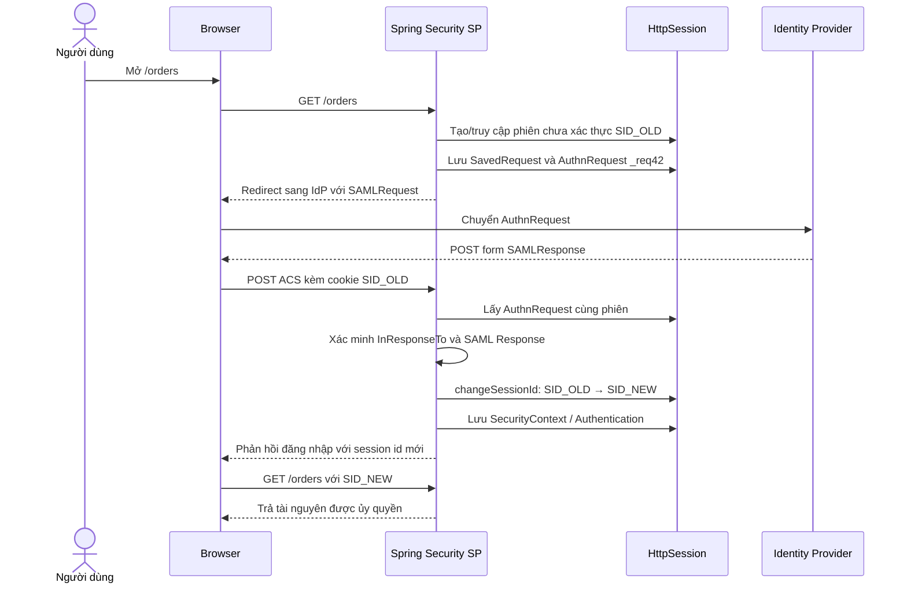
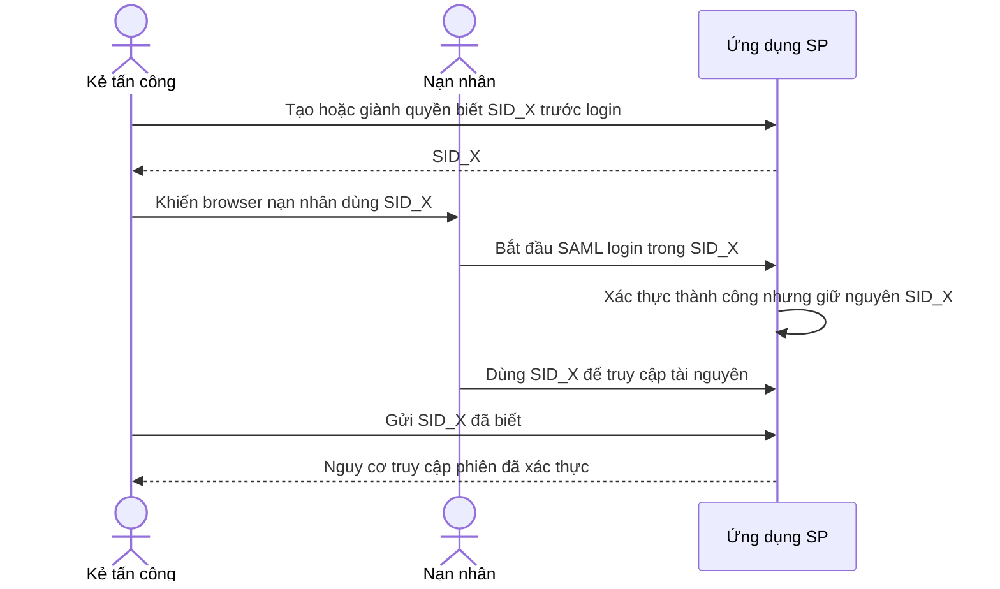

# Session fixation và thay đổi mã phiên sau đăng nhập SAML2 trong Spring Security

**Chủ đề:** Spring Security – federation → Phiên và trình duyệt.

Một ứng dụng Service Provider (SP) dùng Spring Security SAML2 thường tạo một `HttpSession` **trước khi người dùng xác thực thành công**: nó phải nhớ `AuthnRequest`, `RelayState` liên quan, trang người dùng muốn truy cập và ngữ cảnh trình duyệt. Sau khi Identity Provider (IdP) trả về SAML Response hợp lệ, ứng dụng phải chuyển từ trạng thái **chưa xác thực** sang **đã xác thực** mà không cho kẻ tấn công tiếp tục sử dụng mã phiên cũ. Cơ chế chống **session fixation** của Spring Security giải quyết việc này bằng cách **thay đổi session ID tại thời điểm đăng nhập thành công**, theo mặc định qua `HttpServletRequest.changeSessionId()` trên Servlet container hiện đại.

**Kết luận quan trọng nhất:** thay session ID **không đồng nghĩa xóa HttpSession hoặc tạo user mới**. Với `changeSessionId()`, định danh phiên cũ hết khả năng truy cập vào phiên vừa xác thực, trong khi dữ liệu phiên cần thiết được giữ. Cơ chế này bổ sung, **không thay thế**, việc kiểm chứng chữ ký SAML, `InResponseTo`, chống login CSRF, cookie bảo mật và phân quyền.

Bài học dành cho **Spring Security Servlet/MVC**, Spring Boot 4.x/Security 7.x và Java 17+. Các nguyên lý cũng áp dụng cho Security 6.x; đối chiếu API đúng phiên bản khi triển khai. Không dùng nguyên cấu hình Servlet cho WebFlux.

## 1. Từ phiên vô danh đến phiên đã xác thực

Trong SAML2 SP-initiated SSO, người dùng có thể truy cập `GET /orders` khi chưa login. Spring Security bắt đầu hành trình:

1. Browser mở URL được bảo vệ. SP có thể tạo một `HttpSession` chưa xác thực để giữ thông tin trước login.
2. `Saml2WebSsoAuthenticationRequestFilter` xây `AuthnRequest`, lưu yêu cầu trong `Saml2AuthenticationRequestRepository`; mặc định là `HttpSessionSaml2AuthenticationRequestRepository`.
3. Browser được chuyển đến IdP. IdP xác thực người dùng rồi gửi `SAMLResponse` tới Assertion Consumer Service (ACS) của SP.
4. `Saml2WebSsoAuthenticationFilter` và bộ xử lý SAML xác minh response, xác định đúng request đã lưu, issuer, chữ ký, audience, thời hạn, recipient và các điều kiện.
5. Khi xác thực thành công, `SessionAuthenticationStrategy` của cơ chế login tham gia xử lý session. **Session fixation protection** thay session ID theo policy, thông thường bằng `changeSessionId()`.
6. Kết quả `Authentication`/`SecurityContext` được lưu theo cơ chế persistence; browser nhận cookie phiên mới hoặc một cập nhật session tracking phù hợp, tiếp tục truy cập trang được bảo vệ.

Ví dụ khái niệm:

```text
Trước login:
  Cookie của browser: JSESSIONID=SID_OLD
  HttpSession(SID_OLD):
    - pending AuthnRequest ID=_req42
    - SavedRequest=/orders
    - Authentication chưa được xác minh

Sau SAMLResponse hợp lệ và session fixation protection:
  Cookie/session id: JSESSIONID=SID_NEW
  SID_OLD không còn là cách truy cập phiên đã xác thực
  HttpSession(SID_NEW):
    - SecurityContext / Authentication của user đã xác thực
    - Các thuộc tính còn được giữ theo session strategy
  Browser vào /orders bằng SID_NEW
```

**SID_OLD và SID_NEW chỉ là tên tượng trưng**, không phải format hoặc token thật. Mã phiên thực phải do container/session manager sinh ngẫu nhiên và bảo vệ. Không sử dụng hai ID cố định trong sản phẩm.

### 1.1. Sơ đồ hai pha của một phiên



**Sơ đồ là trình tự trách nhiệm logic**, không cam kết chính xác thứ tự nội bộ từng method trong mọi phiên bản Spring, nhất là khi ứng dụng có custom success handler/session strategy. Hãy kiểm tra behavior thực tế bằng trình duyệt và phiên bản đang deploy.

### 1.2. Ba đối tượng trạng thái khác nhau

| Đối tượng | Khi nào xuất hiện? | Công dụng |
| --- | --- | --- |
| `HttpSession` chưa xác thực | Có thể từ trước khi bắt đầu SAML login | Nối tiếp browser, giữ state chờ login |
| `AbstractSaml2AuthenticationRequest` | SP tạo trước redirect đến IdP | Tương quan với SAML Response qua `InResponseTo` trong đúng browser session |
| `SecurityContext` và `Authentication` | Chỉ sau khi SAML validation thành công | Biểu diễn danh tính đã đăng nhập để ủy quyền ở các request sau |
| `SavedRequest` | Có thể khi truy cập URL được bảo vệ | Ghi nhớ đích quay về sau thành công |
| `Session ID` | Mã định vị HttpSession | Thay khi chuyển sang trạng thái authenticated, không phải user ID hoặc SAML ID |

**Một HttpSession tồn tại không có nghĩa người dùng đã đăng nhập.** Phân biệt này rất quan trọng khi kiểm thử fixation: một phiên vô danh có thể cần tồn tại để lưu handshake SAML, nhưng ID của nó không được tiếp tục hợp thức hóa phiên đã xác thực sau login.

## 2. Session fixation là gì?

**Session fixation** là kịch bản kẻ tấn công biết hoặc đã tác động để nạn nhân sử dụng **một session ID cụ thể** trước khi nạn nhân đăng nhập. Nếu SP tiếp tục giữ nguyên ID đó sau khi nạn nhân xác thực, kẻ tấn công có thể thử dùng cùng ID để truy cập trạng thái authenticated của nạn nhân.

Khác với đánh cắp cookie sau login, session fixation giả định kẻ tấn công biết hoặc điều khiển **ID trước login**. Tấn công thành công hay không phụ thuộc ứng dụng có cho phép gán/cố định session ID bằng URL rewriting, cookie injection, session adoption, lỗi subdomain, proxy hoặc một lỗ hổng khác.

### 2.1. Diễn tiến khi không bảo vệ



Đây là **mô hình rủi ro**, không phải chứng minh rằng một kẻ bất kỳ có thể đặt cookie của mọi domain. Môi trường browser, domain, khả năng cố định ID và chính sách session tracking quyết định việc tấn công có triển khai được không.

### 2.2. Khi Spring thay session ID

```text
Kẻ tấn công biết SID_X từ trước.
Nạn nhân xác thực trong HttpSession ban đầu SID_X.
SessionAuthenticationStrategy thay SID_X bằng SID_Y.
Nạn nhân nhận SID_Y.
Truy cập lại với SID_X: không được xem là authenticated session SID_Y.
```

Nếu attacker không nhận được SID_Y, cơ chế này chặn việc dùng **ID cũ** để chiếm phiên sau login. Nó không chặn attacker đã đánh cắp SID_Y bằng XSS/malware hoặc log leak, không thay thế CSRF protection và không cho phép bỏ qua SAML validation.

**Không vô hiệu hóa session fixation protection chỉ vì “SSO đã dùng IdP uy tín”.** SAML là cơ chế xác thực danh tính; session của SP vẫn cần phòng vệ riêng.

## 3. Cơ chế mặc định của Spring Security trên Servlet hiện đại

Spring Security cung cấp `SessionAuthenticationStrategy` để xử lý khi người dùng vừa được xác thực. Với cơ chế login tương tác như SAML2 Web SSO, filter/handler xác thực kết hợp chiến lược phiên của filter chain. Trên Servlet container hỗ trợ Servlet 3.1+, lựa chọn mặc định chống session fixation thường là:

```java
HttpServletRequest.changeSessionId()
```

Đây là method của **Servlet API**, không phải hàm OpenSAML hay một endpoint HTTP. Servlet container đổi mã nhận diện phiên và duy trì các thuộc tính session tương ứng. Framework thực hiện đúng thời điểm thông qua `ChangeSessionIdAuthenticationStrategy` khi authentication thành công.

**Mặc định được tài liệu Spring Security xác nhận:** `changeSessionId` cho Servlet 3.1 trở lên; `migrateSession` trên container cũ hơn (Servlet 3.0 trở xuống). Với Spring Boot 4.x, một Servlet container phù hợp hiện đại nên hỗ trợ `changeSessionId`.

### 3.1. Bốn lựa chọn cần phân biệt

| Chiến lược | Hành vi | Khi dùng? | Rủi ro/cân nhắc |
| --- | --- | --- | --- |
| **`changeSessionId()`** | Đổi ID **của phiên hiện có**, giữ session attributes | **Ưu tiên/mặc định** trên Servlet hiện đại | Cần kiểm tra container, cookie, session store và event listeners |
| **`migrateSession()`** | Hủy phiên cũ, tạo phiên mới, **sao chép toàn bộ** thuộc tính phiên | Khi môi trường/thiết kế cần chiến lược di chuyển đầy đủ | Copy object có binding listener, serialization/cost và dữ liệu pre-auth không mong muốn |
| **`newSession()`** | Tạo phiên mới, **không sao chép toàn bộ** app attributes; vẫn sao chép các thuộc tính liên quan Spring Security theo tài liệu | Khi muốn dọn sạch nhiều dữ liệu pre-auth | Có thể làm mất cart, locale, app state hoặc deep-link custom đang giữ trong session |
| **`none()`** | Không thực hiện session fixation protection | Hiếm khi có một cơ chế bảo vệ khác đã được chứng minh | **Không khuyến nghị**, dễ mở đường cho fixation |

**Không đánh đồng “newSession” với “không còn gì trong session”.** Tài liệu cho biết một số thuộc tính Spring Security vẫn được sao chép nhằm duy trì hoạt động bảo mật. Kết quả chính xác của application attributes phải test với cấu hình thực.

### 3.2. Sự khác biệt về object/attribute khi dùng `changeSessionId`

Giả sử phiên đang có:

```text
HttpSession id = S_old
attributes:
    SAVED_REQUEST = /reports/2026
    CART = {...}
    SAML_AUTHENTICATION_REQUEST = {...}
```

Với `changeSessionId`, mã định vị chuyển sang `S_new` nhưng các thuộc tính session hiện có **được giữ**. Spring Security có thể đã tiêu thụ/xóa pending `AuthnRequest` trong quá trình xử lý login theo lifecycle riêng, nên **đừng giả định mọi attribute liệt kê ở trên vẫn còn sau thành công**. Thuộc tính giữ được và attribute đã bị filter chủ động xóa là hai cơ chế khác nhau.

Với `migrateSession`, container/framework có thể tạo một đối tượng HttpSession mới rồi sao chép attributes, phát event binding/unbinding. Với `newSession`, đa số application attributes có thể mất; nếu thành phần ứng dụng dựa vào cart/saved state, cần thiết kế lại cách phục hồi dữ liệu an toàn.

**Chọn chiến lược nào không được làm mất kiểm tra `InResponseTo`.** SAML request phải được tìm và xác minh ở **phiên ban đầu khi callback tới**, trước khi authenticated state được thiết lập.

## 4. Cấu hình session fixation trong Spring Security

Trên Spring Security 6.x/7.x, có thể dùng DSL:

```java
http.sessionManagement(session -> session
    .sessionFixation(fixation -> fixation.changeSessionId())
);
```

Đây là **mảnh Java cấu hình HttpSecurity**, không phải chương trình `javac` độc lập. Trong phần lớn ứng dụng Servlet hiện đại, không bắt buộc viết lại vì đó đã là mặc định. Cấu hình tường minh giúp tài liệu hóa policy và tránh bị một cấu hình custom khác vô tình đổi.

### 4.1. Ví dụ `SecurityFilterChain` có SAML2 Login

`src/main/java/com/example/federation/SecurityConfig.java`:

```java
package com.example.federation;

import org.springframework.context.annotation.Bean;
import org.springframework.context.annotation.Configuration;
import org.springframework.security.config.Customizer;
import org.springframework.security.config.annotation.web.builders.HttpSecurity;
import org.springframework.security.web.SecurityFilterChain;

@Configuration
public class SecurityConfig {

    @Bean
    SecurityFilterChain securityFilterChain(HttpSecurity http)
            throws Exception {
        http
            .authorizeHttpRequests(auth -> auth
                .requestMatchers("/", "/error").permitAll()
                .anyRequest().authenticated()
            )
            .saml2Login(Customizer.withDefaults())
            .sessionManagement(session -> session
                .sessionFixation(fixation -> fixation.changeSessionId())
            );
        return http.build();
    }
}
```

**Phạm vi:** đây là một lớp trong ứng dụng Spring Boot **Servlet** dùng starter SAML2 đúng version. Nó không chứa IdP metadata/credentials nên **không thể chạy login thật nếu đứng riêng**.

Khi SAML callback đến `/login/saml2/sso/{registrationId}`, Spring Security cần xác thực response trước. Khi authentication thành công, session management policy đã cấu hình được áp dụng qua cơ chế xử lý login. Không đặt manual `request.changeSessionId()` trong controller xử lý ACS — ACS thuộc filter, và đổi session không đúng thời điểm có thể làm mất correlation hoặc gây side effects.

### 4.2. Cấu hình thay thế khi có lý do rõ ràng

Nếu muốn session mới giữ toàn bộ app attributes:

```java
http.sessionManagement(session -> session
    .sessionFixation(fixation -> fixation.migrateSession())
);
```

Nếu yêu cầu phiên sau login hạn chế dữ liệu pre-auth:

```java
http.sessionManagement(session -> session
    .sessionFixation(fixation -> fixation.newSession())
);
```

Hai cấu hình này **thay thế** `changeSessionId`, không khai báo đồng thời cả ba trong cùng chain. Trước khi chọn, rà soát cart, CSRF token, SavedRequest, SAML request repository, session-bound listeners, cache và trạng thái ứng dụng. Đặc biệt `newSession` có thể làm mất dữ liệu tùy biến mà ứng dụng tưởng sẽ tồn tại sau login.

Đừng dùng `fixation.none()` để “sửa lỗi SAML redirect mất cookie”; cookie qua IdP và fixation protection là hai vấn đề khác nhau.

### 4.3. Đừng đặt `SessionCreationPolicy.STATELESS` một cách máy móc

Một ứng dụng SAML2 Web SSO điển hình cần `HttpSession` cho request correlation và phiên web đã xác thực. `SessionCreationPolicy.STATELESS` khiến SecurityContext không được lưu theo cơ chế session mặc định và có thể mâu thuẫn với `HttpSessionSaml2AuthenticationRequestRepository`/SavedRequest.

| Policy | Ảnh hưởng cần nhớ |
| --- | --- |
| `IF_REQUIRED` | Có thể tạo session khi cần cho login/SavedRequest; hợp với đa số SP web |
| `NEVER` | Không chủ động tạo session cho SecurityContext nhưng thành phần khác vẫn có thể tạo session; không tự đồng nghĩa stateless tuyệt đối |
| `STATELESS` | Không sử dụng HttpSession để lấy/lưu SecurityContext; cần thiết kế lại nếu muốn một cơ chế SAML login thực sự stateless |
| `ALWAYS` | Tạo session tích cực hơn; không thay thế fixation protection |

Không chọn policy bằng trực giác: kiểm tra request repository, browser cookie và nhu cầu lưu authenticated state.

## 5. Maven và Spring Boot: chuẩn bị ví dụ thực hành

Ví dụ dưới đây nhắm **Spring Boot 4.1.x + Spring Security do Boot quản lý + Java 17+**. SAML2 cần OpenSAML và IdP metadata thật; phần cấu hình dùng hostname giả định để minh họa.

`pom.xml`:

```xml
<?xml version="1.0" encoding="UTF-8"?>
<project xmlns="http://maven.apache.org/POM/4.0.0"
         xmlns:xsi="http://www.w3.org/2001/XMLSchema-instance"
         xsi:schemaLocation="http://maven.apache.org/POM/4.0.0
           https://maven.apache.org/xsd/maven-4.0.0.xsd">
    <modelVersion>4.0.0</modelVersion>
    <parent>
        <groupId>org.springframework.boot</groupId>
        <artifactId>spring-boot-starter-parent</artifactId>
        <version>4.1.2</version>
        <relativePath/>
    </parent>
    <groupId>com.example</groupId>
    <artifactId>saml-session-fixation</artifactId>
    <version>1.0.0</version>
    <properties><java.version>17</java.version></properties>
    <repositories>
        <repository>
            <id>shibboleth-releases</id>
            <url>https://build.shibboleth.net/maven/releases/</url>
            <snapshots><enabled>false</enabled></snapshots>
        </repository>
    </repositories>
    <dependencies>
        <dependency>
            <groupId>org.springframework.boot</groupId>
            <artifactId>spring-boot-starter-webmvc</artifactId>
        </dependency>
        <dependency>
            <groupId>org.springframework.boot</groupId>
            <artifactId>spring-boot-starter-security</artifactId>
        </dependency>
        <dependency>
            <groupId>org.springframework.boot</groupId>
            <artifactId>spring-boot-starter-security-saml2</artifactId>
        </dependency>
        <dependency>
            <groupId>org.springframework.boot</groupId>
            <artifactId>spring-boot-starter-test</artifactId>
            <scope>test</scope>
        </dependency>
    </dependencies>
    <build>
        <plugins>
            <plugin>
                <groupId>org.springframework.boot</groupId>
                <artifactId>spring-boot-maven-plugin</artifactId>
            </plugin>
        </plugins>
    </build>
</project>
```

Spring Security SAML2 Service Provider dựa trên OpenSAML; tùy môi trường cần kho Shibboleth Releases hoặc mirror artifact repository hợp lệ. Giữ version do Spring Boot BOM quản lý; Boot 3.x có tên starter khác, không chép nguyên dependency Boot 4.

`src/main/java/com/example/federation/Application.java`:

```java
package com.example.federation;

import org.springframework.boot.SpringApplication;
import org.springframework.boot.autoconfigure.SpringBootApplication;
import org.springframework.web.bind.annotation.GetMapping;
import org.springframework.web.bind.annotation.RestController;
import org.springframework.security.core.Authentication;

@SpringBootApplication
@RestController
public class Application {
    public static void main(String[] args) {
        SpringApplication.run(Application.class, args);
    }

    @GetMapping("/")
    String index() {
        return "SAML SP online";
    }

    @GetMapping("/private")
    String privatePage(Authentication auth) {
        return "Welcome: " + auth.getName();
    }
}
```

Cùng `SecurityConfig.java` ở mục 4, `src/main/resources/application.yml`:

```yaml
spring:
  security:
    saml2:
      relyingparty:
        registration:
          partner-a:
            assertingparty:
              metadata-uri: https://login.partner.example/metadata.xml
```

Khi đã thay bằng metadata IdP hợp lệ và cấu hình entity ID/ACS public phù hợp, chạy:

```bash
mvn -DskipTests compile
mvn spring-boot:run
```

**Không có stdout cố định cho SSO.** Đăng nhập phụ thuộc IdP, X.509 verification, browser, SameSite cookie, session storage và gateway; biên dịch thành công chỉ kiểm tra code/dependencies chứ chưa chứng minh session rotation chạy an toàn.

## 6. Quan hệ với `HttpSessionSaml2AuthenticationRequestRepository`

Điểm dễ nhầm: SAML2 thường cần session **trước** login để lưu AuthnRequest. Nếu Spring xoá session hay đổi ID vào **thời điểm không đúng**, response từ IdP có thể không tìm lại được request đang chờ.

### 6.1. Request correlation diễn ra trước authenticated session

Theo Spring Security:
- `Saml2WebSsoAuthenticationRequestFilter` tạo `AuthnRequest` và lưu `AbstractSaml2AuthenticationRequest` vào `Saml2AuthenticationRequestRepository`.
- `HttpSessionSaml2AuthenticationRequestRepository` là repository mặc định, gắn request với `HttpSession` browser đã khởi tạo.
- `Saml2WebSsoAuthenticationFilter` nhận response và sử dụng `Saml2AuthenticationTokenConverter` để resolve registration/request đã lưu.
- Sau khi response được xác minh, cơ chế authentication success xử lý session fixation protection.

**Mục tiêu:** callback mang cookie phiên **SID_OLD** tìm đúng pending request `_req42`; sau xác minh mới chuyển sang session ID mới. Nếu chạy `changeSessionId()` từ filter tự viết **trước** callback hoặc hủy session quá sớm, correlation sẽ mất.

### 6.2. Session fixation và login fixation là hai vấn đề khác

| Tình huống | Cơ chế phòng vệ |
| --- | --- |
| Kẻ tấn công **biết mã HttpSession cũ** rồi nạn nhân đăng nhập | **Đổi session ID sau authentication** bằng SessionAuthenticationStrategy |
| Kẻ tấn công phát SAMLResponse hợp lệ của **chính tài khoản attacker** rồi ép browser nạn nhân POST vào ACS | **Session-bound AuthnRequest correlation**, policy chống unsolicited/login CSRF và các SAML validations |
| Kẻ tấn công đánh cắp **session ID mới sau login** | HTTPS, Secure/HttpOnly cookie, chống XSS, session controls, timeout/revocation, điều tra sự cố |
| Kẻ tấn công gửi SAMLResponse đã dùng lại | Replay detection, time/recipient/audience checks và request correlation |
| Kẻ tấn công dùng cùng ID để vào tenant khác | Tenant/role/resource-level authorization |

**Đổi mã phiên không đủ để chống login CSRF**, vì kẻ tấn công có thể khiến nạn nhân đăng nhập dưới danh tính attacker, rồi Spring vẫn đổi session ID một cách hợp lệ. Ngược lại, một AuthnRequest được tương quan chính xác không giải quyết rủi ro attacker biết session ID được giữ nguyên sau xác thực.

### 6.3. IdP-initiated SSO

Khi IdP chủ động gửi unsolicited SAMLResponse, không có `AuthnRequest` do SP phát hành trong giao dịch đó. Nếu SP **chủ động cho phép** IdP-initiated và response vượt qua xác minh, session fixation protection vẫn quan trọng cho phiên SP vừa được authenticated. Tuy nhiên, không có request/session correlation như SP-initiated nên cần biện pháp bổ sung chống login CSRF, replay, `RelayState` open redirect và tenant confusion.

Nếu policy chỉ cho SP-initiated, **không** tự động chuyển response “mất session” thành IdP-initiated để tránh lỗi login.

## 7. Cookie, SameSite và callback SAML cross-site POST

Một tình huống xảy ra thường xuyên: browser giữ cookie `JSESSIONID` trước redirect đến IdP, nhưng khi IdP submit form `HTTP POST` sang ACS của SP, browser không gửi lại cookie cũ. Spring tạo session khác hoặc không tìm được pending AuthnRequest; người dùng thấy lỗi vòng lặp hoặc `InResponseTo` không khớp.

### 7.1. SameSite ảnh hưởng callback trước khi rotate ID

Giả sử:
- SP: `https://portal.example.com`.
- IdP: `https://login.partner.example`.
- Callback: cross-site `POST /login/saml2/sso/partner-a`.

| Cookie policy | Ảnh hưởng thường gặp |
| --- | --- |
| `SameSite=Strict` | Không gửi cookie trong điều hướng cross-site, dễ mất pre-auth session |
| `SameSite=Lax` | Thường không gửi cookie trong **cross-site POST**, dù top-level GET có ngoại lệ |
| `SameSite=None; Secure` | Cho phép gửi cookie trong bối cảnh cross-site theo policy browser, yêu cầu HTTPS; cần đánh giá CSRF và thực tế browser |
| `HttpOnly` | JavaScript thông thường không đọc cookie, giảm một kênh lấy cắp (không loại bỏ XSS/CSRF) |
| `Secure` | Cookie chỉ được gửi qua HTTPS, thiết yếu với session auth production |
| `Domain` / `Path` | Phạm vi cookie; sai host/path có thể khiến callback không nhận session |

Đừng mặc định mọi môi trường cần `SameSite=None`. Cách phân loại “same-site” dựa trên site/scheme của browser, không đơn thuần là “khác hostname”; IdP và SP cùng registrable domain có thể có hành vi khác. Test bằng browser/IdP thực và kiểm tra `Set-Cookie`/Cookie headers trên **chính callback**.

Ví dụ một cấu hình Boot **chỉ sau khi đã xác minh cần cross-site POST cookie**:

```yaml
server:
  servlet:
    session:
      cookie:
        secure: true
        http-only: true
        same-site: none
```

**Cảnh báo:** cấu hình này ảnh hưởng mọi request dùng session cookie và cần thiết kế CSRF protection cho POST nghiệp vụ. Không tắt CSRF toàn website; Spring Security xử lý callback SAML theo cơ chế của nó. Không đặt cookie `Domain=.example.com` quá rộng nếu nhiều subdomain không được tin cùng mức.

### 7.2. Nhìn dấu hiệu trong Network trace

Một trace đúng có thể cho thấy:

```text
GET /saml2/authenticate/partner-a
  → Set-Cookie: JSESSIONID=SID_OLD; Secure; HttpOnly; SameSite=...
  → Redirect tới IdP

POST /login/saml2/sso/partner-a
  → Cookie: JSESSIONID=SID_OLD
  → SAMLResponse được xác minh
  → SessionAuthenticationStrategy đổi mã phiên
  → Set-Cookie: JSESSIONID=SID_NEW; Secure; HttpOnly; SameSite=...

GET /private
  → Cookie: JSESSIONID=SID_NEW
  → Được xác thực và phân quyền
```

Đây là **sơ đồ tiêu biểu**, không đảm bảo mọi container đặt `Set-Cookie` vào đúng response như ví dụ hoặc luôn có cookie trước login. Nếu browser chưa có session trước login, phải tạo/truy cập session thì mới có ID cũ để so sánh. Kiểm chứng **giá trị thực tế có thay đổi hay không** bằng công cụ phù hợp, không dựa đơn độc vào một header nhất định.

**Không copy giá trị cookie thật vào ticket/Slack/log.** Nếu phải đối chiếu, ghi dạng mask hoặc hash trong môi trường kiểm thử được phép.

## 8. Session store, Redis, load balancer và rolling deployment

Với nhiều instance, session fixation protection phải hoạt động nhất quán trên toàn SP fleet.

### 8.1. Sticky session không giải quyết mọi tình huống

```text
Request trước login → Pod A (session SID_OLD local)
ACS callback        → Pod B (không biết SID_OLD)
```

Pod B không tìm thấy `AuthnRequest`. Lỗi này **xảy ra trước thời điểm session fixation protection thành công**. Nếu dùng sticky session, cần xử lý pod chết, retry, cân bằng tải đổi đường và rolling upgrade.

**Spring Session Redis** có thể thay backing store của HttpSession để nhiều pod đọc cùng session ID/state; nếu dùng, phải bảo vệ Redis ACL/TLS/secret, namespace, TTL, serializer và nhất quán phiên bản. Khi container/session abstraction đổi session ID, storage layer phải phản ánh thay đổi để **old ID không tiếp tục truy cập authenticated state**.

Không tự thay `HttpSessionSaml2AuthenticationRequestRepository` bằng cache tra theo `RelayState` chỉ vì Redis dễ triển khai: repository session-bound vốn có lợi ích chống login swapping. Spring Session Redis giúp chia sẻ `HttpSession` mà không cần đánh đổi correlation semantics.

### 8.2. Kiểm thử ID cũ không còn được chấp nhận ở node khác

Sau SAML login thành công, không chỉ test pod đang nhận callback:
- Gửi request có **SID_NEW** đến nhiều node → user được nhận diện đúng, quyền không lẫn tenant.
- Gửi request có **SID_OLD** từ môi trường staging → không có authenticated state của phiên mới.
- Kiểm tra cache/session store đã đổi khóa hoặc lập mapping theo cơ chế an toàn; không tồn tại alias công khai lâu dài từ old ID sang new ID.
- Test rolling deploy và rollback. Không để pod cũ chỉ đọc session version cũ hoặc serializer không tương thích.
- Test failover khi một pod chết giữa redirect từ IdP và callback.
- Không dựa vào việc “thay session ID” nhưng vẫn giữ bản sao **authenticated Session** dưới old ID trong cache riêng của ứng dụng.

Với Spring Session, session ID được quản lý bởi repository/framework; đừng viết một cơ chế `changeSessionId` thủ công vào Redis key rồi bỏ qua cookie và session tracking.

## 9. Java 17 chạy độc lập: mô phỏng đổi mã phiên

Chương trình sau **chỉ dùng JDK 17+**, chạy bằng `javac/java`, mô phỏng điều cốt lõi: một map lưu phiên thay key `SID_OLD` thành `SID_NEW` trong khi dữ liệu còn được giữ. **Đây không phải Servlet container, không phát cookie, không kiểm chứng SAML và không phải cách triển khai session production**.

Tệp `SessionIdRotationDemo.java`:

```java
import java.util.HashMap;
import java.util.Map;

public class SessionIdRotationDemo {

    static final class SessionStore {
        private final Map<String, Map<String, String>> sessions =
                new HashMap<>();

        void create(String id, String savedRequest) {
            Map<String, String> attributes = new HashMap<>();
            attributes.put("savedRequest", savedRequest);
            sessions.put(id, attributes);
        }

        boolean rotateAfterSuccessfulLogin(
                String oldId, String newId, String user) {
            if (oldId.equals(newId)
                    || sessions.containsKey(newId)
                    || !sessions.containsKey(oldId)) {
                return false;
            }
            Map<String, String> session = sessions.remove(oldId);
            session.put("authenticatedUser", user);
            sessions.put(newId, session);
            return true;
        }

        boolean canReadAs(String id, String expectedUser) {
            Map<String, String> session = sessions.get(id);
            return session != null
                    && expectedUser.equals(
                        session.get("authenticatedUser"));
        }

        String savedRequest(String id) {
            Map<String, String> session = sessions.get(id);
            return session == null ? "<none>"
                    : session.get("savedRequest");
        }
    }

    public static void main(String[] args) {
        SessionStore store = new SessionStore();
        store.create("SID_OLD", "/orders");

        System.out.println("Pre-login authenticated: "
                + store.canReadAs("SID_OLD", "alice"));

        boolean rotated = store.rotateAfterSuccessfulLogin(
                "SID_OLD", "SID_NEW", "alice");
        System.out.println("ID changed: " + rotated);
        System.out.println("Old ID authenticated: "
                + store.canReadAs("SID_OLD", "alice"));
        System.out.println("New ID authenticated: "
                + store.canReadAs("SID_NEW", "alice"));
        System.out.println("Saved request retained: "
                + store.savedRequest("SID_NEW"));
    }
}
```

Chạy ở thư mục chứa file:

```bash
javac SessionIdRotationDemo.java
java SessionIdRotationDemo
```

**Stdout chính xác:**

```text
Pre-login authenticated: false
ID changed: true
Old ID authenticated: false
New ID authenticated: true
Saved request retained: /orders
```

Ý nghĩa:
- Trước login, cùng ID cũ chưa đủ để truy cập tài nguyên cần auth.
- Sau khi “login thành công” được mô phỏng, ID cũ không còn ánh xạ đến trạng thái authenticated.
- ID mới nhận trạng thái authenticated và vẫn có SavedRequest.
- **Mã `SID_OLD`/`SID_NEW` cố định chỉ phục vụ demo**; ứng dụng thật phải để container/session manager sinh ID mạnh và thay đổi nguyên tử.
- Chương trình không có cookie, OAuth/SAML signature validation, session fixation events, TTL, concurrency, network hoặc replay defense; không copy `SessionStore` này sang sản phẩm thật.

## 10. Xác minh session ID thật sự đã đổi

### 10.1. Test với browser thật và IdP sandbox

1. Dùng browser profile kiểm thử sạch, truy cập một trang SP chưa đăng nhập để chắc chắn session pre-auth tồn tại (ví dụ khởi tạo SP-initiated SSO).
2. Trước khi chuyển sang IdP, quan sát session cookie ID và lưu **chỉ trong bộ nhớ công cụ test bảo mật**; không dán raw ID vào log.
3. Đăng nhập IdP sandbox, để browser POST `SAMLResponse` về ACS cùng pre-auth session.
4. Sau xác thực, quan sát session ID/cookie của SP: **khác ID cũ**, authenticated state còn hiệu lực và SavedRequest được phục hồi.
5. Trong một HTTP client thử nghiệm cách ly, gửi **old ID**; phải không lấy được trang protected ở trạng thái đã authenticated.
6. Gửi **new ID** với cùng trạng thái browser phù hợp; được truy cập sau authorization (không có nghĩa mọi user đều được xem mọi trang).
7. Logout, kiểm tra session bị invalidated, cookie được xử lý theo policy; old/new ID không còn cho truy cập đã xác thực.
8. Lặp lại qua nhiều pod và reverse proxy, thử cookie SameSite và MFA chậm.

**Đừng kết luận FAIL chỉ vì không thấy hai cookie khác nhau** nếu browser không hề có phiên trước login; cần một test có `HttpSession` hợp lệ ngay từ đầu. Cũng không mặc định header `Set-Cookie` là cách duy nhất container/session layer truyền thay đổi ID.

### 10.2. Test tự động ở mức tích hợp

Với Spring Boot/Spring Security tests:
- Tạo hoặc dùng một pre-auth `MockHttpSession`, duy trì nó qua request tạo AuthnRequest.
- Tạo **SAMLResponse được ký hợp lệ** bằng IdP test key hoặc fixture đáng tin; không tắt validator SAML chỉ để test session fixation.
- Đưa POST ACS qua đúng filter chain với session ban đầu.
- So session ID trước/sau và `SecurityContext` hoặc trạng thái authorization. Có thể dùng test container/embedded browser nếu cần test cookie thật.
- Negative test: SAMLResponse sai chữ ký, sai `InResponseTo` hoặc hết hạn **không thiết lập authenticated state**.
- Integration test phải bao gồm SessionAuthenticationStrategy thật. Một test với `@WithMockUser` chỉ đặt SecurityContext trực tiếp **không chứng minh** chiến lược thay ID khi SAML authentication thành công.
- MockMvc không kiểm chứng được browser SameSite behavior; dùng Playwright/Selenium hoặc trình duyệt thật với IdP sandbox.

**Có thể có event:** Spring Security phát `SessionFixationProtectionEvent` khi cơ chế fixation protection xảy ra. Với `changeSessionId()`, Servlet `HttpSessionIdListener` cũng có thể được thông báo. Nếu ứng dụng ghi audit theo cả hai listener, tránh ghi đôi sự kiện hoặc vô tình kích hoạt cleanup hai lần. **Không log raw session IDs** trong event payload.

## 11. SecurityContext persistence sau session rotation

Thay session ID chỉ bảo vệ **mã truy cập phiên**. Authentication vẫn cần được lưu trong `SecurityContextRepository` để request tiếp theo nhận được user đã đăng nhập.

Spring Security 6/7 sử dụng mô hình explicit save với `SecurityContextHolderFilter` theo tài liệu mới. Khi dùng `saml2Login` mặc định, framework đảm trách chu trình authentication/persistence của cơ chế login. Nếu một team viết **custom authentication filter/controller** hoặc một handler gán `SecurityContextHolder.getContext().setAuthentication(...)`, chỉ thao tác đó **không đủ bảo đảm** authentication được lưu cho request tiếp theo. Cần dùng `SecurityContextRepository.saveContext(...)` phù hợp, đúng thứ tự và chỉ sau kiểm chứng thành công.

Vì thế một lỗi “đã đổi cookie nhưng login xong vẫn 401” có thể do:
- SecurityContext không được lưu/restore, không phải do session fixation.
- Session cookie sau login không quay lại SP vì `Secure`/`Domain`/`Path`/`SameSite`.
- Session store nhiều node không chia sẻ hoặc đã hết hạn.
- Authorization vẫn deny user dù authentication thành công.
- Callback/redirect quá sớm trước khi persistence hoàn tất ở custom flow.

**Không khắc phục bằng cách tắt `changeSessionId`.** Điều tra ranh giới giữa Authentication, SessionAuthenticationStrategy, SecurityContextRepository, cookie và authorization.

## 12. Đổi session ID có giải quyết mọi vấn đề về session không?

Không. Các lớp bảo vệ cần phối hợp:

| Vấn đề | Biện pháp phù hợp |
| --- | --- |
| Session fixation trước login | Thay ID khi authentication thành công; hạn chế session tracking bằng URL |
| Session hijacking sau login | HTTPS/HSTS, cookie Secure/HttpOnly, chống XSS, phát hiện bất thường, timeout/revocation |
| Login CSRF qua IdP-initiated | Ưu tiên SP-initiated/correlation, policy unsolicited và chống replay |
| CSRF các POST nghiệp vụ dựa trên cookie | CSRF token hoặc cơ chế tương đương; không disable toàn bộ |
| SameSite làm mất SAML pending request | Cấu hình cookie và HTTP binding phù hợp, test browser, session repository |
| Sai tenant/role | Issuer/NameID mapping và authorization kiểm tra tài nguyên |
| Session bất tử | Timeout, maximum concurrent sessions (khi yêu cầu), logout/expiration và kiểm tra quyền thay đổi |
| Replay assertion | Validation của OpenSAML, time/correlation, replay cache theo policy |
| XSS | Encode đầu ra, CSP, kiểm soát input và JS dependencies; HttpOnly không ngăn mọi hành vi XSS |
| Cluster mất state | Shared session store hoặc sticky routing cùng failover đã kiểm thử |

### 12.1. Vòng đời logout

Khi logout ở SP, session local cần được invalidated và SecurityContext được clear theo Spring Security/logout policy. Việc xóa session cookie phụ thuộc path/domain/container và browser; cấu hình `deleteCookies("JSESSIONID")` có thể hữu ích nhưng không đảm bảo hoạt động trên mọi servlet container/proxy. Nếu dùng Spring Session, cookie name có thể khác; đừng hard-code sai.

**SAML Single Logout (SLO)** là phần giao thức riêng giữa SP và IdP; chỉ invalidate HttpSession không đồng nghĩa IdP session và các SP khác đều logout. Test logout cả ở browser lẫn IdP theo yêu cầu nghiệp vụ.

### 12.2. Bao lâu phải đổi session ID?

Nguyên tắc an ninh là **đổi tại ranh giới nâng quyền/authentication**, không nhất thiết đổi ở mọi HTTP request. Đổi ID mỗi request có thể làm vỡ tab song song, websocket và request concurrency. Khi ứng dụng có “step-up”, impersonation hoặc chuyển quyền nhạy cảm, cân nhắc chính sách rotate/re-auth cụ thể và kiểm thử; không giả định SAML SSO lần đầu là ranh giới duy nhất trong vòng đời ứng dụng.

**Session ID không phải SAML `SessionIndex`.** `SessionIndex` trong `AuthnStatement` thuộc ngữ cảnh phiên xác thực IdP/SAML và có thể phục vụ Single Logout. Nó không phải `JSESSIONID` do SP quản lý. Không dùng `SessionIndex` làm key của HttpSession và không cho rằng đổi JSESSIONID bắt buộc đổi SessionIndex.

## 13. Bảng chẩn đoán sự cố

| Triệu chứng | Nguyên nhân có thể | Hướng kiểm tra |
| --- | --- | --- |
| Login thành công nhưng JSESSIONID không đổi | Session cũ chưa tồn tại, session strategy bị custom sai hoặc filter không gọi strategy | Kiểm tra có pre-auth session, filter chain, `sessionFixation` và success path |
| SAML callback không thấy AuthnRequest | Cookie pre-auth không gửi do SameSite/Path, session timeout, cluster routing | Kiểm tra cookie tại ACS POST, request repository và backing store |
| Có cookie mới nhưng `/private` trả 401 | SecurityContext không được persist hoặc cookie mới không được gửi tiếp | Rà soát custom handler/`SecurityContextRepository` và network |
| Có cookie mới nhưng `/private` trả 403 | Authentication có thể đúng nhưng user thiếu quyền | Kiểm tra roles, tenant membership và authorization policy |
| Redirect loop sau IdP | Callback hoặc SavedRequest sai, session/cookie mất, SAML validation fail | Xem logs đã che thông tin, network order, issuer và ACS |
| Giỏ hàng/locale biến mất sau login | `newSession()` hoặc custom strategy không migrate app attrs | Cân nhắc `changeSessionId()`, lưu state server-side có kiểm soát |
| Event logout/login bị ghi hai lần | Listener nhận cả `SessionFixationProtectionEvent` và `HttpSessionIdListener` | De-duplicate bằng event/correlation ID, không dựa vào raw SID |
| Chỉ lỗi trên một số node | In-memory sessions, sticky policy, rolling upgrade, serialization | Test callback vào từng pod, shared session TTL và version |
| Browser A login, browser B biết SID_OLD vẫn truy cập được | Session fixation protection chưa hoạt động hoặc alias/stale cache | Kiểm tra old ID bị loại, event strategy, phân tách state |
| IdP-initiated login tạo phiên sai tài khoản | Login CSRF/account linking yếu, không có SP request correlation | Xem policy unsolicited, tenant/issuer mapping và account linking |
| Session expire nhanh sau MFA | Pre-auth session TTL ngắn hơn luồng IdP/MFA | Kiểm tra timeout/cookie, không kéo dài vô hạn |
| Không nhận cookie mới sau reverse proxy | Host/scheme/`Set-Cookie` bị gateway rewrite, trusted forward headers sai | Dùng public HTTPS host, Path/Domain/Secure/forwarded header đúng |
| App tự viết auth thành công nhưng ID không đổi | Custom filter không áp dụng SessionAuthenticationStrategy | Gắn session strategy vào authentication mechanism đúng thứ tự |
| Dùng `STATELESS` mà SAML login bị rớt session | SAML Web SSO vẫn cần session/request repository hoặc custom thiết kế | Chọn phù hợp hoặc thiết kế state/identity persistence khác |

## 14. Checklist QA / security acceptance

**Trước đăng nhập**

- [ ] Browser có pre-auth session hợp lệ khi flow cần lưu `AuthnRequest`.
- [ ] `HttpSessionSaml2AuthenticationRequestRepository` tìm đúng request theo browser session; `InResponseTo` khớp request của giao dịch.
- [ ] Không chấp nhận IdP-initiated/unsolicited ngoài policy.
- [ ] Cookie `Secure`, `HttpOnly`, `SameSite`, `Domain`, `Path` phù hợp HTTPS/cross-site POST callback.
- [ ] Không để URL rewriting nhận session ID do client chọn nếu không có kiểm soát chặt.

**Khi xác thực thành công**

- [ ] Filter/`AuthenticationManager` đã kiểm chứng chữ ký, issuer, audience, recipient, time, subject confirmation và replay.
- [ ] Với session cũ hiện hữu, **session ID sau authentication khác trước**, old ID không còn truy cập authenticated state.
- [ ] `changeSessionId()` giữ được dữ liệu ứng dụng cần thiết, đồng thời request repository loại bỏ pending request theo lifecycle.
- [ ] SecurityContext/Authentication được lưu và tải lại ở HTTP request tiếp theo.
- [ ] Deep-link/SavedRequest phục hồi an toàn, không open redirect từ RelayState.
- [ ] Ủy quyền theo tenant/resource vẫn được thực thi; login không tự cấp role.

**Khi lỗi/đăng xuất/triển khai phân tán**

- [ ] SAML validation fail không lập authenticated session hoặc chuyển quyền trái chính sách.
- [ ] Cố dùng old ID trong browser khác không tạo được phiên đã xác thực.
- [ ] Logout invalidate session và xử lý cookie; cookie cũ không cấp quyền sau logout.
- [ ] Spring Session/Redis hoặc sticky session hoạt động qua nhiều pod và failover.
- [ ] Cả signing, decryption, request correlation và session fixation hoạt động trên SAML test IdP thật.
- [ ] Không log raw `JSESSIONID`, `SAMLResponse`, assertion, private key hay PII.
- [ ] Sự kiện session ID change được audit có kiểm soát, không đếm đôi từ nhiều listeners.
- [ ] Không dùng `@WithMockUser` làm bằng chứng duy nhất rằng session fixation được bảo vệ.

## 15. Các hiểu nhầm phổ biến

1. **“SAML đã ký nên không cần đổi HttpSession ID.”** Sai. Chữ ký SAML xác minh nguồn IdP; session fixation là nguy cơ riêng của SP.
2. **“Cứ có HttpSession là đã authenticated.”** Sai. HttpSession trước login có thể chỉ giữ request SAML và SavedRequest.
3. **“Đổi ID tức là xóa hết dữ liệu phiên.”** Sai với `changeSessionId()`; dữ liệu trong session hiện có được giữ.
4. **“Dùng `newSession()` thì lúc nào cũng tốt hơn.”** Không; một số dữ liệu trước login của ứng dụng có thể mất, và vẫn cần test security attributes.
5. **“Dùng cache RelayState là khỏi cần session security.”** Sai. Cache không tự có browser binding; có thể mở nguy cơ login swapping.
6. **“Mất cookie pre-auth thì bỏ qua `InResponseTo`.”** Không; thiếu correlation phải fail safe theo policy SP-initiated.
7. **“SameSite=Lax luôn gửi cookie vì IdP chuyển hướng.”** Không; SAML HTTP POST callback là tình huống thường bị chặn trong cross-site context.
8. **“ID mới nghĩa là chống được mọi hijacking.”** Không; ID mới vẫn phải chống đánh cắp và quản lý TTL/logout.
9. **“SessionIndex trong SAML là JSESSIONID.”** Sai. Hai hệ thống và vòng đời khác nhau.
10. **“Tắt CSRF toàn bộ để SAML chạy.”** Không; giữ bảo vệ endpoint nghiệp vụ, chỉ xử lý đặc thù ACS theo framework/binding.
11. **“Spring Security tự lưu SecurityContext nếu custom controller chỉ set authentication.”** Không bảo đảm trong Spring Security 6/7 explicit-save model; cần `SecurityContextRepository.saveContext(...)` khi tự quản authentication.
12. **“Một test login thành công là đủ.”** Chưa đủ: phải test old ID, cookies, logout, multi-node, SameSite, failure path và tenant.

## 16. Câu hỏi tự kiểm tra

**Q1. Mục đích của `changeSessionId()` là gì?**

Đổi mã định vị một `HttpSession` đã tồn tại khi authentication thành công, khiến ID pre-auth không còn truy cập được authenticated session, trong khi các thuộc tính phiên được giữ. Phần còn lại của ứng dụng vẫn phải xử lý authorization, cookie và timeout.

**Q2. Tại sao SP cần session trước login?**

Trong SP-initiated SAML, SP có thể lưu pending `AuthnRequest` và SavedRequest để browser quay lại từ IdP được tương quan đúng giao dịch. Session này chưa có nghĩa user đã authenticated.

**Q3. Khi nào biết session fixation protection đang hoạt động?**

Trong bài test có một pre-auth session hợp lệ, sau login thành công ID phải đổi, ID cũ không truy cập được trạng thái đã xác thực, ID mới truy cập được theo quyền. Dùng browser/Servlet container thật và test đúng filter chain.

**Q4. Nếu browser không gửi cookie lúc IdP POST về ACS, có nên gọi `changeSessionId()` sớm hơn không?**

Không. Vấn đề là SP không tìm lại pending request trong session cũ, xảy ra **trước xác thực thành công**. Kiểm tra SameSite/Domain/Path/Secure, reverse proxy và session store, không hạ thấp SAML validation.

**Q5. Đổi JSESSIONID có bảo vệ trước unsolicited SAML login CSRF không?**

Không đầy đủ. Cần SP request correlation hoặc biện pháp bù cho IdP-initiated, replay protection và identity/tenant policy. Chuyển ID chỉ phòng tấn công giữ mã session cũ.

## 17. Tài liệu chính thức

1. [Spring Security – Authentication Persistence and Session Management](https://docs.spring.io/spring-security/reference/servlet/authentication/session-management.html): `changeSessionId`, `migrateSession`, `newSession`, session fixation events và `SecurityContextRepository`.
2. [Spring Security JavaDoc – SessionFixationConfigurer](https://docs.spring.io/spring-security/reference/api/java/org/springframework/security/config/annotation/web/configurers/SessionManagementConfigurer.SessionFixationConfigurer.html): các phương thức `changeSessionId()`, `migrateSession()`, `newSession()` và `none()`.
3. [Spring Security – SAML2 Login Overview](https://docs.spring.io/spring-security/reference/servlet/saml2/login/overview.html): filter và các bước SP-initiated Web Browser SSO.
4. [Spring Security – Producing AuthnRequests](https://docs.spring.io/spring-security/reference/servlet/saml2/login/authentication-requests.html): `HttpSessionSaml2AuthenticationRequestRepository`, session binding và login fixation defense.
5. [Spring Security – Authenticating SAML Responses](https://docs.spring.io/spring-security/reference/servlet/saml2/login/authentication.html): ACS và xác minh response/Assertion trước khi tạo phiên.
6. [Spring Session – Redis Configuration](https://docs.spring.io/spring-session/reference/configuration/redis.html): shared session store cho hệ thống phân tán.
7. [Servlet API – HttpServletRequest.changeSessionId](https://jakarta.ee/specifications/servlet/): semantics thay mã phiên thuộc Servlet container.
8. [OWASP – Session Management Cheat Sheet](https://cheatsheetseries.owasp.org/cheatsheets/Session_Management_Cheat_Sheet/): session ID entropy, cookie, renewal, timeout và session fixation.
9. [OWASP – SAML Security Cheat Sheet](https://cheatsheetseries.owasp.org/cheatsheets/SAML_Security_Cheat_Sheet/): SAML trust, replay, login CSRF, RelayState.

**Tóm tắt:** trong Spring Security Servlet, **session trước login** giữ `AuthnRequest` và trạng thái browser. Sau khi SAML Response được **xác minh thành công**, `SessionAuthenticationStrategy` đổi mã session ID (thường bằng `HttpServletRequest.changeSessionId()`) để ID cũ không tiếp cận phiên đã xác thực. Với SAML federation, phải đồng thời giữ **request/session correlation, cookie cross-site POST, SecurityContext persistence, replay defense và authorization**. Không hạ thấp bảo vệ để khắc phục một lỗi mất cookie hoặc khác biệt cấu hình IdP.