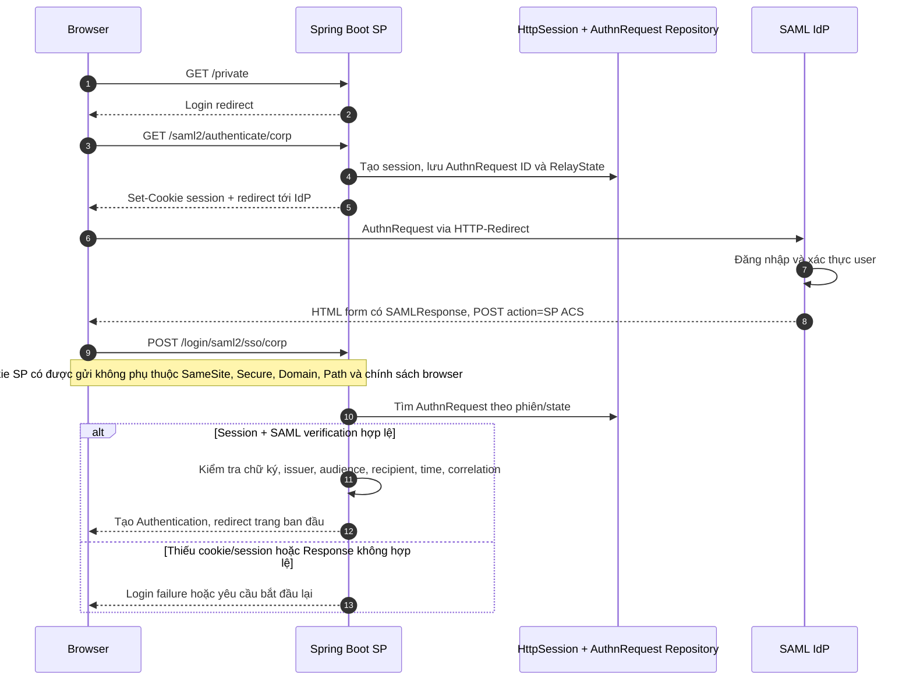

# Cookie Secure, HttpOnly, SameSite và phản hồi SAML qua HTTP-POST

## 1. Vì sao cookie phiên có thể làm hỏng SAML SSO dù SAMLResponse hợp lệ?

Trong Spring Security SAML 2.0 Web Browser SSO, ứng dụng Spring Boot là **Service Provider (SP)** hoặc *Relying Party*, còn hệ thống định danh là **Identity Provider (IdP)** hoặc *Asserting Party*. Một luồng SP-initiated phổ biến bắt đầu bằng việc ứng dụng tạo `AuthnRequest`, chuyển trình duyệt sang IdP và nhận `SAMLResponse` quay lại tại **Assertion Consumer Service (ACS)** qua **HTTP-POST binding**.

Nếu ứng dụng lưu yêu cầu đang chờ trong `HttpSession`, cookie phiên phải theo trình duyệt quay lại SP để nó tìm đúng yêu cầu. Nhưng callback từ IdP là một **form POST phát sinh từ website khác**, nên cơ chế cookie `SameSite` của browser có thể **không gửi cookie SP**. Kết quả: browser đã đăng nhập IdP thành công, XML SAMLResponse có vẻ hợp lệ, nhưng SP mất correlation state; nhiều hệ thống lại đưa người dùng về trang login hoặc báo `InResponseTo`/RelayState không khớp.

Vấn đề này không được giải quyết chỉ bằng cách “kiểm tra chữ ký SAML”. **Cookie, HTTP session, CSRF và SAML validation bảo vệ những ranh giới khác nhau**; mỗi tầng phải được xử lý đúng.

### Mục tiêu học tập

Sau bài này, người học có thể:

1. Giải thích chính xác tác dụng của `Secure`, `HttpOnly`, `SameSite=Strict/Lax/None`, `Domain` và `Path` đối với session cookie.
2. Phân biệt **same-origin** và **schemeful same-site**, dự đoán được callback SAML HTTP-POST có mang cookie hay không.
3. Hiểu vì sao repository mặc định `HttpSessionSaml2AuthenticationRequestRepository` cần browser gửi cookie phiên đúng lúc nhận `SAMLResponse`.
4. Cấu hình cookie session với `server.servlet.session.cookie.*` trong Spring Boot 3.x, và biết khi nào phải cấu hình `DefaultCookieSerializer` của Spring Session.
5. Xử lý đúng reverse proxy HTTPS, session store, SameSite, CSRF và request correlation mà không tắt kiểm tra bảo mật.
6. Debug bằng browser DevTools và negative tests; xác định lỗi cookie trước khi thay đổi SAML validators hoặc IdP metadata.

Bài học dùng Java 17+, Spring Boot 3.x và Spring Security 6.x; những ví dụ hostname chỉ mang tính giả định. Nhiều chi tiết API tương đương trong Spring Security đời mới, nhưng cần ghim release cụ thể khi triển khai.

## 2. Luồng SAML HTTP-POST nhìn từ browser và cookie

Giả sử SP ở **`https://app.sp-example.test`**, IdP ở **`https://login.idp-example.test`**. Đây là hai site khác nhau. SP có registration ID `corp` và dùng ACS mặc định:

```text
SP public host: https://app.sp-example.test
IdP public host: https://login.idp-example.test
SP start login: /saml2/authenticate/corp
SP ACS: /login/saml2/sso/corp
```

Sơ đồ sau phân tách request khởi tạo, nơi lưu AuthnRequest và callback:



Điều quan trọng: browser **không cần gửi cookie của IdP đến SP**. Browser cần gửi **cookie phiên của SP** mà SP đã đặt trước khi chuyển sang IdP. Cookie IdP thường chỉ được gửi khi browser liên lạc với IdP; hai bên có session riêng.

### Hai thông điệp khác nhau

- `SAMLRequest`: chứa yêu cầu xác thực do SP tạo, thường được chuyển tới IdP qua HTTP-Redirect binding.
- `SAMLResponse`: chứa phản hồi do IdP phát, thường được đưa vào HTML form mà browser POST đến ACS.

**HTTP-POST binding** ở đây là một HTML form POST thông thường, không phải `fetch()` AJAX mặc định, không phải HTTP webhook IdP gọi thẳng từ server. IdP có thể gửi HTML chứa form cho browser; chính browser quyết định có gửi các cookie phù hợp của SP hay không khi submit tới SP.

## 3. Set-Cookie và Cookie: hai chiều trao đổi

Server tạo cookie với response header:

```http
HTTP/1.1 302 Found
Location: https://login.idp-example.test/saml/sso?SAMLRequest=...
Set-Cookie: JSESSIONID=opaque-session-id; Path=/; Secure; HttpOnly; SameSite=None
```

Đây là **minh họa header**, không phải giá trị phiên dùng được. Sau này, nếu browser quyết định cookie phù hợp, nó gửi trên request tới SP:

```http
POST /login/saml2/sso/corp HTTP/1.1
Host: app.sp-example.test
Cookie: JSESSIONID=opaque-session-id
Content-Type: application/x-www-form-urlencoded

SAMLResponse=BASE64_ENCODED_XML&RelayState=OPAQUE_STATE
```

Các thuộc tính `Secure`, `HttpOnly`, `SameSite`, `Domain`, `Path` **không xuất hiện lại trong header `Cookie`**; chúng là quy tắc browser lưu sau khi nhận `Set-Cookie`. Vì thế nhìn server log `Cookie: JSESSIONID=...` **không biết được** cookie đã được set với SameSite/HttpOnly nào. Muốn kiểm tra cần xem **response `Set-Cookie`** và tab Application/Storage Cookies của browser.

Ngược lại, `SAMLResponse`/`RelayState` là **trường form**. Không được dùng chúng để thay cookie session; không nên ghi chúng vào log production hoặc issue tracker vì có thể chứa thông tin danh tính và dữ liệu liên hệ giao dịch.

## 4. Thuộc tính Secure: giới hạn cookie vào HTTPS

`Secure` yêu cầu browser chỉ gửi cookie tới kết nối HTTPS, với một số ngoại lệ localhost được browser hỗ trợ. Nó không tự **nâng cấp** một trang HTTP thành HTTPS và cũng không thay thế HSTS, TLS certificate, proxy configuration hay SAML XML Signature.

Ví dụ:

```http
Set-Cookie: JSESSIONID=opaque; Secure; HttpOnly; Path=/; SameSite=None
```

Trong production:

- Public SP URL và ACS nên dùng **HTTPS**, không HTTP.
- Browser phải thấy HTTPS ở URL của SP. Dù proxy kết nối tới Spring Boot bằng HTTP nội bộ, response cookie gửi tới browser vẫn nên có `Secure`.
- Với `SameSite=None`, browser hiện đại đòi `Secure`; cookie thiếu nó thường bị **từ chối lưu** hoặc bị bỏ.
- Nếu `Secure=true` trong môi trường local `http://127.0.0.1:8080`, kết quả có thể khác nhau theo localhost exceptions/browser. **Không** lấy kết quả localhost làm bằng chứng cấu hình production đúng; ưu tiên HTTPS local hoặc profile dev được thiết kế riêng.

`Secure` chỉ hạn chế vận chuyển cookie theo scheme. Nếu ứng dụng có XSS, kẻ tấn công có thể tạo request trong chính origin; Secure không thay CSRF protection, HttpOnly, Content Security Policy hoặc input/output encoding.

## 5. Thuộc tính HttpOnly: không cho JavaScript đọc session cookie

`HttpOnly` ngăn JavaScript đọc hoặc sửa cookie qua `document.cookie`. Ví dụ:

```http
Set-Cookie: JSESSIONID=opaque; Path=/; Secure; HttpOnly; SameSite=None
```

Nếu browser đang có cookie như trên:

- `document.cookie` không hiển thị `JSESSIONID`.
- Browser **vẫn tự đính cookie** với các request phù hợp từ navigation, form hoặc `fetch()` (nếu chính sách credentials/origin cho phép).
- `HttpOnly` **không chặn** việc gửi cookie trên SAML HTTP-POST callback. Vì thế không cần bỏ HttpOnly để “giúp IdP trả SAMLResponse”.
- HttpOnly làm giảm nguy cơ XSS đọc trộm session ID, nhưng XSS vẫn có thể thực hiện hành động từ ngữ cảnh cùng origin; không xem nó là biện pháp chống XSS toàn diện.

Một sai lầm thường gặp: frontend nói “không thấy cookie trong document.cookie” rồi kết luận session không tồn tại. Với HttpOnly, **đây là hành vi mong muốn**. Cần xem DevTools → Application → Cookies và Network → Request Headers mà không chia sẻ giá trị cookie.

## 6. SameSite: quyết định cookie có theo cross-site request hay không

`SameSite` là thuộc tính server gửi trong `Set-Cookie` để browser quyết định có đính cookie vào request bắt nguồn từ một **site khác** hay không.

| SameSite | Hành vi với request same-site | Cross-site top-level GET navigation | Cross-site top-level POST, ví dụ SAML HTTP-POST |
| --- | --- | --- | --- |
| **Strict** | Gửi cookie nếu các điều kiện khác đúng | Thông thường **không gửi** | **Không gửi** |
| **Lax** đặt tường minh | Gửi cookie | **Có thể gửi** vì top-level navigation dùng safe method | **Không gửi** vì POST không phải safe method |
| **None; Secure** | Gửi cookie | Có thể gửi | **Có thể gửi** nếu HTTPS/Domain/Path/browser policy đều cho phép |
| Không ghi SameSite | Browser áp dụng default riêng | Thường giống Lax | Có thể có hành vi ngoại lệ “Lax-allowing-unsafe” với cookie mới tạo ở một số browser; **không được dựa vào** |

Bảng mô tả trình duyệt hiện đại cho trường hợp **cross-site** thực sự, không gồm các chặn cookie bổ sung do privacy settings/enterprise policy. Chính sách trình duyệt thay đổi theo phiên bản; cần kiểm thử các browser mục tiêu.

**Hai điểm cần nhớ:**

1. **`SameSite=Lax` đặt rõ khác trường hợp không có `SameSite`**. Chromium và một số browser có cơ chế mặc định nhẹ tay hơn cho cookie mới tạo trong khoảng ngắn (ví dụ hai phút) khi server **không khai báo SameSite**. Đó không phải lời đảm bảo với `SameSite=Lax` tường minh, không phải chuẩn vận hành SAML được khuyến nghị.
2. `SameSite=None` nghĩa là **cho phép gửi cookie trong cross-site context** khi các điều kiện khác đúng; chữ “None” **không có nghĩa tắt cookie**. Browser vẫn có thể chặn vì domain/path/HTTPS, third-party cookie policy, partitioning hoặc người dùng tắt cookie.

Đừng dựa vào việc SSO “đôi lúc chạy trong hai phút đầu” để kết luận cấu hình cookie đúng: người dùng xác thực MFA lâu hơn, đổi tab hoặc browser khác có thể khiến luồng đột ngột hỏng.

## 7. Same-origin không đồng nghĩa same-site

**Origin** gồm `scheme + host + port`. **Site** trong cookie hiện đại thường dựa trên **scheme + registrable domain (eTLD+1)**; các subdomain cùng site có thể **khác origin**.

Ví dụ:

| A → B | Same-origin? | Same-site? | Nhận xét |
| --- | --- | --- | --- |
| `https://app.example.test` → `https://app.example.test` | Có | Có | Cùng origin/site |
| `https://login.example.test` → `https://app.example.test` | Không | Có | Hai subdomain nhưng cùng scheme và registrable domain |
| `https://login.idp-example.test` → `https://app.sp-example.test` | Không | Không | Hai registrable domains khác nhau |
| `http://app.example.test` → `https://app.example.test` | Không | Không trong schemeful same-site | Chỉ khác scheme vẫn có thể thành cross-site |
| `https://app.example.test:8443` → `https://app.example.test` | Không (khác port) | Thường có (port không định nghĩa site) | Cookie không phân biệt port theo cách origin |

SAML IdP/ SP thường ở hai domain khác nhau, nhưng **không phải mọi SAML callback đều cross-site**. Nếu `login.example.test` và `app.example.test` đều HTTPS, chúng có thể là same-site dù khác origin. `SameSite=Lax` không nhất thiết chặn POST trong trường hợp này. Vì vậy cần xác định **hai public hosts và scheme thực tế**, không suy luận chỉ từ từ “IdP khác SP”.

**Cross-origin CORS** là cơ chế khác: một HTML form POST điều hướng top-level thường không bị browser kiểm soát như AJAX `fetch()` theo CORS. Không thêm `Access-Control-Allow-Origin: *` để chữa lỗi SAML HTTP-POST callback. CORS không làm cookie Lax được gửi trong cross-site POST.

## 8. Vì sao HTTP-POST binding đặc biệt dễ lộ lỗi SameSite?

IdP có thể trả cho browser một trang HTML với form:

```html
<form method="post" action="https://app.sp-example.test/login/saml2/sso/corp">
  <input type="hidden" name="SAMLResponse" value="BASE64_ENCODED_SAML"/>
  <input type="hidden" name="RelayState" value="OPAQUE_STATE"/>
  <noscript><button type="submit">Continue</button></noscript>
</form>
<script>document.forms[0].submit();</script>
```

HTML trên là **minh họa binding**, không phải SAML message hợp lệ. Browser đang hiển thị trang ở **site IdP**, rồi submit form **POST** đến **site SP**. Nếu đây là một cross-site POST, cookie `SameSite=Lax`/`Strict` của SP thường bị giữ lại dù người dùng đang chủ động đăng nhập.

Trên một số hệ thống, IdP gửi AuthnRequest/Response theo binding khác. **HTTP-Redirect binding** dùng GET có quy tắc cookie khác; đừng vì một test Redirect/GET hoạt động mà kết luận HTTP-POST binding cũng hoạt động. Một số SAML profile có Artifact binding, POST kèm artifact và server-to-server retrieval; nếu dùng cần thiết kế riêng, không xem là thay đổi cookie flag đơn giản.

**Base64 không phải encryption.** `SAMLResponse` có thể chứa PII trong browser trước khi form submit. HTTPS bảo vệ đường truyền, XML Signature bảo vệ tính toàn vẹn/phát hành của phần được ký, còn SAML encryption dùng để che một số thuộc tính khỏi browser. Cookie flags không thay các chức năng đó.

## 9. Session cookie và HttpSessionSaml2AuthenticationRequestRepository

Spring Security SAML2 Servlet mặc định dùng **`HttpSessionSaml2AuthenticationRequestRepository`** để lưu `AbstractSaml2AuthenticationRequest`. Điều này phục vụ nhiều mục đích:

- Giữ request ID/registration/RelayState hoặc dữ liệu đủ để giải quyết callback.
- Liên hệ browser session đã bắt đầu SSO với response nhận về.
- Hỗ trợ defense-in-depth chống **login fixation**/login CSRF trong SP-initiated login.
- Loại bỏ hoặc consume giao dịch sau khi nhận response theo quy trình framework.

Luồng điển hình:

```text
GET /saml2/authenticate/corp:
    browser có hoặc nhận cookie phiên của SP
    SP lưu AuthnRequest trong HttpSession của phiên này
    SP đưa browser đến IdP

POST /login/saml2/sso/corp:
    browser quay lại với SAMLResponse
    SP nhìn cookie phiên để tìm HttpSession
    Spring Security lấy AuthnRequest đã lưu
    kiểm tra SAML Response và liên hệ InResponseTo/RelayState
    success => Authentication; failure => không tạo login
```

Nếu callback **không có cookie SP**, framework có thể nhìn thấy **session mới hoặc không có session**, dẫn đến không lấy được request đang chờ. Không được “sửa” bằng cách tự nhận SAML Response có chữ ký hợp lệ nhưng **bỏ `InResponseTo`/request correlation** khi chính sách chỉ cho SP-initiated.

### Hai repository không giống nhau

- `Saml2AuthenticationRequestRepository`: pending AuthnRequest **trước login**.
- `SecurityContextRepository`: giữ `Authentication` **sau login**.
- `RelyingPartyRegistrationRepository`: trust config/idp metadata, keys, ACS và Entity ID, không giữ AuthnRequest.
- `RequestCache`: saved URL quay về sau login, không chứa SAML AuthnRequest.

Một lỗi mất `AuthnRequest` không giống lỗi “đã xác thực nhưng request tiếp theo quên login”. Cả hai có thể liên quan cookie/session, nhưng phải tìm đúng nơi mất state.

## 10. Hiện tượng lỗi khi cookie bị chặn ở callback

Một kịch bản thực tế:

1. SP xử lý `GET /private`, redirect tới `/saml2/authenticate/corp`.
2. Server trả `Set-Cookie: JSESSIONID=...; SameSite=Lax; Secure; HttpOnly` và lưu request vào session.
3. Browser chuyển sang IdP khác site, người dùng nhập password/MFA.
4. IdP tự POST form `SAMLResponse` về SP ACS.
5. Browser **không gửi `JSESSIONID`** do explicit `SameSite=Lax` và phương thức là cross-site POST.
6. SP không tìm được original session/pending AuthnRequest.
7. Authentication thất bại, có thể log correlation error hoặc redirect lại IdP.

Các dấu hiệu:

- Browser Network thấy POST tới đúng ACS, có `SAMLResponse`.
- Request headers của POST **không có cookie session SP**.
- DevTools có thể đánh dấu cookie “excluded” với lý do `SameSite=Lax`/`Strict`.
- Server tạo session mới hoặc không tìm được state cũ, dẫn tới lỗi tương quan.
- Thử lại sau login nhanh có thể cho kết quả không nhất quán nếu cookie **không khai báo SameSite** và một browser có ngoại lệ ngắn hạn.

**Không chắc cứ mất cookie là lỗi duy nhất.** Nếu browser vẫn gửi cookie, cần kiểm tra session timeout, invalidation, load balancer, Spring Session backend, reverse proxy, cookie name/path/domain và AuthnRequest repository.

## 11. Quy tắc chọn SameSite cho phiên SAML

Không tồn tại một lựa chọn đúng tuyệt đối cho mọi mô hình. Hãy chọn theo mô hình redirect/POST thực tế, nguy cơ CSRF và browser được hỗ trợ.

| Mô hình | Khuyến nghị thực hành |
| --- | --- |
| SP/IdP cùng schemeful site; login HTTP-POST và session cookie gửi được | Có thể giữ `Lax` nếu test end-to-end xác nhận |
| SP/IdP **cross-site**, POST callback cần session-bound AuthnRequest | Xem xét `SameSite=None; Secure; HttpOnly` cho **cookie session cần thiết**, kết hợp CSRF và SAML validation |
| Ứng dụng không muốn gửi session cookie cross-site | Cần kiến trúc giữ/correlate AuthnRequest riêng được đánh giá bảo mật, không bỏ kiểm tra |
| Iframe/third-party embedded login | Có thêm hạn chế third-party cookies/partitioning; nên ưu tiên top-level login khi có thể |
| SP có nhiều domain/tenant | Thống nhất public host, cookie Domain/Path, routing và registration cho từng origin |
| Bắt buộc `SameSite=Strict` vì chính sách tổ chức | Cần thiết kế thay thế session request lookup; đánh giá login fixation và khả năng IdP-initiated |

**Khi cần `None`**, đừng tắt `HttpOnly` hoặc `Secure`. Nếu giữ session cookie ở `SameSite=None`, bảo vệ bổ sung CSRF, kiểm tra Origin/Referer trong phạm vi phù hợp, token anti-CSRF cho endpoint nghiệp vụ và CSP/XSS defense trở nên đặc biệt quan trọng.

Một lựa chọn nâng cao là tách cookie session phục vụ authentication handshake khỏi session nghiệp vụ, nhưng việc này đòi hỏi kiến trúc cookie/repository và threat model cụ thể; không tự tạo “cookie RelayState” không ký rồi coi là tương đương session-bound validation.

## 12. Spring Boot 3.x: cấu hình session cookie ở application.yml

Spring Boot cung cấp `server.servlet.session.cookie.same-site` cùng `secure`/`http-only`. Ví dụ cho **môi trường production HTTPS với SP/IdP cross-site và HTTP-POST binding**:

```yaml
server:
  forward-headers-strategy: framework
  servlet:
    session:
      timeout: 20m
      cookie:
        name: JSESSIONID
        secure: true
        http-only: true
        same-site: "none"
        path: "/"

spring:
  security:
    saml2:
      relyingparty:
        registration:
          corp:
            assertingparty:
              metadata-uri: "${SAML_IDP_METADATA_URI}"
```

Cấu hình có các tác dụng:

- `cookie.secure: true`: cookie phiên phải mang `Secure`.
- `cookie.http-only: true`: không cho JavaScript đọc session ID.
- `cookie.same-site: "none"`: cho phép browser gửi cookie trên cross-site POST nếu các điều kiện khác thỏa.
- `cookie.path: "/"`: cookie áp dụng cho cả endpoint khởi tạo login và ACS nằm dưới root. Trong app deploy dưới context path, xem xét phạm vi hẹp nhất phù hợp.
- `session.timeout: 20m`: thời gian chờ phiên **ví dụ**, phải phù hợp cả thời gian MFA/login thực tế và chính sách bảo mật.
- `forward-headers-strategy: framework`: app có thể nhận biết public HTTPS origin từ **trusted proxy**; chỉ dùng khi reverse proxy loại bỏ/ghi đè forwarded headers từ Internet.
- `SAML_IDP_METADATA_URI`: một vị trí metadata của IdP được cấu hình tin cậy, không cho user HTTP tùy ý cung cấp.

**Không coi đoạn YAML là cấu hình SAML đầy đủ cho mọi IdP.** SP Entity ID, ACS public URL, certificate verification, ký AuthnRequest nếu IdP yêu cầu, và metadata provider phải đúng. URL ví dụ `https://login.idp-example.test/metadata` không thể dùng để đăng nhập thực.

Spring Boot 3.5 documentation xác nhận `server.servlet.session.cookie.same-site` hỗ trợ trong auto-configured Tomcat, Jetty và Undertow, đồng thời có thể dùng cho Spring Session auto-configured servlet repository. Nếu ứng dụng tự thêm `CookieSerializer` hoặc container/session configuration tùy chỉnh, hãy **đọc `Set-Cookie` thực tế** để xác minh giá trị nào thắng, thay vì giả định YAML luôn quyết định.

### Tách production và development

Một cấu hình an toàn thường đặt các giá trị **production cookie** trong profile môi trường chính thức:

```yaml
# application-prod.yml: ví dụ dành cho public HTTPS.
server:
  servlet:
    session:
      cookie:
        secure: true
        http-only: true
        same-site: "none"
```

Nếu development chạy HTTP thuần, `Secure` có thể gây lỗi gửi cookie. Ưu tiên HTTPS dev (ví dụ reverse proxy hoặc certificate local hợp lệ). Nếu chọn tạm khác để debug, phải giới hạn **chỉ ở dev profile**, không commit cấu hình giảm bảo vệ vào production. Test SAML callback cross-site nên thực hiện với public HTTPS hoặc test domains phản ánh đúng schemeful-site thực tế, không chỉ localhost.

## 13. Ví dụ Spring Boot Servlet hoàn chỉnh để quan sát SAML session

Dự án Spring Boot 3.x/Spring Security 6.x, Java 17+. Trong `build.gradle` của dự án **đã có plugins Java/Spring Boot và dependency management tương thích**, thêm:

```groovy
repositories {
    mavenCentral()
    // Một số bộ OpenSAML cần Shibboleth release repository.
    maven { url "https://build.shibboleth.net/maven/releases/" }
}

dependencies {
    implementation "org.springframework.boot:spring-boot-starter-web"
    implementation "org.springframework.boot:spring-boot-starter-security"
    implementation "org.springframework.security:spring-security-saml2-service-provider"
}
```

Đây là **mảnh file Gradle**, không phải `build.gradle` độc lập. Không ép version OpenSAML tùy tiện; chọn phiên bản tương thích với Spring Security release đang dùng.

Lưu tại `src/main/java/demo/cookies/SamlCookieApplication.java`:

```java
package demo.cookies;

import java.util.Map;

import org.springframework.boot.SpringApplication;
import org.springframework.boot.autoconfigure.SpringBootApplication;
import org.springframework.context.annotation.Bean;
import org.springframework.security.config.Customizer;
import org.springframework.security.config.annotation.web.builders.HttpSecurity;
import org.springframework.security.core.annotation.AuthenticationPrincipal;
import org.springframework.security.saml2.provider.service.authentication.Saml2AuthenticatedPrincipal;
import org.springframework.security.web.SecurityFilterChain;
import org.springframework.web.bind.annotation.GetMapping;
import org.springframework.web.bind.annotation.RestController;

@SpringBootApplication
@RestController
public class SamlCookieApplication {

    public static void main(String[] args) {
        SpringApplication.run(SamlCookieApplication.class, args);
    }

    @Bean
    SecurityFilterChain securityFilterChain(HttpSecurity http) throws Exception {
        return http
                .authorizeHttpRequests(auth -> auth
                        .requestMatchers("/", "/error").permitAll()
                        .anyRequest().authenticated())
                .saml2Login(Customizer.withDefaults())
                .build();
    }

    @GetMapping("/")
    public String home() {
        return "SAML cookie demo: open /private";
    }

    @GetMapping("/private")
    public Map<String, String> privateEndpoint(
            @AuthenticationPrincipal Saml2AuthenticatedPrincipal user) {
        return Map.of(
                "registration", user.getRelyingPartyRegistrationId(),
                "subject", user.getName());
    }
}
```

Code intentionally **không có controller nhận `/login/saml2/sso/corp`**. Spring Security tạo `Saml2WebSsoAuthenticationFilter` để xử lý ACS. Cookie session không phải do controller tự set, mà do servlet container hoặc Spring Session ghi theo cấu hình.

Để chạy trong dự án Gradle đã có wrapper, IdP sandbox, public HTTPS/metadata/ACS tương ứng:

```bash
SAML_IDP_METADATA_URI=https://login.idp-example.test/metadata ./gradlew bootRun
```

Địa chỉ `login.idp-example.test` là placeholder, nên không có stdout login xác định. Khi IdP thực xác minh thành công, `GET /private` trả JSON chứa `registration` và `subject` tương ứng user thật. Phải bảo vệ hoặc bỏ endpoint demo in NameID trước production vì đó có thể là dữ liệu nhận dạng.

Nếu một cookie HTTP-only được set, không thấy nó trong `document.cookie` là **đúng thiết kế**; hãy quan sát trực tiếp response headers và browser cookie storage.

### Vì sao không nên tự set session cookie trong controller?

Không nên gọi:

```java
// Anti-pattern: không thực hiện trong ứng dụng thực.
response.addHeader("Set-Cookie",
        "JSESSIONID=hard-coded-id; SameSite=None; Secure");
```

Đoạn minh họa này không có class/import và không dành để chạy. Nó có thể tạo cookie session khác với container, thiếu HttpOnly, sai session ID hoặc xung đột SessionRepository; cũng không tạo session phía server. **Hãy để container/Spring Session quản lý session ID**, đặt thuộc tính qua cơ chế chính thức.

## 14. Nếu dùng Spring Session: ai ghi cookie, và cách tùy biến

Khi dùng Spring Session (ví dụ Redis-backed sessions), ứng dụng có thể thấy session cookie tên `SESSION` thay vì `JSESSIONID` tùy cách cấu hình. `Spring Session DefaultCookieSerializer` có các thuộc tính `sameSite`, `useSecureCookie`, `useHttpOnlyCookie`, `cookieName` và `cookiePath`. Mặc định tài liệu Spring Session mô tả `SameSite=Lax` nếu không cấu hình khác.

Nếu dự án đã có Spring Session và cần tùy biến serializer, một bean minh họa (không dùng song song với một serializer khác):

```java
package demo.cookies;

import org.springframework.context.annotation.Bean;
import org.springframework.context.annotation.Configuration;
import org.springframework.session.web.http.CookieSerializer;
import org.springframework.session.web.http.DefaultCookieSerializer;

@Configuration
public class SessionCookieConfiguration {

    @Bean
    CookieSerializer cookieSerializer() {
        DefaultCookieSerializer serializer = new DefaultCookieSerializer();
        serializer.setCookieName("SESSION");
        serializer.setCookiePath("/");
        serializer.setUseSecureCookie(true);
        serializer.setUseHttpOnlyCookie(true);
        serializer.setSameSite("None");
        return serializer;
    }
}
```

Class ở trên **biên dịch khi đã thêm Spring Session vào dự án**. Nó **không tự bật Redis hoặc thay thế HTTP session store**; ứng dụng cần dependency/Redis connection và `SessionRepository` đúng. Nếu chỉ dùng Servlet container session mặc định, hãy dùng `server.servlet.session.cookie.*` ở mục 12, không thêm Spring Session chỉ để đổi SameSite.

**Cảnh báo về cấu hình trùng:** Spring Boot có hỗ trợ cấu hình SameSite cho session cookie, bao gồm auto-configured Spring Session. Nhưng một custom `CookieSerializer` có thể ghi đè một phần hành vi. Không đoán cookie tên gì hoặc SameSite ra sao; hãy xem `Set-Cookie` thực tế trên response từ SP và xác định đúng component đang ghi nó.

### Các lỗi Spring Session không liên quan cookie flags

- Redis/session store mất kết nối hoặc key hết TTL sớm.
- Các pod dùng serialization không tương thích.
- Session ID bị đổi/invalidate ở một bước login, ứng dụng lưu state không đúng lifecycle.
- Keyspace/namespace session bị trùng giữa môi trường.
- Cookie tên `SESSION` bị khác so với cấu hình load balancer/proxy.

Đổi SameSite sang None **không** giải quyết các lỗi backend như vậy. Cần kiểm tra cookie được gửi **và** server có thể tìm đúng dữ liệu trong session store.

## 15. Multi-replica: cookie đúng vẫn có thể mất AuthnRequest

Mô hình:

```text
Browser -- HTTPS --> Load Balancer
                          |
                 +--------+--------+
                 |                 |
              SP pod A          SP pod B
                 |                 |
                 +---- Session ----+
                       Store?
```

Nếu SP khởi tạo `AuthnRequest` ở pod A, rồi callback POST SAMLResponse được load balancer chuyển sang pod B, mà `HttpSession` chỉ tồn tại trong RAM pod A, thì dù browser **đã gửi cookie đúng**, pod B có thể không tìm được request.

Lựa chọn:

1. **Spring Session / shared session store** giữa mọi replica: thường thích hợp cho session-bound SSO, giúp giữ lợi thế correlation với browser session.
2. **Sticky session**: gắn browser với một pod trong thời gian login, nhưng phải biết khi rolling deployment, pod restart hoặc failover thì vẫn có thể mất state.
3. **Repository SAML riêng có backend phân tán**: cần kiểm tra security tradeoff, TTL/consume-once và correlation, không chỉ chọn Redis theo thói quen.

Để phân biệt, kiểm tra:

- Browser POST ACS có gửi `SESSION`/`JSESSIONID` không?
- Session ID đó có tồn tại trong đúng store/namespace không?
- Pod nhận callback có truy cập đúng session store không?
- AuthnRequest đã được ghi vào session trước khi chuyển browser sang IdP chưa?
- Session timeout/MFA dài hay multi-tab đã làm thay đổi request state chưa?

Nếu cookie có trên network request nhưng repository load null, vấn đề không nhất thiết là `SameSite`.

## 16. Reverse proxy, TLS termination và forwarded headers

Một ingress phổ biến kết thúc TLS:

```text
Browser --- HTTPS ---> https://app.sp-example.test
                              |
                        Trusted proxy
                              |
                       HTTP internal hop
                              |
                        Spring Boot :8080
```

Nếu Spring Boot chỉ thấy request nội bộ `http://app-service:8080`, `request.isSecure()` và URL base được suy ra có thể sai. Điều này ảnh hưởng:

- Việc có đặt cookie `Secure` nếu hệ thống tự suy luận theo request.
- Giá trị public `{baseUrl}` dùng trong ACS/metadata/redirect.
- `Destination`, `Recipient` và chứng thực URL của SAML Response.
- Redirect HTTP↔HTTPS và đường callback sau ingress.

Cấu hình mẫu:

```yaml
server:
  forward-headers-strategy: framework
  servlet:
    session:
      cookie:
        secure: true
        http-only: true
        same-site: "none"
```

`forward-headers-strategy: framework` chỉ nên dùng khi proxy **xóa hoặc ghi đè** `Forwarded`, `X-Forwarded-Proto`, `X-Forwarded-Host` và các header tương tự từ client Internet. Nếu backend trực tiếp tin header attacker tự đặt, có thể bị host-header poisoning hoặc sai URL metadata. Không expose backend công khai nếu nó tin forwarded headers.

**Bật Secure không sửa ACS sai URL.** Hãy kiểm tra riêng metadata SP công bố public HTTPS ACS, IdP đăng ký đúng URL, ingress forward POST đúng path và validator `Destination`/`Recipient` không bị vô hiệu hóa.

## 17. Domain, Path, host-only cookie và tên cookie

`SameSite=None` không bảo đảm cookie được gửi nếu `Domain` hoặc `Path` không khớp.

### 17.1. Domain

Nếu response đặt:

```http
Set-Cookie: JSESSIONID=opaque; Path=/; Secure; HttpOnly; SameSite=None
```

không có `Domain` thì cookie là **host-only**, chỉ gửi tới host đã đặt cookie (ví dụ `app.sp-example.test`). Đây thường là cấu hình tốt cho session của một SP.

Nếu đặt `Domain=sp-example.test`, cookie có thể được gửi tới các subdomain `*.sp-example.test` phù hợp. Phạm vi này rộng hơn và có thể làm tăng rủi ro session fixation/cookie injection từ subdomain ít tin cậy. **Không đặt Domain rộng hơn chỉ để “dùng chung cookie” khi SAML IdP ở domain khác**: một SP không thể tùy tiện đặt cookie cho domain IdP, và cũng không cần làm vậy.

### 17.2. Path

Cookie `Path=/app` được gửi tới `/app/...`, không gửi tới `/login/saml2/sso/corp` ở root nếu path không khớp. Với ứng dụng chạy dưới context path `/portal`, đường public ACS có thể là `/portal/login/saml2/sso/corp` và Path cookie nên tương thích context đó.

Để debug:

- Network request tới `/saml2/authenticate/corp` có cookie?
- Server trả `Set-Cookie` từ host nào, path nào?
- Callback URL có cùng host và path thuộc phạm vi cookie không?
- Có cookie cũ trùng tên nhưng khác Domain/Path không?
- Load balancer rewrite route trước khi tới Spring khiến cookie path và request path không phù hợp?

**Path không phải cơ chế bảo mật cách ly ứng dụng mạnh**; không dùng nó thay phân tách host và session namespaces.

### 17.3. Cookie prefix

Với cookie chỉ dành cho một host, các browser hỗ trợ prefix **`__Host-`** yêu cầu `Secure`, `Path=/` và **không có Domain**. Prefix **`__Secure-`** yêu cầu `Secure` từ HTTPS. Đây là biện pháp defense-in-depth chống một số lỗi cookie scope/overwrite, không tự thay SameSite/CSRF.

Không đổi tên session cookie thành `__Host-JSESSIONID` mà quên đồng bộ Spring Session/container config, proxy và test logout. Các prefix chỉ có giá trị nếu browser và tất cả thành phần ghi cookie tuân thủ quy tắc.

## 18. SameSite=None không thay thế CSRF protection

Với `SameSite=None`, browser có thể gửi session cookie trong **nhiều cross-site POST hơn**. Điều này cần thiết với một số SAML HTTP-POST callbacks, nhưng cũng khiến các endpoint nghiệp vụ dùng cookie session dễ nhận cross-site requests hơn.

Phải phân biệt:

1. **SAML ACS** là protocol endpoint nhận HTML form POST từ IdP. IdP **không có CSRF token của SP**. Spring Security SAML2 cần xử lý ACS theo flow SAML, thông thường qua matcher/CSRF exclusion được cấu hình đúng cho route protocol. Việc không dùng CSRF token web form truyền thống ở ACS phải được bù bằng **SAML signature, issuer, audience, destination, subject confirmation, request correlation, time và replay policy**.
2. **API/form nghiệp vụ** như `POST /api/orders/approve` vẫn cần CSRF token khi dựa vào session cookie browser, dù ứng dụng đã bật SAML SSO.
3. **Logout** cũng có nguy cơ logout CSRF: Spring Security mặc định yêu cầu POST/CSRF token cho local logout khi CSRF protection bật.

Nếu thay processing URL ACS thành `/saml/acs/corp`, cần xác minh filter và CSRF request matcher tương thích. Không chỉ đổi `RelyingPartyRegistration.assertionConsumerServiceLocation` rồi giả định filter và CSRF rules tự thay toàn bộ.

### Ví dụ ngoại lệ chỉ cho ACS tùy chỉnh (khi thực sự cần)

Một mảnh DSL chỉ để giải thích phạm vi, **không phải cấu hình bắt buộc cho flow mặc định**:

```java
.csrf(csrf -> csrf
        .ignoringRequestMatchers("/saml/acs/**"))
```

Đây là **đoạn thêm vào `HttpSecurity`** sau khi bạn đã cấu hình đúng `saml2Login.loginProcessingUrl("/saml/acs/{registrationId}")`. Nó chỉ minh họa việc giới hạn ngoại lệ chính xác cho protocol endpoint. Khi Spring Security đã tạo CSRF exception SAML phù hợp, không nên bổ sung rule trùng; hãy kiểm tra phiên bản và endpoint thực tế. Đừng đưa `/api/**` vào phạm vi ignore.

**Sai nghiêm trọng:**

```java
// Không dùng chỉ để khắc phục ACS 403:
.csrf(csrf -> csrf.disable())
```

Tắt CSRF toàn bộ để giúp callback SAML chạy có thể làm lộ các hành động có side effect sử dụng cookie session, đặc biệt khi `SameSite=None`.

## 19. Session fixation, login CSRF và rủi ro khi bỏ HttpSession

Một số nhóm chọn giữ `SameSite=Strict`/`Lax` vì security policy và giải quyết lỗi callback bằng cách **đổi repository**:

- `HttpSessionSaml2AuthenticationRequestRepository`: lookup request theo session của browser đang giao dịch.
- `CacheSaml2AuthenticationRequestRepository`: có thể tra theo `RelayState`/giao dịch mà không phụ thuộc session cookie như phương án session-bound; có hỗ trợ trong Spring Security đời mới.

Spring Security docs nhấn mạnh **lợi ích bảo mật của việc lưu AuthnRequest trong HttpSession**, đặc biệt việc liên hệ response với chính browser đã khởi tạo login. Nếu attacker đưa một SAML Response hợp lệ của chính họ cho nạn nhân, session-bound correlation có thể chặn việc nạn nhân vô tình đăng nhập vào tài khoản attacker — một dạng **login fixation/login CSRF**.

Với cache repo tra bằng state/ID nhưng không ràng buộc browser, SP có thể biết một AuthnRequest từng tồn tại mà **không chứng minh browser callback là browser khởi tạo request**. Vì vậy:

- Không xem chuyển từ session sang cache là thay thế **bảo mật tương đương**.
- Nếu dùng cache, cần state có entropy cao, TTL, one-time consume/replay, issuer+registration checks và biện pháp browser binding theo threat model.
- Cache trong memory cục bộ **không tự** hỗ trợ multi-replica; cần backend phân tán và atomic operations phù hợp.
- Không tắt `InResponseTo`, signature, destination, audience hoặc unsolicited-response policy chỉ để “làm SSO chạy”.

Nếu tổ chức chỉ cho phép SP-initiated login, **mất AuthnRequest phải fail-closed**, chứ không tự chuyển thành IdP-initiated/unsolicited login.

## 20. Cẩn thận với iframe, third-party cookies và CHIPS

Nhiều SAML login truyền thống dùng **top-level browser navigation**: browser rời SP, vào IdP rồi POST trở về SP. Tình huống này khác với việc nhúng IdP trong `<iframe>`.

Trong iframe/embedded flow, browser có thể áp dụng thêm:

- Chặn third-party cookies độc lập với SameSite.
- Privacy/enterprise policy về tracking protection.
- Storage partitioning hoặc cookie `Partitioned` (CHIPS) tùy browser.
- CSP `frame-ancestors` và `X-Frame-Options` chặn nhúng login.
- Chính sách IdP cấm đăng nhập trong iframe hoặc yêu cầu top-level interaction.

**`SameSite=None; Secure` không đảm bảo third-party cookie luôn hoạt động trong iframe.** Partitioned cookies không tự giải quyết SAML AuthnRequest correlation nếu top-level site đổi giữa các bước hoặc kho cookie bị chia partition. Khi có lựa chọn, **top-level login SAML** thường đơn giản và ít phụ thuộc third-party cookie hơn.

Không thay đổi `frame-ancestors` thành `*` chỉ để iframe login, vì sẽ tăng clickjacking risk; giải pháp phải được đánh giá theo kiến trúc và chính sách của IdP.

## 21. Chẩn đoán bằng Chrome/Edge/Firefox DevTools

### Bước 1: xác định hai site thật

Ghi lại (không cần chia sẻ secret):

- Host/scheme public SP ở lúc khởi tạo `AuthnRequest`.
- Host/scheme IdP nơi browser nhận HTML form.
- Host/scheme/path ACS trong form action và metadata.
- Có context path hoặc reverse proxy rewrite không.

Nếu hai origin khác nhau nhưng cùng site, `Lax` có thể vẫn hoạt động; không đổi `None` theo thói quen khi chưa kiểm tra.

### Bước 2: xem Set-Cookie lúc khởi tạo

Ở Network tab, tìm response SP tạo/duy trì session trước redirect IdP. Xem **Response Headers**:

```http
Set-Cookie: JSESSIONID=<redacted>; Path=/; Secure; HttpOnly; SameSite=Lax
```

Giá trị trên đã được redact để minh họa. Ghi nhận thuộc tính **không ghi session ID** vào ticket công khai. Xem browser có báo cookie bị **blocked/rejected** ngay khi set không, ví dụ `SameSite=None` thiếu Secure hoặc Domain không hợp lệ.

### Bước 3: xem POST ACS

Trong Network, lọc `/login/saml2/sso/corp` (hoặc custom ACS) và xác nhận:

- Method là POST.
- Request URL là public HTTPS ACS đã đăng ký.
- Request mang form field `SAMLResponse`, có thể `RelayState`.
- Browser gửi **session cookie SP** hay bị đánh dấu **Excluded** vì SameSite/Path/Domain/Secure.
- HTTP status là gì; có redirect loop, 404/405/403 không.
- Nếu request có cookie, SP server có giải quyết session hay không.

**Không xuất HAR có chứa raw SAMLResponse, cookies, authorization headers và NameID** lên website bên ngoài. Browser HAR cần được scrub/redact trước khi chia sẻ nội bộ.

### Bước 4: đối chiếu server state

Nếu callback không mang cookie, kiểm tra SameSite/HTTPS/cookie scope trước.

Nếu callback có cookie nhưng authentication thất bại, kiểm tra:

- Session timeout hoặc bị invalidate.
- Session store/Redis unavailable.
- Pod A tạo session, Pod B không nhìn thấy.
- `Saml2AuthenticationRequestRepository` bị custom không dùng cùng kho.
- Multi-tab login ghi đè pending request.
- `InResponseTo`/issuer/audience/destination/replay validation lỗi thật.

**Không kết luận từ một HTTP 302** rằng SAML login thành công: 302 cũng có thể chuyển về login?error. Thử một resource protected sau callback và xem `Authentication` thực sự.

## 22. Ma trận test theo cookie và browser

| Test | Thiết lập | Kết quả quan sát/kỳ vọng |
| --- | --- | --- |
| A | IdP/SP khác site, `SameSite=Lax` explicit, HTTP-POST ACS | Cookie SP thường không gửi; có thể thiếu request state |
| B | Khác site, `SameSite=Strict`, HTTP-POST ACS | Cookie SP không gửi |
| C | Khác site, `SameSite=None; Secure; HttpOnly`, HTTPS | Cookie **có thể** được gửi nếu Domain/Path/privacy/session phù hợp |
| D | `SameSite=None` nhưng không Secure | Browser hiện đại thường từ chối set cookie |
| E | SameSite=Lax, IdP và SP thật sự cùng schemeful site | POST có thể mang cookie vì same-site |
| F | Khác site nhưng IdP dùng redirect GET về một endpoint hợp lệ | Cookie Lax có thể được gửi với top-level safe navigation; **khác SAML HTTP-POST** |
| G | Cookie có trên ACS request nhưng pod khác không đọc session | Vẫn thất bại; cần shared session/sticky routing |
| H | Cookie không có do `Path=/portal`, ACS ngoài `/portal` | Vẫn thất bại dù SameSite=None |
| I | Cookie secure nhưng SP public request là HTTP | Browser không gửi cookie trong tình huống không có ngoại lệ |
| J | `SameSite=None`, API nghiệp vụ POST không có CSRF token | CSRF filter chặn theo policy; không vì SAML mà bỏ CSRF |
| K | `HttpOnly` bật; JavaScript đọc `document.cookie` | Không thấy session cookie; browser vẫn có thể gửi trên network |
| L | IdP/ SP dùng iframe thay top-level navigation | Có thể bị chặn bởi third-party cookie/frame policy |
| M | Callback không có AuthnRequest tương ứng | Fail-closed theo SP-initiated policy |
| N | Callback có state nhưng chữ ký/issuer/audience sai | SAML validation từ chối; cookie đúng không “cứu” được |
| O | Cùng user đăng nhập trong hai tab, callbacks đảo thứ tự | Không nhầm transaction; behavior phụ thuộc repository/version |
| P | Session cookie đổi ID sau login thành công | Có thể là session fixation protection; cần phân biệt với mất session trước callback |

Các bài test cookie cần thực hiện với browser mục tiêu vì Safari/Firefox/Chromium hoặc chính sách privacy doanh nghiệp có thể khác nhau. Không dùng một browser phiên bản duy nhất làm chứng minh toàn bộ người dùng sẽ đăng nhập được.

## 23. Java 17 độc lập: mô phỏng logic SameSite cho một callback POST

Để ghi nhớ logic mà **không phụ thuộc IdP thật**, chương trình Java sau mô phỏng trường hợp cụ thể: một **cross-site top-level HTTP-POST** về SP, cookie được cấu hình tường minh, và chỉ xét `SameSite` cùng HTTPS/`Secure`. Nó **không phải browser engine** nên cố ý bỏ qua Domain/Path, ITP, cookie partitioning, ngoại lệ khi thiếu SameSite và session store.

Lưu file `SameSitePostDemo.java`:

```java
public final class SameSitePostDemo {

    enum SameSite { STRICT, LAX, NONE }

    static boolean sendsOnCrossSitePost(
            SameSite sameSite, boolean secureFlag, boolean https) {
        // Model simplified: modern SameSite=None requires Secure.
        return sameSite == SameSite.NONE && secureFlag && https;
    }

    public static void main(String[] args) {
        System.out.println("Strict=" +
                sendsOnCrossSitePost(SameSite.STRICT, true, true));
        System.out.println("Lax=" +
                sendsOnCrossSitePost(SameSite.LAX, true, true));
        System.out.println("NoneSecureHttps=" +
                sendsOnCrossSitePost(SameSite.NONE, true, true));
        System.out.println("NoneWithoutSecure=" +
                sendsOnCrossSitePost(SameSite.NONE, false, true));
        System.out.println("NoneOverHttp=" +
                sendsOnCrossSitePost(SameSite.NONE, true, false));
    }
}
```

Biên dịch/chạy Java 17+:

```bash
javac SameSitePostDemo.java
java SameSitePostDemo
```

Stdout chính xác:

```text
Strict=false
Lax=false
NoneSecureHttps=true
NoneWithoutSecure=false
NoneOverHttp=false
```

Mục đích demo là quy tắc **explicit SameSite** cho **cross-site POST** và ràng buộc `Secure`. Nó **không** bảo đảm cookie sẽ được browser gửi trong mọi môi trường khi kết quả là `true`: còn Domain/Path/expiry/privacy policy. `HttpOnly` không tham gia phép quyết định cookie có được gửi trên POST hay không, nên không có tham số HttpOnly trong hàm.

## 24. Những anti-pattern cần tránh

| Anti-pattern | Vì sao sai | Cách xử lý |
| --- | --- | --- |
| Bỏ `HttpOnly` để SAMLResponse gửi được cookie | HttpOnly không ngăn browser gửi cookie | Giữ HttpOnly và debug SameSite/Domain/Path |
| Đặt `SameSite=None` nhưng không có `Secure` | Browser thường từ chối cookie | Dùng HTTPS và Secure |
| Tắt `csrf` toàn app vì ACS bị 403 | Mở nguy cơ CSRF trên form/API nghiệp vụ | Cấu hình CSRF matcher hẹp, giữ SAML validators |
| Bỏ `InResponseTo`/RelayState check khi mất session | Mở login fixation/unsolicited login | Khắc phục cookie/session hoặc thiết kế flow riêng |
| Dùng `Saml2AuthenticationRequestRepository` trong Map static ở pod | State mất khi callback vào pod khác | Shared session/cache có thẩm định |
| Dùng email từ SAMLResponse làm session ID | Dữ liệu danh tính không phải session secret | Để container/Spring Session sinh session ID |
| Mở `Domain=.example.test` cho mọi subdomain không cần thiết | Mở rộng khả năng cookie overwrite/injection | Host-only cookie là mặc định nên ưu tiên |
| Cho rằng cross-origin là cross-site | Nhầm cùng eTLD+1 và scheme | Xác định schemeful site |
| Dựa vào ngoại lệ cookie dưới hai phút | Không ổn định/browser-specific | Set explicit policy và test đủ thời gian MFA |
| Đổi sang HTTP dev rồi kết luận Secure cookie lỗi | HTTPS requirement là tính năng bảo mật | Test HTTPS local/prod-like |
| Bỏ Destination/Recipient validation khi ACS khác public host | Che lỗi proxy/IdP metadata | Sửa forwarded headers và metadata |
| Log raw SAMLResponse/cookie để debug | Rò PII và state có thể bị lạm dụng | Redact và log nhóm nguyên nhân |
| Bật SameSite=None nhưng xem nó là anti-CSRF | None cho phép cross-site cookie | CSRF token và session security riêng |
| Dùng `fetch` CORS config để sửa HTML form SAML POST | Không đúng lớp giao thức | Debug cookie và form navigation |
| Dùng cookie prefix không hợp lệ `__Host-` có Domain | Browser có thể từ chối cookie | Đúng Secure, Path=/, không Domain |
| Coi browser gửi cookie là đủ chứng minh SAML hợp lệ | Session là một tầng, message có thể giả | Validate signature/issuer/audience/correlation/replay |

## 25. Checklist triển khai an toàn

- [ ] SP/IdP public scheme và registrable domains đã được phân loại same-site/cross-site.
- [ ] Login dùng binding HTTP-POST hay Redirect/Artifact được xác nhận từ IdP metadata và browser trace.
- [ ] Cookie session do container hoặc Spring Session ghi đã được xác định đúng tên.
- [ ] Cookie session có `Secure`, `HttpOnly`; `SameSite` được đặt **tường minh** theo threat model.
- [ ] Với cross-site SAML HTTP-POST cần session, `SameSite=None; Secure` đã được cân nhắc và test thực tế.
- [ ] Cookie `Domain` là phạm vi hẹp nhất, `Path` bao gồm login initiation và ACS.
- [ ] Public SP/ACS chạy HTTPS; reverse proxy forwarded headers được trust đúng phạm vi.
- [ ] `HttpSessionSaml2AuthenticationRequestRepository`/request state được duy trì từ AuthnRequest tới callback.
- [ ] Multi-replica có shared session hoặc cơ chế state an toàn; không trông chờ sticky một cách mù quáng.
- [ ] Session timeout bao phủ MFA/login thực tế nhưng không quá dài.
- [ ] SAML validation giữ chữ ký, issuer, recipient, destination, audience, time, correlation và replay defense.
- [ ] IdP-initiated login có policy riêng; không tự chấp nhận unsolicited response khi mất session.
- [ ] CSRF được giữ cho API/form nghiệp vụ; SAML ACS dùng xử lý protocol hẹp.
- [ ] Không tắt CSRF toàn app khi SameSite=None.
- [ ] Cookie prefix/partitioning/iframe restrictions chỉ áp dụng khi đã xác minh khả năng browser.
- [ ] Browser DevTools xác nhận Set-Cookie và POST ACS Cookie headers, có redaction dữ liệu.
- [ ] Negative tests với SameSite=Lax/Strict/None, thiếu Secure, sai Path, hết session và nhiều pod đã chạy.
- [ ] Không ghi log SAMLResponse, RelayState, session cookie, NameID, private key hoặc ID Token.
- [ ] Sau login đã xác minh session authenticated thực, không chỉ nhìn HTTP 302.
- [ ] Tài liệu vận hành chỉ rõ thành phần tạo cookie, nơi lưu session và trách nhiệm quản trị IdP/SP.

## 26. Câu hỏi tự đánh giá

**1. Vì sao SAMLResponse HTTP-POST khác một HTTP GET redirect về mặt cookie?**  
Vì `SameSite=Lax` cho phép cookie ở một số top-level cross-site GET (safe navigation), nhưng thông thường **không** cho cookie ở cross-site POST. HTTP-POST binding khiến vấn đề trở nên rõ ràng.

**2. `HttpOnly` có chặn browser gửi session cookie tới ACS không?**  
Không. Nó ngăn JavaScript truy cập `document.cookie`, còn browser vẫn gửi cookie khi request đáp ứng các điều kiện cookie.

**3. `SameSite=None` có nghĩa là vô hiệu hóa cookie không?**  
Không. Nó cho phép cookie trong cross-site contexts, thường phải đi cùng `Secure` và HTTPS.

**4. Nếu cookie không gửi dù SameSite=None; Secure, kiểm tra gì tiếp?**  
Domain/Path, expiry, browser privacy policy, block/rejected reason, iframe/partitioning và public HTTPS scheme.

**5. Một POST ACS có `SAMLResponse` hợp lệ nhưng không có cookie session có thể gây lỗi gì?**  
`HttpSessionSaml2AuthenticationRequestRepository` có thể không tìm thấy AuthnRequest đã lưu, khiến SP-initiated correlation thất bại.

**6. Có thể bỏ `InResponseTo` nếu chữ ký IdP đúng không?**  
Không nên với SP-initiated. Chữ ký chứng minh IdP, còn correlation chứng minh response thuộc giao dịch/browser đã khởi tạo; bỏ có thể dẫn tới login fixation/session confusion.

**7. Hai host `login.example.test` và `app.example.test` đều HTTPS có phải cross-site không?**  
Không nhất thiết; nếu cùng registrable domain và scheme thì có thể **same-site** dù khác origin.

**8. Spring Boot đặt SameSite session cookie bằng property nào?**  
`server.servlet.session.cookie.same-site`, ví dụ `"none"`, đi cùng `secure: true` và `http-only: true` theo chính sách.

**9. Khi dùng Spring Session, có thể tùy biến SameSite ở đâu?**  
Qua auto-configured Boot session property hoặc `DefaultCookieSerializer#setSameSite(...)` được cấu hình nhất quán; phải xem `Set-Cookie` thực tế để biết component nào áp dụng.

**10. Cookie có trong POST nhưng vẫn mất AuthnRequest trên Kubernetes?**  
Có thể do request tạo session ở pod A nhưng callback đến pod B không dùng shared session hoặc repository; không quy mọi lỗi thành SameSite.

**11. Nếu đặt SameSite=None thì còn cần CSRF token cho POST nghiệp vụ không?**  
Có, đặc biệt khi browser gửi session cookie cross-site. Ngoại lệ của SAML protocol endpoint không thay bảo vệ CSRF cho API nghiệp vụ.

**12. Chỉ thấy HTTP 302 sau ACS có chứng minh login thành công không?**  
Không. Cần xem redirect tới success hay error và truy cập tài nguyên protected để xác nhận `Authentication`.

## 27. Tài liệu chuẩn

- [Spring Security – SAML 2.0 Login Overview](https://docs.spring.io/spring-security/reference/servlet/saml2/login/overview.html): Web Browser SSO, `AuthnRequest` và HTTP-POST `SAMLResponse` callback.
- [Spring Security – Producing AuthnRequests](https://docs.spring.io/spring-security/reference/servlet/saml2/login/authentication-requests.html): `HttpSessionSaml2AuthenticationRequestRepository` mặc định, tùy chọn cache và đánh đổi login fixation.
- [Spring Security – Authenticating SAML Responses](https://docs.spring.io/spring-security/reference/servlet/saml2/login/authentication.html): tiếp nhận SAMLResponse, authentication provider, signature/validation.
- [Spring Boot 3.5 – SameSite Cookies](https://docs.spring.io/spring-boot/3.5/reference/web/servlet.html): `server.servlet.session.cookie.same-site`, servlet container/Spring Session support và cookie configuration.
- [Spring Boot 3.5 – Common Application Properties](https://docs.spring.io/spring-boot/3.5/appendix/application-properties/): `server.servlet.session.cookie.secure`, `http-only`, `same-site`, `path`, `domain`.
- [Spring Session – Custom Cookie](https://docs.spring.io/spring-session/reference/guides/java-custom-cookie.html): `DefaultCookieSerializer`, tên cookie, `SameSite`/`Secure`/`HttpOnly` và cookie scope.
- [Spring Security – CSRF Protection](https://docs.spring.io/spring-security/reference/servlet/exploits/csrf.html): CSRF cho browser session, login/logout và cách cấu hình phạm vi bảo vệ.
- [MDN – Set-Cookie](https://developer.mozilla.org/en-US/docs/Web/HTTP/Reference/Headers/Set-Cookie): ngữ nghĩa Secure, HttpOnly, SameSite, Domain, Path, Lax-allowing-unsafe.
- [MDN – Using HTTP Cookies](https://developer.mozilla.org/en-US/docs/Web/HTTP/Guides/Cookies): schemeful same-site, scope và các giới hạn browser.
- [MDN – Secure Cookie Configuration](https://developer.mozilla.org/en-US/docs/Web/Security/Practical_implementation_guides/Cookies): nguyên tắc bảo vệ session cookie và host-only prefixes.
- [OWASP – Session Management Cheat Sheet](https://cheatsheetseries.owasp.org/cheatsheets/Session_Management_Cheat_Sheet.html): session ID, cookie flags, fixation và lifecycle.
- [OWASP – Cross-Site Request Forgery Prevention Cheat Sheet](https://cheatsheetseries.owasp.org/cheatsheets/Cross-Site_Request_Forgery_Prevention_Cheat_Sheet.html): CSRF tokens, SameSite as defense-in-depth và safe method behavior.
- [OASIS – SAML 2.0 Bindings](https://docs.oasis-open.org/security/saml/v2.0/saml-bindings-2.0-os.pdf): HTTP-POST binding, browser relay và Base64 encoding.
