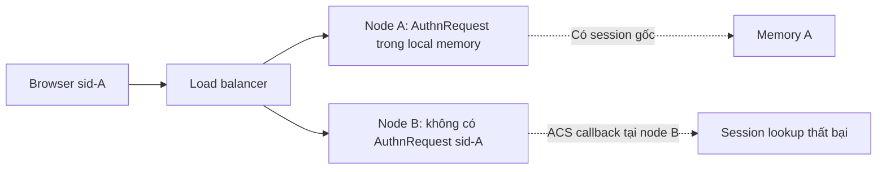
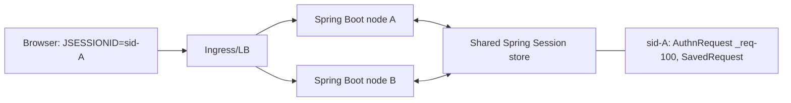

# Mất phiên khi quay lại từ IdP và ảnh hưởng đến AuthnRequest đã lưu

## Mục tiêu học tập

Sau bài học này, bạn có thể:

1. Diễn giải chính xác luồng **SP-initiated SAML2 Web Browser SSO** từ khi ứng dụng phát `AuthnRequest` đến khi nhận `SAMLResponse` ở **Assertion Consumer Service (ACS)**.
2. Phân biệt **AuthnRequest đã lưu**, **SavedRequest của trang được bảo vệ**, **phiên HTTP của SP**, **SSO session của IdP**, và **SecurityContext sau đăng nhập**.
3. Giải thích vì sao cookie phiên SP có thể **không được trình duyệt gửi kèm POST từ IdP về ACS**, đặc biệt do `SameSite=Lax`/`Strict`, `Secure`, `Domain`, `Path` và trình duyệt.
4. Nhận biết tác động khi session cũ không được tìm thấy: mất `Saml2AuthenticationRequestRepository` state, không chứng minh được response đang thuộc đúng AuthnRequest, lỗi `InResponseTo`/`RelayState` hoặc nguy cơ nhận một unsolicited response không phù hợp chính sách.
5. Chẩn đoán nguyên nhân phía trình duyệt, reverse proxy, cân bằng tải, session store, thời gian hết hạn, nhiều tab và cấu hình Spring Security.
6. Cấu hình một ví dụ Spring Boot 3/Spring Security 6 an toàn cho SAML2, sử dụng đúng session cookie và giữ **request correlation**; phân biệt với phương án cache-based repository có trade-off bảo mật.
7. Kiểm thử bằng DevTools/trace đã khử nhạy cảm và một chương trình Java 17+ độc lập cho thấy **mất ràng buộc phiên phải fail closed**.

## 1. Vấn đề điển hình: IdP báo thành công nhưng SP vẫn không đăng nhập

Người dùng mở `https://portal.example.org/reports` khi chưa có phiên ứng dụng. Spring Security chuyển browser tới IdP `https://login.partner.example/sso`. Người dùng đăng nhập, IdP trả SAMLResponse hợp lệ về mặt chữ ký, nhưng ứng dụng lại hiện “Authentication failed”, quay vòng đăng nhập hoặc yêu cầu login lại.

Một nguyên nhân quan trọng là: **khi phát `AuthnRequest`, SP đã lưu thông tin giao dịch trong một `HttpSession`; khi browser POST `SAMLResponse` về ACS, cookie chỉ tới session ấy không được gửi hoặc session server-side không còn.** SP vì vậy không đọc lại được AuthnRequest mà chính nó đã phát.

Điều này khác với việc “IdP quên người dùng” hay “SAML XML hỏng”. Người dùng có thể vẫn có **SSO session IdP hợp lệ**, IdP có thể ký đúng response, nhưng **SP không còn state để gắn phản hồi với request của đúng browser**.

**Điểm cần nhớ:** một SAMLResponse hợp lệ về chữ ký **không đồng nghĩa** nó là phản hồi của lần đăng nhập do browser hiện tại đã yêu cầu. Request correlation còn phục vụ phòng vệ **login CSRF**, **login fixation** và nhầm lẫn giữa các giao dịch/IdP.

### 1.1. Bốn loại trạng thái phải phân biệt

| Trạng thái | Thường nằm ở đâu? | Mục đích | Mất nó gây điều gì? |
| --- | --- | --- | --- |
| **`HttpSession` của SP trước login** | Server SP/session store, browser giữ cookie session ID | Liên kết browser với dữ liệu tạm của giao dịch đăng nhập | SP có thể không tìm được AuthnRequest và saved request |
| **`Saml2AuthenticationRequestRepository`** | Mặc định `HttpSessionSaml2AuthenticationRequestRepository` | Lưu `AbstractSaml2AuthenticationRequest` để tra lại khi ACS nhận response | Không đối chiếu được thông tin request đã phát với browser |
| **`RequestCache` / SavedRequest** | Thường là `HttpSessionRequestCache` trong session SP | Nhớ URL ban đầu như `/reports` để quay lại sau login | Có thể mất đường redirect mong muốn, **không nhất thiết đồng nghĩa** lỗi SAML authentication |
| **`SecurityContext` sau login** | Thường lưu trong session ứng dụng | Duy trì `Saml2Authentication` giữa các HTTP requests | Browser có thể bị xem là anonymous ở request tiếp theo |
| **IdP SSO session** | Cookie/session trên domain của IdP | Nhớ người dùng đã xác thực tại IdP | Có thể khiến IdP hỏi login lại hoặc ngược lại tự login rất nhanh |
| **`RelayState`** | Tham số SAML binding; có thể được SP dùng để đối chiếu state | Liên hệ luồng theo cách thư viện thiết kế | Một giá trị RelayState được trả về **không thay thế** kiểm request/session và chữ ký |

**AuthnRequest** và **SavedRequest** đều có thể nằm trong cùng HttpSession, nhưng mang **ý nghĩa hoàn toàn khác nhau**: cái thứ nhất để bảo vệ giao dịch **SAML authentication**, cái thứ hai để cải thiện trải nghiệm quay về trang đã mở.

## 2. Đường đi chuẩn của một đăng nhập SP-initiated

Giả định:

- SP/RP: `https://portal.example.org`.
- Đăng ký SAML của Spring Security: `registrationId=company`.
- IdP/AP: `https://idp.company-id.example/sso`.
- Tài nguyên bảo vệ: `GET /reports`.
- Endpoint tạo AuthnRequest: `GET /saml2/authenticate/company`.
- ACS: `POST /login/saml2/sso/company`.
- Browser đã được SP cấp session ID `sid-A` trước khi redirect ra IdP.

```mermaid
sequenceDiagram
    actor User as Người dùng
    participant Browser as Trình duyệt
    participant SP as SP/Spring Security
    participant Store as Session Store
    participant IdP as IdP
    User->>Browser: Mở /reports
    Browser->>SP: GET /reports (anonymous)
    SP-->>Browser: 302 tới /saml2/authenticate/company
    Browser->>SP: GET /saml2/authenticate/company
    SP->>SP: Tạo AuthnRequest ID=_req-100 và RelayState
    SP->>Store: Lưu AuthnRequest thuộc HttpSession sid-A
    SP-->>Browser: Set-Cookie sid-A; redirect tới IdP
    Browser->>IdP: SAMLRequest, RelayState
    IdP->>User: Xác thực hoặc dùng IdP SSO session
    User->>IdP: Hoàn tất login
    IdP-->>Browser: HTML form chứa Base64 SAMLResponse
    Browser->>SP: POST ACS + SAMLResponse + RelayState + cookie sid-A
    SP->>Store: Dựa vào sid-A, lấy AuthnRequest _req-100
    Store-->>SP: AuthnRequest đã lưu
    SP->>SP: Verify signature, issuer, conditions, InResponseTo
    SP->>SP: Tạo Authentication và session ứng dụng
    SP-->>Browser: 302 quay lại /reports (nếu SavedRequest tồn tại)
    Browser->>SP: GET /reports + app cookie
    SP-->>Browser: 200 nếu authentication và quyền hợp lệ
```

Luồng thực tế phụ thuộc binding/profile và version. Thông thường **AuthnRequest đi qua HTTP-Redirect** còn **SAMLResponse đi qua form HTTP-POST**. IdP có thể có thêm login, MFA, captcha, redirect nội bộ hay consent. Browser không cần hiểu chữ ký SAML; đó là trách nhiệm của SP.

### 2.1. Session ID trong hai thời điểm

**Trước khi chuyển sang IdP:**

```http
GET /saml2/authenticate/company HTTP/1.1
Host: portal.example.org
Cookie: JSESSIONID=sid-A
```

SP lưu `AuthnRequest(_req-100)` vào session `sid-A`. Phản hồi từ SP đến browser có thể chứa `Set-Cookie` nếu session vừa được tạo:

```http
HTTP/1.1 302 Found
Set-Cookie: JSESSIONID=sid-A; Path=/; Secure; HttpOnly; SameSite=None
Location: https://idp.company-id.example/sso?SAMLRequest=...&RelayState=...
```

Giá trị `sid-A`, `_req-100` và URL là **fixture minh họa**, không phải cookie hoặc transaction thật. `SameSite=None` chỉ là lựa chọn ví dụ cho kiến trúc cần cookie trên cross-site POST; **không phải khuyến cáo bắt buộc cho mọi ứng dụng**.

**Khi IdP trả về ACS:**

```http
POST /login/saml2/sso/company HTTP/1.1
Host: portal.example.org
Content-Type: application/x-www-form-urlencoded
Cookie: JSESSIONID=sid-A

SAMLResponse=BASE64_XML&RelayState=opaque-value
```

SP phải nhận diện đúng phiên `sid-A`, đọc request ID `_req-100` trong repository, rồi so với `InResponseTo`/conditions tương ứng của response. Nó cũng phải xác minh **signature, issuer, audience, recipient, destination, time conditions** và các điều kiện SAML khác; không chỉ so request ID.

## 3. Spring Security lưu AuthnRequest ở đâu?

Trong Spring Security SAML2 Servlet, hai thành phần đáng chú ý là:

- `Saml2WebSsoAuthenticationRequestFilter`: xử lý endpoint tạo AuthnRequest (`/saml2/authenticate/{registrationId}`); tạo, ký khi cần, encode và phát request đi IdP.
- `Saml2WebSsoAuthenticationFilter`: nhận SAMLResponse tại ACS (`/login/saml2/sso/{registrationId}`), chuyển request cho authentication converter/manager.

Giữa chúng có **`Saml2AuthenticationRequestRepository<AbstractSaml2AuthenticationRequest>`**.

Spring Security mặc định dùng **`HttpSessionSaml2AuthenticationRequestRepository`** để lưu `AbstractSaml2AuthenticationRequest` trong `HttpSession` của browser. Khi ACS quay về, `Saml2AuthenticationTokenConverter`/SAML filter sử dụng repository để **load/remove** request đã lưu theo luồng.

### 3.1. Thông tin cần liên hệ khi response về

Một `AbstractSaml2AuthenticationRequest` có các thông tin như:

- **`getId()`**: ID của AuthnRequest đã phát, ví dụ `_req-100`.
- **`getRelayState()`**: state opaque gắn với request theo binding.
- **`getRelyingPartyRegistrationId()`**: registration tương ứng, ví dụ `company`.
- **`getAuthenticationRequestUri()`**: endpoint IdP nhận request.
- **`getBinding()`**: binding gửi request, ví dụ Redirect hoặc POST.
- **`getSamlRequest()`**: payload AuthnRequest đã được encode theo binding.

Không phải mục nào cũng cần kiểm soát bằng business code; framework dùng dữ liệu đó để bảo đảm response được xử lý trong **ngữ cảnh tin cậy phù hợp**. Quan trọng nhất khi xử lý sự cố là **request đã lưu trước khi sang IdP phải còn truy xuất được tại thời điểm quay lại**.

### 3.2. Vì sao không chỉ dựa vào `InResponseTo` hoặc `RelayState`?

Giả sử attacker tự khởi tạo login ở máy mình, lấy AuthnRequest `_req-attacker` rồi gửi SAMLResponse tương ứng cho browser nạn nhân. Nếu SP chỉ tra một kho request toàn cục bằng `InResponseTo` hoặc `RelayState` mà không ràng buộc với đúng browser/session, nó có thể biết “ứng dụng đã tạo request này”, nhưng **không biết request đó được tạo cho browser hiện tại**.

**Session-bound repository** làm cho việc liên kết này tự nhiên hơn: request được tìm trong **phiên SP của browser đang nhận response**. Nếu thiếu phiên, ta không nên tự đi tìm trong mọi session khác và gán kết quả cho browser. Một kho lưu cache độc lập có thể có giá trị trong kiến trúc đặc biệt, nhưng phải hiểu **trade-off login fixation** và thiết kế thêm ràng buộc bảo mật.

### 3.3. Nếu AuthnRequest biến mất, có chắc Spring Security luôn báo lỗi không?

**Không nên khẳng định một thông báo hoặc trạng thái HTTP cố định.** Kết quả phụ thuộc version của Spring Security/OpenSAML, cấu hình repository, response validator và chính sách hỗ trợ **IdP-initiated/unsolicited responses**.

Tình huống có thể xảy ra:

1. Converter/provider không tìm được request hoặc correlation không hợp lệ nên **authentication fail**.
2. Một tích hợp cho phép unsolicited response có thể đi nhánh khác và **không kiểm được `InResponseTo` như SP-initiated chuẩn**; đây là vấn đề an ninh cần được đánh giá, không thể mặc nhiên coi là cách khắc phục hợp lệ.
3. Nếu response vẫn được chấp nhận nhưng **SavedRequest mất**, người dùng có thể về trang mặc định thay vì `/reports`.
4. Nếu `SecurityContext` không được lưu sau login, lần GET sau đó vẫn bị anonymous và có thể tạo **login loop**.

Vì vậy, cần quan sát cả **repository state**, **validation outcome**, **cookie/session ID** và **handler điều hướng**. Không nên suy từ một màn hình lỗi mà kết luận ngay rằng lỗi chữ ký hay mất cookie.

## 4. Khi cookie không được gửi kèm cross-site POST

Đây là nguyên nhân thường gặp nhất đối với SAML2 SSO sử dụng HTTP-POST binding qua hai **site** khác nhau.

### 4.1. `SameSite` hoạt động ra sao?

Một cookie có `SameSite` kiểm soát liệu browser có gửi cookie đó khi request phát sinh từ ngữ cảnh khác site hay không. Site không đồng nghĩa origin; chính sách hiện đại thường xét **scheme và registrable domain**. Hai hostname có thể khác origin nhưng vẫn cùng site; ngược lại IdP với domain khác có thể là cross-site.

| Cookie | Cross-site **top-level GET** | Cross-site **POST** IdP → ACS | Ý nghĩa với SAML |
| --- | --- | --- | --- |
| `SameSite=Strict` | Thông thường **không gửi** khi từ site khác điều hướng đến | **Không gửi** | Có thể mất session khi rời IdP rồi quay lại SP |
| `SameSite=Lax` | Thông thường gửi với top-level navigation dùng phương thức safe | Thông thường **không gửi** | SP nhận POST ACS mà không có cookie phiên |
| `SameSite=None; Secure` | Có thể gửi nếu cookie/browser policy cho phép | Có thể gửi nếu cookie/browser policy cho phép | Thường phù hợp khi cần duy trì session trên cross-site POST, nhưng tăng bề mặt cross-site và phải đánh giá CSRF |
| Không khai báo `SameSite` | Tùy browser và chính sách mặc định | **Không ổn định**, nhiều browser áp Lax mặc định | Không dựa vào default hoặc giả định mọi browser giống nhau |

**Ngoại lệ cần biết:** một số trình duyệt có cơ chế Lax mặc định nới lỏng cho một số POST **ngay sau khi cookie mới được tạo** (ví dụ khoảng thời gian rất ngắn). Điều này **không phải hợp đồng ổn định**. Đăng nhập nhanh có thể tình cờ hoạt động trong khi người dùng MFA chậm lại thất bại. Không thiết kế dựa trên ngoại lệ thời gian đó.

### 4.2. Minh họa mất cookie ở ACS

```mermaid
sequenceDiagram
    participant Browser as Browser
    participant SP as SP
    participant Store as Session Store
    participant IdP as IdP
    Browser->>SP: GET /saml2/authenticate/company
    SP->>Store: Lưu AuthnRequest _req-100 vào sid-A
    SP-->>Browser: Set-Cookie sid-A; SameSite=Lax; redirect
    Browser->>IdP: AuthnRequest
    IdP-->>Browser: Form HTTP-POST đến ACS
    Note over Browser,SP: Cross-site POST: cookie SameSite=Lax có thể bị loại
    Browser->>SP: POST ACS + SAMLResponse (KHÔNG có sid-A)
    SP->>Store: Không thể truy xuất session gốc
    Store-->>SP: Không có AuthnRequest _req-100 trong session hiện tại
    SP-->>Browser: Login failure/handling theo chính sách
```

Browser có thể lưu cookie `sid-A` trong kho cookie **nhưng cố ý không gửi** nó ở request POST cụ thể. Vì vậy khác nhau giữa:

- “Cookie không tồn tại trên browser”.
- “Cookie tồn tại nhưng không được gửi vì SameSite/Secure/Domain/Path/policy”.
- “Cookie được gửi nhưng SP không còn session tương ứng”.
- “Session đúng vẫn còn nhưng request repository đã mất/đã remove AuthnRequest”.

Cần chẩn đoán từng trường hợp, không nói chung là “hỏng cookie”.

### 4.3. `Secure`, `HttpOnly`, `Domain`, `Path` và HTTPS

| Thuộc tính | Nếu cấu hình sai | Cách xác minh |
| --- | --- | --- |
| **`Secure`** | Cookie Secure không đi qua HTTP; `SameSite=None` thường phải có `Secure` mới được browser chấp nhận | Toàn bộ public SSO flow phải chạy HTTPS; proxy phải báo đúng external scheme |
| **`Domain`** | Cookie host-only/Domain không khớp hostname ACS | So chính xác host public của endpoint phát cookie và host ACS |
| **`Path`** | Cookie cấp ở `/portal` có thể không đi vào `/login/saml2/sso/company` nếu đường ACS nằm ngoài path | So Path cookie với external request path/context path |
| **`HttpOnly`** | Không ảnh hưởng việc browser gửi cookie trong HTTP; hạn chế JavaScript đọc cookie | Giữ `HttpOnly` cho session cookie; không bỏ nó để “sửa SAML” |
| **Expires/Max-Age** | Cookie đã hết hạn hoặc bị xóa trước callback | Kiểm thời điểm tạo/hết hạn và browser storage |
| **SameSite** | Cookie bị chặn ở cross-site POST dù còn hạn | Kiểm request ACS, mục “Cookies” và blocked/excluded reason trên DevTools |

**Nếu IdP và SP là hai subdomain của cùng registrable domain với cùng scheme**, một số request có thể được xem same-site dù vẫn cross-origin. Vì vậy không thể chỉ nhìn “khác hostname” là kết luận SameSite sẽ chặn. Phải dựa vào **site context thực tế và thông tin browser**.

## 5. Những nguyên nhân mất phiên khác ngoài SameSite

### 5.1. Session hết hạn trước khi IdP quay về

User dừng lâu ở trang IdP để nhập MFA, yêu cầu phê duyệt hoặc xử lý SSO. Nếu SP session timeout ngắn, `HttpSession` chứa AuthnRequest có thể hết hạn trước callback.

Triệu chứng:

- Các login hoàn tất nhanh thành công; login/MFA chậm thường thất bại.
- Cookie được browser gửi đúng nhưng server trả session mới/không thấy AuthnRequest.
- Session store log cho thấy expiration ở khoảng thời gian IdP login.

Khắc phục:

- Thiết lập session timeout có tính đến thời gian xác thực thực tế, **không kéo dài vô hạn**.
- Cân nhắc repository riêng có TTL ngắn và phù hợp bảo mật nếu kiến trúc yêu cầu.
- Khi hết hạn, **khởi tạo AuthnRequest mới** thay vì tái sử dụng SAMLResponse cũ hoặc bỏ kiểm trạng thái.
- Đồng bộ đồng hồ server/IdP; đồng hồ sai còn gây lỗi SAML `NotBefore`/`NotOnOrAfter` độc lập với session expiry.

### 5.2. Cân bằng tải và nhiều instance

`sid-A` được node **A** tạo và giữ trong bộ nhớ. Khi browser POST ACS, load balancer chuyển tới node **B**. B thấy cookie `sid-A` nhưng **không có dữ liệu session**.



Giải pháp:

- Dùng **shared session store** (ví dụ Spring Session Redis/JDBC) để cả A và B thấy state, cấu hình serialization/version/TTL nhất quán.
- Nếu tạm dùng **sticky session**, cần kiểm callback trở lại đúng node; sticky routing có thể mất khi rolling deployment, cookie affinity hết hạn hoặc node chết.
- Đồng bộ cookie name/path/secure/key giữa replicas; không để mỗi instance dùng một context path tùy ý.
- Với rolling deployments, giữ compatibility cho data structure của request trong session hoặc có kế hoạch drain/in-flight logins.
- Lưu ý **dùng Redis cho session không sửa được việc browser không gửi cookie**. Phải giải quyết cả cookie transport và session distribution.

### 5.3. Restart, redeploy, session eviction

- Tomcat/Jetty session trong memory có thể biến mất khi restart tùy setup.
- Redis/JDBC TTL hoặc cache eviction có thể xóa session trước khi IdP phản hồi.
- Thay session namespace/serialization khi deploy có thể khiến session cũ không đọc được.
- Store không reachable hoặc cluster bị split có thể khiến callback không tìm request.

Cách xử lý: quan sát session creation/expiry, store health, replication, TTL, release rollout và số in-flight SSO requests. Không giải quyết bằng cách tự nhận mọi response không có matching request.

### 5.4. Browser xóa hoặc cách ly cookie

- Người dùng xóa cookie, dùng cửa sổ ẩn danh khác, đổi profile/browser hoặc ngăn cookie.
- Chính sách privacy/enterprise browser chặn cookies trong một số ngữ cảnh.
- Ứng dụng mở SSO trong iframe/popup có thể chịu chính sách cookie khác top-level navigation.
- ACS dùng hostname khác `portal.example.org` (ví dụ `sso.portal.example.org`) mà cookie host-only không áp dụng.

Việc login được khởi tạo ở browser/profile A và kết thúc ở browser/profile B **không nên** tự gán kết quả vào session B. Đây là ràng buộc bảo mật, không phải lỗi cần bỏ qua.

### 5.5. Session fixation protection và thay session ID

Spring Security có thể **đổi session ID sau authentication thành công** để chống session fixation. Đây là hành vi bảo mật bình thường. Không kết luận “mất phiên” chỉ vì cookie trước login `sid-A` và cookie sau login `sid-B` khác nhau.

Hãy so:

1. Tại **thời điểm phát AuthnRequest** có session nào?
2. Tại **thời điểm POST ACS trước khi xác thực** server có thể đọc session/request đã lưu không?
3. Chỉ sau khi SAML authentication thành công, session ID có được rotate và security context có tồn tại ở request tiếp theo không?

Nếu ID đổi **trước khi** đọc correlation state, cần tìm nguyên nhân cụ thể (filter/custom code/session strategy) chứ không tắt toàn bộ session fixation protection.

### 5.6. Nhiều tab, nhiều login flow và request bị ghi đè

User mở cùng lúc hai tab, chọn hai IdP hoặc liên tục nhấn đăng nhập. Một implementation request repository có thể lưu/match một hoặc nhiều giao dịch tùy phiên bản; không giả định mọi thiết kế session repository có thể giữ vô hạn các AuthnRequest song song.

Rủi ro:

- AuthnRequest mới thay thế request cũ trong cùng session.
- Response từ tab A quay lại sau khi tab B phát request.
- `InResponseTo` trỏ ID của A nhưng repository đang giữ thông tin B.
- User gửi lại form POST cũ sau khi request đã được consume/remove.

Cần test concurrency theo repository/library version đang chạy. Nếu sản phẩm phải hỗ trợ login song song, thiết kế **state keyed by opaque IDs** với transaction isolation và browser binding an toàn, TTL, one-time consume; không bỏ request correlation.

## 6. RelayState, InResponseTo và AuthnRequest: liên hệ thế nào?

### 6.1. Ba giá trị có chức năng riêng

| Giá trị | Bên tạo/đặt | Mục đích | Không được suy ra |
| --- | --- | --- | --- |
| **`AuthnRequest.ID`** | SP tạo khi phát login request | Định danh request do SP gửi | Không chứng minh browser hiện tại đã tạo request chỉ nhờ ID |
| **`Response.InResponseTo`** hoặc SubjectConfirmationData.InResponseTo | IdP phản hồi theo request | Liên hệ SAMLResponse/Assertion với request gốc | Không thay thế session binding/chữ ký/trust |
| **`RelayState`** | SP phát theo binding, IdP phản hồi lại khi áp dụng | Opaque state; có thể giúp thư viện tìm giao dịch | Không phải credential hoặc URL redirect mặc nhiên đáng tin |
| **`JSESSIONID`** | Container/SP cấp cookie cho browser | Tìm `HttpSession`/request đã lưu của browser | Không chứng minh user đã đăng nhập hoặc IdP response hợp lệ |

**Một response đúng `InResponseTo` nhưng không được gắn với session/request hợp lệ vẫn chưa đủ.** Có thể có giao dịch do attacker tạo ở browser khác. Ngược lại, một session có AuthnRequest nhưng SAMLResponse sai issuer/audience/chữ ký vẫn phải bị từ chối.

### 6.2. Điều gì xảy ra nếu chỉ kiểm một trường?

- **Chỉ `RelayState` khớp:** attacker có thể tạo/copy opaque state trong một số mô hình; không chứng minh trust của assertion.
- **Chỉ chữ ký XML hợp lệ:** IdP có thể đã ký assertion dành cho SP hoặc browser khác; vẫn cần audience, recipient, time, request correlation.
- **Chỉ `InResponseTo` khớp một request trong cache toàn cục:** biết app từng phát request, nhưng không biết **browser đang nộp response có sở hữu giao dịch đó**.
- **Chỉ có cookie session:** cookie chỉ giúp tìm state; không xác minh IdP, SAMLResponse, status hoặc quyền.
- **Chỉ user đã có IdP SSO cookie:** SP vẫn phải xác thực response và tạo phiên cục bộ.

### 6.3. IdP-initiated SSO không phải “bản sửa” cho mất session

Trong **IdP-initiated/unsolicited SAML SSO**, response có thể đến mà không có AuthnRequest do SP vừa phát. Loại flow này có **thiết kế và threat model riêng**, thường khó ràng buộc browser login intent hơn SP-initiated.

Không bật chấp nhận unsolicited responses hoặc tắt `InResponseTo`/request validator chỉ vì SameSite đang chặn cookie. Nếu kiến trúc cần IdP-initiated, phải có phê duyệt threat model, login CSRF controls, issuer/audience/recipient validation và chính sách riêng.

## 7. Ví dụ Spring Boot 3 + Spring Security 6: giữ session trong cross-site POST

Đây là **mẫu tích hợp Spring MVC/Servlet** với Java 17+, một IdP và HTTP-POST SAMLResponse. Nó không phải ứng dụng hoàn chỉnh chỉ cần copy là đăng nhập được: cần IdP thật, certificate được thẩm định, SP entityId/ACS đúng và thư viện phù hợp.

### 7.1. Dependencies

Với `build.gradle` trong dự án đã dùng Spring Boot 3.x plugin/BOM:

```groovy
dependencies {
    implementation 'org.springframework.boot:spring-boot-starter-web'
    implementation 'org.springframework.boot:spring-boot-starter-security'
    implementation 'org.springframework.security:spring-security-saml2-service-provider'

    testImplementation 'org.springframework.boot:spring-boot-starter-test'
    testImplementation 'org.springframework.security:spring-security-test'
}
```

OpenSAML là dependency bên dưới Spring Security SAML2. Cần repositories và versions tương thích BOM; đừng ép thủ công OpenSAML version khác chỉ để sửa lỗi session/cookie.

### 7.2. `application.yml`

Ví dụ môi trường **bắt buộc gửi session cookie tại cross-site ACS POST** và đã đánh giá rủi ro CSRF:

```yaml
server:
  servlet:
    session:
      timeout: 20m
      cookie:
        http-only: true
        secure: true
        same-site: none

spring:
  security:
    saml2:
      relyingparty:
        registration:
          company:
            entity-id: "https://portal.example.org/saml2/service-provider-metadata/company"
            acs:
              location: "https://portal.example.org/login/saml2/sso/company"
            assertingparty:
              entity-id: "https://idp.company-id.example/saml"
              verification:
                credentials:
                  - certificate-location: "classpath:idp-signing.crt"
              singlesignon:
                url: "https://idp.company-id.example/sso"
                sign-request: false
```

**Giải thích các giá trị quan trọng:**

1. `server.servlet.session.cookie.same-site: none` yêu cầu server đặt `SameSite=None` để browser có thể gửi cookie trong cross-site POST **khi chính sách browser cho phép**; không tự xử lý nếu browser chặn cookies theo policy khác.
2. `secure: true` tương thích yêu cầu `SameSite=None; Secure` và đòi **public HTTPS**. Không bỏ `Secure` để thử nghiệm production qua HTTP.
3. `http-only: true` giúp JavaScript trang không đọc session cookie; không ngăn cookie gửi trong HTTP request.
4. `timeout: 20m` chỉ là **giá trị ví dụ**, phải cân đối thời lượng IdP/MFA và chính sách session của tổ chức. Không đặt vô hạn.
5. `company` là registration ID của Spring Security. `entity-id` cấp registration là **SP entity ID**, còn `assertingparty.entity-id` là **IdP issuer**.
6. `verification.credentials` chứa **public signing certificate của IdP đã thẩm định**, không phải private key.
7. `sign-request: false` chỉ phù hợp khi IdP cho phép unsigned AuthnRequest. Nếu IdP bắt buộc request ký, bổ sung SP signing credentials và đặt `true`.
8. `acs.location` phải là **URL public HTTPS** thực tế mà IdP POST response. Trong hệ proxy/ingress, đối chiếu external host, scheme, context path và forwarded headers từ **trusted proxy**.
9. Nếu dùng Spring Session hoặc container tự quản lý cookie, hãy kiểm giá trị **Set-Cookie thực tế**; không giả định một property đã được áp dụng cho mọi app server/cookie generator.

**Quan trọng về bảo mật:** `SameSite=None` tăng khả năng cookie tham gia cross-site requests. **Không tắt CSRF protection toàn cục.** Các endpoint thay đổi trạng thái ngoài SAML ACS vẫn cần CSRF token/các kiểm soát phù hợp. Với ACS phải giữ signature và request correlation thay cho niềm tin vào Cookie/RelayState đơn độc.

### 7.3. Java `SecurityFilterChain`

Tệp `src/main/java/com/example/saml/SecurityConfiguration.java`:

```java
package com.example.saml;

import org.springframework.context.annotation.Bean;
import org.springframework.context.annotation.Configuration;
import org.springframework.security.config.Customizer;
import org.springframework.security.config.annotation.web.builders.HttpSecurity;
import org.springframework.security.web.SecurityFilterChain;

@Configuration
public class SecurityConfiguration {

    @Bean
    SecurityFilterChain filterChain(HttpSecurity http) throws Exception {
        return http
                .authorizeHttpRequests(auth -> auth
                        .requestMatchers("/", "/error").permitAll()
                        .anyRequest().authenticated()
                )
                .saml2Login(Customizer.withDefaults())
                .build();
    }
}
```

Spring Security SAML2 sẽ dùng bộ lọc phát request và xử lý SAMLResponse, trong đó **mặc định có repository lưu AuthnRequest theo HttpSession**. Không cần tự viết một controller để đọc `SAMLResponse` rồi lấy `NameID` làm username; cách làm đó bỏ qua xác minh SAML.

### 7.4. Khai báo rõ repository theo phiên (tùy chọn)

Nếu cần làm rõ kiến trúc, có thể khai báo bean theo Spring Security 6.x:

```java
package com.example.saml;

import org.springframework.context.annotation.Bean;
import org.springframework.context.annotation.Configuration;
import org.springframework.security.saml2.provider.service.authentication.AbstractSaml2AuthenticationRequest;
import org.springframework.security.saml2.provider.service.web.HttpSessionSaml2AuthenticationRequestRepository;
import org.springframework.security.saml2.provider.service.web.Saml2AuthenticationRequestRepository;

@Configuration
public class SamlRequestRepositoryConfiguration {

    @Bean
    Saml2AuthenticationRequestRepository<AbstractSaml2AuthenticationRequest>
            authenticationRequestRepository() {
        return new HttpSessionSaml2AuthenticationRequestRepository();
    }
}
```

Đoạn bean này **thường tương đương default**, chỉ giúp nhìn rõ repository chứ **không tự khắc phục** cookie bị browser chặn hoặc session store thiếu đồng bộ. Spring Security sử dụng repository để lưu và load/remove request; ứng dụng phải bảo đảm browser có thể gửi cookie trở lại và server còn session.

Khi nâng version, kiểm API/DSL của bản Spring Security hiện dùng. Không khai báo nhiều repository bean mâu thuẫn khiến filter phát request lưu ở repository A còn converter ACS tìm ở repository B.

### 7.5. Controller minh họa

Tệp `src/main/java/com/example/saml/SamlDemoApplication.java`:

```java
package com.example.saml;

import org.springframework.boot.SpringApplication;
import org.springframework.boot.autoconfigure.SpringBootApplication;

@SpringBootApplication
public class SamlDemoApplication {
    public static void main(String[] args) {
        SpringApplication.run(SamlDemoApplication.class, args);
    }
}
```

Tệp `src/main/java/com/example/saml/ReportsController.java`:

```java
package com.example.saml;

import org.springframework.security.core.Authentication;
import org.springframework.web.bind.annotation.GetMapping;
import org.springframework.web.bind.annotation.RestController;

@RestController
public class ReportsController {

    @GetMapping("/")
    String home() {
        return "Public";
    }

    @GetMapping("/reports")
    String reports(Authentication authentication) {
        return "Reports for " + authentication.getName();
    }
}
```

Giả sử một IdP thật phát SAMLResponse hợp lệ với NameID `u-42`, browser giữ đúng session và user có quyền, `GET /reports` có thể trả:

```text
Reports for u-42
```

Đó là **kết quả minh họa có điều kiện**, không phải đầu ra cố định khi chưa có IdP/certificate/registration. Spring Security phải xác thực SAMLResponse trước khi controller được chạy.

## 8. Đặt Spring Session trong hệ nhiều node

Khi browser đã **gửi đúng cookie**, nhưng ACS có thể đến node khác, phải giữ `HttpSession` được chia sẻ.

### 8.1. Sơ đồ nhiều node với shared store



Spring Session có thể lưu HTTP session vào Redis hoặc JDBC tùy setup. Một flow hợp lệ phải bảo đảm:

- Node A lưu AuthnRequest trong session chung.
- Node B nhận ACS POST với **cùng cookie session ID**.
- Node B đọc được AuthnRequest từ store, không mất do TTL/serialization.
- Sau authentication, session state/security context được persist đúng và visible trên mọi node.

Nếu request tới B **không có cookie**, shared store sẽ không biết nên chọn session nào; không có phép màu tự gắn theo `RelayState`.

### 8.2. Dependencies tham khảo cho Redis

Trong `build.gradle` (đã có Boot BOM/Redis phù hợp):

```groovy
dependencies {
    implementation 'org.springframework.session:spring-session-data-redis'
    implementation 'org.springframework.boot:spring-boot-starter-data-redis'
}
```

Đây là **phần bổ sung** cho các dependencies ở mục 7.1. Cần Redis service, cấu hình kết nối, bảo vệ kết nối và chọn cơ chế serialization/session namespace tương thích. Không lưu login state nhạy cảm ở Redis không được kiểm soát ACL, TLS hoặc truy cập nội bộ.

Trong `application.yml` có thể đặt thông số Redis tương ứng môi trường:

```yaml
spring:
  data:
    redis:
      host: "redis.internal.example"
      port: 6379
  session:
    timeout: 20m
```

Chỉ là **ví dụ triển khai**; với Redis production cần auth, TLS và secret management phù hợp. Cần kiểm Spring Boot 3 minor version về auto-config/properties. Session TTL và `server.servlet.session.timeout` phải được xem xét theo setup; không giả định cấu hình nào cũng ghi đè lẫn nhau.

### 8.3. Những lỗi store không thể chữa bằng thêm Redis

- Browser không gửi `JSESSIONID` vì SameSite/Domain/Path.
- IdP POST về ACS hostname khác với host đã phát cookie.
- AuthnRequest repository đang dùng kho khác session store.
- Session bị expire/evict trước khi IdP hoàn thành login.
- Bản phát request và bản nhận response dùng **khác version cấu trúc serialized data**.
- App tạo hai sessions cho cùng browser do redirect qua các hostname hoặc context paths khác nhau.
- Proxy xóa cookie headers hoặc route tới một ứng dụng khác với repository khác.

Hãy kiểm từng bước trước khi đổ lỗi cho Redis hay IdP.

## 9. Cache-based AuthnRequest repository: chỉ chọn sau khi đánh giá bảo mật

Một số kiến trúc cần `SameSite=Strict` cho ứng dụng, hoặc browser thường không gửi cookie session về ACS. Spring Security 6.5+ có **`CacheSaml2AuthenticationRequestRepository`**, có thể lưu AuthnRequest theo dạng cache thay vì dựa trực tiếp vào phiên browser.

### 9.1. Cấu hình minh họa, không phải khuyến nghị mặc định

```java
package com.example.saml;

import org.springframework.context.annotation.Bean;
import org.springframework.context.annotation.Configuration;
import org.springframework.security.saml2.provider.service.authentication.AbstractSaml2AuthenticationRequest;
import org.springframework.security.saml2.provider.service.web.CacheSaml2AuthenticationRequestRepository;
import org.springframework.security.saml2.provider.service.web.Saml2AuthenticationRequestRepository;

@Configuration
public class AlternativeRequestRepositoryConfiguration {

    @Bean
    Saml2AuthenticationRequestRepository<AbstractSaml2AuthenticationRequest>
            authenticationRequestRepository() {
        return new CacheSaml2AuthenticationRequestRepository();
    }
}
```

**Chỉ chọn một trong hai cấu hình repository** (mục 7.4 hoặc 9.1), không bật cả hai. Đây là ví dụ API Spring Security 6.5+, không phù hợp nếu dự án dùng version không có class này.

**Cảnh báo quan trọng:** cache repository có thể giúp tìm lại request khi session browser không tới ACS, nhưng có **trade-off login fixation**. Nếu tìm request bằng một `RelayState`/`InResponseTo` do browser gửi, server biết “ứng dụng từng tạo request” nhưng **không chắc request đó thuộc browser đang POST**. Spring Security documentation cảnh báo rõ sự khác biệt so với session-based binding.

Vì vậy:

- Không đổi repository như cách “bỏ kiểm state cho qua”.
- Thiết kế threat model với các rủi ro login CSRF, session mix-up, attacker-initiated login, replay và nhiều tabs.
- Nếu tự xây cache, cần **opaque, unguessable, one-time state**, TTL có giới hạn, ký/ràng buộc dữ liệu phù hợp và bảo vệ browser intent; một state đoán khó **chưa tự giải quyết** thiếu binding giữa browser nạn nhân và request đã phát.
- Cân nhắc kiến trúc thực sự ràng buộc browser, ví dụ flow có bước xác nhận/handshake same-site thích hợp và không làm yếu SAML validation.
- Kiểm cipher suites, verification cert, issuer, audience, recipient, time và `InResponseTo` như bình thường.
- Không biến `RelayState` thành URL redirect do user tự cung cấp; tránh open redirect.
- Không xem “login thành công trong test thủ công” là bằng chứng đủ cho khả năng chống login fixation.

**Ưu tiên kiểm cookie/session và môi trường thật trước khi chọn giải pháp thay repository.** Một bộ cache có khả năng truy tìm request nhưng mất bảo vệ theo browser không phải cải tiến bảo mật miễn phí.

## 10. Ví dụ Java 17+ độc lập: mô phỏng tương quan theo session

Đây là **bài tập logic thuần Java**, không phụ thuộc Spring và **không xác minh SAML cryptography**. Mục đích là chứng minh vì sao phải có session gốc để liên hệ response với AuthnRequest đã phát. Chương trình dùng ID giả định cố định để stdout xác định; **không dùng UUID/ID cố định như vậy cho SSO thực tế**.

Tệp `SessionCorrelationDemo.java`:

```java
import java.util.Map;

public final class SessionCorrelationDemo {

    record PendingRequest(String requestId,
                          String relayState,
                          String registrationId) {}

    static boolean belongsToBrowserSession(
            Map<String, PendingRequest> pendingBySession,
            String browserSessionId,
            String inResponseTo,
            String relayState,
            String registrationId) {

        if (pendingBySession == null || browserSessionId == null) {
            return false;
        }
        PendingRequest pending =
                pendingBySession.get(browserSessionId);
        if (pending == null) {
            return false;
        }

        return pending.requestId().equals(inResponseTo)
                && pending.relayState().equals(relayState)
                && pending.registrationId().equals(registrationId);
    }

    public static void main(String[] args) {
        Map<String, PendingRequest> requests = Map.of(
                "sid-A", new PendingRequest(
                        "_req-100", "opaque-A", "company"));

        System.out.println("Same session: "
                + belongsToBrowserSession(
                        requests, "sid-A",
                        "_req-100", "opaque-A", "company"));

        System.out.println("Missing cookie: "
                + belongsToBrowserSession(
                        requests, null,
                        "_req-100", "opaque-A", "company"));

        System.out.println("Different session: "
                + belongsToBrowserSession(
                        requests, "sid-B",
                        "_req-100", "opaque-A", "company"));

        System.out.println("Wrong request ID: "
                + belongsToBrowserSession(
                        requests, "sid-A",
                        "_req-ATTACKER", "opaque-A", "company"));

        System.out.println("Wrong RelayState: "
                + belongsToBrowserSession(
                        requests, "sid-A",
                        "_req-100", "opaque-OTHER", "company"));

        System.out.println("Wrong registration: "
                + belongsToBrowserSession(
                        requests, "sid-A",
                        "_req-100", "opaque-A", "partner"));
    }
}
```

Biên dịch và chạy bằng JDK 17 trở lên:

```bash
javac SessionCorrelationDemo.java
java SessionCorrelationDemo
```

**Stdout chính xác:**

```text
Same session: true
Missing cookie: false
Different session: false
Wrong request ID: false
Wrong RelayState: false
Wrong registration: false
```

Ý nghĩa:

- Session `sid-A` có AuthnRequest đúng → mô hình correlation trả `true`.
- Browser không gửi cookie hoặc gửi `sid-B` → không tìm được request gốc → **fail closed**.
- Dù session đúng, `InResponseTo`, `RelayState` hoặc registration không khớp → **fail closed**.
- Trong ứng dụng thật, **cookie session ID không phải một bí mật để tự log/đưa vào browser JavaScript**; mã demo chỉ dùng các chuỗi giả định để học cách tra state.
- Điều kiện `true` ở ví dụ **không đủ để login**: vẫn phải có SAML Signature, trust certificate, issuer, audience, recipient, time conditions, decryption và anti-replay validation từ OpenSAML/Spring Security.
- Không dùng `Map` này thay cho repository Spring Security; phiên thật cần store/TTL/session strategy, request ID không dự đoán được và one-time consumption.

### 10.1. Biến thể mô phỏng mất SavedRequest nhưng không mất AuthnRequest

Giả sử SP vẫn có AuthnRequest trong session và validate response thành công, nhưng `HttpSessionRequestCache` không còn URL `/reports`. Khi đó success handler có thể đưa user tới **default target URL** như `/dashboard` thay vì báo lỗi authentication.

Do đó không nên gán mọi triệu chứng “sau login không quay lại /reports” thành mất `AuthnRequest`. Kiểm **saved request** và **request repository** riêng.

## 11. Quy trình chẩn đoán có thứ tự bằng trình duyệt và server logs

### 11.1. Phía browser DevTools

Mở DevTools → Network, bật **Preserve log**, thực hiện đăng nhập **trong môi trường test có dữ liệu giả và quyền phù hợp**.

Quan sát chuỗi:

```text
GET /reports
GET /saml2/authenticate/company
302 IdP SSO?SAMLRequest=...&RelayState=...
IdP login/MFA
POST /login/saml2/sso/company
GET /reports (nếu thành công)
hoặc /login?error (nếu thất bại)
```

Ở các requests/responses liên quan, kiểm:

1. **Response từ SP lúc phát AuthnRequest**: có `Set-Cookie` không? Cookie name, `Domain`, `Path`, `Secure`, `HttpOnly`, `SameSite`, expiry thế nào?
2. **Browser cookie store** sau redirect: cookie SP còn tồn tại hay đã bị browser từ chối? Có “blocked reason” không?
3. **Request POST về ACS**: mục Cookies có gửi **đúng session cookie** không? Nếu không, browser có ghi lý do `SameSite`, domain/path, secure, expiry, storage policy không?
4. **Host và scheme** tại bước (1) và ACS: có cùng public URL như thiết kế không? Có redirect qua HTTP, host nội bộ hoặc subdomain khác không?
5. **Thời gian** giữa lúc phát AuthnRequest và ACS; có vượt TTL không?
6. **Nhiều tab**: có thêm `GET /saml2/authenticate/...` nào xảy ra giữa hai bước không?

**Không chụp/nghiệp vụ chia sẻ raw `SAMLResponse`, cookie session, NameID, signed Assertion hoặc token trong ticket**. Có thể gửi screenshot đã che các field nhạy cảm, ghi nhận **“cookie present/absent”** thay cho giá trị thật.

### 11.2. Phía Spring Security/server

Trên môi trường được kiểm soát:

- Ghi request correlation ID của HTTP request, `registrationId`, tên endpoint và loại lỗi.
- Ghi **session-present?**, **session-store hit/miss?**, **AuthnRequest-found?**, **expected request ID present?** bằng mã giả hoặc hash/định danh đã khử nhạy cảm.
- Ghi `InResponseTo matched?`, không cần log toàn bộ XML assertion.
- Ghi node ID/zone, session store/TTL events, rolling deployment version khi có nhiều replicas.
- Nếu session được tạo mới ngay tại ACS, xác định **vì sao session gốc không được dùng**; đừng coi session mới là evidence user chưa từng khởi tạo login.
- Nếu provider từ chối signature, issuer, audience hoặc condition **trong khi session vẫn đúng**, chẩn đoán ở lớp SAML trust chứ không chỉ đổi SameSite.

**Bật DEBUG có kiểm soát:** `org.springframework.security` và các package SAML/OpenSAML có thể giúp biết điểm lỗi. Tránh log cấp độ debug lâu dài trong production vì dễ lộ thông điệp/PII; kiểm logging configuration của version thực tế.

### 11.3. Đo lường tối thiểu

Các chỉ số hữu ích:

- `saml_authnrequest_created_total{registrationId}`.
- `saml_response_received_total{registrationId}`.
- `saml_request_repository_miss_total{registrationId}`.
- `saml_login_failure_total{reason,registrationId}` (reason **phân loại chung**, không là exception message chứa PII).
- Latency từ phát request đến callback; phân phối theo MFA.
- Session expiration/eviction và node distribution.
- Tỷ lệ callback POST **không có session cookie** trong logs đã khử nhạy cảm.

Không ghi nhãn metric là user ID, session ID, raw RelayState hoặc SAMLResponse: cardinality cao và lộ dữ liệu.

## 12. Ma trận triệu chứng và phương án xử lý

| Triệu chứng | Khả năng | Kiểm tra / xử lý |
| --- | --- | --- |
| Login nhanh chạy, MFA lâu thường hỏng | Session TTL ngắn hoặc ngoại lệ Lax mặc định không ổn định | Đo thời gian; kiểm TTL, Set-Cookie và SameSite rõ ràng |
| Browser giữ cookie nhưng ACS POST không gửi | `SameSite=Lax/Strict` trên cross-site POST | DevTools blocked/excluded reason; cân nhắc `None; Secure` hoặc thiết kế state an toàn khác |
| ACS request gửi cookie nhưng server không tìm session | Node khác/Redis TTL/rolling deploy | Kiểm store hit/miss, node IDs, serialization và TTL |
| ACS có session nhưng không có AuthnRequest | Request đã expire/remove/ghi đè, nhiều tabs, sai repository | So request ID/RelayState và số request song song theo version |
| Sau login điều hướng tới dashboard thay vì reports | `SavedRequest` mất, success handler dùng default | Kiểm `HttpSessionRequestCache`, success handler, không đổ lỗi chữ ký |
| Sau login quay vòng về IdP | SecurityContext không persist hoặc session cookie ở request tiếp theo mất | Kiểm auth success, session rotate/cookie, `SecurityContextRepository` |
| IdP báo success nhưng SP lỗi issuer/audience | Sai registration, trust cert, SP entity ID hoặc metadata | Đối chiếu IdP/SP config; không bỏ signature/conditions |
| `InResponseTo` mismatch | Request không thuộc session hoặc tab/flow khác, session bị mất | Kiểm repo, browser binding, multi-tab, không tự chấp nhận unsolicited |
| POST ACS 404/405/403 | Sai ACS path/method, ingress, chain routing hoặc CSRF custom | So metadata, filter chain, proxy; không tắt CSRF toàn cục |
| Cross-origin nhưng cùng-site nên cookie vẫn đi | Schemeful same-site, registrable domain tương ứng | Không suy từ hostname; kiểm DevTools thực |
| Browser từ chối `SameSite=None` cookie | Thiếu `Secure` hoặc HTTPS/Domain/Path/policy | Dùng HTTPS, kiểm header `Set-Cookie` thực tế |
| Node A và B cho kết quả khác nhau | Session/cert/registration config không đồng bộ | Dùng shared store, đồng bộ configurations và rolling upgrade |
| Chỉ một tab hỏng | Request cũ đã bị ghi đè/consume trong same session | Kiểm repository behavior và multi-tab concurrency |
| Vừa login xong session ID đổi | Session fixation protection hợp lệ | Kiểm điểm đổi ID, security context và session migration trước khi coi là lỗi |

## 13. Kiểm thử thực tế và negative tests

### 13.1. Positive flow

- Browser tạo request tới `/saml2/authenticate/company`.
- SP tạo và lưu AuthnRequest ID/RelayState trong session.
- Browser đi IdP qua Redirect, IdP xác thực và ký Response/Assertion.
- Browser POST ACS **có cookie đúng nếu repository yêu cầu**.
- SP đọc lại request, correlation khớp, SAML signature/issuer/audience/time/recipient hợp lệ.
- Spring Security tạo `Saml2Authentication`, lưu `SecurityContext`; browser về `/reports` hoặc trang đích hợp lệ và tải lại được với app session.

### 13.2. Negative flow

| Trường hợp | Kết quả mong đợi |
| --- | --- |
| Browser cố ý không gửi session cookie trong ACS POST | Với session-bound SP-initiated policy, **không chấp nhận response** nếu thiếu browser binding cần thiết |
| Browser gửi session cookie của browser B, nhưng response do request A khởi tạo | **Từ chối** do không thuộc giao dịch của browser B |
| `RelayState` bị sửa hoặc không thuộc request đã lưu | Từ chối/không chấp nhận flow theo chính sách repository |
| `InResponseTo` không bằng request ID đã lưu | Từ chối |
| AuthnRequest đã bị consume, gửi lại SAMLResponse cũ | Không tái dùng response như một lần login mới |
| IdP Response được ký bằng certificate chưa trust | Từ chối, không bỏ verification |
| Response có chữ ký đúng nhưng audience/recipient sai | Từ chối |
| Response hết hạn | Từ chối |
| AuthnRequest hết hạn sau một thời gian dài ở MFA | Yêu cầu tạo **login request mới**, không “gian lận” thời gian |
| Callback tới node không có session | Với store không chia sẻ, có thể fail; khắc phục hạ tầng thay vì bỏ state |
| User authentication thành công nhưng thiếu quyền `ROLE_ADMIN` | 403 authorization; không phải lỗi cookie |
| Tắt SameSite restrictions nhưng không có CSRF controls | Đánh giá là cấu hình **không đạt yêu cầu bảo mật**, không tuyên bố bug đã được sửa an toàn |

### 13.3. Tách ba bài kiểm thử để xác định chỗ hỏng

1. **Session continuity test:** cookie/session lưu request trước IdP có được nhìn thấy tại ACS không?
2. **SAML correlation and trust test:** request ID, RelayState, registration, issuer, audience, signature, recipient, thời hạn có hợp lệ không?
3. **Post-auth session test:** sau authentication thành công, browser có gửi cookie phiên mới/đã rotate và `SecurityContext` có tồn tại tại GET tiếp theo không?

Nếu tất cả cùng ghi “login failure” mà không phân loại, đội vận hành dễ chỉnh sai lớp. Nên có reason codes không chứa PII như `MISSING_SESSION_COOKIE`, `AUTHN_REQUEST_NOT_FOUND`, `IN_RESPONSE_TO_MISMATCH`, `SIGNATURE_VALIDATION_FAILED`, `SECURITY_CONTEXT_NOT_PERSISTED`.

### 13.4. Build test project

Với dự án Spring Boot có Gradle Wrapper:

```bash
./gradlew dependencyInsight --configuration runtimeClasspath --dependency spring-security-saml2-service-provider
./gradlew compileJava
./gradlew test
```

Trên Windows thay bằng `.\gradlew.bat`. Build thành công **không chứng minh** phiên SAML hoạt động trong browser với cookie rules thực tế. Các URL `example.org` ở bài chỉ là môi trường minh họa, không thể dùng login end-to-end nếu chưa có IdP thật và registration đúng.

## 14. Không nên “sửa” theo các cách nào?

| Anti-pattern | Vì sao sai? | Hướng thay thế |
| --- | --- | --- |
| Bỏ mọi kiểm `InResponseTo` khi mất cookie | Mở đường mix-up/login CSRF/fixation | Khôi phục browser-session binding hoặc thiết kế flow được review |
| Tin `RelayState` bất kỳ làm bằng chứng login | State không tự chứng minh đã được đúng browser phát | Opaque one-time state + trust + browser intent protection |
| Lấy request từ một global map theo ID không ràng buộc browser | Attacker có thể tạo giao dịch ở browser mình rồi đưa response cho nạn nhân | Giữ session-bound request repository hoặc threat-model cache flow nghiêm ngặt |
| Tắt CSRF bảo vệ toàn cục | Form POST khác ngoài SAML có thể bị giả mạo | Chỉ dùng CSRF strategy tương thích ACS, giữ protection cho app actions |
| Cho cookie `SameSite=None` nhưng không `Secure` | Browser có thể từ chối cookie và làm lộ nguy cơ truyền không HTTPS | HTTPS và `Secure`, xác minh Set-Cookie thực |
| Tăng session timeout vô hạn | Giữ state/sessions quá lâu, rủi ro replay/phình tài nguyên | TTL giới hạn và re-login sạch khi expired |
| Dùng Redis nhưng ACS không có cookie | Không biết session nào trong Redis để tra | Sửa cookie/host/path hoặc giải pháp browser binding khác |
| Reuse SAMLResponse đã thất bại | Response có thể đã hết hạn/consumed/replayed | Phát AuthnRequest mới, IdP tạo Response mới |
| Tắt session fixation protection | Làm yếu phòng vệ session ID khi authentication | Phân biệt rotate sau login và mất state trước callback |
| Log raw `JSESSIONID`, `RelayState`, `SAMLResponse` | Lộ session/bằng chứng xác thực/PII | Log state presence/hashed ID/correlation, che giá trị nhạy cảm |
| Đổi ACS mà không đổi IdP metadata | Destination/Recipient mismatch | Đồng bộ public ACS/registration/proxy |
| Chọn sai registration khi nhiều IdP | Issuer/cert mismatches hoặc tenant mix-up | Ràng buộc request, response và IdP đã tin |
| Chỉ dựa vào “IdP vừa đăng nhập thành công” | Không kiểm SP session/correlation | Kiểm cả browser, repository và SAML validation |

## 15. Câu hỏi tự kiểm tra

**1. Browser đã đăng nhập thành công ở IdP nhưng SP không tìm thấy AuthnRequest trong session. IdP có nhất thiết sai không?**

Không. IdP có thể phát Response hợp lệ nhưng SP đã mất session/cookie hoặc request repository. Phải kiểm từng lớp; response không được chấp nhận như SP-initiated flow nếu thiếu correlation policy bắt buộc.

**2. `SavedRequest` khác `AuthnRequest` như thế nào?**

`SavedRequest` nhớ URL ban đầu để redirect sau login; `AuthnRequest` là request SAML đã phát tới IdP để đối chiếu response và bảo vệ giao dịch authentication.

**3. Tại sao `SameSite=Lax` thường gây vấn đề cho SAML HTTP-POST binding?**

Cross-site top-level POST không thuộc loại safe navigation mà Lax thường cho phép cookie; browser có thể không gửi SP session cookie tới ACS dù cookie vẫn lưu.

**4. Khi dùng `SameSite=None`, vì sao vẫn cần `Secure` và các biện pháp CSRF?**

Browser thường yêu cầu `Secure` đối với cookie `SameSite=None`. Cho cookie gửi cross-site tăng bề mặt request giả mạo; các endpoint thay đổi trạng thái và SAML ACS phải giữ biện pháp CSRF/state validation phù hợp.

**5. Một user MFA lâu thường thất bại nhưng login nhanh thành công. Nên kiểm gì?**

Session timeout/TTL, browser SameSite default và ngoại lệ thời gian POST, IdP MFA duration, session-store expiration và clock differences.

**6. Với hai pod, cookie `sid-A` được gửi đúng nhưng response đi node B không thấy request. Sửa bằng cách nào?**

Dùng shared session store hoặc routing có kiểm soát, kiểm TTL/config/serialization. Đồng thời bảo đảm AuthnRequest được lưu/đọc từ cùng repository và session ID.

**7. Có nên chuyển ngay sang cache repository nếu session cookie không về ACS không?**

Không mặc định. Cache repository có trade-off bảo mật vì request lookup theo state không tự chứng minh browser hiện tại đã khởi tạo login. Phải threat-model và kiểm login fixation/CSRF/replay.

**8. Vì sao `InResponseTo` trùng một request trong cache toàn cục chưa đủ?**

Vì request đó có thể được attacker tạo ở một browser khác. SP phải có cách ràng buộc response với đúng browser/login intent ngoài signature/trust.

**9. Session ID đổi sau SAML login có phải luôn là mất phiên không?**

Không. Spring Security có thể rotate session ID để chống fixation. Phải kiểm state lúc ACS nhận response và security context sau authentication.

**10. Authentication đã PASS nhưng người dùng không quay lại `/reports`. Vấn đề có thể ở đâu?**

`SavedRequest` đã mất hoặc success handler dùng default target; cũng có thể post-auth session không persist. Không nhất thiết AuthnRequest hoặc chữ ký SAML sai.

**11. Nếu một request SAMLResponse đã được submit, có nên cho người dùng bấm Refresh để dùng lại form cũ không?**

Không dùng lại như một phiên đăng nhập mới. State có thể đã consumed, response có hạn ngắn và chính sách chống replay. Khởi tạo login flow mới khi cần.

**12. Thế nào là dấu hiệu chẩn đoán đáng tin nhất giữa “cookie bị browser chặn” và “server mất session”?**

Tại ACS, nếu **cookie không có trong request** và DevTools ghi rõ bị excluded do SameSite/Domain/Path, đó là dấu hiệu browser. Nếu **cookie có** nhưng server/session store không tìm ID, kiểm store TTL, node routing, restart và serialization.

## Ghi nhớ

**Trong SP-initiated SAML2 SSO, AuthnRequest được lưu trước khi rời SP và cần được liên hệ an toàn với response khi browser quay lại ACS.** Spring Security mặc định dùng **HttpSessionSaml2AuthenticationRequestRepository**; vì vậy **browser session cookie và session store là một phần của an toàn giao dịch**, không chỉ phục vụ giữ đăng nhập sau khi thành công.

Đường đi cần nhớ:

**SP lưu AuthnRequest với session → Browser sang IdP → IdP POST SAMLResponse → Browser gửi lại session cookie (khi cần) → SP truy xuất AuthnRequest → đối chiếu `InResponseTo`/state + kiểm signature/issuer/audience/time → tạo authentication.**

Khi callback mất phiên, ưu tiên kiểm **SameSite + Secure + Domain + Path + public ACS URL + TTL + load balancing + session store**, sau đó mới xem xét repository tùy biến. **Đừng giải quyết bằng cách bỏ kiểm request correlation hoặc chấp nhận unsolicited response không được phê duyệt.**

### Tài liệu tham khảo

- [Spring Security 6.5 – Producing AuthnRequests và AuthnRequest Repository](https://docs.spring.io/spring-security/reference/6.5/servlet/saml2/login/authentication-requests.html)
- [Spring Security 6.5 – Authenticating SAML Responses](https://docs.spring.io/spring-security/reference/6.5/servlet/saml2/login/authentication.html)
- [Spring Security – SAML2 Login Overview](https://docs.spring.io/spring-security/reference/6.5/servlet/saml2/login/overview.html)
- [Spring Security 6.5 – CacheSaml2AuthenticationRequestRepository API](https://docs.spring.io/spring-security/site/docs/6.5.2/api/org/springframework/security/saml2/provider/service/web/CacheSaml2AuthenticationRequestRepository.html)
- [Spring Security 6.5 – Authentication Persistence and Session Management](https://docs.spring.io/spring-security/reference/6.5/servlet/authentication/session-management.html)
- [Spring Boot 3.5 – SameSite Cookie configuration](https://docs.spring.io/spring-boot/3.5/reference/web/servlet.html)
- [MDN – Set-Cookie và SameSite](https://developer.mozilla.org/en-US/docs/Web/HTTP/Reference/Headers/Set-Cookie)
- [OWASP – Session Management Cheat Sheet](https://cheatsheetseries.owasp.org/cheatsheets/Session_Management_Cheat_Sheet.html)
