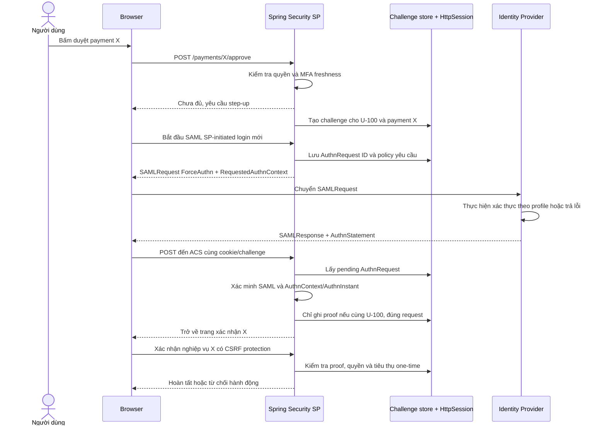

# Yêu cầu xác thực lại và điều kiện thực thi xác thực tăng cường tại IdP

**Chủ đề:** Spring Security – federation → Phiên và trình duyệt.

Một người dùng đăng nhập SAML2 thành công vào ứng dụng Service Provider (SP) chưa chắc được phép ngay lập tức chuyển tiền, duyệt lương, đổi khóa API, xóa dữ liệu hoặc thực hiện quyền quản trị. Những thao tác nhạy cảm có thể yêu cầu **xác thực lại tại Identity Provider (IdP)**, **xác thực đa yếu tố (MFA)**, **bằng chứng vừa mới được tạo**, hoặc cả ba điều kiện.

SAML 2.0 cung cấp các trường cho SP diễn đạt yêu cầu này. Tuy nhiên **gửi yêu cầu không phải bằng chứng IdP đã thực hiện yêu cầu**: SP phải xác minh `SAMLResponse`, kiểm tra `AuthnContext`, thời gian `AuthnInstant`, đúng user, đúng giao dịch, đúng tenant và quyền nghiệp vụ trước khi thực hiện hành động.

Bài học áp dụng cho Spring Security Servlet/MVC, Java 17+, Spring Security 7/OpenSAML 5. Những điểm API thay đổi giữa Spring Security 6/7 cần được kiểm tra theo phiên bản triển khai. Domain `example.com` là dữ liệu minh họa, không phải IdP thật.

## 1. Phân biệt reauthentication, MFA, freshness và authorization

| Khái niệm | Ý nghĩa | Bằng chứng hoặc cơ chế |
| --- | --- | --- |
| Reauthentication | Người dùng phải thực hiện sự kiện xác thực mới thay vì chỉ dùng lại security context IdP cũ | `AuthnRequest ForceAuthn="true"`; kiểm tra kết quả IdP và `AuthnInstant` |
| Step-up authentication | Đáp ứng yêu cầu xác thực mạnh hơn trước | `RequestedAuthnContext` trong request, `AuthnContextClassRef` trong assertion |
| Freshness | Sự kiện xác thực nằm trong thời gian cho phép, hoặc sau khi tạo challenge | `AuthnStatement@AuthnInstant` so với thời gian UTC trên server |
| Subject continuity | Người dùng sau step-up là cùng identity với người dùng SP ban đầu | Issuer và NameID đã xác minh → internal user ID |
| Transaction binding | Bằng chứng thuộc đúng hành động đang xin quyền | AuthnRequest ID, `InResponseTo`, session-bound challenge, resource ID |
| Authorization | User được phép thực hiện nghiệp vụ tại thời điểm xác nhận | Role, tenant membership, quyền tài nguyên, transaction state |

**Không đánh đồng:**
- `ForceAuthn=true` **không có nghĩa** MFA; IdP có thể xác thực lại chỉ bằng một yếu tố nếu hợp đồng không yêu cầu khác.
- `RequestedAuthnContext` **không bắt buộc sự kiện vừa xảy ra**, vì IdP có thể dùng security context đã đủ mạnh từ phiên hiện hữu tùy cách xử lý.
- `SAMLResponse@IssueInstant` mới **không có nghĩa** `AuthnInstant` mới.
- `SessionIndex` của IdP không phải `JSESSIONID` của Spring hay bằng chứng MFA.
- Người dùng đạt MFA **không tự có thêm role** trong ứng dụng.

## 2. Vai trò của `ForceAuthn` trong SAML 2.0

Trong `samlp:AuthnRequest`, thuộc tính `ForceAuthn` cho IdP biết SP yêu cầu IdP trực tiếp xác thực lại presenter, thay vì dựa vào context xác thực cũ:

```xml
<samlp:AuthnRequest
    xmlns:samlp="urn:oasis:names:tc:SAML:2.0:protocol"
    xmlns:saml="urn:oasis:names:tc:SAML:2.0:assertion"
    ID="_stepup-req42"
    Version="2.0"
    IssueInstant="2026-11-07T03:00:00Z"
    Destination="https://idp.partner.example/sso"
    AssertionConsumerServiceURL="https://portal.example.com/login/saml2/sso/partner-a"
    ForceAuthn="true"
    IsPassive="false">
  <saml:Issuer>https://portal.example.com/saml2/sp/partner-a</saml:Issuer>
</samlp:AuthnRequest>
```

Đây là XML rút gọn chỉ minh họa các field, không phải AuthnRequest đã ký có thể chạy trực tiếp. Trong hệ thống thật, SP phải phát ID duy nhất, ký request nếu IdP yêu cầu và lưu pending request để đối chiếu callback.

**ForceAuthn dùng để hỏi xác thực mới, không chỉ định factor cụ thể.** Nó có thể thích hợp khi người dùng cần xác nhận lại danh tính trước thao tác rủi ro cao. Việc IdP thật có hiện màn hình đăng nhập hay dùng factor gì phụ thuộc khả năng IdP và chính sách đã thỏa thuận. SP cần kiểm tra thời điểm và ngữ cảnh trả về, không chỉ xem browser có redirect hay không.

### `IsPassive` có khác `ForceAuthn` không?

`IsPassive=true` đề nghị IdP xử lý **không có tương tác nhìn thấy từ người dùng**. Đây không phải cách yêu cầu MFA; đối với step-up có tương tác, thường để false hoặc không đặt trường này. Tự cấu hình `ForceAuthn=true` và `IsPassive=true` có thể khiến IdP không thể thỏa cả hai và trả lỗi.

**Không bật ForceAuthn cho mọi login** trong production nếu chỉ một số nghiệp vụ cần reauthentication. Điều đó có thể phá trải nghiệm SSO, tạo vòng lặp và tăng nguy cơ mỏi mệt do yêu cầu xác thực lặp. Hãy kích hoạt theo hành động/tenant và session policy ở phía SP.

## 3. `RequestedAuthnContext` để yêu cầu mức xác thực

`RequestedAuthnContext` là phần tử con **chuẩn** của `AuthnRequest`, không phải một extension tùy ý. SP có thể gửi một `AuthnContextClassRef` định danh phương thức hoặc profile assurance đã được IdP hiểu.

Ví dụ yêu cầu REFEDS MFA:

```xml
<samlp:RequestedAuthnContext
    xmlns:samlp="urn:oasis:names:tc:SAML:2.0:protocol"
    xmlns:saml="urn:oasis:names:tc:SAML:2.0:assertion"
    Comparison="exact">
  <saml:AuthnContextClassRef>https://refeds.org/profile/mfa</saml:AuthnContextClassRef>
</samlp:RequestedAuthnContext>
```

`https://refeds.org/profile/mfa` là URI trong REFEDS MFA Profile; trong SAML, URI nằm ở `AuthnContextClassRef`. Khi IdP khẳng định đã thực hiện authentication đúng profile này, nó có thể đưa URI tương ứng vào `AuthnStatement/AuthnContext` trong assertion. **SP phải xác minh Assertion trước khi tin claim.**

REFEDS MFA cho biết một profile MFA được thỏa thuận; nó **không mặc định** bảo đảm phishing-resistant MFA, mức chứng thực danh tính ngoài đời hoặc mọi tiêu chuẩn compliance. Nếu nghiệp vụ yêu cầu FIDO2/hardware-bound assurance, hai bên phải xác định profile/claim/policy chặt hơn.

### `Comparison` nghĩa là gì?

| Giá trị | Ý nghĩa | Khuyến nghị |
| --- | --- | --- |
| `exact` | Context trả về phải tương thích chính xác với class/declaration được yêu cầu | Thường phù hợp với URI REFEDS MFA cụ thể |
| `minimum` | Bằng hoặc tốt hơn theo quan hệ so sánh do IdP hỗ trợ | Không suy mọi context có thứ tự toàn cục |
| `maximum` | Không vượt quá mức chỉ định theo ngữ nghĩa so sánh | Hiếm dùng cho step-up |
| `better` | Mạnh hơn mức chỉ định theo quan hệ so sánh | Cần IdP định nghĩa cách so sánh |

**Không xem các URI authn context là một thang số mặc định.** Muốn policy “MFA bắt buộc”, tốt nhất yêu cầu một profile phù hợp, kiểm tra URI đã được IdP phát, và từ chối context khác ngoài allowlist. Nếu IdP không đáp ứng, có thể trả `NoAuthnContext` hoặc lỗi riêng của vendor; SP phải **fail closed**, không tự chấp nhận password-only.

### Phải dùng ForceAuthn và RequestedAuthnContext cùng lúc không?

Không phải mọi luồng đều cần cả hai:
- Trang bình thường: SAML login hợp lệ là đủ nếu policy cho phép.
- Yêu cầu nhập lại mật khẩu hoặc xác thực trực tiếp: `ForceAuthn=true`; không tự suy là MFA.
- Yêu cầu MFA mà không nhất thiết mới: `RequestedAuthnContext` + `AuthnInstant` và freshness policy có thể cho phép sự kiện trước đó còn đủ mới.
- Giao dịch cần **MFA vừa diễn ra sau yêu cầu**: `ForceAuthn=true` **và** `RequestedAuthnContext`, sau đó SP kiểm tra `AuthnInstant` nằm sau challenge và gần hiện tại.

Quyết định cuối cùng phải dựa trên **policy nghiệp vụ**, hợp đồng IdP và bằng chứng đã xác minh, không dựa trên “đã mở màn hình IdP”.

## 4. Luồng step-up đối với một hành động nhạy cảm

Ví dụ người dùng đang đăng nhập SP dưới user nội bộ `U-100` và muốn duyệt thanh toán X. Quyền nghiệp vụ có thể tồn tại nhưng bằng chứng MFA chưa đủ mới.



**Không tự thực hiện thanh toán ngay trong ACS callback.** Callback xác minh authentication; hành động nghiệp vụ cần request riêng hoặc giao thức transaction confirmation đã được thiết kế chống CSRF/replay và thay đổi thông tin thanh toán.

### 4.1. Challenge phải nằm ở server

Một đối tượng server-side có thể gồm:

```text
StepUpChallenge {
  challengeId              = nonce ngẫu nhiên, one-time
  originalInternalUserId   = U-100
  trustedIssuer            = IdP issuer theo registration
  registrationId           = partner-a
  samlRequestId            = AuthnRequest ID do SP tạo
  requiredContext          = https://refeds.org/profile/mfa
  issuedAt                 = UTC instant
  expiresAt                = issuedAt + 5 minutes
  action                   = APPROVE_PAYMENT
  resourceId               = X
  resourceVersion          = 7
  consumed                 = false
}
```

Các giá trị trên là mẫu cấu trúc, không phải metadata hoặc message thực. Trên production cần:
- Liên kết với **phiên browser đã khởi tạo challenge**, tránh dùng một `RelayState` có thể bị sao chép làm bằng chứng duy nhất.
- Không đưa số tiền, user permissions, token hoặc PII trực tiếp vào RelayState, URL redirect hay log.
- Tạo nonce mạnh, TTL ngắn và tiêu thụ một lần nguyên tử.
- Lưu `originalInternalUserId` và trusted issuer/registration để không gắn MFA của người khác vào account cũ.
- Giới hạn proof trong một hành động/resource/version; kiểm tra lại quyền và trạng thái tài nguyên trước khi thực thi.
- Khi logout, chuyển user hoặc tenant, xóa challenge/proof liên quan.
- Nếu đã authenticated ở SP, **không trông chờ `.authenticated()` tự bắt đầu SAML**; application cần route/policy riêng để kích hoạt reauthentication.

### 4.2. Cùng user hay đã đổi account tại IdP?

Trong lúc step-up, IdP có thể hiển thị account chooser và người dùng đăng nhập bằng user khác. SAMLResponse có thể hợp lệ về chữ ký, đúng profile MFA và mới; nhưng **không thỏa challenge của original user**. Phải kiểm tra external subject (Issuer, NameID và scope phù hợp) được ánh xạ tới cùng internal user. Chuyển account phải qua flow riêng, không ngầm coi đó là step-up thành công.

## 5. Đọc bằng chứng trả về: `AuthnStatement`

Một Assertion sau khi đã được xác minh có thể chứa:

```xml
<saml:AuthnStatement
    xmlns:saml="urn:oasis:names:tc:SAML:2.0:assertion"
    AuthnInstant="2026-11-07T03:00:17Z"
    SessionIndex="_idp-session-74">
  <saml:AuthnContext>
    <saml:AuthnContextClassRef>https://refeds.org/profile/mfa</saml:AuthnContextClassRef>
  </saml:AuthnContext>
</saml:AuthnStatement>
```

Đây là **mảnh XML**, chưa phải assertion có chữ ký/conditions hoàn chỉnh. Chỉ dùng dữ liệu trong Assertion mà Spring Security/OpenSAML đã chấp nhận sau khi xác minh signature, issuer, audience, recipient, thời hạn, subject confirmation, request correlation và replay theo policy.

| Dữ liệu | Ý nghĩa chính xác |
| --- | --- |
| `AuthnContextClassRef` | Loại/profile xác thực mà IdP khẳng định đã đạt |
| `AuthnInstant` | Thời điểm IdP khẳng định đã xác thực |
| `SessionIndex` | Định danh phiên xác thực IdP, có thể hỗ trợ SAML Single Logout |
| `Response@IssueInstant` | Thời điểm tạo response, **không phản ánh freshness của MFA** |
| `Assertion@IssueInstant` | Thời điểm phát assertion, không tự chứng minh user vừa tương tác |
| `Conditions/NotOnOrAfter` | Thời hạn sử dụng assertion, không tự làm authentication đủ mới |
| `InResponseTo` | Khớp AuthnRequest SP-initiated đang chờ, không thay thế context/freshness |

### 5.1. Freshness phải được kiểm tra bằng thời gian tuyệt đối

Ví dụ policy: thanh toán X đòi hỏi MFA **sau khi** SP tạo challenge lúc `10:11:00Z`, trong **5 phút gần đây**. Assertion có:
- `AuthnInstant=10:12:00Z` và MFA context đúng: có thể đủ điều kiện thời gian.
- `AuthnInstant=10:05:00Z` dù `Response@IssueInstant=10:15:00Z`: **không đủ mới**.
- `AuthnInstant=10:16:30Z` trong khi đồng hồ SP là `10:15:00Z`: tương lai quá mức clock skew → từ chối.
- `AuthnInstant` thiếu: không đủ cơ sở kết luận freshness → từ chối theo step-up policy.

So bằng `java.time.Instant`/UTC, không so chuỗi ngày giờ hoặc timezone cục bộ. Cho phép clock skew nhỏ theo thỏa thuận IdP/NTP, nhưng không nới vô hạn để “fix” sai đồng hồ.

**Giới hạn niềm tin:** AuthnInstant là thông tin IdP phát. SP không trực tiếp quan sát yếu tố người dùng đã nhập. Vì vậy hợp đồng IdP phải quy định cách cập nhật `AuthnInstant` sau ForceAuthn/MFA, “remember device” và khả năng tái sử dụng sự kiện xác thực.

## 6. Spring Security: tùy chỉnh AuthnRequest bằng OpenSAML 5

Spring Security Servlet cung cấp `OpenSaml5AuthenticationRequestResolver` và callback `setAuthnRequestCustomizer(...)`. Có thể dùng OpenSAML object model đặt `ForceAuthn` và `RequestedAuthnContext` **trước khi** framework serialize/encode/ký request.

### 6.1. Mẫu cấu hình chỉ dành cho sandbox step-up

`StepUpRequestConfig.java` (một lớp trong dự án Spring Boot/Security 7, không chạy độc lập bằng `javac`):

```java
package com.example.saml;

import org.opensaml.saml.saml2.core.AuthnContextClassRef;
import org.opensaml.saml.saml2.core.AuthnContextComparisonTypeEnumeration;
import org.opensaml.saml.saml2.core.RequestedAuthnContext;
import org.opensaml.saml.saml2.core.impl.AuthnContextClassRefBuilder;
import org.opensaml.saml.saml2.core.impl.RequestedAuthnContextBuilder;
import org.springframework.context.annotation.Bean;
import org.springframework.context.annotation.Configuration;
import org.springframework.security.saml2.provider.service.registration
        .RelyingPartyRegistrationRepository;
import org.springframework.security.saml2.provider.service.web
        .DefaultRelyingPartyRegistrationResolver;
import org.springframework.security.saml2.provider.service.web
        .RelyingPartyRegistrationResolver;
import org.springframework.security.saml2.provider.service.web.authentication
        .OpenSaml5AuthenticationRequestResolver;
import org.springframework.security.saml2.provider.service.web.authentication
        .Saml2AuthenticationRequestResolver;

@Configuration
public class StepUpRequestConfig {
    private static final String MFA =
            "https://refeds.org/profile/mfa";

    @Bean
    Saml2AuthenticationRequestResolver authenticationRequestResolver(
            RelyingPartyRegistrationRepository registrations) {
        RelyingPartyRegistrationResolver partyResolver =
                new DefaultRelyingPartyRegistrationResolver(registrations);
        OpenSaml5AuthenticationRequestResolver resolver =
                new OpenSaml5AuthenticationRequestResolver(partyResolver);

        resolver.setAuthnRequestCustomizer(context -> {
            var request = context.getAuthnRequest();
            request.setForceAuthn(true);
            request.setIsPassive(false);

            RequestedAuthnContext required =
                    new RequestedAuthnContextBuilder().buildObject();
            required.setComparison(
                    AuthnContextComparisonTypeEnumeration.EXACT);
            AuthnContextClassRef ref =
                    new AuthnContextClassRefBuilder().buildObject();
            ref.setURI(MFA);
            required.getAuthnContextClassRefs().add(ref);
            request.setRequestedAuthnContext(required);
        });
        return resolver;
    }
}
```

Mã trên **bật ForceAuthn và MFA cho mọi AuthnRequest do resolver này tạo**. Dùng để chứng minh tương thích IdP sandbox; **không triển khai toàn cục cho mọi login bình thường**. Ở production cần cách tách đường bắt đầu step-up và chính sách do server kiểm soát, chỉ custom request cho challenge được phép, vẫn giữ request ID/issuer/ACS/destination và lưu pending request theo framework. Không đưa `?forceAuthn=true` hay `?acr=admin` từ client làm nguồn policy đáng tin.

### 6.2. Gắn resolver vào SAML login DSL

`SecurityConfig.java`:

```java
package com.example.saml;

import org.springframework.context.annotation.Bean;
import org.springframework.context.annotation.Configuration;
import org.springframework.security.config.annotation.web.builders.HttpSecurity;
import org.springframework.security.saml2.provider.service.web.authentication
        .Saml2AuthenticationRequestResolver;
import org.springframework.security.web.SecurityFilterChain;

@Configuration
public class SecurityConfig {
    @Bean
    SecurityFilterChain securityFilterChain(
            HttpSecurity http,
            Saml2AuthenticationRequestResolver resolver)
            throws Exception {
        http.authorizeHttpRequests(auth -> auth
                    .requestMatchers("/", "/error").permitAll()
                    .anyRequest().authenticated())
                .saml2Login(saml2 ->
                    saml2.authenticationRequestResolver(resolver));
        return http.build();
    }
}
```

`saml2Login` xử lý flow; endpoint tạo request mặc định thường là `GET /saml2/authenticate/{registrationId}` và ACS là `POST /login/saml2/sso/{registrationId}`. Nếu IdP yêu cầu ký `AuthnRequest`, cấu hình signing credentials tương ứng và kiểm chứng đúng HTTP Redirect/POST binding. **Không sửa XML sau khi đã ký** hoặc vô hiệu signature validation chỉ để ép IdP chấp nhận MFA context.

### 6.3. Phụ thuộc Maven minh họa

Trong dự án Spring Boot 4.1.x có parent/BOM tương thích, dependency cần thiết:

```xml
<dependencies>
  <dependency>
    <groupId>org.springframework.boot</groupId>
    <artifactId>spring-boot-starter-webmvc</artifactId>
  </dependency>
  <dependency>
    <groupId>org.springframework.boot</groupId>
    <artifactId>spring-boot-starter-security</artifactId>
  </dependency>
  <dependency>
    <groupId>org.springframework.boot</groupId>
    <artifactId>spring-boot-starter-security-saml2</artifactId>
  </dependency>
</dependencies>
```

Phần này chỉ là mảnh POM, cần parent `spring-boot-starter-parent`, Java 17+, plugin, `@SpringBootApplication` và IdP metadata thật. OpenSAML có thể yêu cầu kho Shibboleth Releases/mirror nội bộ theo tài liệu Spring Security. Với Boot 3.x/Security 6.x, tên starter và thế hệ OpenSAML khác; đừng trộn major.

`application.yml` minh họa:

```yaml
spring:
  security:
    saml2:
      relyingparty:
        registration:
          partner-a:
            assertingparty:
              metadata-uri: https://idp.partner.example/metadata.xml
```

URL mẫu không thể đăng nhập thật. Cần IdP metadata/chứng chỉ, SP entity ID/ACS public và hợp đồng hỗ trợ ForceAuthn/context. Build pass chỉ xác nhận compile, **không xác nhận IdP thực hiện MFA**.

## 7. Kiểm chứng kết quả tại SP: bước bắt buộc

Trong Spring Security 7, `Saml2AuthenticationTokenConverter` và `OpenSaml5AuthenticationProvider` xác thực SAML Response/Assertion. Việc tùy chỉnh AuthnRequest **không tự động làm các chính sách MFA/freshness riêng của ứng dụng được thực thi**.

Khi nhận response, một chính sách step-up chặt chẽ cần:
1. **Xác minh SAML chuẩn**: chữ ký, IdP Issuer tin cậy, destination, audience, recipient, subject confirmation, thời gian assertion và chống replay.
2. **Correlation**: response có `InResponseTo` khớp pending request được SP lưu trong **đúng session/browser**; không fallback unsolicited nếu thiếu.
3. **Original user**: NameID/Issuer đã ánh xạ phải khớp user ban đầu; không cho IdP account switch tự cấp MFA cho user cũ.
4. **Context**: lấy `AuthnContextClassRef` từ Assertion **đã xác minh**, kiểm tra URI nằm trong allowlist của IdP và action.
5. **Freshness**: kiểm tra `AuthnInstant`, ngưỡng tuổi và thời điểm challenge, giới hạn tương lai trong clock skew.
6. **Challenge validity**: còn hạn, đúng action/resource, chưa tiêu thụ, đúng tenant và registration.
7. **Proof**: tạo marker server-side ngắn hạn gắn user, action, resource, level, expiresAt; không set role vĩnh viễn.
8. **Business authorization**: khi thực thi, kiểm tra lại quyền, tài nguyên, CSRF, idempotency và tiêu thụ proof nguyên tử.

**Tùy biến an toàn:** có thể thêm `AssertionValidator` vào `OpenSaml5AuthenticationProvider` theo tài liệu Spring Security; **giữ các validator mặc định**. Hoặc trích bằng chứng sau xác minh bằng converter/success-flow đáng tin rồi thực thi chính sách. Không tự parse `SAMLResponse` nguyên bản trong controller rồi tin `AuthnContext` chưa được kiểm chứng.

### 7.1. Vì sao không dùng một boolean trong session?

`session.setAttribute("MFA_DONE", true)` không mang user, timestamp, issuer, request ID, tenant, action hay TTL. Nó có thể bị dùng lại khi user switch, resource thay đổi hoặc session tồn tại quá lâu.

Proof nên có cấu trúc:

```text
VerifiedStepUp {
  originalUserId
  trustedIssuer
  subjectKey
  registrationId
  challengeId
  authnContextUri
  authnInstant
  verifiedAt
  expiresAt
  action
  resourceId
  resourceVersion
  consumed
}
```

Dữ liệu này ở server, được xóa khi logout/chuyển tenant/user và tiêu thụ theo đúng hành động. Với nhiều pod, cần storage dùng chung và atomic compare-and-consume.

## 8. Java 17 chạy độc lập: kiểm tra freshness và đúng người

Chương trình sau dùng chỉ JDK 17+, mô phỏng thuật toán kiểm tra **trên bằng chứng đã được SAML layer xác minh**. Nó không ký/đọc SAML, không có cookie hoặc anti-replay thật; không dùng làm authentication provider của production.

`StepUpPolicyDemo.java`:

```java
import java.time.Duration;
import java.time.Instant;
import java.util.Objects;

public class StepUpPolicyDemo {
    private static final String MFA = "https://refeds.org/profile/mfa";
    private static final Duration MAX_AGE = Duration.ofMinutes(5);
    private static final Duration SKEW = Duration.ofSeconds(30);

    record Challenge(String issuer, String userId,
                     String requestId, Instant issuedAt) {}

    record Evidence(String issuer, String userId,
                    String requestId, String context,
                    Instant authnInstant) {}

    static boolean accept(Challenge c, Evidence e, Instant now) {
        if (c == null || e == null || c.issuedAt() == null
                || e.authnInstant() == null) {
            return false;
        }
        if (!Objects.equals(c.issuer(), e.issuer())
                || !Objects.equals(c.userId(), e.userId())
                || !Objects.equals(c.requestId(), e.requestId())
                || !MFA.equals(e.context())) {
            return false;
        }
        Instant minTime = now.minus(MAX_AGE);
        Instant challengeMin = c.issuedAt().minus(SKEW);
        Instant maxTime = now.plus(SKEW);

        return !e.authnInstant().isBefore(minTime)
                && !e.authnInstant().isBefore(challengeMin)
                && !e.authnInstant().isAfter(maxTime);
    }

    public static void main(String[] args) {
        Instant now = Instant.parse("2026-11-07T10:15:00Z");
        Challenge challenge = new Challenge(
                "idp-A", "user-100", "_r42",
                Instant.parse("2026-11-07T10:11:00Z"));

        Evidence valid = new Evidence(
                "idp-A", "user-100", "_r42", MFA,
                Instant.parse("2026-11-07T10:12:00Z"));
        Evidence old = new Evidence(
                "idp-A", "user-100", "_r42", MFA,
                Instant.parse("2026-11-07T10:05:00Z"));
        Evidence weak = new Evidence(
                "idp-A", "user-100", "_r42", "password",
                Instant.parse("2026-11-07T10:12:00Z"));
        Evidence otherUser = new Evidence(
                "idp-A", "user-999", "_r42", MFA,
                Instant.parse("2026-11-07T10:12:00Z"));
        Evidence wrongRequest = new Evidence(
                "idp-A", "user-100", "_other", MFA,
                Instant.parse("2026-11-07T10:12:00Z"));

        System.out.println("Valid MFA: " + accept(challenge, valid, now));
        System.out.println("Old MFA: " + accept(challenge, old, now));
        System.out.println("Weak MFA: " + accept(challenge, weak, now));
        System.out.println("Other user: " + accept(challenge, otherUser, now));
        System.out.println("Wrong request: "
                + accept(challenge, wrongRequest, now));
    }
}
```

Chạy từ thư mục có file:

```bash
javac StepUpPolicyDemo.java
java StepUpPolicyDemo
```

**Stdout chính xác:**

```text
Valid MFA: true
Old MFA: false
Weak MFA: false
Other user: false
Wrong request: false
```

Giải thích: trường hợp hợp lệ đạt MFA context và thời gian đúng; old vượt ngưỡng, weak thiếu context, otherUser sai tài khoản, wrongRequest không trùng challenge. Ví dụ **giả định Evidence đã được verify và challenge đã được ràng buộc phiên**: attacker không được tự tạo Evidence hoặc sửa request ID. Production cần xác minh XML signature, issuer/audience/recipient, request repository, replay, one-time consume và quyền nghiệp vụ bên ngoài hàm này.

## 9. Session và browser: không làm mất pending request

Spring Security mặc định lưu `AuthnRequest` trong `HttpSessionSaml2AuthenticationRequestRepository`. Khi IdP POST response sang ACS, browser phải gửi cookie session thích hợp để SP tìm lại request; do đó reauthentication có thể thất bại **trước khi** kiểm tra context nếu:
- `SameSite=Lax/Strict` chặn cookie trong cross-site POST (tùy browser/site).
- Cookie `Secure`/`Domain`/`Path` sai hoặc reverse proxy thay host.
- Pre-auth/session challenge đã timeout.
- Callback vào pod khác nhưng session store chỉ nằm trong pod đầu.
- Multi-tab tạo nhiều request mà repository không đáp ứng concurrency theo cách ứng dụng kỳ vọng.

Nếu cần cookie cross-site POST, đánh giá `SameSite=None; Secure` cùng CSRF/cookie policy của tổ chức, test browser thật. Không tắt CSRF toàn ứng dụng. Trong cluster, có thể dùng Spring Session Redis để chia sẻ HttpSession, đồng thời giữ browser binding.

**Không đổi sang cache tra theo `RelayState` rồi mặc định an toàn**: một cache chỉ dựa vào request ID từ phía browser có thể mất natural login fixation defense của session-bound repository. Nếu phải tùy biến, cần threat model và one-time nonce/browser binding.

**Session fixation:** sau một lần login thành công, Spring Security có thể đổi session ID theo policy. Challenge/proof phải tiếp tục thuộc đúng original user/session và không rò sang account khác. Không tự xóa HttpSession trước khi callback vì sẽ mất pending AuthnRequest.

## 10. Hợp đồng IdP trước khi kích hoạt step-up

| Nội dung | Phải xác nhận với IdP |
| --- | --- |
| `ForceAuthn` | Có hỗ trợ, có yêu cầu xác thực lại thật và xử lý remembered session thế nào? |
| `RequestedAuthnContext` | Có hỗ trợ `Comparison="exact"` và URI assurance nào? |
| REFEDS MFA | Có tuân thủ profile tương ứng? Có phát đúng `AuthnContextClassRef` sau MFA? |
| `AuthnInstant` | Khi người dùng thực hiện lại, timestamp có cập nhật đúng không? |
| MFA remember-device | IdP có thể reuse proof bao lâu, có báo rõ trong assertion không? |
| Subject | NameID/Issuer có nhất quán khi IdP bật account chooser? |
| Failure | IdP trả `NoAuthnContext`/`AuthnFailed`/vendor error nào khi không đạt? |
| Request signature | Có yêu cầu SP ký AuthnRequest? Public cert SP nào được trust? |
| Response signature | SP verify đúng IdP certificate/trust anchors không? |
| Time sync | Clock skew tối đa giữa SP/IdP là bao nhiêu? |
| Testing | Có sandbox để mô phỏng MFA pass/fail, stale context và đổi account không? |

Một số IdP hiểu `ForceAuthn` nhưng không nhận REFEDS MFA URI; một số hỗ trợ URI vendor-specific hoặc silently ignore một phần request. Vì vậy phải kiểm tra **request XML thực đã gửi** và **response Assertion thực đã được xác minh**, không chỉ xem “màn MFA có xuất hiện”.

## 11. Test matrix phải có

| Ca kiểm thử | Kỳ vọng |
| --- | --- |
| ForceAuthn=true + MFA context đúng + AuthnInstant đủ mới | Có thể PASS sau mọi SAML/identity/authorization checks |
| ForceAuthn=true nhưng IdP chỉ password | **FAIL** nếu action cần MFA |
| RequestedAuthnContext=MFA nhưng AuthnInstant quá cũ | **FAIL** nếu cần freshness |
| Response mới, AuthnInstant cũ | **FAIL**; IssueInstant không thay freshness |
| MFA context URI không trong allowlist | **FAIL**, không tự xem mạnh hơn |
| IdP không đáp ứng và trả NoAuthnContext | Hướng dẫn người dùng, không downgrade |
| SAML signature sai | **FAIL** trước bước MFA policy |
| InResponseTo sai hoặc pending request mất | **FAIL**, không fallback unsolicited |
| User tại IdP khác original SP user | **FAIL**, không account-switch ngầm |
| Issuer/registration/tenant khác challenge | **FAIL** nếu không có policy trust rõ |
| Challenge hết hạn hoặc đã dùng | **FAIL**, không cho thực thi lại |
| MFA đạt nhưng role đã bị thu hồi | **FAIL** authorization |
| Payment/resource đổi trong lúc MFA | Kiểm tra version, yêu cầu xác nhận lại |
| Browser mất cookie ở ACS POST | Lỗi an toàn, không bỏ correlation |
| Hai tab khác action cùng step-up | Không trộn request/proof, xử lý concurrency |
| Callback sang pod khác | Chỉ PASS khi session store và challenge đúng |
| Logout trong lúc MFA | Không hồi sinh session/proof cũ |
| IdP remember-device không làm mới AuthnInstant | SP từ chối nếu freshness policy yêu cầu |
| Clock IdP chạy trước quá xa | Từ chối với skew giới hạn |
| Browser retry payment | One-time proof và idempotency bảo vệ |
| Audit log | Không lưu raw SAMLResponse/cookie/secret; có correlation đã che |

**Không dùng mỗi `@WithMockUser` để chứng minh step-up**. Unit test thuần Java kiểm logic thời gian; integration test phải có signed SAML Assertion/IdP test fixture; browser e2e cần test cookie SameSite, POST callback, negative paths và multi-tab. Chỉ khi kiểm chứng đầy đủ mới cho phép action nhạy cảm.

## 12. Tình huống thực tế

**Phê duyệt hóa đơn lớn:** Kế toán đã đăng nhập một giờ trước. SP yêu cầu reauthentication có MFA theo IdP contract, kiểm tra AuthnInstant sau challenge và mới trong 5 phút. Sau callback, kế toán phải xác nhận đúng hóa đơn/tài khoản nhận; service kiểm lại role APPROVER và ghi audit.

**Thay email khôi phục:** Một user có phiên SP hợp lệ nhưng email recovery là tài nguyên nhạy cảm. SP yêu cầu step-up, xác minh cùng external identity, không cho người khác đăng nhập IdP rồi thay thông tin của user ban đầu.

**Xem báo cáo thông thường:** Không cần ForceAuthn ở mỗi lần đọc nếu session và quyền còn hợp lệ. Bật mặc định toàn ứng dụng sẽ gây vòng lặp/giảm UX.

**MFA nhưng không có quyền:** Một user vừa vượt qua MFA vẫn không được cấp quyền truy cập tenant khác. Authentication assurance không làm thay đổi authorization.

**IdP đổi profile MFA:** Nếu nhà cung cấp chuyển từ URI REFEDS MFA sang context vendor-specific, phải cập nhật hợp đồng, test và allowlist; không tự coi mọi giá trị có chữ “MFA” tương đương.

## 13. Lỗi hiểu sai phổ biến

1. **ForceAuthn=true tương đương MFA.** Không; đây là yêu cầu xác thực trực tiếp.
2. **RequestedAuthnContext có mặt là đủ.** Không; phải kiểm tra kết quả.
3. **Response vừa phát nghĩa là MFA vừa diễn ra.** Không; cần `AuthnInstant`.
4. **SessionIndex là mốc thời gian.** Không; đó là chỉ số phiên SAML.
5. **MFA thành công nghĩa là role admin.** Không; quyền nghiệp vụ là lớp riêng.
6. **Có thể tự gửi ForceAuthn bằng query param của trình duyệt.** Không lấy input chưa tin làm security policy.
7. **Khi thiếu request thì xử lý như IdP-initiated.** Không cho làm bypass step-up.
8. **Cùng email nghĩa là cùng account sau reauth.** Không; dùng Issuer/NameID đã xác minh và internal user mapping.
9. **Có thể ghi `MFA_DONE=true` vĩnh viễn trong session.** Không; thiếu scope, TTL, subject và chống replay.
10. **Thay AuthnContextClassRef bằng một chuỗi tùy ý của IdP.** Chỉ chấp nhận URI có contract được phê duyệt.
11. **Tắt chữ ký/CSRF vì IdP báo lỗi.** Không; xử lý trust, binding, cookie/ACS đúng.
12. **Một lần login PASS là đủ test.** Không; phải kiểm thử failure, wrong subject, stale time, multiple tabs, multi-node và transaction replay.

## 14. Checklist triển khai

**Thiết kế**
- [ ] Có policy xác định action cần reauthentication, mức MFA và ngưỡng freshness.
- [ ] IdP xác nhận semantics ForceAuthn, RequestedAuthnContext, AuthnInstant và error behavior.
- [ ] Challenge lưu server-side và bound user/issuer/session/request ID/action/TTL.
- [ ] Step-up kích hoạt bằng SP-initiated AuthnRequest mới; không phụ thuộc vào authentication entrypoint chỉ dành cho user chưa login.
- [ ] Không tự động cấp role hay xử lý nghiệp vụ ngay từ ACS callback.

**Bảo mật**
- [ ] SAML validation giữ chữ ký, issuer, audience, recipient, time, correlation và replay.
- [ ] Context được lấy từ assertion đã xác minh và phải thuộc allowlist.
- [ ] AuthnInstant được kiểm tra cả freshness và giới hạn thời gian challenge, clock skew nhỏ.
- [ ] External subject sau step-up khớp original internal user/tenant.
- [ ] Proof có TTL, action/resource scope, one-time consume; logout hoặc switch account làm mất proof.
- [ ] Business request có CSRF protection, idempotency và authorization mới nhất.

**Vận hành**
- [ ] IdP sandbox test MFA/reauthentication thực, không chỉ build Spring.
- [ ] Cookie/ACS/SameSite, request repository, Spring Session Redis/cluster đã test.
- [ ] Có negative tests cho NoAuthnContext, stale MFA, wrong user/request, replay và time skew.
- [ ] Log chỉ có mã tương quan/loại lỗi, không chứa raw assertion, session ID hay thông tin factor nhạy cảm.

## 15. Nguồn chính thức

1. [Spring Security – Producing AuthnRequests](https://docs.spring.io/spring-security/reference/servlet/saml2/login/authentication-requests.html): `OpenSaml5AuthenticationRequestResolver`, `setAuthnRequestCustomizer`, ForceAuthn và request repository.
2. [Spring Security – Authenticating SAML Responses](https://docs.spring.io/spring-security/reference/servlet/saml2/login/authentication.html): `OpenSaml5AuthenticationProvider` và mở rộng Assertion validation.
3. [Spring Security – SAML2 Login Overview](https://docs.spring.io/spring-security/reference/servlet/saml2/login/overview.html): SP-initiated flow và ACS.
4. [OASIS – SAML 2.0 Core](https://docs.oasis-open.org/security/saml/v2.0/saml-core-2.0-os.pdf): `ForceAuthn`, `IsPassive`, `RequestedAuthnContext`, `AuthnStatement` và `AuthnInstant`.
5. [OASIS – SAML 2.0 Profiles](https://docs.oasis-open.org/security/saml/v2.0/saml-profiles-2.0-os.pdf): Web Browser SSO và request–response correlation.
6. [REFEDS MFA Profile](https://refeds.org/profile/mfa): profile MFA và URI AuthnContextClassRef.
7. [REFEDS – How to request authentication contexts](https://wiki.refeds.org/display/ASS/How+to+request+authentication+contexts): XML requested context, outcome và `NoAuthnContext`.
8. [OpenSAML 5 – RequestedAuthnContext JavaDoc](https://shibboleth.net/api/java-opensaml/5.2.3/org/opensaml/saml/saml2/core/RequestedAuthnContext.html): lớp và phương thức builder/refs.
9. [OWASP – SAML Security Cheat Sheet](https://cheatsheetseries.owasp.org/cheatsheets/SAML_Security_Cheat_Sheet): signature, replay, RelayState và login CSRF.
10. [OWASP – Authentication Cheat Sheet](https://cheatsheetseries.owasp.org/cheatsheets/Authentication_Cheat_Sheet/): reauthentication khi có rủi ro cao.

**Kết luận:** `ForceAuthn` hỏi IdP xác thực lại; `RequestedAuthnContext` hỏi mức xác thực; `AuthnInstant` cho biết khi nào IdP tuyên bố đã xác thực. Chỉ khi SP xác minh SAML, cùng subject, đúng challenge, đủ MFA, đủ mới và đủ quyền nghiệp vụ mới được thực thi hành động nhạy cảm.