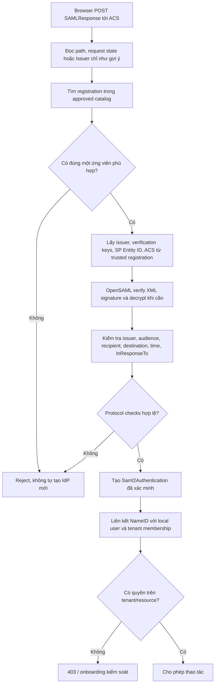
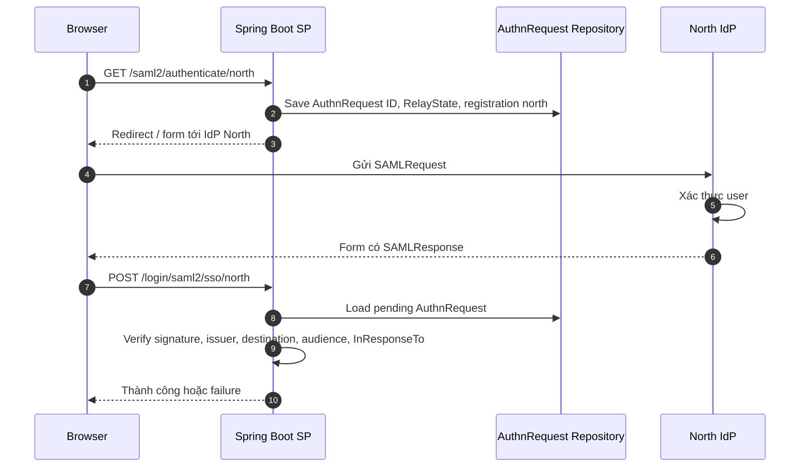

# Xác định IdP từ thông tin chưa được xác minh mà không tự thiết lập tin cậy

## 1. Bài toán và mục tiêu

Trong Spring Security SAML 2.0 federation, một Service Provider (SP) có thể phục vụ nhiều tổ chức hoặc tenant, mỗi tenant dùng một Identity Provider (IdP). Khi trình duyệt gửi `SAMLResponse` tới Assertion Consumer Service (ACS), SP cần chọn đúng `RelyingPartyRegistration` để lấy certificate, IdP entity ID, SP entity ID, ACS và các quy tắc xác thực.

Nghịch lý có vẻ xuất hiện: để kiểm tra chữ ký, ứng dụng phải biết IdP; nhưng thông tin dùng để đoán IdP có thể nằm **trong chính thông điệp chưa được kiểm tra chữ ký** — chẳng hạn `<saml:Issuer>`, `registrationId` trong URL callback, `RelayState` hoặc tham số tenant.

**Nguyên tắc trung tâm: thông tin chưa xác minh chỉ được dùng để chọn một ứng viên cấu hình đã được phê duyệt. Việc chọn được ứng viên không thiết lập quan hệ tin cậy, không chứng minh issuer và không xác thực người dùng.** Sau khi chọn, Spring Security/OpenSAML vẫn phải xác minh chữ ký bằng certificate đã cấu hình trước, issuer, audience, destination, recipient, thời hạn, request correlation và các điều kiện áp dụng.

Mục tiêu thực hành:

1. Phân biệt **candidate selection**, **trust configuration**, **SAML validation** và **tenant authorization**.
2. Biết các nguồn gợi ý: `Issuer`, `registrationId`, AuthnRequest đã lưu, tenant/host/email domain và `RelayState`.
3. Dùng repository chứa những `RelyingPartyRegistration` đã được quản trị phê duyệt, không tự tải metadata/key theo input từ browser.
4. Xử lý issuer không có, issuer trùng nhiều registrations, sai signature/ACS/tenant bằng fail-closed.
5. Thiết kế được SP-initiated SSO cho nhiều IdP, có ví dụ Spring Boot 3.x/Java 17 và test.
6. Biết trường hợp tương tự ở OIDC/OAuth 2.0 là **authorization-server mix-up**.

Đề bài thuộc nhóm **Nhiều IdP và tenant**. Những hostname `example.test`, IDs và certificate paths dưới đây chỉ là ví dụ, không tạo ra IdP hoạt động.

## 2. Hai quyết định khác nhau: chọn ứng viên và chấp nhận danh tính

Hãy xét hai IdP đã được tổ chức đồng ý tích hợp:

```text
RelyingPartyRegistration north:
  IdP Entity ID: https://north-idp.example.test/entity
  IdP trusted certificate: north-signing.crt
  SP Entity ID: https://app.example.test/saml2/service-provider-metadata/north
  SP ACS: https://app.example.test/login/saml2/sso/north

RelyingPartyRegistration south:
  IdP Entity ID: https://south-idp.example.test/entity
  IdP trusted certificate: south-signing.crt
  SP Entity ID: https://app.example.test/saml2/service-provider-metadata/south
  SP ACS: https://app.example.test/login/saml2/sso/south
```

Nếu browser POST tới `/login/saml2/sso/north`, SP có thể **chọn** registration `north`. Nếu XML chứa `Issuer=https://north-idp.example.test/entity`, điều đó cũng có thể là **một gợi ý tra cứu**.

Nhưng attacker có thể sửa cả URL và XML. Chính **chữ ký được xác minh với north-signing.crt đã được phê duyệt** và các điều kiện SAML đi kèm mới có thể làm Response đáng tin. Nếu chữ ký được tạo bởi key khác, dù Issuer tự khai là North, authentication phải thất bại.

Phân biệt bốn trạng thái:

| Trạng thái | Ý nghĩa | Đã cho phép đăng nhập chưa? |
| --- | --- | --- |
| `candidateFound` | Tìm ra registration khả dĩ từ allowlist | **Chưa** |
| `signatureValidated` | Thông điệp/phần assertion dùng để tạo principal có chữ ký hợp lệ từ key được tin | **Chưa đủ** |
| `samlAuthenticationSucceeded` | Tất cả kiểm tra SAML cần thiết thành công | Có thể có phiên authenticated |
| `tenantAuthorized` | Identity đã xác minh được phép vào tenant và tài nguyên cụ thể | Chỉ khi chính sách ứng dụng đồng ý |

Một **certificate tự ký của attacker có thể xác minh đúng chữ ký của attacker**, nhưng không vì thế được dùng làm trust anchor của tenant. “Verify thành công với certificate lấy ngay từ response” không chứng minh IdP đã được tổ chức chấp thuận.

## 3. Luồng an toàn: gợi ý → catalog → kiểm chứng → phân quyền



Sơ đồ là biểu diễn trách nhiệm, không cam kết thứ tự nội bộ của mọi bản OpenSAML. Tuy nhiên mọi quyền nghiệp vụ đều phải xuất hiện **sau** authentication, không lấy từ HTTP query hay XML chưa được kiểm tra.

Điểm fail-closed quan trọng:

- Không tìm thấy registration đã phê duyệt ⇒ từ chối.
- Có nhiều registrations phù hợp nhưng không đủ thông tin phân biệt ⇒ từ chối hoặc yêu cầu bắt đầu lại login với registration rõ ràng.
- Đúng Issuer text nhưng chữ ký sai ⇒ từ chối.
- Signature đúng IdP nhưng audience/recipient thuộc SP hoặc tenant khác ⇒ từ chối.
- SAML hợp lệ nhưng user không có local account/link/tenant membership ⇒ từ chối truy cập tài nguyên.

## 4. Dữ liệu nào có thể làm gợi ý, dữ liệu nào chưa được tin?

| Thông tin | Có thể sử dụng cho lựa chọn ban đầu | Không được dùng trực tiếp để |
| --- | --- | --- |
| `/login/saml2/sso/{registrationId}` | Tra tên registration đã tồn tại | Kết luận IdP nào đã ký response |
| `Response/Issuer` | Tra IdP Entity ID trong allowlist, nếu khớp duy nhất | Tự thêm issuer hoặc tin key đi kèm |
| `AuthnRequest` đã lưu ở server | Khôi phục registration và transaction SP đã tạo | Bỏ qua chữ ký hoặc audience |
| `RelayState` | Liên hệ request state đã bảo vệ | Chọn role, tenant hoặc redirect URL tùy ý |
| `InResponseTo` | So với request ID đã lưu | Chỉ kiểm tra chuỗi ID rồi coi đã authenticate |
| `?tenant=north` | Cho UI chọn IdP trong allowlist | Cấp quyền tenant North |
| Email domain do user nhập | Gợi ý IdP trên trang discovery | Tự động liên kết tài khoản nội bộ |
| `Host`/`Forwarded` | Routing khi proxy đã chuẩn hóa theo allowlist | Xác minh danh tính hoặc nâng quyền |
| `KeyInfo` trong SAML XML | Có thể giúp tìm key **đã ghim** theo profile | Tin một certificate mới do response tự đưa |
| NameID/SAML attributes | Sau validation, tra local identity link | Auto-link bằng email hoặc cấp quyền admin vô điều kiện |

**Authentication không đồng nghĩa authorization.** Ngay cả IdP hợp lệ và SAML Response hợp lệ cũng chưa đủ để người dùng đọc toàn bộ tài liệu của tenant mà họ tự chọn qua URL.

## 5. Các thành phần Spring Security tham gia

Trong Spring Security Servlet:

- `Saml2WebSsoAuthenticationRequestFilter` tạo `AuthnRequest` khi browser truy cập `/saml2/authenticate/{registrationId}`.
- `Saml2AuthenticationRequestResolver` lựa chọn registration để tạo request và gửi tới IdP.
- `Saml2AuthenticationRequestRepository` lưu pending AuthnRequest; mặc định thường dùng `HttpSessionSaml2AuthenticationRequestRepository`.
- `Saml2WebSsoAuthenticationFilter` nhận `SAMLResponse` ở ACS.
- `Saml2AuthenticationTokenConverter` tạo token authentication và resolve `RelyingPartyRegistration`.
- `RelyingPartyRegistrationRepository` lưu các đối tác/credential đã provision.
- OpenSAML authentication provider xác minh response và assertion trước khi tạo `Saml2Authentication`.
- `Saml2AuthenticatedPrincipal` chỉ tồn tại như principal của SAML authentication đã thành công; `getRelyingPartyRegistrationId()` trả về registration tương ứng.

Hai phương thức repository hữu ích trong Spring Security 6.x:

```java
RelyingPartyRegistration findByRegistrationId(String registrationId);

RelyingPartyRegistration findUniqueByAssertingPartyEntityId(String entityId);
```

Đây là **chữ ký trích từ API** (không phải class Java độc lập). Phương thức thứ hai chỉ dùng khi issuer khớp duy nhất một registration; nếu không duy nhất, kết quả không nên biến thành sự lựa chọn tùy tiện.

Tài liệu Spring Security mô tả converter có thể dùng AuthnRequest liên quan, `registrationId` trong URL và, nếu không có, `Response/Issuer` để tìm registration. **Việc lookup bằng Issuer ở đây không có nghĩa framework đã tin Issuer.** Converter chỉ cần candidate để provider biết verification key nào phải dùng.

## 6. Issuer lookup: được dùng làm khóa tra cứu, không phải trust anchor

Một SAML Response có phần:

```xml
<samlp:Response
    xmlns:samlp="urn:oasis:names:tc:SAML:2.0:protocol"
    xmlns:saml="urn:oasis:names:tc:SAML:2.0:assertion"
    ID="_response-1" Version="2.0"
    IssueInstant="2026-11-07T03:00:00Z"
    Destination="https://app.example.test/login/saml2/sso/north">
  <saml:Issuer>https://north-idp.example.test/entity</saml:Issuer>
  <!-- Status, assertion, signatures omitted -->
</samlp:Response>
```

Đây chỉ là XML minh họa, không phải Response đăng nhập hợp lệ. Trước khi kiểm tra chữ ký, attacker hoàn toàn có thể đổi `Issuer`.

**Cách đúng về mặt kiến trúc:**

```text
untrustedIssuer = safeParseIssuer(request)
candidate = approvedRepository.findUniqueByAssertingPartyEntityId(untrustedIssuer)
if candidate == null:
    reject
else:
    validateSamlResponseWithApprovedRegistration(candidate)
```

Đây là pseudocode; **không tự viết XML parser** nếu Spring Security/OpenSAML có converter phù hợp. Parser sơ bộ, nếu thật sự cần, phải có size limit, không cho XXE/DTD/external entities, tránh signature wrapping và không fetch resource từ XML.

**Cách sai:**

```text
untrustedIssuer = parseIssuerFromBrowser()
metadata = httpGet(untrustedIssuer + "/metadata")
certificate = metadata.signingKey
trustStore.add(certificate)
acceptResponseWith(certificate)
```

Đó là **self-provisioning trust**, kèm nguy cơ SSRF: attacker có thể cung cấp địa chỉ nội bộ hoặc endpoint metadata của chính họ. **HTTPS chỉ bảo vệ quá trình tải**, không chứng minh IdP đó được phép xác thực tenant này.

Nếu server có chế độ metadata refresh, phải refresh từ endpoint **đã được phê duyệt từ trước**, có chính sách issuer/cert/rotation rõ ràng. Không chạy discovery tùy ý theo mỗi login POST.

## 7. Path registrationId giúp định tuyến, nhưng không chứng minh danh tính

Với hai registrations, giữ URL rõ ràng:

```text
GET  /saml2/authenticate/north
POST /login/saml2/sso/north

GET  /saml2/authenticate/south
POST /login/saml2/sso/south
```

Browser có thể thay `north` thành `south` ở URL. Nếu Response của IdP North bị gửi tới ACS South, Spring Security có thể chọn registration South để **thử** xác minh, nhưng phải từ chối khi chữ ký, issuer, audience hoặc destination/recipient không phù hợp.

`registrationId` là **định danh cấu hình**, không phải bí mật. Không cần che nó bằng random string để thay kiểm tra giao thức.

### ACS URL và SP Entity ID khác nhau

`/login/saml2/sso/north` là đường HTTP nhận response. SP Entity ID có thể là `https://app.example.test/saml2/service-provider-metadata/north`. Assertion `AudienceRestriction` phải hướng tới SP Entity ID phù hợp, còn `Destination` và `SubjectConfirmationData@Recipient` thường phải phù hợp ACS.

Nếu IdP được đăng ký sai ACS hoặc SP Entity ID, hãy **sửa metadata/IdP config**, không bỏ validator để “login chạy được”.

## 8. SP-initiated SSO: ưu tiên ngữ cảnh AuthnRequest đã lưu

Với SP-initiated SSO, SP biết mình đã chọn registration nào trước khi browser đi tới IdP:



Repository dựa trên `HttpSession` giúp gắn request đang chờ với browser session đã khởi tạo, chống một số kiểu **login fixation/login CSRF**. `InResponseTo` và `RelayState` cần được liên hệ với request/transaction đã lưu theo chính sách.

Không xem một giá trị RelayState dài là “bằng chứng mật mã” nếu nó có thể bị đoán, phát lại hoặc không gắn với browser. Nếu dùng cache repository thay session, phải đánh giá entropy, TTL, one-time consume, browser binding và replay.

### SameSite và callback HTTP-POST

IdP thường đưa browser quay về SP bằng **cross-site POST**. Nếu cookie phiên SP dùng `SameSite=Lax` hoặc `Strict` và hai site khác nhau, cookie có thể không được gửi; repository không tìm thấy AuthnRequest.

Sửa cookie/session/ingress và kiểm tra multi-replica trước. **Không tự coi response mất session là IdP-initiated login hợp lệ** chỉ vì issuer lookup có thể tìm một candidate.

## 9. IdP-initiated SSO: khi không có AuthnRequest ban đầu

Với IdP-initiated hoặc unsolicited SSO, browser có thể gửi Response đến ACS dù SP chưa tạo AuthnRequest cho flow đó. Vì thế:

- Không có request state do SP tạo để làm nguồn đăng ký ban đầu.
- `InResponseTo` có thể vắng mặt.
- Issuer hoặc URL ACS có thể là những gợi ý còn lại để tìm candidate.
- Chữ ký, issuer, audience, destination/recipient, time, replay và tenant policy vẫn bắt buộc.
- Login CSRF/session confusion cần chính sách bổ sung.

Nếu tổ chức chỉ cần SP-initiated, thiết kế **fail-closed** với unsolicited response theo phiên bản framework và validator phù hợp. Nếu bắt buộc hỗ trợ IdP-initiated, phải phê duyệt riêng từng IdP/tenant, định nghĩa cơ chế chống replay/login CSRF và kiểm soát user session switching.

**Không để việc thiếu session tự động kích hoạt một “chế độ dễ dãi”**, bởi chính attacker có thể tìm cách làm mất correlation state.

## 10. Một Issuer dùng cho nhiều registrations: ambiguity không phải lỗi có thể đoán

Có thể tồn tại hai registrations cùng IdP Entity ID nhưng khác SP Entity ID, ACS hoặc tenant:

```text
north:
  IdP Issuer = https://central-idp.example.test/entity
  SP Entity ID = https://app.example.test/sp/north
south:
  IdP Issuer = https://central-idp.example.test/entity
  SP Entity ID = https://app.example.test/sp/south
```

Nếu chỉ có `Issuer=https://central-idp.example.test/entity`, không thể chọn registration duy nhất. Khi đó:

1. Với SP-initiated, lấy registration đã lưu cùng AuthnRequest.
2. Ưu tiên ACS path `{registrationId}` nếu hợp đồng metadata cho phép.
3. Kiểm tra assertion audience/recipient/destination của registration đã chọn.
4. Nếu cần ACS chung, xây resolver chuyên biệt dựa trên state tin cậy và các trường được xác minh đúng cách.
5. Nếu không xác định được một registration, **từ chối** thay vì lấy phần tử đầu tiên trong danh sách.

Dù hai registrations dùng chung certificate IdP, **signature valid không đồng nghĩa tenant authorized**. IdP chung có thể ký một assertion cho SP South; assertion đó không được sử dụng cho SP North nếu audience/recipient/transaction không phù hợp.

## 11. Tenant picker và email domain chỉ là UX hints

Một trang SSO discovery có thể hỏi:

```text
Chọn tổ chức: north / south
Hoặc nhập email để gợi ý đăng nhập tại IdP tương ứng.
```

Người dùng có thể tự chọn `north` dù không thuộc North. Điều này **không sao** nếu selection chỉ điều hướng đến một IdP đã provision; IdP vẫn phải xác thực, và SP phải kiểm tra local tenant membership sau khi xác thực.

Không được:

- Coi `?tenant=north` là quyền sử dụng tenant North.
- Tự tạo metadata URL bằng cách nối `https://` + tên tenant.
- Auto-link tài khoản quản trị North chỉ vì email trong assertion có domain `north.example.test`.
- Để field `groups=admins` từ IdP bất kỳ tạo local `ROLE_ADMIN` không có mapping được phê duyệt.

Với OIDC, khóa liên kết danh tính thường là **`(verified iss, sub)`**; với SAML, cần IdP/registration đáng tin và persistent NameID/qualifiers theo profile. Email có thể đổi, trùng giữa tenants hoặc được cấp lại.

## 12. Host-based tenant routing cũng không tự tạo trust

Một dịch vụ có thể truy cập qua:

```text
https://north.app.example.test/
https://south.app.example.test/
```

Nhưng `Host` và `X-Forwarded-Host` là dữ liệu request. Nếu reverse proxy không xóa/ghi đè header do Internet cung cấp, attacker có thể làm ứng dụng chọn sai tenant/registration hoặc tạo `{baseUrl}` sai cho ACS/metadata.

Thực hành an toàn:

1. Ingress chỉ chấp nhận **hostname public được đăng ký**.
2. Proxy xóa/ghi đè `Forwarded`, `X-Forwarded-Host`, `X-Forwarded-Proto` từ client trước khi chuyển tới app.
3. Ứng dụng map normalized host vào **allowlist tenant** đã quản trị.
4. Khi authentication thành công, còn phải kiểm tra **local identity link/tenant membership**.
5. Tránh kiểm tra domain bằng phép nối chuỗi hoặc so hậu tố thiếu ranh giới hostname; cẩn thận IDNA/punycode.
6. Giữ SP Entity ID, ACS URL và metadata nhất quán với cấu hình IdP.

`server.forward-headers-strategy: framework` trong Spring Boot có thể hữu ích khi app sau proxy, nhưng **chỉ dùng với proxy tin cậy**. Nó không biến header người dùng thành bằng chứng danh tính.

## 13. Provision IdP trước, không provision trong callback

**Onboarding một IdP là thay đổi trust configuration**, cần quản trị độc lập với đăng nhập.

Quy trình nên có:

1. Xác nhận tenant/tổ chức và người có thẩm quyền phê duyệt IdP.
2. Lấy metadata từ nguồn được xác nhận, kiểm tra Entity ID và SSO endpoint.
3. Thiết lập certificate verification/trust anchors, key rotation policy.
4. Đăng ký SP Entity ID, ACS URL và signing credentials phía SP nếu IdP yêu cầu.
5. Chọn registrationId ổn định, duy nhất; không tạo ngẫu nhiên mỗi lần restart.
6. Kiểm thử positive/negative SAML với sandbox.
7. Kích hoạt registration trong approved catalog, ghi audit trail.
8. Khi vô hiệu hóa IdP, không tự fallback sang một IdP khác hoặc certificate cũ.
9. Nếu phải refresh metadata, chỉ refresh từ **approved locations** và kiểm tra thay đổi certificate/entity ID theo chính sách.

Ngược lại, **trust on first use** đối với Issuer/certificate trong một callback là nguy hiểm: lần đầu gặp metadata có thể đến từ chính attacker. Một HTTPS metadata endpoint mới xuất hiện không phải lý do tin người phát hành đó.

### SSRF và remote metadata

Không cho người dùng truyền `metadataUrl`, `issuer`, `jku`, `x5u` hoặc một HTTP URL bất kỳ để server tải rồi tin làm IdP. Các địa chỉ nội bộ như `169.254.169.254`, loopback hoặc private ranges có thể bị lạm dụng để lấy dữ liệu cloud/network. Quá trình metadata provisioning có thể được tự động hóa **sau approval, allowlist và network controls**, không chạy tự động từ SAMLResponse chưa xác minh.

## 14. Ví dụ Spring Boot 3.x cấu hình hai IdP được phê duyệt

Với Spring Boot 3.x/Spring Security 6.x Servlet, một ví dụ `application.yml`:

```yaml
spring:
  security:
    saml2:
      relyingparty:
        registration:
          north:
            entity-id: "https://app.example.test/saml2/service-provider-metadata/north"
            acs:
              location: "https://app.example.test/login/saml2/sso/north"
            assertingparty:
              metadata-uri: "${NORTH_IDP_METADATA_URI}"
          south:
            entity-id: "https://app.example.test/saml2/service-provider-metadata/south"
            acs:
              location: "https://app.example.test/login/saml2/sso/south"
            assertingparty:
              metadata-uri: "${SOUTH_IDP_METADATA_URI}"
```

Hai biến môi trường `NORTH_IDP_METADATA_URI` và `SOUTH_IDP_METADATA_URI` phải được **provision trước** bởi người quản trị/chương trình deployment. Không lấy từ `?issuer=...` hoặc nội dung XML callback. Mỗi IdP có thể yêu cầu signing key của SP và cấu hình ACS ở dashboard riêng.

Đây là cấu hình đăng ký hai đối tác **đã tin cậy từ trước**. Nó không tự chứng minh certificate đúng nếu biến môi trường bị attacker kiểm soát. Quản trị deployment, secret/config manager, network access và audit là phần của trust chain.

Trong `build.gradle` của một dự án Spring Boot đã có plugin Java/Boot và dependency management phù hợp:

```groovy
repositories {
    mavenCentral()
    // Bổ sung repository Shibboleth khi tổ hợp OpenSAML yêu cầu.
    maven { url "https://build.shibboleth.net/maven/releases/" }
}

dependencies {
    implementation "org.springframework.boot:spring-boot-starter-web"
    implementation "org.springframework.boot:spring-boot-starter-security"
    implementation "org.springframework.security:spring-security-saml2-service-provider"
}
```

Đây là **mảnh build file**, không phải file đầy đủ; yêu cầu Java 17+, Spring Boot 3.x/Spring Security 6.x phù hợp và một IdP thực để thử end-to-end.

## 15. Java 17/Spring Boot: tenant selection qua allowlist, authorization sau login

Class sau dùng **hai registrations đã provision** trong YAML. Người dùng được chọn tenant nhưng **không** được cung cấp metadata/certificate tùy ý. SAML authentication tiếp tục do Spring Security filter/provider chuẩn thực hiện.

Lưu tại `src/main/java/demo/multiidp/MultiIdpApplication.java`:

```java
package demo.multiidp;

import java.net.URI;
import java.util.Map;

import org.springframework.boot.SpringApplication;
import org.springframework.boot.autoconfigure.SpringBootApplication;
import org.springframework.context.annotation.Bean;
import org.springframework.http.HttpStatus;
import org.springframework.http.ResponseEntity;
import org.springframework.security.config.Customizer;
import org.springframework.security.config.annotation.web.builders.HttpSecurity;
import org.springframework.security.core.annotation.AuthenticationPrincipal;
import org.springframework.security.saml2.provider.service.authentication.Saml2AuthenticatedPrincipal;
import org.springframework.security.web.SecurityFilterChain;
import org.springframework.web.bind.annotation.GetMapping;
import org.springframework.web.bind.annotation.PathVariable;
import org.springframework.web.bind.annotation.RestController;
import org.springframework.web.server.ResponseStatusException;

@SpringBootApplication
@RestController
public class MultiIdpApplication {

    // Chỉ routing, KHÔNG phải proof rằng user thuộc tenant.
    private static final Map<String, String> APPROVED = Map.of(
            "north", "north",
            "south", "south");

    public static void main(String[] args) {
        SpringApplication.run(MultiIdpApplication.class, args);
    }

    @Bean
    SecurityFilterChain security(HttpSecurity http) throws Exception {
        return http
                .authorizeHttpRequests(auth -> auth
                        .requestMatchers("/", "/start/**", "/error").permitAll()
                        .anyRequest().authenticated())
                .saml2Login(Customizer.withDefaults())
                .saml2Metadata(Customizer.withDefaults())
                .build();
    }

    @GetMapping("/")
    public String index() {
        return "Open /start/north or /start/south";
    }

    @GetMapping("/start/{tenant}")
    public ResponseEntity<Void> start(@PathVariable String tenant) {
        String registrationId = APPROVED.get(tenant);
        if (registrationId == null) {
            throw new ResponseStatusException(HttpStatus.NOT_FOUND);
        }
        // Chuyển tới Spring Security SAML AuthnRequest generator.
        return ResponseEntity.status(HttpStatus.SEE_OTHER)
                .location(URI.create("/saml2/authenticate/" + registrationId))
                .build();
    }

    @GetMapping("/tenant/{tenant}/home")
    public Map<String, String> home(
            @PathVariable String tenant,
            @AuthenticationPrincipal Saml2AuthenticatedPrincipal principal) {
        String expected = APPROVED.get(tenant);
        if (expected == null || principal == null
                || !expected.equals(
                        principal.getRelyingPartyRegistrationId())) {
            throw new ResponseStatusException(HttpStatus.FORBIDDEN);
        }
        // Production: kiểm tra thêm local identity link, active user,
        // tenant membership và quyền trên từng object.
        return Map.of("tenant", tenant, "status", "authenticated");
    }
}
```

### Điều gì đã được bảo vệ trong code?

- `APPROVED` chỉ cho chọn `north` hoặc `south`.
- `/start/{tenant}` là **route gợi ý IdP**, không xác thực user.
- `/saml2/authenticate/{registrationId}` là endpoint **do framework** dùng để tạo AuthnRequest.
- `/login/saml2/sso/{registrationId}` là ACS do `Saml2WebSsoAuthenticationFilter` xử lý; không có controller tự parse XML.
- `/tenant/{tenant}/home` chỉ sử dụng `Saml2AuthenticatedPrincipal` **sau khi provider xác minh**, rồi so registration với tenant yêu cầu.
- Không có input `metadataUrl` từ browser.
- Nếu user của South cố vào `/tenant/north/home`, demo trả 403.

**Giới hạn quan trọng:** mapping 1 tenant ↔ 1 IdP là đơn giản hóa. Nếu một IdP phục vụ nhiều tenants hoặc một tenant liên kết nhiều IdP, cần identity links và local authorization riêng; registration đúng không tự cấp mọi quyền. `Map.of` trong demo cũng không đại diện cho hệ thống onboarding/ACL production.

### Chạy và đầu ra

Trong dự án Gradle có wrapper, với hai metadata URL thật do quản trị viên cung cấp:

```bash
NORTH_IDP_METADATA_URI=https://north-idp.example.test/metadata \
SOUTH_IDP_METADATA_URI=https://south-idp.example.test/metadata \
./gradlew bootRun
```

Domain `example.test` chỉ minh họa, không có IdP thật tại các URL đó. Khi cấu hình IdP/ACS/certificate đã được thiết lập đầy đủ, đăng nhập North hợp lệ và gọi `GET /tenant/north/home` có thể trả:

```json
{"tenant":"north","status":"authenticated"}
```

Kết quả này **phụ thuộc authentication SAML thành công**, không phải stdout cố định của lệnh bootRun. Nếu App có servlet context path khác root, cần điều chỉnh redirect relative path trong `/start/{tenant}` cho phù hợp mà không nhận base URL tùy ý từ browser.

## 16. Java 17 độc lập: tìm ứng viên duy nhất không tạo Authentication

Ví dụ dưới đây chỉ mô phỏng **lookup trong catalog đã phê duyệt**, chạy được với JDK 17. Có hai registrations cùng IdP North để minh họa issuer không duy nhất.

Lưu tại `IssuerLookupDemo.java`:

```java
import java.util.List;
import java.util.Optional;

public final class IssuerLookupDemo {

    record Registration(String id, String idpEntityId) { }

    private static final List<Registration> APPROVED = List.of(
            new Registration("north", "https://north.example.test/entity"),
            new Registration("south", "https://south.example.test/entity"),
            new Registration("north-secondary", "https://north.example.test/entity")
    );

    static Optional<Registration> chooseCandidate(String unverifiedIssuer) {
        if (unverifiedIssuer == null) {
            return Optional.empty();
        }

        List<Registration> matches = APPROVED.stream()
                .filter(r -> r.idpEntityId().equals(unverifiedIssuer))
                .toList();

        return matches.size() == 1
                ? Optional.of(matches.get(0))
                : Optional.empty();
    }

    public static void main(String[] args) {
        System.out.println("south=" + chooseCandidate(
                "https://south.example.test/entity")
                .map(Registration::id).orElse("none"));
        System.out.println("unknown=" + chooseCandidate(
                "https://attacker.example.test/entity")
                .map(Registration::id).orElse("none"));
        System.out.println("ambiguous=" + chooseCandidate(
                "https://north.example.test/entity")
                .map(Registration::id).orElse("none"));
        System.out.println("authenticated=false");
    }
}
```

Chạy:

```bash
javac IssuerLookupDemo.java
java IssuerLookupDemo
```

Stdout chính xác:

```text
south=south
unknown=none
ambiguous=none
authenticated=false
```

`south=south` chỉ có nghĩa là có một ứng viên trong catalog. `authenticated=false` nhấn mạnh: **chưa có chữ ký hoặc assertion nào được xác minh**. Đây không phải thư viện SAML; production phải để Spring Security/OpenSAML tiếp tục xác minh bằng trusted verification credentials.

## 17. Khi nào cần custom AuthenticationConverter?

Đa số app chỉ cần nhiều `RelyingPartyRegistration` và giữ ACS có `registrationId`. Chỉ cân nhắc custom converter khi:

- IdP buộc dùng ACS chung không có registration ID.
- Một IdP issuer xuất hiện trong nhiều registrations và request state/callback cần phân biệt.
- Có Artifact binding hoặc một federation broker phức tạp.
- Multi-tenant routing cần kết hợp server-side state đã được bảo vệ với registration lookup.

Spring Security hỗ trợ thay converter trong DSL:

```java
.saml2Login(saml -> saml
        .authenticationConverter(customAuthenticationConverter))
```

Đây là **mảnh cấu hình**, cần bean `customAuthenticationConverter` kiểu `AuthenticationConverter` được triển khai đúng contract; không thêm vào class ví dụ ở mục 15 khi chưa cần. `Saml2AuthenticationTokenConverter` có constructor sử dụng `RelyingPartyRegistrationResolver` và API tích hợp `Saml2AuthenticationRequestRepository`.

Custom converter vẫn phải:

1. Chỉ chọn **registration đã có**.
2. Giữ request-state/registration correlation.
3. Không tự tải metadata theo Issuer do browser gửi.
4. Không trả về một `Authentication` đã authenticated chỉ vì đã chọn registration.
5. Để OpenSAML provider verify chữ ký, issuer, audience, destination, recipient và thời gian.
6. Fail-closed nếu ứng viên mơ hồ hoặc không có.

## 18. SAML verification: những điều ngoài chữ ký

Dù chữ ký đúng IdP key, SP vẫn phải kiểm tra:

1. **Issuer** của Response/Assertion phù hợp IdP Entity ID.
2. **Destination** của Response phù hợp ACS theo profile.
3. **Recipient** trong `SubjectConfirmationData` phù hợp endpoint nhận assertion.
4. **AudienceRestriction** hướng tới SP Entity ID đã đăng ký, không phải tenant string do browser khai.
5. **NotBefore / NotOnOrAfter** và thời hạn subject confirmation.
6. **InResponseTo**/request correlation với SP-initiated flow.
7. **Replay** prevention khi applicable.
8. Phần **assertion thực sự dùng để tạo principal** nằm trong phạm vi chữ ký hợp lệ, chống XML Signature Wrapping.
9. **EncryptedAssertion** nếu có phải được giải mã bằng SP private key thích hợp; giải mã được không tự bỏ signature checks.
10. Quyền **tenant và local user** phải được xét riêng sau khi authentication thành công.

Không sửa lỗi mất correlation bằng cách bỏ `InResponseTo`, và không sửa lỗi audience mismatch bằng cách chấp nhận mọi audience. Những lỗi này thường chỉ ra ACS/metadata/registration/proxy bị cấu hình sai hoặc attacker đang thử message từ tenant khác.

## 19. OIDC/OAuth 2.0 mix-up: bài học tương tự

Trong OAuth2/OIDC Login có nhiều Authorization Servers, attacker có thể làm client nhầm server đã phát authorization response, khiến authorization code/token được gửi đến endpoint của server khác. Đây là **authorization-server mix-up**.

Theo RFC 9700 (OAuth 2.0 Security Best Current Practice), client liên kết nhiều authorization servers cần cơ chế chống mix-up: thông tin issuer theo **RFC 9207**, hoặc một lựa chọn được RFC chấp nhận như redirect URI riêng khi thích hợp.

Các nguyên tắc tương ứng:

- Giữ issuer/client registration đã chọn cùng **authorization request/state**; khi callback đến phải đối chiếu issuer.
- `iss` từ authorization response hoặc ID Token không được dùng để tự tạo client registration mới.
- ID Token phải được verify chữ ký bằng key của **configured issuer**, rồi kiểm tra issuer, audience, nonce/time.
- Không tin `kid`, `jku`, `x5u` trong JWT header để tải JWKS từ một domain tùy ý.
- Identity link nên dựa trên `(verified iss, sub)`, không dùng email.

**Đừng trộn protocol:** SAML dùng `SAMLResponse`/XML Signature/`RelyingPartyRegistration`, còn OIDC dùng ID Token/JWS/JWKS/client registration. Đây là hai ví dụ của cùng một **trust-boundary principle**, không có nghĩa dùng token của giao thức này để xác minh giao thức kia.

## 20. Identity linking và tenant authorization vẫn là bước riêng

Sau khi SAML authentication thành công, principal có thể cung cấp `Saml2AuthenticatedPrincipal#getName()` (thường là NameID) và `getRelyingPartyRegistrationId()`. Nhưng có nhiều loại NameID, kể cả transient. Không mặc nhiên dùng NameID làm khóa bền vững khi IdP chưa cam kết persistent format.

Mô hình dữ liệu thường dùng:

```text
verified SAML principal
  -> trusted IdP / registration
  -> stable external subject (NameID + qualifiers as required)
  -> external_identity_link
  -> local_user_id + local_tenant_memberships
  -> resource ACL and business roles
  -> allow or deny
```

Các ràng buộc:

- Một registration chỉ được ủy quyền xác thực các danh tính/tenants đã thống nhất.
- Một user có thể có nhiều linked identities, nhưng việc link/unlink cần approval/audit.
- Email không đủ làm khóa tự động giữa các IdP.
- Role claim/group từ IdP chỉ được map khi tổ chức ủy quyền IdP quản lý nhóm đó và policy đúng tenant.
- Resource APIs phải kiểm tra ownership/ACL để tránh IDOR/BOLA, không chỉ `authenticated()`.

**Nhà phát hành SAML hợp lệ không có nghĩa mọi business claim đều được ứng dụng tin vô điều kiện.** Trust ở tầng authentication và authorization có phạm vi khác nhau.

## 21. Negative tests cho candidate selection và trust

| Tình huống | Kỳ vọng |
| --- | --- |
| Issuer chưa nằm trong approved catalog | Reject; không fetch metadata theo Issuer |
| Issuer đúng North nhưng ký bằng key attacker | Signature failure |
| Response North POST tới ACS South | Reject khi issuer/key/audience/recipient/correlation không phù hợp |
| Hai registrations cùng Issuer, không có request state | Reject ambiguity, không chọn ngẫu nhiên |
| Browser chọn `/start/evil` | 404/deny, không tạo registration |
| Query `?metadataUrl=http://127.0.0.1` | Không tải URL, tránh SSRF |
| `KeyInfo` gắn certificate attacker | Không tự tin certificate lạ |
| Assertion có audience của tenant khác | Reject |
| Destination/Recipient khác ACS | Reject |
| `InResponseTo` sai hoặc AuthnRequest đã hết hạn | Reject theo SP-initiated policy |
| Browser callback thiếu cookie session vì SameSite | Điều tra session; không downgrade thành unsolicited |
| SAMLResponse replay | Reject theo replay policy |
| Signed Response chứa node Assertion không nằm trong phần được ký hợp lệ | XML Signature Wrapping bị chặn |
| Host/Forwarded header giả | Không làm đổi trusted tenant/ACS |
| IdP South xác thực rồi truy cập `/tenant/north/home` | 403 theo mapping đơn giản của demo |
| Email trùng admin North nhưng từ IdP khác | Không auto-link |
| Registration đã revoked | Không được fallback sang IdP khác |
| OIDC response issuer khác authorization request issuer | Chặn mix-up |
| JWT `jku` trỏ tới URL lạ | Không fetch remote key từ token header |
| IdP-initiated chưa được phép | Fail-closed |

Test với IdP sandbox/cert test, không dùng production SAMLResponse hay cookies trong issue tracker. Chỉ kiểm tra HTTP 302 không chứng minh authentication success: redirect đó có thể trỏ đến trang lỗi.

## 22. Quan sát và xử lý lỗi

| Triệu chứng | Có thể do | Cách xử lý |
| --- | --- | --- |
| `No RelyingPartyRegistration` | registrationId lạ, issuer không khớp allowlist | Xem cấu hình đã provision; không tạo trust từ request |
| Issuer không duy nhất | Cùng IdP nhiều registrations | Dùng state/path rõ ràng, hoặc fail-closed |
| Invalid signature | Cert verify sai, key rotation, attacker key | Kiểm tra trusted metadata/cert |
| Invalid issuer | Response tự khai IdP khác candidate | Giữ issuer validation, xem registration |
| Audience invalid | SP Entity ID sai | Sửa IdP config/metadata |
| Invalid Destination/Recipient | ACS sai, proxy sai, callback sai path | Kiểm tra public HTTPS URL, trusted proxy |
| Missing InResponseTo | Cookie SameSite/session/replica/unsolicited policy | Xem AuthnRequest repository và browser POST |
| SAML hợp lệ nhưng 403 | Local user chưa linked hoặc thiếu tenant membership | Kiểm tra authorization sau login |
| HTTP callback làm fetch URL lạ | Custom discovery không an toàn | Bỏ dynamic fetch, provision metadata |
| OIDC code đi nhầm token endpoint | AS mix-up | Ràng buộc issuer và state, theo RFC 9700 |

Log an toàn có thể ghi `registrationId` ứng viên, trạng thái found/unknown/ambiguous, nhóm lỗi signature/issuer/audience, local tenant authorization result và correlation ID nội bộ.

**Không log** raw `SAMLResponse`, `SAMLRequest`, `RelayState`, NameID, cookie `JSESSIONID`, private key hoặc certificate bí mật. Đừng dùng unverified Issuer làm metric label có cardinality không giới hạn. Phân biệt metric **candidate lookup succeeded** với **authentication succeeded**.

## 23. Checklist triển khai

- [ ] Mọi IdP/SP pair đã có registration/trust anchor được phê duyệt.
- [ ] Không tạo hoặc cập nhật trust store khi xử lý SAML callback.
- [ ] Không fetch issuer metadata, certificate, JWK/JWKS URL từ input chưa xác minh.
- [ ] Dùng `registrationId` ổn định; unknown/revoked registration fail-closed.
- [ ] Chỉ dùng Issuer XML để chọn ứng viên trong approved catalog.
- [ ] Ambiguous Issuer lookup không được chọn ngẫu nhiên.
- [ ] AuthnRequest state được giữ và đối chiếu với browser cho SP-initiated flow.
- [ ] Cookie session, SameSite, multi-replica và ACS routing được kiểm thử.
- [ ] SAML XML signature verify bằng certificate IdP đã provision, chống Signature Wrapping.
- [ ] Issuer, Recipient, Destination, Audience, clock, subject confirmation và replay được kiểm tra.
- [ ] IdP-initiated SSO có policy riêng; không fallback khi mất session.
- [ ] Host/Forwarded headers chỉ tin từ reverse proxy đã kiểm soát.
- [ ] Local identity link/tenant membership/object ACL quyết định quyền nghiệp vụ.
- [ ] Không auto-link theo email, transient NameID hoặc groups chưa ủy quyền.
- [ ] SP Entity ID, ACS, metadata của từng tenant đúng, không dùng audience chung tùy tiện.
- [ ] IdP onboarding/key rotation phải có approval/audit.
- [ ] OIDC clients đa provider được bảo vệ khỏi authorization-server mix-up.
- [ ] Negative tests cho issuer giả, sai signature, ambiguous issuer, cross-tenant, SSRF và replay đã chạy.

## 24. Câu hỏi tự đánh giá

**1. Chưa verify chữ ký mà dùng Issuer để chọn một registration có sai không?**  
Không nhất thiết. Được phép dùng Issuer làm **gợi ý tra cứu trong danh sách đã phê duyệt**, không được tin Issuer tự khai hoặc key mới.

**2. `/saml2/sso/north` có chứng minh Response do IdP North phát không?**  
Không. URL path chỉ gợi ý registration; cần signature và mọi validation bắt buộc.

**3. Vì sao không được tải metadata từ Issuer trong SAMLResponse?**  
Vì IdP có thể do attacker tự khai; dynamic fetch có thể gây SSRF và self-established trust.

**4. Nếu Issuer trùng trong hai registrations thì làm gì?**  
Dùng AuthnRequest state/ACS path đã được kiểm soát hoặc resolver tin cậy; nếu vẫn mơ hồ thì từ chối.

**5. Signature hợp lệ với IdP chung có đủ cho tenant North không?**  
Không. Cần audience/recipient/destination/transaction và local tenant authorization phù hợp.

**6. RelayState có phải bằng chứng user đang sở hữu tenant đó không?**  
Không. Đây là state đi qua browser; phải gắn với transaction server-side.

**7. Khi mất session cookie trên HTTP-POST callback có được bỏ InResponseTo không?**  
Không tự động. Phải sửa cookie/session hoặc có chính sách IdP-initiated riêng, không downgrade.

**8. Host header của request có thể quyết định tenant không?**  
Chỉ làm gợi ý sau khi proxy chuẩn hóa/allowlist; không tự tạo quyền cho principal.

**9. Đăng nhập SAML thành công có đủ cho mọi API tenant không?**  
Không. Cần linked local account, tenant membership, resource ACL và trạng thái quyền hiện hành.

**10. OIDC với nhiều authorization servers cần chống lỗi gì?**  
Authorization-server mix-up; RFC 9700 và RFC 9207 mô tả issuer identification/binding với authorization request.

## 25. Tài liệu tham khảo

- [Spring Security – SAML 2.0 Login Overview](https://docs.spring.io/spring-security/reference/servlet/saml2/login/overview.html): nhiều relying parties, registration resolution, request/response pipeline.
- [Spring Security – Authenticating SAML Responses](https://docs.spring.io/spring-security/reference/servlet/saml2/login/authentication.html): lookup từ request/Issuer và `AuthenticationConverter`.
- [Spring Security 6.5 – RelyingPartyRegistrationRepository API](https://docs.spring.io/spring-security/reference/6.5/api/java/org/springframework/security/saml2/provider/service/registration/RelyingPartyRegistrationRepository.html): `findByRegistrationId` và `findUniqueByAssertingPartyEntityId`.
- [Spring Security – Producing AuthnRequests](https://docs.spring.io/spring-security/reference/servlet/saml2/login/authentication-requests.html): `Saml2AuthenticationRequestRepository` và session binding.
- [Spring Boot 3.5 – SAML2 Relying Party Configuration](https://docs.spring.io/spring-boot/3.5/reference/web/spring-security.html): nhiều registrations và metadata IdP.
- [Spring Security – SAML 2.0 Metadata](https://docs.spring.io/spring-security/reference/servlet/saml2/metadata.html): SP Entity ID/ACS.
- [OASIS – SAML 2.0 Core](https://docs.oasis-open.org/security/saml/v2.0/saml-core-2.0-os.pdf): Issuer, Conditions, SubjectConfirmation, AudienceRestriction và InResponseTo.
- [OASIS – SAML 2.0 Metadata](https://docs.oasis-open.org/security/saml/v2.0/saml-metadata-2.0-os.pdf): Identity Provider descriptors và trust keys.
- [OWASP – SAML Security Cheat Sheet](https://cheatsheetseries.owasp.org/cheatsheets/SAML_Security_Cheat_Sheet.html): XML Signature Wrapping, replay, trusted metadata/certificates.
- [RFC 9700 – OAuth 2.0 Security Best Current Practice](https://www.rfc-editor.org/rfc/rfc9700.html): chống authorization-server mix-up.
- [RFC 9207 – OAuth 2.0 Authorization Server Issuer Identification](https://www.rfc-editor.org/rfc/rfc9207.html): issuer response parameter `iss`.
- [OpenID Connect Core 1.0](https://openid.net/specs/openid-connect-core-1_0.html): token validation và định danh `(iss, sub)`.
